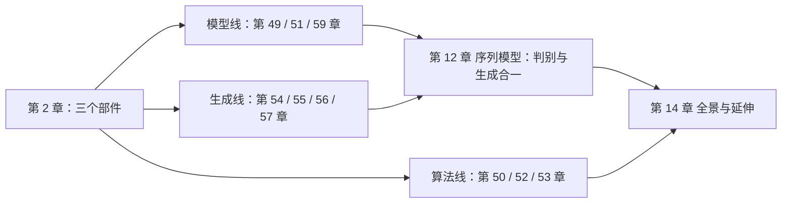

# $\rm Chapter \, 2$ 深度学习导论：历史与三个部件

第 1 章备齐了偏导数、链式法则与矩阵记号；从本章起，我们正式进入深度学习（Deep Learning）本身。本章对应讲义 L1 全讲（`lec1_intro.pdf`，107 页），回答三个问题：深度学习在机器学习版图里处在什么位置、它比传统机器学习多做了哪一步；这门技术从 1943 年走到 2012 年踩过哪些坑，每个坑都直接决定了后面章节的一个设计选择；整个分册围绕哪三个部件展开。讲义 L1 的后半（L1 p76–p106）是编程环境教程，与本分册知识线无关，只在 §2.7 一句话交代。第 3 章起，我们将用前两章的记号搭出第一个真正可训练的模型。

> **开始前自检**：本章假设你已经会：
>
> - □ 偏导数与梯度的记号（[第 1 章](01-深度学习数学与记号.md)），§2.4 反向传播会用到
> - □ 多元链式法则（第 1 章「多元链式法则」一节），§2.4.3 只用到一句话
> - □ 矩阵乘向量与内积记号 $w^\top x$（第 1 章的记号约定）
> - □（选读）见过 PyTorch 训练模型的大致流程（[第 43 章](../06-编程语言/43-PyTorch与模型训练全过程.md)），只在 §2.7 出现一次，不回读也不影响主线

## $\rm \S \, 2.1$ 深度学习在机器学习版图里的位置

讲义 L1 p14 用一句话定义了深度学习：

> Deep Learning is a class of machine learning methods that use neural networks to learn representations from raw data.

（译文：深度学习是一类用神经网络从原始数据中学习表示的机器学习（machine learning）方法。）

这个句子里嵌着一串层级（L1 p15 的同心圆图），从大到小拆开：

1. **AI**（人工智能，Artificial Intelligence）：让机器做「聪明的事」的总称，早期包括搜索、专家系统等。
2. **机器学习**：不手写规则，而是从数据里拟合规则。例如支持向量机（Support Vector Machine, SVM）。
3. **表示学习**（representation learning）：机器学习里再进一层，即连「用什么特征描述数据」也自动学。例如主成分分析（Principal Component Analysis, PCA）学一个线性变换、lasso 学一个稀疏变换。
4. **深度学习**：表示学习里用神经网络（neural network）这一族函数做表示的那一支。

每一圈都只比外圈多承诺一件事：机器学习不手写规则，表示学习连特征也不手写，深度学习把「学特征」这件事交给神经网络。

### $\rm \S \, 2.1.1$ 手工特征 vs 端到端：差在 $\phi$ 上

传统流程（L1 p17）分两步：先由人设计一个特征映射（feature map）$\phi(x)$，比如为图片设计「边缘检测器」，再学一个简单分类器 $f$：

$$
y=f\big(\phi(x);\theta_f\big),\qquad \phi \text{ 固定}.
$$

其中 $\theta_f$ 是分类器要学的参数：传统流程里只有 $\theta_f$ 是学出来的，特征映射 $\phi$ 的每个细节都由人写死。深度学习把这个 $\phi$ 也交给神经网络去学：

$$
y=f_{NN}\big(x;\theta_{NN}\big).
$$

「端到端」（end-to-end）的含义就是：从原始输入 $x$ 直接到输出 $y$，中间不再插人手设计的一段。**白话**：以前要人类先告诉机器「看边缘、看纹理」，现在让网络自己长出一套特征。

这句话背后藏着两个假设，讲义明白写了出来（L1 p17），后面十二章其实都在给它们打工：

1. **假设一（表达力，expressivity）**：神经网络可以（近似地）表示任何函数，对应模型结构的设计（第 51、59 章）；
2. **假设二（可训练性，trainability）**：存在聪明的算法自动找出好的网络，对应优化与学习算法（第 50、52 章）。

> **竞赛生迁移提示**：手工特征工程就是你在竞赛里手搓启发式，A\* 的估价函数 $h(n)$、贪心的排序关键字、剪枝的阈值，全是「人设计 $\phi$」：设计得好就快，设计错了就错，换一道题还要重想一遍。表示学习把这件事交给程序：给足带标注的样本，让训练自己把「什么算好特征」学成权重。竞赛经验恰好能告诉你手搓为什么难，要同时猜对「哪些量重要」和「怎么组合它们」，这正是 $\phi$ 固定的代价。

### $\rm \S \, 2.1.2$ 神经网络这个词的来历

L1 p18 给的描述：人工神经网络（Artificial Neural Network, ANN）是由大量互联的单元（artificial neuron，人工神经元）构成的计算系统，松散地模仿生物大脑的神经元。三个要点：

1. 单元之间的连接叫边（edge），每条边带一个权重（weight），学习过程中权重会被调整；
2. 每个单元把自己的输入加权求和，再过一个非线性函数（nonlinear function）输出；
3. 「前馈」（feedforward）指信号单向流动、不成环，本分册前半部分的网络基本都是前馈（循环神经网络（Recurrent Neural Network, RNN）是例外，见第 12 章）。

接下来讲义花了近 60 页讲历史（L1 p19–p75）。历史在这里不是装饰：XOR 这一课直接决定了「可微」为什么是现代深度学习的原点。下面按讲义的叙事顺序走一遍，每一站都只为回答一个问题，三个部件是怎么被迫长成今天这个样子的。

## $\rm \S \, 2.2$ 联结主义前史：从图灵到 Hebb

1. **人脑是联结主义（connectionism）机器**（L1 p19–p20）：早在 Bain（1873）、Ferrier（1876）的时代就有「大脑靠连接工作」的猜想，每个神经元接收许多连接、又发出许多连接，处理能力与容量是「连接」的函数。
2. **图灵的联结主义机器**（L1 p21）：B 型机（B-type machine），单元是 NAND 节点（与非门），网络由随机接线组成、靠「训练」调整接线。图灵在 1948 年就画出了这个框架。
3. **McCulloch–Pitts 神经元**（L1 p22–p23，1943）：第一个神经元的数学模型，即阈值型单元：输入加权求和后超过阈值（threshold）就输出 1，否则输出 0；并证明这样的网络能实现任意布尔函数（Boolean function）的计算。注意：这个模型的权重是设计出来的，不是学出来的。

4. **Hebb 学习律**（L1 p24，1949）：第一个「学习算法」，神经元之间的连接强度随共同激活而增强（「一起激活的神经元连到一起」）。第 8 章的 Hopfield 网络用的训练规则就是它。

5. **第一次硬件尝试**（L1 p25）：SNARC（Stochastic Neural Analog Reinforcement Calculator），用电机和电位器模拟 40 个神经元，学习方式是「奖励时保持接线、失败时重新随机接线」。

这一段的共同点：要么权重靠人设计（McCulloch–Pitts），要么学习规则与「从数据拟合输出」无关（Hebb、SNARC）。第一个能从数据里学权重的神经单元，要到 1958 年才出现。

## $\rm \S \, 2.3$ 感知机与第一次 AI 寒冬

### $\rm \S \, 2.3.1$ 感知机是什么

Rosenblatt 在 1958 年给出了第一个能从数据学权重的神经单元：感知机（perceptron）。数学形式（L1 p28）：

$$
y=
\begin{cases}
1, & \text{若 } \sum_i w_i x_i-T>0,\\
0, & \text{否则}.
\end{cases}
$$

其中 $x_i$ 是输入向量的第 $i$ 个分量，$w_i$ 是对应的权重，$T$ 是阈值。**白话**：把输入按权重投票，票数超过门槛就是 1。

训练（学习规则）也很简单：

$$
w \leftarrow w+\eta\big(d(x)-y(x)\big)x.
$$

其中 $d(x)$ 是期望输出、$y(x)$ 是当前输出、$\eta$ 是步长（learning rate，后续章节惯称「学习率」）。读法：只在判错时更新，判成 1 而该是 0（$d(x)-y(x)=-1$），就把权重往 $x$ 的反方向推；判成 0 而该是 1（$d(x)-y(x)=1$），就往 $x$ 方向推；判对了则更新量为零，权重不动。讲义给了两个结论（L1 p28）：

1. 在线性可分（linearly separable）数据上保证收敛（convergence）；
2. 单个感知机可以实现任何布尔门：AND、OR、NOT。

### $\rm \S \, 2.3.2$ 能手算的小例：感知机学 OR

取 $x\in\{0,1\}^2$，训练样本的标签是 OR 的真值。初始 $w=(0,0)$、$T=0.5$（等价于偏置口径 $b=-0.5$，见 §2.8）、$\eta=1$。

1. 喂 $(1,0)\to1$：加权和 $w^\top x=0\le0.5$，输出 $0$，判错。更新：$w\leftarrow(0,0)+1\cdot(1-0)\cdot(1,0)=(1,0)$。
2. 喂 $(0,1)\to1$：$w^\top x=1\cdot0+0\cdot1=0\le0.5$，输出 $0$，判错。更新：$w\leftarrow(1,0)+1\cdot(1-0)\cdot(0,1)=(1,1)$。
3. 检查四个样本：$(1,0)$：$w^\top x=1>0.5\to1$，对；$(0,1)$：$1>0.5\to1$，对；$(1,1)$：$2>0.5\to1$，对；$(0,0)$：$0\le0.5\to0$，对。全部判对，收敛。

两轮手算就能体会「只在错时改」：判对时权重纹丝不动，判错时朝输入方向挪一步。每一步的数都能纸笔验算。

### $\rm \S \, 2.3.3$ XOR：一个感知机做不到的事

一个感知机画出的决策边界（decision boundary）是一条直线（高维下是超平面，hyperplane）。而异或（exclusive OR，下文记 $\oplus$）的真值表：

| $x_1$ | $x_2$ | $x_1\oplus x_2$ |
| --- | --- | --- |
| 0 | 0 | 0 |
| 0 | 1 | 1 |
| 1 | 0 | 1 |
| 1 | 1 | 0 |

在平面上把四个点标出来：两个 1 在一条对角线上，两个 0 在另一条对角线上，任何一条直线都不可能把两类分开。1969 年，Minsky 与 Papert 的《Perceptrons》一书把这一点抬成了对整个研究方向的质疑（L1 p29、p35）；1973 年的 Lighthill 报告又让各国资助转向，AI 进入第一次寒冬。讲义在这里插了一句值得记住的事实：Rosenblatt 在 1971 年 43 岁生日那天去世（L1 p35）。

### $\rm \S \, 2.3.4$ 但多层就能解，即问题变成了「怎么训练」

Minsky 自己在 1969 年的书里就画出了 XOR 的两层解法（L1 p29 右图）：把 XOR 拆成 $X\vee Y$ 与 $\bar X\vee\bar Y$ 两个子问题，即 $\text{XOR}=(X\vee Y)\wedge(\bar X\vee\bar Y)$，每个子问题都是 OR、NOR 这类单个感知机能算的线性边界，再用一层组合起来。讲义随即给了两层网络的表达力结论：

1. 两层感知机（多层感知机，Multi-Layer Perceptron, MLP）是万能布尔函数（L1 p33）：任何布尔函数都能用它表达；
2. 表达的代价有下界：$N$ 变量的 XOR 需要 $O(2^{N-1})$ 个中间单元；Håstad 在 1987 年证明的奇偶函数（parity function）下界进一步说明，浅而宽的电路指数级费单元，深而窄的电路多项式级就够。这就是「深度」二字的理论动机：不是「深了更好看」，而是深度可以换来表达力的指数节省。

这一段把两个问题**拆开**了：XOR 说不通的是单层的**表达力**；而就算承认多层能表达，还有一个新问题，即多层的权重怎么学？这才是卡住十几年的那一环，也是下一节的主题。

## $\rm \S \, 2.4$ 从「不可导」到反向传播

### $\rm \S \, 2.4.1$ 经典多层感知机为什么学不动

L1 p38 把困难讲得很具体：感知机用的阈值函数是阶跃函数（step function），它在跳变处不可导、其他地方导数为 0。这带来两个后果：

1. 改一点权重，输出根本没变（没跨过那级台阶），得不到任何「往哪改会变好」的信息；
2. 改很多权重，输出变了，但「变好变坏」与「怎么改」之间没有连续的因果关系，问题退化成一类组合优化（combinatorial optimization），「顺着梯度走」的全部工具都失效了。

### $\rm \S \, 2.4.2$ 可微化：把阶跃换成 sigmoid

L1 p39–p40 的方案：把阈值函数换成光滑的近似，sigmoid 函数（sigmoid function，S 形函数）：

$$
\sigma(x)=\frac{1}{1+e^{-x}}.
$$

它把整个实轴平滑地压进 $(0,1)$：$x\to-\infty$ 时 $\sigma(x)\to0$，$x\to+\infty$ 时 $\sigma(x)\to1$，$x=0$ 时 $\sigma(0)=0.5$。而且处处可导：

$$
\sigma'(x)=\sigma(x)\big(1-\sigma(x)\big).
$$

（这个导数式在第 3 章的逻辑回归一节会完整推一遍。）改一点权重，输出就改一点，即梯度成了「改进的方向」的信号。L1 p40 的原话是：Differentiable function → we now have gradient!

注意 sigmoid 改的是「光滑性」，没改「形状」：它仍然是把大数压向 1、小数压向 0 的单调 S 形，判别行为与阶跃几乎一致，只是边界处从「硬跳」变成「平滑过渡」。

### $\rm \S \, 2.4.3$ 反向传播（1986）

有了可微的单元，多层的梯度就可以用链式法则（第 1 章「多元链式法则」一节）从输出层往回逐层算。1986 年，Rumelhart、Hinton、Williams 在 Nature 发表《Learning representations by back-propagating errors》（L1 p41–p43），第一次展示了「网络能通过梯度自己学出中间层的特征表示」，这个算法叫反向传播（backpropagation），第 4 章会手工推导全程。

一句话总结这段历史课：多层的表达力早就知道，卡住的是「不可导 → 没有梯度 → 没法学」；sigmoid 给了可导性，反向传播给了算法。深度学习的两块地基自此铺好，直到 2012 年，算力和数据把这条路真正撑开。

## $\rm \S \, 2.5$ 复兴与新春天（1990s–2022）

时间线（L1 p44–p75）。每一条都对应后面的一章，不是闲谈：

1. **1990s**：卷积神经网络（Convolutional Neural Network, CNN）用于手写邮编识别（L1 p45），卷积结构，见第 5 章。
2. **2000s**：神经概率语言模型（L1 p46–p47），神经网络进入自然语言，见第 12 章。
3. **2012**：语音识别突破（Hinton 与 Google/MSR/IBM 合作）；AlexNet 拿下 ImageNet（L1 p48–p68），后者把「CNN + 数据增广（data augmentation）+ GPU」的组合拳打成了新范式，AlexNet 的每个技巧在第 7 章逐个拆解。
4. **2018**：Hinton、Bengio、LeCun 获图灵奖（L1 p71）。
5. **2019–2022**：GPT 系列到 ChatGPT（L1 p62–p74），注意力（attention）、预训练（pre-training）与规模化，见第 59、60 章。
6. 讲义自己的历史总结（L1 p75）：1960 年代的超乐观 → 寒冬 → 两次复兴 → 现在的春天；教训是「别把表达力当成万能的」，假设一与假设二始终要分开检查。

> **竞赛生迁移提示**：「存在一个好的网络」与「真的能把它训练出来」必须分开检查，就像一道题「存在多项式算法」与「你能在时限内写对并跑过」是两回事。第一次寒冬的误判正在于此：XOR 两层就能表达，但没有人知道中间层的权重从哪来，「表达出来了」被当成了「学得出来」，整个方向因此被错杀十几年。

## $\rm \S \, 2.6$ 三个部件：全分册的地图

讲义 L1 p8–p11 用三张图交代了这门课要教什么。归纳起来是三个部件，本分册按它们组织：

1. **模型（结构）**：设计网络架构 $f_{NN}$，如何把「平移不变」「变长输入」「序列顺序」这些数据性质编进结构里。对应第 3 章（MLP）、第 5 章（CNN）、第 12 章（RNN 与 LSTM）、第 13 章（Transformer）、第 14 章（图卷积网络（Graph Convolutional Network, GCN）等）。
2. **算法（怎么学）**：从数据算梯度、调参数。对应第 4 章（反向传播）、第 6 章（优化器）、第 7 章（正则与归一化）。
3. **生成与应用**：从「判别」到「生成」的整条线（生成线见第 8–11 章），以及「学到的东西怎么用」（收尾在第 14 章）。

三个术语先在这里立好（L1 p8–p9）：

1. 数据是样本 $X$ 与标签 $Y$；模型记作 $f$；
2. 判别式模型（discriminative model）：建模 $P(Y\mid X)$，或直接学 $X\to Y$ 的映射，例：图像分类；
3. 生成式模型（generative model）：建模 $P(X)$ 或 $P(X\mid Y)$，例：图像生成、语言生成。

两种视角在整门课里是两条并列主线：判别线是第 3–7 章，生成线是第 8–11 章；到了第 12 章，两者合一，语言模型既是判别器（给下一段话打分）也是生成器（产出下一段话）。

> **竞赛生迁移提示**：三个部件的分工在竞赛里也有对应物。数据对应「题面给的输入规模与性质」，$n$ 的范围、图是否稠密，它决定什么做法可行；模型对应「算法主体选什么结构」，DP、网络流还是贪心，正如 CNN 还是 RNN，由数据性质决定；优化算法对应「怎么在解空间里走」，爬山、模拟退火、梯度下降，以及卡时里调的温度和步长。选型顺序也一致：先看数据性质，再定结构，最后才是调参。

## $\rm \S \, 2.7$ 编程环境：本地 PyTorch 就够

讲义 L1 p76–p106 是 Colab 与 PyTorch 入门：建账号、挂载 Drive、跑 `linear.py`、保存 checkpoint。本分册不依赖 Colab（它在国内访问也不方便），所有实验都可以用本地 PyTorch 完成，环境安装见[第 18 章](../06-编程语言/18-Python环境与科学计算栈.md)，训练全过程见[第 43 章](../06-编程语言/43-PyTorch与模型训练全过程.md)，概念不受影响。讲义 p102–p106 那个「`nn.Linear` 学一条直线并可视化权重」的例子，会在[第 3 章](03-从逻辑回归到多层感知机.md)末尾用公式重述一遍：权重 $w$ 与偏置 $b$ 各自在学什么。

## $\rm \S \, 2.8$ 符号与形状核对

本章公式的向量都是「单个样本」口径，还没有批量（batch）的概念（那是第 3 章之后的事）：

| 符号 | 形状 | 含义 |
| --- | --- | --- |
| $x$ | $\mathbb{R}^{d}$ | 单个样本的输入向量 |
| $w$ | $\mathbb{R}^{d}$ | 权重向量，与 $x$ 同维数 $d$ |
| $w^\top x=\sum_i w_i x_i$ | 标量 | 加权求和（内积），判据里的「票数」 |
| $T$ | 标量 | 感知机阈值；后续章节统一吸收为偏置 $b=-T$，判据写成 $w^\top x+b>0$ |
| $\eta$ | 标量 | 步长（学习率） |
| $d(x)$，$y(x)$ | 标量 | 期望输出、当前输出 |
| $\eta\big(d(x)-y(x)\big)x$ | $\mathbb{R}^{d}$ | 一次更新量：标量乘向量后与 $w$ 同形状，故要求 $x$ 与 $w$ 同维数 |
| $\sigma(x)$ | 标量 $\to(0,1)$ | sigmoid：把任意实数压成 $(0,1)$ 里的数，处处可导 |

## $\rm \S \, 2.9$ 出处对照

正文与本表中的「L1 p33」记法指：本分册依据的《深度学习》课程讲义第 1 讲第 33 页（讲义第 1 页为封面）。

| 本章内容 | 讲义页 |
| --- | --- |
| 三层版图、手工特征 vs 端到端、两个假设 | L1 p14–p17 |
| 神经网络定义 | L1 p18 |
| 联结主义前史（B 型机、McCulloch–Pitts 神经元、Hebb、SNARC） | L1 p19–p25 |
| 感知机、学习规则、线性可分收敛 | L1 p26–p28 |
| XOR 与多层解法 | L1 p29–p33 |
| 第一次寒冬、Lighthill 报告 | L1 p35–p37 |
| 不可导的困难、sigmoid 近似 | L1 p38–p40 |
| 反向传播（1986） | L1 p41–p43 |
| 复兴与三时代 | L1 p44–p75 |
| 三个部件与判别/生成术语 | L1 p8–p11 |
| Colab/PyTorch 环境 | L1 p76–p106 |

## $\rm \S \, 2.10$ 关键概念回顾

1. 写出「手工特征」与「端到端学习」各自的公式，并指出两者的差别落在哪一项上。
2. 两层 MLP 能表达 XOR，那为什么 1969 年之后神经网络仍然停滞了十几年？（提示：本章把问题拆成了哪两个？）
3. sigmoid 相对阶跃函数改了什么、没改什么？它为什么让「训练」变得可行？
4. 「深度」二字换来了什么？用 Håstad 下界的一句话回答。

## $\rm \S \, 2.11$ 应用与辨析

1. 感知机的学习规则为什么只在判错时更新？举一个算例：$x=(1,1)$、期望输出 $d(x)=0$、当前输出 $y(x)=1$、$\eta=1$，写出一步更新后的权重表达式。
2. 把 XOR 的四个样本循环喂给感知机学习规则（初始 $w=(0,0)$、$T=0.5$、$\eta=1$），你预计会发生什么？这与「线性可分时保证收敛」的适用条件是什么关系？
3. 任务：训练一个手写数字分类器。把下面三件事分别归入三个部件，并各用一句话说明理由：收集并标注六万张手写数字图片；决定用卷积结构而不是全连接结构（第 5 章）；选定优化算法并调节步长。

## $\rm \S \, 2.12$ 本章自测答案

> 先闭卷作答上面两节，再核对。

### $\rm \S \, 2.12.1$ 自测答案 · 关键概念回顾

1. 手工特征：$y=f\big(\phi(x);\theta_f\big)$，$\phi$ 固定；端到端：$y=f_{NN}\big(x;\theta_{NN}\big)$。差别在 $\phi$：前者由人写死，后者也由网络从数据学出。（§2.1.1）
2. 两个问题被拆开了：单层的**表达力**不够（XOR）已被两层解法解决；但多层的**训练方法**没解决，阶跃不可导，没有梯度，就没有「改进方向」。卡住的是第二个。（§2.3.4、§2.4.1）
3. 改了「光滑性」（处处可导），没改「形状」（仍是把大数压向 1、小数压向 0 的单调 S 形）。可导则梯度存在，梯度指出改进方向，「顺着梯度走」的算法才可用。（§2.4.2）
4. 深度用多项式级的单元规模实现浅层电路需要指数级规模（如 $O(2^{N-1})$）才能表达的函数（如奇偶函数）：深度换的是表达力的规模效率。（§2.3.4）

### $\rm \S \, 2.12.2$ 自测答案 · 应用与辨析

1. 因为判对时 $d(x)-y(x)=0$，更新量恒为零；而「判对了还要继续改」既没有信号指明方向，也没有依据说当前解不好。算例：$w\leftarrow w+1\cdot(0-1)\cdot(1,1)=w-(1,1)$。（§2.3.1）
2. XOR 线性不可分，不存在任何一条直线能分开两类；学习规则会在样本之间来回拉扯权重、无法收敛，不同样本给出的更新方向互相抵消。「保证收敛」的前提是线性可分；前提不成立时保证整体失效，这正是「适用条件」的含义。（§2.3.2、§2.3.3）
3. 收集标注图片是**数据**部件，它就是样本 $X$ 与标签 $Y$；选卷积结构是**模型**部件，把「数字画在图里哪个位置都算同一个数字」这类平移不变性质编进结构（第 5 章）；选优化算法与调步长是**算法**部件，决定「从数据算梯度、更新参数」这一步怎么做。（§2.6）

---

历史课到这里，三个部件为什么长成今天的样子已经清楚：可微化与反向传播解决了「怎么学」，2012 年的算力与数据规模让「学表示」从纸面变成工程，剩下的「学什么结构」从下一章开始逐个展开。第 3 章回到 §2.4 留下的那颗种子：把感知机的 0/1 硬判决换成 sigmoid 的概率输出，得到逻辑回归，再把它层层堆成多层感知机，你会第一次亲手推出 $\sigma'(x)=\sigma(x)\big(1-\sigma(x)\big)$ 的完整证明，并用梯度下降训练出第一个模型。

> 你现在能：向别人讲清深度学习比传统机器学习多学了哪一步、XOR 卡住的到底是哪两个问题，以及本分册三个部件各自负责什么。
