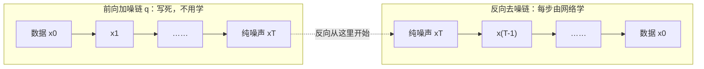

# $\rm Chapter \, 11$ 生成模型Ⅳ：Flow 与扩散模型

[第 8 章](08-能量模型与采样.md)的能量模型靠 MCMC 采样保住精确密度，[第 9 章](09-变分自编码器VAE.md)的 VAE 靠变分下界近似似然，[第 10 章](10-生成对抗网络GAN.md)的 GAN 干脆放弃似然——生成模型四部曲在本章走到最后一站，要补上的是第三条路：**似然可以精确算出来**。本章主角是两条路线：用可逆变换精确算密度的归一化流（Normalizing Flow），以及把生成拆成上千个小去噪步骤的扩散模型（Diffusion Model）。

本章对应《深度学习》课程讲义第 7 讲（Normalizing Flow & Diffusion Model）。第 7 讲的原始讲义文件在课程资料中已损坏、无法打开，本章内容按散落在其他讲次中的线索重建：L8 p3 的课程回顾把该讲概括为「Flow model (bijections)」与「Diffusion model (denoising score matching)」两行，L5 p66 的 VAE 总结预告了流的用途，L11 p4–p5 与 p43–p56 记录了它的学习原则与后续延续。正文标注「重建」的部分，推导按 DDPM、RealNVP/Glow 与 score matching 的通行文献口径补齐；页码只标在确实可查的讲义页上。讲义引用形如「L8 p3」，指本分册依据的《深度学习》课程讲义第 8 讲第 3 页，页码从封面起算（封面为第 1 页），汇总见 §11.7。学完本章，生成模型这条线收束，[第 12 章](12-序列模型RNN与LSTM.md)起转向处理序列数据的架构。

> **开始前自检**：本章假设你已经会：
>
> 1. □ 期望与 KL 散度的定义（回读：[第 1 章](01-深度学习数学与记号.md) §1.4.2、§1.4.3）；
> 2. □ 链式法则的多元形式（回读：[第 1 章](01-深度学习数学与记号.md) §1.2.3；行列式的几何意义本章 §11.2.3 当场重讲，不必先回读）；
> 3. □ VAE 的 ELBO 与「近似推断为什么是近似」（回读：[第 9 章](09-变分自编码器VAE.md) §9.3、§9.9.1）；
> 4. □ GAN 的「无似然」路线与它的代价（回读：[第 10 章](10-生成对抗网络GAN.md) §10.1.1、§10.2.9）。
>
> 本章的推导只用三样老工具：一维微积分、行列式的几何意义、两个独立高斯的方差相加。难点不在工具，在每一步都问清「这一项在账本上记的是什么」。

## $\rm \S \, 11.1$ 为什么还需要新模型（重建）

### $\rm \S \, 11.1.1$ 前三章各留下了一道缝

把第 8–10 章的结论摊开看，会发现它们各自缺一块（重建，按 L8 p3 的课程回顾口径）：

1. **能量模型（EBM，第 8 章）**：密度有定义、形式通用，但配分函数 $Z$ 不可算，采样只能靠 MCMC、收敛慢（第 8 章 §8.1.5、§8.3.7）；训练时每步都要「长链采样」，代价极高。
2. **VAE（第 9 章）**：训练稳定、采样便宜，但**推断是近似的**（第 9 章 §9.9.1）。它的目标是 ELBO——似然的一个下界，而之所以只能给下界，是因为真实后验 ${p(z\mid x)}$ 不可解，只能用 ${q(z\mid x;\phi)}$ 去拟合（第 9 章 §9.3）。于是出现两个后果：
   1. 「模型算出来的数」不等于真似然，两个 VAE 之间没法严格比较；
   2. 近似的形状由预设的分布族决定（通常是高斯，第 9 章 §9.9.3）。讲义在 L5 p66 的总结里把这条缺点写得很直白：Assumed density of ${q(z\mid x)}$ & $p(z)$；随后给出出路——"We need a more powerful proposal distribution. E.g., flow models as $q(z)$ (lecture 7(a))"。这句话是第 7 讲存在的直接证据：流的用途之一，就是充当一个表达能力更强的 $q(z)$。
3. **GAN（第 10 章）**：完全不做似然（likelihood-free），代价在第 10 章 §10.2.9 已经算过——没有可算的 ${\log p_G(x)}$，因此没有基于似然的评价（只能靠 IS/FID 这类间接指标，第 10 章 §10.3）、没有单调下降的训练目标、也没有停止准则；再加上 min–max 的求解结构会震荡（第 10 章 §10.4.2）。

于是「理想模型」的样子被这三条缝反向定义出来了（重建）：

1. **似然可以精确计算**（不是下界、不是近似）——这样训练就是标准的极大似然（MLE），像训练一个回归模型一样稳定，且有天然的模型比较与停止准则；
2. **映射可逆**（invertible）——这样「从 $z$ 生成 $x$」与「从 $x$ 反推 $z$」是同一个映射的两个方向，编码器不需要额外学习，也不需要近似；
3. 采样仍然便宜（最好一次前向）。

L11 p4–p5 的回顾页把这件事概括成一行：

> Learning $\theta$: MLE (flow); ELBO (VAE); Classification (GAN)

**白话**：流的训练原则是「真·极大似然」，这是它和 VAE 最本质的区别。

### $\rm \S \, 11.1.2$ 两条实现路线

L8 p3 用两个词总结了第 7 讲的两节，正好就是两条路线：

1. **Flow model (bijections)**：用一个**可逆**的双射（bijection）变换把简单分布「推」成复杂分布，密度用变量替换公式精确算出来。可逆性是设计约束，也是全部代价的来源。
2. **Diffusion model (denoising score matching)**：不直接构造「噪声→数据」这一步到位的映射，而是把生成拆成**很多小步**：先定义一条把数据逐步破坏成纯噪声的链（写死、不用学），再让网络学会它的逆过程——每一步只需要「去掉一点点噪声」。训练目标是「去噪得分匹配（denoising score matching）」。

两条路线的共同点是**放弃对抗、回到似然**；不同点是「一步到位」与「千步逼近」的取舍，§11.4 会把它们放进同一张表里。

**本节小结**：前三章各留一道缝——EBM 采样慢、VAE 推断是近似、GAN 干脆没有似然——把这些缝反过来描，就得到理想模型的三条要求：似然精确、映射可逆、采样便宜；实现它们的两条路，一是把简单分布一步步「推」成数据分布的 Flow，二是把破坏过程写死、只学生成过程的 Diffusion。

---

## $\rm \S \, 11.2$ 归一化流：把似然精确算出来（重建）

### $\rm \S \, 11.2.1$ 记号表

| 记号 | 含义 | 形状 / 取值 |
| --- | --- | --- |
| $z$ | 潜变量（也是采样的起点） | $\mathbb{R}^{d}$ 中的向量，${z\sim p_Z}$ |
| $x$ | 观测（图像等） | $\mathbb{R}^{d}$ 中的向量——**维数与 $z$ 相同**，这是流的硬性前提 |
| $f$ | 正向映射 ${z\mapsto x}$ | 双射（bijection），${f:\mathbb{R}^d\to\mathbb{R}^d}$ |
| $g=f^{-1}$ | 反向映射 ${x\mapsto z}$ | ${g(x)=f^{-1}(x)}$ |
| $p_Z$ | 先验（通常 ${N(0,I)}$） | 密度可闭式写出 |
| $p_X$ | 模型诱导出的数据分布 | 目标：${p_X\approx p_{data}}$ |
| ${J_f(z),J_g(x)}$ | 两个方向的 Jacobian 矩阵 | ${d\times d}$，${[J_f]_{ij}=\partial f_i/\partial z_j}$ |
| $K$ | 可逆层的层数 | 越深表达力越强，代价是每层一次前向 |
| ${x_1,x_2}$ | 耦合层把输入劈成的两半 | ${x_1\in\mathbb{R}^{d_1}}$、${x_2\in\mathbb{R}^{d-d_1}}$ |

### $\rm \S \, 11.2.2$ 一维先推：变量替换公式

**要解决的问题**：$z$ 的分布是简单的（${z\sim N(0,1)}$），${x=f(z)}$ 之后分布变复杂了。能不能用 $p_Z$ 把 $p_X$ 写出来？这就是变量替换公式（change of variables）要回答的问题。

**直觉（密度守恒）**：概率质量不会因为换坐标系而丢失。取一个极小的区间 ${[z,z+\mathrm{d}z]}$，它在映射下变成 ${[x,x+\mathrm{d}x]}$，其中 ${x=f(z)}$、${\mathrm{d}x=|f'(z)|\,\mathrm{d}z}$。两边的概率必须相等：

$$
p_Z(z)\,|\mathrm{d}z|=p_X(x)\,|\mathrm{d}x| .
$$

把 ${\mathrm{d}x=|f'(z)|\mathrm{d}z}$ 代进去、两边约去 $|\mathrm{d}z|$：

$$
p_X(x)=\frac{p_Z(z)}{|f'(z)|}=p_Z\big(g(x)\big)\cdot\big|g'(x)\big| ,
$$

其中第二式的来源是反函数的求导法则 ${g'(x)=\frac{\mathrm{d}z}{\mathrm{d}x}=\frac{1}{f'(z)}}$。写成对数形式（这是训练时用的形式）：

$$
\log p_X(x)=\log p_Z\big(g(x)\big)+\log\big|g'(x)\big| .
$$

**读法**：右边第一项是「在 $z$ 坐标下这个点有多常见」，第二项是「坐标被拉伸/压缩了多少」的对数。**关键点：${p_X(x)\ne p_Z(z)}$**——不改坐标就直接搬密度是错的，差的就是这个换元因子。反过来记也成立：${p_Z(z)=p_X(f(z))|f'(z)|}$。**唯一要守的约定是：用哪个方向算密度，就配那个方向的导数，并取绝对值。**

**能手算例一（仿射）**：${z\sim N(0,1)}$，${x=f(z)=\mu+\sigma z}$（$\sigma>0$）。则 ${g(x)=(x-\mu)/\sigma}$、${g'(x)=1/\sigma}$，于是

$$
p_X(x)=\frac{1}{\sigma}\,\varphi\!\left(\frac{x-\mu}{\sigma}\right)=\frac{1}{\sqrt{2\pi\sigma^2}}\exp\!\left(-\frac{(x-\mu)^2}{2\sigma^2}\right),
$$

其中 ${\varphi(u)=\frac{1}{\sqrt{2\pi}}e^{-u^2/2}}$ 是标准正态密度。核对：结果正是 ${N(\mu,\sigma^2)}$ 的密度——「把标准正态平移缩放」得到的当然是平移缩放后的正态，公式给对了 ✓。

**能手算例二（非线性）**：${z\sim N(0,1)}$，${x=f(z)=z^3}$。则 ${g(x)=x^{1/3}}$、${g'(x)=\frac{1}{3}x^{-2/3}}$，于是

$$
p_X(x)=\varphi\!\left(x^{1/3}\right)\cdot\frac{1}{3}|x|^{-2/3}\qquad(x\ne0).
$$

两个核对：

1. **总量对**：${\int_{-\infty}^{\infty}p_X(x)\mathrm{d}x=\int\varphi(z)\mathrm{d}z=1}$。做法是代换 ${x=z^3}$、${\mathrm{d}x=3z^2\mathrm{d}z}$：被积函数变成 ${\varphi(z)\cdot\frac13 z^{-2}\cdot 3z^2=\varphi(z)}$ ✓。
2. **$x=0$ 处密度发散不是错误**：$z$ 在 0 附近的一整段质量被压到了 ${x=0}$ 附近（三次方在原点附近把坐标压得很扁），密度自然要往上堆。**白话：坐标被压扁的地方，密度就变高。**

### $\rm \S \, 11.2.3$ 多维：Jacobian 行列式

一维的 ${|f'(z)|}$ 到多维换成 ${|\det J|}$，理由是雅可比行列式（Jacobian determinant）的几何意义。行列式（determinant）这个词若久未用，本节当场把它讲清，不必回读旧章。

**当场讲清行列式在做什么**：对一个线性映射 $A$，${\det A}$ 是「体积放大率」。两个能立刻验算的例子：

1. ${A=\begin{pmatrix}2&3\\0&1\end{pmatrix}}$：${\det A=2}$，单位正方形被映成底 2、高 1 的平行四边形，面积比 2 ✓；
2. 旋转矩阵 ${R=\begin{pmatrix}\cos\theta&-\sin\theta\\ \sin\theta&\cos\theta\end{pmatrix}}$：${\det R=1}$，转动不改面积 ✓；而 ${\det=0}$ 意味着把空间压到了低一维，映射不可逆。**所以「可逆」与「${\det J\ne0}$ 处处成立」是一回事。**

推到非线性映射：$f$ 在点 $z$ 附近可以被它的线性化 ${J_f(z)=\partial f/\partial z}$ 近似，一个边长为 ${\mathrm{d}z_1,\dots,\mathrm{d}z_d}$ 的小盒子被映成一个平行多面体，其体积 ${=|\det J_f(z)|\,\mathrm{d}z_1\cdots\mathrm{d}z_d}$。把「密度守恒」写成体积的形式，得到**变量替换公式**：

$$
p_Z(z)=p_X\big(f(z)\big)\cdot\big|\det J_f(z)\big|\qquad\Longleftrightarrow\qquad p_X(x)=p_Z\big(g(x)\big)\cdot\big|\det J_g(x)\big| .
$$

对数形式（训练目标）：

$$
\log p_X(x)=\log p_Z\big(g(x)\big)+\log\big|\det J_g(x)\big| .
$$

两种方向的关系可以自检：链式法则给 ${J_g(x)=(J_f(z))^{-1}}$，而 ${\det(A^{-1})=1/\det A}$，取绝对值后两个式子完全一致 ✓。

> **竞赛生迁移提示**：${|\det J|}$ 对竞赛生不是生人——它就是换元积分里那个多出来的因子。微积分里 ${\int f(x)\,\mathrm{d}x}$ 代 ${x=g(u)}$，积分变量一换要多乘一个 ${|g'(u)|}$（「长度元被拉伸了多少」）；二重积分换极坐标，${\mathrm{d}x\,\mathrm{d}y}$ 变成 ${r\,\mathrm{d}r\,\mathrm{d}\theta}$，那个 $r$ 恰好是坐标变换的 ${\det J}$。两件事是同一句守恒的话：**测度元放大多少倍，密度就缩小多少倍，总量不变**。换元积分守的是积分值，流守的是概率质量；写成 ${\log|\det J|}$ 只是把这笔账记进对数——复合映射的缩放因子连乘，取了对数就逐层连加。

**能手算例三（线性映射的体积）**：${d=2}$，${x=Az}$，${A=\begin{pmatrix}2&1\\0&3\end{pmatrix}}$。${\det A=2\times3-1\times0=6}$。若 $p_Z$ 是单位正方形 ${[0,1]^2}$ 上的均匀分布（密度恒为 1），那么

$$
p_X(x)=\frac{p_Z(A^{-1}x)}{6}=\frac{1}{6}\quad\text{在平行四边形 }\{Az:\ z\in[0,1]^2\}\text{ 上}.
$$

核对：该平行四边形的两条边是 $A$ 的两列 ${(2,0)}$ 与 ${(1,3)}$，面积 ${=|2\times3-1\times0|=6}$；总概率 ${=6\times\frac16=1}$ ✓。**白话：单位正方形上有 1 单位质量，铺开成面积 6 的平行四边形后密度就只有 $1/6$。**

**能手算例四（保体积的剪切）**：${x_1=z_1}$、${x_2=z_2+z_1^2}$。这个映射可逆——${z_1=x_1}$、${z_2=x_2-x_1^2}$ 就是它的逆——它的 Jacobian 是

$$
J_f=\begin{pmatrix}1&0\\ 2z_1&1\end{pmatrix},\qquad \det J_f=1 .
$$

所以它处处保持体积（${p_X=p_Z}$）。这个例子是 §11.2.4 的前奏：**三角阵的行列式＝对角元之积**，于是「行列式好算」和「网络结构设计」就通过「三角性」联系起来了。

### $\rm \S \, 11.2.4$ 可逆网络怎么设计：仿射耦合层

**要同时满足三件事才算合格的流模型**（重建）：

1. 每一层必须可逆；
2. 逆必须便宜（否则采样变贵）；
3. ${\log|\det J|}$ 必须便宜（否则训练变贵——一般 ${d\times d}$ 行列式要 $O(d^3)$，而图像里 $d$ 是百万量级）。

RealNVP 给出的答案是**仿射耦合层（affine coupling layer）**。把输入劈成两半 ${x=(x_1,x_2)}$（${x_1\in\mathbb{R}^{d_1}}$、${x_2\in\mathbb{R}^{d-d_1}}$，${d_1+d_2=d}$），定义

$$
y_1=x_1,\qquad y_2=x_2\odot\exp\!\big(s(x_1)\big)+t(x_1),
$$

其中 ${s,t}$ 是**任意**函数（就是两个神经网络，${\mathbb{R}^{d_1}\to\mathbb{R}^{d-d_1}}$），$\odot$ 是逐元素乘。

**读法**：前半段原封不动地抄过去；后半段做一次「由 $x_1$ 决定的逐元素缩放 + 平移」。$x_1$ 在这里一物两用：既是数据（要保留），又是变换的参数（用来改造 $x_2$）。

**为什么可逆**：${y_1=x_1}$ 直接给出 $x_1$；有了 $x_1$ 就能算出 ${s(x_1),t(x_1)}$，再从 $y_2$ 反解

$$
x_2=\big(y_2-t(y_1)\big)\odot\exp\!\big(-s(y_1)\big).
$$

关键点：**逆不需要 ${s,t}$ 可逆**——它们只需要能被求值（前向一次）就行。所以 ${s,t}$ 可以随便用卷积、注意力这些不可逆的模块。

**为什么 ${\log|\det J|}$ 便宜**：$y_1$ 完全不依赖 $x_2$，所以 Jacobian 的右上块是 0：

$$
J=\frac{\partial y}{\partial x}=\begin{pmatrix}\dfrac{\partial y_1}{\partial x_1}&\dfrac{\partial y_1}{\partial x_2}\\[2mm] \dfrac{\partial y_2}{\partial x_1}&\dfrac{\partial y_2}{\partial x_2}\end{pmatrix}=\begin{pmatrix}I&0\\[2mm] \dfrac{\partial y_2}{\partial x_1}&\mathrm{diag}\big(\exp(s(x_1))\big)\end{pmatrix},
$$

这是**下三角矩阵**，行列式等于对角元之积，于是

$$
\log\big|\det J\big|=\sum_{j=1}^{d-d_1}s_j(x_1).
$$

**白话**：行列式的计算从 $O(d^3)$ 降到 $O(d)$，而且连 ${\partial y_2/\partial x_1}$ 那一大块都不用算——**整个模型的复杂度没有因为「要算行列式」而变差**。代价是每一层只动了一半维数（$x_1$ 被原样抄走），所以必须**交替划分**：下一层把划分换过来（用掩码 mask 交替），让这一轮没动的部分在下一轮动起来。

**能手算例五（一层耦合的正向、逆向与行列式）**：${d=4}$，劈成前两维与后两维。设 ${x_1=(1,0)}$、${x_2=(0,0)}$，并假设网络输出 ${s(x_1)=(0.5,-0.5)}$、${t(x_1)=(1,2)}$。则

1. 正向：${y_1=(1,0)}$，${y_2=(0,0)\odot(e^{0.5},e^{-0.5})+(1,2)=(1,2)}$；
2. ${\log|\det J|=0.5+(-0.5)=0}$——这一层是保体积的；
3. 逆向：${x_2=\big((1,2)-(1,2)\big)\odot(e^{-0.5},e^{0.5})=(0,0)}$ ✓ 回到了原值。

**叠加多层**：一串双射的复合仍是双射，而复合函数的 Jacobian 是各层 Jacobian 的乘积（链式法则），行列式可乘 → 取对数后可加。设 ${g=g_1\circ g_2\circ\cdots\circ g_K}$（先跑第 $K$ 层、最后跑第 1 层，方向按实现定），则

$$
\log p_X(x)=\log p_Z\big(g(x)\big)+\sum_{k=1}^{K}\log\big|\det J_{g_k}\big| .
$$

**核对**：${J_{f\circ h}(x)=J_f(h(x))\cdot J_h(x)}$，而 ${\det(AB)=\det A\cdot\det B}$，所以 ${\log|\det J|}$ 在复合下逐层相加 ✓。

### $\rm \S \, 11.2.5$ RealNVP 与 Glow 一句话，以及流的代价（重建·标准文献）

1. **RealNVP（Dinh et al., 2016）**：提出仿射耦合层 + 交替掩码划分 + 多尺度（multi-scale）结构，是「耦合层」这套设计的出处。
2. **Glow（Kingma & Dhariwal, 2018）**：把耦合里的「按通道置换」换成**可学习的可逆 ${1\times1}$ 卷积**（它本身是一个线性双射，其对数行列式可以用 ${\log|\det W|}$ 直接算），让通道之间的混合更自由；再加上 ActNorm（做一次数据相关的缩放平移，作用类似 BN 但可逆）与多尺度结构，第一次展示了流模型也能生成高质量大图。

**流的账，逐条结清**：

1. **训练**：目标就是 ${\max_\theta\sum_i\log p_X(x_i)}$——精确 MLE，没有下界、没有对抗、没有 MCMC。梯度来源只有两项：${\log p_Z(g(x))}$（让 $x$ 反推回去落在高概率区）与 ${\sum_k\log|\det J|}$（防止网络靠「把空间揉成一团」来作弊）。**这一项的存在是流与 VAE 的关键差别：压缩体积会让第一项变好，但会被行列式项罚回来。**
2. **采样**：抽 ${z\sim p_Z}$，一次前向 ${x=f(z)}$。与 GAN 一样快。
3. **编码**：${z=g(x)}$ 也是精确的（可逆），不需要第 9 章那种近似后验。
4. **代价——架构受限**：维数必须相同（${d_x=d_z}$，不能像 VAE 那样降维）；每一层都要可逆，所以不能用池化、不能有信息瓶颈；单层耦合层只动一半维数，表达力要靠「叠很多层 + 交替划分」堆出来；$s$ 里如果用 $\exp$ 要注意数值范围（通常加 tanh 或做缩放约束）。
5. **实践中的好处**（重建）：正因为「可逆 + 精确似然」，流的潜空间天然规整（插值、算术都有意义），也常被拿来当 VAE 的更强先验/后验——这正是 L5 p66 那句 "flow models as $q(z)$" 要做的事。

---

## $\rm \S \, 11.3$ 扩散模型：把一步到位换成一千小步（重建）

### $\rm \S \, 11.3.1$ 记号表

| 记号 | 含义 | 形状 / 取值 |
| --- | --- | --- |
| $x_0$ | 真实数据 | $\mathbb{R}^{d}$（本节 $d$ 指像素数） |
| ${x_1,\dots,x_T}$ | 逐步加噪后的样本 | 与 $x_0$ 同形状；$T$ 是步数（DDPM 用 1000） |
| $\beta_t$ | 第 $t$ 步注入的噪声方差 | ${0<\beta_t<1}$，写死（不学） |
| $\alpha_t$ | 信号保留系数 | ${\alpha_t=1-\beta_t}$ |
| $\bar\alpha_t$ | 累计信号保留系数 | ${\bar\alpha_t=\prod_{s=1}^{t}\alpha_s}$ |
| $\epsilon$ | 标准高斯噪声 | ${\epsilon\sim N(0,I)}$，与 $x_0$ 同形状 |
| $q$ | 前向（加噪）过程的分布 | ${q(x_t\mid x_{t-1})}$、${q(x_t\mid x_0)}$ 都有闭式 |
| $p_\theta$ | 反向（去噪）过程，网络参数 $\theta$ | ${p_\theta(x_{t-1}\mid x_t)}$ |
| ${\epsilon_\theta(x_t,t)}$ | 网络的输出：对噪声的预测 | 与 $x_t$ 同形状 |
| ${\mu_\theta,\tilde\mu_t,\tilde\beta_t}$ | 反向/后验高斯分布的均值与方差 | 与 $x_t$ 同形状 / 标量 |
| ${s(x)=\nabla_x\log p(x)}$ | 得分（score） | 与 $x$ 同形状 |

### $\rm \S \, 11.3.2$ 思路：把大跳变拆成一串小步

**要解决的问题**：Flow 的架构受限，GAN 训练不稳——有没有一种模型，训练像回归一样稳，表达力又不受可逆性约束？（重建）

**扩散的答案**：不要去学「噪声 → 图片」这个大跳变，而把生成拆成一条**很长的链**：

1. **前向**：定义一条写死的加噪链，把一张真图在 $T$ 步里逐步破坏、最后变成纯噪声。这一步**不需要学**，全部由你指定的噪声表（noise schedule，一串写死的 $\beta_t$）决定；
2. **反向**：让一个网络学「每一步怎么把噪声去掉一点点」。因为每一步的变化都很小，网络的活儿变得很简单；
3. **生成**：从纯噪声出发，反复用网络去噪 $T$ 次，得到一张图。

**白话**：这像是「把一幅画用橡皮一点点擦掉」与「照着录像倒放回来」——倒放每一步都比凭空作画容易得多。这条路线因此同时拿到了两样东西：表达力不受可逆性限制（每一步都只是「加一个小高斯」），训练也稳定（每一步都是回归问题）。

> **竞赛生迁移提示**：「一步难问题拆成一串小步、每步只做局部修正」是竞赛里的老朋友——递推与动态规划把大问题拆成一串带已知转移的小决策；构造类题目不直接拼终局，而是从初始状态一小步一小步扩展。扩散的正向链就是一条**已知的转移方程**：$x_t$ 由 $x_{t-1}$ 经写死的一小步推出；要学的只是逆过程，且每一步都被压成一个「去掉一点噪声」的回归题。与 DP 的一点不同要分清：DP 的每步转移是精确给定的，这里的反向转移是**学出来的近似**——所以才有 §11.3.4 的 ELBO 与监督目标。

### $\rm \S \, 11.3.3$ 前向加噪链与闭式 $x_t$

**前向链**（重建·标准文献，DDPM 的口径）：

$$
q(x_t\mid x_{t-1})=N\Big(\sqrt{1-\beta_t}\,x_{t-1},\ \beta_t I\Big),
$$

也就是 ${x_t=\sqrt{\alpha_t}\,x_{t-1}+\sqrt{\beta_t}\,\epsilon}$（${\epsilon\sim N(0,I)}$，${\alpha_t=1-\beta_t}$）。**读法**：每一步把当前信号乘一个略小于 1 的系数、再加上一点独立的高斯噪声。这个 $q$ 是「扩散」名字的来源——把信息一点点扩散掉。

**这条链最重要的性质是可以闭式求 $t$ 步之后的结果**：

$$
x_t=\sqrt{\bar\alpha_t}\,x_0+\sqrt{1-\bar\alpha_t}\,\epsilon,\qquad \bar\alpha_t=\prod_{s=1}^{t}\alpha_s .
$$

**推导（归纳法，一行不跳）**：

第 1 步：${t=1}$ 直接成立（${\bar\alpha_1=\alpha_1}$）。

第 2 步：假设 ${t-1}$ 成立，即 ${x_{t-1}=\sqrt{\bar\alpha_{t-1}}\,x_0+\sqrt{1-\bar\alpha_{t-1}}\,\epsilon'}$（${\epsilon'\sim N(0,I)}$ 与后面的 $\epsilon$ 独立）。代入前向链：

$$
x_t=\sqrt{\alpha_t}\,x_{t-1}+\sqrt{1-\alpha_t}\,\epsilon=\sqrt{\alpha_t\bar\alpha_{t-1}}\,x_0+\underbrace{\sqrt{\alpha_t\big(1-\bar\alpha_{t-1}\big)}\,\epsilon'+\sqrt{1-\alpha_t}\,\epsilon}_{\text{两项独立高斯}} .
$$

第 3 步：合并两个噪声项。两个独立零均值高斯的和还是高斯，**方差相加**：${\mathrm{Var}(a\epsilon'+b\epsilon)=a^2\mathrm{Var}(\epsilon')+b^2\mathrm{Var}(\epsilon)=a^2+b^2}$，于是

$$
\alpha_t\big(1-\bar\alpha_{t-1}\big)+(1-\alpha_t)=\alpha_t-\alpha_t\bar\alpha_{t-1}+1-\alpha_t=1-\alpha_t\bar\alpha_{t-1}=1-\bar\alpha_t .
$$

第 4 步：两项合起来就是 ${\sqrt{1-\bar\alpha_t}\,\epsilon}$（可以把它们写成一个新的标准高斯），系数 ${\sqrt{\alpha_t}\sqrt{\bar\alpha_{t-1}}=\sqrt{\bar\alpha_t}}$。归纳完成：

$$
x_t=\sqrt{\bar\alpha_t}\,x_0+\sqrt{1-\bar\alpha_t}\,\epsilon .
$$

**能手算例六**：取 ${\beta_1=0.1}$、${\beta_2=0.2}$，则 ${\alpha_1=0.9}$、${\alpha_2=0.8}$、${\bar\alpha_2=0.9\times0.8=0.72}$，于是

$$
x_2=\sqrt{0.72}\,x_0+\sqrt{0.28}\,\epsilon=0.8485\,x_0+0.5292\,\epsilon .
$$

两条核对：

1. 方差相加：${\alpha_2(1-\bar\alpha_1)+(1-\alpha_2)=0.8\times0.1+0.2=0.28}$ ✓ 正好等于 ${1-\bar\alpha_2}$；
2. 具体数值：${x_0=1.0}$、${\epsilon=0.5}$ 时 ${x_2=0.8485\times1.0+0.5292\times0.5=0.8485+0.2646=1.1131}$。

再看一眼「噪声表要多大」。若 $\beta$ 全取 0.02、${T=1000}$，则 ${\bar\alpha_T=0.98^{1000}\approx1.7\times10^{-9}}$——$x_T$ 里几乎不剩信号，就是纯噪声。**这就是为什么可以放心地从 ${x_T\sim N(0,I)}$ 出发采样**：加噪链的终点与数据无关。

**这条闭式的工程含义**：训练时不需要真的跑 $t$ 步加噪——随机抽一个 $t$、抽一个 $x_0$、抽一个 $\epsilon$，一步就能造出 $x_t$。这是 DDPM 训练成本低的关键。

### $\rm \S \, 11.3.4$ 反向去噪与变分视角

**要解决的问题**：想要的是 ${q(x_{t-1}\mid x_t)}$——「加噪的逆」。但由贝叶斯定理

$$
q(x_{t-1}\mid x_t)\propto q(x_t\mid x_{t-1})\,q(x_{t-1}),
$$

里面那个 ${q(x_{t-1})}$ 是**数据分布在时刻 ${t-1}$ 的边际**，未知（它涉及整个数据分布）。所以反向过程只能学：定义一个带参数的近似反向链

$$
p_\theta(x_{t-1}\mid x_t)=N\big(\mu_\theta(x_t,t),\ \Sigma_t\big),
$$

并希望 ${\prod_t p_\theta}$ 给出的轨迹与真实的反向轨迹一致。

**关键的中间结果（后验可写闭式）**：把 $x_0$ 也条件进去，${q(x_{t-1}\mid x_t,x_0)}$ 是**已知的高斯**。来源是把两个高斯乘起来（一个是 ${q(x_t\mid x_{t-1})=N(\sqrt{\alpha_t}x_{t-1},\beta_tI)}$，另一个是 ${q(x_{t-1}\mid x_0)=N(\sqrt{\bar\alpha_{t-1}}x_0,(1-\bar\alpha_{t-1})I)}$），配方后得

$$
q(x_{t-1}\mid x_t,x_0)=N\big(\tilde\mu_t(x_t,x_0),\ \tilde\beta_t I\big),
$$

$$
\tilde\mu_t=\frac{\sqrt{\bar\alpha_{t-1}}\,\beta_t}{1-\bar\alpha_t}x_0+\frac{\sqrt{\alpha_t}\,(1-\bar\alpha_{t-1})}{1-\bar\alpha_t}x_t,\qquad
\tilde\beta_t=\frac{\beta_t\,(1-\bar\alpha_{t-1})}{1-\bar\alpha_t}.
$$

**能手算核对（用 §11.3.3 的数）**：${t=2}$、${\beta_2=0.2}$、${\bar\alpha_1=0.9}$、${\bar\alpha_2=0.72}$、${\alpha_2=0.8}$，则

$$
\tilde\mu_2=0.6776\,x_0+0.3194\,x_2,\qquad \tilde\beta_2=\frac{0.2\times0.1}{0.28}=0.0714 .
$$

核对方式是「精度相加」（两个高斯相乘，精度＝方差的倒数相加）：后验的精度应当等于两条信息源的精度之和，

$$
\frac{1}{\tilde\beta_2}=\frac{\alpha_2}{\beta_2}+\frac{1}{1-\bar\alpha_1}=\frac{0.8}{0.2}+\frac{1}{0.1}=4+10=14\;\Longrightarrow\;\tilde\beta_2=\frac{1}{14}=0.0714\ \checkmark .
$$

均值的核对：把 ${x_0=1.0}$、${x_2=1.1131}$ 代进去，${\tilde\mu_2=0.6776+0.3194\times1.1131=1.0332}$；这应当等于「反向走一步的目标均值」，§11.3.5 会用另一条路重算同一个数。

**变分视角（把第 9 章的方法搬过来）**：整个模型其实是一个 $T$ 层隐变量模型，隐变量是 ${x_1,\dots,x_T}$、可见变量是 $x_0$，于是可以像 VAE 那样写 ELBO（重建·标准文献）：

$$
\log p_\theta(x_0)\ \ge\ E_q\Big[\log p_\theta(x_0\mid x_1)\Big]-\mathrm{KL}\Big(q(x_T\mid x_0)\,\big\|\,p(x_T)\Big)-\sum_{t=2}^{T}\mathrm{KL}\Big(q(x_{t-1}\mid x_t,x_0)\,\big\|\,p_\theta(x_{t-1}\mid x_t)\Big).
$$

三项各是什么，逐项读：

1. **第一项**：重建项——最后一步从 $x_1$ 恢复 $x_0$ 的对数似然；
2. **第二项**：终点的匹配项——前向链的终点分布 ${q(x_T\mid x_0)}$ 与先验 ${p(x_T)=N(0,I)}$ 的差距。设计噪声表时让 ${\bar\alpha_T\to0}$，这一项就接近 0；
3. **第三项**：${\sum_{t=2}^{T}}$ 个「反向一步」的 KL——每个都拿**可算的后验** ${q(x_{t-1}\mid x_t,x_0)}$ 当监督目标。这一项就是训练的绝大多数工作量所在。

推导里用到一条恒等式（贝叶斯）：${q(x_t\mid x_{t-1})q(x_{t-1}\mid x_0)=q(x_{t-1}\mid x_t,x_0)q(x_t\mid x_0)}$——两边都是「${x_{t-1},x_t}$ 的联合分布」，只是按不同变量分解。有了它，${\log\frac{q(x_t\mid x_{t-1})}{q(x_{t-1}\mid x_t,x_0)}}$ 就能改写成 ${\log\frac{q(x_t\mid x_0)}{q(x_{t-1}\mid x_0)}}$，求和时首尾相消，只剩下三项。

**从 KL 到「预测噪声」**：第三项里两个分布都被参数化成**同方差**的高斯（$q$ 的方差是 $\tilde\beta_t$，$p_\theta$ 也取 ${\Sigma_t=\tilde\beta_tI}$），而同方差高斯的 KL 有闭式：

$$
\mathrm{KL}\Big(N(\tilde\mu_t,\tilde\beta_tI)\,\big\|\,N(\mu_\theta,\tilde\beta_tI)\Big)=\frac{1}{2\tilde\beta_t}\big\|\tilde\mu_t-\mu_\theta\big\|_2^2 .
$$

（来源：把两者的密度比取对数，指数部分的差是 ${\frac{\|x-\mu_\theta\|^2-\|x-\tilde\mu_t\|^2}{2\tilde\beta_t}}$，在 ${x\sim N(\tilde\mu_t,\tilde\beta_tI)}$ 下取期望相当于把 ${\|x-\mu_\theta\|^2}$ 换成 ${\|\tilde\mu_t-\mu_\theta\|^2+d\tilde\beta_t}$，常数项抵消。）于是「最小化 KL」就变成了「让网络输出的均值尽量接近真实后验均值」——一个**回归问题**。

**网络到底输出什么**：$\tilde\mu_t$ 里含 $x_0$（未知），但可以换成 $x_t$ 与噪声。由闭式 ${x_t=\sqrt{\bar\alpha_t}x_0+\sqrt{1-\bar\alpha_t}\epsilon}$ 解出 ${x_0=\frac{x_t-\sqrt{1-\bar\alpha_t}\epsilon}{\sqrt{\bar\alpha_t}}}$，代入并把 $x_t$ 的系数归并（这里用 ${\sqrt{\bar\alpha_{t-1}}/\sqrt{\bar\alpha_t}=1/\sqrt{\alpha_t}}$），得

$$
\tilde\mu_t=\frac{1}{\sqrt{\alpha_t}}\left(x_t-\frac{\beta_t}{\sqrt{1-\bar\alpha_t}}\,\epsilon\right).
$$

**核对**：把 $\tilde\mu_t$ 的两项系数相加，$x_t$ 的总系数 ${=\frac{\beta_t}{\sqrt{\alpha_t}(1-\bar\alpha_t)}+\frac{\alpha_t-\bar\alpha_t}{\sqrt{\alpha_t}(1-\bar\alpha_t)}=\frac{1}{\sqrt{\alpha_t}}}$ ✓（其中用到 ${1-\bar\alpha_{t-1}=\frac{\alpha_t-\bar\alpha_t}{\alpha_t}}$）。

于是只要让网络预测噪声 ${\hat\epsilon=\epsilon_\theta(x_t,t)}$、并令

$$
\mu_\theta(x_t,t)=\frac{1}{\sqrt{\alpha_t}}\left(x_t-\frac{\beta_t}{\sqrt{1-\bar\alpha_t}}\,\epsilon_\theta(x_t,t)\right),
$$

KL 项就变成「噪声预测的平方误差」。丢掉与 $t$ 有关的权重（DDPM 的简化），得到实际用的训练目标：

$$
L_{\text{simple}}=E_{t\sim\mathrm{Unif}\{1,\dots,T\},\,x_0,\,\epsilon}\Big[\big\|\epsilon-\epsilon_\theta\big(\sqrt{\bar\alpha_t}x_0+\sqrt{1-\bar\alpha_t}\epsilon,\ t\big)\big\|_2^2\Big] .
$$

**白话**：训练就是反复做一件事——随机抽一张图和一步 $t$，按闭式造出加噪版本 $x_t$，让网络看一眼 $x_t$ 和 $t$，说出「你被加了什么噪声」。损失是预测噪声与真实噪声的平方误差。**整个训练过程没有对抗、没有 MCMC、没有重要性采样**——这也解释了为什么扩散的训练稳定性是五种模型里最好的。

### $\rm \S \, 11.3.5$ 采样与「去噪得分匹配」这个名字

**采样过程**（重建·标准文献）：${x_T\sim N(0,I)}$，然后 ${t=T,T-1,\dots,1}$ 逐步反向：

$$
x_{t-1}=\mu_\theta(x_t,t)+\sqrt{\tilde\beta_t}\,z,\qquad z\sim N(0,I)\ \ (t>1),
$$

${t=1}$ 时不加噪声。**能手算核对最后一步为什么不加噪声**：认定 ${\bar\alpha_0=1}$（空乘积），则 ${\tilde\beta_1=\frac{\beta_1(1-\bar\alpha_0)}{1-\bar\alpha_1}=0}$，${\tilde\mu_1=\frac{\sqrt{\bar\alpha_0}\beta_1}{1-\bar\alpha_1}x_0+\frac{\sqrt{\alpha_1}(1-\bar\alpha_0)}{1-\bar\alpha_1}x_1=x_0}$——后验退化成一个点质量，所以最后一步就是「直接吐出去噪结果」。

**能手算例七（一步去噪的数值）**：沿用 §11.3.3 的数（${\beta_1=0.1}$、${\beta_2=0.2}$、${\bar\alpha_1=0.9}$、${\bar\alpha_2=0.72}$），取 ${x_0=1.0}$、${\epsilon=0.5}$，则 ${x_2=1.1131}$。设网络完美预测 ${\hat\epsilon=\epsilon=0.5}$：

1. 反推数据：${\hat x_0=\frac{x_2-\sqrt{1-\bar\alpha_2}\,\hat\epsilon}{\sqrt{\bar\alpha_2}}=\frac{1.1131-0.5292\times0.5}{0.8485}=\frac{0.8485}{0.8485}=1.0000}$ ✓ 精确回到 $x_0$；
2. 反向一步的均值：${\mu_\theta=\frac{1}{\sqrt{0.8}}\big(1.1131-\frac{0.2}{\sqrt{0.28}}\times0.5\big)=1.1180\times(1.1131-0.1890)=1.0332}$；
3. 与 §11.3.4 的另一条路核对：${\tilde\mu_2=0.6776\times1.0+0.3194\times1.1131=1.0332}$ ✓ 两条路给同一个数。

**白话**：这一步的意义是「${x_2=1.1131}$ 里含有 0.5 的噪声，去掉它之后往回走的中心在 1.0332」——它既不是原来的 $x_2$，也不是最终的 $x_0$，而是介于两者之间的中间站（同时还要再撒一点方差 0.0714 的噪声，因为反向链本身是随机的）。

**「去噪得分匹配」名字解读**（这是 L8 p3 对第 7 讲 b 部分的总结词，逐段拆开）：

1. **得分（score）** 是指对数密度的梯度 ${s(x)=\nabla_x\log p(x)}$。它不是概率密度，但和密度几乎一样完整地刻画分布。**它有一个密度没有的好处：配分函数被消掉了。** 若 ${p(x)=e^{-E(x)}/Z}$，则 ${\nabla_x\log p(x)=-\nabla_xE(x)}$——$Z$ 是常数，求梯度时消失（这正是 EBM 把训练变成「能量梯度之差」的原因，第 8 章的对比散度就是在做这件事，见 §8.4.4）。所以「拟合得分」比「拟合密度」容易：它不需要知道归一化常数。
2. **去噪（denoising）** 指「给定加噪样本，估计里面的噪声」这件事。
3. **两者为什么是一回事**：对加噪分布有一条恒等式（Tweedie 公式，Tweedie's formula，重建·标准文献）：若 ${x=x_0+\sigma\epsilon}$、${\epsilon\sim N(0,I)}$，则 ${E[x_0\mid x]=x+\sigma^2\nabla_x\log p(x)}$。在扩散的记号下（${x_t=\sqrt{\bar\alpha_t}x_0+\sqrt{1-\bar\alpha_t}\epsilon}$）它给出

$$
\nabla_{x_t}\log q_t(x_t)=-\frac{\epsilon}{\sqrt{1-\bar\alpha_t}}\quad\text{（即：}\ \epsilon=-\sqrt{1-\bar\alpha_t}\,\nabla_{x_t}\log q_t(x_t)\text{）},
$$

   其中 $q_t$ 是 $x_t$ 的边际分布。**核对（一维点质量的特例）**：若 ${x_0=a}$ 取定，则 ${q_t=N(\sqrt{\bar\alpha_t}a,1-\bar\alpha_t)}$，其得分是 ${-\frac{x_t-\sqrt{\bar\alpha_t}a}{1-\bar\alpha_t}=-\frac{\sqrt{1-\bar\alpha_t}\epsilon}{1-\bar\alpha_t}=-\frac{\epsilon}{\sqrt{1-\bar\alpha_t}}}$ ✓。所以**「预测噪声」与「估计加噪分布的得分」只差一个已知常数**——DDPM 的损失就是一个得分匹配目标。
4. **「匹配（matching）」** 指这类目标的形式来自 score matching（Hyvärinen, 2005）：直接去拟合 ${\nabla\log p}$，不必先写出 $p$。Vincent（2011）的 **denoising score matching** 进一步证明：「给数据加噪，然后回归加噪过程带来的那部分得分」与「直接做得分匹配」等价（相差一个与参数无关的常数）。这就补全了名字的最后一块：**denoising score matching ＝ 用「给数据加噪再让网络说出噪声」的方式，去匹配数据分布的对数密度梯度。**

**为什么这个视角有用**：它把扩散接到两条老线上——第 8 章（EBM 里就在跟「能量/得分的梯度」打交道）与 MCMC 采样。采样过程也可以换个说法：每一步沿「当前噪声水平下的得分」往上走一点、再补一点噪声，本质上是**退火版**的朗之万动力学（Langevin dynamics；从高噪声水平一路退到低噪声水平），这解释了「从纯噪声出发为什么能走到数据上」。

> **竞赛生迁移提示**：「沿着梯度往上走、再撒一点随机扰动、噪声水平（温度）从高到低」——这正是模拟退火（simulated annealing）的循环：前期高温大步乱跳翻过山脊，后期低温小步收敛到谷底。扩散采样把「温度表」换成「噪声表」，把「能量差」换成「得分」，把退火的目标从「找最小能量」换成「走向数据分布的高概率区」。失效边界也一致：步长（温度/噪声表）设得不对，两条路都会卡在坏解上。

### $\rm \S \, 11.3.6$ 代价，以及从 DDPM 到 latent diffusion

**代价**（重建）：

1. **采样慢**：一次生成要 $T$ 次网络前向（DDPM 用 ${T=1000}$）。对比第 10 章 §10.7.1 的 GigaGAN：512px 只要 0.13 秒——一次前向 vs 一千次前向，差距就在这。后续工作的一大主线就是「用更少的步数走完同样的路」（步长更大的采样器、蒸馏、一致性模型等）。
2. **在像素空间做，分辨率一高就贵**：$T$ 次前向都作用在 ${H\times W\times C}$ 的大张量上，${1024\times1024}$ 的图像上做 1000 步，计算量是天文数字。
3. **似然是下界**：虽然比 GAN 好（至少有一个 ELBO 可以算），但单步的 ${\log p_\theta(x_0)}$ 并不精确可算（$\bar\alpha$ 的链把各步耦合在一起）。

**latent diffusion（L11 p53–p56）就是对第 2 条的回应**：讲义的原话是「我们可以用预训练模型来提供潜表示」——用一个**预训练的 VAE** 把图像压到潜空间，**扩散过程在潜空间里跑**（A pretrained VAE for image latent space, run diffusion process in latent space），条件信息则用预训练的语言/图像编码器通过交叉注意力（cross attention）注入（Pretrained LLM/Image encoders for conditioning by cross attention）。讲义在 p56 注明这就是 Stable Diffusion 的技术基础。**白话**：把「在百万维的像素上跑一千步」换成「在几千维的潜变量上跑一千步」，细节纹理交给 VAE 解码器。

这条线的上一站是 DALL-E 2（L11 p43–p46）：图像先生成到一个「图像嵌入」空间，然后用**层次化扩散模型（hierarchical diffusion models）**做到 ${1024\times1024}$，文本条件由一个 Transformer 扩散模型承担（Transformer-based diffusion model）；讲义在 p44 括注 "diffusion model will be mentioned in lec 14"，说明课程后面还有扩散的专题。L11 p67 的总结页把这条路线概括成「DALL-E 系列与 latent diffusion model」。更早的一步是 DALL-E（L11 p42）用离散 VAE + 自回归（autoregressive）Transformer 的路线——把生成问题交给**离散词元 + 序列模型**，这是第 58、59 章的主题。

**本节小结**：扩散把生成拆成一千步小去噪——前向链写死且有闭式，反向每一步都拿可算的后验当监督目标，训练于是退化成「预测噪声」的回归题，稳定性是五种模型里最好的；代价全压在采样端（$T$ 次前向）与像素空间成本上，latent diffusion 用预训练 VAE 的潜空间把后者砍掉。

---

## $\rm \S \, 11.4$ 五种生成模型的横向对照（重建）

这张表按 L8 p3 的口径（expressiveness / inference / training 三方权衡）拼起来，前几列的事实来源是各章的讲义：EBM 与 VAE 的短板见 L6 p98 的对比页，GAN 的短板见 L6 p22 与 L6 p98，流与扩散按 L8 p3 的两行总结与本章重建的内容填写。

| 模型 | 学什么 / 怎么训 | 似然 | 采样 | 推断（${x\to z}$） | 训练稳定性 | 代表短板 |
| --- | --- | --- | --- | --- | --- | --- |
| EBM（第 8 章） | 能量函数 ${E(x;\theta)}$；对比散度 + MCMC | 有定义，但 $Z$ 不可算 | MCMC，慢、收敛无保证 | 概念上可行，实际同样靠采样 | 慢且需调采样器 | 采样是瓶颈（L6 p98：slow converge） |
| VAE（第 9 章） | ELBO（近似后验 $q_\phi$） | 下界（ELBO） | 一次前向，快 | 有编码器，但后验是**近似**的 | 稳定 | 近似推断 + 高斯假设导致的模糊样本（L5 p64–p66、L6 p98） |
| GAN（第 10 章） | 二分类损失（无似然） | 无（likelihood-free） | 一次前向，最快 | 无（除非加编码器，如 BiGAN） | 最难：震荡 + 模式崩塌 | 无停止准则、评价只能靠 IS/FID（L6 p22、p98） |
| Flow（§11.2） | 精确 MLE：${\log p_Z(g(x))+\log\lvert\det J_g\rvert}$ | **精确可算** | 一次前向（反向跑），快 | 精确（就是 $g$） | 稳定（纯 MLE） | 架构受限：维数必须相同、每层必须可逆 |
| Diffusion（§11.3） | 去噪回归（得分匹配），等价于一个 ELBO | 下界（可算但非精确） | $T$ 次前向，**最慢** | 无天然的（反向链可用于近似反演） | **最稳** | 采样慢、像素空间成本高 |

把它读成三条轴（这三条轴就是 L8 p3 的 trade-offs）：

1. **似然**：Flow 精确，VAE 与 Diffusion 有下界，GAN 没有，EBM 有但不可算。想「像训练回归模型一样训练生成模型」，选流；
2. **采样**：GAN 与 Flow 一次前向最便宜，VAE 也是一次，EBM 与 Diffusion 要迭代；
3. **训练**：Diffusion 与 Flow/VAE 都稳，GAN 最难——「难」不是一个可以调好的超参数，而是 min–max 结构自带的（第 10 章 §10.4.2）。

于是生成模型的演化可以读成「换格子」：GAN 拿「训练稳定性」换「画质与一次采样」；Flow 拿「架构自由」换「精确似然」；Diffusion 拿「采样速度」换「训练稳定性与表达力」；latent diffusion 再把「采样速度」抢回来一点（在压缩后的潜空间跑）。**没有哪一格是白送的，这就是 L8 p3 与 L6 p98 都想说的那句话。**

---

## $\rm \S \, 11.5$ 符号与形状核对

| 记号 | 含义 | 形状 / 关系 |
| --- | --- | --- |
| ${z,x}$ | 潜变量、观测 | 均为 ${d\times1}$，**流的硬性要求：两者同维** |
| ${f,g}$ | 正向、反向双射 | ${g=f^{-1}}$；${J_g(x)=(J_f(z))^{-1}}$ |
| ${J_f,J_g}$ | Jacobian 矩阵 | ${d\times d}$；${\det J\ne0}$ 处处成立（可逆的必要条件） |
| ${\log\lvert\det J\rvert}$（复合） | 总换元因子 | ${\sum_{k=1}^{K}\log\lvert\det J_{g_k}\rvert}$（行列式可乘 → 对数可加） |
| 耦合层 | 一层可逆变换 | 劈成 ${d_1+(d-d_1)}$；Jacobian 是下三角，${\log\lvert\det J\rvert=\sum_j s_j(x_1)}$ |
| ${s(\cdot),t(\cdot)}$ | 耦合层的缩放与平移网络 | ${\mathbb{R}^{d_1}\to\mathbb{R}^{d-d_1}}$，可任意（不必可逆） |
| ${x_0,x_t}$ | 数据、第 $t$ 步加噪样本 | 同为 ${d\times1}$ |
| ${\beta_t,\alpha_t,\bar\alpha_t}$ | 噪声表与累计系数 | 标量；${\alpha_t=1-\beta_t}$，${\bar\alpha_t=\prod_{s\le t}\alpha_s}$ |
| $T$ | 扩散步数 | 标量；DDPM 用 1000 |
| ${\epsilon,\epsilon_\theta}$ | 真实噪声、网络预测 | 与 $x_t$ 同形状；损失是 ${\|\epsilon-\epsilon_\theta\|^2}$ |
| ${\mu_\theta,\tilde\mu_t,\tilde\beta_t}$ | 反向均值、后验均值、后验方差 | 前两个与 $x_t$ 同形状；$\tilde\beta_t$ 是标量（同方差参数化） |
| ${s(x)}$ | 得分 ${\nabla_x\log p(x)}$ | 与 $x$ 同形状；与噪声的关系 ${\epsilon=-\sqrt{1-\bar\alpha_t}\,\nabla_{x_t}\log q_t}$ |

两处最容易混的：一是**流的 ${|\det J|}$ 取哪个方向的 Jacobian**（守住「算 $p_X(x)$ 就用 $g$ 的，算 $p_Z(z)$ 就用 $f$ 的，都取绝对值」就不会错）；二是**扩散里 $\bar\alpha_t$ 是连乘不是单步的 $\alpha_t$**（${1-\bar\alpha_t}$ 是时刻 $t$ 的累计噪声方差，$\beta_t$ 是单步的）。

## $\rm \S \, 11.6$ 能手算的小例（汇总）

| 编号 | 题目 | 结果 | 位置 |
| --- | --- | --- | --- |
| 1 | ${z\sim N(0,1)}$、${x=\mu+\sigma z}$ 的密度 | ${\frac{1}{\sigma}\varphi(\frac{x-\mu}{\sigma})}$，即 ${N(\mu,\sigma^2)}$ | §11.2.2 |
| 2 | ${x=z^3}$ 的密度 | ${\varphi(x^{1/3})\cdot\frac13\lvert x\rvert^{-2/3}}$；积分归一 ✓、${x=0}$ 处发散是「压扁」的后果 | §11.2.2 |
| 3 | 线性映射 ${A=\begin{pmatrix}2&1\\0&3\end{pmatrix}}$ | ${\det A=6}$，单位正方形 → 面积 6 的平行四边形，密度 ${1\to1/6}$ | §11.2.3 |
| 4 | 剪切映射 ${x_1=z_1}$、${x_2=z_2+z_1^2}$ | $J$ 下三角、${\det J=1}$（保体积） | §11.2.3 |
| 5 | 一层耦合层（${s=(0.5,-0.5)}$、${t=(1,2)}$） | ${y=(1,0,1,2)}$；${\log\lvert\det J\rvert=0}$；逆运算回 ${(0,0)}$ ✓ | §11.2.4 |
| 6 | ${\beta=(0.1,0.2)}$ 的闭式 | ${\bar\alpha_2=0.72}$，${x_2=0.8485x_0+0.5292\epsilon}$；方差核对 0.28 ✓ | §11.3.3 |
| 7 | 后验 ${q(x_1\mid x_2,x_0)}$ | ${\tilde\mu_2=0.6776x_0+0.3194x_2}$，${\tilde\beta_2=0.0714}$；精度核对 ${4+10=14}$ ✓ | §11.3.4 |
| 8 | 一步去噪（${x_0=1}$、${\epsilon=0.5}$） | ${x_2=1.1131}$；${\hat x_0=1.0000}$ ✓；${\mu_\theta=1.0332}$（两条路一致） | §11.3.5 |
| 9 | ${\beta=0.02}$、${T=1000}$ | ${\bar\alpha_T=0.98^{1000}\approx1.7\times10^{-9}}$：终点就是纯噪声 | §11.3.3 |
| 10 | 最后一步为什么不加噪声 | ${\bar\alpha_0=1\Rightarrow\tilde\beta_1=0}$、${\tilde\mu_1=x_0}$ | §11.3.5 |

## $\rm \S \, 11.7$ 出处对照

口径说明：本章引用形如「L8 p3」，指本分册依据的《深度学习》课程讲义第 8 讲第 3 页，第 1 页为封面；L1、L5、L6、L11 同理。第 7 讲的原始讲义文件已损坏、无法阅读，因此凡内容标注「重建」的行，页码一栏只列确实可查的其他讲次页面，推导本身按 DDPM、RealNVP/Glow 与 score matching 的通行文献口径补齐；日后若拿到完好的第 7 讲原件，可逐节替换。

| 本章内容 | 讲义页 / 标记 |
| --- | --- |
| 课程表：第 7 讲 = Normalizing Flow & Diffusion Model（3/31） | L1 p4 |
| 「我们还缺什么」：VAE 的近似推断与假设密度 | L5 p64–p67（尤其 p66 的 flow models as $q(z)$） |
| 三条学习原则并列：MLE (flow) / ELBO (VAE) / Classification (GAN) | L11 p4–p5 |
| 第 7 讲两节的核心技术：bijections、denoising score matching | L8 p3 |
| 五种模型的 trade-offs（表达力 / 推断 / 训练） | L8 p3（口径） |
| 变量替换公式、一维与多维推导、手算例 | 重建（标准文献：变量替换/换元公式） |
| 可逆网络设计：仿射耦合层、三角 Jacobian、交替划分 | 重建·标准文献 |
| RealNVP、Glow、ActNorm、可逆 ${1\times1}$ 卷积 | 重建·标准文献 |
| 前向加噪链、闭式 $x_t$、后验闭式、ELBO 分解、训练目标 $L_{\text{simple}}$ | 重建·标准文献（DDPM 口径） |
| 得分、Tweedie 公式、去噪得分匹配名字的含义 | 重建·标准文献（score matching / Vincent 2011） |
| 采样过程、最后一步不加噪声 | 重建·标准文献 |
| 扩散的代价（$T$ 步采样）与 GigaGAN 的速度对照 | 重建 + L6 p73 |
| DALL-E 2 的层次化扩散 | L11 p43–p46 |
| latent diffusion（预训练 VAE + 潜空间扩散 + cross attention；Stable Diffusion） | L11 p53–p56 |
| 「DALL-E 系列与 latent diffusion model」的总括 | L11 p67 |
| EBM / VAE / GAN 的对比与三方权衡 | L6 p98 |

## $\rm \S \, 11.8$ 关键概念回顾

1. (a) 为什么 VAE 的似然只能是下界，而流可以精确？两者差在哪一步？(b) 写出一维与多维的变量替换公式（含对数形式），并解释多维里的 ${|\det J|}$ 在做什么。
2. 仿射耦合层为什么可逆？为什么它的 Jacobian 是下三角阵、${\log|\det J|}$ 等于什么？为什么它必须「交替划分」？
3. 扩散模型里，反向一步的真实分布 ${q(x_{t-1}\mid x_t)}$ 为什么不可算？要把它变成可算的，需要把谁也条件进来？这一步换来了什么？
4. 「去噪得分匹配」这个名字的三段话各指什么？为什么「预测噪声」与「估计得分」只差一个已知常数？

## $\rm \S \, 11.9$ 应用与辨析

1. 用 ${z\sim N(0,1)}$、${x=\mu+\sigma z}$ 验证变量替换公式给出 ${N(\mu,\sigma^2)}$；再对 ${x=z^3}$ 验证密度总积分为 1，并解释 $x=0$ 处密度发散为什么不矛盾。
2. (a) 推导闭式 ${x_t=\sqrt{\bar\alpha_t}x_0+\sqrt{1-\bar\alpha_t}\epsilon}$，指出哪一步用了「两个独立高斯的方差相加」；(b) 取 ${\beta_1=0.1}$、${\beta_2=0.2}$，算出 $\bar\alpha_2$ 与 $x_2$ 的闭式系数；再取 ${x_0=1.0}$、${\epsilon=0.5}$，算出 $x_2$、完美去噪时的 ${\hat x_0}$ 与反向一步均值 $\mu_\theta$，并用后验均值公式核对。
3. 五种生成模型（EBM / VAE / GAN / Flow / Diffusion）各把「似然、采样、训练」三格里的哪一格换掉了？为什么说 latent diffusion 是把采样速度「抢回来一点」，而不是把「要跑 $T$ 步」这件事改掉了？

## $\rm \S \, 11.10$ 本章自测答案

> 先闭卷作答上面两节，再核对。

### $\rm \S \, 11.10.1$ 自测答案 · 关键概念回顾

1. (a) VAE 之所以只能给下界，是因为真实后验 ${p(z\mid x)}$ 不可解，只能用 ${q(z\mid x;\phi)}$ 近似，ELBO 的推导里出现一个 ${\mathrm{KL}(q\,\|\,p(\cdot\mid x))\ge0}$（第 9 章 §9.3.3）；流没有隐变量后验需要近似——它用变量替换公式把 ${\log p_X(x)}$ 写成 ${\log p_Z(g(x))+\log|\det J_g(x)|}$，两项都能直接算，所以是精确似然。(b) 一维：${p_X(x)=p_Z(g(x))|g'(x)|}$；多维：${p_X(x)=p_Z(g(x))|\det J_g(x)|}$；对数形式 ${\log p_X(x)=\log p_Z(g(x))+\log|\det J_g(x)|}$。${|\det J|}$ 是映射在某点的**局部体积放大率**：小盒子被拉伸多少倍，密度就按比例缩多少倍（旋转的 ${\det=1}$ 不改体积，${\det=0}$ 则不可逆）。（§11.1.1、§11.2.2、§11.2.3）
2. 因为 ${y_1=x_1}$ 原样保留、且 ${s,t}$ 只需被求值就能反解 ${x_2=(y_2-t(y_1))\odot\exp(-s(y_1))}$——逆不需要 ${s,t}$ 可逆。Jacobian 的右上块是 0（$y_1$ 不依赖 $x_2$），所以是下三角，${\log|\det J|=\sum_j s_j(x_1)}$。因为一层只动一半维数（另一半被原样搬过去），必须让划分（掩码）在层间交替，才能让所有维数都被改造到。（§11.2.4）
3. 由贝叶斯公式 ${q(x_{t-1}\mid x_t)\propto q(x_t\mid x_{t-1})q(x_{t-1})}$，右边的 ${q(x_{t-1})}$ 是数据分布在时刻 ${t-1}$ 的边际——它涉及整个数据分布，因此未知。把 $x_0$ 也条件进来后，${q(x_{t-1}\mid x_t,x_0)}$ 是两个已知高斯的乘积，仍是高斯、有闭式（均值 $\tilde\mu_t$、方差 ${\tilde\beta_t I}$）；于是 ELBO 的第三项里，每一小步反向都有了可算的监督目标，训练从「猜整条反向链」变成「对每一步做高斯回归」。（§11.3.4）
4. 「得分」＝对数密度梯度 ${\nabla_x\log p(x)}$（好处是配分函数被消掉）；「去噪」＝给定加噪样本估计其中的噪声；「匹配」＝用平方误差去拟合（score matching 的做法，Vincent 2011 证明「加噪后回归」与直接匹配得分等价）。两者等价的原因是一条恒等式（Tweedie）：${\nabla_{x_t}\log q_t(x_t)=-\epsilon/\sqrt{1-\bar\alpha_t}}$——预测噪声乘上一个已知常数就是得分，所以「猜噪声」等价于「估得分」。（§11.3.5）

### $\rm \S \, 11.10.2$ 自测答案 · 应用与辨析

1. ${g(x)=(x-\mu)/\sigma}$、${g'(x)=1/\sigma}$，所以 ${p_X(x)=\frac{1}{\sigma}\varphi(\frac{x-\mu}{\sigma})}$，这正是 ${N(\mu,\sigma^2)}$ 的密度（可直接与标准公式对照）。对 ${x=z^3}$：代换 ${x=z^3}$、${\mathrm{d}x=3z^2\mathrm{d}z}$ 后被积函数变成 ${\varphi(z)\cdot\frac13 z^{-2}\cdot 3z^2=\varphi(z)}$，总积分 ${=\int\varphi(z)\mathrm{d}z=1}$ ✓；${x=0}$ 处 ${|x|^{-2/3}}$ 发散不矛盾——$z$ 在 0 附近的一整段质量被三次方压进 ${x=0}$ 附近，坐标被压扁的地方密度就变高。（§11.2.2）
2. (a) 归纳法：设 ${x_{t-1}=\sqrt{\bar\alpha_{t-1}}\,x_0+\sqrt{1-\bar\alpha_{t-1}}\,\epsilon'}$，代入 ${x_t=\sqrt{\alpha_t}\,x_{t-1}+\sqrt{1-\alpha_t}\,\epsilon}$，信号项系数 ${\sqrt{\alpha_t\bar\alpha_{t-1}}=\sqrt{\bar\alpha_t}}$；两个噪声项独立，**方差相加**得 ${\alpha_t(1-\bar\alpha_{t-1})+(1-\alpha_t)=1-\bar\alpha_t}$，于是可合并成一项 ${\sqrt{1-\bar\alpha_t}\,\epsilon}$。(b) ${\bar\alpha_2=0.9\times0.8=0.72}$，${x_2=0.8485\,x_0+0.5292\,\epsilon}$（方差核对 ${0.8\times0.1+0.2=0.28}$ ✓）。取 ${x_0=1.0}$、${\epsilon=0.5}$：${x_2=1.1131}$；完美去噪给出 ${\hat x_0=(1.1131-0.5292\times0.5)/0.8485=1.0000}$ ✓；反向均值 ${\mu_\theta=\frac{1}{\sqrt{0.8}}\big(1.1131-\frac{0.2}{\sqrt{0.28}}\times0.5\big)=1.0332}$，与后验均值 ${\tilde\mu_2=0.6776\times1.0+0.3194\times1.1131=1.0332}$ 两条路一致 ✓。（§11.3.3、§11.3.5）
3. GAN 拿训练稳定性换一次采样与画质；Flow 拿架构自由（同维、可逆）换精确似然；Diffusion 拿采样速度（$T$ 步）换训练稳定与表达力。latent diffusion 把扩散搬到预训练 VAE 的潜空间去跑，同样的步数作用在维数小得多的张量上，于是采样成本大幅下降——换掉的是「在像素空间跑」这一条，不是「要跑 $T$ 步」这一条。（§11.3.6、§11.4）

---

至此，生成模型四部曲落幕：能量模型守住密度却输给采样，VAE 拿到稳定训练却只有近似推断，GAN 拿到画质却离开似然，Flow 拿到精确似然却被架构捆住手脚，扩散模型拿到最稳的训练与最大的表达力，代价是一千次前向的采样——§11.4 那张表就是全部的账。而本章结尾埋下的那条线索——DALL-E 把生成问题交给「离散词元 + 序列模型」——指向本分册的下一站：数据不总是彼此独立的一张张图片，还可以是一段有前后依赖的序列。[第 12 章](12-序列模型RNN与LSTM.md)要解决的正是「网络如何吃进序列」：循环神经网络（RNN）与 LSTM 如何让「上一步的状态」参与「下一步的决策」。

> 你现在能：独立推导一维与多维的变量替换公式，并说出 ${\log|\det J|}$ 记的是哪笔账；从噪声表 $\beta_t$ 算出 $\bar\alpha_t$、写出生成 $x_t$ 的闭式，并完成一步去噪的全套数值核对；面对任何一个新听到的生成模型，用「似然 / 采样 / 训练」三格说出它拿什么换了什么。
