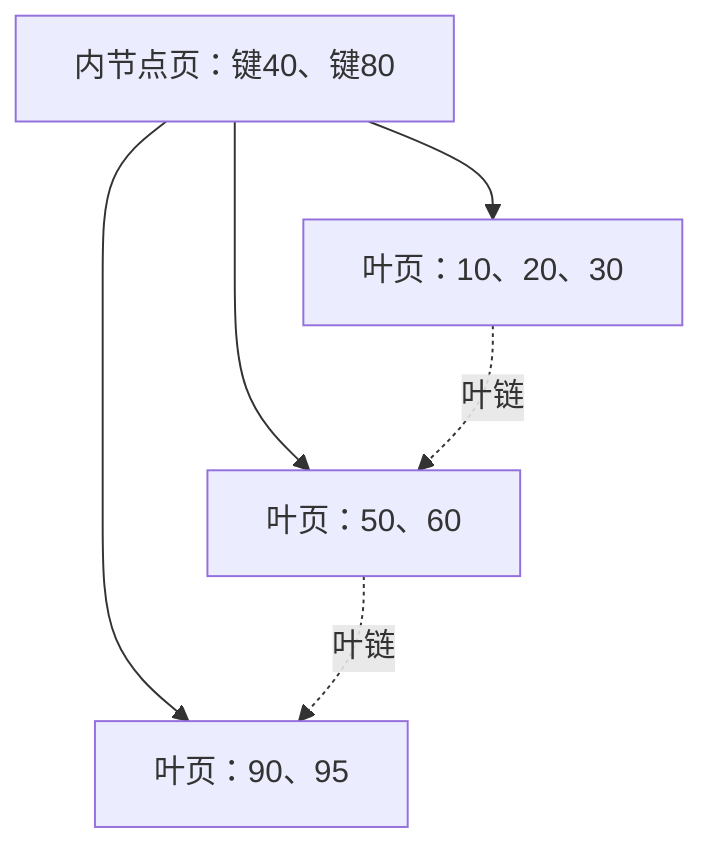

# $\rm Chapter \, 2$ 存储引擎：页、磁盘友好与 B+ 树

上一章把数据库文件看成了页的集合（§1.5），欠条清单里最先到期的是「按键查找」。本章回答：按键查找的结构为什么偏偏是 B+ 树。顺序是：先给磁盘访问立一个记账单位（代价模型），看 DBMS 默认怎么摆一张表（堆表），算一笔「红黑树在磁盘上破产」的账，从破产原因反推出 B+ 树的结构与阶数，最后用一百万键的模拟实验对账，并为第 3 章的索引代价预留接口。

> **开始前自检**：本章假设你已经会：
>
> 1. □ 接受「局部性决定内存访问速度」，见过缓存友好写法差出几倍的例子（计算机速通 §10.3）；
> 2. □ 会 `lower_bound` 与二分查找，明白比较次数与树高的关系（竞赛通用；§2.3 与 §2.5 的算账工具）；
> 3. □ 知道红黑树、跳表这类内存有序结构解决什么问题（竞赛通用；§2.3 要拿它们算账）；
> 4. □ 读过本书 §1.5：知道 DBMS 按固定大小的页读写数据，记得 $6066$ 页与每页约 $165$ 行两个数字。

## $\rm \S \, 2.1$ 代价模型：内存里数操作，磁盘上数页

cs 册 §10.3 让你见过内存内部的一层鸿沟：缓存命中与未命中差百倍。把镜头拉远，整条存储体系每层之间都隔着两三个数量级：

| 访问对象 | 单次随机访问量级 | 相对内存 |
| --- | --- | --- |
| 内存 | 约 $100\,\text{ns}$ | $1$ |
| NVMe SSD 随机读 | 约 $0.1\,\text{ms}$ | 约 $10^3$ |
| 机械盘寻道 | 约 $10\,\text{ms}$ | 约 $10^5$ |

（量级是当前常见硬件的经验值，随代际波动；不变的倍数关系才是重点。）SSD 完成一次随机读的时间里，CPU 能在内存里做几十万次比较：磁盘算法的瓶颈根本不在「比较了多少次」，而在「触碰了多少个不同的存储块」。所以本章记账只用一个单位：**页访问次数**：DBMS 每从磁盘取一页记一次，这个数字决定查询的快慢档位。cs 册 §10.6 讲过延迟与带宽不能互换，这里再补半句：磁盘上延迟（碰几页）主导一切，带宽（每页多大）只是配角。

## $\rm \S \, 2.2$ 堆表：DBMS 默认怎么摆一张表

最朴素的摆法：记录按插入先后打包进页，一页装满就开新页，页与页之间不排序，这种组织叫**堆表（heap file）**。页内布局三段：页头（空闲空间、槽数等元数据）、记录区、槽位目录（第 $i$ 条记录在页内的偏移）。于是「页内第几条」有目录可查，「在哪一页」则无人知晓。

堆表把插入做成了 $O(1)$ 的追加，代价正是 §1.4 亲眼所见的那条：按键查询退化成全表扫。补救不是给堆表排序（追加与有序的冲突 §1.2 已经演示过），而是另立一份按键有序的副本结构，让「键 → 哪一页哪一条」可以直达。这就是索引，cs 册 §26.5 你已经用过它的接口效果，本册第 3 章算它的代价。本章先回答它的形状问题。

页大小是各家 DBMS 的约定而非定律：SQLite 默认 $4\,\text{KB}$（§1.5 实测 $4096$），PostgreSQL 用 $8\,\text{KB}$，InnoDB 用 $16\,\text{KB}$。同一库内页大小固定，建库时定下，之后不能改。

## $\rm \S \, 2.3$ 破产算账：为什么磁盘索引不是红黑树

内存里的有序结构（红黑树、跳表）每一步是一次指针跳转，代价约等于一次内存访问。把它们原样搬进磁盘（节点存进页里，每一步变成一次页访问），账就崩了：

1. **页访问次数**：二叉结构存 $10^6$ 个键，树高 ${\lceil\log_2 10^6\rceil}=20$，一次点查要碰 $20$ 页。SSD 上约 $2\,\text{ms}$，机械盘上约 $0.2\,\text{s}$，上一章 $0.14\,\text{ms}$ 的按键查询在这里直接破产；
2. **页的利用率**：每个二叉节点独占一页 $4\,\text{KB}$，有用的键加两个指针不过几十字节，一页 $99\%$ 的字节在陪跑；
3. **加内存缓存也救不了**：树高 $20$ 意味着冷数据仍要多次下探，而数据库的职责恰恰是处理远大于内存的数据。

出路不在「少转几个弯」，而在「一次页访问多换几个键」：一个节点从 $1$ 键换成整页的 $d$ 个键，树立刻从二叉变成 $d$ 叉：

$$
h=\lceil\log_{d}N\rceil
$$

$d=256$ 时 $h=3$，$d=1024$ 时 $h=2$，页访问次数从 $20$ 掉到个位数。剩下的唯一问题：$d$ 能开多大？这由一页塞得下多少键决定，也就是下一节。

## $\rm \S \, 2.4$ B+ 树：一页一个节点

**B+ 树（B+ tree）**就是把这笔账落到实处的结构：多路平衡搜索树，一个节点占一页。



两条结构规则，分别治红黑树的两条死因：

1. **内节点只放路标**：键与孩子指针，不含数据。一页 $4096$ 字节，键 $8$ 字节加页号指针 $8$ 字节，一条路标 $16$ 字节，能放约 $256$ 条，即扇出（fanout）$d\approx 256$，正是 §2.3 公式里的 $d$。像楼层索引牌：牌上只有房间号，牌上找不到书；
2. **数据全在叶子，叶子串成链**：相邻叶页首尾相接，范围扫描从起点顺链横移即可，不用回头。像书架之间连通的走廊。

叶子要放「键加记录本体」，一条更宽，实测同量级：§1.5 那个库平均每页 $165$ 行。高度公式照搬 §2.3，代入数字：

$$
256^{2}=65536\;<\;10^{6}\;\le\;256^{3}\;\Longrightarrow\;h=3
$$

所以 $10^6$ 键的点查最多碰 $3$ 页：根、内节点、叶。范围取 $1000$ 个连续键，是 $3$ 页定位加沿叶链约 $5$ 页，合计个位数。对比 §2.3 红黑树的 $20$ 页。这就是「磁盘友好」四个字的全部含义。

## $\rm \S \, 2.5$ 模拟实验：一百万键的页访问账单

模型口径：$10^6$ 个有序键，每记录 $16$ 字节，页取 $4/8/16\,\text{KB}$ 三档，即每页 $256/512/1024$ 条。比较两种组织：有序文件加二分（每次探针碰一页）与按 §2.4 批量装出的 B+ 树（叶容量等于页条目数，扇出同）。随机种子 20261025：

```python
import math, random
random.seed(20261025); N = 1_000_000
def bsearch_pages(q, B):
    lo, hi, pages = 0, N - 1, set()
    while lo <= hi:
        mid = (lo + hi) // 2; pages.add(mid // B)
        if mid == q: return len(pages)
        lo, hi = (mid + 1, hi) if mid < q else (lo, mid - 1)
for B in (256, 512, 1024):
    lv, h = math.ceil(N / B), 1
    while lv > B: lv, h = math.ceil(lv / B), h + 1
    h += lv > 1; q5 = random.sample(range(N), 5000)
    print(f"B={B}: 二分 worst={max(bsearch_pages(q,B) for q in q5)} 页 | B+ 树高 {h} 页")
```

```text
B=256: 二分 worst=13 页 | B+ 树高 3 页
B=512: 二分 worst=12 页 | B+ 树高 3 页
B=1024: 二分 worst=11 页 | B+ 树高 2 页
```

读法四条：

1. $4\,\text{KB}$ 档：二分 $13$ 页对 B+ 树 $3$ 页，§2.3 的账兑现。二分比纸面上的 ${\lceil\log_2 3907\rceil}=12$ 还多一页：探针按记录走、不与页边界对齐，会多蹭到页；
2. 页大小每翻倍，二分只省约 $1$ 页，B+ 树直接少一层：两种「对数」的底的差别；
3. 范围扫描差距更大：完整模拟（$5000$ 次随机起点、每次取 $1000$ 个连续键）里 B+ 树平均总页数约 $6.9$（定位 $3$ 加顺读约 $4.9$）；二分组织要先付 $12$ 到 $13$ 页定位，再加约 $5$ 页顺读，合计约 $17$ 页。范围查询才是 B+ 树的碾压性项目；
4. 用真实数字复核：§1.5 的库有 $6066$ 个叶页，按扇出 $256$ 折算中间层 ${\lceil 6066/256\rceil}=24$ 页、根 $1$ 页，共 $3$ 层，与模型一致。模拟省略了页头与变长记录，做量级判断够用。

## $\rm \S \, 2.6$ 聚簇与二级：一份数据能有几棵树

回头看 §1.4：SQLite 没让你建任何索引，按键查询就快了，因为它的表本身就是一棵以 rowid 为键的 B+ 树（cs 册 §27.5 提过 rowid 的存在），整行就住在叶子里。这种「叶子即记录」的组织叫**聚簇索引（clustered index）**：表即索引，数据只此一份，主键点查与范围读都顺路。按非键列另建的索引是**二级索引（secondary index）**：一棵小 B+ 树，叶子放「键值加 rowid」，查到后拿 rowid 回聚簇树取整行。cs 册 §27.5.2 的「回表」正是这第二次下探。

两棵树，两本账：聚簇树永远一份，二级树每个列组合一份。每多建一棵，写入就多改一棵。这本账（空间、写放大、什么时候一棵覆盖索引能省掉回表）是第 3 章的全部主题。

## $\rm \S \, 2.7$ 关键概念回顾

1. 为什么磁盘算法的记账单位是页访问次数而不是 CPU 操作数？用 §2.1 的表说清倍数关系。
2. 堆表是什么、页内三段各是什么？它把哪种操作做成 $O(1)$，牺牲了什么？
3. 红黑树在磁盘上的两条死因是什么？分别被 B+ 树的哪条结构规则治好？
4. 扇出 $d$ 由什么决定？写出高度公式，并解释 $10^6$ 键在 $4\,\text{KB}$ 页下树高为什么是 $3$。
5. 聚簇索引与二级索引的叶子各放什么？「回表」发生在哪一步？

## $\rm \S \, 2.8$ 应用与辨析

1. 同学说：「把红黑树每个节点塞大一点，一个节点放 $100$ 个键连同数据，照样当磁盘索引。」这个方案差在哪？提示：想想内节点混入数据后路标变少、以及范围扫描怎么走。
2. DBA 把某库页大小从 $4\,\text{KB}$ 调到 $16\,\text{KB}$ 后，点查页访问从 $3$ 降到 $2$。这个收益是无条件免费的吗？从一次随机 I/O 的搬运量角度分析。
3. `SELECT * FROM t WHERE user='heidi'` 走二级索引后仍然慢。用本章结构说清慢在哪两步，并说出第 3 章会开的那味药叫什么。

## $\rm \S \, 2.9$ 本章自测答案

> 先闭卷作答 §2.7 与 §2.8，再核对。

### $\rm \S \, 2.9.1$ 关键概念回顾答案

1. 一次随机页访问约 $0.1\,\text{ms}$（SSD），期间 CPU 能做几十万次内存比较；比较次数藏在对数因子里，翻不出一个数量级，而页访问次数每差一次就差一个 $0.1\,\text{ms}$。所以记账只记页。（§2.1）
2. 堆表：记录按插入顺序装页、装满开新页、页间无序。页内三段：页头、记录区、槽位目录。$O(1)$ 的是追加写入；牺牲的是按键直达：只能全表扫。（§2.2）
3. 死因一：树高即页访问次数，$10^6$ 键二叉要 $20$ 页；死因二：一页一节点，利用率约 $1\%$。B+ 树用「内节点装满一页路标」压低树高，用「叶子串链」让范围扫描单程横移、不回根。（§2.3、§2.4）
4. $d$ 是一页装得下的路标条数，约等于页大小除以单条路标字节数（$4096/16\approx 256$）。$h=\lceil\log_{d}N\rceil$：$256^{2}=65536<10^{6}$，两层装不下，故 $h=3$。（§2.4）
5. 聚簇叶子放整行（表即索引，只有一份）；二级叶子放键值加 rowid。回表发生在二级树命中之后：拿 rowid 回聚簇树再下探一次。（§2.6）

### $\rm \S \, 2.9.2$ 应用与辨析答案

1. 数据混进节点，路标就变少：一页塞 $100$ 条「键加数据」后，能放的路标远少于 $100$，树高压不下去；而且范围扫描要走中序，在节点间上下回溯、重复触碰内节点页。B+ 树的要点是「每一层（包括叶子层）都装满一页」，内节点纯路标、数据全部下沉到链起来的叶子。（§2.3、§2.4）
2. 不免费。页翻四倍，一次随机 I/O 的起步搬运量也翻四倍：点查省一层页访问（约 $0.1\,\text{ms}$），但每次 I/O 多搬字节、缓存池能装的页变少、写放大变大；对小页命中率高的负载可能净亏。页大小是约定与权衡，不是越大越好。（§2.1、§2.2、§2.5）
3. 两步：先在二级树里命中所有 heidi 的叶子（这部分快），然后逐行拿 rowid 回聚簇树取整行，回表是逐行随机下探，命中行数一多就成了灾难（cs 册 §27.5.2 的放大效应）。第 3 章的药叫覆盖索引：把查询要的列并进二级索引，让回表不必发生。（§2.6）

---

现在我们知道索引为什么长成 B+ 树，也看见了它的影子成本：每多一棵二级树，写入就要多改一棵树。第 3 章把这本账算全：索引的空间与写放大、复合与覆盖索引，以及优化器怎么在多棵树之间做选择。

> 你现在能：用页访问次数给磁盘上的数据结构记账；从页大小推出 B+ 树的扇出与树高；解释聚簇与二级索引的分工、回表发生的位置；用一百万键的模拟数字复述二分组织与 B+ 树的差距。
