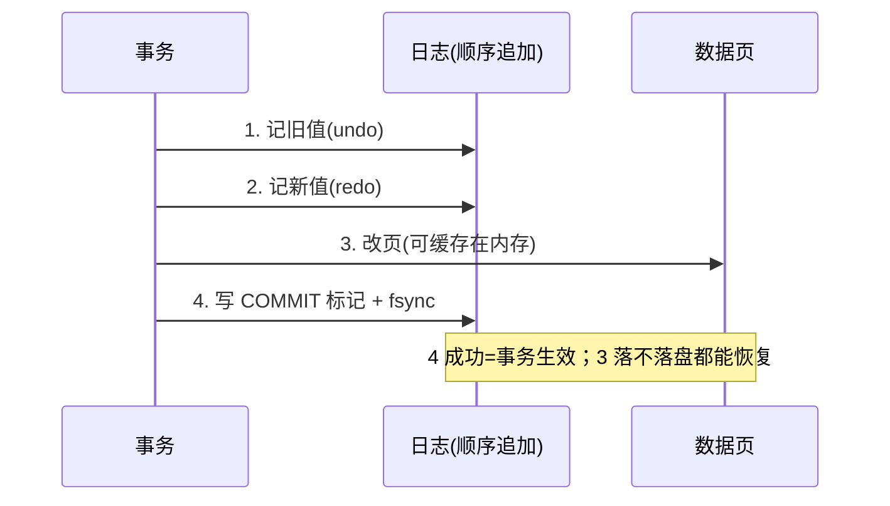

# $\rm Chapter \, 6$ 事务与 ACID：从一次崩溃说起

前五章的世界有个隐藏假设：机器永远健康、数据库永远只有一个用户。从本章起两个假设同时拆掉，先拆「不崩溃」：转账扣了 A 的 300 元、还没给 B 加上，进程死了，这 300 元去哪了？再拆「单用户」留给第 7 章。事务（transaction）是数据库对「半路出事」的全部答案，四个字母 ACID 各防一种具体的死法。

> **开始前自检**：本章假设你已经会：
>
> 1. □ 执行 BEGIN/COMMIT/ROLLBACK 的基本 SQL 语法（计算机速通 §26.5 的日常用法，本章讲原理）；
> 2. □ 说明页是读写的基本单位、改一行也要写整页（§2.1）；
> 3. □ 知道操作系统把文件写进「页缓存」、落盘由内核择机（操作系统分册 §8.1、§10.2）；
> 4. □ 写过「两条 UPDATE 必须同生共死」的业务代码（§6.1 的转账贯穿全章）。

## $\rm \S \, 6.1$ 事故现场：两条 UPDATE 之间死机会怎样

账本上 A、B 各 1000 元。转账 = 两条语句：

```text
UPDATE acc SET bal=bal-300 WHERE id='A';   -- 第一步
UPDATE acc SET bal=bal+300 WHERE id='B';   -- 第二步
```

第一步与第二步之间进程被杀/断电/磁盘满，数据库重开后是三种半截状态之一：钱从 A 消失但没到 B（总账少 300）；钱还没离开 A 但到了 B（凭空多 300）；页写了一半（A 的余额是乱码）。用户与审计都不接受任何一种。**事务的接口极简**：`BEGIN` 圈出「这几步算一个不可分割的单位」，`COMMIT` 宣布全部生效，`ROLLBACK` 宣布全部作废，剩下的问题全部交给数据库内部实现。

**本节小结**：半截转账有三种死状（钱消失、钱凭空多、页写烂），事务用 BEGIN/COMMIT/ROLLBACK 把「同生共死」做成一个极简接口，实现全留在数据库内部——后面几节就是拆这个内部。

## $\rm \S \, 6.2$ ACID 四个字母：各防一种死法

先分别定义再合体（四个概念容易背串，按「防什么」记最牢）：

1. **原子性（Atomicity）**：防「做到一半」。事务内的修改要么全部可见、要么全部不存在，没有中间态。对应死法：§6.1 的半截转账；
2. **一致性（Consistency）**：防「账本自相矛盾」。事务把数据库从一个合法状态带到另一个合法状态（约束、外键、触发器全部满足）。注意一致性是**应用与数据库共同的目标**：A+D 是数据库的技术承诺，C 是在 AID 之上由约束兜底的业务结果（转账后总额不变这条「业务等式」要靠应用声明约束或自己保证）；
3. **隔离性（Isolation）**：防「互相插队」。并发事务彼此看不见对方的中间态，效果上像排队执行。对应死法与完整解法在第 7 章，本章只给接口；
4. **持久性（Durability）**：防「 COMMIT 了却不认账」。一旦 COMMIT 返回，修改就扛得住之后的断电，哪怕磁盘缓存里还有没落盘的东西。

四个字母里最反直觉的是 C：它不是独立机制，是 AID 的结果加上业务约束的合奏，面试与教材最大的混淆点就在这。

**本节小结**：A 防「做到一半」、I 防「互相插队」、D 防「不认账」——这三个是数据库的机制承诺；C 防「账本自相矛盾」，它建立在 AID 之上，由约束与应用一起兜底。

## $\rm \S \, 6.3$ 朴素方案及其漏洞：先写哪边都坏

要保证「两条 UPDATE 同生共死」，先想到两条路，各有死穴：

1. **先在原地把 A 改了，B 改完才算成**：两步之间崩溃 = A 的改动孤零零躺着（半截态）；
2. **先把两页读出来、改在内存、一次写回**：可惜「一次写回」两页在磁盘上仍是两次 I/O，写完第一页、第二页没写就断电，一样是半截态。

死穴的根源是**一页一次写、两页必须两次写**，而断电不等人。任何「把多页修改做成一次物理写」的尝试都撞在磁盘的物理粒度上，除非先记**小账**。

**本节小结**：两条朴素路（改原地、攒内存一次写回）都死于「多页改不完就断电」，根源是磁盘只保证单次写的原子性——出路不在硬扛粒度，而在把账先记下来，这就是下一节的 WAL。

## $\rm \S \, 6.4$ WAL：先记账，后动账

预写日志（Write-Ahead Logging，WAL）的思路：把「我要改什么」先用一条**顺序追加**的日志记下来（日志是纯追加的小写，可以一次落盘），再慢慢改数据页。崩溃恢复时扫日志：

1. 事务已标记 COMMIT → **重做（redo）**：日志里记的修改逐条重放，哪怕数据页还没改，改完为止；
2. 事务没有 COMMIT 标记 → **撤销（undo）**：日志里同时记着「改之前是什么」（旧值），逐条倒放还原。

两条日志配一套规则，多页修改在逻辑上变成「先写一小条」。一张时序图把两阶段摆平：



> **竞赛生迁移提示**：这本质是「离线算法换在线正确性」，你已经会写「先全部算完再一次性输出」的离线程序（相当于先把整页改完再写盘）；WAL 是它的在线版：先把**意图**写下来（小代价），实际执行可以慢慢来。类比滚动数组题里「先记录转移再回溯还原」：崩溃恢复=从记录重走一遍。它与操作系统分册 §8.5 的文件系统日志、以及本章开头说的「银行先记账再动账」是同一个思想在不同层的重演：**把「多步操作的原子性」转译成「单条追加写的原子性」**，而单条追加写恰好是磁盘最擅长的事。SQLite 里 `journal_mode=WAL` 打开这套机制（§8 章展开它与并发的联动）；传统 rollback journal 则是「先存旧页再改」的镜像实现。

## $\rm \S \, 6.5$ 实测：回滚、提交与「杀进程」

三组实验（复现：建 `acc` 表两行，`transfer` 函数圈事务）：

```python
def transfer(amt, commit):
    conn.execute('BEGIN')
    conn.execute('UPDATE acc SET bal=bal-? WHERE id="A"', (amt,))
    conn.execute('UPDATE acc SET bal=bal+? WHERE id="B"', (amt,))
    conn.commit() if commit else conn.rollback()
```

第一组是 ROLLBACK 与 COMMIT 的可见效果（本机实测）：

```text
回滚后: [(1000,), (1000,)]     ← 两条 UPDATE 全部作废
提交后: [(700,), (1300,)]      ← 全部生效，总账守恒
```

第二组更狠：起一个子进程，在事务里插完 500 行、**故意不提交**，然后直接 `kill`（模拟崩溃；与真实断电的差别在「页缓存可能还有部分数据」，但未提交事务的判定不受影响，日志说了算）：

```text
子进程写完 500 行但未提交即被 kill，重开后表里 0 行（0 = 原子性生效，半截账不存在）
```

0 行，不是「大约一半」，而是精确的零：恢复逻辑在日志里找不到 COMMIT 标记，undo 把已写进数据页的 500 行全部抹掉。原子性的「要么全有要么全无」是字面意义。

## $\rm \S \, 6.6$ 持久性的价钱：fsync 的账

COMMIT 要扛断电，日志必须**真正落盘**，也就是 `fsync`（操作系统分册 §8.6 的同一份账）。SQLite 用 `PRAGMA synchronous` 给三档选择，实测 500 个「插一行即提交」的小事务（本机，Windows/NVMe）：

```text
synchronous=OFF   : 每事务 1.16 ms   ← 不等 fsync，断电可能丢最近事务
synchronous=NORMAL: 每事务 1.63 ms   ← WAL 下断电最多丢、不损坏
synchronous=FULL  : 每事务 2.17 ms   ← 每次 COMMIT 都 fsync，硬保证
```

实测读数里还有一条隐性信息：三档都远快于机械盘时代（那时 FULL 每次要等盘片转回来，毫秒级翻十倍），持久性的价格随硬件换代在降，但「OFF 与 FULL 差 2 倍」的结构关系不变，选型逻辑因此也不过时。

档位的语义差异要背准：OFF 的风险是**丢最近已提交的事务**（数据库文件本身仍一致，日志机制照样跑，只是不等盘）；FULL 才是「COMMIT 返回即永生」。本机 NVMe 上三档差距不足 2 倍，机械盘或网络文件系统上会拉开一个数量级，这也是「数据库别放 NFS 上」的经典理由（fsync 变成跨网往返）。选型直觉：钱包类业务 FULL，缓存/日志类可以 NORMAL。

**本节小结**：持久性按档位计价——OFF 丢「最近已提交」但账本不坏，NORMAL 在 WAL 下最多丢不损坏，FULL 是 COMMIT 即永生；价差随硬件缩小但结构关系不变，按业务丢不丢得起选档。

## $\rm \S \, 6.7$ 关键概念回顾

1. ACID 四个字母各防哪种死法？哪个字母是「技术承诺」、哪个是「合奏结果」？
2. 朴素方案的两条路各自的死穴是什么？根源在哪？
3. WAL 里 redo 与 undo 各处理哪种状态的日志？为什么日志可以「一次写」而数据页不行？
4. 杀进程实验里为什么恰好是 0 行而不是「一部分」？
5. `synchronous=OFF` 丢的是什么？为什么数据库仍然「一致」？

## $\rm \S \, 6.8$ 应用与辨析

1. 业务要求「订单创建后 10 分钟未支付自动取消」。有人说直接把「创建订单」和「插入取消任务」放一个事务里最稳妥。指出这个设计对 C 的误解与更合适的边界。
2. 团队把批量导入 100 万行的脚本包在一个大事务里跑 40 秒。评估这个做法的两面，并给出改进。
3. 同事的测试显示 `synchronous=OFF` 下 kill 进程「从没丢过数据」，于是主张生产用 OFF。给出反驳实验的设计思路。


## $\rm \S \, 6.9$ 本章自测答案

### $\rm \S \, 6.9.1$ 关键概念回顾答案

1. A 防「做到一半」、C 防「账本自相矛盾」、I 防「并发互相插队」、D 防「COMMIT 了不认账」。A、I、D 是数据库的技术承诺（各有日志/锁/MVCC 机制）；C 是 AID 的结果叠上业务约束的合奏，「总账守恒」这类业务等式要靠约束或应用声明。（§6.2）
2. 先改原地：两步间崩溃＝改动孤悬。先改内存再写回：「一次写回两页」物理上仍是两次 I/O，写完第一页断电照样半截。根源：磁盘以页为粒度、多页必多次写，而断电不等人。（§6.3）
3. 有 COMMIT 标记的日志→redo 重放补齐未落盘的页修改；无标记→undo 按日志里记的旧值倒放。日志是顺序追加的单条小写（一次 fsync 原子完成），数据页修改是分散多页的大写，前者磁盘做得到原子，后者做不到。（§6.4）
4. 恢复逻辑在日志里找不到该事务的 COMMIT 标记，判定为未完成，undo 把 500 行全部回滚。原子性保证的是逻辑边界（事务），不是物理边界（页），「一部分」这个状态在逻辑层不存在。（§6.5）
5. 丢的是最近若干已提交事务（fsync 未完成前的日志段）。数据库仍一致是因为日志与数据页的规则自洽：重启后要么日志重放成功、要么事务根本没被承认过，损坏的只会是「最近提交的持久性」，不是账本结构。所以 OFF 只可用于「丢了能重算」的数据。（§6.6）

### $\rm \S \, 6.9.2$ 应用与辨析答案

1. 误解在把「一致性」当数据库全责：取消任务的触发是时间性业务规则，事务只能保证「订单行与任务行同时存在」，保证不了「10 分钟后任务被履行」。边界画法：事务圈住写入（订单＋任务记录同生共死），履行动作交给定时扫描/队列。AID 管原子，调度管时间。（§6.2）
2. 好处：原子（中途失败整体回滚）、通常更快（一个事务摊薄 fsync）。代价：回滚段与日志膨胀、其他写者被挡（写锁的账在 §7.4）、40 秒无法增量验证。改进：按一万行一批分事务，每批原子、批间可断点续跑。（§6.5、§6.6）
3. OFF 的丢失窗口＝「COMMIT 返回到日志真正落盘之间」。实验要构造恰好在这个窗口里的崩溃，kill 进程不够（进程退出时页缓存仍会刷盘），要拔电/宿主机断电，或用故障注入工具在 fsync 前后精确断流，跑上千次统计丢失率。同事的 kill 测试只是没踩中窗口，不是窗口不存在。（§6.6）

---

单机崩溃的账结清了：要么全做要么全无、COMMIT 了就不认账。但 §6.2 埋的另一个死法还没拆：两个用户同时转账会怎样？下一章把镜头对准并发：两个连接抢同一行、三种读异常、以及隔离级别这道「安全与性能」的旋钮。

> 你现在能：按「防什么」默写 ACID 并指出 C 的合奏本质；讲清 WAL 把多页原子性转译成追加写原子性的机制；用杀进程实验解释为什么恰好 0 行；按业务选 synchronous 档位并说明各档丢什么。