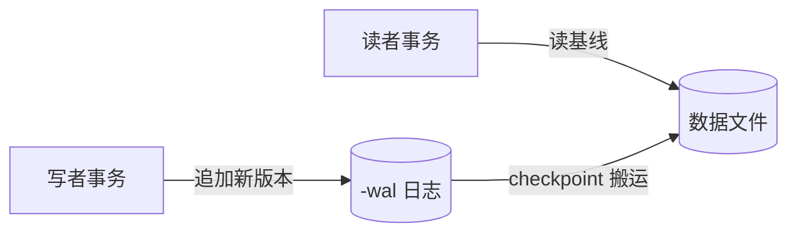

# $\rm Chapter \, 8$ MVCC 与日志：读写互不阻塞的实现

第 7 章留下了两个悬念：快照从哪来（读旧值不用复制整个数据库）？写锁为什么挡读者、又为什么不挡？答案在同一个地方：**多版本并发控制（MVCC，Multi-Version Concurrency Control）**：数据不止一份，每个事务看到自己的版本；而承载多版本的那个数据结构，就是第 6 章埋下伏笔的 WAL 日志本身。本章把引擎盖完全打开。

> **开始前自检**：本章假设你已经会：
>
> 1. □ 演示事务内快照的「稳」与跨事务直读的「变」（§7.2 两组实验会被直接引用）；
> 2. □ 讲清 WAL「先记账后动账」与 redo/undo（§6.4 的时序图）；
> 3. □ 解释锁的生命周期＝事务（§7.3 的两阶段锁）；
> 4. □ 知道页是磁盘读写的单位（§2.1）。

## $\rm \S \, 8.1$ 快照难题：旧数据放在哪

§7.2 里 c1 在事务内两次读都是 100，哪怕 c2 已经把值改成 200 并提交。要支撑这个行为，c1 读的「100」必须**物理上还存在某处**。磁盘上的那一行明明已经是 200 了。三种笨办法先排除：每次 BEGIN 复制整个数据库（开销不可接受）；把写挡在外面（那就退化成单用户）；给每行读都加锁（读多写少的服务直接锁死）。工程答案是第四种：**同一行同时存多个版本，每个事务按自己的时间戳挑版本**，这就是 MVCC 的全部直觉。剩下的问题：版本存哪、怎么挑、何时删。

## $\rm \S \, 8.2$ 两种日志模式：先看谁在挡谁

SQLite 有两种日志模式，挡与不挡的分界恰好落在它们之间：

1. **回滚日志（rollback journal，默认模式）**：改页之前，把**旧页**抄进旁侧日志；事务提交后删日志。读旧值靠「数据文件还没改」。于是写者改页期间，数据文件处于中间态，读者要读就得等写者回滚或提交完。互斥的根源：**新旧版本共用数据文件，中间态必须被遮住**；
2. **WAL（Write-Ahead Log 模式，`PRAGMA journal_mode=WAL`）**：反着来，数据文件不动，**新版本**追加进 WAL 日志；checkpoint 时才成批搬回数据文件。读者读数据文件（旧版本），写者写 WAL（新版本），两边物理上就不在一个文件里。

WAL 的写路径画成图（读路径走下面的旧基线，两不相交）：



实测把「谁挡谁」摆出来（复现：两连接，读者 `BEGIN` 后先 `SELECT` 持住读侧，写者再 `BEGIN IMMEDIATE` 写入并提交）：

```text
delete  : 读者持读锁期间 写者被挡: database is locked
WAL     : 读者持读锁期间 写者提交成功（读写并存）
```

回滚日志模式下写者的 COMMIT 要独占数据文件，读者不放手就 `database is locked`；WAL 模式下写者只往日志追加，与读者（读数据文件）互不相干。**读写互不阻塞不是魔法，是「新旧版本分家」的物理后果**。

## $\rm \S \, 8.3$ MVCC 的三步：版本、可见性、清理

WAL 天然就是版本库：每个提交的事务在日志里是一段带序号的增量。MVCC 在它之上补三件事：

1. **版本从哪来**：写者的每次提交都是 WAL 里的一段新版本（页级增量）；数据文件里的是旧基线；
2. **可见性怎么挑**：每个读者 BEGIN 时记下当前日志位点（快照点）。之后要读某页：数据文件的基线 + 「位点之前已提交」的日志段，拼出自己那个瞬间的世界。位点之后提交的段落一律不可见。§7.2 的「两次读都是 100」就是这么拼出来的：c2 的段落落在 c1 的位点之后；
3. **旧版本何时删**：日志不能无限长。**checkpoint** 把「所有活跃读者位点之前」的段落搬进数据文件，然后重用空间。活跃读者的最老位点因此成了清理的水位线：长事务不结束，日志就不能越过它清理。§7.4 说的「长事务杀伤力」在存储上的具体形态就是这个水位线被钉死。

把「位点挑版本」用一个 20 行的最小模型跑起来（不依赖数据库，纯 Python 演示可见性规则；复现核心 12 行）：

```python
log = []                                   # WAL: (提交序号, key, 新值)；None=未提交
def write(key, val, commit):
    log.append((len(log)+1 if commit else None, key, val))
def read(spot, key, base):
    val = base[key]                        # 数据文件基线
    for seq, k, v in log:                  # 位点之前已提交的段落按序覆盖
        if k == key and seq is not None and seq <= spot:
            val = v
    return val
```

模拟：段 1–2 已提交（x=100、y=5），段 3 已提交（x=200），段 4 未提交（x=300）；两个读者位点分别为 0 与 2。本机实测输出：

```text
T1 位点=0: x=0   y=0
T2 位点=2: x=100 y=5
（段3 已提交但序号 3 > 两者位点 → 看不见；段4 无提交标记 → 谁都看不见）
```

读法三条：位点 0 的 T1 连段 1、2 都看不见：它的世界停在开库瞬间（基线全 0）；位点 2 的 T2 看见段 1、2 但看不见段 3，因为「位点之后的提交不存在」；段 4 没有提交标记，无论位点多高都不可见。这就是**脏读在 MVCC 里的死法**：未提交的版本根本不进入可见性比较。这个模型与 §7.2 实验完全同构：把 T2 的位点换成 c1 的 BEGIN 位点，就是那组「100→100」的输出。

一句话收拢：**MVCC＝用空间换并发**：同一时刻多个版本并存（费空间），换来读写两不相扰（赚并发）；而「空间」由 checkpoint 收回来。

## $\rm \S \, 8.4$ 实测：-wal 文件与 checkpoint 的水位线

版本堆积肉眼可见（复现：WAL 库连插 5000 行后看 `-wal` 文件，再 checkpoint）：

```text
5000 次插入后 -wal 4023 KB
PRAGMA wal_checkpoint(TRUNCATE) -> -wal 0 字节
```

顺带一提两种 checkpoint：PASSIVE 是 SQLite 的自动档，写到一定量、且无读者挡路时顺手搬；TRUNCATE 是手动清障档，搬完把日志文件截断归零（下面的实测用的就是它）。

三样东西值得看。第一，`-wal` 文件从 0 涨到 4 MB：5000 个新版本全在日志里，数据文件还没动；第二，`TRUNCATE` checkpoint 后归零，所有段落搬进主文件、日志清空（生产默认的 PASSIVE 模式不清长度只重用空间，TRUNCATE 是显式清障）；第三，配合上一组实验的推论：只要有读者还锚在老位点，checkpoint 搬到水位线就得停。「日志暴涨」的第一排查项永远是「有没有不结束的长事务」（运维口诀：wal 涨、先查老事务）。
活跃位点的另一个副作用：checkpoint 每次都从水位线重扫，读者越老、搬运越碎，所以「偶尔有长查询」的服务，日志文件呈现出锯齿状增长而不是平稳水位，属正常形态，与暴涨（持续单调涨）要区分。残留文件名单也印证分家（关掉所有连接后 -wal/-shm 自动清理，只剩主文件，上一组实测的目录列表正是如此）：WAL 模式的库多出 `-wal`（版本库）与 `-shm`（位点共享内存）两个文件，回滚日志模式只有临时 `-journal`。

## $\rm \S \, 8.5$ 崩溃恢复：WAL 版的 redo

第 6 章的 redo/undo 在 WAL 模式下走简版：日志里**有 COMMIT 标记**的段落重放进数据文件（redo）；**没有标记**的段落直接忽略，因为数据文件从未被改过，不需要 undo。恢复因此更快也更简单（「先写日志再改文件」的同一逻辑在这里被贯彻到底）。对照表收拢两种模式：

| | 回滚日志（默认） | WAL |
| --- | --- | --- |
| 日志里存 | 旧页（undo 用） | 新页（redo 用） |
| 事务期间数据文件 | 被改成新值 | 保持旧值 |
| 读者与写者 | 互斥（文件共用） | 并存（分家） |
| 崩溃恢复 | 回滚未完成事务 | 重放已提交段落 |
| 代价 | 读写排队 | 空间＋checkpoint、单写者仍是库级 |

最后一行提醒：WAL 解决的是**读写**互斥，**写写**仍是库级单写（§7.3 的账不变）。SQLite 的定位从来是「读多写少的嵌入式」，两把锁合起来读它的适用面。

> **跨库视角**：多版本不是 SQLite 的专利，形态不同而已。PostgreSQL 把版本放在**表内**：每次 UPDATE 写一条新元组、旧元组打上「 xmin/xmax 」事务号标记，读者按事务号比大小挑版本，清理靠 VACUUM（对应 checkpoint 的水位线逻辑）；MySQL/InnoDB 则是「回滚段存旧版本」的镜像形态。识别同构的钥匙就一个问题：**旧版本存在哪、谁来清**。答案变了，快照与并发的外部行为不变（§7 的实验在任何一家都是同样的读数形态）。

## $\rm \S \, 8.6$ 关键概念回顾

1. MVCC 解决快照难题的思路是什么？三种笨办法各自错在哪？
2. 两种日志模式分别把「旧页/新页」存进日志？这对读写互斥性意味着什么？
3. 可见性的「位点」是什么？位点之后的提交为什么不可见？
4. checkpoint 的水位线由什么决定？日志暴涨的第一排查项是什么？
5. WAL 模式下为什么崩溃恢复不需要 undo？

## $\rm \S \, 8.7$ 应用与辨析

1. 服务运行一周后 `-wal` 文件 8 GB。给出三步排查与处置。
2. 「WAL 模式下读永远不被挡，所以报表可以开一小时的长事务慢慢跑」，指出两个问题。
3. 把 §7.2 的快照实验与本章的可见性规则串起来，解释「两次读都是 100」的完整数据通路，并用最小模型里的段 4 说明「脏读在 MVCC 里根本进不了比较」。

## $\rm \S \, 8.8$ 本章自测答案

### $\rm \S \, 8.8.1$ 关键概念回顾答案

1. 同一行多版本并存、各事务按位点挑。复制全库＝开销不可接受；挡写＝退化单用户；读加锁＝读写互相拖死。（§8.1）
2. 回滚日志存旧页（数据文件先改新值，中间态要遮住→互斥）；WAL 存新页（数据文件保持旧值→读者读文件、写者写日志，天然分家）。（§8.2）
3. 位点＝BEGIN 时 WAL 的长度位置。可见性规则＝「基线＋位点之前已提交的段落」；位点之后提交的段落对这个事务不存在。不是被挡，是按时间切的世界。（§8.3）
4. 水位线＝最老活跃读者的位点，checkpoint 只能搬它之前的段落。日志暴涨第一排查项：有没有永不结束的长事务钉住水位线。（§8.3、§8.4）
5. 数据文件从未被未提交事务改过（改的只是日志），没有「半改的现场」需要还原；忽略无标记段落即可，恢复＝纯 redo。（§8.5）

### $\rm \S \, 8.8.2$ 应用与辨析答案

1. ① 查活跃事务：`SELECT * FROM db pragma...`（SQLite 无全库事务表则查应用侧连接），找不结束的长事务；② 有则让应用收尾或断开；③ 无则手动 `PRAGMA wal_checkpoint(TRUNCATE)` 清障。根因不除（长事务）的话，checkpoint 只能停在水位线，清了还会涨。（§8.4）
2. 一：水位线被一小时的事务钉死，日志一周内清不动（正是题 1 的根因）。二：报表锚定的是一小时前的旧世界，跨这一小时的所有提交它都看不见——业务上「慢慢读」读到的可能是过时一个小时的库存。。长报表的正确姿势：短事务分批读（接受批间跳变）或走只读副本。（§8.3、§8.4）
3. 通路：c1 BEGIN 记位点（此刻 WAL 长度＝L）→ c2 的 UPDATE 作为新段落追加到 L 之后并提交 → c1 读 id=1：数据文件基线里是 100，L 之后无已提交段（c2 的在 L 后），拼出 100 → 第二次读同一位点同一条规则，仍是 100 → COMMIT 后 c1 新事务位点=L'（含 c2 段落），读到 200。（§7.2、§8.3）
（段 4 的补充）它的提交序号是 None——可见性规则要求「seq 非 None 且 ≤ 位点」，未提交版本在第一步就被过滤。脏读在锁方案里靠「挡」防、在 MVCC 里靠「不可见」防：不是不让读，是读了也不存在。（§8.3 模拟实验）

---

到这里，单机数据库的全部账本都翻完了：存储怎么放（§2–3）、查询怎么算（§4–5）、崩溃怎么扛（§6）、并发怎么处（§7–8）。最后一章走出单机：把数据复制到多台机器、切成多份，研究一致性与可用性的取舍，以及「选型」这道把前九章全部用上的综合题。

> 你现在能：解释 MVCC「空间换并发」的三步（版本/位点/checkpoint）；用两组实测说明两种日志模式谁挡谁；从 -wal 文件大小诊断长事务；画出 §7.2 快照实验的完整数据通路。
