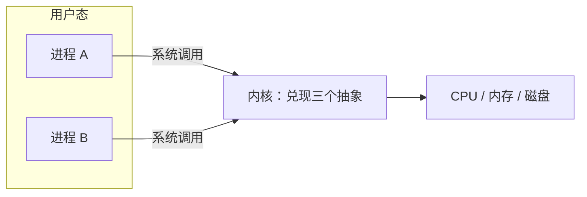

# $\rm Chapter \, 1$ 操作系统在管什么：进程、虚拟内存与文件

你在计算机速通册已经用过 `ps` 和 `top` 看进程清单，也听过「进程 = 演出」的说法（计算机速通 §11.5）。本章把镜头从「怎么用」转到「凭什么能这样用」：硬件本来只有一块 CPU、一条内存和一块磁盘，程序直接用它们会出什么事；操作系统靠哪三个抽象把「一块铁」变成能同时跑几百个程序还互不踩脚的机器；以及程序请求内核代劳的那扇门——系统调用。

> **开始前自检**：本章假设你已经会：
>
> 1. □ 用 `ps`、`top` 看过进程列表，接受「进程 = 演出」的比喻（计算机速通 §11.5）；
> 2. □ 知道 CPU 分用户态与内核态两层执行模式（计算机速通 §11.1）；
> 3. □ 会用终端重定向 `<` `>`，知道标准流占着 0、1、2 三个编号（计算机速通 §12.1）；
> 4. □ 写 C++ 时见过数组越界与野指针的破坏力（竞赛通用；§1.1 的第二场灾难靠它想象）。

## $\rm \S \, 1.1$ 没有操作系统时：程序直接用硬件会发生什么

把操作系统拿走，程序直接面对硬件，同时放两个程序 A、B 上这台机器，三场灾难依次登场：

1. **地址冲突**：可执行文件里的地址是链接器定死的，A 和 B 都认为「我的代码放在从低地址开始的内存里」。谁后加载，谁的代码就原样盖在前一个的代码上——第一个程序的下一条指令已经是别人的了；
2. **互相踩内存**：A 里一次越界写（数组开小、野指针，竞赛里都亲手犯过）恰好落在 B 的变量上，B 毫无报错地算出错答案。更糟的是无法归因：故障现场离肇事代码十万八千里；
3. **磁盘裸布局**：程序必须自己记住「我的记录存在第几号扇区」。A 和 B 都想用同一片扇区，就得人工划地盘；换一块硬盘或挪一下分区，所有程序全部作废。

三场灾难对应三种必须管起来的资源：CPU 的时间、内存的位置、磁盘上的数据。操作系统的答案不是「管得更严」，而是给每个程序发一套假象——三个抽象。

**本节小结**：三场灾难对应三种没人管的资源，这一节立起了「为什么非有操作系统不可」的问题；下一节给出的三个抽象，一人管一场。

## $\rm \S \, 1.2$ 三个抽象：进程、虚拟内存与文件

| 抽象 | 管住哪场灾难 | 一句话定义 |
| --- | --- | --- |
| 进程（process） | CPU 时间 | 程序的一次运行，连同它的全部账目，打包成可调度的「演出」 |
| 虚拟内存（virtual memory） | 内存位置 | 每个进程拿到一套自己的假地址，以为独占整台机器 |
| 文件（file） | 磁盘数据 | 统一的字节流：按路径打开、按偏移读写，扇区分配是内核的事 |

1. **进程**管的是「CPU 一次只跑一个程序怎么办」。你在 cs 册看到的 `ps` 清单，就是内核记下的演出场次表（计算机速通 §11.5）。这里补定义的另一半：进程不只是「正在运行的程序」，它是内核的记账单位——CPU 用到哪、内存划给谁、打开了哪些文件，全记在这场演出的账本上。下一章我们翻开这本账本；
2. **虚拟内存**管的是灾难 1 和 2：程序里的地址是**假地址（virtual address）**，访问时由内核与硬件合力翻译到真实的物理位置。两个程序都「从低地址开始」不再冲突，因为它们活在各自的假象里，物理上根本不重叠。cs 册 §12.2 让你见过现象（每个进程以为自己拥有整台机器）；翻译的机制是第 4 章，本章只需要接受这个结论；
3. **文件**管的是灾难 3：「第几号扇区」被换成「路径名 + 字节偏移」。程序不再知道、也不许知道数据在磁盘的哪个位置。§1.3 的实验会看到这套接口的真面目，磁盘上到底怎么摆是第 8 章的事。

三个抽象不是三件独立的事，而是同一道防线的三层：所有程序都活在抽象之上，一切与硬件的接触都穿过内核那扇门。



一条命令就能把三层串起来：`python score.py < in.txt`。Shell 先创建一个新进程（进程抽象），内核把 Python 解释器装进一套新的假地址（虚拟内存抽象），脚本每次读输入都经 fd 走文件接口（文件抽象）——你在 cs 册 §12.1 见过的重定向，正是三层在同时工作。

抽象不免费：每一次地址翻译、每一次进内核都要付出时间。从第 3 章起，我们会逐个给这些开销定价。

**本节小结**：三个抽象各接住一场灾难，系统调用是把它们串起来的那扇门；下一节走进门里，亲手触发几次系统调用。

## $\rm \S \, 1.3$ 系统调用：进内核的唯一一扇门

三个抽象都由内核兑现，而用户程序想请内核代劳——分配内存、打开文件、创建进程——只有一种方式：**系统调用（system call）**。执行它时 CPU 从用户态切进内核态，内核做完再把结果交回来。cs 册 §11.1 讲过这两层模式，本章补上「进门」这半句：这扇门是唯一的，不是众多接口中的一个。理由直接来自 §1.1：假如程序能绕过内核自己写磁盘、改地址翻译表，三场灾难原样回归。唯一的门，才有唯一的检查点。

用 Python 把三个动作各触发一次（Windows 10，Python 3.12.10 实测输出）：

```python
import os, subprocess, sys
print("parent pid:", os.getpid())            # 一次 getpid 系统调用
r = subprocess.run([sys.executable, "-c",
                    "import os; print('child pid:', os.getpid())"],
                   capture_output=True, text=True)
print(r.stdout.strip())                      # 新进程里又是一次 getpid
f1, f2, f3 = open("a.txt", "w"), open("b.txt", "w"), open("c.txt", "w")
print("fd numbers:", f1.fileno(), f2.fileno(), f3.fileno())
f2.close()
print("close fd 4 then reopen:", open("d.txt", "w").fileno())
```

```text
parent pid: 8260
child pid: 42940
fd numbers: 3 4 5
close fd 4 then reopen: 4
```

逐行读法：

1. 父子两个 pid 不同：两个 Python 解释器是两个进程，各自一本账（进程是记账单位的第一条证据）；
2. 打开三个文件得到编号 3、4、5：**文件描述符（file descriptor，fd）**是进程私有的一张「已打开文件表」的下标，0、1、2 被标准流占用，所以从 3 起编；
3. 关掉 fd 4 再打开新文件，又拿到 4：fd 是表槽位而不是文件本身，`close` 释放槽位后立刻被复用。这正是 cs 册 §12.1 里「重定向就是改 0、1、2 的指向」能成立的机制基础。

Linux 上有一个能直接看见系统调用的追踪器 strace（Windows 没有对应工具）。以下输出在 WSL2 的 Linux 6.6.87 内核下采集：

```text
$ strace python3 -c 'import os; os.getpid()'
execve("/usr/bin/python3", ["python3", "-c", "import os; os.getpid()"], ...) = 0
getpid()                                = 458
exit_group(0)                           = ?
```

`execve` 把 Python 解释器装进内存，`getpid` 是那行代码唯一想要的调用，`exit_group` 收场。用 `strace -c` 统计（同环境截选），更耐人寻味：

| 系统调用 | 次数 |
| --- | --- |
| rt_sigaction（装信号处理器） | 66 |
| close | 38 |
| mmap（向内核要内存） | 27 |
| getpid | 1 |
| execve | 1 |
| 合计 | 531 |

一行「只要 pid」的程序实际触发了 531 次系统调用，其中 `getpid` 只占 1 次——剩下的 530 次是解释器启动时在向内核要内存、读文件、装环境。程序对内核的依赖远比源代码表面上看起来的深。Windows 下想要类似的视野，Sysinternals 的 Process Monitor 以图形方式展示文件与注册表操作，但看不到系统调用级的完整流水，粒度与 strace 不同。

**本节小结**：系统调用是进内核的唯一一扇门，fd 是进程「已打开文件表」的槽位编号；strace 的 531 次提醒我们，程序的每一步实质动作都有内核在场。

## $\rm \S \, 1.4$ 一切皆文件：一条经验规则和它的失效边界

Unix 系统还有一条贯穿性的设计：把「能按字节读写的对象」尽量都挂成文件——普通文件、目录、终端设备、管道、套接字，甚至内核自己的状态（`/proc` 下的「文件」）。这是**经验规则**而非定律，收益是真实的：`open`、`read`、`write`、`close` 一套动词走遍天下，cs 册 §12.1 的重定向与管道那套组合拳，就是这条规则付给用户的第一笔红利。

它的失效边界同样要背下来：

1. **Windows 不认这套**：Windows 的句柄模型统一，但套接字是独立的句柄类型、设备要 `\\.\` 前缀、没有 `/proc`。跨平台程序不能假设「内核状态也能像文件一样读」；
2. **套接字只在读写环节像文件**：`connect`、`bind`、`listen` 这些建立连接的动作没有文件对应物，「皆文件」覆盖不了连接的生命周期；
3. **`/proc` 里的「文件」不是存储**：它们读两次内容可能不同、没有固定大小，是内核状态的实时窗口——把 `/proc` 当普通文件做缓存就会出错。

判断一个对象是否在这条规则覆盖内，办法只有一条：它是否真能 `open` 之后 `read` 出字节流。能，规则适用；不能，就回到各自的专用接口。

**本节小结**：「一切皆文件」是经验规则不是定律，收益是一套动词走遍天下，边界在 Windows、套接字连接与 `/proc` 三处；判断标准只有 open 之后能否 read。

## $\rm \S \, 1.5$ 关键概念回顾

1. 三场灾难各是什么？三个抽象分别管住哪一场？
2. 为什么系统调用必须是「唯一的门」？如果存在第二条路，§1.1 会怎样回归？
3. 文件描述符为什么从 3 开始编号？关闭 fd 4 后立刻重开，为什么新文件又拿到 4？
4. 「一切皆文件」属于定义、可验证事实，还是经验规则？说出它的一条失效边界。
5. strace 统计里「只要 pid」的程序触发了 531 次系统调用、`getpid` 只占 1 次，这组数字说明程序与内核是什么关系？

## $\rm \S \, 1.6$ 应用与辨析

1. 有同学说：「虚拟内存不就是拿硬盘上的页面文件当内存用吗？」这句话混淆了哪些层级？
2. 你的跨平台脚本在 Linux 上读 `/proc/self/status` 成功，在 Windows 上抛异常。用 §1.4 的边界解释原因，并给出一条两边都能跑的替代思路。
3. 两个终端同时向各自日志文件写数据，为什么互不覆盖对方的扇区？

## $\rm \S \, 1.7$ 本章自测答案

> 先闭卷作答 §1.5 与 §1.6，再核对。

### $\rm \S \, 1.7.1$ 关键概念回顾答案

1. 地址冲突（两个程序抢同一段物理内存）、互相踩内存（越界写毁掉别人）、磁盘裸布局（程序自己管扇区）。进程管 CPU 时间、虚拟内存管内存位置、文件管磁盘数据。（§1.1、§1.2）
2. 门唯一，检查才唯一。若能绕过内核直接写磁盘或改地址翻译，三个抽象全部失效，§1.1 的三场灾难原样回归。（§1.3）
3. fd 是进程私有「已打开文件表」的下标，0、1、2 被标准流占用，新打开的从 3 起。fd 编号是表槽位而非文件本身，`close` 释放槽位后立刻复用，所以重开又拿到 4。（§1.3）
4. 经验规则。失效边界任举其一：Windows 没有统一的「一切皆文件」（套接字独立类型、无 `/proc`）；套接字的连接建立动作无文件对应物；`/proc` 的「文件」是实时窗口不是存储。（§1.4）
5. 程序的每一步实质动作都穿过内核：哪怕是「只要一个 pid」的一行代码，背后也有几百次系统调用在向内核要内存、读文件、装环境——源代码的简洁不等于对内核依赖的稀薄。（§1.3）

### $\rm \S \, 1.7.2$ 应用与辨析答案

1. 混淆了抽象与实现：虚拟内存是「每个进程一套假地址」的抽象（§1.2），页面文件只是物理内存不够时的一种后备手段，且多数页根本不在磁盘上。机制在第 4 章展开。（§1.2）
2. `/proc` 是 Linux 提供的内核状态窗口，属于 §1.4 的边界 1 与 3：Windows 没有它，它也不是真文件。替代思路是用跨平台接口取同类信息，例如 Python 的 `os` 模块（`os.getpid()` 等）在两边语义一致。（§1.4）
3. 因为「往哪个扇区写」不是程序决定的：文件抽象把扇区分配收归内核，两个进程各自持有 fd，内核负责让它们的字节流落在不同位置。（§1.2、§1.3）

---

三个抽象里，进程排在第一位，也是你接下来最需要拆开的一个：它在内核里究竟由哪些字段构成、怎么被复制与替换、退出之后谁来收尸。下一章打开进程的账本。

> 你现在能：说出三场灾难与三个抽象的一一对应；用 `os.getpid`、`open`、`subprocess` 演示系统调用并解释 fd 从 3 起编；讲清为什么进内核的门只能有一扇；指出「一切皆文件」在哪些场合失效。
