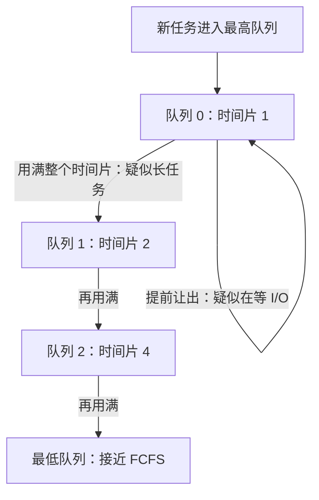

# $\rm Chapter \, 3$ CPU 调度：从 FCFS/SJF 到时间片轮转

上一章收尾时把三个问题留给了调度器：谁先上场、演多久、什么时候被请下台。本章把它们逐个摆上台实测：先来先服务会被一个长任务拖垮全场（护航效应）；最短作业优先在平均意义上最优，代价是要求操作系统预言未来；时间片轮转放弃「最优」，用频繁切换换回响应速度——三种策略在同一份任务集上的真实模拟数字会在 §3.4 摊开对比。之后看多级反馈队列如何从行为反推任务类型，瞥一眼 Linux 的 CFS/EEVDF，最后落到负载的两种形状与调度对策。

> **开始前自检**：本章假设你已经会：
>
> 1. □ PCB 的字段清单，尤其是寄存器现场与「状态」字段（本书 §2.1）；
> 2. □ 时间片到点存现场、换人装现场的切换机制（计算机速通 §11.2）；
> 3. □ 「进程 = 演出」的比喻与 `ps` 进程清单（计算机速通 §11.5）；
> 4. □ 会跑 Python 脚本并逐行读 f-string 输出（本书 §1.3、§2.5 练过）。

## $\rm \S \, 3.1$ 一套 CPU，几十个就绪进程：调度器在平衡什么

CPU 只有一套，就绪的进程往往几十个——§2.1 的 PCB 里那个「就绪」状态，对应的正是内核里排着的队伍。谁先上场，是**调度器（scheduler）**的裁量。先划清范围：本章只讨论单个 CPU 核上的调度，多核的排队与负载均衡是另一层问题，同一套指标照用。裁量之前先定尺子，本章用到两把：**吞吐率（throughput）**，单位时间完成的任务数；**响应时间（response time）**，从提交请求到第一次得到回答。

尺子之间互相打架：让编译这种大任务独占 CPU，吞吐率最高，但终端会卡到像死机；反过来每个任务都切一小口，响应漂亮，切换本身的开销却在吃掉吞吐率。另一对张力是公平与优先：公平要求每个任务按人头分 CPU，优先要求重要的任务多分——两者天然冲突，给谁说理都得多让一步。所以调度没有全局最优解，只有按负载做出的取舍——本章后面每种策略，都是在这个天平上选了一个支点。

## $\rm \S \, 3.2$ FCFS：排队办事与护航效应

最朴素的策略是**先来先服务（First-Come, First-Served，FCFS）**：就绪队列排成一条 FIFO，队头跑到退出才轮到下一个。衡量队伍之苦用**等待时间（waiting time）**：任务在就绪队列里干等的时长。手工算一个三任务的小账（同时到达，时长 20、2、2）：按 A、B、C 的顺序跑，B 干等 20、C 干等 22，平均等待 $(0+20+22)/3 = 14$；换成 B、C、A 的顺序，平均等待只有 $(0+2+4)/3 = 2$。同样的任务，只换顺序，等待差 7 倍。

一个长任务堵在队头、后面所有短任务陪着干等，这叫**护航效应（convoy effect）**：窄桥上轿车被货车护着一起龟速前进。真实系统里，一次全量备份或一个跑飞了的编译，足以让全机的交互请求排成长队。

> 竞赛生迁移提示：OJ 的评测队列就是 FCFS。比赛刚开始几百个提交堵在一起，你前面有一个跑满时限的暴力解，你的提交就得干等——护航效应在评测记录里看得一清二楚。

## $\rm \S \, 3.3$ SJF：最优解与它的预言要求

对护航效应最直接的反击是把短任务先跑：**最短作业优先（Shortest Job First，SJF）**。在「同时到达、不可抢占」的前提下它平均等待最优，理由一句话说尽：队列里只要有一对相邻任务时长逆序（长的在前），交换它们，后面每个任务的等待都只减不增——把逆序对换光，剩下的升序就是 SJF。

最优的前提却是操作系统满足不了的：任务要跑多久，跑完才知道。现实调度器只能用历史估未来，经典口径是指数平均：把最近一段实测时长 $t_n$ 与旧预测 $\tau_n$ 加权混合成下一次的预测

$$
\tau_{n+1} = \alpha \, t_n + (1 - \alpha) \, \tau_n
$$

$\alpha$ 接近 1 就只信最近一段，接近 0 就信长期平均——预测永远跟着行为修正，「反馈」二字在调度里的第一次出场就在这里，第二次在 §3.5 的队名里。SJF 还有第二重代价：短任务源源不断时，长任务可能永远轮不上——**饿死（starvation）**。下一节的轮转调度从另一条路绕开这两个困难。

## $\rm \S \, 3.4$ 时间片轮转与一场实测实验

**时间片轮转（Round-Robin，RR）**的规则：每人最多连跑一个时间片，到点被请下台、排到队尾，现场整份存取进 PCB——这个动作就是上下文切换（context switch），§2.1 里寄存器现场字段的用武之地。RR 明确放弃「谁短谁先」，改押响应与公平。比较前再钉一个指标：**周转时间（turnaround time）**＝完成时刻 − 到达时刻，等待时间 = 周转 − 实际运行。

固定一份 8 任务集（同时到达，把全部差异归给调度策略本身），FCFS、SJF 与五种时间片各跑一遍。本节与 §4.7 的模拟在 Windows 10 / Python 3.12.10 实跑，固定 `random.seed(2026)`，任务集与输出在任意平台逐位一致。复现（12 行，也可用 `python3 - <<'PY'` 的 heredoc 方式执行）：

```python
import random; from collections import deque
random.seed(2026)
jobs = [(f"P{i}", random.randint(1, 12)) for i in range(8)]; print("任务集(名, 时长):", jobs)
def sim(tag, q, pick):
    t, comp, rem, rq, disp, first = 0, {}, {n: b for n, b in jobs}, deque(jobs), 0, {}
    while len(comp) < len(jobs):
        i = pick(rq) if q is None else 0; n, b = rq[i]; del rq[i]; disp += 1; first.setdefault(n, t)
        s = rem[n] if q is None else min(q, rem[n]); t += s; rem[n] -= s
        rq.append((n, b)) if rem[n] > 0 else comp.__setitem__(n, t)
    print(f"{tag:7s} 等待 {sum(comp[n]-b for n,b in jobs)/8:.2f}  周转 {sum(comp.values())/8:.2f}  响应 {sum(first[n] for n,_ in jobs)/8:.2f}  调度 {disp} 次")
sim("FCFS", None, lambda r: 0); sim("SJF", None, lambda r: min(range(len(r)), key=lambda i: r[i][1]))
for k in (1, 2, 4, 8, 16): sim(f"RR q={k}", k, None)
```

```text
任务集(名, 时长): [('P0', 2), ('P1', 6), ('P2', 9), ('P3', 9), ('P4', 11), ('P5', 2), ('P6', 4), ('P7', 10)]
FCFS    等待 21.50  周转 28.12  响应 21.50  调度 8 次
SJF     等待 15.62  周转 22.25  响应 15.62  调度 8 次
RR q=1  等待 28.88  周转 35.50  响应 3.50  调度 53 次
RR q=2  等待 27.12  周转 33.75  响应 7.00  调度 28 次
RR q=4  等待 27.75  周转 34.38  响应 11.75  调度 17 次
RR q=8  等待 28.50  周转 35.12  响应 19.25  调度 12 次
RR q=16 等待 21.50  周转 28.12  响应 21.50  调度 8 次
```

四条读法。1. SJF 平均等待 15.62 全场最低，§3.3 的最优性拿到数字；FCFS 的 21.50 是被最长的 11 单位任务 P4 堵出来的。2. 响应一列随时间片缩小单调变好：21.50 → 19.25 → 11.75 → 7.00 → 3.50，q=1 时开局第一轮里每个任务最多等 7 个单位就摸到一次 CPU——RR 买的就是这个。3. 代价记在「调度」一列：q=1 要做 53 次调度决策，恰好等于总 CPU 需求 53（每单位时间切一次），每次都是一存一装两份寄存器现场。4. q=16 那行与 FCFS 完全相同：时间片大到没人会被打断，轮转退化成先来先服务——这行就是「时间片不能太大」的证据。还注意等待一列 RR 全面差于 FCFS：RR 不是为平均等待设计的，用等待换响应，这笔账要在自己的负载上算。

## $\rm \S \, 3.5$ 多级反馈队列：不预言，靠行为反推

SJF 要预言、FCFS 护航、RR 只顾公平。**多级反馈队列（Multi-Level Feedback Queue，MLFQ）**换思路：预言不可靠，行为可观察——用任务已经表现出的样子反推它是什么。设多条优先级递减的队列，规则四条：

1. 新任务一律进最高优先级队列：先假设它是很快让出 CPU 的短任务；
2. 优先级越高，时间片越短：交互要的是频繁被服务，不是大片时间；
3. 用满了整个时间片还没跑完，降到下一级：它八成是长任务；
4. 时间片没用完就主动让出（多半是去等输入输出），留在本级别。



拿一个总时长 8 的纯计算任务走一遍：在队列 0 用满片 1 被降级，队列 1 用满片 2 降级，队列 2 用满片 4 降级，最后在最低队列用片 8 跑完——四步走完，它已被识别为长任务。换成「算 1 单位、等一次 I/O」循环 8 次的任务：每次都提前让出，永远留在队列 0，每轮 I/O 期间 CPU 让给别的任务，这正是交互程序该有的待遇。

MLFQ 的每个判断都是**猜测**而非预言：先做初始化再进入纯计算的程序，开局像短任务，会被一路降级冤枉；反过来，任务只要赶在时间片用完前让出一次，就能一直赖在最高级。现实内核的对策是记总账（统计任务实际获得的 CPU 时间），别让「装交互」白嫖优先级。低优先级队列还有饥饿风险，主流实现会周期性把所有任务提升回最高队列（boost），给长任务翻身机会。

## $\rm \S \, 3.6$ 一瞥 Linux：CFS 与 EEVDF

Linux 走的又是另一条路：完全公平调度器（Completely Fair Scheduler，CFS）不用队列，给每个任务记一笔**虚拟运行时间（virtual runtime，vruntime）**——谁累计跑得少谁最「亏欠」，下一个上场；全部任务按 vruntime 排进一棵红黑树（你写过），每次取最左节点，插删都是 $O(\log n)$。`nice` 值在这套账本里变成权重：高权重任务 vruntime 涨得慢，自然多分到 CPU。内核 6.6 起 CFS 被 EEVDF（Earliest Eligible Virtual Deadline First）接替：在 vruntime 之外再算一个虚拟截止时间，让「早该被服务却没被服务」的任务更早胜出，时延不再靠队列位置碰运气。本机 WSL2 的内核实测 `uname -r` 为 6.6.87.2-microsoft-standard-WSL2，恰好站在这次换血之后的版本线上。

## $\rm \S \, 3.7$ I/O 密集与 CPU 密集：负载的两种形状

按行为给负载分类：**I/O 密集（I/O-bound）**任务的运行模式是短促 CPU 突发加漫长 I/O 等待，编辑器、shell、Web 服务都长这样；**CPU 密集（CPU-bound）**任务是长段连续计算，编译、矩阵乘法、压缩。两者向调度器索要的东西完全不同：I/O 密集不在乎一次拿多长 CPU，在乎多快被响应，否则用户敲一个键半天没回音；CPU 密集不在乎多快开跑，在乎别被频繁打断——每次上下文切换都白扔一整套寄存器现场和热起来的缓存。

于是有本章最实用的一条经验规则：给 I/O 密集任务更高优先级几乎不亏——它反正马上让出 CPU，占高位的成本极低，却把整条交互链路提速；CPU 密集沉到低优先级换大片时间，吞吐不受损。MLFQ 的升降级规则，本质上就是在自动完成这个分类。你在 cs 册 §11.5 用 `top` 见过的 NI 列，展示的正是 `nice` 值——手动版优先级旋钮，往负拧是「我重要」，往正拧是「我不急」。

## $\rm \S \, 3.8$ 关键概念回顾

1. 护航效应是怎么产生的？为什么它对交互负载格外致命？
2. SJF 在什么前提下平均等待最优？它有哪两个现实困难？
3. 实验里 RR q=16 一行为什么与 FCFS 完全相同？q 缩到 1 的代价是什么？
4. MLFQ 用哪两种行为信号区分任务类型？任务可以怎样「骗」它？
5. CFS 的 vruntime 与 MLFQ 的降级规则，分别用什么手段逼近公平？

## $\rm \S \, 3.9$ 应用与辨析

1. 编译服务器上有人跑 `make -j64`，全组终端立刻卡顿。用本章概念解释现象，并给出两条缓解方向。
2. 「RR 是比 FCFS 更先进的调度，所以平均等待一定更短。」用 §3.4 的数字指出这句话错在哪。
3. 游戏服务器把物理引擎线程提到最高优先级后，帧率反而更抖。结合 I/O 密集与 CPU 密集的分类，给出一种可能的解释。

## $\rm \S \, 3.10$ 本章自测答案

> 先闭卷作答 §3.8 与 §3.9，再核对。

### $\rm \S \, 3.10.1$ 关键概念回顾答案

1. FCFS 严格按到达顺序且不可抢占，队头的长任务把后面所有短任务堵成一条队。交互任务的短请求被压在长计算后面，响应时间失控——而它本来只需要几个单位。（§3.2）
2. 前提：所有任务同时到达且不可抢占。任何相邻逆序对交换后总等待严格减少，升序即最优。困难：任务时长是未来信息，只能用历史估计；短任务源源不断时长任务饿死。（§3.3）
3. q=16 不小于最长的 11 单位任务，每个任务都在一个时间片内跑完，RR 退化为 FCFS。q=1 的代价是 53 次调度决策（恰等于总 CPU 需求），每次上下文切换的存现场装现场都在吃实际算力。（§3.4）
4. 信号一：用满时间片则降级（像长任务）；信号二：提前让出去等 I/O 则留级（像交互）。骗法：赶在时间片用尽前故意让出，即可赖在最高队列；内核靠统计总账与周期性 boost 缓解。（§3.5）
5. MLFQ 按行为的形状升降优先级，看任务「像什么」；CFS 记 vruntime 欠账，谁欠得多谁先跑，看账本是否平衡，`nice` 把公平参数化成份额。前者是分类，后者是记账。（§3.5、§3.6）

### $\rm \S \, 3.10.2$ 应用与辨析答案

1. `make -j64` 造出 64 个 CPU 密集任务，交互任务被压在长队或低优先级里，护航效应全场生效。缓解：降低编译任务的优先级（调高 `nice`）或限制它能用的核数——本质是别让 CPU 密集负载坐在交互负载前面。（§3.2、§3.7）
2. 错。等待一列 RR 全面差于 FCFS（q=1 时 28.88 对 21.50）：RR 用平均等待换响应（3.50 对 21.50）。两个策略优化不同指标，没有谁更先进，只有负载要什么。（§3.4）
3. 物理引擎是 CPU 密集负载，提为最高优先级后它频繁把渲染、音频这类 I/O 密集线程从 CPU 上挤下去，整条「等 I/O 再响应」的管线被拖慢，帧与帧之间供给不匀。CPU 密集任务的正确待遇是大片时间或受限份额，不是最高优先级。（§3.7）

---

调度解决「谁用 CPU」，但每次切换都要给下一个进程换一套完整的内存布景：第 1 章承诺「每个进程以为独占整台机器」（§1.2），§2.1 的账本里也确实躺着「页表指针」字段，可它怎么把假地址变成真地址、查一次表要花多少钱，都还没有答案。下一章拆开页表、地址翻译与 TLB。

> 你现在能：用护航效应解释长任务卡顿全局；说清 SJF 为什么最优又为什么不可用；引用 §3.4 的数字讲时间片大小的取舍；复述 MLFQ 的四条规则与防作弊手段；一句话讲出 vruntime 的公平思想。
