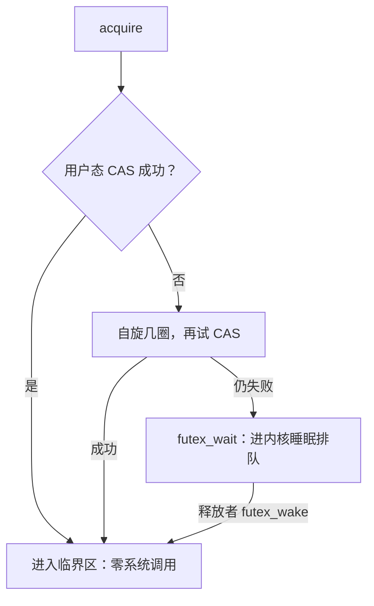

# $\rm Chapter \, 6$ 并发原语：从关中断到 CAS 与 futex

第 2 章的竞态实验结尾留了一句承诺：给计数器加一把 `threading.Lock`，实测 3 次全部精确等于 200000，「锁的机制是第 6 章的主题」（§2.5）。本章兑现承诺：先看清最朴素的「先检查再设置」差在哪条缝里，再沿历史把答案逐层加码（中断屏蔽、原子指令、自旋锁、futex），每一层都在回答同一个问题：怎样把「读-改-写」三步钉成不可分割的一步；最后算一笔粗锁与细锁的账，看锁的旋钮拧向哪里。

> **开始前自检**：本章假设你已经会：
>
> 1. □ 读-改-写交错丢更新的实验与结论（本书 §2.5）；
> 2. □ 用户态与内核态两层模式、系统调用是唯一的门（本书 §1.3、计算机速通 §11.1）；
> 3. □ 时间片切换与「进程 = 演出」（计算机速通 §11.2）；
> 4. □ 会读状态机式的小段 Python 模拟（本书 §3.4 的调度模拟练过）。

## $\rm \S \, 6.1$ 一条指令的缺口：test-then-set 的间隙

§2.5 的账已经很清楚：两个线程各自把计数器增 $10^5$ 次，结果只有约一半，线程 1 读到 5、还没写回 6，线程 2 也读到 5 并写回 6，线程 1 随后把自己的 6 盖上去，两次自增只剩一次。丢更新发生在「读」与「写」之间的缝里，缝的宽度由调度器决定，程序自己说了不算。

锁要提供的保证因此只有一句话：同一时刻至多一个线程在**临界区（critical section）**里，临界区就是访问共享变量的那段代码。最初的直觉是拿一个共享变量当门闩：进门先检查 `lock == 0`，是就写入 1，出门写回 0。麻烦在于「先检查再设置」本身就是一次读-改-写：检查与设置之间的缝，正是上一段那条缝。两个线程都读到 0、都把自己当赢家、肩并肩走进临界区，锁形同虚设。结论先立在这：用会被打断的普通指令，造不出不被打断的保证；缺的是硬件出手。

**本节小结**：竞态的缝在指令与指令之间，普通指令造不出不被打断的保证；接下来三层加码，每层都在找更硬的原子性。

## $\rm \S \, 6.2$ 中断屏蔽：单核时代的第一代答案

单核处理器上，并发只有一种形态：交错。能打断执行流的只有中断（时钟到点、I/O 到达），切换因此只能发生在中断边界上。那么进临界区前把中断关掉，缝自然消失，检查与设置之间不会再有任何打断。这就是**中断屏蔽（interrupt masking）**，至今仍是内核保护自己内部数据结构的手段之一：内核更新几条指令就能改完的小表时，顺手关掉中断。

它有两处失效边界：

1. 多核直接击穿：屏蔽只作用于本核。线程 A 在核 1 上关掉中断，线程 B 在核 2 上照跑、照改同一个门闩，缝原样敞开；两核各自都关也一样，各自关各自的，谁也拦不住谁；
2. 代价不可忽视：关中断期间时钟与 I/O 一并失聪，关久了整机失去响应；何况它是特权指令，用户态程序根本没有执行的权限，中断屏蔽天生是内核的自用工具，从来不是给应用的锁。

多核时代需要的是一条跨核也作数的原子指令。

## $\rm \S \, 6.3$ 原子指令：test-and-set 与 compare-and-swap

硬件的出手方式是把「读-判-写」压成一条指令：CPU 保证它从头执行到尾、中途不接受打断；另一核想碰同一个内存位置，必须等这条指令做完（跨核排他的底层是缓存一致性协议，机制超出本章范围）。两个最常用的形态：

1. **测试并设置（test-and-set）**：原子地「读出旧值、写入 1」，返回旧值。返回 0 说明门闩原来开着、刚被你拨上，你是赢家；返回 1 说明别人已在临界区；
2. **比较并交换（compare-and-swap，CAS）**：原子地「若 *ptr 仍等于期望值 expected，则写入新值 new」，并报告是否成功。期望值与新值都任意，test-and-set 只是「期望固定为 0、新值固定为 1」的特例。

CAS 直接给出丢更新的通用解法：把「读 tmp；写 tmp + 1」换成「CAS(位置, 期望 tmp, 新值 tmp + 1)，失败就重来」，写回前核对世界是否变过，变过就重来，不覆盖任何人的修改。§6.4 的实验全程只用 CAS。

**本节小结**：原子指令把读-判-写钉成一步，CAS 是其中的通用形态，「失败即重来」是它的正确用法；下一节用它搭锁并实测这层语义。

## $\rm \S \, 6.4$ 自旋锁与一次 CAS 语义实验

用 CAS 搭一把锁只要一行：`while not CAS(&lock, 0, 1): pass`赢家进临界区，输家原地转圈重试，这就是**自旋锁（spinlock）**。

动手验证之前先诚实交代环境：Python 有 GIL（§2.5 补过：CPython 当前实现的线程切换在微秒级，踩不进纳秒级的读改写窗口），线程级真并行演示不出原子指令的价值。所以本实验不追求真并行，而是搭一个确定性调度器：两个线程各建一台状态机（读一步、写一步），调度器按固定种子的随机序列每次挑一台推进一步；CAS 版与「直接写回」版跑同一调度规则，对比的就是 CAS 的语义本身。想看跨进程的真竞争，`multiprocessing` 能绕开 GIL，但确定性交错已足够把语义看清楚。本实验与 §3.4、§4.7、§5.6 同环境实跑（Windows 10 / Python 3.12.10），固定 `random.seed(2026)`。复现（12 行）：

```python
import random; random.seed(2026); N = 50000
def run(cas):
    cnt, tmp, pend, ok, fail, rng = 0, [0, 0], [False, False], [0, 0], 0, random.Random(2026)
    while ok[0] < N or ok[1] < N:
        t = rng.randrange(2)
        if ok[t] >= N: continue
        if not pend[t]: tmp[t] = cnt; pend[t] = True
        elif not cas: cnt = tmp[t] + 1; pend[t] = False; ok[t] += 1
        elif cnt == tmp[t]: cnt = tmp[t] + 1; pend[t] = False; ok[t] += 1
        else: tmp[t] = cnt; fail += 1
    return cnt, fail
for c in (False, True): cnt, fail = run(c); print(f"{'直接写回' if not c else 'CAS    '}: 终值 {cnt}  丢更新 {2*N - cnt}  CAS失败重试 {fail}")
```

```text
直接写回: 终值 62615  丢更新 37385  CAS失败重试 0
CAS    : 终值 100000  丢更新 0  CAS失败重试 50196
```

三条读法：

1. 直接写回：100000 次自增丢掉 37385 次。确定性调度器把 §2.5 那次「连跑 5 次、丢掉约一半」的竞态变成固定数字，竞态的本质是交错的自由度，不是概率玄学；
2. CAS 版：终值精确 100000。10 万次自增里 50196 次撞上「别人先写了一步」，每一次都被重试救回。CAS 的语义价值不是「不出错」，而是「错了必然知道、必然能重来」：失败只说明世界的值变过，重读、重算、再试就好；
3. 代价也写在数字里：CAS 版多走了 50196 步重试。原子性买来的正确性，账单开在重试上。这正是 §6.5 要引入睡眠的原因之一。

## $\rm \S \, 6.5$ 从自旋到睡眠：互斥锁的三层实现

自旋锁的适用范围很窄：临界区极短、核又多时，转几圈比睡一觉便宜（睡着要进内核，醒来还要重新排队）；临界区一长，转圈就是纯烧，输家把时间片烧光，赢家被堵在后面反而更慢。工程答案是三层递进：

1. 第一层，自旋：赌临界区马上结束，转几圈再试 CAS；
2. 第二层，让权：几圈拿不到就主动让出 CPU（yield 或睡一小会儿）。缓解但不解决，睡多久靠猜，睡过头临界区早空了，睡不够白醒；
3. 第三层，内核排队：Linux 的 **futex（fast userspace mutex）**把「睡与叫醒」做成系统调用，CAS 失败的线程执行 `futex_wait` 进内核，挂到这把锁的等待队列上睡觉；持锁者释放时若队列非空，执行 `futex_wake` 叫醒一位。



这套设计的要害是快慢分离：无竞争时，锁的全部成本就是一条 CAS，系统调用一次都不发生。这不是推导，是可以实测的事实。两个小脚本：无竞争版只有「主线程 acquire 后立刻 release」三行；阻塞版让主线程先拿住锁，再启动子线程去 acquire（必然撞上），睡 0.2 秒后释放：

```python
import threading, time
lk = threading.Lock()
lk.acquire()                                        # 主线程先拿住锁
t = threading.Thread(target=lambda: lk.acquire())   # 子线程必然撞上被持有的锁
t.start(); time.sleep(0.2); lk.release(); t.join()  # 子线程睡进内核队列，释放时被叫醒
```

strace 只统计 futex 这一类系统调用（以下输出在 WSL2 的 Linux 6.6.87 内核下采集）：

```text
$ strace -f -c -e trace=futex python3 uncontended.py | tail -3
  0.00    0.000000           0         1           futex
------ ----------- ----------- --------- --------- ----------------
100.00    0.000000           0         1           total
$ strace -f -c -e trace=futex python3 blocked.py | tail -3
100.00    0.001497          83        18         3 futex
------ ----------- ----------- --------- --------- ----------------
100.00    0.001497          83        18         3 total
```

无竞争的 acquire 与 release 全程只有 1 次 futex，与 `python3 -c pass` 的纯启动基线相同，即锁本身 0 次；必然撞锁的场景涨到 18 次（多次采集在 15 到 20 之间浮动，每次运行的调度不同）。撞锁现场的内核握手长这样（哪条线程在等、哪条在放每次运行不同，这里只看动作）：

```text
630   futex(0xb49280, FUTEX_WAIT_BITSET_PRIVATE, 0, {tv_sec=90, ...} <unfinished ...>
672   futex(0xb49280, FUTEX_WAKE_PRIVATE, 1 <unfinished ...>
630   <... futex resumed>)              = 0
672   <... futex resumed>)              = 1
```

同一地址上，一条 `FUTEX_WAIT` 把等待方送进内核队列睡觉，一条 `FUTEX_WAKE` 叫醒队列里的一位，等待方从同一次调用里恢复返回，「内核排队」不再是抽象说法，就是这两个系统调用。§2.5 那把 `threading.Lock` 的 acquire 在 Linux 上走的正是这条路径：快路径一条 CAS，慢路径 futex。

**本节小结**：futex 的要害是快慢分离——无竞争零系统调用，撞上了才进内核排队；实测的 1 次对 18 次 futex 就是这条分界线。

## $\rm \S \, 6.6$ 信号量与条件变量一瞥

锁只回答「谁现在能进」；并发程序还要回答「什么时候轮到我等的事件」。两个经典原语各用一句话立此存照：

1. **信号量（semaphore）**：一个计数器加两个原子操作，P 把计数减 1（减成负数则睡眠），V 把计数加 1（队列里有人就叫醒一位）。初值 $N$ 的信号量天然是「N 个名额」的发放器：限流、资源池、生产者-消费者的空位计数；初值 1 的信号量就是一把互斥锁；
2. **条件变量（condition variable）**：让线程「睡到某条件成立」，wait 释放锁并入睡，被叫醒后重新持锁返回；notify 叫醒等待者。它必须与锁配合使用：检查条件与入睡之间也是一条缝，锁负责把这条缝钉住。

Python 标准库的 `threading.Semaphore` 与 `threading.Condition` 是这两个原语的直译；第 7 章的死锁会把多把锁同时摆上桌。

**本节小结**：信号量管名额发放，条件变量管「睡到条件成立」，两者都站在锁的肩膀上；多把锁同场时，会出现一种新的死法。

## $\rm \S \, 6.7$ 锁的粒度：粗锁与细锁的账

锁的设计还有一个旋钮：一把锁罩多大。粗锁罩住整个模块，正确性最好管；细锁按数据分片各配一把，争用面小。两者的账记在不同科目上，先算一笔纸上账（假设各请求临界区互不重叠、调度理想，数字可手算）：

1. 8 个请求、各需 1 ms 临界区、4 核。粗锁一把：全部在一扇门前排队，8 ms 走完，其余 3 核全程闲置，多核买来的算力被一把锁如数退还；
2. 同样负载分 4 片各配一把锁：4 条队伍并行，2 ms 走完，吞吐 4 倍。

细锁不是免费午餐：每把锁的 acquire 与 release 即使无竞争也要付 CAS 与缓存行同步的价钱（计算机速通 §10.3 的量级感），锁一多，簿记开销反噬并行收益；而「同时持有多把锁」会把程序送进下一章的领地，死锁。经验规则：先粗后细，实测出争用热点再拆锁。Python 的 GIL 是粗锁的极端样本：整个解释器一把锁，正确性无忧、多核并行归零，§2.6 建议 CPU 并行改用进程，正是在绕开这把粗锁。

**本节小结**：粗锁省心但退还吞吐，细锁提速但付簿记与死锁风险；先粗后细、实测再拆，拆的时候记得下一章的排序纪律。

## $\rm \S \, 6.8$ 关键概念回顾

1. 「先检查再设置」的缝在哪两条指令之间？为什么锁不能用两个普通赋值实现？
2. 中断屏蔽在单核上为什么有效？多核上怎样失效，代价是什么？
3. test-and-set 与 CAS 是什么关系？CAS 失败意味着什么、正确动作是什么？
4. futex 的快路径与慢路径各发生在哪里？§6.5 的实测证据是什么？
5. 自旋、让权、内核排队三层各赌什么？粗锁与细锁的账分别记在哪个科目？

## $\rm \S \, 6.9$ 应用与辨析

1. 同学说：「在临界区前后各关一次中断，多核上也能实现互斥。」指出推理错在哪一步。
2. 你的服务把每个请求的处理都包在一把全局锁里，QPS 上不去、CPU 却很闲。解释现象并给出两条改造方向。
3. 有人看完 §6.4 说：「CAS 失败 50196 次，说明 CAS 很慢。」用同一实验的数字反驳。

## $\rm \S \, 6.10$ 本章自测答案

> 先闭卷作答 §6.8 与 §6.9，再核对。

### $\rm \S \, 6.10.1$ 关键概念回顾答案

1. 缝在「检查 lock == 0」与「写入 1」两条指令之间：两个线程可以先后各读到 0，各自以为自己是唯一赢家。普通赋值保证不了读-判-写的原子性，锁必须由一个不可分割的「检查并设置」动作兜底。（§6.1）
2. 单核上并发即交错，交错只能发生在中断边界，关中断即封死所有边界，缝消失。多核失效：屏蔽只对本核生效，另一核照改共享变量。代价：关中断期间时钟与 I/O 失聪，整机可能失去响应；且它是特权指令，用户态无权使用。（§6.2）
3. test-and-set 是「期望 0、写 1」的特例，CAS 是期望值与新值都任意的通用形态。CAS 失败说明内存位置的当前值已不等于期望值，期间有人改过；正确动作是重读新值、重算、再试，绝不覆盖。（§6.3）
4. 快路径纯用户态（一条 CAS，零系统调用），慢路径才 futex_wait 与 futex_wake 进内核排队。实测：无竞争的 acquire 与 release 全程 1 次 futex（与纯启动基线相同，锁本身 0 次）；必然撞锁的场景涨到 18 次，trace 里可见成对的 WAIT 与 WAKE。（§6.5）
5. 自旋赌「临界区马上结束」，赌输就烧 CPU；让权赌「睡多久合适」，赌注靠猜；内核排队不赌，竞争成真才睡进队列。粗锁的账记在吞吐上（串行化退还多核算力），细锁的账记在簿记与持锁顺序上；GIL 属于粗锁的极端。（§6.5、§6.7）

### $\rm \S \, 6.10.2$ 应用与辨析答案

1. 错在「关中断影响全局」这一步：屏蔽只作用于本核，另一核上的线程照常运行并改同一个变量，缝没有闭合。多核互斥只能靠跨核原子指令（§6.3）；关中断在多核上的实际效果只剩本核暂时不被打断，还附赠响应性代价。（§6.2）
2. 现象是 §6.7 的粗锁账：所有请求在唯一一扇门前串行，多核算力闲置，吞吐被临界区总时长锁死。改造方向一：按数据分片拆锁（例如按用户或按分区各配一把）；方向二：缩短临界区，把 I/O 与重计算挪到锁外，只把真正碰共享变量的几行留在里面。（§6.7）
3. 慢要拿对照组说话：同一调度下，直接写回「快」的前提是丢掉 37385 次更新、结果全错；CAS 的 50196 次失败全部转化为重试，换来精确的 100000。失败次数大说明争用烈度高，而 CAS 把每次争用变成一次可承受的重试，它的对手从来不是「不出错的世界」，是「出错还不自知」的版本。（§6.4）

---

到这里，让多个执行流安全协作的工具箱已经备齐：原子指令、锁、信号量、条件变量。但工具一多就有人同时拿两把，两个线程各持一把锁、都在等对方手里那把，谁也不放。下一章把这种新的死法机器化：死锁的四个必要条件，以及逐条破解的手段。

> 你现在能：指出 test-then-set 的缝并用 CAS 钉死它；解释中断屏蔽为何只对单核有效；引用实测数字说明 futex 快路径不进内核；按自旋、让权、睡眠三层讲完一次 lock.acquire() 的完整旅程；算出粗锁在多核上退还了多少吞吐。
