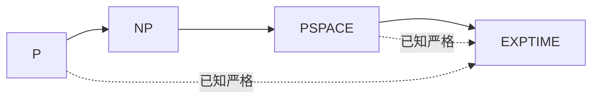

# $\rm Chapter \, 3$ 复杂性类：P、NP 与包含关系图谱

第 2 章的地图把问题分成两半：算得出来的与算不出来的。本章给「算得出来」的那一半定价。定价的骨架是一个包含关系链条 $\mathrm{P} \subseteq \mathrm{NP} \subseteq \mathrm{PSPACE} \subseteq \mathrm{EXPTIME}$，链条上哪些环节已证严格、哪些悬而未决，本章全部标明。链条的骨架靠一条定理撑起：时间层次定理，它是对角化在「快慢」上的重演。

> **开始前自检**：本章假设你已经会：
>
> 1. □ 会把判定问题写成语言：$L \subseteq \{0,1\}^*$，算法正确即判定器对所有输入停机且回答恰当（形式语言册 §1.1）；
> 2. □ 知道对角化的骨架：给一切候选编号，在编号等于内容处唱反调（§1.4、§2.4）；
> 3. □ 接受模型之间的多项式等价，知道复杂度类因此不挑合理模型（§1.3）；
> 4. □ 记得形式语言册 §9.2 的 $2^n$ 表：$n=20$ 约百万状态、$n=40$ 分钟级。

## $\rm \S \, 3.1$ 时间可构造与时间层次定理

定义类之前要先排除一个病态：不是任何函数都能当「时间上限」用。机器总得先知道还剩多少时间才好掐表，而知道 $f(n)$ 至少要花时间把 $f(n)$ 算出来。称 $f$ 是**时间可构造函数（time-constructible function）**，若存在图灵机恰好在 $O(f(n))$ 步内于纸带上写出 $f(n)$ 的表示。常见函数 $n$、$n \log n$、$n^k$、$2^n$ 全部时间可构造，竞赛遇到的一切复杂度都在内。

定义**确定性时间类（deterministic time class）** $\mathrm{DTIME}(f)$：能被 $O(f(n))$ 时间的图灵机判定的语言全体。核心定理（白话：只要时间上限本身会算，预算再稍微放宽一点，就必然有新语言冒出来——时间变多却原地踏步反倒是病态）：

$$
\text{时间层次定理：若 } f \text{ 时间可构造，则存在语言在 } O(f \cdot \log^2 f) \text{ 时间内可判定、但不在 } \mathrm{DTIME}(f) \text{ 中。}
$$

单带机器上模拟开销更大，可以粗化成一个好记的形式：$\mathrm{DTIME}(f) \subsetneq \mathrm{DTIME}(f^3)$（$\subsetneq$ 读作「真包含于」，左边是右边更小的真子集，不只是子集），时间每放宽三次方，就一定多出新的语言。放宽平方与放宽立方哪个精确成立取决于机器带数，本章用不着抠，统一称「严格分层」。

证明思路是对角化的重演，值得走一遍。要对角化的对象是「$f$ 时间内运行的机器」$M_1, M_2, \ldots$，构造语言 $L$：输入 $w$，先花 $O(f(|w|))$ 步把 $|w|$ 对应的机器编号 $e$ 恢复出来并启动模拟（时间可构造性在此入场）；模拟 $M_e$ 跑在 $w$ 自身上，预算 $f(|w|)$ 步；若 $M_e$ 在预算内**接受** $w$，则 $L$ 拒绝 $w$，否则接受。模拟本身要付对角化常数与日志因子，所以预算放宽到 $f \cdot \log^2 f$。两件事随之成立：$L$ 在放宽后时间内可判定（模拟 $M_e$ 比它自己慢一个模拟因子）；$L$ 与每台 $M_e$ 在输入 $w_e$（长度足以让编号 $e$ 出现在对角线上）处答案相反，故没有一台 $M_e$ 判定 $L$。与第 2 章的对角化对照：这次唱反调的不是「是否停机」而是「是否在预算内接受」，而预算放宽正对应第 1 章的模拟开销——同一个自引用骨架，填的账不同。

**本节小结**：本节先用时间可构造函数排除「机器算不出自己的预算」的病态，再用对角化证出严格分层：预算放宽，必有新语言。这是链条上两处「已证严格」的全部火力来源。

## $\rm \S \, 3.2$ P、NP 与 coNP：验证者定义

**P 类**：多项式时间内可判定的语言全体，$\mathrm{P} = \bigcup_k \mathrm{DTIME}(n^k)$。多项式等价（§1.3）保证这个定义在 RAM 与图灵机上给出同一个类。

**NP 类**用验证者定义，这是本章的主定义。语言 $L$ 属于 NP，当且仅当存在多项式时间的**验证者（verifier）** $V$ 与多项式 $p$，使得：

$$
x \in L \iff \text{存在某证书 } c,\ |c| \le p(|x|),\ V(x, c) = 1
$$

证书（certificate）长度多项式受限，验证者逐位读完证书后给出是与否。SAT 的验证者吃「赋值」当证书：按赋值逐子句检查，线性时间。哈密顿回路的验证者吃「回路本身」当证书：沿回路走一遍核实每条边存在。NP 的直觉一句话：**找解可能很难，验解必须便宜**。P 与 NP 的关系就是「能找」与「能验」的关系：能找显然能验（证书留空，自己找），所以 $\mathrm{P} \subseteq \mathrm{NP}$；反过来能不能从「能验」推出「能找」，是全章乃至全学科最著名的问题。

**coNP** 是补问题类：$L \in \mathrm{coNP}$ 当且仅当 $\overline{L} \in \mathrm{NP}$。它接住「否答案反而好验」的问题：SAT 的补（无任何满足赋值）在 coNP 里，因为「不存在满足赋值」没有一个短证书能自己证明自己，却天然有 NP 形式的反例空间。$\mathrm{P} = \mathrm{NP}$ 会连带 $\mathrm{NP} = \mathrm{coNP}$（补一个多项式判定器即可），所以 $\mathrm{NP} \ne \mathrm{coNP}$ 的证明会自动解决 $\mathrm{P}$ vs $\mathrm{NP}$；已知 $\mathrm{NP} \ne \mathrm{coNP}$ 与 $\mathrm{P} = \mathrm{NP}$ 同样悬而未决。

验证者定义要落到代码才算数。SAT 的验证者两行：

```python
def verify_SAT(formula, cert):   # cert: 一份赋值, 长度 = 变量数, 多项式受界
    return all(any(lit_true(lit, cert) for lit in clause) for clause in formula)
```

读法：$V$ 拿到公式与证书后逐子句、逐文字核对，多项式时间；$x \in \mathrm{SAT}$ 时存在证书（那组满足赋值）使它返回真，$x \notin \mathrm{SAT}$ 时任何证书都过不了。注意验证者从不找赋值，它只裁判；「找」的全部困难被推给了「存在哪份证书」。哈密顿回路的验证者同构：证书是回路，验证沿边核对，几行代码换一个名词。

**本节小结**：本节立起三个类：P 是「能找」，NP 是「能验」（证书 + 多项式验证者），coNP 是「否答案好验」；P 与 NP 的关系就是「找」与「验」的差距，全章乃至全学科都在追它。

## $\rm \S \, 3.3$ 包含关系图谱

四个类按定义层层相套：$\mathrm{P} \subseteq \mathrm{NP} \subseteq \mathrm{PSPACE} \subseteq \mathrm{EXPTIME}$。中间两个类的含义：**PSPACE** 是多项式空间可判定（时间不限，重用空间即可，且由 Savitch 定理非确定性只多付平方空间）；**EXPTIME** 是 $\bigcup_k \mathrm{DTIME}(2^{n^k})$。链条的已证与开放如下：



1. **已证严格**：$\mathrm{P} \subsetneq \mathrm{EXPTIME}$，直接由时间层次定理得出（$n^k$ 与 $2^n$ 之间隔着严格分层）；$\mathrm{PSPACE} \subsetneq \mathrm{EXPTIME}$ 由空间层次定理同理得出。两个严格分离互不借用，各靠一条层次定理；
2. **开放**：$\mathrm{P}$ vs $\mathrm{NP}$、$\mathrm{NP}$ vs $\mathrm{PSPACE}$、$\mathrm{P}$ vs $\mathrm{PSPACE}$ 全部未知。注意 $\mathrm{P} \subsetneq \mathrm{EXPTIME}$ 只保证链条上至少一处严格，而那一处已被上面两条认领，帮不上中间环节的忙；
3. **共识**：学界普遍猜测链条四处全部严格。下一章的 NP 完全性理论建立在「猜测第一处严格」上，第 5 章的 Ladner 定理则说明：即使 $\mathrm{P} \ne \mathrm{NP}$，NP 里也远不止两层。

链条的每一处「$\subseteq$」也各有一个具体的理由，写一遍有助记住：$\mathrm{P} \subseteq \mathrm{NP}$ 是证书留空的验证者；$\mathrm{NP} \subseteq \mathrm{PSPACE}$ 是把全部配置图（多项式大）做可达性搜索，深度优先只花多项式空间；$\mathrm{PSPACE} \subseteq \mathrm{EXPTIME}$ 是多项式空间只有指数多个格局，配置图上判定接受至多走指数步（重访检测防绕圈）。三句话全是「把定义念一遍」的功夫，真正费力的是严格分离那一侧，层次定理正是为此而生。

**本节小结**：本节画完链条：四个类层层相套，两处严格分离（P⊊EXPTIME、PSPACE⊊EXPTIME）各靠一条层次定理，中间三处开放；每一处包含都有「把定义念一遍」级的理由。下一节用真数字给「多项式对指数」定手感。

## $\rm \S \, 3.4$ 数值例：多项式与指数的距离

类的定义说了半天「多项式对指数」，值得用真数字压一压。下表对比 $2^n$ 与 $n^3$（精确整数值，Python 直接计算）：

| $n$ | $2^n$ | $n^3$ | $2^n / n^3$ |
| --- | --- | --- | --- |
| 20 | 1 048 576 | 8 000 | 131 |
| 25 | 33 554 432 | 15 625 | 2 147 |
| 30 | 1 073 741 824 | 27 000 | 39 768 |

$n=20$ 时指数只贵两个数量级，$n=30$ 时已经贵四万倍。增长率（$n$ 增 5，比值乘约 31，即 $2^5$）才是分层的本质：比值本身会一直涨下去，多项式永远追不上。这正是「类的成员资格比常数与多项式指数都重要」的数值面孔。

把视角转到竞赛题面，规模约束就是复杂度类提示（下表数字按 $10^8$ 次基本运算每秒折算，由脚本逐行计算核对）：

| 题面规模 | 可行的复杂度 | 运算量 | 折算秒数 |
| --- | --- | --- | --- |
| $n \le 20$ | $2^n \cdot n$（状压枚举） | $2.1 \times 10^7$ | 0.21 s |
| $n \le 100$ | $n^3$ | $1.0 \times 10^6$ | 0.01 s |
| $n \le 500$ | $n^3$ | $1.25 \times 10^8$ | 1.25 s |
| $n \le 5000$ | $n^2$ | $2.5 \times 10^7$ | 0.25 s |
| $n \le 5000$ | $n^2 \log n$ | $3.1 \times 10^8$ | 3.08 s |
| $n \le 10^5$ | $n \log n$ | $1.7 \times 10^6$ | 0.02 s |
| $n \le 10^6$ | $n$ | $1.0 \times 10^6$ | 0.01 s |

读法：$n \le 20$ 的题出题人就是在暗示指数枚举（形式语言册 §9.2 的 $2^n$ 表在同一位置）；$n \le 5000$ 卡掉立方、放过平方；$n \le 10^5$ 起线性对数是底线。题面的每个数字都对应链条上某个类里「恰好可行」的那档算法，这套对应表竞赛生背过，本章只是给它盖了理论上的章。

## $\rm \S \, 3.5$ 关键概念回顾

1. 时间可构造函数排除的是什么病态？为什么 $2^n$ 与 $n^{100}$ 都满足它？
2. 时间层次定理的对角化里，「唱反调」调的是哪个量？预算为什么要放宽 $\log^2 f$？
3. 用验证者定义陈述 NP。证书与验证者分别对应 SAT 与哈密顿回路的什么？
4. $\mathrm{NP} \ne \mathrm{coNP}$ 与 $\mathrm{P} = \mathrm{NP}$ 两个问题谁更强？方向是什么？
5. 链条 $\mathrm{P} \subseteq \mathrm{NP} \subseteq \mathrm{PSPACE} \subseteq \mathrm{EXPTIME}$ 上已证严格的哪两处各靠什么定理？
6. $n \le 20$ 与 $n \le 5000$ 的题面约束各自暗示哪一档算法？

## $\rm \S \, 3.6$ 应用与辨析

1. 有人把 NP 展开成 non-polynomial。错在哪？给出正确读法。
2. 时间层次定理能否证明 $\mathrm{P} \ne \mathrm{NP}$？沿着「NP 里的机器也是机器」这条路走会卡在哪里？
3. 一个语言的验证者要求证书存在时接受、不存在时拒绝。若把验证者放宽为「证书存在时接受、不存在时可以不停机」，得到的是哪个类？它与 NP 的差别在哪？
4. $n \le 3000$、时限 2 s 的题，$n^2 \log n$ 算法可行吗？用 §3.4 的表折算并给结论。
5. $\mathrm{P} = \mathrm{NP}$ 会推出 $\mathrm{EXPTIME} = \mathrm{NP}$ 吗？用已证严格的结果排除。

## $\rm \S \, 3.7$ 本章自测答案

> 先闭卷作答 §3.5 与 §3.6，再核对。

### $\rm \S \, 3.7.1$ 关键概念回顾答案

1. 排除「机器无法在预算内得知预算」的病态：$f$ 必须能被某机器在 $O(f(n))$ 步内算出，机器才能掐表。$2^n$ 可由反复倍增算出，$n^{100}$ 由连乘算出，都能赶上自己的值。（§3.1）
2. 调的是「是否在预算内接受」：$L$ 的定义恰与 $M_e$ 在 $w_e$ 上的判定相反。放宽 $\log^2 f$ 是付给逐格模拟的对角化常数与日志因子，预算必须比被模拟者稍大。（§3.1）
3. $x \in L$ 当且仅当存在长度 $\le p(|x|)$ 的证书 $c$ 使多项式时间验证者 $V(x, c)$ 接受。SAT 的证书是赋值、验证者逐子句核对；哈密顿回路的证书是回路本身、验证者沿边核对。（§3.2）
4. $\mathrm{NP} \ne \mathrm{coNP}$ 更强：$\mathrm{P} = \mathrm{NP}$ 时补运算保持多项式判定，立即 $\mathrm{NP} = \mathrm{coNP}$，故证出前者自动解决后者；反之不成立。（§3.2）
5. $\mathrm{P} \subsetneq \mathrm{EXPTIME}$ 靠时间层次定理（$n^k$ 与 $2^n$ 分层）；$\mathrm{PSPACE} \subsetneq \mathrm{EXPTIME}$ 靠空间层次定理（多项式空间与 $2^n$ 空间分层）。（§3.3）
6. $n \le 20$ 暗示 $2^n$ 级状压或搜索；$n \le 5000$ 暗示平方级，立方被卡掉。（§3.4）

### $\rm \S \, 3.7.2$ 应用与辨析答案

1. NP 是 nondeterministic polynomial（非确定性多项式时间），不是 non-polynomial。它的定义与「非多项式」无关：NP 完全包含 P，全都是多项式层面的类。（§3.2）
2. 不能。层次定理对角化的对象是「确定性预算内机器」，它能证明 $\mathrm{DTIME}(n^k) \subsetneq \mathrm{DTIME}(2^n)$ 这类确定性分层；而 $\mathrm{P}$ vs $\mathrm{NP}$ 的一侧是非确定性机器，非确定性带来的「证书存在性」无法被确定性模拟复现，对角化在跨确定性边界处失效。（§3.1、§3.2）
3. 得到的是半可判定（递归可枚举）世界的类比，不再是 NP：NP 要求验证者对一切输入**停机**，否证书情形也必须在多项式内输出拒绝；放宽成不停机就丢了「拒绝可判定」这半边，验证者定义失效。（§3.2）
4. $n^2 \log n$ 在 $n = 5000$ 折算约 3.08 s，超出 2 s 时限；但常数因子有两三倍余量的实践中可能勉强过。表的读法是量级判断，不是死刑判决。（§3.4）
5. 不能推出。$\mathrm{P} = \mathrm{NP}$ 只把前两格合并，链条变成 $\mathrm{P} \subseteq \mathrm{PSPACE} \subseteq \mathrm{EXPTIME}$，而 $\mathrm{P} \subsetneq \mathrm{EXPTIME}$ 已证严格，矛盾并不出现；它最多推出 $\mathrm{P} = \mathrm{NP} \subseteq \mathrm{PSPACE}$。（§3.3）

---

链条的中间环节 $\mathrm{P}$ vs $\mathrm{NP}$ 悬着，但有一类问题地位特殊：只要它们中任何一个进了 P，整个 NP 就全部进 P。下一章给这批「一荣俱荣」的问题画像：NP 完全性。

> 你现在能：说出时间可构造函数排除的病态并复述时间层次定理的对角化骨架；用验证者与证书定义 NP 并在 SAT 上走一遍；画出四类包含链并标明两处已证严格与三处开放；报出 $2^n$ 与 $n^3$ 在 $n = 30$ 处的四万倍差距；把题面规模约束读成复杂度类提示。
