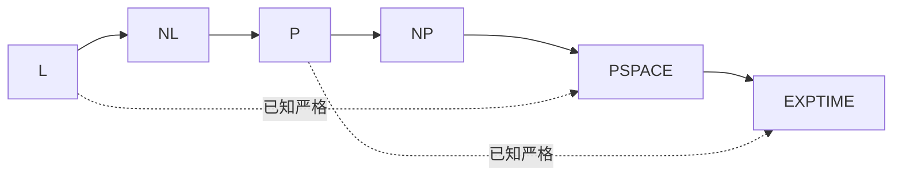

# $\rm Chapter \, 6$ 空间复杂性：PSPACE 与 TQBF

前五章的主尺是时间。本章换一把尺：空间。空间与时间有个根本的不对称：时间是线性消耗的，用一步少一步；空间是可重用的，同一块内存可以翻来覆去写。这个不对称造出全章的核心杠杆：把一条计算的轨迹看成一张有向图，即使图大得写不下来，也可以只花多项式空间在上面游走。沿着这根杠杆，本章走到 $\mathrm{PSPACE}$ 的门口，用博弈的视角看它最完全的问题 TQBF。

> **开始前自检**：本章假设你已经会：
>
> 1. □ 会陈述包含链 $\mathrm{P} \subseteq \mathrm{NP} \subseteq \mathrm{PSPACE} \subsetneq \mathrm{EXPTIME}$，并指明哪一处已证严格（§3.3）；
> 2. □ 会用验证者与证书定义 NP（§3.2）；
> 3. □ 知道 $\mathrm{PSPACE}$ 的定义与「多项式空间、时间不限」的读法（§3.3）；
> 4. □ 在形式语言册 §9.4 见过 $\mathrm{L}$ 与 $\mathrm{NL}$ 的初版定义。

## $\rm \S \, 6.1$ 空间类与配置图

定义**确定性空间类** $\mathrm{DSPACE}(f)$：能被最多使用 $O(f(n))$ 个工作带格子的图灵机判定的语言全体。三个最常用的档位：

| 类 | 定义 | 直觉读法 |
| --- | --- | --- |
| $\mathrm{L}$ | $\mathrm{DSPACE}(\log n)$ | 只够存几个下标 |
| $\mathrm{NL}$ | 非确定版 $\mathrm{DSPACE}(\log n)$ | 几个下标加「运气好的猜路」 |
| $\mathrm{PSPACE}$ | $\bigcup_k \mathrm{DSPACE}(n^k)$ | 时间不限，空间多项式 |

空间可重用这件事，对照第 3 章的 $10^8$ 次每秒折算表（§3.4）就有了分量：时间预算按运算次数花，空间预算按「同时摊在桌面上的纸」花。一个 $O(n^2)$ 时间的算法可以只用 $O(\log n)$ 空间（两个循环变量加一个累加器），竞赛里滚动数组优化正是主动做这笔交换：丢掉历史、换省内存。

定义**配置图（configuration graph）**：把一台机器在输入 $w$ 上的计算轨迹看成一个有向图。顶点是格局（configuration），即「状态 + 各带读写头位置 + 带内容」的完整快照；边是从一个格局一步转移能到的下一个格局。关键账目：空间 $s(n)$ 的机器在长度 $n$ 的输入上，格局总数至多 $2^{O(s(n))}$，指数大，但每个格局只用 $O(s(n))$ 空间就能写下来。于是「机器接受 $w$ 吗」变成「配置图上从起点格局到某个接受格局可达吗」，判定问题被翻译成图可达性（计算机速通 §6 的 BFS/DFS 在这张图上只是「图太大、装不下邻接表」）。空间换时间的杠杆就在这里：图本身可以是指数大的，我们从不把它造出来，只在需要时现算某顶点的出边。

## $\rm \S \, 6.2$ Savitch 定理：猜路可以只用平方空间

**Savitch 定理（1970）**：对 $f(n) \ge \log n$，$\mathrm{NSPACE}(f) \subseteq \mathrm{DSPACE}(f^2)$。最常用的推论是 $\mathrm{NL} \subseteq \mathrm{DSPACE}(\log^2 n)$，通常简记为「非确定性只多付平方空间」。

构造是一行递归。定义 ${\mathrm{reach}(c_1, c_2, t)}$：从格局 $c_1$ 走至多 $t$ 步能否到 $c_2$。递归式：

$$
\mathrm{reach}(c_1, c_2, t) \iff \exists\ m\ \big(\mathrm{reach}(c_1, m,\ t/2) \wedge \mathrm{reach}(m, c_2,\ t/2)\big)
$$

中间格局 $m$ 是非确定性的「猜」，确定性机器就把它换成穷举：对全部 $2^{O(f)}$ 个候选逐个试。递归深度是 $\log t = O(f)$（步数 $t$ 至多等于格局数 $2^{O(f)}$），每层递归要在栈上存一对格局，各占 $O(f)$ 空间，合计 $O(f^2)$。代价是时间爆成指数：这个递归不加记忆化会反复重算同一对 ${c_1, c_2}$。下面的实验让这笔账可见：16 个格局的小图上，一个不可达查询不记忆化要递归 95808 次，记忆化后 5547 次，省 17 倍；记忆化本身要多花空间存已算状态，这正是「空间换时间」的具象。Savitch 定理的读法由此落地：非确定性带来的「猜一条路」，在空间账本上几乎是免费的。

## $\rm \S \, 6.3$ TQBF：评估量化公式就是下棋

**TQBF（true quantified Boolean formula）**：判断一个全量化布尔公式（每个变量前面都挂 $\exists$ 或 $\forall$）取值是否为真。它是 $\mathrm{PSPACE}$ 完全的：属于 PSPACE，且 PSPACE 中一切语言都归约到它（§4.1 的完全性口径）。

评估它有一个直白的博弈读法：量词前缀是一场两人轮流行动的完美信息对局。轮到 $\exists x_i$，我方选 $x_i$ 的取值；轮到 $\forall x_i$，对手选。公式为真，当且仅当我方有必胜策略。这与博弈论册 §2.4 的 minimax 搜索是同一件事：树上的层交替做 $\max$ 与 $\min$，$\exists$ 就是 $\max$ 节点、$\forall$ 就是 $\min$ 节点，全量化公式的求值就是自底向上填一棵博弈树。手算一个最小例子：$\forall x \exists y\ (x \lor y) \land (\lnot x \lor \lnot y)$。$x=0$ 时取 $y=1$ 成真，$x=1$ 时取 $y=0$ 成真，两个分支我方都有应对，公式为真。

TQBF 属于 PSPACE 的账目：按量词序递归求值，深度等于变量个数（多项式），每层只需记住当前的赋值前缀，总空间 $O(n)$。PSPACE 完全的另一半（ hardness）一句话版本：把一台 PSPACE 机器的「存在接受路径」写成量化公式，「存在一步转移」给 $\exists$，而路径要按 Savitch 的方式用中间点二分，二分又引入 $\forall$ 与 $\exists$ 的交替，交替的深度是多项式的。完全性给 TQBF 一张全家福：它站在 PSPACE 的归约链顶端，地位与 SAT 在 NP 中相当（§4.2）。

放上谱系图（与 §3.3 的四类链相比，本章把下端补细）：



1. **已证严格**：$\mathrm{L} \subsetneq \mathrm{PSPACE}$ 由空间层次定理直接给出（§3.3 同款论证，把时间换成空间，对角化照样运转）；$\mathrm{P} \subsetneq \mathrm{EXPTIME}$ 靠时间层次定理；
2. **开放**：$\mathrm{L}$ vs $\mathrm{NL}$、$\mathrm{L}$ vs $\mathrm{P}$、$\mathrm{NP}$ vs $\mathrm{PSPACE}$ 都未决。Savitch 定理只给出 $\mathrm{NL} \subseteq \mathrm{DSPACE}(\log^2 n)$，离 $\mathrm{NL} = \mathrm{L}$ 还差一个对数；
3. **谱系读法**：$\mathrm{NP} \subseteq \mathrm{PSPACE}$ 的理由就是把验证者的全部证书空间逐个试（§3.3），所以 PSPACE 是「NP 再加上回合制对抗」的扩张：单人解谜（NP）之上，加对手（博弈）就到 PSPACE。

## $\rm \S \, 6.4$ 数值实验：博弈树与记忆化

三个实验全部真跑，随机种子固定（见代码注释）。第一个是本册最小的 TQBF 全树求值，先手算后跑（§6.3 的手算结果 $x=0$ 取 $y=1$、$x=1$ 取 $y=0$ 与程序输出逐格一致）：

| $x$ | $y$ | ${(x \lor y) \land (\lnot x \lor \lnot y)}$ | 层上归属 |
| --- | --- | --- | --- |
| 0 | 0 | 0 | $x=0$ 分支对手能拿到的最好值 |
| 0 | 1 | 1 | 我方在 $x=0$ 的应对 |
| 1 | 0 | 1 | 我方在 $x=1$ 的应对 |
| 1 | 1 | 0 | $x=1$ 分支的最小值 |

两个分支我方都有成真选择，$\forall x$ 层取到 1，公式为真。整棵树 7 个节点（4 叶 3 内部），与「变量数 2、完全二叉树 $2^{3}-1$」的账目相符。

第二个实验看 Savitch 递归的记忆化账目。16 个格局的随机有向图（每个顶点 2 条出边，种子 `seed(7)`），查询一对不可达格局，k 从 4 递减：

```python
def savitch(c1, c2, k, memo):
    cnt[0] += 1
    if c1 == c2 or (c1, c2) in edges: return True
    if k == 0: return False
    if (c1, c2, k) in memo: return memo[(c1, c2, k)]     # 已算过的状态直接取
    r = any(savitch(c1, m, k-1, memo) and savitch(m, c2, k-1, memo)
            for m in range(16))
    memo[(c1, c2, k)] = r
    return r
```

同一查询 ${\mathrm{reach}(0, 5, 4)}$，答案都是「不可达」，不带记忆化递归 95808 次，带记忆化 5547 次，17.3 倍；可达的对照查询（${\mathrm{reach}(0, 13, 4)}$）两种跑法都是 105 次，因为第一条成功路径很快被 `any` 短路找到，重算还没来得及发生。差异全在不可达查询上：必须穷尽全部中间点，同一对 ${c_1, c_2}$ 在不同分支里被反复送进来。

第三个实验对比「无前缀量词」的搜索树增长。固定比率 4.3 的随机 3CNF（每变量约 4.3 个子句，种子 `seed(7+n)`），朴素回溯数递归节点数：

| 变量数 $n$ | 回溯节点数 | $2^n$ | 节点占 $2^n$ 比例 |
| --- | --- | --- | --- |
| 10 | 273 | 1 024 | 0.27 |
| 15 | 42 508 | 32 768 | 1.30 |
| 20 | 273 574 | 1 048 576 | 0.26 |

$n$ 每加 5，节点数涨一个数量级上下，与 $2^n$ 的骨架同步。TQBF 的博弈求值把这种增长收进多项式空间：深度等于变量数，每层一个赋值前缀。对比 SAT 与 TQBF 的同一个直觉：SAT 树 exponentially 宽，TQBF 树 exponentially 深，但深可以递归着走（栈多项式），宽必须同时摊开（空间指数），这就是「量词不改变空间的账、只改变时间的账」。

## $\rm \S \, 6.5$ 关键概念回顾

1. 配置图的顶点与边各是什么？空间 $s(n)$ 的机器格局总数是多少量级？
2. Savitch 定理的递归式里「中间格局」扮演什么角色？空间账与时间账各付多少？
3. 用博弈语言陈述 TQBF 的语义。$\exists$ 与 $\forall$ 各对应哪种节点？
4. $\mathrm{NP} \subseteq \mathrm{PSPACE}$ 的两句话理由是什么？
5. 谱系链上已证严格的两处各靠哪条定理？
6. §6.4 的实验里，记忆化在哪类查询上省钱？省多少？

## $\rm \S \, 6.6$ 应用与辨析

1. 滚动数组把 $O(n^2)$ 空间压到 $O(n)$，这与 Savitch 定理的「平方空间」是一回事吗？
2. 有人主张：TQBF 的博弈树有 $2^n$ 片叶子，所以评估它需要指数空间。错在哪一步？
3. 若某博弈题的题面保证步数 $\le 10^9$、局面可用 64 字节描述，你敢直接 BFS 吗？用配置图的语言说清顾虑与出路。
4. $\mathrm{L}$ vs $\mathrm{NL}$ 与 $\mathrm{P}$ vs $\mathrm{NP}$ 这两个开放问题，形式上有什么平行结构？Savitch 定理给了前者什么程度的答案？

## $\rm \S \, 6.7$ 本章自测答案

> 先闭卷作答 §6.5 与 §6.6，再核对。

### $\rm \S \, 6.7.1$ 关键概念回顾答案

1. 顶点是「状态＋读写头位置＋带内容」的完整快照，边是一步转移；总数至多 $2^{O(s(n))}$。（§6.1）
2. 中间格局是非确定性「猜」的对象，确定性化后换成穷举；空间付 $O(f^2)$（递归深度 $O(f)$、每层存一对格局），时间付指数。（§6.2）
3. 公式为真当且仅当 $\exists$ 方（我方选值）对 $\forall$ 方（对手选值）有必胜策略；$\exists$ 对应 $\max$ 节点，$\forall$ 对应 $\min$ 节点。（§6.3）
4. 一句是 PSPACE 时间不限、可逐个试全部证书；另一句是空间可重用，试证书的草稿纸反复用同一块。（§6.3）
5. $\mathrm{L} \subsetneq \mathrm{PSPACE}$ 靠空间层次定理，$\mathrm{P} \subsetneq \mathrm{EXPTIME}$ 靠时间层次定理。（§6.3）
6. 不可达查询（必须穷尽搜索的）：95808 次降到 5547 次，17.3 倍；可达查询被短路，几乎不受益。（§6.4）

### $\rm \S \, 6.7.2$ 应用与辨析答案

1. 不是一回事。滚动数组是单项工程优化，省的是同一算法的工作区；Savitch 是定理，说的是「非确定性的猜路能力」在确定性模拟下只多付平方空间，两件事同用「空间可重用」这个物理事实，但层级不同。（§6.1、§6.2）
2. 错在把「树的宽度」当成「需要的空间」。求值按深度优先走，栈上只需保存当前分支的赋值前缀，$O(n)$ 空间；指数是时间（与节点数）的账，空间账上叶子可以走完一片丢一片。（§6.3、§6.4）
3. 直接 BFS 不敢：局面数至多 $2^{64 \times 8}$ 量级，邻接表装不下。出路是配置图视角的隐式图搜索：不存全图，每次现算当前局面的后继，配合迭代加深或记忆化把空间控制在多项式。（§6.1）
4. 平行结构：一个问「猜能力是否买来加速」、一个问「猜路是否买来省空间」。Savitch 给前者的答案是「几乎白送」（平方空间模拟猜路），但对 $\mathrm{P}$ vs $\mathrm{NP}$ 没有对应物，时间不可重用使同样的戏法失效。（§6.2）

---

PSPACE 把「对抗与量词」收进了多项式空间。下一章给机器发一枚硬币：允许算法掷骰子、偶尔算错，看「大概率对」能买到什么、又能否被摊平成确定性。

> 你现在能：定义 $\mathrm{L}$、$\mathrm{NL}$、$\mathrm{PSPACE}$ 并把判定问题翻译成配置图可达性；复述 Savitch 定理的中间点递归与平方空间账目；用必胜策略语言读 TQBF 并说出它为何 PSPACE 完全；背出谱系链上两处已证严格的位置与定理名；用记忆化实验解释「空间换时间」何时兑现。
