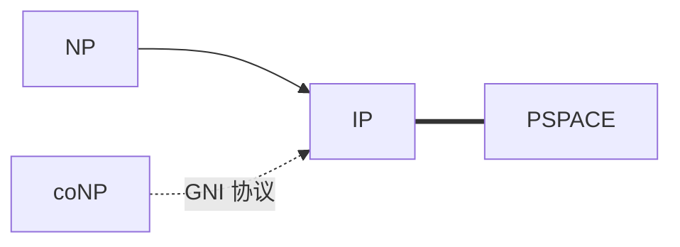

# $\rm Chapter \, 8$ 交互证明：IP 与验证的力量

前三章里「证明」都是一叠写死的证书：NP 的验证者读一份固定串，然后给判词（§3.2）。本章把证明变成一场对话：验证者出一道道随机挑战，证明者逐一作答，看完全部问答再裁决。证明者算力不限，验证者只有多项式时间加一枚硬币。这个升级不是修辞，它换来了实打实的类：图非同构这个连 NP 证书都找不到的问题进来了，而对话的极限恰是上一章的天花板 $\mathrm{IP} = \mathrm{PSPACE}$。验证者的能力升级路径由此有了三个台阶：一封静态证书只够读一次（NP），对话与硬币把可验范围推到整个 PSPACE，零知识再换一个轴：不问「能验多少」，问「验证时泄露多少」。三个台阶共用同一个舞台：算力无限的证明者对多项式时间的验证者。

> **开始前自检**：本章假设你已经会：
>
> 1. □ 会用验证者与证书定义 NP，知道证书是「一次性写死的串」（§3.2）；
> 2. □ 知道图同构 GI 的中间地位与 Babai 准多项式算法（§5.2）；
> 3. □ 会算独立事件的连乘概率（概率论册 §2.4）；
> 4. □ 知道 PSPACE 与 TQBF 的博弈读法（§6.3）。

## $\rm \S \, 8.1$ 交互证明：把证明变成问答

白话：交互证明把「验证」从读一封写死的信升级为一场现场盘问——验证者随机提问，证明者（算力不限）作答，真命题能答得滴水不漏，假命题骗不过三分之一以上。

**交互证明（interactive proof，IP）**：语言 $L$ 属于 IP，当且仅当存在一个随机多项式时间验证者 $V$ 与某个算力无限的证明者 $P$，使得：

1. **完备性（completeness）**：$x \in L$ 时，存在 $P$ 的策略使 $V$ 以至少 $2/3$ 的概率接受；
2. **可靠性（soundness）**：$x \notin L$ 时，无论 $P$ 怎么耍赖（哪怕算力无限），$V$ 被骗的概率至多 $1/3$。

与 NP 的差别有两处，都要看清楚。其一，证明从「一份静态证书」换成「按验证者提问定制的应答序列」，证明者可以针对每一道随机挑战重新组织答案。其二，可靠性从「对所有证书成立」变成「对所有作弊策略、以概率成立」，随机性分担了验证者的无能。两个常数也不必对称：$2/3$ 与 $1/3$ 各自只需站到 $1/2$ 的正确一侧，与 §7.2 的 BPP 放大同款；整场对话重复取多数同样能把被骗概率指数压低。

静态证书是一封写好的信，交互证明是一场现场盘问：盘问者每一步都可以根据上一步的回答换问题，写死的信做不到这一点。骨架与静态情形的对应也顺理成章：单轮、无随机、无提问的对话就是一封读一遍的信，所以 $\mathrm{NP} \subseteq \mathrm{IP}$ 是平凡的（§8.4 会把整条谱系摆齐）。

**本节小结**：本节立好 IP 的完备性（约束诚实情形）与可靠性（约束一切作弊策略）两条，并点出与 NP 的两处差别——应答按提问定制、随机性分担验证者的无能。下一节拿一个 NP 装不下的问题来试刀。

## $\rm \S \, 8.2$ 图非同构：没有证书，可以对话

白话：GNI 是「非同构」这种否答案问题——连证书都找不到的问题，交互证明却能验：让验证者随机混一张图，考证明者「它从哪来」。

**图非同构（graph non-isomorphism，GNI）**：给定 $G_1, G_2$，断言两者不同构。它的麻烦在证书侧：同构有证书（那个重命名映射，§5.2），非同构的「证书」要描述所有 ${n!}$ 个映射都不行，没有已知的短写法，GNI 甚至不一定在 NP 里。协议把它救进 IP：

1. 验证者私下掷硬币选 $b \in \{1, 2\}$，把 $G_b$ 随机洗牌（作用一个随机置换）得到 $H$，发给证明者；
2. 证明者回答 $H$ 来自哪一张（答 1 或 2）；
3. 重复 30 轮，验证者全对才接受。

读法：若 $G_1$ 与 $G_2$ 真的不同构，无限算力的证明者逐个比对 $H$ 与两图，每轮都能答对；若两图同构，$H$ 的分布在两种来源下完全一样，任何证明者（包括全知的）都只能瞎猜，单轮对率 $1/2$，30 轮全对的概率 $2^{-30} \approx 9.3 \times 10^{-10}$（${n!}$ 个置换里两图共享同一批像，洗牌后的分布无从区分）。随机洗牌在这里扮演「把来源信息物理抹掉」的角色。验算这笔账的独立性：各轮挑战掷的是新硬币、新置换，轮与轮之间互不影响，30 个 $1/2$ 直接相乘。

两个技术细节值得单独钉住。第一，发 $H$ 前必须做随机置换：若把 $G_b$ 原样发出去，图的标号直接写明来源，协议退化成送分题；置换把「顶点叫什么」与「图长什么样」解耦，$H$ 里只剩形状信息。第二，验证者的硬币是私下掷的（证明者看不到 $b$），这个设定叫私掷硬币；Goldwasser–Sipser 定理证明对 GNI 这类问题把硬币公开（双方都看得见掷出什么，协议记作 AM）威力不减，本册只留这句话，不展开证明。轮数与冒充成功概率的账目表（精确值 $2^{-r}$）：

| 轮数 $r$ | 5 | 10 | 20 | 30 | 40 |
| --- | --- | --- | --- | --- | --- |
| 冒充全过概率 | $0.031$ | $9.8 \times 10^{-4}$ | $9.5 \times 10^{-7}$ | $9.3 \times 10^{-10}$ | $9.1 \times 10^{-13}$ |

每加 10 轮，安全裕量翻 $2^{10} = 1024$ 倍，这就是「轮数换可靠度」的汇率表。真跑模拟（小图：$G_1$ 为四元环，$G_2$ 为三角形加孤立点，种子 `seed(7)`）：诚实证明者 30 轮全过（30/30）；冒充者（对来源一无所知、每轮瞎猜）跑 100 万场 30 轮对局，全部通过 0 场，与理论期望 $10^6 \times 2^{-30} = 0.0009$ 场相符，单轮对率实测 0.5000。

这里藏着全章最重要的一层区分：**证明存在**与**证明知识**。GI 的证书「是」那个同构映射，证明者亮出的是一件具体东西；GNI 的协议里证明者从头到尾没有亮出任何「非同构的原因」，它只是稳定地通过了一连串本应只有真非同构者才能通过的考验。「我知道」与「我是什么」在交互世界里分了家，这也为下一节的零知识铺路：零知识把「不亮实物」从 GNI 的副作用升级成协议的目标。

**本节小结**：GNI 协议靠「洗牌抹掉来源 + 私掷硬币」把没有证书的问题验了起来，30 轮的账目给出 $2^{-30}$ 的安全裕量；节末的「证明存在 vs 证明知识」之分是通往零知识的桥。

## $\rm \S \, 8.3$ 零知识一句话：能验证，不泄露

白话：零知识给交互证明追加一条纪律——验证者跑完协议，除了「命题为真」这个结论本身，别的一个字节都带不走。

**零知识（zero-knowledge）**：交互证明的加强版，要求验证者看完对话后，除了「命题为真」之外什么都没学到（形式化为：验证者自己模拟出一套同分布的对话记录）。最小例子是图三着色的零知识协议，流程三步：

1. **承诺（commit）**：证明者取一个合法三着色，随机置换颜色名，把每个顶点的颜色装进带锁的信封（密码学承诺）发给验证者；
2. **挑战（challenge）**：验证者随机选一条边；
3. **揭示（reveal）**：证明者只拆开这条边两端的两封信，验证者核对两色不同。

重复若干轮。验证者每轮只见到「两个不同的颜色」，凑不齐整个着色方案；协议的安全论证走模拟器路线，本册不展开，完整版在密码学册 §9（那里 Schnorr 身份识别用的正是同一个承诺-挑战-应答骨架）。承诺件本身有两个正式性质，记下名字即可：绑定性（承诺后证明者换不了内容，防作假）与隐藏性（拆开前验证者读不出内容，防泄露），零知识的全部安全论证都压在这两条上。

轮数的账目与 GNI 同款：若图为 $m$ 条边，验证者每轮拆中的是随机一条，想让每条边都被查到的概率压到 $\delta$，轮数取 $O(m \ln \frac{1}{\delta})$，多项式乘常数还是多项式。三个协议摆一张对照表收尾：

| 协议 | 断言 | 每轮挑战 | 验证者学到的 |
| --- | --- | --- | --- |
| GNI（§8.2） | 两图不同构 | 猜洗牌图的来源 | 只学到「命题为真」的置信度 |
| 三着色（本节） | 图可三着色 | 挑一条边拆两信 | 同上，且零额外信息 |
| Schnorr 身份识别（密码学册 §9.2） | 我持有私钥 | 挑随机数 | 同上，可当登录用 |

三行是同一个模板的三次换装：随机挑战让作弊者「猜」，猜错率乘在一起，泄露被结构本身按住。

**本节小结**：三着色协议用「信封（承诺）—挑边（挑战）—拆两封（揭示）」把泄露按在每轮一条边上，安全论证全压在承诺的绑定性（防作假）与隐藏性（防泄露）两条上；与 GNI、Schnorr 合看，是同一个「挑战—应答」模板的三次换装。

## $\rm \S \, 8.4$ IP=PSPACE：对话的天花板

白话：上一章的天花板在这里被对话摸到——能被多轮问答验证的问题，恰好就是多项式空间能算的问题，两个看似无关的视角在顶上重合。

**IP=PSPACE（Shamir, 1990）**：交互证明恰好刻画多项式空间。两个方向的骨架：

1. $\mathrm{IP} \subseteq \mathrm{PSPACE}$：验证者的接受概率可以对整棵对话树做动态规划算出，树上状态是「当前对话前缀」，深度多项式，逐层回推只需多项式空间（§6.1 的配置图读法又一次接管）；
2. $\mathrm{PSPACE} \subseteq \mathrm{IP}$ 走 arithmetization（算术化）：把布尔公式译成多项式，「与」变乘、「或、非」变加减，公式的真值 counting 变成一个大多项式在某点的取值；证明者报出多项式，验证者在一两个随机点上抽查：若证明者报错了任何一层求和，随机点检验以高概率戳穿。TQBF 的博弈树（§6.3）就这样被翻译成一场关于多项式取值的问答。

验证者能力增强的谱系随之清晰：验证者是确定性多项式时间，得到 NP（§3.2）；加上一枚硬币与对话能力，得到 IP；静态证书对应单轮对话，所以 $\mathrm{NP} \subseteq \mathrm{IP}$ 平凡。中间还有一档：GNI 协议说明 $\mathrm{coNP} \subseteq \mathrm{IP}$（GNI 是 coNP 型问题），这在 1980 年代曾是意外，一个「否答案」问题第一次有了高效验证手段。而 $\mathrm{IP} = \mathrm{PSPACE}$ 把对话的极限钉在与 TQBF 同一高度：验证者能验的，恰好是有限空间能算的。谱系一张图（实线为类本身，虚线标对话能力带来的跨越）：

谱系上每一档「涨一格」都有明确的成分账：NP 到 IP 涨在「多轮提问加随机性」；NP 到 coNP 那条虚线涨在「洗牌抹掉来源信息」；IP 到 PSPACE 不是上涨而是重合，两边是同一个类的两张面孔，一张从「验证」进入（本章），一张从「空间游走」进入（§6.1）。顺带一笔：Shamir 的协议里证明者本身也只用到多项式空间，所以 $\mathrm{IP} = \mathrm{PSPACE}$ 还能读成「PSPACE 机器能算的，PSPACE 机器就能教」。这条谱系的历史也只用了五年：1985 年 Goldwasser–Micali–Rackoff 与 Babai 分别提出交互证明的两个版本（前者带零知识，后者是公开硬币的 AM），1986 年 Goldwasser–Sipser 证明私掷与公开等价，1990 年 Shamir 补上 $\mathrm{IP} = \mathrm{PSPACE}$ 的封顶。一个概念的黄金期有多短，这里是个好样本。

**本节小结**：本节把验证者能力的三个台阶钉进一张谱系（NP、coNP、IP、PSPACE）：上界方向靠对话树上的动态规划，下界方向靠 arithmetization 把 TQBF 译成多项式问答；历史五年封顶，接口留给下一章——从「验证」掉头去问「造」。

## $\rm \S \, 8.5$ 关键概念回顾

1. 交互证明的完备性与可靠性各约束哪一方？「无论证明者多强」约束的是哪一条？
2. GNI 协议里，随机洗牌在两图同构时起到了什么分布性质？
3. 「证明存在」与「证明知识」在 GI 与 GNI 上分别对应什么？
4. 三着色零知识协议的三步各防住什么？
5. $\mathrm{IP} \subseteq \mathrm{PSPACE}$ 的动态规划在什么对象上做？
6. arithmetization 把布尔运算翻译成什么？验证者靠什么抽查？
7. GNI 协议里，验证者发出 $H$ 之前为什么要做随机置换？不做会怎样？
8. 轮数从 30 加到 40，冒充全过概率的裕量乘多少？这个「汇率」由什么决定？

## $\rm \S \, 8.6$ 应用与辨析

1. 把 GNI 协议的 30 轮减到 5 轮，冒充者的全过概率变成多少？这还够用吗？
2. 有人说：「交互证明中验证者的随机挑战必须保密，否则证明者可以预演。」结合 GNI 协议判断对错。
3. 零知识协议里，验证者为什么不能要求一次拆开全部信封？
4. $\mathrm{IP} = \mathrm{PSPACE}$ 与 $\mathrm{NP} \subseteq \mathrm{IP}$ 一起读，验证者从「读一封信」到「下完一盘棋」换来了整个 PSPACE。哪个成分贡献了 coNP 那一档？
5. 三着色协议中，承诺的绑定量与隐藏量各被协议的哪一步用到？
6. 把 GNI 的洗牌图换成「直接发邻接矩阵的行随机重排」，协议还安全吗？
7. 诚实证明者在 GNI 协议里每轮要做什么计算？这对「证明者算力不限」的设定依赖到什么程度？

## $\rm \S \, 8.7$ 本章自测答案

> 先闭卷作答 §8.5 与 §8.6，再核对。

### $\rm \S \, 8.7.1$ 关键概念回顾答案

1. 完备性约束诚实情形（真命题能被接受），可靠性约束作弊情形（假命题骗不过），「无论证明者多强」是可靠性的量词：对一切作弊策略成立。（§8.1）
2. 同构时 $H$ 在两种来源下同分布，来源信息被洗牌抹掉，任何证明者只能猜，单轮 $1/2$。（§8.2）
3. GI 证明存在：证书是同构映射这件实物；GNI 证明知识：不亮任何反例实物，只靠稳定通过考验。（§8.2）
4. 承诺防「先看后答」，挑战防「预先伪造固定应答」，揭示范围（只拆一条边）防「整套着色泄露」。（§8.3）
5. 在对话树上：节点是问答前缀，回推每个节点的最优接受概率，深度多项式、每层多项式状态。（§8.4）
6. 与译乘、或与非译成加减，真值变成多项式取值；验证者在随机点上检验证明者报出的层和。（§8.4）
7. 把「顶点叫什么」与「图长什么样」解耦，防止 $H$ 的标号泄露来源 $b$；不做的话协议退化为送分题，验证者读标号即知答案。（§8.2）
8. 乘 $2^{10} = 1024$ 倍；汇率由单轮错误率 $1/2$ 决定，$r$ 轮独立全对是 $(1/2)^r$，轮数每加 10 就是 10 个 2 相乘。（§8.2）

### $\rm \S \, 8.7.2$ 应用与辨析答案

1. $2^{-5} = 1/32 \approx 0.031$，作为认证协议偏高（三十二分之一的假阳性），工业口径常取 40 至 100 轮；30 轮的 $9.3 \times 10^{-10}$ 已低于大多数硬件失效率。（§8.2）
2. 不必保密，也不可能保密：协议的挑战本来就是公开掷出的硬币。防预演靠的是挑战在承诺之后才发生（时序），GNI 里验证者先私下选 $b$ 再发洗牌图，回答无法提前伪造。（§8.2、§8.3）
3. 拆开全部信封就把整个着色交了出去，验证者获得的信息超出「命题为真」，零知识性质被破坏；协议的信息预算按「每轮一条边」计。（§8.3）
4. 贡献 coNP 档的是「随机洗牌让验证者能考非确定性问题」：GNI 协议不依赖多轮对话的深度，单轮挑战即可，靠的是随机性与来源不可分性，对话轮数只是把可靠度压低。（§8.2、§8.4）
5. 绑定量压在「证明者不能在拆信后换着色」，对应承诺步骤的锁；隐藏量压在「拆开前读不出颜色」，对应随机置换颜色名；挑战与揭示步骤只是在这两条上做选择题。（§8.3）
6. 不安全。行重排只打乱顶点顺序，不改变「两图同构时分布相同」这件事本身没坏，但证明者若能从行序推断来源就漏了；标准的随机置换之所以必要，正是它对全部 ${n!}$ 个标号均匀，使任何统计量都读不出 $b$。（§8.2）
7. 把 $H$ 分别与 $G_1, G_2$ 比对同构，答出来源的那一个；GNI 本身没有已知多项式算法（§5.2），所以诚实证明者的负担恰恰是「解开一个难题」，算力无限的设定把这份负担整个豁免了，验证者一点也不用干难活。（§8.2）

---

对话证明把验证的力量顶到了 PSPACE。最后一根支柱从「验证」掉头去问「造」：把计算展开成电路，用计数去数下界，然后把十章合拢成一张地图。

> 你现在能：陈述交互证明的完备性与可靠性并区分其约束对象；走一遍 GNI 协议并算出冒充者 $2^{-30}$ 的账；区分证明存在与证明知识；复述三着色零知识的承诺-挑战-揭示流程；说出 $\mathrm{IP} = \mathrm{PSPACE}$ 两方向各自的证明骨架。
