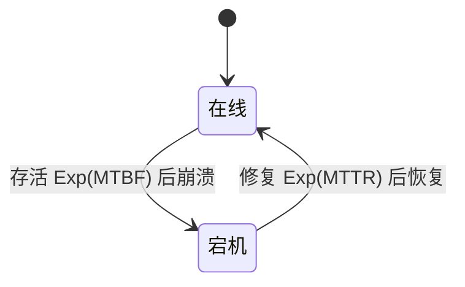

# $\rm Chapter \, 1$ 引言与失败模型

> **本章假设你已经会**
>
> 1. 线程是共享地址空间的进程，为什么需要它、切换成本记在哪笔账上，见《操作系统》§2.5。
> 2. 一台机器上把消息送到具体进程靠端口与分用，见《计算机网络》§4.1。
> 3. TCP 的重传靠自适应超时，超时间隔怎么从 RTT 估出来，见《计算机网络》§5.4。
> 4. 指数分布的无记忆性：等了多久不影响还要等多久，《概率论》§12.1 用它造泊松过程，本章用它造宕机。

单机程序里，代码失败的方式屈指可数：抛异常、段错误、死循环，每一种都会当场暴露在调用者面前。把程序拆到多台机器上之后，出现了一种单机世界根本没有的失败形态：程序的一部分坏了，另一部分却毫无察觉，而且永远无法当场确认对方到底坏没坏。这一章的任务是把这种「部分失败」讲清楚：它从哪来、以哪几种面目出现、哪些能修、哪些从原理上就修不了。

全册的心智模型从本章立起来：网络会撒谎，共识就是把撒谎变成可计算的不确定。撒谎的方式很具体：它会把「死了」伪装成「慢了」，把「没收到」伪装成「还没发」，让每一次判断都携带不确定。学完本章你将能算清「单机换三副本到底值多少可用性」这笔账，并能解释为什么有两道著名的「不可能定理」挡在所有协议面前。下一章的 MapReduce 则要回答：失败既然躲不掉，怎么在它之上把一件大事干完。

## $\rm \S \, 1.1$ 问题：单机世界没有的「部分失败」

先定住这个词。部分失败（partial failure）指这样的状态：系统由多台机器组成，其中一些机器坏了（或慢了、或失联了），另一些还在正常工作。它可怕在两条。

1. 坏的部分不通知任何人。一台宕机的机器不会发出「我要死了」的消息，它只是从某一刻起再无回音；而一个变慢的机器连「再无回音」都做不到，它还会回话，只是越来越迟。从外面看，死与慢不可区分。
2. 失败是局部的。单机程序崩溃，整个进程一起完蛋，不存在「半个程序活着」；而在集群里，坏一台机器，其余 $N-1$ 台还在照常干活，全局视角下没有任何一处报错，错误只在「需要那台机器的人」那里才显形。

用一个必须常年在线的服务把账算出来。先给符号：一台机器平均无故障时间为 MTBF（mean time between failures，两次故障之间的平均存活时长），坏了之后到恢复服务为止的平均时长为 MTTR（mean time to repair）。机器稳态下「活着的时间占比」叫可用度（availability）：

$$
A=\frac{\mathrm{MTBF}}{\mathrm{MTBF}+\mathrm{MTTR}}
$$

读法：分母是一轮「活-坏-修」周期的总时长，分子是其中活着的部分，所以 $A$ 就是不停机的时间比例。取 MTBF 为 999 小时、MTTR 为 1 小时，得 $A=0.999$，这就是业内说的「三个九」：99.9% 可用。听起来很好，折成年历却是一年停机约 8.8 小时；而且这个 MTTR 已经很乐观，它假设故障被立刻发现、立刻有人修、一小时修好，真实世界里「发现」本身常常就要几个小时。

现有方法在这笔账面前无能为力。买更贵的硬件把 MTBF 拉长十倍，停机时间确实按比例缩短，但缩短到每年几十分钟后依然不为零：故障率是物理属性，永远压不到零。分布式的第一反应是上副本（replica）：同一份数据、同一个服务跑在多台机器上，坏一台还有别的顶上。

但「顶上」立刻引出一个单机时代不存在的问题：几台在线才算服务在线？答案取决于你问谁。

1. 若任意一台在线就能读，三台副本几乎永不停机，但读到陈旧数据的风险最大：写入有先有后，你连到的那台可能还没收到最新数据。
2. 若要求凑够多数派（quorum，即超过半数的副本在线才算服务在线），停机时间会长一些，但换来一条三副本场景下白送的保证：任何两个多数派集合至少共享一台机器。证明只有一行：三台机器的多数派至少含 2 台，两个「至少 2 台」的集合若不共享机器，加起来至少 4 台，超过了 3。后文第 3 章起所有的一致性协议都踩在这条交集性质上。

这笔账不能靠口算，我们直接模拟。方法叫蒙特卡洛模拟（Monte Carlo simulation，用随机数反复抽样再统计结果的数值方法），步骤如下。

1. 用事件驱动的模拟造三台机器的生命线：每台机器的无故障时长服从均值为 MTBF 的指数分布，修复时长服从均值为 MTTR 的指数分布（指数分布的无记忆性见《概率论》§12.1），坏了自动修、修好接着用。
2. 三台机器的两种时长全部相互独立，这是本实验的核心假设，稍后会亲手拆它。
3. 每个时刻统计有多少台在线，据此判定三种配置是否停机：单机；三副本要求至少 2 台在线（多数派）；三副本要求至少 1 台在线。
4. 环境为 WSL 里的 python3 加 numpy；模拟总时长 200 万小时（约 228 年），独立重复 40 次，随机数生成器种子固定为 20261104，任何人重跑都能得到同一串数字。

模拟里每台机器的一生只有两个状态；「事件驱动」指的是状态只在事件发生的瞬间改变，事件之间什么都不发生。



模拟器不做逐秒扫描，而是把时钟直接跳到「下一个事件」发生的时刻，把两个事件之间的整段时长记入对应配置的停机账本：跳过的区间里三台机器的状态恒定，这种记法与逐秒扫描统计出的结果严格相等，代价却从几十亿步降到每轮几千个事件。

| 配置 | 模拟停机占比 | 折合每年 | 理论值 |
| --- | --- | --- | --- |
| 单机 | ${0.000991 \pm 0.000031}$ | 8.7 小时 | 0.001（8.8 小时） |
| 三副本，至少 2 台在线 | ${0.000003 \pm 0.000001}$ | 93 秒 | 95 秒 |
| 三副本，至少 1 台在线 | ${3.3\times 10^{-9}}$ | 0.1 秒 | 0.03 秒 |
| 三副本多数派，另加公共故障 | ${0.000086 \pm 0.000008}$ | 2720 秒 | 无解析式 |

读法：第一列是实验条件，第二列是模拟测得的「服务不在线」时间占比，加号后是 40 次独立重复的样本标准差，第三列把占比折算成一年，第四列是概率论给出的解析答案。模拟与解析对得上，说明模拟没跑偏，也说明这点误差是 228 年样本的天然抖动。

三行数字各有各的话要说。第一行到第二行：把一台机器换成三台凑多数派，年停机时间从 8.7 小时缩到 93 秒，缩了三百多倍。原因是代数上的：多数派失守要求三台里至多一台在线，概率为

$$
(1-A)^2\,(1+2A)=(1-A)^3+3A(1-A)^2
$$

读法：左边是化简后的整体式；右边拆开，第一项是「三台全坏」的概率（三个独立的坏概率相乘），第二项是「恰好只剩一台好」（哪一台好有三种选法，每种概率是 $A(1-A)^2$）。把 $A=0.999$ 代入得约百万分之三，一年摊下来 95 秒，与模拟的 93 秒一致。第三行更进一步：只求一台在线的话，停机要求三台全坏，概率 ${(1-A)^3=10^{-9}}$，228 年的模拟里几乎观测不到全停。

这就是副本的乘法魔力：独立事件的联合概率是各自概率的乘积，多一台独立副本，灾难概率就再乘一个小数。但乘法魔力只在「独立」成立时有效，而独立恰恰是最常被打破的假设。实验在独立故障之外加了一个公共故障源：平均每 10000 小时（约 14 个月）一次的事件，比如机柜断电、交换机重启、一次滚烫的配置推送，同时打挂三台，各台再独立修复。仅此一项，年停机时间从 93 秒涨到约 2720 秒（45 分钟），是独立模型的 29 倍。白话：备份防得住「每台机器各自倒霉」，防不住「它们一起倒霉」；三台副本插在同一个插线板上，等于一台。

1. 独立性是所有副本可用性估算的地基，地基不牢，后面的位数全是假的。
2. 公共故障的来源往往是共享层：同一供电、同一网络设备、同一个有 bug 的升级包。
3. 行业对策是把副本故意分开：不同机柜、不同供电、甚至不同机房，代价是副本之间的网络延迟变贵、同步变慢。

顺手把规模的影响也算一笔。设一台机器一小时内崩溃的概率为 $p$，各台独立，则 $N$ 台同时跑一小时、至少一台中途死掉的概率是 ${1-(1-p)^N}$：先算「全部幸存」的概率 ${(1-p)^N}$（独立事件连乘），再用 1 减掉它。取 $p=0.001$，$N=10$ 时约为 1%，无关痛痒；$N=1800$ 时约为 83.5%，失败从意外变成日程表。这个概率有个好用的近似：$p$ 很小时 $\ln(1-p)\approx -p$，于是 ${(1-p)^N\approx e^{-Np}}$，「至少一台出事」约为 ${1-e^{-Np}}$，随 $N$ 指数逼近 1；$N=1800$ 时 $Np=1.8$，${1-e^{-1.8}=0.835}$，与精确值一致。下一章的 MapReduce 就出生在这个规模上。

> 本节小结：部分失败＝一部分坏了而另一部分不知情、死与慢不可区分；副本用独立故障的乘法换可用性，多数派用可用性换一致性前提；独立性本身是最常被打破的假设，共享层是它的头号杀手。

## $\rm \S \, 1.2$ 失败三件套：网络、时钟、进程

部分失败往下拆，是三件各自成灾的工具。它们在本册每个系统里都会出场，值得一次性认清。

第一件，不可靠网络。网络可以丢消息、推迟消息、重复消息、把消息的先后顺序调包，极端情况下干脆把一群机器切成互不可见的孤岛，业内叫网络分区（network partition）。分区最阴险的后果叫脑裂（split brain）：被切开的两侧各自以为对方死了，各自宣称自己是唯一的主节点，继续接受写入，和好之后数据已经分叉。面对这一切，探测手段只有一个：等。发出请求后设一个超时（timeout），到点没回音就当对方出事了。但「出事」是个四选一的谜题。

1. 请求根本没送到。
2. 对方收到了，还在处理。
3. 对方处理完回信了，信死在路上。
4. 一切正常，只是这次慢了。

超时机制天生分不清这四种情况，因为它观测到的只有同一件事：时间到了，没有回音。你在《计算机网络》§5.4 见过 TCP 怎么办：用最近的往返时延估计一个自适应的超时。那套估计对「平均行为」有效，分布式系统要回答的却是「此刻这一台机器还能不能托付」——一个关于单台机器此刻状态的判定，而慢与死在观测上完全同形，这是判定无解的根源。

第二件，不可靠时钟。每台机器的时钟由各自的晶振驱动，走快走慢以每天毫秒到秒级累积，这个偏差叫漂移（drift）；一块普通晶振的漂移率在百万分之十的量级，一天累计下来就是将近一秒。机器靠 NTP（Network Time Protocol，网络时间协议）定期向时间服务器对时，局域网内能把误差压到毫秒级，但对时可能把时钟往回拨：本地时钟快了，校准就是倒退。结论是：跨机器不存在「现在几点」的唯一答案，每台机器都只知道自己那个版本的「现在」。这直接废掉一条朴素思路：给每个事件盖时间戳、按时间戳排序就能还原先后。两台时钟漂移的机器盖出的时间戳，先后可能与真实先后相反，何况时钟还会倒退。全局时间这个舒适的假设要到很后面（第 9 章 Spanner）才以昂贵工程的形式勉强回来，此前本册所有排序都只能靠消息传递本身。

把量级代进账里看得更清楚：漂移率 $\epsilon = 10^{-5}$（即百万分之十）的时钟，一天 86400 秒累计偏差 $\epsilon \times 86400 = 0.864$ 秒，这就是「将近一秒」的来历。受牵连的还有定时器语义：「10 秒后执行」只对本地时钟成立，把定时任务交给另一台机器、用它的时钟计时，10 秒可能是 9 秒也可能是 12 秒；第 3 章的选举超时会正面撞上这件事，那里的对策是把超时留在本机计时、用消息往返代替对表。

第三件，进程崩溃。进程死了，内存里的全部状态随之蒸发，重启后它对生前之事一无所知。比崩溃更麻烦的是暂停：一次长达几十秒的垃圾回收停顿、一次虚拟机热迁移、一次 CPU 被邻居进程吃满，都会让进程几十秒不回话。从外部观测，暂停与死亡没有任何区别。这才是「网络会撒谎」的完整含义：你收到的每一个「它死了」的判断，都可能是网络和调度器合伙伪造的。健康检查只能告诉你「最近没回音」，永远不能告诉你「它死了」。

白话：三件套干的是同一件事，把「对方此刻是什么状态」从能观测的量里删掉，只给你留下「到点没回音」这一个事实；分布式系统的很多设计，本质上都是在替这个被删掉的事实下注。

> 本节小结：不可靠网络让「它死了」与「它慢了」不可区分、还可能把系统切成互相对骗的分区；不可靠时钟让「先后」失去全局参照；进程崩溃和更难缠的暂停让状态蒸发。三件套共同撕掉单机程序里「失败会当场暴露」的舒适假设。

## $\rm \S \, 1.3$ 失败的谱系：fail-stop 与拜占庭

「坏」有程度之分。容错理论的第一个分类动作就是把坏的样式排成谱系，按「死法可以有多难猜」从轻到重排列如下。

1. 崩溃停止（crash-stop，理想化后称 fail-stop）：进程要么在按协议运行，要么彻底停止；停止后不再发出任何消息，也不再产生任何影响，仿佛从没有过。这是最温顺的死法。
2. 遗漏失败（omission failure）：进程活着，但时不时丢掉该做的动作，该回的消息不回。
3. 时序失败（timing failure）：动作都做了，但迟到了，而协议恰好依赖时限；对依赖超时的协议来说，一台总是迟到的机器比一台干脆死的机器更难处理。
4. 拜占庭失败（Byzantine failure）：进程的行为完全任意，包括计算错误、发伪造消息、对不同对象说不同的话。名字来自 Lamport 等人 1982 年虚构的拜占庭将军问题：将军里混进了叛徒，叛徒会故意传假话。

谱系的分界线画在第 1 档与第 4 档之间：fail-stop 的机器只会死不会撒谎，拜占庭的机器会撒谎。容忍它们的代价相差一个量级，两个下界都能数出来。

先看 fail-stop 的 $2f+1$。任何两个多数派集合交集至少一台机器（§1.1 已证三副本情形，一般情形同理），只要坏的不超过 $f$ 台，交集那台必然是好的。反过来，$2f$ 台不够：多数派要 $f+1$ 台，而允许坏 $f$ 台意味着可能恰好只剩 $f$ 台活着，$f<f+1$，一个多数派都凑不齐，系统只能停摆；$2f+1$ 台时坏 $f$ 台还剩 $f+1$ 台，恰好仍是多数派，服务与容错两头都保住。

再看拜占庭的 $3f+1$。任何协议都不能等全部 $n$ 台回话才行动：$f$ 台可能崩溃，永远等不到，决策只能基于先回来的 $n-f$ 张票。麻烦在于这 $n-f$ 台里可能混着全部 $f$ 个叛徒，诚实票只剩 $n-2f$ 张；要让诚实票压倒伪造票（否则叛徒对不同接收方报不同的值就能搅局），必须 $n-2f>f$，即 $n>3f$，最小整数解 $n=3f+1$。fail-stop 不需要这份富余：死掉的机器不出票，先回来的 $n-f$ 张票全部可信，条件退化为 $n-f>f$，即 $n>2f$，取 $2f+1$。两个下界相差 $f$ 台机器，买的不是「多容一档故障」，而是「票数多到伪造不过来」。白话：fail-stop 的世界死人不出声，活人的话都可信；拜占庭的世界死人还冒充活人说话，只能靠人数优势把谎话淹掉。

本册的立场现在说清：我们只做 crash 容错（fail-stop），不考虑拜占庭行为。理由是诚实的经济账：数据中心里的机器是我们的、软件是我们写的，出错的最坏形态就是崩溃或变慢；让一台机器撒谎，需要攻击者攻破机器本身，那是《56-计算机安全》册的战场。拜占庭容错留给开放环境：互联网上互不相识的节点、任何参与者有动机作恶的系统（如区块链）。识别失败模型是设计任何分布式系统的第一步，因为选错了模型，后面所有协议的保证都是空头支票：按 fail-stop 设计的系统一旦混进撒谎节点，多数派投票会被叛徒的假票搅乱；按拜占庭设计的系统用在数据中心，则是拿三倍的机器钱买用不到的防备。

> 本节小结：失败样式从「只会死」到「会撒谎」排成谱系，容错代价逐档陡增（$2f+1$ 对 $3f+1$）；本册锁定 crash 容错，即机器只会死不会撒谎。

## $\rm \S \, 1.4$ 两将军与 FLP：直觉级的「做不到」

在讲怎么做到之前，必须先知道有两条定理说「做不到」。它们是本册所有协议设计决策（为什么用超时、为什么要随机化、为什么接受弱保证）的源头。两条定理约束的都叫共识（consensus）问题：若干进程对同一个值投票，要求最终大家决定出相同的值（一致性），且这个值来自某个进程的真实提议（有效性），并且每个进程最终都会做出决定（终止性）。这三个要求合在一起就是「达成一致」的完整含义，缺一不可。

两将军问题（Two Generals Problem）：两支军队分驻山谷两侧，只有信使可以穿谷传信，而信使可能被截杀。两军约定同时进攻才有胜算，于是需要就「双方都进攻」达成一致。任何有限轮数的协议都做不到，论证是归纳式的。

1. 无论协议设计了多少轮确认，它总有最后一条消息。
2. 发送这条消息的一方无法确知它是否送达：若它被截杀，接收方收不到这条最后的确认。
3. 此刻两人已经不一致：发送方以为确认完毕决定进攻，接收方还在等，决定不进攻。
4. 若为了保险再补一条「我收到你的确认了」，这条新消息又成了协议的最后一条，第 2 步的困境原样重演，无穷倒退。

结论：在可能丢消息的信道上，不存在用有限条消息就确定达成一致的协议。注意它难在哪：这里连机器崩溃都不需要，光是不可靠信道就足以杀死确定性的一致。

FLP 不可能性（FLP impossibility，以三位作者 Fischer、Lynch、Paterson 命名，1985 年论文《Impossibility of Distributed Consensus with One Faulty Process》）把刀磨得更利。它问的是：在异步系统（asynchronous system，消息延迟没有任何上界的系统）里，哪怕只有一个进程可能崩溃，能不能有一个确定性算法，保证共识的三个要求全部达成？FLP 证明不能。直觉是这样的：算法要做的本质判断是「它到底是死了还是慢了」，而判定材料只有消息的到与不到；在异步世界里，对手（可以自由安排每条消息延迟的假想敌人）总能让决定性的那条消息恰好迟到任意久，使算法永远停在「再等一会儿」与「换人重选」之间摇摆。只要存在一种延迟安排能让算法不终止，「保证终止」就落空，证明就成立。它和上一节的账是同一句话：死与慢不可区分，谁也不能替你区分。

FLP 挡住的组合是「确定性算法＋异步＋保证终止」，它没有说共识不可能，只说了这些要求不能同时满足。工程上绕开它的路有两条，各放弃一样东西。

1. 放弃纯异步：引入超时，相当于假设「延迟虽然不保证上界，但超过某个时长就可以合理怀疑对方死了」。这类系统叫部分同步（partially synchronous）系统，Paxos 与第 3 章的 Raft 走这条路。
2. 放弃确定性：允许算法掷硬币，让对手无法预判下一步，从而无法安排针对性的延迟；随机化超时正是这个思想的落地，第 3 章会用实验展示它为什么能终结选举僵局。

顺带解释有效性条件为什么不是废话：若没有它，「全体永远直接输出同一个固定值」的算法瞬间满足一致性与终止性，共识问题被架空。三条要求合起来才把这类作弊解关在门外，这也是读任何可能性或不可能性结论之前要先抠定义的原因。

两条路都保住了「总能出结果」，代价是承认在极端时序下可能多等几轮选举。白话：FLP 是交通法规里的物理极限，绕不过去，只能绕着修路。

> 本节小结：两将军说不可靠信道上有限条消息定不了终身，FLP 说异步系统加一个崩溃就别想既要确定性又要必然终止；实践的全部技巧就是在这两处各让一步。

## $\rm \S \, 1.5$ RPC 与线程：把失败写回函数签名

理论到此为止，回到写代码的手。让一台机器调用另一台机器上的函数，业界标准形态是 RPC（remote procedure call，远程过程调用）：框架把「发请求、等回信、拆结果」打包，让调用方写起来几乎和调用本地函数一样。前半句是对的，后半句藏着本章最大的陷阱：本地调用与远程调用的结局数目不一样。

1. 本地调用只有两种结局：返回结果，或抛出异常；无论哪种，成败都在同一台机器、同一时刻定案，调用者亲历全程。
2. RPC 有三种结局：返回结果（调用成功）；明确报错（比如连接被拒，说明请求大概率没执行，对方端口上根本没有进程在听，见《计算机网络》§4.1）；无回音（超时了）。
3. 第三种结局是分水岭：此时请求可能没到、可能执行到一半、可能已经执行完毕但响应死在路上。调用者收到的不是「失败」，而是「不知道」。

把「不知道」当失败处理，就要承担「其实成功了」的后果；把它当未知挂起，系统可能永远等下去。工程默认做法是超时后重试，而重试合法的前提是操作幂等（idempotent，执行一次与执行多次效果相同）：查询是幂等的，「余额减 100」不是，对后者盲目重试会扣两次钱。重试的骨架长这样：

```python
def call_with_retry(op, tries=3, timeout=2.0):
    for i in range(tries):
        result = rpc_call(op, timeout)  # 三种结局：结果 / 明确报错 / 超时
        if result == TIMEOUT:           # 第三种：不知道执行了没有
            continue                    # 敢重试的前提：op 幂等
        return result
    raise Unreachable("连续超时，放弃本次调用")
```

幂等不是 RPC 的附带品，是调用者必须自己设计进接口的属性：要么操作天然可重复（查询、覆盖写），要么给请求带上唯一编号（请求 ID），服务端记录处理过的编号，重复请求直接返回上次结果而不是再执行一遍。下一章 MapReduce 的整个容错大厦就盖在「任务设计成幂等」这一块砖上。

RPC 的等待是网络尺度的：一次跨机房调用几毫秒起步，比一次内存读取慢五个数量级。若调用线程干等回信，CPU 大部分时间在空转。线程是标准解法，理由接的是《操作系统》§2.5 那笔账：线程＝共享地址空间的执行流，创建成本远低于进程，于是可以让每个进行中的请求占一个线程，线程阻塞在等待上，别的线程照常干活，等待彼此错开。账也能反过来算它的极限：以 Linux 默认线程栈 8 MB 计，一万个并发请求就是 80 GB 的栈内存，机器吃不消。另一个流派是事件驱动：单线程用 I/O 多路复用（《操作系统》第 9 章）同时盯着成千上万个连接，谁就绪处理谁，内存账好看得多，代价是代码里全是回调。两条路线之争贯穿整个工业界，本册实验采用更直观的多线程模型。本册的实验与语言无关、用 Python 模拟，但值得知道：MIT 6.5840 课程的原版实验用 Go 语言，其 goroutine 与 RPC 框架正是「线程加 RPC」组合的工业级样本。

### $\rm \S \, 1.5.1$ 一次双扣费的证据式排查

把三件套装进一个具体事故。某支付服务调用下游记账服务扣款，代码的行为是：等待 2 秒，超时就记一条失败日志并重试一次。上线三周后客服收到投诉，一笔订单扣了两次钱。

排查从日志下手。用这笔订单的请求 ID 在两个服务里各捞出记录，按时间排序：

1. 10:07:33.102 支付服务发出请求（请求 ID 8842）；33.431 记账服务写库成功，本次处理耗时 329 ms。
2. 10:07:35.104 支付服务的超时计时器到期，记「调用失败」，随后发出重试。
3. 10:07:35.106 记账服务收到同一请求 ID 的第二次调用，把「余额减 100」又执行了一遍，写库成功。

证据把责任钉得很准：网络没丢请求，数据库也没错账，两笔写库都成功了，第一笔的响应只是死在了回程路上（§1.2 四选一谜题的第 3 种）。支付服务把「不知道」当「失败」记下并重试，记账服务不幂等照单全收，两个缺陷叠加才凑成一次双扣费，去掉任何一个都不会出事。修复各归其位：记账服务按请求 ID 建去重表，重复请求直接返回上次的结果；支付服务把日志措辞从「失败」改成「结果未知」，因为措辞决定下一个读日志的人往哪个方向查。白话：超时重试本身不是错误，把「未知」标成「失败」才是，标签一错，排查方向全错。

### $\rm \S \, 1.5.2$ 动手验证本章的可用性账

本章 §1.1 的全部数字出自一个不足百行的 Python 脚本，只依赖 numpy，不碰任何外部服务，可以在自己机器上安全重跑。前置条件：装有 WSL 的 Windows（或其他带 python3 与 numpy 的环境），在 Git Bash 里执行：

```bash
# Shell：Git Bash（Windows 上经 wsl 进入 Linux 侧）；无需管理员权限
# 第 1 行进入实验目录（WSL 里 Windows 的 C 盘挂在 /mnt/c 下）；
# 第 2 行重跑模拟并把输出存档；第 3 行与本书引用的原始输出逐行比对
cd /mnt/c/Users/20811/Desktop/26Fall/_uni5_work/expDS01
python3 exp01.py > my_rerun.txt
diff my_rerun.txt result.txt && echo REPRO_OK
```

成功标志是末尾打印 `REPRO_OK`，实测耗时约 5 秒：种子固定让随机数序列逐位相同，重跑结果应与 §1.1 表中每个数字（含加减号后的误差）完全一致。最常见的失败是 `cd` 报路径不存在，说明你不在 WSL 里而在 Windows 侧，改用 `C:\Users\...` 形式的路径、换装了 numpy 的 Windows Python 重跑即可；若 diff 报告内容差异，多半是 numpy 版本不同导致随机流实现不同，此时各项数字仍应落在表中误差范围内。

> 本节小结：RPC 把本地调用的两态结局变成三态，「无回音」意味着调用者对成败一无所知；重试要求幂等，海量并发等待要求线程或多路复用，这两件工具是后面每一章的地基。

## $\rm \S \, 1.6$ 关键概念回顾

1. 用两个要点给出部分失败的定义，并说明为什么单机程序里它不存在。
2. 超时观测到的唯一事实是什么？它为什么分不清「对方死了」和「对方慢了」？
3. fail-stop 与拜占庭的分界线是什么？容忍 $f$ 台故障，两者的机器数量要求各是多少？
4. 复述两将军问题的归纳论证：为什么确认轮数再多也无济于事？
5. FLP 排除了哪几项要求的组合？工程上从哪两个方向绕开，各放弃什么？

## $\rm \S \, 1.7$ 应用与辨析

1. 三副本「任意一台在线即可读」的停机占比远小于「凑多数派」，本章实验数据也支持，那为什么第 3 章起的一致性协议都坚持多数派？
2. 某团队把三台副本装进同一个机柜，宣称年停机时间从单机的 8.7 小时降到 95 秒。指出这个宣称错在哪，并用本章实验的数字修正它。
3. 一个 RPC 超时后盲目重试，举出一个会因此出大问题的具体操作，并说明幂等设计如何救场。

## $\rm \S \, 1.8$ 本章自测答案

1. 部分失败的两个要点：失败是局部的（一些机器坏了另一些正常），且坏的部分不主动通知任何人、死与慢不可区分。单机程序里失败是全局的：进程一崩全部停止，不存在「半个程序活着却无报错」的状态（§1.1）。
2. 超时观测到的唯一事实是「约定时间到了，没有回音」。四种可能（请求未达、对方仍在处理、响应丢失、只是慢）在观测上同形，因为它们全部只留下这一个事实；区分它们需要对方之外的信息来源，而网络本身不提供（§1.2）。
3. 分界线是「死」还是「撒谎」：fail-stop 的机器停止后不发消息不产生影响，拜占庭的机器行为任意包括伪造消息。容忍 $f$ 台 fail-stop 故障需 $2f+1$ 台（多数派交集），容忍 $f$ 台拜占庭故障经典下界为 $3f+1$ 台，且协议复杂度陡增（§1.3）。
4. 归纳论证的抓手是「最后一条消息」：任何有限轮协议都有一条终结消息，它的发送方无法确知它是否送达；为确认它而补发的消息又成为新的最后一条，无穷倒退。故有限条消息不可能确定性达成一致（§1.4）。
5. FLP 排除的组合：异步系统＋哪怕一个进程崩溃＋确定性算法＋保证终止。绕法一：放弃纯异步改用超时（部分同步，如 Paxos/Raft）；绕法二：放弃确定性引入随机化（如随机化超时）。两者都保住「必然终止」，代价是极端时序下可能多等几轮（§1.4）。

应用与辨析答案：

1. 「任一台可读」的可用性确实更高，但它读到的可能是落后副本的数据：三台机器写入有先后，只求一台在线，就没有任何机制保证你连到的那台已收到最新写入。多数派保证的是任意两个多数派集合至少共享一台机器（三副本各含 2 台，交集至少 1 台），写入方与读取方若各自凑够多数派，必然在至少一台机器上相遇，这正是复制与一致性协议（第 3 章起）赖以成立的前提；用一点可用性换来一致性（§1.1）。
2. 错在独立性假设：同一机柜意味着共享供电与网络设备，公共故障源把「三台独立失效」变成「三台一起失效」。本章实验加了平均每 10000 小时一次的公共故障后，年停机时间从 93 秒涨到约 2720 秒（45 分钟），是独立模型的 29 倍，离 95 秒的宣称差得远；正确做法是把副本分散到不同机柜、不同供电乃至不同机房（§1.1）。
3. 经典反例是支付：「余额减 100」不幂等，第一次请求其实成功、只是响应丢失时，重试会再扣一次钱。幂等救场的方式是给请求带上唯一编号（请求 ID），服务端记录已处理过的编号，重复请求直接返回上一次的结果而不是再执行一遍；查询类操作天然幂等，无需此改造（§1.5）。

**你现在能做什么**：向同事解释清楚，为什么把服务从一台机器换成三副本，年停机时间能从 8.7 小时缩到 93 秒，以及为什么这个数字在三台机器同处一个机柜时不作数。

下一章把镜头拉远：失败既然是常态，就用它当设计输入。MapReduce 把一件千台机器的大事裁剪成两个函数，让「失败了怎么办」的答案平凡到一个字：重跑。你会看到本章的幂等思想如何长成一座编程模型。

---

实验记录：本章 §1.1 全部实测数字来自脚本 `exp01.py`（事件驱动蒙特卡洛，numpy，种子 20261104，40 次重复 × 200 万小时，WSL python3 运行），原始输出存于写作工作目录 `26Fall/_uni5_work/expDS01/result.txt`；重跑与逐行比对的完整命令见 §1.5.2，重跑可逐位复现表中数字。
