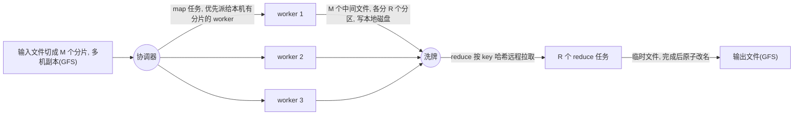

# $\rm Chapter \, 2$ MapReduce：把容错写进编程模型

> **本章假设你已经会**
>
> 1. 部分失败为什么是分布式系统的第一性难题：一台机器坏了，你却无法确定远端那台是死是慢（§1.1）。
> 2. 失败三件套：不可靠的网络、不可靠的时钟、会随时崩溃的进程（§1.2）。
> 3. 本册只做崩溃容错（fail-stop），不考虑拜占庭行为，即机器只会死不会撒谎（§1.3）。
> 4. RPC 的基本形态：调用远端机器上的函数，写起来像调用本地函数，但每一次调用都可能超时、重试或永远没有回音（§1.5）。
> 5. 进程与线程的账在《操作系统》§2.5 算过，本章的多进程实验直接借用那套概念。

上一章我们把「机器会死、消息会丢」摆上了台面，但没回答那个真正要紧的问题：既然失败随时发生，成千上万台机器怎么把一件大事干完？本章给出第一个完整答案 MapReduce。它的思路不是消灭失败，而是把计算裁剪成两个函数，使得失败后的对策平凡到只有一个字：重跑。学完本章，你将能读懂 Google 2004 年那篇论文的容错设计，并亲手复现重执行与备份任务的时间账；下一章要解决的是它留下的尾巴：协调器自己挂了怎么办。

## $\rm \S \, 2.1$ 问题：一台机器算不完，一千台机器管不住

设想一个具体任务：某个网站一天产生 1 TB 日志，每行是一条访问记录，要统计每个 URL 被访问了多少次。写过一个单机 for 循环的人都知道怎么做：读文件、逐行累加进一张哈希表、输出结果。这个方案在 10 GB 数据上没有任何问题，问题出在 1 TB 上。单块磁盘顺序读取大约每秒 200 MB，读完 1 TB 要一个多小时，而日志每天都会产生，昨天的还没算完，今天的又到了。用 1800 台机器并行读呢？总带宽翻了一千多倍，理论上一两分钟读完，但上节的失败账随之而来：机器越多，一小时内至少一台出事的概率越接近必然。

1. 用更多磁盘、更快 CPU 的单机？磁盘带宽的涨速远跟不上数据量的涨速，这条路几年内就到头了。
2. 把数据切成 $N$ 份，用 $N$ 台机器各算一份，最后合并。速度上来了，但看一眼失败模型的账：假设一台机器在一小时作业内崩溃的概率是 0.1%，1800 台机器同时跑，至少一台中途死掉的概率是 ${1 - 0.999^{1800} \approx 83\%}$。

也就是说，在这个规模上「作业中途死一台机器」不是异常，是常态。白话：单机程序把「我读的文件会一直陪着我」当默认，集群里这个默认每个小时都会被打破几十次。除了彻底死掉的机器，还有更阴险的一类：没死但变慢的机器，业内叫它掉队者（straggler）。一块快坏的磁盘、一个被邻居抢走的 CPU 核，都能让某台机器比同伴慢几倍，而整个作业要等最慢的那个才算完（§2.4 会给出实测账）。

把第一章的失败三件套逐条对到这个任务上，能看清系统需要什么。不可靠网络：某台机器算完了，结果却在回程的网络上丢了，协调器看到的只是「等了很久没有结果」。不可靠时钟：协调器判断「等了很久」只能靠本地超时，而超时既可能来自对方的死，也可能来自网络的慢，它无法区分。进程崩溃：机器没坏但计算进程死了，表现与前者完全一样。三条失败最终汇成同一个症状：任务的结果没有按时出现。这决定了 MapReduce 的容错策略只能是「不猜病因，重发药方」：任何没有按时交卷的任务，重新执行一遍即可，系统不花力气去诊断。这个选择对不对、凭什么成立，就是 §2.4 的全部内容。

现有方法的具体不足就在这里：for 循环的写法把「输入在哪、算到哪一步、结果给谁」全部焊死在一个进程里，机器一死，这些信息跟着进程一起消失，你只能从头再来。把日志灌进数据库再做 GROUP BY 也好不到哪去：单库扛不住每天 1 TB 的写入，而数据库引以为傲的索引与事务是给在线查询用的，批处理用它是拿错了工具。MapReduce 要做的，是把「算什么」和「在哪儿算、死了怎么办」拆开：前者由用户写两个函数，后者由一套固定的协调机制接管，而那套机制对失败的唯一反应就是重跑受影响的任务。

> 本节小结：规模上去之后失败是常态而非异常，容错必须由系统接管，不能指望用户的 for 循环自己处理。

## $\rm \S \, 2.2$ map 与 reduce：把业务写成两个纯函数

MapReduce 的核心决定是：用户只许写两个函数，系统的其余部分全部固定。两个函数的签名是

$$
\begin{aligned}
\mathrm{map} &: (k_1, v_1) \to \mathrm{list}\,(k_2, v_2) \\
\mathrm{reduce} &: (k_2, \mathrm{list}\,(v_2)) \to \mathrm{list}\,(v_2)
\end{aligned}
$$

读法：map 吃一条输入记录，记录带一个主键 $k_1$（比如分片编号）和载荷 $v_1$（比如一段文本），吐出一串「中间键–值」对；reduce 吃一个中间键 $k_2$ 和它名下收集到的全部值组成的列表，吐出最终输出。词频统计写出来只有几行：

```python
def map(key, value):        # key: 分片编号; value: 该分片的文本
    for word in value.split():
        emit(word, 1)

def reduce(word, ones):     # word: 中间键; ones: 全系统 map 出的、该词名下所有的 1
    emit(word, sum(ones))
```

白话：map 负责「拆」，把一条大记录拆成一个个带标签的小账目；reduce 负责「合」，把同一个标签下的账目汇总。拆与合之间的一切（搬运、排序、容错）都是系统的活，用户碰不着。

系统替你做三件事。

1. 归拢：把中间键相同的值凑到同一次 reduce 调用，论文里把搬运这一步叫洗牌（shuffle）。
2. 分区：决定哪个 reduce 管哪些键，靠分区函数（partition function）：${\mathrm{hash}(k_2) \bmod R}$，$R$ 是 reduce 任务数，读法就是对键取哈希再除以 $R$ 取余数，键被均匀撒进 $R$ 个桶。
3. 确定性检查：这个模型要求 map 是确定性（deterministic）函数，输出只由输入决定，不依赖执行时间、机器编号或任何共享状态。词频统计显然满足；一个「每处理一行就把全局计数器加一」的 map 不满足，后果在 §2.4 详谈。

还有一个系统免费送的优化值得点名：合并器（combiner）。它是一段跑在 map 本地的 mini-reduce：词频统计里 map 不必把每个词的（w, 1）原样发出去，本地先合并成（w, 本分片内出现次数）再洗牌。账很直观：一个分片 35 万个词、词汇表 300 个词，洗牌要搬的键值对从 35 万个降到 300 个，省下的是整个集群的洗牌带宽。合并器能用与否取决于归并运算是否可交换可结合，求和可以，取平均数要先换成「和与计数」这对可合并的量再除。

分区函数还附带一个常被忽略的承诺：reduce worker 收到某分区的中间文件后先按键排序再逐键调用 reduce，所以每次 reduce 调用拿到的值列表旁边总有一个明确的键，相邻调用之间键保持有序。排序不是锦上添花，倒排索引一类任务直接依赖它：map 对每个词输出（词， 文档编号），reduce 收到某词名下的全部文档编号，只要顺序拼接就是该词的倒排表，排序阶段免费完成了这份工作。

$R$ 的取值有两头都要防的坑。$R$ 取 1 最省事，但全部键涌进一个 reduce 任务，洗牌和归拢全压在一台机器上，§2.3 的粒度账和 §2.4 的掉队者账都白算了。$R$ 取得太大也不行：每个 reduce 任务完成后在 GFS 生成一个输出文件，$R$ 就是输出文件数，下游若要继续处理，成千上万个小文件意味着成千上万次打开、关闭与元数据操作。经验规则：$R$ 取能让单台机器在分钟级完成的量，$M$ 则取得比 worker 数细一个量级以上，$M$ 大 $R$ 小是常态。

这两个函数能覆盖的任务比表面看起来多。

1. 分布式 grep：map 在一行里匹配模式，命中则原样输出，reduce 是恒等函数。
2. 倒排索引：map 对每个词输出（词， 文档编号），reduce 收到某词名下的全部文档编号，顺序拼接就是倒排表。
3. 分布式排序：map 把每条记录按其键算出应属分区（分区函数换成「区间划分」而非哈希），reduce 把分区内的记录排序后直接输出，键空间被切成 $R$ 段、段内又排了序，全局有序就这么攒出来。

排序基准最能说明规模：论文用 1800 台机器对 1 TB 数据排序，M 取 200000、R 取 5000（Dean & Ghemawat, OSDI 2004），2008 年更新版在 1000 台机器上把同一任务压到 68 秒（Dean & Ghemawat, CACM 2008）。

反过来，这两个函数的边界也很清楚：任务必须能拆成「各记录独立处理、再按键归拢」两步。图的最短路径要在顶点间反复传递状态，硬套 map/reduce 得排成一长串作业、每轮洗牌一遍，代价很高，这正是后来 Pregel 一类图计算系统出场的原因。

> 本节小结：用户只写 map 和 reduce 两个确定性函数，归拢、分区、搬运全部归系统，这份约束正是容错的入场券。

## $\rm \S \, 2.3$ 执行过程：协调器、worker 与一次洗牌

写好两个函数后，运行时是这样一个画面：一个协调器（coordinator，论文称 master）进程加 $W$ 个 worker 进程。协调器不碰任何数据，只管账本：哪些任务没派、哪些在跑、哪些完成了。



执行分三波，每波对应任务账本上的一类条目。

第一波 map：输入文件被切成 $M$ 个分片（split），每个分片对应一个 map 任务，协调器把它派给某个 worker；worker 在本地磁盘为每个分区写一个中间文件，返回文件名和位置清单。

第二波洗牌：reduce 任务 $r$ 通过远程调用，从每个 map worker 那里拉取属于自己分区的中间文件，先在内存或磁盘上按键排序，把同一键的值归成组。这里有个精确的时点要抠清楚：拉取和排序可以在部分 map 完成后就开始（流水线见下文），但用户的 reduce 函数必须等全部 map 完成后才逐键调用，因为一个键的全部值可能散落在任何一个 map worker 的输出里，缺一份结果就不对。

第三波落盘：每个 reduce 任务把输出写进一个临时文件，写完后原子地改名为最终输出文件，改名的原子性让「任务完成」成为一个瞬间发生、不会半途的事件，这是 §2.4 容错论证的支点。

worker 端还有一个常被忽略的细节：跑 map 的程序就是用户程序的复制品。作业启动时，系统把用户写的 map 与 reduce 代码复制到各台机器上拉起进程（论文里是 fork 出来的副本），所以本章的多进程实验可以直接模拟这套结构：协调器一个进程，worker 若干进程，任务经队列传递，结果原路返回。

协调器账本上每个任务只有三种状态，外加一条位置信息：

| 状态 | 含义 | 协调器额外记什么 |
| --- | --- | --- |
| 空闲 | 未派发 | 无 |
| 进行中 | 已派给某 worker，尚未交卷 | 派发时刻与领取者编号 |
| 完成 | 结果已就位 | 中间或输出文件的位置清单 |

位置清单的传递路径值得单独说：map worker 完成任务后把 $R$ 个中间文件的位置经 RPC 上报协调器，协调器记进账本；reduce worker 领任务时从账本拿到位置清单，再直接从各 map worker 的磁盘拉数据。数据自始至终在 worker 之间直飞，协调器手里只有地址没有货物，这正是它敢用一台小机器的原因之一。

论文还做了一层流水线：不必等全部 map 完成才开始洗牌，某个 map 一完成，在等它分区的 reduce 任务就可以开始拉取，map 阶段与洗牌阶段首尾重叠。

$M$ 从哪来？分片大小由 GFS 的块大小决定：每块 64 MB，1 TB 输入就是约 16000 个分片，分片数无需用户操心，跟着文件系统走，而「跟文件系统走」正是下一段本地性优化能成立的前提。

中间结果放在 map worker 的本地磁盘而不是共享存储，这步棋的直接收益在失败时才显现：map 结果丢了，重算它只需重读自己那个分片，不需要问任何人。间接收益是带宽：Google 的输入文件本就存着多份副本（GFS，一种把大文件按块复制到多台机器的文件系统），协调器派 map 任务时优先挑本机就存着该分片副本的 worker，数据不用走网络，集群骨干网只需承载洗牌这一段流量。白话：能搬账本不如能搬算盘，把计算挪向数据，通常比把数据挪向计算便宜。

还有一笔关于任务粒度的账要算。上面排序基准里 1800 台机器对应 20 万个 map 任务，平均一台机器要轮换一百多个任务，为什么不一人一个大任务？两个理由都与失败有关。

理由一是负载均衡：任务切成比 worker 数细一个量级的碎片，掉队者最多拖慢自己手里那一小片，其余任务早被别人领走；§2.4 会实测这个差别。理由二是失败爆炸半径：一个任务失败要重跑的只是一个碎片加它的账目条目，而不是一整段时间的劳动。

协调器为这个粒度付出的代价是账本大小：它要为每个任务记几条状态（空闲、进行中、完成）与中间文件位置，总状态量与 ${M + R}$ 成正比，20 万个任务也只是几 MB 量级。这笔小账在 §2.5 还会再算一次，它决定了协调器崩溃后损失能否被便宜地补救。

> 本节小结：协调器只记账不搬数，map 写本地中间文件，reduce 拉取后原子改名落盘，任务切得比机器细一个量级，三步各自有明确的完成事件。

## $\rm \S \, 2.4$ 容错＝重执行：为什么这样就够了

### $\rm \S \, 2.4.1$ 失联与重执行

协调器周期性 ping 每个 worker，超时就把这个 worker 标记为失联（failed），它名下两样东西作废：正在跑的任务重新排队，已经完成的 map 任务也重新排队，因为那些中间文件躺在它的本地磁盘上，跟机器一起消失了。已经完成的 reduce 任务不用动，输出已经原子改名进了 GFS。被重新排队的任务由还活着的 worker 领走，干活的机器换了一茬，作业毫无察觉地继续。

注意失联检测本身是不可靠的：网络抖动会让一台好端端的机器被误判为死。对多数系统这是灾难的种子（误判主节点会导致双主，第 3 章的主战场），对 MapReduce 却近乎无害，因为重执行的安全性与机器是否真死无关。这个不对称值得记下：把误判的代价设计成零，检测就不再需要精确。

误判的代价也不全是零：超时阈值设得短，活机器被频繁误杀，重执行白烧算力；设得长，真死的机器占着任务干等，作业被拖住。两边都是账，论文没有给出万能值，实务上按任务时长的量级取超时并容忍少量浪费。被误判的 worker 若后来缓过来，它迟到的上报会在协调器对账时被丢弃（任务已重派给别人），不会造成重复生效。

为什么「重跑一遍」就是正确的？这是本章最要紧的论证，需要两个条件，缺一不可。条件一：任务输出只依赖输入（§2.2 的确定性要求），于是重跑第 $i$ 个 map 任务得到的是字节级相同的 $R$ 个中间文件，覆盖旧的也不会引入分歧。条件二：结果生效的方式是原子改名，于是「完成」要么完全发生、要么完全没发生，不存在跑了一半的结果被下游读到。两条合起来，任务变成幂等（idempotent）操作：执行一次和执行多次，对系统其他部分的效果完全一样。幂等不是锦上添花，它是「重执行」这个策略的全部合法性来源。白话：重执行像把可能烧糊的菜重做一遍，前提是菜谱固定（确定性），上菜是一次性端出的（原子改名），灶台上不留半成品。

> 竞赛生迁移提示：这像 OJ 评测，重交同一份代码、同一个测试点，判题结果不会变，所以评测机崩了重跑该测试点毫无心理负担；但「抢一血」类的任务依赖提交次数，重跑就出错。类比失效的边界在「输出是否依赖执行历史」，正文用确定性条件把它钉死。

### $\rm \S \, 2.4.2$ 掉队者与备份任务

失联好对付，掉队者难缠：机器活着、能 ping 通、就是慢。没有机器死，但一个 worker 每个任务多花 1 秒（慢磁盘、资源争抢、机器该换而未换），完成时间照样被它卡住。账目上的原因一句话就能说完：完成时间下界由分到任务的每个 worker 各自的总耗时决定，

$$
T_{\text{job}} \;\ge\; \max_{i}\; n_i \cdot (t_{\text{task}} + s_i)
$$

读法：$n_i$ 是第 $i$ 个 worker 分到的任务数，$t_{\text{task}}$ 是单个任务的净计算时间，$s_i$ 是它每次任务的额外延迟，整件事再快也快不过最慢的那一份。§2.3 把任务切细正是为了压小这个下界里的 $n_i$；MapReduce 的第二味药是备份任务（backup task）：当作业接近尾声、某个任务明显跑得比同伴久（触发阈值是启发式的，各系统不同），协调器把同一个任务再派给一台空闲机器，谁先提交结果算谁的，另一份丢弃。由于结果幂等，副本之间不存在竞争问题，先到先赢即可。论文实测备份通常只多花百分之几的资源（Dean & Ghemawat, OSDI 2004），买到的是掉队者几乎不再影响作业完成时间。后续工作把触发规则继续打磨，代表是 LATE 调度（Zaharia 等, OSDI 2008）：与其等任务超时，不如估计每个在跑任务的剩余时间，把副本优先派给「看起来最慢」的任务，思路相同，只是把阈值换成了预测。

### $\rm \S \, 2.4.3$ 实测账与一个反例

两味药各值多少钱？我们用实验说话。单机多进程模拟一个 MapReduce 词频作业：4 个 worker 进程、12 个 map 分片（每片 35 万词）、4 个 reduce 分区，协调器逻辑照抄本节的描述，脚本与输出在 `_uni5_work/expDS02/`，种子固定为 20261104，Git Bash 里 `wsl bash -c "cd /mnt/c/Users/20811/Desktop/26Fall/_uni5_work/expDS02 && python3 mr_sim.py"` 即可复现，成功标志是终端打出四个场景的中位数并生成同目录的 `result.txt`。常见失败：命令卡住不动多半是上一次运行的残留进程还占着，`pkill -f mr_sim` 清掉再跑。每个场景连跑三次取中位数，因为单次计时被进程启动和调度抖动污染，取中位数能滤掉运气值。结果如下：

| 场景 | 完成时间（中位数） | 任务账 |
| --- | --- | --- |
| A 基线：无故障 | 0.118 s | 12 次 map |
| B 两个 worker 中途退出，重执行 | 0.214 s | 14 次 map（12 有用 + 2 浪费） |
| C 一台 worker 被拖慢（每任务多睡 1 s） | 2.063 s | 12 次 map，无人失败 |
| D 同 C，加备份任务 | 0.670 s | 13 次 map，其中 1 次是副本 |

B 的账最直白：两个 worker 各带着一个跑到一半的任务人间蒸发，协调器把它们重新排队，完成时间从 0.118 s 涨到 0.214 s。多花的约 0.1 s 里既有重执行的算力，也有失联检测的等待。要点是它的形状：代价只与「丢了几个任务」成正比，与「作业多大」无关。系统没有浪费任何力气去判断那两台机器到底是死了还是网络抖了一下，它只是把账重记一遍，这正是全册心智模型「网络会撒谎」的第一次可计算化：不追问谎言的内容，只让谎言失去后果。

C 是掉队者的账。12 个 map 任务被切成细粒度轮流派发，慢 worker 实际只分到 2 个，代入下界就是 2 乘以 1 秒多，实测 2.063 s 几乎贴着下界，是基线的 17.5 倍。D 场景加了备份规则（观察期 0.6 s），慢 worker 的在跑任务一过观察期就被空闲机器的副本抢先完成，完成时间从 2.063 s 降到 0.670 s，加速 3.1 倍。注意 0.670 s 仍是基线的 5.7 倍而回不到 0.118 s：备份触发要等满 0.6 s 的观察期，慢 worker 占着的任务 slot 始终在消耗派发机会，容错买的是「不被拖垮」，不是「仿佛无事发生」。

最后看一个反例的排查过程，它是确定性条件被违反时的现场。假设 map 的实现是「读入分片，往机器上的全局计数器累加，顺便给每条记录盖上当前时间戳」，单机测试一切正常。

上集群后出现两个症状：其一，两次运行同一作业，输出里同一批词的计数略有出入；其二，开启备份任务后症状更频繁。排查路径是先怀疑结果合并逻辑，再逐任务对账，最终发现 map 输出依赖了执行历史：重跑把同一批记录算了第二遍，先到先赢的提交规则又可能采纳两个不同的版本。

证据指向模型违反而非网络故障的判据是：故障是确定性的、随重执行出现的，而不随机器、时段漂移。修法不是给计数器加更强的锁，而是回到 §2.2 的约束：把状态收进 map 的返回值，让输出只依赖输入。

动手环节（在你自己的目录里改副本，不要改别人的文件）：把 `_uni5_work/expDS02/` 整个拷到你的工作目录，然后用文本编辑器打开 `mr_sim.py`，改两个参数再跑。

1. 把 `SLOW_SLEEP = 1.0` 改成 0.3，先写下你预测的场景 C 完成时间（提示：套用 $T_{\text{job}}$ 的下界公式），跑完对照。预期现象：C 与基线的差距缩小，但仍远大于基线。
2. 把 `BACKUP_S = 0.6` 改成 0.05，再跑场景 D。预期现象：D 逼近基线，因为慢任务几乎立刻被副本覆盖。
3. 把 `CRASH_IDS = (1, 3)` 改成 `(0, 1, 2, 3)` 再跑场景 B。预期现象：作业永远完不成，4 个 worker 全部死光，没有任何东西在跑。这暴露了本章机制的另一条边界：重执行的前提是还有活着的 worker。
4. 把 `N_WORKER = 4` 改成 8 再跑场景 A。预期现象：完成时间几乎不变，因为你的机器物理核数没变，8 个进程分抢 4 个核，账要算在硬件上而不是参数上。

> 本节小结：失联靠重执行兜底，其合法性来自确定性与原子改名合成出的幂等，误判也因此无害；掉队靠备份任务止血；反例说明约束一旦被绕开，症状是确定性复发，排查要对账不要怀疑网络。

## $\rm \S \, 2.5$ 协调器单点怎么办

上面所有花活都建立在一个前提上：协调器活着。它是单点（single point of failure）：它一死，账本跟着消失，所有 worker 手里的任务立刻失去意义。这笔账不好看：作业进行到 90% 时协调器崩溃，按 MapReduce 论文的原始做法，客户端只能整个作业从头重跑，9 成算力作废。而且这不只是算力问题：作业期间全集群都在为它打工，协调器死掉的窗口里，洗牌没有收件人，重执行没有派单人，整个系统陷入集体等待。

对比 §2.4 的 worker 失联能看清这里的特殊性。worker 死了，协调器还活着，账本还在，重执行有据可依；协调器死了，没人知道账在哪、任务派到哪、结果归谁。同一种崩溃，发生在不同角色身上，后果完全不对称，判断标准就一条：死掉的那一方是不是唯一持有全局状态的一方。所以让关键状态不再「唯一持有」是治本方向（第 6 章的 primary-backup 复制就是干这个的），但它立刻引出下一层问题：两份账本谁是正本？

论文的缓解是检查点（checkpoint）：协调器周期性地把任务账本写进持久存储，新协调器从最近的检查点接着记账，损失被压缩到两个检查点之间的那一段。这里 §2.3 那笔小账第二次派上用场：账本内容只有每个任务的状态与中间文件位置，总量与 ${M + R}$ 成正比，几百 KB 到几 MB，写一次检查点的开销小到可以随时做，所以损失窗口可以压得很窄。还有一层顺手的好处：中间文件本来就躺在各 worker 的本地磁盘上，协调器换人之后账本里记的位置依然有效，接任者不必重算任何已完成的 map 任务，只需继续派发剩余的。

但注意这个缓解只答了「账怎么保住」，没答「新的协调器从哪来」：由谁决定接任者？两个候选协调器要是都宣称自己是正主，账本就有了两个版本，比没有账本更糟。白话：账本可以复印，复印机不能有两个主人。

这是一个关于「活下来」的系统性问题，MapReduce 选择绕开它而不是解决它，论文对协调器失效的处理就一句话：客户端检测到作业失败后重试即可，理由是协调器是精心维护的单台机器，崩溃概率远低于成百上千的 worker，绕开的期望成本可以接受。绕开的代价要到第三章才偿还：我们将会看到，让一组机器就「谁是正主」达成一致，恰恰是整个分布式系统领域最硬的一块骨头（Raft 就是为此生的）。

> 本节小结：协调器是全系统唯一不许随便死又不许随便换的角色，检查点保账本不保接任，接任问题留给第 3 章。

## $\rm \S \, 2.6$ 关键概念回顾

1. 用一句话分别说出 map 与 reduce 的输入输出，并解释为什么 reduce 的输出类型是 list 而不是单个值。
2. 中间结果存放在哪里？为什么 map 任务的结果丢失后必须重跑该 map 任务，而不能从别处拷一份现成的？
3. 「重执行是安全的」依赖哪两个条件？各自对应执行过程的哪个机制？
4. 宕机与掉队者都会拖慢作业，协调器对两者的处理方式有什么本质区别？各花多少钱？
5. 协调器把 map 任务优先派给本机存有输入分片副本的 worker，这省的是哪一段流量？如果把输入文件放到单块共享磁盘上，这个优化还成立吗？

## $\rm \S \, 2.7$ 应用与辨析

1. 有人把 map 写成「每读一行就给机器上的共享哈希表加一，结束时返回整表」，在单机上跑得很好。放到本章的容错机制下逐条检查：违反了哪条，失败时会出现什么后果？
2. 一个 MapReduce 作业进行到 80% 时协调器进程崩溃。按论文的机制会发生什么？请设计一种让损失更小的改进，并说出它的代价。
3. 实验场景 D 的完成时间 0.670 s 仍是基线 0.118 s 的 5.7 倍。备份任务明明能压制掉队者，为什么差距没有被抹平？如果要进一步逼近基线，账应该往哪个方向算？

## $\rm \S \, 2.8$ 本章自测答案

1. map 吃带主键的输入记录、吐中间键值对；reduce 吃一个中间键和该键名下的全部值、吐输出列表。输出是 list 是为了允许一次 reduce 调用产生多行结果（例如把每个键的全部值同时写进汇总与明细），单值输出会把业务强行压扁（§2.2）。
2. 在各 map worker 的本地磁盘。因为中间文件没有第二个副本，也没有写进共享存储；重跑该 map 任务只需重读自己的输入分片，代价可控，这正是「中间结果放本地」换来的简单性（§2.3、§2.4）。
3. 条件一是任务输出确定性，只由输入决定；条件二是结果以原子改名方式生效，完成是瞬间的。前者保证重跑结果与原结果无分歧，后者保证下游不会读到半成品（§2.4）。
4. 宕机是机器消失，用重执行兜底，代价是被丢任务的重算时间；掉队者是机器活着但慢，用备份任务止血，代价是少量重复劳动加观察期等待。本质区别：前者处理「结果没了」，后者处理「结果来得慢」（§2.4）。
5. 省的是集群骨干网上「输入数据流向计算节点」的那段流量：数据已在本地磁盘，读它不占网络。输入若在单块共享磁盘上，所有 worker 的读请求都挤同一块盘的总线，磁盘带宽立刻成为新瓶颈，本地性优化自然不成立，这正是 GFS 多副本与「计算挪向数据」绑在一起的原因（§2.3）。
6. 违反确定性：输出依赖共享可变状态和累计执行次数。后果是重执行不再幂等，worker 失联重跑后全局哈希表被重复累加，且先到先赢的提交规则可能采纳不同机器算出的不同版本，数据静默错掉（§2.4）。
7. 按论文机制：账本随进程消失，客户端得到失败，整个作业从头重跑，约八成已完成算力作废。改进：协调器把账本增量写入持久存储（检查点或日志），新协调器接手。代价是要先解决「谁来当新协调器」的接任问题，这正是第 3 章 Raft 的主题（§2.5）。
8. 因为备份不是免费瞬移：触发需要约 0.6 s 的观察期，慢 worker 占住的一个任务 slot 仍消耗派发机会，且副本与新任务共享固定数量的 worker。要逼近基线，账应该往「备份触发阈值」与「慢 worker 的任务分配份额」上算，例如更短的观察期或把慢 worker 提前踢出派发名单（§2.4）。

**你现在能做什么**：给你一个跑在两百台机器上、每小时死一两台的词频作业，你能说出它为什么仍能在预期时间内算完，并且能在自己机器上复现重执行与备份任务的实测账。

MapReduce 把「谁干活」变成了可替换的零件，worker 死多少作业都照常推进。但那个负责记账的协调器依旧独一无二：它一死全场重来，而「谁来接替它」这个问题，MapReduce 用「概率低，绕开」一句话搪塞了过去。下一章我们不再绕：选举与 Raft 会正面回答一组机器如何就「谁是正主」达成一致，那是全册心智模型「共识就是把撒谎变成可计算的不确定」的主战场。
