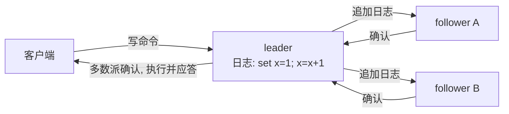
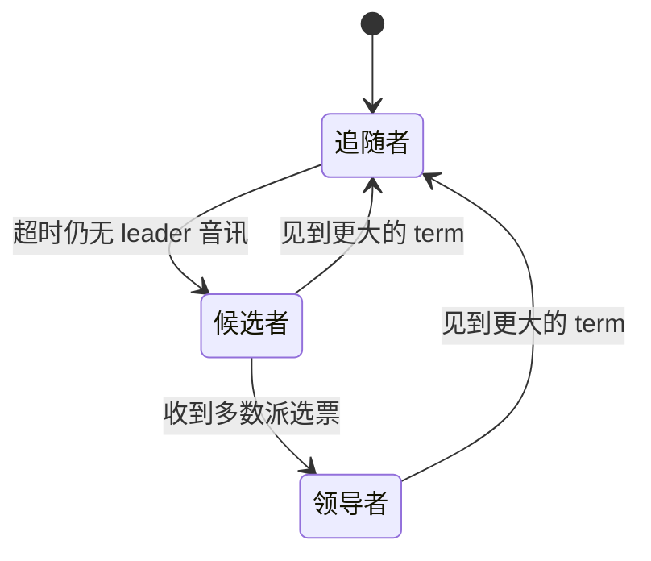

# $\rm Chapter \, 3$ 选举与 Raft（上）：谁是正主

> **本章假设你已经会**
>
> 1. 部分失败为什么是分布式的第一性难题：一台机器坏了，你却无法确定远端那台是死是慢（§1.1）。
> 2. 失败三件套：不可靠的网络、不可靠的时钟、会随时崩溃的进程（§1.2）。
> 3. 本册只做崩溃容错（fail-stop）：机器只会死，不会撒谎（§1.3）。
> 4. RPC 的基本形态：每次调用都可能超时、重试或永远没有回音（§1.5）。
> 5. 协调器是 MapReduce 里唯一不许随便死又不许随便换的角色，而「新协调器从哪来」被一路留到了本章（§2.5）。

上一章结尾把债记在了本章头上：账本可以复印，复印机不能有两个主人。本章开始还债：先讲清为什么「两个正主」比「没有正主」更糟（§3.1），再建立贯穿后半册的复制状态机框架（§3.2），然后正面回答接任问题。答案的名字叫 Raft（Ongaro & Ousterhout, USENIX ATC 2014），它把「谁是正主」变成一场有任期、有选票、有时间限制的选举。路线是先立协议再立活性：§3.3 给出选票规则并证明同一任期至多选出一位 leader，这是安全性；§3.4 用实验展示固定超时怎么把选举拖进活锁，§3.5 再用随机超时把活性挣回来。本章只做上半场：怎么选出 leader；日志怎么写、崩溃后凭什么恢复，全部留给第 4 章。

## $\rm \S \, 3.1$ 两个正主比没有正主更糟

第 2 章有一笔账被轻轻放过：worker 被误判为死，代价近乎为零，因为重执行是幂等的，多算一遍不影响结果。同样的误判发生在协调器身上就是另一回事了。设想协调器只是网卡卡了十秒，客户端按某种「接任机制」拉起一台新协调器，而旧的那台缓过来继续记账。从这一刻起集群里有两本账：两边都在派任务，worker 交卷不知道交给谁，同一分片被算两遍、产出两套中间文件，最终输出指向哪个版本取决于最后一秒谁抢到了改名。没有协调器，作业只是停摆，重启即可；有两个协调器，作业会安静地算出错误的结果。停摆是故障，错误的结果比故障恶劣得多，因为它不报错。

这类惨剧有名字：脑裂（split brain）。在数据库主从复制里它更致命：两台机器都自认为主库、各自接收写入，数据分叉之后没有机械的办法合并，只能人工逐条对账。第 1 章总结过失败三件套汇成的症状是「结果没有按时出现」，现在补上对称的另一半：当你以为对方死了而它其实活着时，症状变成「结果被算了两遍，而且两遍不一样」。

把症状的根源摊开看。你 ping 不通一台机器，得到的信息只是「我没能 ping 通」，而不是「它死了」，这两句话的差别就是全册心智模型里那句「网络会撒谎」：网络传递给你的每个观察都可能是旧闻或误报。共识（consensus）问题就是在这种片面信息下，让一组机器对同一个问题给出永远一致的答案，本章这个问题具体化为「当前的任期里正主是谁」。这个问题的要求分两个方向，缺一不可。

1. 安全性：任何时刻，至多只有一个正主被系统承认。违反它的代价就是脑裂，账算不回来。
2. 活性：只要足够多的机器活着，选举迟早出结果，系统不会永远停在无主状态。违反它，系统退回单机时代。

「被系统承认」这四个字是操作性的，不是谁自称就算数：每个 follower 只认 term 不认人，旧 leader 的指令带着旧 term 到达一律被拒收，新 leader 的指令带着新 term 到达一律被服从。正主不是加冕出来的，是全体机器按同一套 term 规则行动后涌现的客观结果，这也是为什么安全性最终能落成一条可以证明的选票规则（§3.3），而不是一条行为守则。

MapReduce 第 2 章选择的「概率低，绕开」，绕开的其实是活性这一侧的难题。本章要给的协议两个方向都要保：安全性靠选票规则证出来（§3.3），活性靠随机超时挣出来（§3.4 与 §3.5）。

再从客户端的视角称一称两种失败的分量。没有正主时，客户端的请求全部超时，它知道写入没有生效，等选举完重试就好；有两个正主时，客户端向旧主写入得到「成功」，新主对此一无所知，几分钟后这条写入凭空消失，全程没有任何报错。安全性被破坏的可怕之处在于故障是静默的：系统照常应答，答的全是错的。白话：钱包丢了可以挂失补办，被人克隆了一张能刷的假卡，损失要到对账那天才浮出水面。

> 本节小结：误判活人为死人在 worker 上无害、在协调器上致命，因为两个正主各自记账会产生不可合并的分歧；共识问题的两条底线是至多一个正主与迟早选出正主。

## $\rm \S \, 3.2$ 复制状态机：把一致缩成一条日志

在讲选举之前，得先说清选出来的 leader 到底管什么。分布式系统里大多数容错服务用的是同一副骨架：复制状态机（replicated state machine）。每台机器上跑三样东西：一个确定性状态机、一份日志、一个共识模块。确定性状态机的意思是，状态迁移由输入唯一决定：

$$
s_{i+1} = \delta(s_i, c_i)
$$

读法：日志里第 $i$ 条命令 $c_i$ 打进当前状态 $s_i$，确定性函数 $\delta$ 吐出下一个状态 $s_{i+1}$；$\delta$ 只依赖这两个参数，不看墙上的钟、不看机器编号。于是有一条对后面一切论证都基础的推论：两台机器只要从相同的初始状态出发、日志里的命令序列完全相同，执行到任何一步的状态都完全相同。「几台机器状态一致」这个看似无从下手的问题，就此缩小成「日志一致」这个可以逐条核对的问题，这就是本章标题里「把撒谎变成可计算的不确定」的第一次兑现。

日志里放什么由服务决定：键值存储放「set x=3」这样的写命令，MapReduce 的协调器账本放「任务 7 已完成」这样的账目变更。共识模块的职责是保证所有机器对「日志第 $i$ 条是什么、顺序如何」达成一致，达成一致的命令被逐一送进状态机。整副骨架长这样（日志怎么复制到位是第 4 章的内容，这里只看结构）：



拿一个两行的任务把「顺序错了会怎样」走完。日志两条命令：`set x = 1` 与 `x = x + 1`。A、B 按原顺序执行，各自的 $x$ 停在 2；C 把两条抄反了，它的 $x$ 停在 1。此后同一个读请求，A、B 答 2，C 答 1，没有任何一方报错，分歧静静躺在副本里直到被读出来。反过来，只要三本日志逐字节相同，哪怕三台机器快慢悬殊，答案永远一致。服务的一致性就这样被整个押在日志上。白话：三台机器不必互相商量状态，只要抄同一本账、逐条照做；共识模块要的不是「结果差不多」，是账本连标点都不差。

剩下的设计选择是：由谁往日志里写命令。Raft 选了最简单的答案：只有一个领导者（leader）可以接客户命令、写日志、指挥别人复制，其余机器一律是追随者（follower），只管从 leader 那里收日志、照抄、回报。这个选择的账很划算：没有 leader 的系统里，任意两台机器都要互相协商命令的全局顺序，每一轮协商就是一次小共识；有了 leader，「每条命令都对一次」变成「每届 leader 选对一次」，一次选举的成本摊给它在任期间处理的上万条命令。客户端永远只跟 leader 说话，follower 挂掉几台，只要 leader 还在，服务毫无察觉。

但这副骨架立刻显出它的命门：leader 成了新的单点。它一死，没人接客户命令， follower 们必须认出这件事并选出新的 leader，而认出这件事的唯一线索又回到那个撒谎的网络：follower 只能看到「多久没收到 leader 的消息了」。选举协议的全部难度都压在这一句上。还有一桩后续账先记下：follower 崩溃重启后内存状态清零，它的状态机要回到正轨，只能从日志重放恢复，前提是日志在别处有副本；日志怎么保住副本、恢复到哪一条为止，同样是第 4 章的内容。

> 本节小结：复制状态机把多机一致缩成日志一致，单 leader 把逐命令协商摊薄成逐届选举，代价是 leader 的生死判定又落回不可靠网络手里。

## $\rm \S \, 3.3$ 选举协议：任期、角色与一人一票

Raft 把每台机器的生涯压缩成三个角色和一条规则。角色是领导者、追随者与候选者（candidate），转换关系只有四条：



那条规则就是任期（term）：一个单调递增的整数，充当整份日志的逻辑时钟。每次有机器发起选举，它就把 term 加一，term 随每条消息传播。机器之间比新旧的唯一标准就是 term：收到比自己大的 term，无论自己在什么角色、正在干什么，立刻改回 follower 并承认对方的新 term；收到比自己小的 term，一律拒绝。为什么不拿两台机器的墙钟时间比新旧？因为不可靠时钟正是第 1 章三件套之一：两台机器的钟差可以差得任意大，而单调递增的计数器不依赖任何物理钟，只比事件次数。第 8 章会正式展开逻辑时钟的完整理论，这里的 term 就是它最简单的形态：不计量秒，只数事件。

选举的流程一共五步。

1. follower 超过一段时间没听到 leader 的心跳（heartbeat，一条空的日志追加消息，作用相当于「我还活着」），先变成 candidate。
2. candidate 把自己的 term 加一，投自己一票，并向其他所有机器并行发出拉票消息（RequestVote RPC，携带自己的 term）。
3. 其他机器收到拉票消息：若对方 term 更大且本任期自己还没投过票，就投给它，并重置自己的超时计时器；否则拒绝。
4. candidate 收齐多数派（majority）选票，变身 leader，立刻向所有人发心跳，宣布江山已定。
5. 等待选票期间若收到更大 term 的消息，candidate 认输回 follower；若收到与自己 term 相同的 leader 心跳，同样退位，本任期已经有主，再竞选只会制造分裂票。

把五步放到一条时间线上数一遍（5 台机器，超时区间足够宽，第 0 步起老 leader 失联）。第 100 步，A 的计时器最先到期，它变 candidate、进入新任期、投自己一票；第 102 步，拉票消息抵达 B 与 C，两人本任期未投过票，各回一张选票；第 104 步，A 收到第二张选票，凑齐 3 票，变身 leader，立刻发心跳；第 105 到 106 步，心跳抵达其余各台，把它们的计时器清零，D、E 从头等起。从老 leader 失联到新 leader 主政，花费是一个随机等待加两个消息往返，这笔账的形状到 §3.5 还要用。

投票规则只有一句话：每台机器在一个任期里至多投一票，先到先得。整个协议的安全性就从这一句话里长出来。我们来证明：同一任期至多产生一个 leader。反设任期 $t$ 有两个 leader $L_1$ 与 $L_2$，按第 4 步它们各自拿到了多数派选票，记两个多数派为 $M_1$ 与 $M_2$。$N$ 台机器容 $f$ 台故障时 $N = 2f+1$，多数派至少 ${\lfloor N/2 \rfloor + 1}$ 票，即 $(N+1)/2$ 票，于是

$$
|M_1 \cap M_2| \;\ge\; \frac{N+1}{2} + \frac{N+1}{2} - N \;=\; 1
$$

读法：两个集合的交集大小等于两者大小之和减去并集大小，并集至多就是全部 $N$ 台机器，代进去发现两个多数派至少共享一台机器。共享的那台机器在任期 $t$ 里只投过一张票，而 $L_1$ 和 $L_2$ 都声称拿到了它的票，矛盾。所以任期 $t$ 至多一位 leader。白话：两个评测组都宣布自己拿了一道题的 AC，可全评测组里人人只许提交一次，两个组的人数又都超过一半，两组必有重叠的人，那个人记得自己交给了谁，谎言当场拆穿。

> 竞赛生迁移提示：term 的用法很像你写过的版本号检查：本地版本号比数据里的小，就接受覆盖并把自己的版本号抬上去；比它大就拒绝。Raft 只额外加了一条铁律「每个版本号至多投一次票」，并发控制就从「怎么合并冲突」简化成「比大小」。类比失效的边界在重启失忆：版本号存在内存里，进程一崩就忘，忘掉的版本号会让人重复投票，这正是下一段的洞。

证明还顺带回答了一个配置问题：当选门槛为什么是多数派，而不是等全部机器点头？等全部确认，任何一台失联都会卡死选举，容错能力归零；${\lfloor N/2 \rfloor + 1}$ 是能让任意两个多数派必然相交的最小门槛，也就是容 $f$ 台故障的最便宜门票。门槛再降一格，相交性就没了，两个 leader 可以各带一派人马分庭抗礼，安全性证明的第一行就写不下去。

这个证明刻意留了一个洞：它假设每台机器「记得自己这任期投给谁」。记忆存在内存里，进程崩溃重启就清零，同一台机器就会在任期 $t$ 里投出第二票，证明失效，脑裂的大门重新打开。哪些状态必须赶在重启前写到磁盘上，是第 4 章持久化（persistence）一节的主题，这里先把洞记在墙上。

> 本节小结：term 充当逻辑时钟让机器只比新旧不比对错，一人一票加多数派相交证明了每任期至多一位 leader，证明的成立条件是投票记录不因重启丢失。

## $\rm \S \, 3.4$ 固定超时的死局：活锁实测

还剩一个环节没有着落：follower 靠什么判断 leader 死了。Raft 的答案是超时计时器：超过一个选举超时（election timeout）没听到心跳，就认为 leader 大概率死了，自己上场竞选。接下来的问题是怎么给所有人定这个超时，这一步走错，前面全部的安全性证明都救不了活性。

最朴素的方案是定死一个值：所有机器的选举超时都取同一个固定值 $T$。推演一遍它的行为，读者会看到一条完美的死循环。

1. 系统启动，所有 follower 的计时器同时归零，同时数到 $T$。
2. 同一时刻，全员超时，全员变 candidate，全员把 term 加一，于是大家在同一个任期里。
3. 每人把唯一的一张票投给了自己，互相拉票全部被拒，没有任何人凑齐多数派。
4. 选举失败，全员退回 follower，把计时器重置回同一个 $T$，回到第 1 步。

每一轮里所有人都在忙：发消息、收消息、计票，系统却没有一寸进展。这个状态叫活锁（livelock），与死锁的区别在于：死锁是一群人互相等，谁也不动；活锁是一群人都在动，动作还互相抵消。竞赛生在并发编程里见过它的近亲：两个线程各写了一个「抢锁失败就退避一会儿再试」的循环，退避时长又恰好相同，于是永远一起抢、一起失败。票分不出去的这一步还有专门的名字：分裂票（split vote），每个候选人的票数都停在 1，多数派永远凑不齐。

上面这段推演不是抬杠，它能在模拟里原样复现。先补一句容易误解的话：推演里死循环的根源是「开火时刻」同步，不是「消息」同步。网络延迟每轮都在抖，拉票消息何时抵达确实参差不齐，但各台的计时器仍在同一秒到期：人人都先投了自己，迟到的拉票消息才陆续进门，一张票也拉不走。随机化的下手处因此不是消息，是计时器本身。

我们写了一个离散时间步的选举模拟器来复现它：5 台机器、需要 3 票当选，消息单程延迟在 1 到 4 个时间步之间随机，每台机器的选举超时固定为 100 步，所有机器同时启动；连跑 300 次试验，种子固定为 20261104。脚本与完整输出在 `_uni5_work/expDS03/`，在 Git Bash 里用

```bash
wsl bash -c "cd /mnt/c/Users/20811/Desktop/26Fall/_uni5_work/expDS03 && python3 election_sim.py"
```

即可复现，终端会按场景打出统计行；成功标志是 A 行打出 conv=0.000、C 行打出 conv=1.000，B 组六档各打出一行；常见失败是 WSL 尚未启动导致命令报连接错误，先手动进一次 wsl 再重跑。

本章模拟的计时单位是「步」，一个抽象的离散时间步，不对应任何具体的毫秒数；单位换算只影响常数，不影响曲线的形状，读者关心的倍数关系在任何单位下都成立。结果的前两行：

| 场景 | 收敛比例 | 收敛用时 | 选举账 |
| --- | --- | --- | --- |
| A 固定超时，同时启动 | 0/300 | 2000 步内无一收敛 | 每次试验发起 100 次选举（20 轮 × 5 台），全部分裂 |
| C 固定超时，启动时刻随机错开 0..600 | 300/300 | 中位 176 步 | 100% 在第一轮选出 |

A 行就是推演的死循环：300 次试验零收敛，每次试验在 2000 步里发起了整整 100 次选举，每次都分裂。C 行是同一个模拟器只改一处的结果：把 5 台机器的启动时刻随机错开，其余全部不动，300 次试验全部收敛，而且全部在第一轮选完。把 A 和 C 并排放，结论必须说得精确：固定超时不是「一定不收敛」，而是「不为收敛提供任何保证」，C 收敛靠的是启动时刻恰好错开这份运气；而一旦哪一轮分裂发生，第 4 步的重置会把这份运气清零，让所有人重新站上同一条起跑线。真实系统里没有两个时钟严格相同，运气常常不坏，但「常常」不是协议，任何一台机器的重启、一次网络抖动后的集体重试，都可能把系统推回 A 行。

白话：固定超时像五个人约好每 100 秒同时举手抢同一把伞，抢不成就约好再等 100 秒一起抢；随机超时是每人自己定闹钟，闹钟最先响的那个人总能在别人开口前把伞拿走。

动手环节（把 `_uni5_work/expDS03/` 拷到你自己的目录再改，参数全在 `election_sim.py` 顶部，以下预期数字都来自实跑 `variants.py`）：

1. 把 `N = 5` 改成 4 再跑场景 A。预期：仍然 0/300 收敛，每次试验的选举次数从 100 降到 80（每轮 4 台发起）。多数派变成 3 票救不了它，病根在「同时」，不在人数。
2. 把 `T = 100` 改成 40 再跑场景 A。预期：同样 0/300 收敛，选举次数涨到 250；缩短超时只是让活锁转得更快，治标不治本。
3. 把 `RTT = (1, 4)` 改成 `(1, 60)` 再跑场景 C。预期：仍然 300/300 收敛，第一轮成功率从 100% 微降到 97.7%，但中位收敛从 176 步拖到 234 步。错开的启动量级（600）盖过了延迟（60），运气没有被淹掉，可消息变慢的账一分不少地记在收敛时间上；若把错开量级压到与延迟同量级，这一项就会掉下去，动手试试便知。
4. 把场景 C 的错开范围从 0..600 压到 0..60、再压到 0..15。预期：0..60 时仍 100% 第一轮选出（中位 111 步），0..15 时首轮成功率掉到 94.3%、均值涨到 121.2 步。边界浮出来了：错开量级一旦压到只剩消息延迟的三四倍，运气就开始不够分，而 0..15 相对消息延迟 1..4 已经算「错开」了。固定超时对错开量的胃口没有下限保证，这正是随机超时要把错开做进协议的原因。

> 本节小结：固定超时让全体候选人在同一任期自投自票，分裂票无限循环成活锁；实验显示错开启动的运气能救它，但分裂一轮运气即告清零，协议层面必须另找办法。

## $\rm \S \, 3.5$ 随机超时：把运气变成参数

Raft 的解法朴素到令人起疑：把每次的选举超时从一个区间里随机抽取，超时取值均匀分布于 ${[T,\, T+W]}$，$T$ 是区间下界，$W$ 是区间宽度，每轮重抽。回到 §3.4 的死循环看它切在哪里：第 2 步「同一时刻全员变 candidate」再也拼不出来，因为 5 个闹钟几乎不会同时响；最早响的那台机器在别人的闹钟响起之前就把拉票消息送到了，别人还没投过票，票就顺顺当当地给了它。分裂票没有消失，只是从「必然」降级成「偶尔」，偶尔失败的轮次重抽随机值后再战。

这一次性把活性从运气变成了可以调的参数。设单轮选举成功的概率为 $p$，各轮独立同分布，那么选出 leader 所需的轮数 $R$ 服从几何分布，

$$
\mathbb{E}[R] = \frac{1}{p}, \qquad \mathbb{E}[D] \approx T + \frac{W}{N+1}
$$

读法：$R$ 是到选出为止经历的选举轮数，几何分布的期望是 $1/p$；$D$ 是单轮里等到「最早那台」机器超时的等待，$N$ 台机器各自独立地在 ${[T,\, T+W]}$ 里抽超时，最早一个的平均位置是下界 $T$ 加上把 $W$ 等分成 $N+1$ 份的一份；两者相乘再加拉票消息一来一回，就是期望收敛时间的粗账。$p$ 随 $W$ 增大而增大，$D$ 也随 $W$ 增大而增大，一个量被这根旋钮往两个方向拧，方向走多远合适要靠实测。我们把 $W$ 从 2 扫到 320，其余设定与 §3.4 完全相同（$T=100$、消息单程延迟 1..4 步、每档 300 次试验、同一批种子）：

| 区间宽度 $W$ | 首轮选出比例 | 收敛用时中位（步） | 收敛用时均值（步） |
| --- | --- | --- | --- |
| 2 | 37.0% | 204 | 219.1 |
| 5 | 80.7% | 106 | 130.5 |
| 10 | 92.7% | 106 | 113.9 |
| 20 | 96.3% | 107 | 111.8 |
| 40 | 99.3% | 109 | 111.5 |
| 80 | 100% | 114 | 117.5 |
| 160 | 100% | 125 | 130.9 |
| 320 | 100% | 144 | 157.8 |

这张表有三处值得停下来。其一，均值在 $W=20$ 到 40 之间见底（约 111.5 步），两端都变差：$W=2$ 时区间窄得跟消息延迟同量级，候选人经常挤在一起，首轮成功率跌到 37%，失败轮每轮白烧一个超时，均值被拖到 219.1 步，是最优宽度的两倍。其二，$W$ 过 160 后首轮必中，均值反而回升到 157.8 步（$W=320$ 档），因为公式里 $T + W/(N+1)$ 一项从 103 步爬到 153 步，超时区间太宽等于把所有人的闹钟统一往后拨，收敛被自己的等待时间拖慢。两个方向的坏法不同：太窄坏在重试，太宽坏在干等，账各记各的。其三，中位数比均值温和（$W=2$ 时中位 204 对均值 219），因为分裂票是尾部事件：它很少发生，一旦发生就烧掉一整轮，统计时看均值才看得见它。一句话读表：宽度选在「首轮几乎必中」与「等待不喧宾夺主」的交点，本实验落在 $W=20$ 到 40。

两条经验规则从表里长出来。第一，$W$ 要明显大于消息延迟：本实验里消息单程至多 4 步，$W \ge 20$（5 倍于延迟）后首轮成功率就站上 96%；Raft 论文 §5.2 给出的参考区间是 150 到 300 毫秒，针对的是毫秒级网络，倍数关系一致。第二，$W$ 不要宽到喧宾夺主，它决定的是故障后系统无主的最坏等待，生产系统的常用折中是把无主时间压在秒级。

区间下界 $T$ 也不是随便定的。心跳每隔一小段发出一次，走网络要时间，follower 收到还要处理，所以 $T$ 必须明显大于「心跳间隔加往返延迟」，否则 leader 好端端在位，follower 已经因为等不到心跳而频频叛乱，term 被无谓推高。Raft 论文让心跳间隔远小于选举超时，两者通常差着一个数量级：心跳管「我还活着」的日常报平安，超时管「他是不是死了」的异常侦查，两件事不该挤在同一档时间里。

还有一条岔路值得停下来辨一辨：随机化看着不踏实，干脆给每台机器配一个互不相同的固定超时，让取值最小的那台稳赢，行不行？行，确定性方案确实收敛。但它牺牲了机器的对称性：同一份配置发到所有机器，读出来的值必然相同，想不同就得为每台机器单独维护一份配置，扩容、换机都要改全组的规则。随机化方案里每台机器拿到的仍是同一行配置，差异由运行时自己掷出来。为省掉这份运维账，业界（Raft、ZooKeeper 的选举皆然）不约而同选了随机。

动手写 Raft 的人在这一节踩的坑高度集中，列举三条并给出各自的判据。

1. 忘了在收到心跳或投出选票时重置超时计时器。症状：leader 健在，follower 却不断超时叛乱、term 飙升。判据：term 的增长速度远超故障率。
2. 忘了「见到更大的 term 立刻让位」。症状：旧 leader 与新 leader 并存，同一任期出现两个数据来源。判据：日志里同一 term 出现两条不同来源的心跳记录。
3. 计时器只在初次启动时随机一次，之后重置回固定值。症状：系统运行正常，唯独 leader 崩溃后的重选举偶发长时间无主。判据：失败轮的时间点与全员计时器归零的时间点重合，即 §3.4 的活锁复发。

白话：随机区间宽度是「错开多少」的预算，太窄大家挤在同一分钟里靠重试分胜负，太宽则平白把所有人的闹钟往后拨，两头都是账，答案取在比消息延迟大一个量级的地方。

动手环节（继续用 `_uni5_work/expDS03/` 的脚本）：

1. 把 sweep 循环里的宽度档位换成 `(2, 320)` 各跑一次。预期：$W=2$ 档首轮成功率掉到 37%、均值 219.1 步，$W=320$ 档均值回升到 157.8 步，U 形两端都看得见。
2. 把 `N = 5` 改成 7 再扫一遍。预期：窄区间的代价变重，$W=5$ 档首轮成功率从 80.7% 掉到 72.3%、均值涨到 141 步；$W \ge 20$ 后与 5 台机器几乎无异（均值 111 步上下）。集群越大，越要把区间喂宽。

> 选读：第 1 章直觉级地提过 FLP 不可能性（§1.4）：在消息可以任意延迟的异步网络里允许一台机器崩溃，就不存在保证必然出结果的确定性共识协议。§3.4 的活锁实验正是它在 5 台机器上的日常化身：一套确定性规则在循环里空转，每一步都正确，永远不到站。随机化正是理论留下的那扇门：FLP 挡的是确定性算法，往协议里注入真正的随机（或超时这类物理世界固有的不可预测量），必然终止就可能回来了。Raft 论文刻意不展开这层理论，但本节的概率账就是绕过 FLP 的那一步。

> 本节小结：随机超时把分裂票从必然压成偶发，收敛期望由 $1/p$ 与 $T+W/(N+1)$ 共同决定，区间宽度两头受限：窄于消息延迟则分裂票频发，宽过需求则无主等待白白拉长。

## $\rm \S \, 3.6$ 关键概念回顾

1. 复制状态机靠哪两个前提保证「相同日志推不出不同状态」？分别对应正文哪个公式或要求？
2. 「同一任期至多一位 leader」的证明里，多数派相交那一步用到了 $N=2f+1$ 的什么性质？把 $N$ 换成 $2f+2$，多数派该取多大才能保住证明？
3. term 在协议里承担什么职责？机器收到比自己小的 term 时该怎么处理，为什么？
4. 分裂票和活锁分别指什么？固定超时是如何把前者变成后者的？
5. 随机超时的区间宽度 $W$ 太窄与太宽各坏在哪？实验表格里哪两行数字分别对应这两种坏法？

## $\rm \S \, 3.7$ 应用与辨析

1. 一个 5 节点 Raft 集群同时发生网络分区：2 台被隔在一侧，3 台在另一侧。两侧各自的选举会发生什么？哪一侧能选出 leader，为什么这恰好不违反安全性？
2. 同学实现的 Raft 在 leader 崩溃后平均要经历 8 轮分裂票才收敛，消息往返约 5 毫秒，选举超时区间是 ${[300,\, 305]}$ 毫秒。指出病因并给出修改建议，修改后预期的轮数量级如何变化？
3. §3.3 的安全性证明在机器崩溃重启后失效。构造一个具体场景：重启丢失投票记录的机器如何导致同一任期两个 leader？

## $\rm \S \, 3.8$ 本章自测答案

1. 前提一是状态迁移函数 $\delta$ 确定性，即 $s_{i+1} = \delta(s_i, c_i)$ 只依赖状态与命令；前提二是日志命令序列逐条相同。前者是 §3.2 的公式，后者由共识模块保证（§3.2）。
2. 用到了「多数派大小为 $(N+1)/2$，两个多数派之和为 $N+1$，超过机器总数 $N$，故至少相交一台」。$N=2f+2$ 时多数派须取 $f+2$（即 ${\lfloor N/2 \rfloor + 1}$），两两之和 $2f+4 > 2f+2$，相交至少两台，证明才保得住；若取 $f+1$ 则两个多数派可以完全不相交（§3.3）。
3. term 是整份日志的逻辑时钟，让机器比较新旧只需比较一个整数。收到更小的 term 要拒绝，因为承认旧 term 的消息等于承认一个已经被推翻的正主，会让过期 leader 的指令重新生效（§3.3）。
4. 分裂票是一轮选举中无人拿到多数派；活锁是系统各成员持续动作却无进展。固定超时让全员在同一时刻自投自票（必然分裂票），失败后重置回同一超时值，把分裂票逐轮复制，就成了活锁（§3.4）。
5. 太窄时候选人时间上挤在一起，分裂票频发，失败轮白烧超时，对应表中 $W=5$ 行（首轮仅 80.7%，均值 130.5 步）；太宽时 $T+W/2$ 增大，无主等待本身变长，对应 $W=160$ 行（首轮 100% 但中位涨到 125 步、均值回升到 130.9 步）（§3.5）。
6. 3 台一侧能选出 leader：它有 3 台机器，凑得齐多数派 3 票；2 台一侧最多拿到 2 票，永远选不出，只能干等分区愈合。安全性不被违反，因为「至多一个 leader」是按全体 5 台机器的多数派证明的，两侧的多数派若都存在必然在全体层面相交，而 2 台侧根本凑不出全体多数派（§3.3、§3.7 题 1）。
7. 病因是区间宽度 5 毫秒小于消息往返 5 毫秒，候选人根本错不开，正是表中 $W=5$ 的形态。建议把区间拉宽到往返延迟一个量级以上，例如 ${[300,\ 450]}$ 毫秒；首轮成功率会从约八成升到接近必然，平均轮数从多轮降到 1 轮上下（§3.5）。
8. 场景：5 台机器。任期 5 的选举里 A 拿到 A、B、C 三票当选，随后 A 与 B 断电崩溃；B 的投票记录放在内存里，随断电丢失，A 的实现把记录写进了磁盘，重启读回后仍是「任期 5 已投 A」。D 此前停在任期 4，超时后进入任期 5 拉票：B 的状态是全新的，任期 5 在它眼里是新任期，它投给 D；停在任期 4 的 E 也投给 D。D 凑齐 D、B、E 三票在任期 5 当选。稍后 A 恢复，它的记录里自己仍是任期 5 的 leader，开始照常接客，而集群多数派已认了 D：同一任期两位 leader，安全性被 B 的失忆击穿。修法在第 4 章：currentTerm 与 votedFor 必须在回复拉票消息之前落盘（§3.3）。

**你现在能做什么**：给你任意一个「选主」场景，你能说清它的安全性靠什么规则保证、活性靠什么机制挽救，并能用固定随机种子复现固定超时的活锁与随机超时的收敛时间表。

选举选出的只是「拿到笔的人」。leader 上任之后写下的每一笔都要让全集群抄成同一本账，而抄账途中老 leader 可能假死复活、候选人的日志可能比别人短、机器重启可能忘掉自己投过谁。下一章把这三笔账逐一算清：AppendEntries 的一致性检查、提交规则的老 term 陷阱，以及哪些状态必须先落盘才准睡觉。
