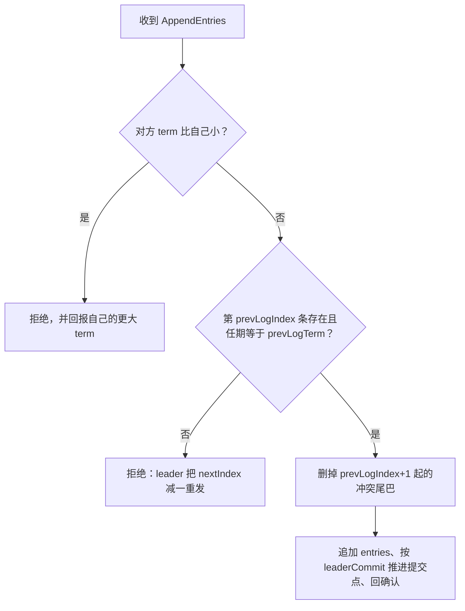

# $\rm Chapter \, 4$ Raft（下）：日志、提交与持久化

> **本章假设你已经会**
>
> 1. 复制状态机骨架：确定性状态机加一份日志，多机一致被缩小成日志一致（§3.2）。
> 2. leader、follower、candidate 三角色与 term 规则：只比新旧，不比对错（§3.3）。
> 3. 「同一任期至多一位 leader」的证明，以及它成立的前提：投票记录不因重启丢失（§3.3）。
> 4. 随机超时如何把选举活性挣回来：分裂票偶发、重抽再战（§3.5）。
> 5. 崩溃就是内存清零：进程死了，内存里的东西一件不剩，磁盘上的原样都在（§1.2）。

上一章把 leader 送上了台，也留下一串没算完的账：日志怎么抄、抄岔了怎么办、老任期写下的条目什么时候才敢认账、机器睡觉醒来凭什么接着干。本章把这三笔账逐一算清。路线是：先给日志复制的最小机制 AppendEntries 和它附带的一致性检查（§4.2），用它拆解最常见的冲突场景「老 leader 假死复活」并用模拟统计回滚代价（§4.3）；再算提交规则的老 term 陷阱，那里藏着一个只数选票就会翻车的反例（§4.4）；然后回答哪些状态必须先落盘（§4.5）；最后处理日志无限增长的问题，引入快照（§4.6）。学完本章，Raft 的安全性地基就齐了，第 5 章才有资格谈「客户端什么时候能相信一个读到的值」。

## $\rm \S \, 4.1$ 正主拿到了笔，账还没抄齐

第 3 章的选举只回答了「谁是正主」。正主上任后要干的活，就是 §3.2 那副骨架的日常运转：客户端发来一条写命令，leader 把它追加到自己日志的末尾，然后指挥所有 follower 把这条命令也抄进各自的日志；等这件事「安全了」，leader 才把命令送进状态机执行，并向客户端报告成功。「安全了」三个字值得一个正式定义：一条日志条目被复制到了多数派机器上、且保证永远不会被任何后来的 leader 推翻，就称它已提交（committed）。只有已提交的条目才准进状态机，只有已提交的写入才准答复「成功」。这个定义把客户端的信任和日志绑在了一起：你听到的那声「成功」，背后必须是多数派磁盘上的同一条记录。

这个定义立刻兑现成一条客户端可感知的承诺。客户端在时刻 $t_1$ 收到「set x = 1 成功」，随后 leader 崩溃、换选、折腾了半天，时刻 $t_2$ 再有客户端来读 $x$，读到的必须还是 1。凭什么？「成功」意味着该条目已在多数派日志里，而本章 §4.4 会证明新 leader 必然继承全部已提交条目，所以无论中间换几任 leader、哪台机器崩溃重启，这条命令都在日志里，重放就回到 1。承诺、多数派、日志，三件事从此拴死在一起。

把命令从 leader 抄到 follower 的消息就是追加日志 RPC（AppendEntries RPC），它其实是 §3.3 心跳消息的完整版：心跳是空的 AppendEntries，所以「发心跳」和「抄日志」共用一条通道。每条 AppendEntries 带五样东西：leader 的 term、已有日志的前一项位置 prevLogIndex、前一项的任期 prevLogTerm、要追加的条目序列 entries，以及 leader 自己已确认的提交点 leaderCommit。前一项位置和任期合起来构成一致性检查（consistency check），它是本章全部机制的地基，下一节专门讲它。

本章要还的三笔债都从第 3 章来。其一，follower 的日志可能落后、可能缺页、可能被前任 leader 写岔，AppendEntries 靠什么发现并修复（§4.2 与 §4.3）。其二，「多数派抄到了」不等于「可以提交」，§4.4 会给出一个只数选票就把已提交数据弄丢的反例。其三，§3.3 的证明假设每台机器记得自己投过谁，而这个记忆存在内存里，一次断电就清零（§3.3 末尾特意在墙上留了洞）；哪些状态必须赶在断电前写进磁盘，§4.5 给出完整清单。白话：提交像快递签收，系统只把多数派都收到的那件标成已签收；从签收那一刻起，无论仓库怎么倒腾、换几任站长，这件包裹都不会再丢。

> 本节小结：提交的定义把「答复成功」抵押在多数派日志上，AppendEntries 是抄日志与报心跳共用的通道，本章按「抄、修、认账、落盘、瘦身」的顺序还清第 3 章的债。

## $\rm \S \, 4.2$ 一致性检查：抄账先对页码

follower 收到 AppendEntries 后做的第一件事不是抄，而是核对：取出自己日志第 prevLogIndex 条，看它的任期是否等于 prevLogTerm。对不上就拒绝，一条也不抄。这条检查的逻辑是「要接第 prevLogIndex+1 页，先证明你手里的第 prevLogIndex 页和我的一致」，核对凭据就是那一页的任期号。整个收发流程画出来只有一条分支链。



leader 侧对每个 follower 维护一个下一条要发的位置 nextIndex，被拒绝就减一重发，等于一页一页往回翻，直到翻到双方一致的那一页，再从这里开始正常追加。这个回退是线性的，最坏要翻几页就拒绝几次；工程实现常用拒绝时捎带冲突线索（比如follower 缺口的起点）把回退加速成跳跃，属于纯优化，不影响正确性，本书按下不表。

为什么核对一页就够担保整本账？这就是日志匹配性质（Log Matching Property）：若两份日志在第 $i$ 条上任期相同，则两份日志在第 $i$ 条之前的所有条目全部相同。

$$
\mathrm{log}[i].\mathrm{term} = \mathrm{log}'[i].\mathrm{term} \;\Longrightarrow\; \mathrm{log}[j] = \mathrm{log}'[j],\quad \forall\, j \le i
$$

读法：两份日志在第 $i$ 条位置存着同一个任期的条目，就能推出从第 $1$ 条到第 $i$ 条逐条相同。证明分两步。第一步，同一位置同一任期意味着同一条命令：§3.3 证过一个任期至多一位 leader，而一位 leader 在一个日志位置上只创建一条命令，所以「位置加任期」唯一确定条目内容。第二步，归纳：AppendEntries 的 prevLogIndex 与 prevLogTerm 恰好把「第 prevLogIndex 条一致」变成每次追加的前置条件，于是第 $i$ 条一致推出第 $i-1$ 条一致（上次追加就是靠核对它才成功的），一路推到第 $1$ 条。归纳的每一步都踩在一致性检查上，所以这个性质的成立条件是所有机器都执行检查，跳过检查的实现会把地基抽掉。

检查失败之后是修复，规则只有两条。follower 侧：从 prevLogIndex+1 起，把自己日志上与 leader 冲突的尾巴整段删掉，这个动作叫回滚（rollback），然后抄上 leader 带来的条目。leader 侧：nextIndex 减一重试，翻到一致页为止。两条规则合起来保证 follower 的日志最终变成 leader 日志的前缀。注意修复的方向是单向的：follower 改自己的日志去贴合 leader，leader 从不改历史去贴合 follower，因为 leader 的日志是客户命令的唯一正本。白话：抄账不是接过整本就完，而是先对页码、页脚的签名，签名对不上就撕掉自己后面几页重抄，撕掉的是草稿，入过账的页谁也不会撕。

> 本节小结：一致性检查把「整本账一致」压缩成「核对一页的任期号」，配合归纳法撑起日志匹配性质；冲突的修复永远是删 follower 的尾巴，而不是改 leader 的历史。

## $\rm \S \, 4.3$ 冲突修复实测：老 leader 假死复活

最值得拆解的冲突场景是第 3 章预告过的：老 leader 假死复活。它没死透，只是被网络分区隔了一阵，醒来时新 leader 已经主政。我们拿 5 台机器把整个修复走成一张状态推演表。记号：每格写日志条目，数字是位置，括号里是任期，比如「1–6（任期 1）」表示第 1 到 6 条全是任期 1 的条目。

| 时刻 | A（老 leader） | B（换届宕机） | C（新 leader） | D | E | 提交点 |
| --- | --- | --- | --- | --- | --- | --- |
| 任期 1：A 写入 6 条，尽力复制 | 1–6（任期 1） | 1–6（任期 1） | 1–3（任期 1） | 1（任期 1） | 1–2（任期 1） | 3 |
| A 假死、B 宕机；C、D、E 投出任期 2 的 leader C | 同上 | 同上 | 同上 | 同上 | 同上 | 3 |
| C 追加 3 条任期 2 条目（第 4–6 条），复制给 D、E | 1–6（任期 1） | 1–6（任期 1） | 1–3（任期 1）＋4–6（任期 2） | 1–3（任期 1）＋4–6（任期 2） | 1–3（任期 1）＋4–6（任期 2） | 6 |
| A、B 恢复，与 C 对齐 | 1–3（任期 1）＋4–6（任期 2） | 同左 | 不变 | 不变 | 不变 | 6 |

逐行走一遍，共四步。

1. 任期 1：A 写了 6 条，但只有第 1 到 3 条凑上了多数派（A、B、C 三台），提交点停在 3；第 4 到 6 条在 A、B 两台上，属于未提交的草稿。
2. 换届：A 假死、B 宕机，剩下三台里 C 的日志最长，按 §3.3 的投票规则拿到全部三票当选，任期 2 开始。注意投票者只有 D、E 和 C 自己，日志最长的 A、B 都不在场。
3. 新主写入：C 追加 3 条任期 2 的条目，恰好顶在同样的位置 4、5、6 上，并复制给 D、E，凑齐多数派后提交点推进到 6。
4. 归位：A 与 B 回来，一致性检查在第 4 条上炸了，它们那里是任期 1 的旧草稿，C 这里是任期 2 的正本，于是各回滚 3 条、重抄 3 条。

这张表有三处值得停下来看。其一，被回滚的恰好是提交点 3 之后的草稿，已提交的第 1 到 3 条在任何人那里都纹丝不动。其二，C 的日志明明比 A 短，却能当选且不违反任何东西，因为投票者只和在场者比。其三，同一位置 4 上先后住过两条不同的命令，靠任期号分新旧，这正是 §3.3 说的「term 是整份日志的逻辑时钟」落到日志上的样子。

推演表展示的是一次个案，回滚的规模到底服从什么分布，要用模拟数出来。我们把上面的场景随机化：任期 1 的条目数 n1 在 2 到 10 之间、任期 2 在 1 到 6 之间均匀抽取，每台 follower 收到的复制量是随机长度的前缀，每台 follower 另有 0.15 概率在换届期间整体宕机（不投票、不收日志，但保证至少三台可达，否则本届选不出 leader，该次重抽），任期 2 的消息以 0.7 概率全量到达，最后全员复活对齐，统计每个节点回滚的条目数。连跑 20000 次，种子固定为 20261104。脚本与完整输出在 `_uni5_work/expDS04/`，在 Git Bash 里用

```bash
wsl bash -c "cd /mnt/c/Users/20811/Desktop/26Fall/_uni5_work/expDS04 && python3 rollback_sim.py"
```

即可复现；成功标志是安全检查行打出 0、分布共十行，常见失败是 WSL 未启动导致连接报错，先手动进一次 wsl 再跑。模拟计时单位是抽象步，本节统计与时间无关，只数条目。老 leader A 的回滚分布如下。

| A 回滚条目数 | 频次 | 占比 |
| --- | --- | --- |
| 0 条 | 9329 | 46.6% |
| 1 条 | 4993 | 25.0% |
| 2 条 | 2745 | 13.7% |
| 3 条 | 1442 | 7.2% |
| 4 条 | 775 | 3.9% |
| 5 条 | 385 | 1.9% |
| 6 条 | 201 | 1.0% |
| 7 条 | 93 | 0.5% |
| 8 条 | 33 | 0.2% |
| 9 条 | 4 | 0.02% |

伴随的几个统计量把图景补全：出现任何回滚的试验占 53.4%；A 回滚条目数的均值 1.10 条、最大 9 条；全集群每轮回滚总数均值 1.24 条、单轮最大 16 条；需要修复的节点数为 0 台、1 台、2 台的试验分别占 46.6%、46.2%、7.2%；A 的条目最终存活比例平均 82.5%。

零回滚的那 46.6% 还能从概率骨架里直接算出来对个账：A 不回滚当且仅当新 leader 继承到了 A 的完整日志，即至少一台在场 follower 抄满了全部 n1 条。每台抄满的概率是 ${1/(n_1+1)}$（前缀长度在 0 到 n1 里均匀取），四台独立，于是

$$
P(\text{A 零回滚}) \;=\; 1 - \Big(\frac{n_1}{n_1+1}\Big)^{4}
$$

读法：先算四台全都没抄满的概率（每台漏抄的概率是 ${n_1/(n_1+1)}$，四台独立连乘），再取补集。对 n1 在 2 到 10 上取平均，这条式子给出约五成，与实测的 46.6% 对上；0.15 的宕机概率是它的个位数百分点修正。理论骨架和实测对得上，说明模拟没有跑偏。

剩下的数字读出三件事。第一，老 leader 复活几乎对半要撕草稿，但均值只有一条上下，代价集中在未提交的尾部，撕掉 9 条的极端情形要求四台 follower 都几乎没抄到东西，概率按四次方衰减。第二，也是最重要的一件：20000 轮里「被回滚的条目中包含已提交条目」的次数是 0。这不是运气好，模拟里安全断言每轮都在查，而它能零违例地过，靠的是下节要证的定理：新 leader 必然拥有全部已提交条目，所以冲突只可能发生在提交点之后。第三，需要修复的总是换届期间不在场的人，新 leader 从不回滚自己，在场 follower 的零星尾巴早在复制阶段就被顺掉了。

动手环节（把 `_uni5_work/expDS04/` 拷到你自己的目录再改，参数在 `rollback_sim.py` 顶部，以下预期数字都来自实跑）：

1. 把 `P_DOWN = 0.15` 改成 0.0 再跑。预期：需要修复节点数的分布只剩 0 台与 1 台（49.8% 对 50.2%），2 台的档消失。没有节点在换届期间宕机时，新 leader 是在场者中日志最长的，别人的尾巴早在复制阶段就被顺掉了，冲突全部集中到假死的老 leader 头上。
2. 把 `rng.randint(2, 10)` 改成 `rng.randint(2, 20)` 再跑。预期：冲突频率从 53.4% 涨到 67.8%，A 的回滚均值从 1.10 条涨到 2.22 条、最大 19 条，存活比例从 82.5% 降到 80.8%。日志越长，尾巴越大，回滚的期望按比例跟着涨，安全检查依然是 0。

白话：新 leader 像新任主管接手账本，只认已入账的页，前任写在便签上的草稿（还没提交的尾部）一律作废重写，但账本里订死的页一页不会少。

> 本节小结：老 leader 假死复活后按位置与任期逐页对账，回滚只落在未提交的尾部，实测均值约一条、且 20000 轮零次波及已提交条目，靠的是「新 leader 必有全部已提交条目」这一定理。

## $\rm \S \, 4.4$ 提交规则与老 term 陷阱

现在正面回答「多数派抄到了就能提交吗」。对 leader 自己任期内创建的条目，答案是肯定的：它被复制到多数派后不会再被推翻，理由本节末尾给全。但对旧任期的条目，答案是否定的，这一节给出分布式系统里最精巧的反例之一（Raft 论文 §5.4.2 的 Figure 8）。反例的全部前提只有 §3.3 已证的两条：一个任期至多一位 leader，多数派与多数派必然相交。

还是 5 台机器 S1 到 S5，日志里的条目用字母记：第 1 条是任期 1 的初始条目，之后 X 是任期 2 的、Y 是任期 3 的、Z 是任期 4 的，三条是互不相同的三条写命令。X 只被复制到 S2；S5 趁乱在任期 3 当选（S3、S4、S5 三票，它们的日志都不比 S5 新），写下了 Y，也停在第 2 条的位置上；随后 S1 复活、在任期 4 当选（四票），继续把 X 复制出去，送到了 S3。此刻 X 在 S1、S2、S3 三台上，多数派凑齐了。按「数副本」的天真规则，X 应当提交。但看接下来的演变。

| 阶段 | 事件 | S1 | S2 | S3 | S4 | S5 | X 在几台上 |
| --- | --- | --- | --- | --- | --- | --- | --- |
| (a) | S1（任期 2）写 X@2，复制给 S2，随后假死 | 1,X | 1,X | 1 | 1 | 1 | 2 |
| (b) | S5（任期 3）写 Y@2，随后假死 | 1,X | 1,X | 1 | 1 | 1,Y | 2 |
| (c) | S1 复活（任期 4），把 X 复制给 S3 | 1,X | 1,X | 1,X | 1 | 1,Y | 3 |
| (d) | S1 假死，S5（任期 5）当选，把 Y 覆盖到 S2、S3 | 1,X | 1,Y | 1,Y | 1 | 1,Y | 1 |
| (e) | 另一条时间线：S1 写 Z@3（任期 4），复制给 S2、S3 | 1,X,Z | 1,X,Z | 1,X,Z | 1 | 1,Y | 3 |

(d) 行是翻车现场，值得逐台对票。S1 假死后，S5 出来竞选任期 5。投票规则只比日志最后一条的任期：S2、S3 的末条是任期 2，S5 的末条是任期 3，S5 更新，两人各投一票，S5 拿下三票当选，随后把 Y 覆盖到第 2 条上。X 明明凑齐过多数派，此刻却从 3 台缩回 1 台。如果 (c) 阶段系统宣布过「X 已提交」、S2 的状态机已经执行了 X，这一刻就出现已提交数据被推翻：没有任何合法手段把状态机已经做过的事收回来。

这段推演可以程序化验证，不必信文字。`commit_rule_sim.py` 把上面两条时间线各跑一遍，每台机器维护一个「已应用值序列」，收尾时审计它是否仍是自己日志从头重放的前缀（崩溃中的机器应用得少是正常的，应用错是犯罪）。错误策略下，S2 在 (c) 应用过 X=7，(d) 里第 2 条被 Y 覆盖，审计记一次安全违反；正确策略下全程零违反。

```bash
wsl bash -c "cd /mnt/c/Users/20811/Desktop/26Fall/_uni5_work/expDS04 && python3 commit_rule_sim.py"
```

| 策略 | 安全违反次数 | S2 的账 |
| --- | --- | --- |
| 错误：数旧任期条目的副本 | 1 | 已应用 ${[1, 7]}$ 不是日志重放 ${[1, 9]}$ 的前缀 |
| 正确：只数当前任期条目 | 0 | 五台机器的应用序列全是各自日志重放的前缀 |

翻车的根源想清楚只要一句话：(c) 时刻那个「多数派」是瞬时的，它挡不住下一个任期里另一个多数派换个主意。任期 5 的选举里，X 的三台持有者只有 S1 在场，S1 还偏偏是个假死的旁观者，多数派说翻就翻。所以提交的判据必须锚在「未来」上，而未来唯一可计算的东西是 §3.3 的多数派相交：这次选举的多数派和下次选举的多数派必然共享一台机器。

> 竞赛生迁移提示：Figure 8 与 §3.3「同一任期至多一位 leader」的证明用的是同一笔多数派相交的账，方向相反。证明里，相交保证谎言当场拆穿；这里，相交保证翻案必留痕迹。(d) 行里 S5 的选票来源（S2、S3）与 (c) 行里 X 的持有者（S1、S2、S3）一对照，缺的恰好是不在场的 S1。这套账的失效边界是投票必须动真格校验日志新旧：跳过校验的实现会把交点上的守门人换掉。

Raft 的提交规则由此写成：leader 只对自己当前任期创建的条目数副本，凑齐多数派即提交；此前所有旧任期条目随它一起提交，不许单独数副本。规则能立住，靠一条先证出来的定理，Leader 完备性（Leader Completeness）：任一任期的 leader 拥有此前全部已提交条目。证明三步。

1. 已提交条目按定义存在于某个多数派 $M$ 上。
2. 新 leader 当选靠多数派选票 $M'$，由 §3.3 的不等式，$M$ 与 $M'$ 至少共享一台机器。
3. 交点上的那台机器手里有这条已提交条目，而投票规则规定每台机器只投给「日志至少与自己一样新」的候选人；新 leader 若缺这条条目，日志就比交点机器旧，拿不到这票，凑不齐多数派，矛盾。

于是回到规则本身：leader 的当前任期条目凑齐多数派时，提交点可以一路推到该位置，因为据完备性，这些位置上的旧条目在 leader 日志里都有，且据日志匹配性质与人人执行检查，它们在所有副本上一致。再看 (e) 行为什么能解开死结：S1 把任期 4 的 Z 顶到第 3 条并复制给多数派，按规则提交点推进到 3，第 2 条的 X 随之提交；而且从此 S5 永远选不上，S2、S3 的末条任期已是 4，对任期 3 的 S5 一票不给，翻案的可能性被多数派相交永久焊死。白话：旧任期条目像前任签字的报销单，不能自己数人头宣布通过，得等新任签发一张单据，把它捎在后面一起过会。

> 本节小结：旧任期条目凑齐多数派也不可提交，瞬时多数派挡不住下届选举翻案；提交规则锚在当前任期条目上，其正确性由 Leader 完备性加多数派相交保证。

## $\rm \S \, 4.5$ 持久化：睡着之前必须写进磁盘的三样

§1.2 的失败三件套里，进程崩溃的后果是内存清零。Raft 每台机器的状态里，哪些必须在每次改动后写进磁盘（持久化，persistence），哪些可以放心留在内存（易失状态，volatile state）？清单只有三加二。

1. currentTerm：醒来后第一件事就是比新旧，term 忘了就可能把旧 leader 当新主，§3.3 的 term 规则全体失效。
2. votedFor：本任期投给谁。§3.8 第 8 题推演过失忆的代价：重启的机器忘了自己投过 A，同一任期再投 D，一个任期出两位 leader，安全性证明的前提被抽掉。
3. log[]：复制状态机靠日志重放恢复状态（§3.2）。更深一层的账：follower 确认收到某条目后就崩溃且忘了它，若这份确认恰好凑成多数派，条目已提交，而全集群再无副本，已提交数据凭空蒸发。日志必须落盘，才配得上「提交」二字。
4. commitIndex 与 lastApplied 可以易失：它们是账本读出来的位置，不是账本本身，重启后可以重建。

三样必持久的状态有个共同的纪律：在回应任何 RPC 之前先落盘，再回复。回复一张选票前必须让 currentTerm 与 votedFor 躺进磁盘，回复一次追加前必须让新条目躺进磁盘，否则答复本身就成了空头支票。两样还要原子地一起写：currentTerm 加一和 votedFor 清空是同一次选举的两面，磁盘上若出现「新 term 配旧投票记录」，等于开了重复投票的口子，所以工程上把两个值放进同一条记录一次写入。崩溃重启的恢复流程也顺理成章。

1. 从磁盘读回 currentTerm、votedFor、log[]，角色按 §3.3 的规则判定：有更高 term 的心跳就当 follower，超时则自己竞选。
2. 易失状态清零：commitIndex 置 0，lastApplied 置 0，状态机为空。
3. 等第一帧心跳到达，用其中的 leaderCommit（与自己的日志长度取小）定出已提交前缀。
4. 把已提交前缀按序重放进状态机，lastApplied 追平，之后照常服务。重放没开始前，状态机不答任何读请求。

纪律的代价直白：每条命令的提交路径上都躺着一次真实的磁盘写，延迟由它支配。操作系统册在讲日志型文件系统时出现过这个角色（§8.6）：fsync 强制把内核缓冲刷进磁盘，慢，但断电后东西还在。工程上有两味解药，一是批量：攒一批命令一次落盘，一次磁盘写的成本摊给整批；二是流水线：leader 不必等上一条的落盘确认才发下一条，安全底线仍是「答复客户端前，多数派已落盘」。白话：三样持久状态是睡觉前压在枕头下的三张纸，身份证（currentTerm）、投票记录（votedFor）、账本（log），醒来时全靠它们证明自己是谁、投过谁、抄到哪。

这一节的坑在实现里高度集中，列两条并给出判据。

1. 先回话后落盘。症状：断电重启后偶发同一任期两位 leader，或一条已确认的写入消失。判据：出事的条目都在「回复已发出、写盘未完成」的窗口里。
2. currentTerm 与 votedFor 分两次落盘。症状：崩溃恰好卡在两次写之间后，机器在磁盘上的新任期里没有投票记录，又投了一票。判据：持久化文件里出现 term 与投票记录不配套的行。

> 本节小结：currentTerm、votedFor、log 三样先落盘再回话，丢任何一样都直接拆掉已证的安全性；提交点与已应用位置可以易失，重启后靠日志重放与心跳补回。

## $\rm \S \, 4.6$ 快照：账本太厚就装订成期初余额

日志还有一桩与正确性无关、与可用性攸关的病：它只增不减。服务跑一年，日志几亿条，两笔账越欠越重：磁盘被日志吃满；崩溃重启后要重放几亿条才能回到现场。解法利用了一个显然的事实：状态机只关心结果，不关心过程，第 1 到 100 条的效果已全部体现在状态里。快照（snapshot）就是定期把状态机当前状态整个拍下来，连同两个元数据 lastIncludedIndex 与 lastIncludedTerm（快照覆盖到的最后一条日志的位置与任期），写进磁盘，然后把日志前缀整段扔掉。白话：把前 100 页账装订成一页「期初余额」，封面写着「本册含至第 100 笔」，翻旧账只翻这一页。

装订带来一个新接口问题：leader 的 nextIndex 翻页时可能翻进已装订丢弃的区域，对那条位置的检查对方日志里根本不存在。这时 AppendEntries 不再适用，leader 改发安装快照 RPC（InstallSnapshot RPC），把整份快照发过去，消息里除了快照本体，关键是 lastIncludedIndex 与 lastIncludedTerm 这一对边界凭据。follower 的收货规则有三条。

1. 若自己已有的快照边界更新（lastIncludedIndex 更大），整份退回，什么都不做。
2. 否则用快照覆盖状态机；若自己日志在 lastIncludedIndex 之后还有条目（快照落后于自己抄写的进度），保留这段尾巴接在快照后面。
3. 以 lastIncludedIndex、lastIncludedTerm 作为今后一致性检查的新起点，日志前缀彻底作废。

前一节说「日志必须持久化」，装订之后清单更新为「快照连同残留日志段必须持久化」，lastIncludedTerm 尤其不能省，丢了它，跨过装订边界的那次一致性检查就没有凭据可对。快照不是免费午餐，适用条件要看状态机的大小：键值存储状态几百兆，快照是利器；状态本身是几个 TB 的索引，拍一次快照的代价就压过了收益，这类服务要么把日志长度压在阈值内强制推进，要么把状态外置。判断标准只有一条账：重放省下的时间与拷贝状态花掉的时间，哪个大。实现的第三坑也在这：快照写到一半就断电，磁盘上留下半份快照，恢复时必须能识别残卷（写入前先写临时文件再原子改名是常规解法），否则半份快照被当成正本装订进账本。

> 本节小结：快照用「状态加边界元数据」替换日志前缀，InstallSnapshot 处理翻页翻进装订区的情形，适用与否取决于状态机自己有多大。

## $\rm \S \, 4.7$ 关键概念回顾

1. AppendEntries 的一致性检查核对什么？它如何一步步支撑起日志匹配性质？两步论证各自用到哪条已证结论？
2. §4.3 的推演表里，A 与 B 被回滚的 3 条为什么不可能是已提交条目？请用提交点的位置回答，再引用支持这一点的定理。
3. Figure 8 的 (c) 阶段，X 已在 3 台机器上，为什么仍不可提交？(e) 阶段 S1 靠哪一步把 X 提交、又靠什么让 S5 永久失去翻案资格？
4. 写出 Leader 完备性的证明三步。哪一步用到了「投票只给日志不比自己旧的候选人」？
5. Raft 要求哪三样状态先落盘再回话？各自丢了会拆掉哪条已证性质？commitIndex 为什么可以易失？

## $\rm \S \, 4.8$ 应用与辨析

1. 同学实现的 Raft 里，follower 收到 AppendEntries 时跳过一致性检查直接追加，说「反正 leader 是对的」。构造一个具体场景，说明这会如何破坏日志匹配性质的归纳链条。
2. 5 节点集群，任期 3 的 leader 把一条任期 3 的条目复制到 3 台后崩溃；新 leader（任期 4）的日志里没有这条。分别按「数副本即提交」与 Raft 规则推演这条条目的命运，指出哪一步两者分岔。
3. 一台 follower 的日志长 50 条，leader 的快照已装订到第 80 条。leader 该发什么消息？follower 收到后按哪三条规则处置？

## $\rm \S \, 4.9$ 本章自测答案

1. 核对自己日志第 prevLogIndex 条的任期是否等于 prevLogTerm。支撑链条分两步：同一位置同一任期推出同一条命令，用「一个任期至多一位 leader、一位 leader 在一个位置只写一条」（§3.3）；第 $i$ 条一致推出第 $i-1$ 条一致，因为每次追加成功都以核对前一项为前提，归纳到底即整本一致（§4.2）。
2. 推演表中提交点停在 3，被回滚的是第 4 到 6 条，全在提交点之后；支持它的是 Leader 完备性：新 leader 必然拥有全部已提交条目，所以冲突只可能发生在提交点之后的未提交区间（§4.3、§4.4）。
3. (c) 的多数派是瞬时的：任期 5 的选举里 X 的持有者只有假死的 S1 在场，S2、S3 末条任期 2 小于 S5 的 3，只能倒戈，多数派被换掉，X 随之被 Y 覆盖。(e) 中 S1 把当前任期（任期 4）的 Z 复制到多数派，按规则提交点推进到 3，X 随之提交；此后 S2、S3 末条任期 4，对 S5 一票不给，翻案资格被多数派相交焊死（§4.4）。
4. 第一步，已提交条目存在于某个多数派 $M$ 上；第二步，新 leader 的选票多数派 $M'$ 与 $M$ 相交至少一台；第三步，交点机器只投给日志不比自己旧的候选人，缺该条目的候选人得不到它这票，故新 leader 必有该条目。第二步用多数派相交，第三步用投票规则（§4.4）。
5. currentTerm（丢了会把旧主当新主，拆掉 term 规则）、votedFor（丢了会重复投票，拆掉「每任期至多一票」）、log（丢了已提交数据无副本可救）。commitIndex 易失是因为它可由 leaderCommit 心跳与日志重放重建，属于「账本读出的位置」而非账本本身（§4.5）。
6. 场景：follower F 的日志第 5 条是任期 2 的条目，leader L 的第 5 条是任期 3 的。F 跳过检查直接追加 L 带来的第 5 条后，F 的第 4 条还留着任期 2 的旧内容，而 L 的第 4 条是任期 3 的。此后 L 发下一条 AppendEntries，prevLogIndex=4、prevLogTerm=3，F 若照常检查就该在这里拒绝并回滚重对；跳过检查的版本里 F 的第 4、5 条与 L 不同源，日志匹配性质的归纳链条在「第 $i$ 条一致推出第 $i-1$ 条一致」这一步断裂，两份日志在第 4 条上永久分叉（§4.2）。
7. 数副本规则：3 台已达多数派，宣布提交；随后任期 4 的 leader 若缺这条（它可以合法地从旧多数派之外的三台选出），会把自己的条目顶到同一位置，已提交条目被覆盖。Raft 规则：该条目属任期 3，新 leader（任期 4）不数它的副本，不提交；等任期 4 的 leader 把自己的条目复制到多数派时，这条旧条目若还在新 leader 日志里就随之前进，若已被覆盖则从未提交。两者在「是否敢宣布提交」处分岔（§4.4）。
8. 发 InstallSnapshot。follower 三步：快照的 lastIncludedIndex（80）大于自己日志长度（50），不属退货情形；用快照覆盖状态机，自己没有第 80 条之后的日志尾巴需要保留；以 lastIncludedIndex、lastIncludedTerm 作为新起点，此后一致性检查都在装订边界之后进行（§4.6）。

**你现在能做什么**：给你任一台崩溃重启的 Raft 机器，你能说出它的磁盘上必须躺着哪三样、内存里哪些可以重建，并能推演老 leader 复活与 Figure 8 两张表里的每一次日志增删。

到这里，Raft 的日志在多数派上站稳了，提交点的每次推进都踩在已证的定理上。但还剩最后一个问题没回答：客户端在 $t_1$ 时刻写入成功，$t_2$ 时刻发起读，它凭什么确定读到的是那条新值而不是某台落后副本上的旧值？「成功」与「读」之间的时间承诺，正是下一章线性一致性要精确刻画的东西。
