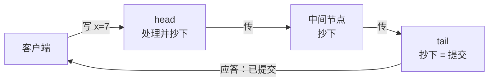

# $\rm Chapter \, 6$ 复制方案谱系：primary-backup 与链式复制

> **本章假设你已经会**
>
> 1. 失败三件套：消息能丢能迟到、时钟不可全信、进程随时会死（§1.2）。
> 2. 复制状态机：把多机一致缩小成一条日志的一致，状态由日志重放而来（§3.2）。
> 3. 提交的定义与 leader 完备性：多数派落盘的写不会丢，新 leader 必然继承全部已提交条目（§4.1、§4.4）。
> 4. 老 leader 假死复活为什么危险：它不知道自己已经下课（§4.3）。
> 5. 线性一致的两条规则，以及三条读路径各自的账单（§5.2、§5.5）。

第 5 章结尾留了一句预告：复制方案不止 Raft 一种。本章把谱系摊开。路线：先算清 Raft 式部署在读多写少负载下的死账，认出「读不可扩展」这个缺口（§6.1）；把 Raft 的骨架抽干，得到最朴素的 primary-backup 方案（§6.2）；把写路径改成一条流水线，得到链式复制（§6.3）；再让链上每个节点都能接客，得到 CRAQ（§6.4）；然后用两个模拟实测读吞吐的扩展性与丢包敏感性（§6.5）；最后对比两种方案的故障恢复，看它们各自把「网络会撒谎」应付到了哪一层（§6.6）。

## $\rm \S \, 6.1$ 问题：正主太忙，备份只旁观

照旧摆 3 台机器，跑一个典型业务：读写比 99 比 1。商品页、配置项、用户档案，绝大多数分布式存储面对的都是这种读多写少的负载。写路径没问题：写本来就少，leader 收下、记日志、等多数派落盘、答复，一台机器绰绰有余。读路径是死账：§5.5 的三招，读多数派要收 3 份应答逐台比对，租约欠一条时钟假设，读索引也要一轮心跳。三招没有一个离开 leader，99 份读每份都要惊动正主。加机器买来的是可靠性，不是读能力：第 4 台、第 5 台加入后，读还是只能从 leader 或多数派走，副本们抄账勤勤恳恳，对外一个客人都不接。

缺的这条能力叫扩展性（scalability）：增加资源时性能跟着改善的能力。第 1 章的可用性账说明副本能摊故障风险，但按 Raft 的合同，副本不能摊负载。本章的问题由此而来：能不能让备份接客，同时不砸掉线性一致这份合同（§5.2）？

每个复制方案其实都在回答同样的三个问题：谁接写、谁接读、故障时谁拍板换人。不同方案就是这三问的不同答卷。白话：火锅店只有一位厨子，菜单上什么都得他炒，客人排到门外。想多开几个出菜口，又绝不能让客人吃到没炒熟的菜，这是后三节全部设计的约束。

> 竞赛生迁移提示：这一章的账单换了货币。单机复杂度数的是操作次数，这里的瓶颈账数的是消息条数与队列占用；「瓶颈决定上限」的思路不变，变的只是瓶颈从 CPU 搬到了网络与队列。本章算延迟、算吞吐，全用同一套换算。

> 本节小结：Raft 的读路径把全部读压回 leader，副本只旁观；本章任务是让备份接客而不砸线性一致的合同，切口是三问：谁接写、谁接读、谁做主。

## $\rm \S \, 6.2$ primary-backup：最朴素的答卷

主备复制（primary-backup replication，下称 PB）的规则一句话说完：N 台机器，1 台 primary 接收全部读写，其余 N-1 台 backup 只抄不接客。它就是第 3、4 章 Raft 抽掉选举细节后的骨架，也兑现了 §2.5 留下的方向：让关键状态不再唯一持有，primary 死了，账本还在别人手里。

写路径的模型约定现在写死，§6.5 的实验直接用：客户端把写发给 primary；primary 记本地日志，同步给全部 backup，等所有 backup 抄完，才答复客户端「成功」。等全部而不是多数派，是为了容忍 N-1 台故障：任何一台死掉，剩下的机器合起来仍保有全部已提交写，这是把 §4.1 提交定义里的「多数派」加码到「全体」换来的。读路径：backup 的账本落后多少没有保证，要线性一致（§5.2），读只能走 primary。读吞吐的天花板于是压在 primary 一台上，加 backup 不加读。

「等全部」也不是 PB 的唯一形态，而是线性一致合同的要求。工程里更常见的是异步复制：primary 抄完本地就应答，backup 慢慢追。这份便利立刻在合同上捅出两个洞：刚写完的读被负载均衡甩到落后的 backup，§5.2 规则二被打破，读到了自己亲手写下的旧值；primary 死得巧时，连应答过「成功」的写都可能跟着陪葬。MySQL 主从异步复制下「从库有延迟，读从库拿旧值」正是第一个洞的日常形态，要堵上就得回同步等全、或折中成半同步。谱系里没有免费的一致性，只是账记在谁头上。

§4.3 的假死问题 PB 里一分不少：谁当 primary 得有个说法。Raft 用选举（§3.3）回答，一般化的 PB 同样需要一个选主机制，这条账先记下，§6.6 与链式一起算。

白话：PB 是一家只有主治医师能看病的诊所，N-1 个实习生死抄病历。主治倒了，病历还在，换个看过全部病历的人接着看，平时病人却都得排他一个。失效边界也在这：抄病历的人再多，挂号窗口只有一个。

> 本节小结：PB 把写收敛到 primary，确认点在「全部 backup 抄完」；它解决单点状态（§2.5），不解决读扩展，读仍困在 primary 一台。

## $\rm \S \, 6.3$ 链式复制：把写排成流水线

链式复制（Chain Replication）出自 van Renesse 与 Schneider（OSDI 2004）。N 台机器排成一条链，一头叫 head，一头叫 tail。写：客户端只发给 head；head 处理后传给下一台，逐台传递直到 tail；tail 抄完后，由 tail 答复客户端「已提交」。每台机器都严格按 head 发出的顺序抄，链上所有账本顺序一致。



为什么线性一致：一条写只有到达 tail 才算提交，tail 又严格按序见过全部已提交写。从 tail 读，读到的状态就是全部已提交写依序重放的结果，§5.2 的规则一、规则二同时满足，线性化点唯一。原始链式复制因此规定：读也发给 tail。tail 之外的节点手里可能有「还没走到 tail」的写，读它们可能读到注定要提交、此刻还没提交的值，合同上不作数。

「到达 tail 才提交」还派生一条容易用反的推论：提交与应答是两件事。tail 抄完某条写、把它计入状态机之后，应答包在回程丢了，客户端超时重发。此刻这条写已经提交，重发的是同一个操作；只要命令带序号、服务端按序号去重（§1.5 的 RPC 重试正是这个问题），重发不会引入第二个值。反过来，一条写只要还没到 tail 就一定没提交，head 或中间节点死掉时，不存在「已经答应成功又反悔」的写。提交点被物理收敛到 tail 一台机器上，§5.2 的两条规则从全局账变成 tail 的本地账，这是链式全部优雅的来源，也是它读路径的枷锁。

写延迟的账要并排摆。设 $d$ 为一跳的单程时延：

$$
T_{\mathrm{PB}} = 4d, \qquad T_{\mathrm{chain}} = (N+1)d
$$

读法：PB 的四段是 client 到主、主到备（各备份并行）、备到主、主到 client，备份加多少都不加深这条流水线，所以恒为 $4d$；链式的 N+1 段全部串行，链上加一台机器就多一跳。N=3 时两者打平，N=4 起链式写延迟开始吃亏。它买到两样东西：其一，写变成流水线，head 不必等一条写走完全链才接下一条（§2.3 的洗牌流水线是同一思想）；其二，读写分家，写由 head 处理、读由 tail 服务，读多写少时两头的活各自变轻，好过 PB 把读写全压一台。读吞吐要从 1 台变成 N 台，还差最后一步。

白话：链式像传纸条。第一排写好，一排排往后传，传到最后一人手里才算数，由他喊「收到了」；想查笔记只能问最后一人，因为他手里的纸条最全。

> 本节小结：链式把写排成单向流水线，提交点在 tail，读 tail 即线性一致；写延迟从 4d 涨到 (N+1)d，换来全链顺序一致与读写分家。

## $\rm \S \, 6.4$ CRAQ：让每一段链都接客

CRAQ（Chain Replication with Apportioned Queries，apportion 即分摊）对写路径一字不动，只改读路径。它给每个节点的每个对象配一份版本历史：对象最新值带一个版本号，外加一个待确认标记。节点抄到新版本时不知道这条写是否已走到 tail、已被确认，于是 CRAQ 定义两种状态：干净（clean）指手里该对象的最新版本已确认提交，脏（dirty）指还没确认。确认的流转方向与写相反：写到达 tail 即提交，tail 把确认沿链向上发回，每台收到确认就把自己那份版本标成干净。

把这套状态在三节点链 A→B→C（A 是 head）上走一遍，对象 x 当前已提交版本 7，一条写 x=8 进来：

1. A 抄下 (x, 8, dirty)，转发给 B，转身继续接下一条写，不停等。
2. B 抄下 (x, 8, dirty)，转发给 C。
3. C 抄下 (x, 8, dirty)。此刻写到达 tail，提交，C 顺链向上发确认。
4. B、A 依次收到确认，把版本 8 标成干净。

期间任何一个读打到 A，A 看到自己手里 x 是脏的，就知道版本 8 还没作数，只能拿已确认的版本 7 应答。确认从 tail 逆流而上，正是为了让每一台在「该不该本地答」这个问题上有账可查。

读算法两条：读到达节点 i，看该对象，干净则直接用本地最新版本应答；脏则向上一跳发一个版本查询「我手里这个版本提交了吗」，上游返回最新已提交的版本号，节点用它应答后照常服务。查询只传版本号不搬数据，代价可以忽略。脏读只在写少的负载里零星出现，这个占比能算出来：设一条写从进链到确认回来共耗时 $D_{\mathrm{ack}}$，写到达率为 $\lambda_{\mathrm{w}}$，那么一个对象单位时间被弄脏 $\lambda_{\mathrm{w}}$ 次、每次脏 $D_{\mathrm{ack}}$ 这么久：

$$
\pi_{\mathrm{dirty}} \;=\; \lambda_{\mathrm{w}} \cdot D_{\mathrm{ack}}
$$

读法：这是一笔 Little 定律式的账，弄脏的频率乘每次脏多久，就是任一时刻你撞见脏对象的概率。写占 5%、每台吞吐在 1 ops/ms 量级、确认耗时按一次读服务折算时，这个占比就在 5% 附近，§6.5 实验取脏概率 0.05 依据在此。

为什么读吞吐线性扩展：读请求被负载均衡撒到 N 台，每台只服务落在自己头上的那一份；写仍是 head 的流水线，脏读的额外查询摊到各段。读服务能力从 1 台（tail 或 primary）变成 N 台，这正是 §6.1 缺口要的东西。

一个常见错误与它的证据：有人把脏读理解成「偶尔旧一点，无伤大雅」，于是偷懒省掉版本查询，脏了也直接拿本地最新值应答。构造一段历史看它违约：客户端 P 在时刻 1 写 x=7，时刻 2 收到「成功」（写已到 tail，已提交）；客户端 Q 在时刻 3 读 x，负载均衡把请求打到一个还没收到确认的脏节点，节点偷懒返回旧值 6。对照 §5.2 的规则二：读开始之前写已经完成，读却没看到它，这段历史不线性一致。排查手段现成：把这段历史喂给 §5.4 的判定器，输出「不存在合法线性化」。结论：脏状态不是性能警告，是正确性红线；版本查询不是可省的优化，是合同条款。

白话：原来全店只有 tail 一个窗口能盖章，CRAQ 给每个节点发了一本登记簿：手里这页盖没盖过章自己知道就直接办，不确定就朝上游问一句「这页交了吗」，问的是页码，不是把账本搬过来。

> 本节小结：CRAQ 用版本历史把「能不能本地答」变成每个节点自己的状态：干净本地答，脏了问一句上游；写路径不动，读能力从 1 台摊到 N 台。

## $\rm \S \, 6.5$ 实测：读吞吐的扩展性与丢包敏感性

两份模拟，脚本与完整输出在 `_uni5_work/expDS06/`，种子固定，重跑逐位复现。在 Git Bash 里用

```bash
wsl bash -c "cd /mnt/c/Users/20811/Desktop/26Fall/_uni5_work/expDS06 && python3 exp1_scale.py && python3 exp2_loss.py"
```

即可复现；成功标志是输出以读吞吐、写延迟、读延迟三段表收尾，数字与下面两表一致。常见失败是 WSL 未启动的连接报错，先进一次 wsl 再跑。

实验一 `exp1_scale.py`，读吞吐对节点数扫描。闭环（closed-loop，客户端收到应答立刻发下一个请求）离散事件模拟：20000 个客户端把系统压到饱和，每节点一个先来先服务队列，读服务时长服从均值 1.0ms 的指数分布，写 1.5ms，写占 5%。PB 把全部读写排进 primary 一个队列；CRAQ 把读均匀撒到 N 台、写进 head，对象处于脏状态的概率取 5%（脏读要向上游多消费一次读服务，按 §6.4 的建模约定）。预热 1000ms 后统计 2000ms 窗口内的完成率。为什么闭环能把系统压到饱和：客户端足够多时，瓶颈节点的队列永远不空，它每完成一个操作立刻开始下一个，单位时间完成数就等于它的服务速率，这正是吞吐上限的定义；开环（固定到达率）测到的是延迟随到达率上涨的曲线，两种测法回答不同的问题，这里要的是上限，所以选闭环。理论线两条：

$$
X_{\mathrm{PB}} \approx \frac{1}{0.95 \times 1.0 + 0.05 \times 1.5} \approx 0.98,
\qquad
X_{\mathrm{CRAQ}} \approx \frac{N}{0.95 \times 1.05 + 0.05 \times 1.5} \approx 0.93N
$$

读法：分母是一次操作平均吃掉的服务量（时间单位 ms），PB 的分子 1 是 primary 一台的服务能力，CRAQ 的分子 N 是全链 N 台，分母里 ${0.95 \times 1.05}$ 的那个 0.05 是脏读多付的第二次服务。实测：

| N | PB（ops/ms） | CRAQ（ops/ms） | CRAQ/PB |
| --- | --- | --- | --- |
| 1 | 0.96 | 0.97 | 1.00 |
| 2 | 0.97 | 1.87 | 1.92 |
| 3 | 0.95 | 2.80 | 2.94 |
| 4 | 0.95 | 3.70 | 3.91 |
| 6 | 1.01 | 5.55 | 5.51 |
| 8 | 0.95 | 7.37 | 7.78 |
| 10 | 0.98 | 9.37 | 9.56 |

PB 恒定在 1 附近抖动，与 N 无关，贴着 0.98 的理论线；CRAQ 逐点咬住 ${0.93N}$（N=10 时实测 9.37 对理论 9.32），比值约等于 N。三副本那一行就是 §6.1 的账落了地：2.80 对 0.95，同样 3 台机器，读能力差 3 倍。

实验二 `exp2_loss.py`，写路径的丢包敏感性。模型：每条消息独立以概率 p 丢失，丢失靠重传超时 $T_{\mathrm{out}} = 20\mathrm{ms}$ 探测后重发；单跳时延 d=1ms；PB 一次写共 2N 条消息（client 到主、主到各备、各备到主、主到 client，备份段并行），链式共 N+1 条串行消息。每配置 10 万次写，种子 20261105。一条消息的期望时延：

$$
\mathbb{E}[T_{\mathrm{msg}}] \;=\; \frac{d}{1-p} \;+\; \frac{p}{1-p}\, T_{\mathrm{out}}
$$

读法：消息平均要发 ${1/(1-p)}$ 次才成功，每次花一个 d；每次失败在重传超时上罚一个 $T_{\mathrm{out}}$。写延迟均值（ms，括号内为 99 分位）：

| N | p | PB 均值 | 链式均值 |
| --- | --- | --- | --- |
| 2 | 0.00 | 4.0 (4.0) | 3.0 (3.0) |
| 2 | 0.02 | 5.7 (25.0) | 4.3 (24.0) |
| 2 | 0.05 | 8.4 (46.0) | 6.3 (45.0) |
| 4 | 0.00 | 4.0 (4.0) | 5.0 (5.0) |
| 4 | 0.02 | 7.3 (25.0) | 7.1 (26.0) |
| 4 | 0.05 | 12.3 (46.0) | 10.5 (47.0) |
| 8 | 0.00 | 4.0 (4.0) | 9.0 (9.0) |
| 8 | 0.02 | 10.2 (46.0) | 12.9 (51.0) |
| 8 | 0.05 | 18.1 (67.0) | 19.0 (72.0) |

无丢包时 PB 恒 4.0、链式 ${N+1}$，与 §6.3 的公式一致；交叉点随丢包率移动：p=0.02 时 N=4 还打平（7.3 对 7.1），N=8 链式反超（12.9 对 10.2）；p=0.05 时链式到 N=6 仍略胜（14.8 对 15.4，result.txt 全表），N=8 落后（19.0 对 18.1），99 分位同样反超（72.0 对 67.0）。机制是两个反向的账：链式消息少（N+1 条对 PB 的 2N 条），吃超时的写占比低，N=8、p=0.05 时链式 37.1% 对 PB 的 56.1%，链式的实测占比与理论 ${1-(1-p)^{N+1} = 36.98\%}$ 吻合，模拟可信；但链式超时一次，罚金沿串行链逐跳放大，PB 的罚金被并行的备份段摊薄。命中少而单次重，对上命中多而单次轻，交叉点就落在中间。读路径两方案打平：都是 2 条消息，p=0.05 时均值 4.19ms，与 N 无关，差距全在读吞吐的上限，不在读延迟。

诚实声明：这份模型把丢包设成独立同分布，真实网络的丢包成簇出现（一丢一串），表里的绝对延迟因此比真实世界悲观；但「串行跳数放大单次罚金、消息条数放大命中比例」两个机制不依赖独立性假设，趋势可信。

动手环节（把 `_uni5_work/expDS06/` 拷到你自己的目录再改，预期结果可复跑验证）：

1. 把 `exp1_scale.py` 的 `W_FRAC` 从 0.05 提到 0.5 再跑。预期 CRAQ/PB 从 9.56 塌到 2 以下：写占一半时 head 光写就要吃 ${0.5 \times 1.5}$ 的服务能力，读扩展的好处被写挤没。先按「head 独担全部写、读均摊」手算 head 的封顶 ${1/(0.5 \times 1.5 + 0.5 \times 1.05/N)}$，再对答案；这时实验一的封顶公式会高估，因为它没算 head 这道窄门。
2. 把 `exp2_loss.py` 的 `T_OUT` 从 20 降到 5 再跑。预期两列均值同降（每次罚金缩到四分之一），交叉点小幅移动，「跳数放大罚金、条数放大命中」的结论不变。
3. 把 `exp1_scale.py` 的 `DIRTY` 从 0.05 提到 0.5 再跑。预期理论分母涨到 1.5（读有一半要付第二次服务），N=10 的吞吐从 9.37 掉到 6.6 上下：线性扩展的斜率仍在，只是从 0.93 压到约 0.66。

白话：实验一说的是「人多好办事」：CRAQ 把读摊给所有人；实验二说的是「人多也多嘴」：PB 每次写要跟所有备份一问一答，问的人越多，路上丢话的机会越多，好在他们是同时问的。

> 本节小结：读吞吐 PB 恒约 0.98、CRAQ 约 ${0.93N}$，线性扩展是真的；写延迟链式在低丢包小链上占优、大链高丢包反被 PB 反超，胜负由「消息条数」与「串行跳数」两条账共同决定。

## $\rm \S \, 6.6$ 故障恢复：链式 vs Raft

链式复制的故障恢复比 Raft 静得多，因为链表早就把接替者写死了。head 死，后继接管：相邻节点间的传递按序到达（FIFO 保序），head 处理到哪条，后继就抄到哪条的前一条，在途写不会凭空消失，后继的日志与 head 天然衔接，直接升 head，客户端把写改发新 head 即可。tail 死，前驱接管：写按序流过前驱，前驱的日志包含 tail 已见过的全部写，前驱升 tail 不丢任何已提交内容；它有而 tail 没抄到的那几条本来就是未提交的，重传即可。

三节点链 A→B→C，写序列 w1、w2、w3，head A 死在处理完 w3、还没来得及转发的那一刻：

| 时刻 | A（head，已死） | B（中间） | C（tail） | 说明 |
| --- | --- | --- | --- | --- |
| t0 | w1 w2 | w1 w2 | w1 w2 | w2 已到 tail，已提交 |
| t1 | w1 w2 w3 | w1 w2 | w1 w2 | A 处理完 w3，未转发即死 |

w3 只在 A 手里，从未到 tail，未提交，客户端也没听到过「成功」，超时重发即可。B 升 head：它的日志 w1 w2 正是 A 日志去掉未转发尾巴后的前缀，从末尾继续接写，衔接点唯一。若 A 死前已把 w3 发给 B，B 自己日志里就有 w3，升 head 后把它当作未确认的尾巴照常沿链下送，客户端的重发带同一序号，被去重，至多生效一次；C 的日志补上 w3 后依旧与 B 严丝合缝。两种情形里，幸存节点（B、C）的日志从头到尾都是同一条账的前缀，这就是「无需对账」的全部内容：FIFO 保序让幸存者日志天然相容，接替者唯一，衔接点唯一，§4.3 那种假死复活后两条日志打架的场面在链上没有立足之地。

死的是链中节点更简单：配置管理器把它从链上摘掉，前后两段直接重连，它的日志前后驱都有，任何已提交写都丢不了；挂掉期间发给它的写没人应答，客户端重发到新链即可。

谁发现故障、谁宣布新链：配置管理器（configuration manager），内部是一个故障检测器（failure detector），靠心跳超时猜「死了」，而 §1.2 说过网络会把「慢」伪装成「死」，所以它只能猜，可能猜错。配置管理器自己是一组机器，要不出一份假链表，得先在它内部跑共识协议，CRAQ 论文用的就是类似 ZooKeeper 的协调服务选主。链式没有消灭共识，而是把共识从数据路径（每条写都要多数派确认）挪到控制路径（每次故障才发生一次），把撒谎的可计算不确定从高频挪到低频。

对照 Raft：任何日志够新的成员都可能当选，新 leader 只保证继承全部已提交条目，可能混着未提交的老条目，所以必须先对账（§4.2 的一致性检查）、再修冲突（§4.3 的假死复活处理）。链式的接替者是唯一的，无需竞选也无需对账。代价是配置管理器这个额外部件，以及它自身的一致性与可用性。

| 维度 | Raft | 链式 / CRAQ |
| --- | --- | --- |
| 故障后谁接手 | 竞选，日志够新者皆可能当选 | 链表定死：head 死后继升，tail 死前驱升 |
| 需要对账吗 | 要（§4.2、§4.3） | 不用，相邻 FIFO 保序，日志天然衔接 |
| 谁宣布换人 | 多数派投票即合法 | 配置管理器发布新链，它自己靠共识 |
| 共识的位置 | 数据路径：每条写多数派确认 | 控制路径：每次故障一次 |
| 读扩展 | 三招全部压回 leader（§5.5） | 干净对象全链可读（§6.4） |

白话：Raft 换正主要开全体代表大会投票，投完还得查新正主的账本有没有夹带没定案的条目；链式换人像流水线交接班，名单早就写好，下一棒顶上就行，只是这份名单必须存放在一个大家公认的地方，那个地方的守护者自己也在开会。

> 本节小结：链式恢复靠链表定人、FIFO 保序免对账，把共识挪到低频的控制路径；Raft 恢复靠竞选加对账，不依赖额外部件，代价是每条写都付多数派的账。

## $\rm \S \, 6.7$ 关键概念回顾

1. 写出两方案一次写的路径与应答点：PB 谁应答、链式谁应答？「到达 tail 才提交」给线性一致提供了什么保证？
2. 原始链式复制为什么读也必须走 tail？CRAQ 用哪两种状态区分「能不能本地答」，脏读为什么只问一个版本号就够？
3. 实测里 PB 读吞吐恒约 0.98、CRAQ 约 ${0.93N}$：写出两条理论线的分子与分母各是什么，各自由什么封顶？
4. 无丢包时写延迟 PB 恒 $4d$、链式 ${(N+1)d}$：为什么 PB 不随 N 涨？链式多付的延迟买到了什么？
5. 链式复制换 head 为什么不用全体竞选也不用对账？配置管理器承担什么，它自己又依赖什么？

## $\rm \S \, 6.8$ 应用与辨析

1. 同学说「链式读吞吐线性扩，把 Raft 换成 CRAQ 白赚」。给出两个它付出的代价，至少一个引用 §6.5 的实测数字。
2. 7 台机器、读占 95%：分别按 §6.5 的公式算两方案读吞吐的理论上限，并指出各自被哪台机器的哪种负载封顶。
3. p=0.05、N=8 时链式写延迟均值反超 PB（19.0 对 18.1），吃超时的比例却低得多（37.1% 对 56.1%）。这两个数字矛盾吗？解释串行跳数与消息条数各自把账推向哪边，并给一个该选链式的配置。

## $\rm \S \, 6.9$ 本章自测答案

1. PB：client 把写给 primary，primary 记本地日志、同步全部 backup、等抄完，由 primary 应答（§6.2）。链式：client 发给 head，写沿链传到 tail，由 tail 应答（§6.3）。tail 应答时它已按序见过全部已提交写，读 tail 的状态就是全部已提交写依序重放的结果，§5.2 的两条规则同时满足，线性化点唯一。
2. tail 之外的节点可能持有「还没走到 tail」的写，读到的是注定提交、此刻未提交的值（§6.3）。CRAQ 给每个对象配版本历史，干净指最新版本已确认提交，脏指未确认（§6.4）；脏读只需向上游问「我手里这个版本提交了吗」，上游返回最新已提交版本号即可应答，版本号是元数据不是数据，所以一个来回就够。
3. PB 线：分子 1 是 primary 一台的服务能力，分母 ${0.95 \times 1.0 + 0.05 \times 1.5 = 1.025}$ 是每操作平均占用它的时间，封顶在 primary 一台；CRAQ 线：分子 N 是全链服务能力，分母 ${0.95 \times 1.05 + 0.05 \times 1.5 = 1.0725}$ 是每操作平均吃掉的全链服务量（含脏读的第二次服务），封顶在全体 N 台的总容量（§6.5）。
4. PB 的备份段全部并行，加备份只加并行宽度、不加深时延链，四段恒定（§6.2）。链式买到：写流水线化、全链顺序一致、读写分家（§6.3），以及经 CRAQ 之后的读线性扩展（§6.4）；§6.5 实测无丢包、N=2 时链式写延迟反而更低（3.0 对 4.0）。
5. 相邻节点间 FIFO 保序：head 死时后继已抄到 head 的前缀，日志天然衔接，无需对账；接替者在链表里唯一确定，无需竞选（§6.6）。配置管理器负责发现故障并发布新链，它内部是一组机器，要不出假链表必须自己先跑共识协议（如 ZooKeeper 类服务选主），链式把共识从数据路径挪到控制路径，没有消灭它。
6. 代价一：写延迟随链长涨，无丢包 ${(N+1)d}$，N=8 实测 9.0ms 对 PB 的 4.0ms；代价二：大链加高丢包时串行跳数反噬，p=0.05、N=8 均值 19.0 对 18.1，99 分位 72.0 对 67.0（§6.5）。代价三：多出配置管理器部件，控制路径先得有一致性，故障恢复的快慢取决于它（§6.6）。
7. PB：${1/1.025 \approx 0.98}$ ops/ms，封顶在 primary 一台，读写全压它；CRAQ：${7/1.0725 \approx 6.5}$ ops/ms，封顶在 7 台的总服务能力，其中 head 另要承担约 5% 的写。7 台同价，读能力差约 6.6 倍，这就是 §6.1 的缺口在 7 台上的数值。
8. 不矛盾，两个指标量的是不同的账。消息条数决定超时命中率：PB 一次写 2N 条消息每条独立吃 p，N=8 时 16 条，命中 56.1%；链式 9 条，命中 37.1%。串行跳数决定单次超时的代价：链式罚金沿 9 跳串行放大且无法并行追回，PB 的备份段并行把罚金摊薄。命中少而单次重，输在均值与尾部；命中多而单次轻，也未必赢。该选链式的配置：读多写少、节点不多、丢包不高的场景，如 N=3、读占 95% 的三副本存储，读能力 3 倍而写延迟打平（§6.5）。

**你现在能做什么**：给定节点数、读写比与丢包率，你能用 §6.5 的三条公式算出两方案的读吞吐上限与写延迟，并说出这次部署该选谁、为什么。

到这里，单份数据放稳了：PB 与链式在同一份线性一致合同下各自讨价还价，读扩展与写延迟、数据路径与控制路径的账都摆上了桌。但真实业务很少只碰一个 key：转账要同时扣一个账户、加另一个账户，两个 key 分散在两台机器上，要么都成、要么都不成。下一章把这笔账搬上桌：分布式事务，两阶段提交与它的阻塞病。
