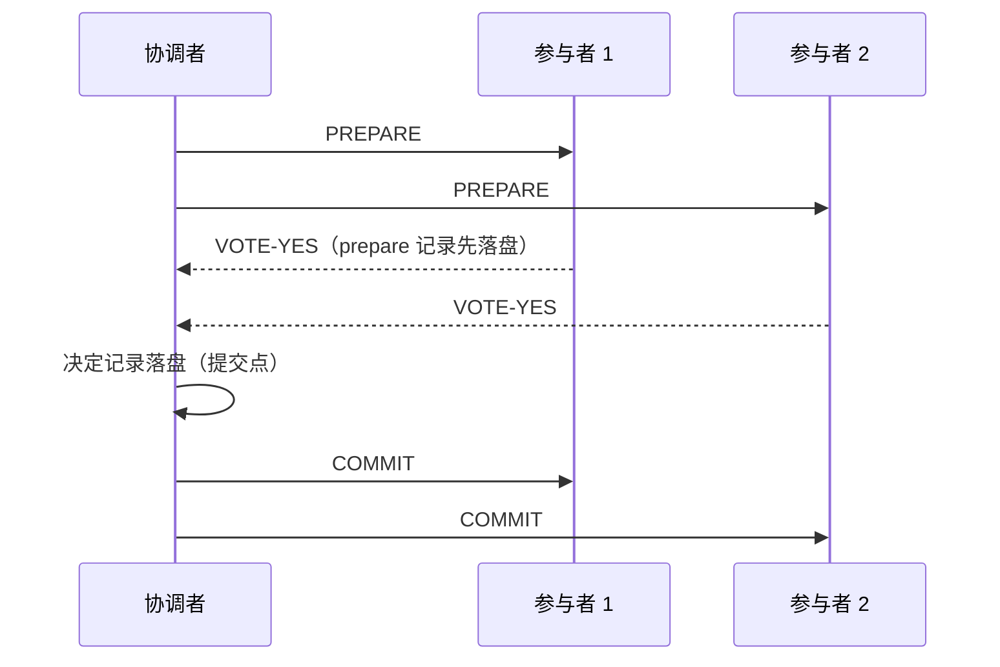

# $\rm Chapter \, 7$ 分布式事务：两阶段提交与它的阻塞病

> **本章假设你已经会**
>
> 1. 失败三件套：消息能丢能迟到、时钟不可全信、进程随时会死（§1.2）。
> 2. RPC 的三种结局：返回、报错、无回音；无回音不等于对方没执行（§1.5）。
> 3. 提交的定义与「先落盘后应答」的纪律：决定记录必须先写进日志再外发（§4.4、§4.5）。
> 4. 线性一致的合同与单 key 读写的判定（§5.2）。
> 5. 单机事务与 ACID、两阶段锁的形状：锁的生命周期就是事务，见《数据库系统》§6.2、§7.3。

第 6 章结尾留了一笔转账：从一个账户扣 100，往另一个账户加 100，两个 key 被分片规则放在两台机器上。前六章的全部本事都只管一台机器内部或同一份数据的多个副本，没管「一个操作横跨两台各自独立、可能各自崩溃的机器」。本章补上这块：分布式事务（distributed transaction）。路线：先看朴素写法坏在哪、引出原子提交（§7.1）；给出两阶段提交的完整时序（§7.2）；推导它的阻塞病——参与者投了票就动弹不得（§7.3）；用模拟实测卡死时长与恢复超时的账（§7.4）；看三阶段提交为什么没能治好它（§7.5）；一瞥把拍板交给共识的 Paxos Commit（§7.6）；最后讲两阶段锁跨机后死锁如何藏身、怎么抓（§7.7）。

## $\rm \S \, 7.1$ 问题：一笔转账跨了两台机器

单机事务你已经有了：《数据库系统》§6.2 讲过 ACID，一笔事务要么全部生效、要么全部撤销，原子性由 WAL 和回滚保证。它的前提是所有修改都在一台机器、一份日志里，回滚和重放都在同一个屋檐下。分片把这个前提拆了：账户 A 在机器 1，账户 B 在机器 2（《数据库系统》§9.3 讲过分片就是按 key 把数据摊到多台机器），一笔转账变成两次独立的本地写。

朴素写法是先写机器 1 再写机器 2，失败窗口立刻出现：机器 1 的扣款已提交，写机器 2 时它恰好崩溃或网络断了。此时机器 1 想撤销也有顾虑——网络断开时它收到的是「无回音」（§1.5），分不清对方是没收到、收到了没执行、还是执行了只是应答丢了；要是机器 2 其实已经加上 100，再撤销就是双倍出错。重试同样两难：盲目重发可能给 B 加两次钱，放弃又可能让 100 凭空消失。

工程师的第一反应往往是加一层事后补救：两边各写各的，另起一个对账任务定期扫差异、发现「扣了没加」就补。它能兜住一部分，但有两个绕不过去的缺陷。其一，对账窗口内系统对外是错的：用户可能正好在这个窗口里查余额、发起下一笔转账，错误状态不是没有被修复，而是被看见了。其二，对账逻辑本身要回答「这笔差异是失败造成的还是正常中间态」，而 §1.5 的三种结局决定了本地日志区分不了，对账任务最后长成一套遍布特例的状态机，正确性反而更难论证。补救是运营手段，不是协议：缺的还是那个东西，一个让两台机器同时说「成」或同时说「不成」的规程。

缺的这份能力叫原子提交（atomic commit）：一组机器对同一笔事务共同决定同一个结论，要么全体 commit、要么全体 abort，且任何时刻任何幸存机器都能得到这个结论。注意它比「不丢」难：§3 到 §6 的复制只保证一台机器上的决定不丢，这里要的是多台机器对同一个决定达成一致。白话：河两岸各放一个钱箱，你从这边取 100 往那边放，河上只有一座会塌的桥。放钱的人和收钱的人必须对「这 100 块到底搬没搬过去」永远给出同一个答案，而桥随时可能断在中间。

> 本节小结：分片把单机事务拆成多次独立本地写，失败窗口里钱会凭空消失或翻倍；缺的能力叫原子提交：多机对 commit/abort 永远同调。

## $\rm \S \, 7.2$ 两阶段提交：完整时序

两阶段提交（Two-Phase Commit，下称 2PC）的分工：一台协调者（coordinator），通常是事务涉及的第一个分片所在机器；其余是参与者（participant），每个持有该事务一个分片的机器各算一个。协议只有两句话：先问大家能不能成，再告诉大家结果。

阶段一（表决）：协调者向全部参与者发 PREPARE。参与者检查自己那份修改能不能做：能，就把一条 prepare 记录写进自己的日志落盘，然后回 VOTE-YES；不能，回 VOTE-NO。prepare 记录落盘是硬性动作，§4.5 的纪律在这里原样生效：投 yes 之后机器可能崩溃，重启后必须能从日志里恢复出「我投过 yes」这个事实，否则承诺无从谈起。投 yes 是一份承诺：从此刻起到得知决定为止，这笔事务的修改保持就绪、锁不释放，不能单方面做掉，也不能单方面撤销。

阶段二（决定）：协调者收齐全部选票。有任何一个 no，决定就是 abort；全部 yes，决定就是 commit。协调者把决定记录写进自己的日志落盘，然后向所有参与者广播。参与者收到决定后执行本地动作（commit 落盘生效或 abort 回滚），事务结束。决定记录落盘那一刻是整笔事务的提交点：§4.4 的提交定义在这里换了个场地，从「日志条目被多数派备份」换成「决定被协调者独占落盘」。



投完 yes、还没收到决定的状态有专名：不确定状态（uncertain state，文献里也叫 in-doubt）。此刻参与者手里攥着锁、修改就绪，却不知道全局结论是哪个。2PC 的所有麻烦都从这个状态长出来，下一节专门算它的账。

有一个对比值得停下来想清楚：第 3 章的 Raft 只等多数派选票（§3.3），2PC 却非要等全体，一个 no 就得 abort。这不是保守，是原子提交的性质逼出来的。设想 commit 只需多数派同意：投了 no 的那台机器恢复后会按自己的日志回滚，而多数派一侧已经 commit，同一笔事务两种结局并存。commit 的含义是「每个参与者最终都会执行」，缺席者没有表决，就不能替它做主。全体一致是唯一不把任何人悬在窗外的法定人数，代价则由 §7.3 来算：任何一台没回音，决定就悬置。

时序的账先记一笔，§7.4 的实验要用。设单程时延 $d$、参与者落盘耗时 $f_{\mathrm{p}}$、协调者决定落盘耗时 $f_{\mathrm{c}}$，无故障时一笔事务从发起到提交：

$$
T_{\mathrm{2PC}} \;=\; d + f_{\mathrm{p}} + d + f_{\mathrm{c}} + d \;=\; 3d + f_{\mathrm{p}} + f_{\mathrm{c}}
$$

读法：三段网络时延依次是 PREPARE 到达、选票回到协调者、COMMIT 送达，中间夹两次磁盘落盘。消息条数是 ${3N + 2}$（N 条 PREPARE、N 条选票、N 条决定，加客户端的请求与应答）。对比 §6.3 的复制写只花一轮落盘加两段时延，2PC 是三次网络往返串行加两次落盘，事务本身就要贵一截，这是原子性跨机的基本票价。白话：主持人挨个问「这道菜能上吗」，能上的后厨先把菜备好锁在保温柜里举手；主持人记下「全体通过」这句话之前，谁都只能干等，菜不能端也不能倒。

> 本节小结：2PC 两阶段，先表决后决定；参与者投 yes 前先落盘、投完进入不确定态；提交点是协调者决定记录落盘那一刻。

## $\rm \S \, 7.3$ 阻塞：参与者为什么不能自己拍板

协调者在某个参与者处于不确定态时崩溃，会发生什么？参与者面前只有两个自救选项，逐个过堂。

1. 自己 commit。危险在于：它不知道别人的选票。假设另一个参与者投了 no，协调者已决定 abort、广播到一半崩溃；它若自己 commit，投 no 的那台恢复后按日志 abort，两台机器对同一笔事务给出相反结论。原子提交从根上破裂。
2. 自己 abort。危险在于：它不知道决定是否已落盘。协调者可能已把 commit 记录写进日志、甚至已把 COMMIT 送出去；它若自己 abort，收到 COMMIT 的那台照做 commit，同样分叉。

两个选项都通向分叉，唯一安全的动作是等。这就是 2PC 的阻塞（blocking）：协调者不在，全部不确定态参与者只能攥着锁干等，等协调者回来。而 §1.2 说过网络分不清「死」和「慢」，参与者连「等谁、等多久」都没有协议层面的答案。

等的那头是协调者的恢复逻辑，它有日志可查，规则明确：恢复后读自己的日志，有完整的决定记录就重发决定，收到过的参与者照旧执行；没有决定记录就补写一条 ABORT 再广播。补写 abort 是安全的，理由值得记牢：决定记录没落盘，说明广播 COMMIT 之前就死了，而 COMMIT 只能从落盘之后发出，所以没有任何参与者收到过 commit，此刻单方面 abort 不可能与任何人的动作分叉。这条规则决定了崩溃发生在哪个阶段，卡死的时长就不一样。

把账摆上桌面。实验基准（全部时延取均值 1.0ms，N=3，模型约定见 §7.4）：t=0 协调者发 PREPARE，t=1.0 到达；t=2.0 各参与者 prepare 记录落盘并发出 VOTE YES（不确定态开始）；t=3.0 选票到齐；t=5.0 决定记录落盘（提交点）；t=6.0 COMMIT 送达。令 ${T_{\mathrm{REC}} = 50\mathrm{ms}}$ 为协调者崩溃到恢复的时长，在五个时刻分别插入崩溃，模拟结果：

| t_crash | 崩溃阶段 | 三名参与者 | 决定记录在日志里吗 |
| --- | --- | --- | --- |
| 0.5 | prepare 在途 | 无人投票，无人被卡 | 否 |
| 2.5 | 选票在途 | 各卡 53.5ms | 否 |
| 4.0 | 决定记录写到一半 | 各卡 55.0ms | 否 |
| 5.2 | COMMIT 在途 | 各卡 54.2ms | 是 |
| 6.5 | COMMIT 已全部送达 | 未受影响（不确定态 4.0ms 正常流逝） | 是 |

逐格验一笔：t_crash=4.0，恢复时刻 ${4.0 + 50 = 54.0}$；日志里决定残缺，补写 ABORT 花到 56.0；送达再花 1.0 到 57.0；参与者的不确定态从 2.0 开始，卡死时长 ${57.0 - 2.0 = 55.0\mathrm{ms}}$。通式：

$$
T_{\mathrm{stuck}} \;=\; t_{\mathrm{crash}} + T_{\mathrm{REC}} + w + d_{\mathrm{del}} - t_{\mathrm{vote}}
$$

读法：${t_{\mathrm{crash}} + T_{\mathrm{REC}}}$ 是恢复时刻；$w$ 是恢复后的额外工作，决定已落盘取 0、需补写 ABORT 取 2.0ms；$d_{\mathrm{del}}$ 是决定送达的单程时延；$t_{\mathrm{vote}}$ 是该参与者发出 VOTE YES 的时刻。四个崩溃时刻的实测值都能用这个式子逐项算出，与上表逐格一致。

最坏情形还没有出现在表里：协调者磁盘坏了，永远不恢复。此刻没有任何协议规则能解开僵局，卡死时长没有上界，唯一的出口是运维手工把事务 abort 掉。参与者之间能不能商量着办？不能：每个不确定态参与者都只知道「我投过 yes」，既不知道别人的选票，也不知道决定落没落盘，把大家的情报拼起来也不含「协调者是否已拍板」这一项，上一段的两个死结一个都没解开。这个问题要换协议才治得了，§7.5、§7.6 各给一条路。白话：主持人举着笔没写下结论就消失了，全桌人举着手不敢放也不敢先吃，因为谁也不知道主持人心里那句话写没写在纸上。

> 本节小结：不确定态的参与者 commit 与 abort 都可能分叉，只能阻塞；协调者恢复按日志裁决，没落盘就补 abort；卡死时长由恢复时刻、恢复后工作和送达时延三项加成，协调者永不恢复则无上界。

## $\rm \S \, 7.4$ 实测：卡死时长与恢复超时的账

把上一节的单点走查变成统计。模拟设定：N=3，单程时延服从均值 1.0ms 的指数分布（无记忆性见《概率论》§12.1，造法同 §6.5），参与者 prepare 落盘 1.0ms，协调者决定落盘 2.0ms，无消息丢失；崩溃时刻在整笔事务窗口内均匀取；卡死时长只统计真卡住的参与者（崩溃前已正常收到决定的不算）。脚本与完整输出在 `_uni5_work/expDS07/`，种子 20261104，重跑逐位复现。在 Git Bash 里用

```bash
wsl bash -c "cd /mnt/c/Users/20811/Desktop/26Fall/_uni5_work/expDS07 && python3 exp1_block.py && python3 exp2_deadlock.py"
```

即可复现；成功标志是输出以线性拟合一行收尾。常见失败是 WSL 未启动的连接报错，先进一次 wsl 再跑。每配置 20000 次：

| T_REC（ms） | 卡死时长均值 | p99 | 卡死比例 | 正常解冻的不确定时长均值 |
| --- | --- | --- | --- | --- |
| 0 | 5.36 | 10.89 | 0.6457 | 4.52 |
| 5 | 10.37 | 15.95 | 0.6444 | 4.57 |
| 10 | 15.40 | 21.03 | 0.6473 | 4.55 |
| 20 | 25.37 | 30.98 | 0.6455 | 4.56 |
| 50 | 55.39 | 60.94 | 0.6493 | 4.50 |
| 100 | 105.37 | 110.95 | 0.6470 | 4.54 |
| 200 | 205.36 | 211.05 | 0.6442 | 4.57 |
| 500 | 505.37 | 510.86 | 0.6490 | 4.52 |

对均值做线性拟合：

$$
\mathbb{E}[T_{\mathrm{stuck}}] \;=\; a + b\,T_{\mathrm{REC}}, \qquad b = 1.0000,\; a = 5.38\mathrm{ms}
$$

读法：斜率精确等于 1，恢复超时不是保险费而是赎金，$T_{\mathrm{REC}}$ 每调大 1ms，每一次卡死都整段变长 1ms；截距 5.38ms 是 $T_{\mathrm{REC}}=0$ 时仍躲不掉的部分，由崩溃点在窗口内的位置、恢复后的补写工作和送达时延构成。最后两列一起看：卡死比例稳定在 64.6% 附近、与 $T_{\mathrm{REC}}$ 完全无关，因为它等于「崩溃恰好落在该参与者不确定窗口内」的概率，只由事务时间线决定；正常解冻的 4.5ms 也与 $T_{\mathrm{REC}}$ 无关。一句话，$T_{\mathrm{REC}}$ 只决定卡多久，不决定卡不卡，而卡不卡主要由协议本身注定。64.6% 这个数还顺带量出了不确定窗口的宽度：投票到送达之间的窗口几乎盖满整笔事务，2PC 的脆弱不是小概率的边角。

$T_{\mathrm{REC}}$ 调小的另一头也有账：真实系统里它包含故障检测的等待，而 §1.2 说过死与慢在观测上同形，设小了会把只是慢的协调者误判成死。误判在本模型里不出现（协调者确实死了），但工程后果真实：恢复侧若在协调者活着的低潮期抢先补 abort，结论同样可能分叉，所以恢复逻辑必须严格按日志裁决而不是按时间裁决。真把 $T_{\mathrm{REC}}$ 拆开看，它是三段之和：心跳超时判死（§1.2 的账，敢设多小取决于网络抖动的尾部）、进程重启、日志重放读到最后一条记录。每一段都是赎金的一部分，生产系统的卡死常以秒计，比本实验的毫秒大两个数量级，原因就在这三段都不便宜。

诚实声明：本模型无消息丢失、无并发事务竞争锁、恢复读日志瞬时完成；真实卡死还会连坐，攥着的锁堵住后面所有事务的排队，伤害按 §7.7 的锁账放大。但「卡死时长随恢复超时线性增长、卡死概率由窗口宽度决定」两个结论不依赖这些简化。

动手环节（把 `_uni5_work/expDS07/` 拷到你自己的目录再改，预期结果可复跑验证）：

1. 把 `DEC_FLUSH` 从 2.0 提到 5.0 再跑实验 B。预期斜率仍是 1.0000、截距从 5.38 涨约 2ms：恢复后补写 ABORT 的 $w$ 变大只挪截距，$T_{\mathrm{REC}}$ 的系数纹丝不动。
2. 在实验 B 里把崩溃时刻改成集中在「选票到齐到决定落盘之间」。预期卡死比例基本不变、均值里的 $w$ 项占比变大：这个窗口正是决定未落盘的高发段。
3. 给 COMMIT 消息加上 2% 丢包与 20ms 重传超时重跑实验 A。预期 tc=5.2 一行的卡死时长上浮：送达被重传拖慢，但斜率对 $T_{\mathrm{REC}}$ 的关系不变。

白话：实验说的是一笔高利贷。协调者每死一次，所有投过票的柜台都被迫歇业；歇业多久不看天意，看你在恢复超时里填的那个数，填多少赔多少，一分不少。

> 本节小结：卡死时长对恢复超时的回归斜率实测 1.0000（截距 5.38ms），调超时是按毫秒赔钱；卡死概率约 64.6% 与超时无关，由不确定窗口几乎盖满整笔事务决定。

## $\rm \S \, 7.5$ 三阶段提交为什么没真解决问题

2PC 的病根一句话：唯一能拍板的人只在它自己的日志里拍板。三阶段提交（Three-Phase Commit，3PC）的处方是在表决和决定之间插一轮 preCommit：协调者收齐全部 yes 后先广播 preCommit（「全体已同意，我即将 commit」），收到者回 ACK；等 ACK 齐了才落盘决定、广播 commit。意图是给参与者一个可推断的台阶：超时自救时，参与者按自己走过的最远一步推断全局——只走到投完票，说明 preCommit 没到过，决定必然没落盘，单方面 abort 安全；收到过 preCommit，说明全员已同意、commit 只差临门一脚，单方面 commit 安全。阻塞似乎被拆掉了。

拆掉它的前提藏在「按超时推断」里：超时能推出「协调者已死且不再有消息在路上」，需要消息延迟和时钟偏差都有上界。这正是 §1.2 三件套的第一件明说没有的东西：网络会撒谎，延迟没有上界。构造一次分区看它破产：网络裂成两半，老协调者和两个参与者在一侧，第三个参与者在另一侧，它崩溃前收到过 preCommit：

| | 网络左侧 | 网络右侧 |
| --- | --- | --- |
| 成员 | 老协调者、参与者 A、参与者 B | 参与者 C |
| 见过的最远一步 | preCommit 从未到达 | C 已收到 preCommit 并回过 ACK |
| 超时后的自救推断 | 决定必然没落盘，按规则 abort | commit 只差临门一脚，按规则 commit |
| 结局 | 同一笔事务两个相反结论并存，原子性破裂 | 同左 |

两边都严格执行协议，谁也没「违规」，坏结局照样发生，因为协议赖以推断的假设（超时等于对方死了）被分区打破。比阻塞恶劣得多：阻塞丢的是可用性，分叉丢的是正确性，账没法平。

这背后是 §1.4 那把刀的又一次出鞘：异步系统里只要有一个进程可能崩溃，安全与必然终止就不可兼得。2PC 选了安全、弃了终止（宁可阻塞）；3PC 想两样都要，只能在消息延迟有上界的同步假设下成立，而那个假设在真实网络上一破再破。所以工程结论干脆：没有主流系统用 3PC。真实的两条出路，一条是给拍板这件事配一份不会丢的纪要（§7.6 的共识），一条是接受阻塞、把恢复超时当赎金精打细算（§7.4）。白话：3PC 像在会议流程里加一道「都确认过了再散会」，平时确实没人傻等；可一旦大家被隔在两个房间里，一边按规矩散了会，另一边按规矩把事办了，纪要都对不上，比干等还糟。

> 本节小结：3PC 用 preCommit 轮给参与者搭自救的台阶，代价是消息延迟有上界的同步假设；分区让两边各自按规则得出相反结论，把阻塞换成了更坏的分叉；工程上无人采用。

## $\rm \S \, 7.6$ Paxos Commit 一瞥

卡死的物证是那份决定记录：它只写在一台机器的日志里，那台机器死了，决定就成了悬案。既然第 3、4 章已经造出了「一条日志不会因为单机死亡而丢失」的机器，最自然的修法就是把决定写成共识：协调者把 commit/abort 作为一个决定写进复制日志，多数派落盘才算拍板；协调者死了，接任的 leader 按 §4.4 的 leader 完备性必然继承全部已落盘条目，从日志里读出悬而未决的那笔决定，继续广播。参与者等的不再是「某一台机器复活」，而是「多数派给出结论」。

Gray 与 Lamport 的论文 Consensus on Transaction Commit（IEEE Computer，2004）把这个思路推到底：2PC 的拍板本来就是一次共识，让每笔事务的决定跑一轮 Paxos 投票，参与者可以在两轮消息内拿到结论，不需要任何额外阶段。这套做法的名字就是 Paxos Commit。

代价也要摆上桌。机器账：2PC 的编制是协调者加 N 个参与者共 N+1 台，协调者一死就阻塞，参与者的承诺没有地方托管；共识组的编制是 $2f+1$ 台容忍 f 台崩溃（§1.3 的账）。延迟账：决定多过一道多数派落盘，提交点从「协调者本机落盘」变成「多数派落盘加广播」，每笔事务多付一轮多数派的延迟，换来的是协调者死也不再阻塞。两个方案并排对账：

| 维度 | 2PC | Paxos Commit |
| --- | --- | --- |
| 编制与容错 | N+1 台，协调者崩溃即阻塞 | $2f+1$ 台，容忍 f 台崩溃 |
| 决定记录在哪 | 协调者单机日志 | 复制日志，多数派落盘 |
| 协调者死后 | 参与者阻塞，等它恢复 | 接任 leader 继承决定，继续广播 |
| 决定延迟 | ${3d + f_{\mathrm{p}} + f_{\mathrm{c}}}$（§7.2） | 多付一轮多数派落盘 |
| 有分叉风险吗 | 无，代价是阻塞 | 无，共识保安全（§3.3） |

这就是 §6.6 那句话的又一次应验：共识没有消灭，只是从「每次崩溃靠运气」挪进了「每笔事务付一轮的钱」，把撒谎的可计算不确定从人身上挪到了制度里。白话：拍板人从一个人换成一个开会必留纪要的委员会，人倒了纪要还在，接任者照纪要办事，谁也不必悬着等某个具体的人醒来。

> 本节小结：Paxos Commit 把 2PC 的决定记录从单机日志搬进复制日志，多数派落盘即拍板，接任 leader 依完备性自动继承；多付一轮多数派延迟，买回协调者死亡后的不阻塞。

## $\rm \S \, 7.7$ 两阶段锁与分布式死锁

事务的原子性靠回滚，隔离性靠锁。单机的故事《数据库系统》§7.3 已讲过：两阶段锁（Two-Phase Locking，2PL）让事务先集中拿锁（增长阶段）、提交或回滚时统一放锁（收缩点），严格版持锁到提交，锁的生命周期就是事务。跨机之后，锁还是各台机器的锁管理器本地执行，但一笔事务可以在机器 1 上锁了账户 A、再去机器 2 锁账户 B。等待关系因此被切碎了：每台机器只看得见落在自己头上的边，谁能等谁，本机一清二楚，跨机的等待它不知道。

把这种局部知识画成等待图（wait-for graph）：边 $T_1 \to T_2$ 表示事务 $T_1$ 在等 $T_2$ 手里的锁。死锁就是一个环，§3.4 辨析过它与活锁的区别：死锁是一群人互相等、谁也不动，活锁是一群人都在动、动作互相抵消。麻烦在于环可以跨机。四笔事务排成 $T_1 \to T_2 \to T_3 \to T_4 \to T_1$：$T_1$ 等 $T_2$ 在机器 A，$T_2$ 等 $T_3$ 跨到机器 B，$T_3$ 等 $T_4$ 在机器 B，$T_4$ 等 $T_1$ 跨回机器 A。机器 A 的本地图是 $T_1 \to T_2 \to T_3^*$（星号表示 T3 在别人家），机器 B 的本地图是 $T_3 \to T_4 \to T_1^*$，两份都是链不是环。死锁真实存在，两台机器的本地检测却谁都看不见。

> 竞赛生迁移提示：等待图找环就是你熟的有向图判环，DFS 三色标号或拓扑排序都行，$O(V+E)$ 的肌肉一点不浪费。新的一层只有两件事：图被切成了碎片，边表要靠消息搬运，而搬运本身有延迟、会失败，判环的输入不再实时。

实测把这件事钉死。实验设定：上述四笔事务的跨机环，两台机器各自每 1ms 查一次本地图，跑 10000 次，检出 0 次（`_uni5_work/expDS07/exp2_deadlock.py`，种子 20261105）。出路两条之外还有第三条预防法，一起摆开。其一，检测法：各机周期性互发本机边表，拼出全局图再找环；探测周期为 $P$、单程时延 $d$ 时，环在某个探测快照之后形成，要等下一个快照才能被收进边表：

$$
T_{\mathrm{det}} \;=\; (kP - \tau_0) + d_{\mathrm{net}}, \qquad \mathbb{E}[T_{\mathrm{det}}] = \tfrac{P}{2} + d_{\mathrm{net}}
$$

读法：$\tau_0$ 是环形成的时刻，$kP$ 是第一个晚于它的探测快照，环形成到下一个快照平均隔半个周期，快照交换再付一跳时延。实测（每配置 20000 次）：P=10 时均值 6.01ms 对理论 6.0，p99 10.90；P=50 时均值 25.99 对理论 26.0；P=100 时 50.74 对 51.0，全部贴线。其二，超时法：一个事务等待超过阈值就假定死锁、回滚重试。不花通信、不用拼图，代价是误杀，把只是排队久的正常等待也砍掉，被回滚事务已做的工作全部作废，重试又给系统添负载。其三，预防法：干脆不许环成形。给每笔事务发一个年龄（它进入系统的时间），规定年轻的永远让年长的：年长的事务来抢锁，年轻的事务立即回滚让路；年轻的事务来抢锁，年长的安心继续等。等待方向被强制成单向（永远从年轻指向年长），图里从结构上长不出环。代价是两处：回滚可能是冤枉的，环还没成、只是争用激烈，年轻事务就被牺牲；年龄戳还要跨机可比，而两台机器对「现在几点」本没有共识，这条引线到第 8 章才解得开。选型直觉：锁竞争激烈、死锁频发的系统付检测法的通信钱；死锁罕见、延迟敏感的系统用超时法兜底；预算充足又要求确定性上界的系统才上预防法。victim 的选择都有讲究：挑回滚代价最小的（改工作量最少的）下手。白话：每家食堂只知道自己门口谁在排队，四个食堂门口排成一个圈，谁也看不见圈的全貌；要么定期互相通报队尾名单拼出全图，要么规定排队超过一刻钟就请一位重排，要么干脆立规矩：后来的必须给先来的让座，圈子永远围不起来。

> 本节小结：跨机的等待图碎片化，本地检测对跨机环实测 0 检出；检测法周期互发边表、时延贴 $\tfrac{P}{2}+d_{\mathrm{net}}$ 的线，超时法零通信但误杀，预防法按事务年龄强制单向等待、从结构上禁止成环；选型看死锁频率、回滚代价与通信预算。

## $\rm \S \, 7.8$ 关键概念回顾

1. 2PC 的两个阶段各做什么？提交点在哪一刻？参与者投 yes 前为什么必须先把 prepare 记录落盘？
2. 参与者处于不确定态时，自己 commit 和自己 abort 各错在哪里？由此推出的唯一安全动作是什么？
3. 协调者恢复后如何按日志裁决？「没落盘就补 abort」的安全性论证是哪一句？
4. 实测中卡死时长对 $T_{\mathrm{REC}}$ 的回归斜率和截距各是多少？卡死比例由什么决定、与什么无关？
5. 3PC 的自救台阶靠什么假设成立？分区下它退化成什么？跨机死锁为什么本地看不见？检测、超时、预防三条出路各付什么代价？

## $\rm \S \, 7.9$ 应用与辨析

1. 同学说「2PC 太脆弱，把协调者换成 Raft 组就万事大吉」。指出这个改法解决了什么、没解决什么，至少一处引用 §7.4 的实测数字。
2. N=3、$T_{\mathrm{REC}}=100\mathrm{ms}$、指数时延均值 1ms：用 §7.3 的通式估算一次崩溃后不确定态参与者的平均卡死时长，再说明为什么调小 $T_{\mathrm{REC}}$ 不能降低被卡的概率。
3. 你的系统每月死锁 3 次、每次死锁拖住 20 笔事务；检测法 P=10、单程 1ms，超时法阈值 5s。比较两法各自的月度代价构成，给出选型并说出它对误杀与通信的取舍。

## $\rm \S \, 7.10$ 本章自测答案

1. 阶段一表决：协调者发 PREPARE，参与者把 prepare 记录落盘后回 VOTE-YES/NO；阶段二决定：全部 yes 则协调者把决定记录落盘再广播 COMMIT，任一 no 则 ABORT（§7.2）。提交点是决定记录落盘那一刻，此后结论不可更改（§7.2）。先落盘是因为投 yes 是承诺：机器可能崩，重启后必须能从日志恢复「我投过 yes」，否则承诺无从兑现，§4.5 的纪律原样适用（§7.2）。
2. 自己 commit 的错处：不知道别人的选票，可能有参与者投了 no 且协调者已决定 abort，分叉；自己 abort 的错处：不知道决定是否已落盘，协调者可能已把 COMMIT 送出，分叉（§7.3）。两个都通向分叉，唯一安全动作是等协调者恢复，即阻塞（§7.3）。
3. 恢复后读日志：有完整决定记录就重发，没有就补写 ABORT 再广播（§7.3）。安全性论证：决定记录没落盘说明广播 COMMIT 之前就死了，而 COMMIT 只能从落盘后发出，没有任何参与者收到过 commit，此刻 abort 不可能与任何人的动作分叉（§7.3）。
4. 斜率 1.0000、截距 5.38ms：恢复超时每调大 1ms 每次卡死整段变长 1ms，截距由崩溃点位置、补写工作与送达时延构成（§7.4）。卡死比例约 64.6%，等于崩溃落在参与者不确定窗口内的概率，只由事务时间线决定，与 $T_{\mathrm{REC}}$ 无关（§7.4）。
5. 3PC 的台阶是「按自己走过的最远一步推断全局」，成立前提是消息延迟与时钟偏差有上界的同步假设（§7.5）。分区下两边各自按规则得出相反结论，阻塞被换成正确性分叉（§7.5）。跨机等待环在每台机器的本地图里都是链不是环，实测 10000 次本地检测 0 检出（§7.7）；检测法付周期通信与 $\tfrac{P}{2}+d_{\mathrm{net}}$ 的时延；超时法零通信但误杀并作废被回滚事务的工作；预防法按事务年龄把等待强制成单向、结构上无环，代价是冤枉回滚与跨机可比的时间戳（§7.7）。
6. 解决了阻塞：决定记录进了复制日志，多数派落盘即拍板，协调者死了接任 leader 按 §4.4 完备性继承决定继续广播，参与者等的是多数派而不是某一台机器（§7.6）。没解决的东西：机器账从 N+1 涨到 $2f+1$，每笔事务多付一轮多数派落盘的延迟（§7.6）；卡死比例那样的窗口脆弱在决定被多数派落盘之前依然存在，只是悬案的托管对象从单机日志换成了共识组（§7.4、§7.6）。
7. 按 §7.4 的实测账，均值 $\approx 100 + 5.38 = 105.38\mathrm{ms}$，表里 T_REC=100 一行实测 105.37ms（§7.4）。调小 $T_{\mathrm{REC}}$ 改变的是每次卡死的长度（斜率 1 的那部分），而被卡与否取决于崩溃是否落在不确定窗口内，窗口宽度由协议时序决定，与超时无关，实测卡死比例在 $T_{\mathrm{REC}}$ 从 0 到 500 的全部配置里都停在 64.6% 附近（§7.4）。
8. 检测法月度代价：持续通信（每 P=10ms 一轮边表交换）加每次死锁约 $\tfrac{10}{2}+1 = 6\mathrm{ms}$ 的额外持锁，几乎不误杀（§7.7）。超时法零通信，但每月 3 次死锁各拖 5s 才解开，期间 20 笔事务全体排队，另有所有超过 5s 的正常长等待被误杀、工作作废并触发重试（§7.7）。死锁频度低（月 3 次）时检测法的常驻通信可以接受、误杀为零，选检测法并把 P 调到 10ms 量级；若死锁近乎日常发生，通信预算吃紧，才退回超时法并配小阈值（§7.7）。

**你现在能做什么**：给你任意一个跨多台机器的「要么都成要么都不成」操作，你能画出它的 2PC 时序、指出提交点在哪条日志记录上，并算出协调者崩溃后每个参与者卡死多久的账。

到这里，「一笔写」的合同已经铺满：单 key 的顺序归第 3 到 5 章，多副本的形态归第 6 章，多 key 的原子归本章。但回看全册，每个协议都在偷用一件没说清的东西：消息的先后。2PC 的选票到齐、Raft 的日志顺序、判历史时的实时序，全靠「谁先谁后」这个概念撑着，而它跨机器时并没有想象中那么理所当然。下一章把「先后」本身做成可计算的对象：happened-before、Lamport 时钟与向量时钟。
