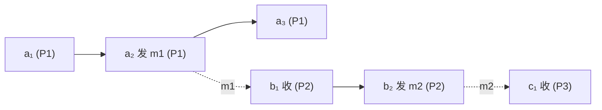

# $\rm Chapter \, 8$ 排序与时钟：把「先后」做成可计算的对象

> **本章假设你已经会**
>
> 1. 不可靠时钟：晶振漂移每天累积毫秒到秒级、对时可能倒拨、跨机不存在统一的「现在」（§1.2）。
> 2. 线性一致性与因果一致性的定义：前者看实时序，后者只保因果链（§5.2、§5.3）。
> 3. 并发写的例子：两个互不知情的写没有因果链，各副本可以各排各的（§5.3）。
> 4. 死锁预防法欠的账：按事务年龄强制单向等待，需要跨机可比的时间戳（§7.7）。
> 5. 程序里「计数器 +1」的直觉，以及函数式「逐分量比较」的读法（本章 §8.5 当场定义）。

第 7 章结尾留了一条引线：预防死锁要给事务发年龄戳，而年龄戳跨机不可比，因为两台机器对「现在几点」没有共识。这个缺口比死锁大得多。回头看前七章，每个协议都在偷偷用「先后」这个词：Raft 的日志顺序、2PC 的选票到齐、线性一致性的实时序、因果一致性的因果链。可「先后」跨机器时凭什么成立？§1.2 已经拆过桥：时间戳排序靠不住，时钟会漂移会倒拨。本章把「先后」本身做成可计算的对象。路线：先定义不依赖任何时钟的 happened-before 关系（§8.2）；给 Lamport 时钟，它能单向放大因果序（§8.3），并用程序实测它的边界（§8.4）；再把向量时钟，它把因果序原样编码（§8.5），同样实测合并与冲突检测（§8.6）；然后兑现 §5.3 的支票，看因果一致性如何从文字变成判据（COPS 一瞥，§8.7）；最后回到真实时钟，算 NTP 同步的误差账（§8.8）。

## $\rm \S \, 8.1$ 问题：时间戳在哪一步破产

先把朴素方案的死处钉准。想给跨机事件排序，工程师的第一反应是各台机器看钟盖章、按数字比大小。这个方案要求「钟的读数与事件的真实先后单调一致」，而 §1.2 说了三件让它破产的事。其一，漂移：两台机器的晶振各走各的，读数差以每天毫秒到秒级累积，A 钟慢了，A 上后发生的事件可能盖上更小的数字。其二，倒拨：对时校准会把钟往回拨，盖出的数字能倒退。其三，也是最根本的：即便钟都准，比较两台机器的读数也没有意义，因为「哪台更准」本身没有裁判。

换一个角度看清缺口有多大。§5.3 定义因果一致性时用的是文字：「有因果关系的操作在所有副本上顺序一致」。什么算有因果关系，当时靠直觉举例；要写程序判定，就得先把这个直觉变成可机械执行的判据。§7.7 的年龄戳、§5.3 的因果链，欠的是同一笔账：一个不依赖时钟、能从消息记录里直接算出来的「先后」。白话：三台钟各报各的时刻，你还敢拿它们裁胜负吗？裁判席上坐的得是消息本身：谁把信寄给谁、信到了没有，这些是不撒谎的事实。

> 本节小结：时间戳排序要求时钟读数与真实先后单调一致，漂移、倒拨、跨机无裁判三件事让它破产；缺的是一个从消息传递本身算出先后的判据。

## $\rm \S \, 8.2$ happened-before：不需要表的时刻序

定义的对象是事件（event）：一个进程执行的一次内部计算、一次消息发送或一次消息接收，各算一个事件。判据只用两条边加一条传递规则，全部信息都在消息记录里：

1. 程序序：同一进程内，事件 $a$ 在事件 $b$ 之前执行，则 $a \to b$（本机顺序，进程自己说了算）。
2. 消息序：事件 $a$ 是某条消息的发送、事件 $b$ 是同一条消息的接收，则 $a \to b$（收到必然晚于发出，这是消息本身的因果）。
3. 传递：$a \to b$ 且 $b \to c$，则 $a \to c$。

满足这三条的有序对 $(a,b)$ 记作 $a \to b$，读作「a 发生于 b 之前」（happened-before，莱斯利·兰伯特 1978 年论文 Time, Clocks, and the Ordering of Events in a Distributed System 提出）。这个关系有三条性质，逐条验证：不自反（没有 $a \to a$，三条规则都造不出自己到自己的边）；传递（第 3 条直接给定）；非对称（$a \to b$ 则不可能 $b \to a$，否则沿边走一圈就出现「消息先收后发」的环，与每条边的实际方向矛盾）。传递加非对称的关系叫严格偏序（strict partial order），你在算法竞赛里熟悉的 DAG 拓扑序就是它的具象。

两个事件可能谁也到不了谁：$a \to b$ 与 $b \to a$ 都不成立时，称 $a$ 与 $b$ 并发（concurrent），记 $a \parallel b$。并发的准确含义是「互相不知情」：从 $a$ 出发沿程序序和消息序走，走不到 $b$，说明 $b$ 发生时（或之后）没有任何信息从 $a$ 流到 $b$。注意并发不等于同时发生，两个相隔一小时、但之间没有任何消息往来的事件照样并发。这才是本章真正的东西：因果序是全册第一个不靠钟、可从日志直接验证的「先后」。

一个小执行走一遍。三个进程，P1 发消息 m1 给 P2，P2 收下后再发 m2 给 P3：

| 事件 | 进程 | 动作 | 已有的因果前驱（举例） |
| --- | --- | --- | --- |
| $a_1$ | P1 | 内部计算 | 无 |
| $a_2$ | P1 | 发 m1 | $a_1$ |
| $b_1$ | P2 | 收 m1 | $a_2$（消息序） |
| $b_2$ | P2 | 发 m2 | $b_1$ |
| $c_1$ | P3 | 收 m2 | $b_2$（消息序） |
| $a_3$ | P1 | 内部计算 | $a_2$ |

于是 $a_1 \to c_1$（沿 $a_1 \to a_2 \to b_1 \to b_2 \to c_1$ 传递），而 $a_3 \parallel c_1$：P1 在发完 m1 之后的内部计算，与 P3 收到 m2 之间没有任何消息往来，互不知情。实线是程序序，虚线是消息序：



沿箭头能走通的就是因果，走不通的就是并发；$a_3$ 与 $c_1$ 之间没有路，判并发。白话：happened-before 不看钟，看的是邮路。谁给谁寄过信、信里裹着谁的见闻，见闻能传到的地方才算「之前」；两个从没通过消息的村庄，谁先谁后这个问题本身就没人能回答。

> 本节小结：happened-before 由程序序、消息序、传递三条规则定义，是可从日志验证的严格偏序；互相到不了的事件对叫并发，含义是互不知情，与物理时刻无关。

## $\rm \S \, 8.3$ Lamport 时钟：给因果序一个单向放大器

happened-before 有个工程上的不方便：它是「对与对」的关系，判定 $a \to b$ 要沿着消息链追。能不能给每个事件盖一个数字，让比较数字就够了？Lamport 时钟（Lamport clock）就是这个数字。每个进程维护一个计数器 $C$，规则三条：

1. 本地事件（内部计算或发送）执行前：$C \leftarrow C + 1$，事件的时钟值就是 $C$。
2. 发送消息时：把递增后的 $C$ 随消息一起带上。
3. 接收消息时：$C \leftarrow \max(C,\; C_{\mathrm{msg}}) + 1$，其中 $C_{\mathrm{msg}}$ 是消息携带的发送方时钟值；接收事件的时钟值就是这个新的 $C$。

三条规则合起来是一个承诺：沿任何因果边走一步，时钟值严格增。程序序那步是规则 1 的 $+1$；消息序那步是规则 3 的 $\max$ 加 $+1$，接收方至少比发送方大 1。于是有单向定理：

$$
a \to b \;\Longrightarrow\; L(a) < L(b)
$$

读法：$L(e)$ 是事件 $e$ 的 Lamport 时钟值。证明沿因果链归纳：$a \to b$ 意味着存在一条从 $a$ 到 $b$ 的链，每一步要么是程序序、要么是消息序；上一段验证了每一步时钟值严格增，走几步就增几次，所以终点大于起点。白话：计数器是个只增不减的水位，因果链每过一道闸门水位都抬高，所以下游水位必不低于上游；但下游水位高，不代表水是从上游流来的，可能只是它自己下了雨。逆命题不成立，这是本节最重要的一个「不」：

$$
L(a) < L(b) \;\centernot\Longrightarrow\; a \to b
$$

时钟值小只说明「不晚于」，可能是因果在前，也可能只是计数器碰巧走得慢。§8.4 会用程序把这个缺口量出来。

还差最后一块：分布式系统常需要一个全序（任何两个事件都能比出先后，且全体一致）。把时钟值加一个平手裁决项就行：定义 $\big(L(e),\; \mathrm{pid}(e)\big)$ 按字典序比较，$\mathrm{pid}$ 是进程编号。时钟值相同的两个事件必然并发（同进程的程序序会强制差 1），并发对用进程号定胜负；两台机器对同一对事件算出同一个胜负，全序就跨机一致了。这个构造叫 Lamport 全序，Raft 的「term 加日志下标」、第 3 章选举里打破平票的字典序，都是它的变体。

Lamport 时钟的代价低到近乎免费：每条消息多带一个整数，每次事件加一次计数。买到的是单向保证。记住这个价格结构，下一节的东西贵 N 倍，买到的也多一倍。

把规则在 §8.2 那个六事件的小执行上走一遍，每台机器的计数器从 0 起步：

| 事件 | 规则动作 | 本进程计数器变化 | $L$ |
| --- | --- | --- | --- |
| $a_1$ | 内部：$+1$ | P1：$0 \to 1$ | 1 |
| $a_2$ | 发送：$+1$，m1 带 2 | P1：$1 \to 2$ | 2 |
| $b_1$ | 接收：${\max(0, 2) + 1}$ | P2：$0 \to 3$ | 3 |
| $b_2$ | 发送：$+1$，m2 带 4 | P2：$3 \to 4$ | 4 |
| $c_1$ | 接收：${\max(0, 4) + 1}$ | P3：$0 \to 5$ | 5 |
| $a_3$ | 内部：$+1$ | P1：$2 \to 3$ | 3 |

这张小表把两件事都演了。$a_3$ 与 $b_1$ 的时钟值同为 3，正是并发对，Lamport 全序用进程号平手裁决；$L(a_3) = 3 < L(c_1) = 5$，但 $a_3 \parallel c_1$，数字上的「在前」没有任何因果内容，§8.4 要量出这种情况有多普遍。

> 本节小结：Lamport 时钟用三条计数规则保证因果在前则时钟值严格小；反方向不成立，时钟值小不等于因果在前；补上进程号做平手裁决就得到跨机一致的全序。

## $\rm \S \, 8.4$ 实测：Lamport 的顺序不是因果序

定理说逆命题不成立，不成立到什么程度，量出来才算数。实测程序 `exp1_lamport_vc.py` 生成一个 3 进程、60 个事件的随机执行（固定种子 20261105，重跑逐位复现）：每一步随机挑一个进程做内部计算、或向随机进程发消息、或投递队首消息；happened-before 的地面真值由事件图的可达性给出（程序序边加消息序边，就是 §8.2 的三条规则）；再按 §8.3 的规则算出每个事件的 Lamport 时钟值。在 Git Bash 里用

```bash
wsl bash -c "cd /mnt/c/Users/20811/Desktop/26Fall/_uni5_work/expDS08 && python3 exp1_lamport_vc.py"
```

即可复现（脚本与完整输出在同目录 `result.txt`；常见失败是 WSL 未启动的连接报错，先进一次 wsl 再跑）。60 个事件两两配对共 1770 对，其中因果对 1436、并发对 334。方向性验证：1436 条因果对全部满足 $L(a) < L(b)$，违反 0 次，单向定理成立。但反方向：

| 检查项 | 数量 | 占并发对比例 |
| --- | --- | --- |
| $L(a) < L(b)$ 但 $a \parallel b$（Lamport 谎报「在前」） | 302 对 | 90.4% |
| $L(a) = L(b)$（必然并发） | 32 对 | 9.6% |

90.4% 这个数把「逆命题不成立」从一句警告变成了主流情形：并发的 334 对里，三百多对都被 Lamport 时钟排出了一个看似确定的先后，而这个先后没有任何因果内容。程序找到的首个案例值得逐项看：事件 #1（进程 2 的发送）$L=2$，事件 #6（进程 1 的发送）$L=3$。数字上 #1 在前，但两个事件分属两个进程、之间没有任何消息，互不知情，真实关系是并发。假如拿这个全序去做 §7.7 的死锁预防（年龄小的让年龄大的），就会把两个本来无冲突的操作裁决成有先有后，冤枉其中一个去回滚。

诚实声明：90.4% 依赖这个随机执行的形状（进程少、消息稀，并发占比高）；换成消息密集的执行，并发对变少，比例会降。但「Lamport 时钟对并发对照样排出先后」这个定性结论与形状无关，它是逆命题不成立的直接后果。白话：这只表把两列不相干的火车排出了个先后，看着煞有介事，其实谁也不等谁；表越便宜，谎报得越像真的。

> 本节小结：60 事件实测，1436 条因果对全部满足单向定理、0 违反；334 条并发对里 302 对（90.4%）被 Lamport 时钟谎报出先后，证明它的顺序不能当因果序用。

## $\rm \S \, 8.5$ 向量时钟：把因果序原样编码

Lamport 时钟的病根是信息不够：一个整数装不下「我知道谁」的完整清单。向量时钟（vector clock）把计数器从一个换成 N 个（N 是进程数），每个进程 $p$ 维护向量 $V[1..N]$，规则升级三条：

1. 本地事件执行前：$V[p] \leftarrow V[p] + 1$。
2. 发送消息：把整个向量 $V$ 随消息带上。
3. 接收消息：${V \leftarrow \max_{\mathrm{逐分量}}(V,\; V_{\mathrm{msg}})}$，然后把 $V[p]$ 加 1。

向量的比较定义要立正：$V(a) \le V(b)$ 表示每个分量都不大于；$V(a) < V(b)$ 表示 $\le$ 且至少一个分量严格小；两个方向各有一个严格小的分量，就是不可比。核心定理是双向等价：

$$
a \to b \;\iff\; V(a) < V(b)
$$

读法：左边是 §8.2 的因果序，右边是向量逐分量比较；这次两个方向都成立，Lamport 时钟丢掉的那一半被补齐了。证明的钥匙是给分量一个准确的含义：$V(e)[k]$ 恰好等于「$e$ 的因果过去里、进程 $k$ 上的事件个数」（含 $e$ 自己那一步，如果 $e$ 在进程 $k$ 上）。归纳可验证：规则 1 和 3 各自让本进程分量加 1，恰好记上新事件；规则 3 的逐分量 max 把消息里带回来的见闻并入，而见闻本身也是前缀计数的并。有了这个含义，两个方向都不难：若 $a \to b$，$a$ 在 $b$ 的因果过去里，$b$ 看到的每个进程的事件都不少于 $a$ 看到的，且本进程分量严格多，故 $V(a) < V(b)$；反之若 $V(a) < V(b)$，看 $b$ 所在进程的分量：$V(b)[b] > V(a)[b]$ 说明 $b$ 知道的本进程事件比 $a$ 知道的多，而每台机器对本地事件的知识是按 1、2、3 依次补齐的前缀，$a$ 知道的前缀短于 $b$ 自己的最新事件，说明 $a$ 的过去不包含 $b$ 且 $b$ 的过去包含 $a$ 看到的全部，从中取出 $b$ 必在 $a$ 之后的那条链即可得 $a \to b$。两个推论直接落地：$V(a)$ 与 $V(b)$ 不可比 $\iff$ $a \parallel b$；向量相等 $\iff$ 是同一个事件。

向量时钟还自带一个合并（merge）运算：两个副本各自见到过不同的消息流，把两个向量做逐分量 max，得到的新向量支配两个输入，代表「双方见过的事件并集」。这是 §8.7 因果一致性检测的原语。

同一张小表换向量重算，分量含义当场兑现：

| 事件 | 规则动作 | 向量变化 | $V$ |
| --- | --- | --- | --- |
| $a_1$ | 内部：本分量 $+1$ | P1：$[0,0,0] \to [1,0,0]$ | $[1,0,0]$ |
| $a_2$ | 发送：$[2,0,0]$ 随 m1 走 | P1：$\to [2,0,0]$ | $[2,0,0]$ |
| $b_1$ | 接收：max 后本分量 $+1$ | P2：$[0,0,0] \oplus [2,0,0] \to [2,1,0]$ | $[2,1,0]$ |
| $b_2$ | 发送：$[2,2,0]$ 随 m2 走 | P2：$\to [2,2,0]$ | $[2,2,0]$ |
| $c_1$ | 接收：max 后本分量 $+1$ | P3：$[0,0,0] \oplus [2,2,0] \to [2,2,1]$ | $[2,2,1]$ |
| $a_3$ | 内部：本分量 $+1$ | P1：$\to [3,0,0]$ | $[3,0,0]$ |

抽查两个判定：$b_1$ 的 $[2,1,0]$ 与 $a_3$ 的 $[3,0,0]$，第 1 分量后者大、第 2 分量前者大，不可比，判并发，与 §8.2 的结论一致；$c_1$ 的 $[2,2,1]$ 与 $a_3$ 的 $[3,0,0]$ 同样不可比。分量的读法也顺了一遍：$c_1$ 知道 P1 上发生过 2 个事件、P2 上 2 个、P3 上 1 个（它自己）。

代价要上秤：每条消息从带一个整数变成带 N 个整数，存储和带宽都是 $O(N)$；上千个节点的系统里这就是实打实的账。这个价格买的是因果序的完整编码，不是奢侈品税：§8.4 量出的 90.4% 谎报率说明整数版的信息缺口是常态。白话：Lamport 时钟是每人一块只记自己步数的表，向量时钟是每人一张「我听说过每个人走到第几步」的清单；清单对得出因果，表只能保证「我前面的人步数都比我少」。

> 本节小结：向量时钟给每个进程一个分量、随消息整体搬运，分量含义是「因果过去里该进程的事件数」；逐分量比较与 happened-before 双向等价，不可比即并发；合并用逐分量 max，代价是每消息 $O(N)$。

## $\rm \S \, 8.6$ 实测：合并与冲突检测

等价定理同样要过程序这一关。还是 `exp1_lamport_vc.py`（同一份 60 事件历史、同一种子），按 §8.5 的规则给每个事件算向量时钟，然后三件事一起验。第一件，等价定理：1436 条因果对全部满足 $V(a) < V(b)$，334 条并发对全部互不可比，违反 0 次，双向都对上了；上一节那对案子重审，事件 #1 的 $V=[0,0,2]$ 与事件 #6 的 $V=[0,2,1]$，一个第 2 分量小、一个第 3 分量小，不可比，判并发，与地面真值一致，Lamport 时钟判错的这对比 vectors 纠正了。

第二件，冲突检测，这是向量时钟在工程里最挣钱的用途。存储系统里两个客户端各写同一个 key（§5.3 的并发写各奔东西就是它），如果副本用向量时钟给写打标，逐分量一比：可比，小的那个写因果在前，大的覆盖它；不可比，两个写并发，谁也不能覆盖谁，冲突要交给上层（保留两个版本让客户端合并，或报错）。这份历史里恰好埋了写 key 为 x 和 y 的各若干事件，程序按「同 key 且向量不可比」筛出冲突写对：key x 有 18 对，key y 有 55 对；key x 的首对是事件 #33（$V=[14,10,6]$）与事件 #45（$V=[13,8,12]$），第 1、2 分量前者大、第 3 分量后者大，典型的互不知情双写。要是用 Lamport 时钟或墙钟盖章，这 73 对里的大多数会被安上一个假的先后，其中一个写悄悄覆盖另一个，数据就这么无声无息地丢了。

第三件，合并：$V=[0,0,2]$ 与 $V=[0,2,1]$ 逐分量 max 得 $[0,2,2]$，新向量支配两个输入，含义是「两个副本的见闻并集」，§8.7 的副本同步就靠它。白话：两张「我听说过谁」的清单合一张，取每栏听说到的最大号，谁也不亏；冲突检测则是拿清单对质，对不上号的两个写就是各说各话。

> 本节小结：同一份 60 事件历史，向量时钟 0 违反复现双向等价；同 key 并发写实测检出 key x 18 对、key y 55 对，逐分量 max 的合并给出见闻并集；冲突检测是向量时钟的直接工程变现。

## $\rm \S \, 8.7$ 因果一致性与 COPS 一瞥

§5.3 的支票现在能兑了。因果一致性的文字定义是「有因果关系的操作在所有副本上顺序一致」，判据到本章才算齐：副本给每个写盖上向量时钟，两个写比一下，可比就按因果序重放，不可比就各排各的；客户端读到某个写后，自己后续的写把读到的向量并进自己的时钟（§8.5 的合并），因果链就顺着客户端的读写自动延长。检测从「靠直觉举例」变成了「逐分量比较」，这就是把撒谎变成可计算的不确定的又一次落地。

COPS（Cluster of Order-Preserving Servers，SOSP 2011）是把这套判据做成产品的键值存储。每个 put 请求携带它依赖的向量时钟；副本收到 put，检查它的依赖是否都已在本地（依赖不满足就先排队等），从而保证「客户端读过 $x=1$ 之后再写 $y=3$，则任何看到 $y=3$ 的客户端也必然能看到 $x=1$」，这条保证叫因果加（causal+）一致性。走一遍这条链怎么成形：客户端先 get 到 $x$ 的写，它的写操作附带的向量是「自己时钟与读到的向量做逐分量 max」，这个向量随 put(y=3) 一起走；别的副本收下 put(y=3) 之前先核对向量里的依赖都到齐了没有，没到齐就压着不发，客户端看不见。于是「读后写」的顺序不需要任何全序协议，靠向量比较就守住了。两个 put 对同一 key 依赖不可比时判为冲突，交给应用处理。代价与 §8.5 的账单一致：向量随请求走，$O(N)$ 的元数据；换来的是不需要多数派、不需要 2PC 的低延迟读写，账在 §5.5 已经算过一半，因果一致的读可以打任意本地副本。

白话：COPS 的副本像个只认挂号信的邮局，包裹上贴着「我见过哪些先前的信」的清单，清单里提到的信没到齐就不上架；没有全序协议，因果却谁也跳不过。

> 本节小结：向量时钟把因果一致性从文字变成逐分量判据；COPS 用 put 携带依赖向量、副本按依赖排序实现因果加一致性，冲突即不可比；代价是 $O(N)$ 元数据，换来本地读的延迟。

## $\rm \S \, 8.8$ 时钟同步的误差账：NTP 欠下的债

本章从头到尾没用墙钟，但不是墙钟没用了，而是它的账要算清楚才敢用。NTP（Network Time Protocol）的机制一句话：客户端在本地时刻 $T_1$ 发问，服务器在 $T_2$ 收到、$T_3$ 回信，客户端 $T_4$ 收到，估计两钟偏差

$$
\theta \;=\; \tfrac{(T_2 - T_1) + (T_3 - T_4)}{2}
$$

读法：$T_2 - T_1$ 里混着偏差加去程时延，$T_3 - T_4$ 里混着偏差减回程时延，两项平均把时延消掉一半剩偏差。推导一步：设真实偏差为 $\delta$（服务器钟比客户端快 $\delta$），单程时延各为 $d_{\mathrm{fwd}}$、$d_{\mathrm{back}}$，代进定义展开，时延项只剩下

$$
\theta - \delta \;=\; \tfrac{d_{\mathrm{fwd}} - d_{\mathrm{back}}}{2}
$$

估计误差被钉在往返不对称的一半上：NTP 假设去回同速，网络撒谎时这个假设就漏。对完时也不是一劳永逸，晶振继续漂移，误差从残余出发按漂移率线性累积，到下次对时为止。两笔账合起来就是误差预算：相对误差 $\le$ 漂移累积 + 非对称残余。

实测把这个预算跑出来（`exp2_ntp.py`，20000 天蒙特卡洛，种子 20261105）：每台机器漂移率在 $\pm 10^{-5}$ 内均匀取（§1.2 的百万分之十档），NTP 每 1024 秒对时一次（互联网常用轮询间隔），对时残余按指数时延（单程均值 0.5ms，局域网 RTT 量级）的非对称项取。结果：两机相对误差的日内最大值，均值 4.83ms，p99 10.71ms，全程最大 13.11ms。理论账对得上：相对漂移上界 $2 \times 10^{-5}$，半个对时周期累积 ${2 \times 10^{-5} \times 1024 / 2 = 10.24\mathrm{ms}}$，是主项；非对称残余平时亚毫秒、指数尾部偶尔几毫秒。

误差存在的后果直接可算：真时间隔 $g$ 的两个事件分落两机，按各自钟的盖章排序，被排反的概率随 $g$ 走：

| 真时间隔 $g$ | 1ms | 5ms | 10ms | 20ms | 50ms |
| --- | --- | --- | --- | --- | --- |
| 排反概率 | 0.3595 | 0.1260 | 0.0294 | 0.0000 | 0.0000 |

1ms 的间隔三成五排反，10ms 还有 3%，20ms 之后才压到零（误差上界兜住了）。所以本 setting 下两机时间戳只对间隔明显大于 10ms 的事件先后可信；§7.7 死锁预防的年龄戳、任何按时间戳裁定先后的逻辑，都得先过这张表的账。想收紧预算，旋钮有两个，各收各的钱：对时周期 $T$ 调短，漂移累积按比例下降（10.24ms 与 $T$ 成正比），代价是对时流量按比例上涨；漂移率本身换硬件（温控晶振、原子钟），买的是 $\epsilon$ 变小。两条路的尽头也不归零，非对称残余那一项是网络给的，换不掉。第 9 章的 Spanner 会走第三条：用原子钟和 GPS 把误差压到个位数毫秒，然后付「等误差过去」的等待账。白话：NTP 像跟对表的人通话对时，他答话快慢不一，你就永远差着半拍；表停在误差预算里，谁的间隔比预算小，谁就排不出可靠的先后。

> 本节小结：NTP 偏差估计的误差钉在往返不对称的一半，两次对时之间按漂移累积；实测 10ppm 漂移加 1024s 周期给出日均 4.83ms、p99 10.71ms 的相对误差，间隔 20ms 以下的事件排序开始不可信。

## $\rm \S \, 8.9$ 关键概念回顾

1. happened-before 的三条定义规则是什么？为什么说它是「可从日志验证」的？并发关系的准确含义是什么？
2. Lamport 时钟的三条规则如何保证 $a \to b \Rightarrow L(a) < L(b)$？逆命题为什么不成立？
3. 向量时钟的分量 $V(e)[k]$ 的准确含义是什么？双向等价定理的证明钥匙是哪一句？
4. 实测中 Lamport 时钟对并发对的谎报率是多少？向量时钟检测同 key 冲突的判据是哪一步比较？
5. NTP 偏差估计的误差由哪一项决定？实测的相对误差预算是多少，间隔多小的事件排序开始不可信？

## $\rm \S \, 8.10$ 应用与辨析

1. 同学说「给每个事件盖墙钟时间戳，排序问题就解决了，何必向量时钟」。用 §8.8 的实测数字说明这个方案在哪一档时间间隔上失效，再用 §8.4 的数字说明 Lamport 时钟为什么不补上这一刀。
2. 四个进程的系统用向量时钟，每条消息带 4 个整数；系统扩到 1000 个节点，估算每条消息的元数据账，并说明为什么 COPS 这类系统把 N 限制在副本组大小而不是全集群。
3. 你的存储系统收到同一 key 的两个写，向量 $[3,1,2]$ 与 $[2,4,0]$。判因果关系，说明若用墙钟盖章可能出现什么结局，并给出合并后的向量与它的含义。

## $\rm \S \, 8.11$ 本章自测答案

1. 三条规则：同进程程序序、发送先于接收、传递闭包（§8.2）。可验证是因为判定只用到消息记录里的事实（谁给谁发过信、本机事件顺序），不需要任何时钟读数（§8.2）。并发即两个方向都推不通，含义是互不知情：没有信息从一方流到另一方；它与物理上同时发生是两回事（§8.2）。
2. 规则 1 让程序序那步计数加 1，规则 3 的 max 加 1 让消息序那步接收值至少比发送值大 1；$a \to b$ 的链上每步严格增，归纳即得（§8.3）。逆命题不成立是因为计数器只记自己走过的步数：对方步数大可能只是它自己多走了几步，与「我知道你的事件」无关，实测 334 条并发对里 302 对被谎报（§8.3、§8.4）。
3. $V(e)[k]$ 是 $e$ 的因果过去里进程 $k$ 上的事件个数（含 $e$ 在本进程的那一步）（§8.5）。证明钥匙：每台机器对本地事件的知识是按编号递增补齐的前缀，规则 3 的逐分量 max 并入的见闻同样是前缀，于是「分量更小」严格对应「因果在前」（§8.5）。
4. 90.4%（302/334，60 事件历史、种子 20261105）（§8.4）。冲突判据：同一 key 的两个写，向量逐分量比较不可比即并发即冲突；可比则因果在前的写会被因果在后的覆盖，无需上报（§8.6）。
5. 误差被钉在往返不对称的一半上，$\theta - \delta = (d_{\mathrm{fwd}} - d_{\mathrm{back}})/2$；两次对时之间再按漂移率累积（§8.8）。实测（10ppm、1024s 周期、0.5ms 单程均值）：相对误差日内最大值均值 4.83ms、p99 10.71ms、最大 13.11ms；间隔 10ms 的事件排反概率 2.94%，20ms 起压到零，所以间隔明显小于 20ms 的排序不可信（§8.8）。
6. 失效档位：§8.8 实测 1ms 间隔排反概率 35.95%、10ms 还有 2.94%，20ms 才归零，所以墙钟盖章只对间隔 20ms 以上的排序可信，更密的写序它给不了（§8.8）。Lamport 时钟不补这一刀，因为它对并发对照样排出「先后」，实测谎报率 90.4%，拿它裁冲突会把大量并发写误判成有先有后，悄悄丢数据（§8.4、§8.6）。
7. 每 4 个整数按每个 8 字节算约 32 字节，扩到 1000 节点约 8000 字节每消息，增长 250 倍（§8.5 的 $O(N)$）。COPS 把向量限制在副本组（比如每 key 的几个副本）而非全集群，因为因果检测只需要在「同一份数据的持有者」之间比，组外机器不参与这个 key 的排序裁决，付全集群的 $O(N)$ 是白花钱（§8.7）。
8. 两个向量不可比：第 1 分量 3 大于 2、第 2 分量 1 小于 4，各有一个严格小，判并发、冲突（§8.5）。墙钟盖章可能给两写安上假先后，因果在后的副本直接覆盖另一个写，§8.6 的 73 对冲突就是这类静默丢数的原型（§8.6）。合并：逐分量 max 得 $[3,4,2]$，含义是双方见过的事件并集，支配两个输入（§8.5）。

**你现在能做什么**：给你一段跨机的消息收发日志，你能手工算出每个事件的 Lamport 时钟值和向量时钟，指出哪些事件对是因果、哪些是并发，并用向量判断哪两个写是冲突。

到这里，「先后」已经从墙钟的独裁里解放出来：因果序可从消息日志算出，Lamport 时钟给它一个便宜的单向放大器，向量时钟给它一个忠实的编码，冲突检测和因果一致性都是这套编码的直接变现。但有一类系统偏偏绕不开墙钟：数据库要给事务定一个全宇宙公认的外部顺序，容不得「各排各的」。第 9 章看 Spanner 怎么用原子钟把 §8.8 的误差预算压到个位数毫秒，再付一笔「等待误差过去」的账，把外部一致性买回来。
