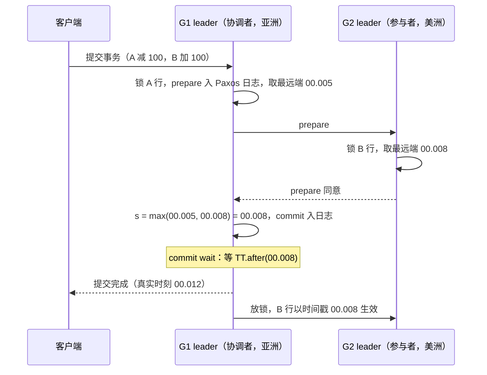

# $\rm Chapter \, 9$ Spanner 与真系统：把误差预算变成产品

> **本章假设你已经会**
>
> 1. NTP 的误差账：漂移按对时周期累积、估计误差钉在往返不对称的一半上，实测 10ms 以下的事件排序开始不可信（§8.8）。
> 2. 线性一致性的实时序定义，以及读路径三招各自的账单（§5.2、§5.5）。
> 3. 2PC 的完整时序、阻塞与 Paxos Commit 的替代思路（§7.2、§7.3、§7.6）。
> 4. Paxos/Raft 复制一个日志的机制：term、多数派、提交规则（§3.3、§4.4）。
> 5. 向量时钟的分量含义与合并运算（§8.5）。

第 8 章结尾留了一句话：有一类系统绕不开墙钟。它指的就是数据库。前面八章攒下的零件已经能拼出一个跨洲的存储系统：Raft 负责把日志复制进多数派（§3、§4），2PC 负责让一次事务跨多个 Paxos 组（§7.2、§7.6），向量时钟负责因果检测（§8.5）。唯独缺一样东西：数据库答应客户的是「你看得见的钟表顺序就是我的提交顺序」，而 §8.8 刚算完，普通机器的墙钟付不起这个承诺。本章看 Google 的 Spanner 怎么付：用 GPS 接收机和原子钟把 §8.8 的误差预算压到几毫秒，再设计一笔「等待误差过去」的账（TrueTime 与 commit wait，§9.2、§9.3），并用蒙特卡洛把这笔账的分布和两种付法（写侧 wait 还是读侧容忍旧数据）的权衡曲线跑出来（§9.4）。之后把流传最广的两句糙话「CAP 三选二」换成准确的表述（§9.5），看一眼硬件革命怎么重画账单（FaRM 与 RDMA，§9.6），最后用一张收束表把全册九个系统各买的那一维并排放好（§9.7）。

## $\rm \S \, 9.1$ 问题：跨洲的数据库要一个全宇宙公认的外部顺序

先把要买的东西钉准。Spanner 是 Google 的全球分布式数据库：数据分片存在多个数据中心，每个分片复制五份组成一个 Paxos 组。客户对它的期望里有一条最硬的：转账事务 T1 把钱从 A 账户挪到 B 账户，T1 提交之后、查询事务 T2 才开始，那么 T2 无论连到哪个大洲的哪个副本，都必须看到 T1 的结果。§5.2 的线性一致性给单条读写过这个承诺，把镜头拉到事务粒度，这条承诺有个名字：外部一致性（external consistency）。定义两句话：

1. 事务之间排出一个全序，这个全序必须与真实时间的先后一致：若 T1 的提交在真实时刻上早于 T2 的开始，则全序里 T1 排在 T2 前面。
2. 这个全序对全宇宙所有观察者都一样，不需要每个客户端自己拼。

满足它的事务序，教科书也叫严格可串行化（strict serializability）：可串行化（数据库分册 §7.4 的隔离级别表里有它的名字，含义是执行效果等价于某个串行执行）加上实时序约束。它比「单操作线性一致」更严：线性一致性只管一个操作插入实时序，外部一致性要求整个事务、跨任意多个分片的读写，整体被钉在真实时间的一条线上。

为什么前八章的零件拼不出它？把那个转账例子逐件过一遍就知道缺口在哪：

1. Raft 给出的是**一个** Paxos 组内部的全序，两个组的日志互相不知道对方的 term 该怎么比，跨组的时间戳从根上就不可比。
2. 2PC 给出的是**一次**事务的原子性（§7.2），它负责让所有参与者对「成还是不成」达成一致，根本不产生跨事务的时间戳。
3. §8.3 的 Lamport 时钟倒是能给跨机全序，但 §8.4 实测过，它对并发事件安插的先后没有因果内容，更不与真实时间对齐。
4. §8.5 的向量时钟编码的是因果序，可「真实世界里 T1 在 T2 之前」不要求两者之间有任何消息往来，客户看的是墙钟。
5. 墙钟这条路 §8.8 已经算过账：漂移加非对称残余的预算在 10ms 量级，间隔更近的事件排序排反概率三成起。

白话：全册到第八章为止，所有「先后」都是机器内部构造出来的；Spanner 要的是你手表上的先后，这等于让撒谎成性的网络和钟当一次公证人。

> 本节小结：外部一致性＝事务全序与真实时间一致且全宇宙统一；Raft 的组内全序、2PC 的原子性、Lamport/向量时钟都与真实时间不挂钩，墙钟又有 §8.8 的 10ms 误差债，这是 Spanner 要补的缺口。

## $\rm \S \, 9.2$ TrueTime：把误差写进接口，而不是藏进实现

Spanner 的做法从换接口开始。普通系统调用返回一个时刻：`clock = 1699000000123`，一个数，错了也不告诉你。TrueTime API 返回的是一个区间：

1. `TT.now()` 返回区间 $[\mathrm{earliest},\; \mathrm{latest}]$，承诺：调用那一刻的真实时间一定落在这个区间里。
2. `TT.after(t)`：区间整体在 $t$ 之后时返回真，即 $\mathrm{earliest} > t$。
3. `TT.before(t)`：对称地，区间整体在 $t$ 之前时返回真。

定义不确定度（uncertainty）$\epsilon = (\mathrm{latest} - \mathrm{earliest})/2$，即区间半宽。区间的中点就是普通钟的读数，$\epsilon$ 是它可能差多少。Spanner 论文给出的生产数字：$\epsilon$ 典型在 1 到 7ms 之间，平均约 4ms（Corbett et al., OSDI 2012, §3）。

$\epsilon$ 为什么能压到个位数毫秒，靠的是硬件，这部分不是工程花絮而是设计的一半。每个数据中心摆着若干台时间主机（time master）：多数装 GPS 接收机，天线对天，直接收卫星时间；少数装原子钟，GPS 天线集体故障时充当后备。每个节点上的时间从机（time slave daemon）每 30 秒向多台主机轮询对时，用多主取交集的算法（Marzullo 变体）把个别撒谎的主机剔掉。两次轮询之间，本地晶振照旧漂移（§1.2 的账），$\epsilon$ 随时间缓慢增长，直到下次对时被压回去。所以 $\epsilon$ 不是常数而是随对时周期起伏的活物，1 到 7ms 的范围就是「刚对完时」到「快该再对时」的波动。

有一个自然的问题：§8.8 的 NTP 不就是对时的吗，为什么不用它？区别不在精度而在**合同**。NTP 给你一个点估计加一个经验误差量级，误差多大取决于网络对称性，撒谎时可以差出去很远且没有承诺；TrueTime 给你一个有合同背书的上界，$\epsilon$ 之内是确定的，超界的风险被硬件（多主、GPS、原子钟）压到工程上可忽略。下一节的定理证明只用到「误差有界」这一条，NTP 付不起这份有界承诺，TrueTime 付得起。

接口换成区间，客户端的推理方式跟着变。想知道「时刻 $t$ 是否已过」，问的不是 `now() >= t`（一个可能错的布尔值），而是 `TT.after(t)`（一个**不会错**的布尔值：区间整体越过 $t$，真实时间必然已过 $t$）。反过来 `TT.after(t)` 为假时，只能说明「区间还没整体越过」，不能断言「一定没过」，真实时间可能已在区间前半段里走过了 $t$。方向的不对称是区间 API 的全部妙处：回答「确定已过」很便宜，回答「确定没过」做不到，下一节 Spanner 把所有确定性的需求都安排成「等一个确定已过」。白话：TrueTime 不假装钟准，它每次报时都说「真实时间在这条走廊里，半宽 4 毫秒」，把 §8.8 那笔混在暗处的误差账变成了接口上明码标价的 $\epsilon$。这正合全册的心智模型：撒谎不可怕，把谎话变成可计算的不确定就行。

> 本节小结：TrueTime 用 GPS 加原子钟加多主对时把时钟误差压进 $\epsilon \approx 1\text{–}7\mathrm{ms}$ 的区间，接口直接返回「区间」而非「时刻」，误差从实现细节升级为一等公民。

## $\rm \S \, 9.3$ commit wait：让写事务等误差走完

区间钟怎么变成外部一致，关键一步是给提交时刻的选取立规矩。Spanner 的读写事务这样走：数据分片成若干 Paxos 组（组内五副本，leader 主导，就是 §3 的复制日志），跨组事务用 2PC 协调，每个组的 leader 是一个参与者（§7.2 的时序原样适用；§7.6 提过，真实现里协调者的存活问题由组内 Paxos 兜住）。提交时：

1. 每个参与组给本组那部分写选一个时间戳，协调者取全体最大者为事务的提交时间戳 ${s = \mathrm{TT.now().latest}}$。
2. commit wait（提交等待）：协调者握着锁等待，直到 `TT.after(s)` 为真，才放锁、才让这次提交对外可见。

第二步是灵魂。`TT.after(s)` 为真意味着当前真实时间已经**确定**超过 $s$，而确认这一眼本身也要靠一个区间：`earliest > s` 即真实时间已走过 $s + \epsilon'$，$\epsilon'$ 是验票那一刻自己的区间半宽。取号时刻记为 $t$，则 $s = t + \epsilon$，两段相加，从取时间戳到放锁至少等了 $\epsilon + \epsilon' \approx 2\epsilon$：一段把自己的区间最远端等过去，一段把验票那一眼自身的误差也等过去。这就是「wait 间隔账」的原式：**提交时间戳选在区间最远端，然后把两段误差全部等完**。为什么这一等就买到了外部一致性，是一条两步的定理：

$$
T_1 \text{ 的提交可见早于 } T_2 \text{ 的开始} \;\Longrightarrow\; s_1 < s_2
$$

读法：$s_i$ 是事务 $T_i$ 的提交时间戳。证明。第一步，commit wait 保证了 $T_1$ 对外可见的那个真实时刻 $t_v$ 满足 $t_v > s_1$：可见必须等 `TT.after(s_1)` 为真，而它为真时真实时间已确定越过 $s_1$。第二步，$T_2$ 开始于 $t_v$ 之后，取 $s_2$ 时真实时间 $t_2 \ge t_v > s_1$，而 $s_2 = \mathrm{TT.now().latest} \ge t_2$，所以 $s_2 > s_1$。两步合起来：任何在真实时间里晚于 $T_1$ 可见时刻开始的事务，时间戳必然更大，按时间戳排出的全序与真实时间一致，外部一致性成立。注意这个证明对 $\epsilon$ 提的全部要求只有「有界」一条：$\epsilon$ 取多大，wait 就相应等多久，正确性分毫不让；压小 $\epsilon$ 优化的是账单（§9.4），不是定理。

时间戳就位后，读路径是顺水推舟。每个副本维护一个安全时间戳 $s_{\mathrm{safe}}$，含义是「时间戳不大于它的提交，在本副本都已生效」，Paxos 日志每应用一条就往前推。只读事务不拿锁、不写日志，选一个读时间戳 $t_r$，到 $s_{\mathrm{safe}} \ge t_r$ 的副本上做快照读（snapshot read）：要最新就取 $t_r = \mathrm{TT.now().latest}$，可能要等 $s_{\mathrm{safe}}$ 追上来；容忍旧数据就取 $t_r$ 往回拨几秒，任何副本即刻可读。这是 §5.5 读路径三招的 Spanner 版：多数派的账 Paxos 已经付过，租约的时钟假设被 TrueTime 的区间明码接管。commit wait 那两段 $\epsilon$ 在读写事务里常常与 Paxos 消息流重叠，论文报告实际多付的墙钟时间小于两段的全部（Corbett et al., 2012, §4.2.3），但下节按最坏情形把整份账单独算出来，看它的形状。还有一点值得注意：wait 是握着锁等的，锁持有时间被拉长 $\epsilon$ 级别，写写冲突的负载会直接感到吞吐压力，这是账单从延迟侧溢出到吞吐侧的路径。

### $\rm \S \, 9.3.1$ 一次跨组转账的完整时间轴

把协议在 §9.1 的转账上走完。A 账户的行在 Paxos 组 G1（亚洲），B 账户的行在 G2（美洲），G1 的 leader 兼任协调者。真实时刻与动作逐行对齐（时间戳取区间最远端是每一步的固定动作，不再重复写）：

| 真实时刻 | 谁 | 动作 |
| --- | --- | --- |
| 12:00:00.000 | 客户端 | 向 G1 提交事务：A 减 100、B 加 100 |
| 12:00:00.001 | G1 leader | 锁住 A 行，把「prepare(减 100)」写进 G1 的 Paxos 日志，参与者时间戳取区间最远端 ${00.005}$ |
| 12:00:00.004 | G2 leader | 收到 prepare，锁住 B 行，参与者时间戳取自己的区间最远端 ${00.008}$ |
| 12:00:00.005 | G1 leader | 收齐两张 prepare 票，取 $s = \max(00.005,\; 00.008) = 00.008$，把「commit, $s$」写进日志（§7.2 的提交点就是这条日志记录） |
| 12:00:00.012 | G1 leader | commit wait 结束：`TT.after(00.008)` 为真，真实时间确定越过 00.008 |
| 12:00:00.012 起 | G1、G2 | 放锁，A、B 两行以时间戳 00.008 对所有后续读可见 |

时序画出来是这样（实线是消息，Note 标出 commit wait 的落点）：



对照定理检查一遍：美洲的查询事务 T2 哪怕在 12:00:00.013 连上 G2，取 ${s_2 = 00.017}$ 或更大，比 $s = 00.008$ 大，读时间戳也随之更大，快照读必然包含这笔转账。假如没有 commit wait，G1 在 commit 记录落盘后就放行（约 00.006），转账的数据带着时间戳 00.008 立刻对外可见。此时设一笔反向转账 T2（B 减 50）在 12:00:00.0065 开始，它取号那一刻的区间半宽恰好小，只有 1.2ms，于是取 $s_2 = 00.0065 + 00.0012 = 00.0077 < 00.008$：T2 明明在真实时间里晚于 T1 开始，时间戳却更小。一个读时间戳为 00.0078 的快照读会看到 T2 的减 50、却看不到 T1 的加 100，读出一个真实世界里从未存在过的余额。注意 T2 的钟并没有坏：它的区间 $[00.0053,\; 00.0077]$ 整体落在 T1 真实提交之后，两个钟各自诚实，撒谎的是「拿区间最远端当下限」这件事本身，§9.4 把这类破坏的概率按间隔 $g$ 算成具体的数。白话：协调者拿着表宣布「本笔交易冠以 00.008」，然后盯着真钟等到 00.008 被确定越过才松手；从这一刻起，全宇宙任何角落取号都取在它后面。

> 本节小结：提交时间戳取区间最远端 $s = \mathrm{TT.now().latest}$，再等 `TT.after(s)` 才可见；可见时刻严格晚于 $s$、后续事务的区间端点严格更大，两步证明外部一致性；读侧用 $s_{\mathrm{safe}}$ 做快照读，最新读可能等、旧读随处可读。

## $\rm \S \, 9.4$ 实测：wait 间隔账与延迟-新鲜度权衡

定理之外，账要自己算。实测脚本 `exp1_truetime.py`（种子 20261105，每场景 $10^6$ 个样本，WSL 运行）把四笔账一次算全：

```bash
wsl bash -c "cd /mnt/c/Users/20811/Desktop/26Fall/_uni5_work/expDS09 && python3 exp1_truetime.py"
```

模型约定：$\epsilon \sim U[1,7]\,\mathrm{ms}$（论文的典型范围）；commit wait 时长按 §9.3 的原式等于两段之和，取号一段加验票一段，各抽一次 $\epsilon$。第一笔账，commit wait 的分布：

| 统计量 | 均值 | p50 | p95 | p99 | 最大 |
| --- | --- | --- | --- | --- | --- |
| 实测（ms） | 8.00 | 8.01 | 12.10 | 13.15 | 13.99 |

理论账对得上：两次 $U[1,7]$ 相加是三角形分布，峰值在 8，p95 的闭式值正是 12.10。干净钟的 wait 是个温顺的账单：均价 8ms，p99 压在 14ms 内，因为均匀分布没有尾巴。

第二笔账，**不给 wait 会怎样**。设 $T_1$ 在真实时刻 $t_1$ 完成提交决策、取 $s_1 = t_1 + \epsilon_1$；$T_2$ 在 $t_1 + g$ 才开始、取 $s_2 = t_1 + g + \epsilon_2$。外部一致性被破坏当且仅当 ${s_1 \ge s_2}$，即 $\epsilon_1 - \epsilon_2 \ge g$。这个概率有闭式：$\epsilon_1,\epsilon_2$ 独立均匀，差落在 $[1,7]^2$ 的正方形上，条件 $\epsilon_1 \ge \epsilon_2 + g$ 切出一个直角边为 $6-g$ 的三角形，面积 $(6-g)^2/2$，除以正方形面积 36 得

$$
P(\text{破坏}) \;=\; \frac{(6-g)^2}{72}, \qquad 0 \le g \le 6\,\mathrm{ms}
$$

读法：$g$ 是两事务真实开始时刻的间隔，间隔越小、平方项放大得越狠，$g$ 超过 $\epsilon$ 的最大值 6ms 后归零。蒙特卡洛与闭式对上了：

| 间隔 $g$（ms） | 0.5 | 1 | 2 | 4 | 6 |
| --- | --- | --- | --- | --- | --- |
| 蒙特卡洛 | 0.4197 | 0.3461 | 0.2221 | 0.0559 | 0.0000 |
| 闭式 $(6-g)^2/72$ | 0.4201 | 0.3472 | 0.2222 | 0.0556 | 0.0000 |

1ms 间隔的事务对有 35% 概率被排出颠倒的全序，2ms 还有 22%。第三笔账，Spanner 自己的 wait 模式：$T_2$ 最早也只能在 $T_1$ 的 commit wait 结束后开始，$10^6$ 次模拟取 $g = 0.05\mathrm{ms}$，破坏次数为 0，定理在模拟里兑现成概率零。

第四笔账是本章真正的权衡曲线：**同样的外部一致性，账单寄给谁**。Spanner 寄给写侧（每写付一次两段 wait）；另一派设计把账寄给读侧：写不等、立即提交，读侧想要新鲜数据就等 safe time 盖住最近一次写的 $s$，或者接受读 $\epsilon$ 之前的旧数据。模型：写入按泊松到达，读到达时距最近一次真实提交 $\Delta \sim \mathrm{Exp}$（均值 10ms），容忍 $f$ 毫秒旧数据即读时间戳取 $t_r = t_{\mathrm{read}} - f$，要等到 `TT.after(s)` 确认通过，等待时长为 ${\max(0,\; \epsilon_{\mathrm{取号}} + \epsilon_{\mathrm{验票}} - \Delta - f)}$。容忍模式的账单随 $f$ 衰减：

| 容忍陈旧度 $f$（ms） | 0 | 1 | 2 | 3 | 5 | 7 |
| --- | --- | --- | --- | --- | --- | --- |
| 读侧期望等待（ms） | 2.626 | 2.113 | 1.652 | 1.248 | 0.622 | 0.243 |
| 读侧等待 p99（ms） | 11.15 | 10.15 | 9.15 | 8.15 | 6.15 | 4.15 |

两边一比，分水岭出现了：容忍模式单价是每个强一致读 2.626ms，wait 模式是每个写 8.00ms 一口价；若每个写平均跟着 $k$ 个强一致读，$k$ 超过 $8.00 / 2.626 \approx 3$ 后，写侧 wait 反而总账更低。Spanner 的客户画像（一次写、多次读）正落在这条线的右边，这就是「账单寄给写侧」的算术依据；反过来读多写少的负载，$f > 0$ 的旧读（Spanner 支持）等待进一步下降。曲线的形状也值得读一眼：期望等待随 $f$ 衰减得先快后慢，因为 $\Delta$ 是指数分布，离得远的写早就 safe 了，账单全压在「刚提交完就来读」的尾巴上；p99 一列是另一记提醒——$f=0$ 时期望只有 2.6ms，p99 却到 11ms，容忍模式省的是期望、省不掉尾部，而 wait 模式的 8ms 是带合同的一口价。两笔账买的是同一份不确定性，区别只是付一次还是付 $k$ 次、付在写路径还是读路径、账单是定值还是随负载浮动。

最后是敏感性：$\epsilon$ 的质量直接定价尾部。把「GPS 失灵」揉进去（5% 的样本 $\epsilon \sim U[7,25]\,\mathrm{ms}$），commit wait 均值只从 8.00 涨到 9.20ms（+15%），p99 却从 13.15 跳到 27.69ms，两倍多。这就是 Spanner 值得为 GPS 天线和原子钟花钱的原因：$\epsilon$ 的中位数决定 wait 的地板，$\epsilon$ 的尾部决定 wait 的惊吓，硬件买的是后者。

诚实声明：以上模型把 commit wait 孤立出来算（真实系统里它与 Paxos 通信、2PC 消息流重叠，论文报告实际多付的墙钟时间小于两段 $\epsilon$ 的全部），$\epsilon$ 取了无尾的均匀分布，忽略跨机传播时延；这些简化都朝「让账更清楚」的方向，不改变四个定性结论：wait 有界且温顺、无 wait 时破坏概率随间隔平方恶化、权衡的分水岭在读写比、尾部由硬件质量定价。白话：外部一致性是一张约 8 毫秒的账单，Spanner 让写的人一次付清、终身免读付；不肯等的设计要么让每个读的客人付小费，要么收下「最多旧几毫秒」的找零、再付一小截尾款。

> 本节小结：实测 commit wait 均价 8.00ms、p99 13.15ms（取号加验票两段 $\epsilon$）；无 wait 时 1ms 间隔的破坏概率 34.6%（与闭式 $(6-g)^2/72$ 吻合），wait 模式 $10^6$ 次 0 破坏；读写比超过约 3 后写侧 wait 的总账低于读侧付账，$\epsilon$ 尾部恶化两倍 p99 由硬件质量兜住。

## $\rm \S \, 9.5$ CAP 与 PACELC：把两句糙话换成准确表述

Spanner 的取舍放到坐标系里看才清楚，这个坐标系就是 CAP。先给三个词的准确定义：一致性（Consistency）指线性一致（§5.2 的实时序插入）；可用性（Availability）指每个**没有崩溃**的节点收到的请求，最终都得到（非报错的）响应；分区容忍（Partition tolerance）指网络可以任意丢消息、把集群切成互不相通的几块，系统照常运转。定理只有一句：**分区发生时，C 与 A 不可兼得**。用最小的账把它钉死：两个节点 A、B，中间的网络断了，客户把 $x=1$ 的写发给 A，另一客户随后把「读 $x$」发给 B。B 若响应，只有两种可能：返回旧值 $x=0$（线性一致破了，A 侧的选择），或等 A 的消息（等不到，可用性破了）。两边都要，就要 B 装作知道 A 的数据，而它不知道，CAP 的不可能就是在这一步完成的。顺带两个澄清：这里的一致性专指线性一致这一档，弱一点的合同（顺序一致、因果一致）不落入这条定理的火力范围；分区也不必是全集群一刀切，实际故障常常只断一部分链路，A 与 B 断了、C 还通着，逐节点的选择更细。

流行语「三选二」要修正三处。其一，P 不是可选件：§1.2 说过网络必然撒谎，分区是迟早送上门的，真正的选择发生在分区**期间**——那一瞬间保 C 还是保 A。其二，CAP 对无分区时的一切保持沉默，而日常运维的绝大多数时间没有分区，那时真正打架的是延迟与一致性，CAP 里根本没有这一维。其三，选择不必是全系统终身制，可以按操作配置（quorum 读写参数就是逐操作的旋钮）。补上第二、三处的坐标系叫 PACELC：**如果**分区（Partition），在 A 与 C 里选；**否则**（Else），在延迟（Latency）与一致性（Consistency）里选。记法四个字母两两一组：Spanner 是 PC/EC，分区时停写保一致，无分区时用 commit wait 和 2PC 的延迟买外部一致，§9.4 那 8ms 就是 EC 这一项的月账单；Dynamo 是 PA/EL，分区时任一边照常收写（牺牲一致），平时本地读写低延迟、给最终一致。白话：CAP 的「三选二」把分区说成货架上的第三样商品，其实分区是自己找上门的债主，你选的只是它敲门那一刻扔下哪样东西跑，PACELC 多问的才是平时过日子的问题——不分区的时候，你要快还是要准。

> 本节小结：CAP 的准确内容是「分区期间 C 与 A 不可兼得」一条；P 必选、无分区时 CAP 沉默，后者的取舍由 PACELC 接管；Spanner = PC/EC（wait 买一致），Dynamo = PA/EL（分区可用、平时低延迟最终一致）。

## $\rm \S \, 9.6$ FaRM 与 RDMA：换硬件改账单一瞥

Spanner 的账单建立在一条前提上：跨机通信至少要毫秒级，因为消息要走内核协议栈。这条前提正在被硬件拆掉。RDMA（Remote Direct Memory Access，远程直接内存访问）是新一代网卡提供的能力：一块网卡直接读写另一台机器的内存，两端内核、两端 CPU 都不经手，单侧延迟微秒级，其中「单侧操作」（one-sided）连对端的 CPU 都不打扰，对端进程毫无察觉。FaRM（Fast Remote Memory，微软研究院，SIGMOD 2014）把这条能力用到了事务上：全部数据以对象形式躺在集群的 DRAM 里，主备复制；事务用乐观并发控制（Optimistic Concurrency Control，OCC）：先随便读（one-sided RDMA 直接读远程内存，不拿锁），提交时才对账。提交协议四步，每步都是 RDMA 单侧操作：

1. 锁（Lock）：对写过的对象发单侧写，把锁位置 1，等所有主副本确认。
2. 验证（Validate）：读回读过的对象的版本号，与读时记录比对，没变才继续；变了说明并发改过它，回滚重试。
3. 提交备份（Commit Backup）：把新版本写进备份副本，收齐确认。
4. 提交主副本（Commit Primary）：主副本写新版本、版本号前移、放锁，事务对外可见。

严格可串行化由第 2 步的验证给出：验证通过的事务，读到的版本在验证与提交之间没有被并发改动，其效果等价于按验证顺序串行执行。全程不问时钟。

把两种账单并排放：Spanner 买「时间的不确定」，货币是 $\epsilon$ 级别的等待；FaRM 买「网络的不确定」，货币是争用高时的验证失败重试。低争用负载下（FaRM 的目标场景），验证几乎总通过，事务以内存速度完成；高争用下 OCC 大量重试，账单恶化，这是它的失效边界。对全册的意义：延迟预算每被硬件重画一次（内核旁路、RDMA、NVMe），协议设计空间就重开一次，「网络会撒谎」的谎话密度本身是可被硬件改变的参数。白话：RDMA 是不用敲门直接伸手进对方冰箱，FaRM 的乐观事务是先拿了再在收银台对账，拿几乎不花钱，对账撞了车才重新来过。

> 本节小结：RDMA 微秒级单侧内存访问拆掉了毫秒通信的前提；FaRM 用乐观并发加验证换严格可串行化，不付时钟账、改付争用重试账；硬件进步重画延迟预算，账单结构随之改变。

## $\rm \S \, 9.7$ 全册收束：九个系统各买哪一维

九个系统走完了，并排放在一起看。全册的心智模型是「网络会撒谎，共识就是把撒谎变成可计算的不确定」；每个系统接住的谎不一样，付的账也不一样：

| 系统（出场） | 核心矛盾 | 一致性维度 | 顺序/时间从哪来 | 付什么账 |
| --- | --- | --- | --- | --- |
| GFS（§2.3） | 大文件多读少写的吞吐 | 宽松：追加可能重复乱序 | 主 chunkserver 定追加位 | 吞吐与简单，放弃严格一致 |
| MapReduce（§2.2） | 千机计算的组织与容错 | 无（批处理） | 协调器调度 | 重执行的机器时换容错 |
| Raft（§3.3、§4.4） | 一个日志的复制共识 | 组内全序日志 | term 加日志下标（§8.3 全序变体） | 多数派往返换强一致 |
| ZooKeeper（§5.6） | 元数据协调 | 线性一致写、顺序一致读 | leader 的 zxid 全序 | 默认读可能旧换读延迟 |
| etcd（§5.6） | 同上，强读默认 | 默认线性一致读 | Raft 全序加读索引 | 心跳往返换强读 |
| CRAQ（§6.4） | 读吞吐线性扩展 | 链上全序、版本化读 | 沿链传递的版本号 | 版本等待换本地读 |
| COPS（§8.7） | 地理副本低延迟读写 | 因果加一致 | 向量时钟依赖（§8.5） | 跨 key 全序换本地读写 |
| Spanner（§9.3） | 跨洲事务外部一致 | 外部一致（严格可串行） | TrueTime 区间加 commit wait | $\epsilon$ 等待换墙钟序 |
| FaRM（§9.6） | 内存级延迟的强事务 | 严格可串行（验证法） | OCC 验证序 | 争用重试换锁等待 |

这张表的读法是按列扫。第四列「顺序从哪来」是全册的暗线：调度器、term 加下标、zxid、链上版本号、向量时钟、TrueTime 区间、验证序，七种答案对应「谁说了算先后」的七种人选，没有一种免费。第五列是代价结构：网络往返、时钟假设、等待、重试，四种货币之间可以兑换但总额不为零，CAP 和 PACELC 说的就是兑换比率的底线。九个系统没有冠军，只有各自买了一维之后剩下的账单。

还可以按角色归组：GFS 和 MapReduce 是**吞吐**时代的答卷，一致性的价钱能省则省；Raft、ZooKeeper、etcd、CRAQ 是**协调**时代的答卷，用一个强全序日志给其他系统当地基；COPS、Spanner、FaRM 是**全球与内存**时代的答卷，分别在因果序、墙钟序、验证序上把事务级合同买齐。三组合起来是一条代价曲线的三个平台期：先承认网络会撒谎（第一组），再学会跟它对账（第二组），最后把对账做到快得像没撒过谎（第三组）。白话：这像给九种保险单排货架，保的险种各不相同（丢消息、错时钟、错顺序），保费有的按次付、有的包月、有的按赔率浮动，但没有任何一张写「什么都保还不收钱」。

> 本节小结：九个系统按「顺序从哪来、付什么账」两列对齐，是全册论证链的收口；顺序的来源有七种、代价有四种货币，兑换有底线而无免费；按吞吐、协调、全球三组看，是同一份「与撒谎网络和解」的合同越签越贵的三个阶段。

## $\rm \S \, 9.8$ 关键概念回顾

1. 外部一致性的准确定义是什么？它与 §5.2 线性一致性、数据库分册 §7.4 的可串行化各是什么关系？
2. TrueTime 的三个方法各自承诺什么？$\epsilon$ 由哪些硬件环节决定，为什么说 GPS 与原子钟是设计的一半而非运维细节？
3. commit wait 的两步协议是什么？外部一致性定理的两步证明各用到它的哪一步？为什么证明只需要 $\epsilon$ 有界、不需要它小？
4. 实测中，无 wait 时 1ms 间隔的破坏概率是多少？写侧 wait 模式的均价与 p99 是多少？容忍模式在读写比多少时反超？
5. CAP 的定理精确内容是什么？「三选二」要修正哪三处？Spanner 与 Dynamo 在 PACELC 里各占哪格、各付什么账？

## $\rm \S \, 9.9$ 应用与辨析

1. 同学说：「Spanner 只要把原子钟造得更好，commit wait 就可以取消了。」用 §9.4 的数字指出这句话哪一半对、哪一半错，以及 wait 能否被压到零。
2. 你的业务：每个写后面平均跟 2 个强一致读，业务可容忍 3ms 的旧数据。用 §9.4 的账单算出两种模式（写侧 wait、读侧容忍 $f=3\mathrm{ms}$）各自的每事务总成本，并给出选择。
3. 把 Spanner、COPS、Dynamo 三个系统放进 PACELC 的 Else 分支（L 与 C 的取舍）逐一说明，并指出哪一家的读延迟最低、它放弃了什么。

## $\rm \S \, 9.10$ 本章自测答案

1. 定义：事务全序与真实时间先后一致且全宇宙统一（§9.1）。与线性一致的关系：线性一致只把单个操作钉进实时序，外部一致把整个事务钉进去，故更强；与可串行化的关系：可串行化加实时序约束就是严格可串行化，别名即外部一致（§9.1）。
2. `TT.now()` 承诺真实时间落在返回区间内；`TT.after(t)`、`TT.before(t)` 承诺区间整体在 $t$ 的一侧（§9.2）。$\epsilon$ 由对时残余与两次对时之间的漂移累积决定，靠 GPS 主机、原子钟后备、30 秒轮询与多主交集算法压到 1 到 7ms（§9.2）。硬件是设计的一半，因为 §9.4 实测 $\epsilon$ 的尾部直接定价 commit wait 的 p99，钟的质量就是延迟尾部。
3. 两步：提交时间戳取 $s = \mathrm{TT.now().latest}$；等 `TT.after(s)` 为真才放锁可见（§9.3）。$\epsilon$ 在账目里的三次出现各司其职：取号时 $s_1 = t_1 + \epsilon$ 把时间戳推到区间最远端，wait 把可见时刻推到 $s_1$ 确定越过之后（含验票自身的一段 $\epsilon'$），$T_2$ 取时间戳时又从自己的区间最远端起跳；推上去多少，可见就等多少，所以证明不需要 $\epsilon$ 很小，只需要它有界（§9.3）。
4. 无 wait 时 1ms 间隔破坏概率 34.6%（蒙特卡洛 0.3461，闭式 $(6-g)^2/72$ 的 0.3472）（§9.4）。wait 模式均价 8.00ms、p99 13.15ms（取号加验票两段 $\epsilon$）、$10^6$ 次 0 破坏（§9.4）。容忍模式单价 2.626ms 每读，读写比超过 $8.00/2.626 \approx 3$ 后写侧 wait 的总账反而更低（§9.4）。
5. CAP 定理：分区发生时线性一致与可用性不可兼得（§9.5）。三处修正：P 必选不可交易；无分区时 CAP 沉默，那里的取舍是 L 对 C；选择可以逐操作配置而非终身制（§9.5）。Spanner 是 PC/EC，付 commit wait 与 2PC 的延迟；Dynamo 是 PA/EL，分区可写、平时最终一致换低延迟（§9.5）。
6. 对的一半：原子钟与 GPS 越好，$\epsilon$ 越小，wait 按两段 $\epsilon$ 线性下降，实测尾部恶化场景里 p99 两倍于干净钟，说明硬件投资确实买回了延迟尾部（§9.4）。错的一半：wait 不能取消。只要 $\epsilon > 0$，定理的证明里「等误差确定越过」这一步就不可省，省掉它破坏概率回到 $(6-g)^2/72$ 的形状（1ms 间隔 34.6%）；$\epsilon$ 压到零需要真实时间零误差，§8.8 已说明这在物理上不可达（§9.4、§8.8）。
7. wait 模式：每写 8.00ms 一口价，读零等待，每事务总成本 8.00ms（§9.4）。容忍模式：2 个读各付期望等待，$f=3\mathrm{ms}$ 时单价 1.248ms，总成本 $2 \times 1.248 = 2.50\mathrm{ms}$（§9.4）。选容忍模式，便宜三倍多，代价是数据最多旧 3ms；本例读写比 2 低于分水岭 3，读侧付账占优（§9.4）。
8. Else 分支（不分区，延迟对一致性）：Spanner 选 C，读新数据可能等 safe time，commit wait 压在写侧；COPS 选 L，因果链内一致、并发 key 各排各的，读打任意本地副本近乎零等待，放弃的是跨 key 全序（§8.7）；Dynamo 选 L，本地读写最终一致，放弃的是读到最新值的承诺（§9.5）。读延迟最低的是 COPS（无全序协议、任意副本可读），它放弃的是 §9.1 那种「转账后必看见」的墙钟承诺，换来 §8.7 的因果加一致。

**你现在能做什么**：给定一个 $\epsilon$ 分布，你能像 §9.4 那样算出 commit wait 的分布、无 wait 时任意间隔的外部一致破坏概率，并按业务的读写比算出 wait 模式与容忍模式哪边总账更低。

全册到这章合上。回头看，第 1 章说网络会撒谎，之后的八章其实是同一个故事的九种讲法：把丢消息、错时钟、慢进程这些谎话，各自翻译成一种可计算的不确定，再为每种不确定开出一张账单。下一站是本册的复习总结（`12-复习总结/R1-复习总结-分布式系统.md`），它会把这些账单重新打乱混排，考你能不能闭卷把它们对回各自的系统。
