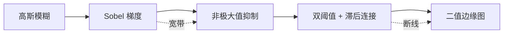

# $\rm Chapter \, 1$ 图像即信号

> **本章假设你已经会**
>
> 1. 正态分布 $N(\mu,\sigma^2)$ 的形状与均值、方差各管什么，见《概率论》§2.4。本章用它给传感器噪声建模。
> 2. 卷积定理与采样定理的结论，见《连续数学》§7.4 与 §7.5。本章 §1.6 只调用结论，不重推。
> 3. 《深度学习》§5.3 里卷积层从「滑动扫描」长出来的过程。本章补上它背后的信号处理定义，第 5 章把两条线接上。
> 4. Python 二维数组：形状、切片、逐元素运算。本章实验只用 numpy，不需要任何图像库。

相机把光变成一张图片时，到底发生了什么？把图片存进计算机时，它又变成了什么？这一章的回答只有一句话：图像是函数，识别是把函数压缩成语义。全册都建立在这句话上，而本章负责把前半句钉死：一张图就是一个定义在网格上的函数 $I(x,y)$，后续一切操作，模糊、锐化、找边缘、最后到神经网络，全是对这个函数的加工。学完本章，你将能在纯 numpy 里亲手实现卷积、高斯模糊与 Sobel 算子，跑通一条完整的 Canny 边缘检测流水线，并解释为什么缩小图片前要先模糊。下一章要回答后半句的前置问题：从函数里提取什么特征，才能让两台相机拍到的同一栋楼对上号。

## $\rm \S \, 1.1$ 图像是一个函数

先定义对象。一张宽 $W$、高 $H$ 的灰度图是一个函数

$$
I:\ \Omega \to V,\qquad \Omega=\{0,1,\dots,W-1\}\times\{0,1,\dots,H-1\}
$$

读法：定义域 $\Omega$ 是全部整数格点（每个格点一个位置），$I$ 给每个位置 $(x,y)$ 指定一个值。这个值的取法就是取值域 $V$，它由存储格式决定：

1. 8 位无符号整数（uint8）：$V=\{0,1,\dots,255\}$，0 是黑、255 是白。一张 8 位图每个位置只占 1 字节，这是照片与截图的默认格式。
2. 浮点数：$V=[0,1]$ 或更宽。计算中途会产生小数与负数（模糊后的边界值就是小数，差分的输出就是负数），uint8 存不下，所以图像处理库的标准做法是先把图转成浮点再加工，算完再转回去。

定义域里每个格点叫一个像素（pixel，picture element 的缩写），像素的值叫灰度值。彩色图不是新东西，只是三个函数并排：$I(x,y)=\big(I_R(x,y),\,I_G(x,y),\,I_B(x,y)\big)$，每个函数管一种颜色分量。这三份灰度图叫三个通道（channel），RGBA 图有四个。本章后续全部在单通道上推导，彩色图对每个通道各做一遍即可。

「图像是函数」不是一句废话，它立刻给出两条推论。其一，函数可以代入、可以加减乘除：两张同尺寸的图相减得到差影图，就能暴露两幅场景的变化。其二，函数有导数：$I$ 在某处变化得剧烈还是平缓，数学上就是偏导数 $\partial I/\partial x$ 与 $\partial I/\partial y$ 的大小，而「变化剧烈的地方」正是接下来几节要找的边缘。整章都是在给「求这个函数的导数」这句话做工程实现。

白话：把图像想成一片起伏的地形，灰度值是海拔，找边缘就是找悬崖，模糊就是把地形磨平，卷积就是在每个位置用一小片邻域的海拔按权重算个加权平均。

**本节小结**：图像是定义在整数网格上的函数，uint8 与浮点两种取值域各管存储与计算，彩色图是三个通道的并列，找到「变化剧烈处」就是找边缘。

## $\rm \S \, 1.2$ 卷积：把邻域加权求和写成一个算子

有了函数视角，第一个加工自然出现。传感器的噪声让每个像素叠加了随机起伏（§1.4 会用 $\sigma=10$ 的正态噪声实测），单个像素不可信，但邻域的平均可信。可信到什么程度可以算出来：设像素真值为 $s$，噪声 $n$ 服从均值为零、方差为 $\sigma^2$ 的正态分布（《概率论》§2.4），则 $n$ 个独立像素的平均值里，噪声部分是 $\tfrac1n\sum_i n_i$，它的期望仍是零（零均值噪声平均后不偏向任何一边），方差是

$$
\mathrm{Var}\Big(\frac{1}{n}\sum_{i=1}^{n}n_i\Big)=\frac{1}{n^2}\sum_{i=1}^{n}\mathrm{Var}(n_i)=\frac{\sigma^2}{n}
$$

读法：平均 $n$ 个像素，噪声标准差从 $\sigma$ 降到 $\sigma/\sqrt{n}$，$25$ 个像素的平均把 $\sigma=10$ 的起伏压到等效的 $2$。这就是「邻域加权求和」的合法性来源，而加权求和值得有个现成的数学名字。设核 $k$ 的尺寸为 $(2a+1)\times(2b+1)$，卷积（convolution）定义为

$$
(I*k)(x,y)=\sum_{i=-a}^{a}\sum_{j=-b}^{b} I(x-i,\,y-j)\,k(i,j)
$$

读法：把核 $k$ 的中心对准 $(x,y)$ 时，输出值等于「原图在 $(x,y)$ 周围的值」与「权重 $k$」的加权平均，注意求和时坐标带负号：核先绕中心旋转 $180^\circ$ 再去对齐。这个小方阵 $k$ 叫卷积核（kernel）或滤波器模板，权重全零除了中心为 1 时输出恒等于输入（恒等核），全 $\tfrac1{25}$ 的 $5\times5$ 核就是平均。

为什么要先旋转 $180^\circ$（工程黑话叫「翻转」）？这是数学卷积的原始定义，好处是它满足结合律与交换律，$(f*g)*h=f*(g*h)$ 成立，连续版的性质见《连续数学》§7.4。但对带对称核的滤波（高斯核沿中心对称，翻转后与自身重合）翻转什么也不改变；真正出现分歧的是非对称核。用 $3\times3$ 小块实测一次：取核 $k=\begin{pmatrix}0&1&0\\0&0&0\\0&0&2\end{pmatrix}$ 与图像块 $\begin{pmatrix}3&1&0\\2&5&1\\0&1&4\end{pmatrix}$，按定义（先翻转）算出 $7$，不翻转直接对应相乘求和（这叫互相关，cross-correlation）算出 $9$，同一个核同一块图差出 $2$。翻转与否不是细节，是两种不同的运算。

工程界的选择很明确：OpenCV 的 filter2D 与各大深度学习框架的 conv 层实际执行的都是互相关，核怎么摆就怎么扫，不做翻转。深度学习敢这么省事有个特殊理由：那里的核是训练出来的参数，网络自己会学到「正确方向」，翻转只是把学习目标换了个镜像。传统视觉的核是人手设计的（Sobel 核的方向就有正负之分），必须想清楚自己用的是哪种约定。本章后续统一用工程约定（互相关），只在提到结合律时回到数学定义。

还有一个边界问题：核中心对准图像边角的像素时，核会伸出图外。标准处理是零填充（zero-padding，图外一律当 0）或复制边界（把最外圈像素向外延伸），本章实验用前者。两种各有盲区：零填充等于在图外贴了一圈黑边，明亮的图卷积后边界一圈会被压暗，锐化时尤其刺眼；复制边界没有压暗问题，却会把贴边的真实边缘放大成假象。选哪种取决于任务在意什么，重要的是心里有数。输出尺寸公式的完整推导在《深度学习》§5.4，这里只借用结论。

白话：卷积就是拿一个小卡片在图上逐格滑动，每到一格就用卡片上的权重把底下的像素掂量出一个加权平均；翻转之争只是「卡片该不该倒着印」，对称卡片倒不倒都一样。

**本节小结**：卷积是把邻域加权求和打包成的算子，数学定义带 $180^\circ$ 翻转，工程框架实际执行互相关，两者只在不翻转会变形的非对称核上有别。

## $\rm \S \, 1.3$ 滤波器三件套：高斯模糊、锐化、Sobel

核是人手设计的，设计思路只有三条，各对应一个经典滤波器。

第一条：去噪要平均，但平均有讲究。全 $\tfrac1{25}$ 的平均核把邻域一视同仁，会连边缘一起抹平；更合理的是近邻话语权大、远邻话语权小，权重按二维正态密度取，这就是高斯模糊（Gaussian blur）：

$$
G_\sigma(x,y)=\frac{1}{2\pi\sigma^2}\,e^{-\frac{x^2+y^2}{2\sigma^2}},\qquad k(i,j)=\frac{G_\sigma(i,j)}{\sum_{u,v}G_\sigma(u,v)}
$$

读法：权重是「以核中心为原点的正态密度」，分母把整块核归一化成和为 1，保证均匀区域模糊前后亮度不变。$\sigma$ 是唯一的旋钮：它越大远处权重衰减越慢，模糊越狠。实测的 $5\times5$、$\sigma=1$ 核中心权重 $0.1621$，四角只剩 $0.0030$，差着五十多倍。高斯核沿中心对称，所以 §1.2 的翻转之争对它不存在；它还满足 $G_\sigma(x,y)=g_\sigma(x)\,g_\sigma(y)$，可拆成先横后竖两次一维卷积，$5\times5$ 核每像素 $25$ 次乘加的账变成 $5+5$ 次。

第二条：想锐化（sharpening），先把图模糊掉一份，再用原图减去模糊图。剩下的 $I-I*G_\sigma$ 恰是「被磨平掉的高频细节」，把它放大后加回去：

$$
S=I+\lambda\,(I-I*G_\sigma)
$$

读法：$\lambda$ 是细节回添的力度，$\lambda=0$ 退回原图，$\lambda$ 取 0.5 到 1 时边界明显变脆。模糊、减、加回，三步全是已建立的操作，不需要新数学。

第三条最关键：找边缘。边缘是亮度剧变处，剧变的度量是梯度，而梯度用差分近似就够了：$I(x{+}1,y)-I(x{-}1,y)$ 是 $\partial I/\partial x$ 的中心差分。但裸差分对噪声极其敏感（差分把两个像素的噪声各乘 1 倍再相减），Sobel 算子（Sobel operator）的妙处是把它拆成两个一维操作的叠加：先沿垂直方向做 $[1,2,1]$ 平滑，再沿水平方向做 $[-1,0,1]$ 差分，外积展开恰是

$$
K_x=\begin{pmatrix}1\\2\\1\end{pmatrix}\begin{pmatrix}-1&0&1\end{pmatrix}=\begin{pmatrix}-1&0&1\\-2&0&2\\-1&0&1\end{pmatrix},\qquad K_y=K_x^{\top}
$$

读法：$K_x$ 管水平方向的变化率（左右列相减、行方向加权平滑），$K_y$ 转置后管竖直方向。两个方向各卷一次，合成为梯度大小：

$$
|\nabla I|=\sqrt{(I*K_x)^2+(I*K_y)^2}
$$

读法：不管亮度朝哪个方向变、变多快，都折算成一个非负的「边缘强度」。它是个偶函数式的组合，翻转约定带来的正负号在这里自动消失，所以后文引用边缘强度时不必纠结符号。

「先平滑再差分」不只是降噪小聪明，它有更硬的来历。Canny 在 1986 年的设计论文里给边缘检测器立了三条准则：漏检率低（真边缘别放过）、定位准（响应别偏出真边界）、每条边只响应一次（别出双线），然后在「对阶跃边加正态噪声」的模型下解这个约束优化，得到的解近似于「高斯函数的一阶导数」，而「高斯平滑之后再差分」正是它的离散实现。平滑与差分两步能合一步还有个代数原因：卷积满足结合律，$(I*G_\sigma)*D=I*(G_\sigma*D)$，先模糊后差分等价于直接卷一个「差分过的高斯核」。这些是本节的选读枝节，主线只需要记住：Sobel 的形状不是拍脑袋，是降噪与求导的折中在 $3\times3$ 里最省事的落法。

白话：高斯模糊是「近处说话声音大」的加权听证会；锐化是先把图磨钝、再反过来把磨掉的部分加倍补回去；Sobel 是先做小范围平滑再问一句「左右差多少」，等于给差分穿了件降噪背心。

**本节小结**：所有经典核都是三条思路的产物，加权平均去噪（高斯）、细节回添（锐化）、平滑后差分（Sobel），每条都能用 §1.2 的卷积直接实现。

## $\rm \S \, 1.4$ 实验：在合成图上实测边缘强度

推导到此为止，全部换成实测。环境是 WSL 的 python3 加 numpy（无 OpenCV），脚本与完整输出在 `_uni5_work\expCV01\`（`expCV01.py` 与 `result.txt`），随机种子固定为 20261105。合成图是一张 $64\times64$ 的单通道图：背景灰度 30，正方形区域（行 20–43、列 20–43）灰度 200，再叠加 $\sigma=10$ 的正态噪声。卷积的纯 numpy 实现只有一层循环：

```python
def conv2_same(img, ker):            # 零填充，输出与输入同尺寸
    kh, kw = ker.shape
    ph, pw = kh // 2, kw // 2
    pad = np.pad(img, ((ph, ph), (pw, pw)))   # 图外补 0
    out = np.zeros_like(img, dtype=float)
    for i in range(img.shape[0]):
        for j in range(img.shape[1]):
            out[i, j] = np.sum(pad[i:i+kh, j:j+kw] * ker[::-1, ::-1])
    return out                       # 末尾翻转核 = 数学卷积定义
```

动手前先看一个真实率极高的翻车现场，它出现在任何图像库之外、纯数组层面：numpy 里两个 uint8 数组相减，结果仍是 uint8，负数全部回绕。实测背景减去方块：$30-200$ 的真值是 $-170$，uint8 下输出 $86$（因为 $-170+256=86$），先转浮点再减才是 $-170$。回绕的破坏是悄悄的：一张暗背景亮物体的图做「背景减除」预处理，减出的差影不但错，还错成正值，后续 Sobel 会把整片背景当成剧烈变化区。证据式排查的第一步由此而来：任何图像运算结果「怪」，先打印 `arr.dtype`，uint8 参与的减法与除法一律先 `astype(float)`。

第一个观察点是模糊对边缘像素值的具体改动。取正方形左上角附近的 $3\times3$ 块（行 19–21、列 19–21），它恰好骑在边界上：

| | 左上 (19,19) | 中心 (20,20) | 右下 (21,21) |
| --- | --- | --- | --- |
| 模糊前 | 30.0 | 200.0 | 200.0 |
| 模糊后 | 45.17 | 113.61 | 181.98 |

读法：模糊把突变的台阶抹成缓坡，骑在边界上的像素被两侧「拉扯」出中间值，而远离边界的方块中心（200.0000）与背景角落（30.0000）分毫不动。台阶变缓坡有个代价：清晰图上理想台阶的 Sobel 响应本可达 $4\times(200-30)=680$，先模糊再算，边界处的 $|\nabla I|$ 实测为 $439.84$，边界强度打了约六五折。

第二个观察点是这套流水线对噪声的抵抗力。在平坦区（行 2–15、列 2–15，本该处处 $|\nabla I|=0$）统计：

| 做法 | $|\nabla I|$ 均值 | $|\nabla I|$ 最大值 |
| --- | --- | --- |
| 噪声图直接 Sobel | 51.08 | 147.30 |
| 先 $5\times5$ 高斯（$\sigma=1$）再 Sobel | 15.79 | 41.74 |

读法：直接对噪声做差分，平坦区居然冒出 147.30 的「边缘强度」，比真边缘的零头还大不了多少，阈值法根本没法用；先模糊再差分，假边缘最大值被压到 41.74（降幅 71.7%），而真边界处还有 438.22。模糊用六五折的真信号换掉了七成的假信号，这笔账是整个传统视觉的生存基础。

> **竞赛生迁移提示**：上面这套二维循环卷积是教学写法，逐像素 $25$ 次乘加。真要批量处理时，卷积定理（《连续数学》§7.4）给了一条老朋友式的路：转到频域逐点相乘再变回来，$O(n\log n)$ 的 FFT（《连续数学》§7.6）你在多项式乘法里已经用过，图像只是把一维换成二维，思路一字不改。另外别忘了刚才的 uint8 陷阱：进任何数组运算前先转浮点。

白话：这组实验是给「模糊」正名的体检单：模糊像拍照前用手轻轻虚一下焦点，假的皮肤纹理糊没了，真的墙角还站着；表里两组数字就是虚与不虚的体检结果。

**本节小结**：模糊把台阶抹成缓坡（真信号 680 折到 439.84），换来平坦区假边缘从 147.30 压到 41.74；后续一切边缘检测都站在「先模糊」这块地基上。

## $\rm \S \, 1.5$ Canny 流水线：从梯度图到边缘图

$|\nabla I|$ 只回答「哪里变化剧烈」，还不是边缘。边缘应该是细细一条线，而实测里 $|\nabla I|$ 高的区域是一整条宽带（§1.4 表格里模糊后的边界坡度横跨好几个像素），直接卡阈值会得到粗面条。Canny 边缘检测器（Canny edge detector）在梯度图之后补三道工序，每道针对一个具体的毛病：



1. 非极大值抑制（non-maximum suppression，NMS）：沿梯度方向比较每个点与前后两个邻居，只留下局部最大的点。「梯度方向」先用 $\arctan(G_y,G_x)$ 算出角度，再就近量化到 $0^\circ$、$45^\circ$、$90^\circ$、$135^\circ$ 四个离散方向（实验里正是这样写的），每个方向对应一对固定的邻居偏移。宽带被削成细线。
2. 双阈值：设高阈值 HIGH 与低阈值 LOW。超过 HIGH 的直接算强边缘点；介于两者之间的是候选，先挂着。单阈值的两难由此解开：阈值高了真边缘断线，低了噪声混入，双阈值让「弱但有靠山的点」活下来。
3. 滞后阈值法（hysteresis thresholding）：从每个强点出发，把与它连通的候选点一并收编。真正的边缘是连续曲线，中间某段弱一点不该断线；孤立的候选点（多半是残余噪声）没人认领，淘汰。

在同一张噪声合成图上实测（先 $\sigma=1$ 高斯，再 Sobel）。平坦区 $|\nabla I|$ 的分位数是 p50=14.99、p99=36.07、最大 41.74，据此取 HIGH=120（平坦区连 p99 都够不着，120 在噪声区之外）与 LOW=48。各阶段的存活像素数：

| 阶段 | $|\nabla I|>\mathrm{HIGH}$ | $|\nabla I|>\mathrm{LOW}$ |
| --- | --- | --- |
| 原始梯度图 | 444 | 701 |
| NMS 之后 | 92 | 94 |
| 滞后连接之后（最终输出） | 92 | 92 |

读法：NMS 淘汰了 79.3% 的超阈值点（444 到 92），因为一条宽带内部只有脊线上的点配活下来；滞后连接没有再淘汰任何点（92 到 92），说明 LOW 与 HIGH 之间的候选点全部连在强边缘上。最终 92 个边缘像素，100% 落在真实方块边界两侧 1 像素内，而且这个数不是巧合：方块边长 24 像素，周长 $4\times24-4=92$，NMS 把每段边界削成恰好一像素宽的单线，不多不少。

白话：NMS 是选美比赛里「一个位置只留冠军」，双阈值加滞后连接是「过高分直接录取，压线分要看有没有录取的人担保」，担保链断掉的就当没来比赛。

**本节小结**：Canny 在梯度图上补三刀，NMS 削宽带成单线（444 到 92），双阈值加滞后连接保连续去孤立点，最终 92 个像素严丝合缝盖住周长 92 的方块边界。

## $\rm \S \, 1.6$ 采样、混叠与图像金字塔

还剩一个方向的问题：像素网格本身是怎么来的，又能怎么变粗。传感器在空间上等间隔取样，间隔越小细节越多；反过来把图缩小（比如隔行隔列取一）就是重新采样。采样定理说，想无损恢复信号，采样频率必须超过信号最高频率的两倍（《连续数学》§7.5）；对图像而言，缩小一半后新网格能表达的频率上限（奈奎斯特频率，Nyquist frequency）从每像素 0.5 周期降到 0.25 周期。原图里比它细的条纹不会消失，而会伪装成新网格上的低频条纹，这就是混叠（aliasing）。

混叠能实测。生成每像素 0.30 周期的正弦条纹（超过 0.25，必混叠），先不辩解、直接算折叠账：隔点采样后，原条纹每前进 1 个新像素，相位走了 $2\pi\times0.30\times2$，等效于一个频率为 $0.30\times2=0.60$ 周期每新像素的条纹；而 0.60 超过 0.5 的部分折回来，$\vert 0.60-1\vert=0.40$，与更低频的条纹在新格点上逐点重合、无法区分。实测 FFT 主峰落在每新像素 0.398 周期处，与理论值 0.40 吻合，幅值 0.933（原条纹几乎原样爬了过来，只是频率错了）。先过一个低通核 $[1,4,6,4,1]/16$（它在 0.30 周期处的增益实测 0.120）再采样，折叠分量的幅值只剩 0.110，被压到原来的 11.8%。二维版本更直观：一张条纹密度从左到右渐密的图，右半区瞬时频率 0.36 到 0.46 周期每像素，直接隔点采样后该区主峰 0.391、幅值 49.0；先做 $\sigma=1.3$ 的高斯模糊再采样，主峰幅值只剩 1.3。直接缩图出现的诡异波纹，源头全在这里。

处理办法因此只有一条：缩图前必须先模糊。「先模糊、再隔点采样」反复迭代，每层尺寸减半，写成一个递推就是

$$
I_{k+1}(x,y)=\big(I_k*G_\sigma\big)(2x,\,2y)
$$

读法：第 $k+1$ 层的每个格点，取自第 $k$ 层「先高斯平滑、再隔点取值」的结果。这个塔式结构叫高斯金字塔（Gaussian pyramid）。实测在 $256\times256$ 的方块图上迭代三层，形状依次是 $(128,128)$、$(64,64)$、$(32,32)$，方块中心的灰度值每层都稳稳保持 255：高斯核和为 1 加上归一化，均匀区域的亮度在缩放中不变。

为什么视觉非要多尺度？因为「多大算一个结构」取决于观察距离，而程序拿不到这个先验。同一张人脸，站在两米外占满整张图，眼睛是几个像素的暗斑；退后十米，整张脸缩成 $32\times32$，暗斑糊成一团灰度起伏，倒是鼻梁与脸颊的交界还剩一条缓边。固定尺寸的滤波器只能覆盖一种观察距离，把「缩小观察距离」翻译成「在金字塔的上一层看」，同一套滤波器就有了全部尺度。金字塔的用途在下一章才显形：同一个角点在大尺度上是条边、在小尺度上才是个点，匹配与检测都要求「在多个尺度上看过」。

白话：缩小图片时，比新网格能表达的更细的花纹不会消失，只会假扮成粗花纹混进来；先模糊等于在门口把高频没收，谁也扮不了谁。

**本节小结**：缩小一半使奈奎斯特上限从 0.25 周期每像素减半到 0.125，超频成分按 $\vert 2f-1\vert$ 折叠成赝频（实测 0.398 对理论 0.40），先模糊后采样能把赝频压到 11.8%，高斯金字塔就是把这件事按尺寸逐层做下去。

## $\rm \S \, 1.7$ 关键概念回顾

1. 用「图像是函数」解释：为什么两张同尺寸照片可以直接相减，而尺寸不同的两张要先缩放？
2. 数学卷积与互相关在什么条件下结果不同？深度学习框架为什么可以不做翻转？
3. Sobel 核为什么设计成「先平滑再差分」而不是直接差分？用 §1.4 的两个数字说明代价与收益。
4. 不先模糊直接把图缩小一半，会发生什么？用 §1.6 的实测数字描述现象与补救效果。

## $\rm \S \, 1.8$ 应用与辨析

1. 同事报告：对强噪声图像做 Canny，输出边缘断断续续。从「σ 的选择」「HIGH 与 LOW 的比例」「滞后连接的次序」三个方向各给出一个可能原因与验证方法。
2. 需要把 $1024\times1024$ 的图缩到 $256\times256$ 做多尺度匹配。比较「直接隔四取一」与「每层减半、每层前先高斯」两种做法的边缘质量与计算量差别。
3. 有人说「高斯模糊会削弱边缘，所以边缘检测前不该模糊」。这个论证错在哪一步？

## $\rm \S \, 1.9$ 答案

1.7.1：函数观点下，同尺寸图的相减是逐格点的函数相减，差值直接指示变化位置；尺寸不同则定义域 $\Omega$ 都不一样，两个函数连逐点相减的资格都没有，得先重采样到同一网格（而重采样正是 §1.6 的内容）。

1.7.2：仅在核非对称时不同（§1.2 实测：同一核同一块，$7$ 对 $9$）。框架的核是训练出来的自由参数，网络会用数据把方向学对，翻转等价于把参数初始化镜像一下，所以省略无害；手工设计核的场合则必须指明约定。

1.7.3：裸差分把噪声原样放大（平坦区 $|\nabla I|$ 最大 147.30），先平滑再差分把它压到 41.74；代价是真边界强度从 680 降到 439.84。收益远大于代价，因为阈值只需区分「41.74 以上」与「438.22 附近」，而裸差分的 147.30 与真信号挤在同一量级。

1.7.4：超过新奈奎斯特频率的条纹折叠成赝频（实测主峰 0.398 对理论 0.40，幅值 0.933），图上出现不该有的粗波纹；先高斯再采样把赝频压到原来的 11.8%（幅值 0.110）。金字塔式逐层做，每层都安全。

1.8.1：σ 太小则噪声残留、NMS 后碎点过多（验证：提高 σ 看 p99 与最大值的差）；HIGH/LOW 比例失衡则候选点大量被拒、真曲线中途饿死（验证：降 LOW 看断线是否愈合，参考 §1.5 的 92 到 94）；先做双阈值再做 NMS 会在宽带上把连通性砍断（验证：交换两步次序复跑，对比最终边缘数）。

1.8.2：直接隔四取一让混叠门槛从每像素 0.25 周期一步降到 0.125，大量纹理折叠成赝频，细结构区域全是波纹；逐层减半则每层只把门槛降一半（0.25 到 0.125 再到 0.0625），每层前的模糊负责把刚越过门槛的高频收掉，各级结构在不同的层上都清晰可辨。计算量靠高斯核的可分离性（§1.3）摊薄，三次 $5\times5$ 卷积各只摊到每像素 $5+5$ 次乘加，成本可忽略，换来的是四个尺度的可用边缘图。

1.8.3：错在把「削弱」当成了净损失。模糊确实把真边缘强度打折（680 到 439.84），但同时把假边缘压得更狠（147.30 到 41.74），信噪比是提高的；没有这一步，双阈值的低阈值根本无处安放。

> 你现在能：在纯 numpy 里实现卷积、高斯模糊与 Sobel，跑通 NMS 加滞后连接的 Canny 流水线，并用「先模糊后采样」解释与避免混叠。

下一章把镜头从「单张图的加工」转向「两张图的对齐」：边缘与斑块只是函数的局部剧变，要让程序认出「这两处是同一栋楼的同一个角」，还需要角点响应、尺度空间与 RANSAC。那里的每一个工具，都建在本章的卷积与金字塔之上。

