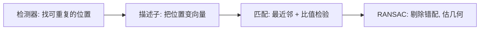

# $\rm Chapter \, 2$ 特征与匹配

> **本章假设你已经会**
>
> 1. 卷积的定义与互相关工程约定，见本册 §1.2。本章所有滤波都建立在它上面。
> 2. Sobel 梯度与边缘强度，见本册 §1.3；实验里还要用到 uint8 回绕陷阱，见 §1.4。
> 3. 高斯金字塔与多尺度观察，见本册 §1.6。尺度空间是它的连续版。
> 4. 实对称矩阵的特征值与二次型的变分刻画（特征值是方向二次型的极值），见《高维概率与矩阵分析》§5.3。
> 5. 几何分布的期望，《概率论》§19.6 讲跳表时用过同一分布，本章 §2.6 再用它算一次账。

上一章把单张图加工到了极致：模糊、锐化、找边缘。但识别任务从一开始就是两张图的事：把两张照片拼成全景，需要回答「左图的这个角对应右图的哪个角」。本章解决这个问题，全册的心智模型在这里第一次发力：图像是函数，识别是把函数压缩成语义，而特征点就是压缩的第一步，把一张 $64\times64$ 的图（4096 个数）压成几十条「位置加描述向量」，每条只有一百多个数，还要保证在另一张图里找得回来。学完本章，你将能在纯 numpy 里实现 Harris 角点检测并在合成图上验证响应公式，理解 SIFT 三件套（尺度、方向、描述子）各自解决什么不变性，并用完整推导过的 RANSAC 从脏匹配里恢复出两图之间的几何变换。下一章会揭示：RANSAC 估出的那个变换，正是相机几何投下的影子。

## $\rm \S \, 2.1$ 问题：两张图怎么对上号

先把任务说精确。给定同一场景的两张图 $A$ 和 $B$（视角、亮度不同），要找一组配对 $\{(p_i, q_i)\}$，$p_i$ 是 $A$ 里的位置，$q_i$ 是 $B$ 里的位置，两者对应场景中同一个点。找到足够的配对后，拟合一个几何变换把它们联系起来，拼接、三维重建、物体对位全都水到渠成。

为什么不用上一章的边缘？边缘点太可替换了：一栋楼的直墙在图里是几百个边缘像素，每个像素的局部样子几乎一样，左图第 37 号边缘点凭什么对应右图第 41 号而不是 42 号？可重复性和可区分性在这里打架：边缘可重复（另一张图里同一条墙还在）但不可区分（认不出具体是哪个点）。特征点要的是同时满足两者的位置，角点（corner）是天然候选：两条边相交的地方，局部结构在哪个方向上都不重复，换个视角往往还在。



这四步是本章的地图：检测器只负责「这个位置值得记」，描述子（descriptor）负责「换个视角也认得出」，匹配给出候选配对（必然有错的），RANSAC（random sample consensus）负责把错的剔出去。每一环都只为下一环服务，缺一环整条链断掉。

白话：找特征像在人群里安排接头，得先挑一个「好认的地标」（检测器，比如路口的角楼而不是笔直长墙上的任意一点），再给地标拍张特征速写（描述子），到另一张图里按速写找人（匹配），最后核对全员身份、把混进来的陌生人清出去（RANSAC）。

**本节小结**：两图对齐需要「可重复又可区分」的局部特征，流水线四步各管一段：定位、描述、匹配、清洗。

## $\rm \S \, 2.2$ Harris 角点：响应式的逐项推导

什么样的位置「值得记」？Harris 和 Stephens 在 1988 年给的判据是一句话：把窗口往任何方向挪一点，窗口里的内容都变很多。把它写成公式。设窗口权重函数 $w(x,y)$（后面取高斯窗，§1.3），定义移窗能量

$$
E(u,v)=\sum_{x,y} w(x,y)\,\big[I(x+u,\,y+v)-I(x,y)\big]^2
$$

读法：把整张图平移 $(u,v)$，数一数窗口内每个像素变了多少（差值的平方），再加权求和。$E(u,v)$ 大，说明这个移动会让窗口「伤筋动骨」。角点就是让 $E$ 在所有方向都大的位置。

$E(u,v)$ 本身不好算，用一阶泰勒展开换成梯度的语言。当 $|u|,|v|$ 小时，

$$
I(x+u,\,y+v)\ \approx\ I(x,y)+I_x(x,y)\,u+I_y(x,y)\,v
$$

读法：小位移下，函数值的变化近似等于梯度点乘位移，这正是多元函数微分的第一课；「小」的前提由图像平滑保证（Sobel 自带平滑，§1.3 的教训：先模糊再求导）。代入 $E$，差值变成 $I_x u+I_y v$，平方展开：

$$
E(u,v)\ \approx\ \sum_{x,y} w\,\big(I_x u+I_y v\big)^2
=u^2\!\sum_{x,y}\! w I_x^2+2uv\!\sum_{x,y}\! w I_x I_y+v^2\!\sum_{x,y}\! w I_y^2
$$

读法：三个求和项只依赖图像，不依赖位移 $(u,v)$，把它们打包成一个矩阵，整个表达式就是一次二次型。这个矩阵是本节的主角，叫二阶矩矩阵（second moment matrix）或结构张量（structure tensor）：

$$
M=\sum_{x,y} w(x,y)\begin{pmatrix} I_x^2 & I_x I_y \\ I_x I_y & I_y^2 \end{pmatrix}
$$

读法：$M$ 是窗口内「梯度能量」的加权平均。它是 $2\times2$ 实对称矩阵，而且半正定：把 $M$ 写成 $\sum w\, g\,g^{\top}$（$g=(I_x,I_y)^{\top}$ 是梯度向量），则任意方向 $d$ 上 $d^{\top} M d=\sum w\,(g^{\top} d)^2\ge 0$。于是 $E(u,v)\approx (u\ v)\,M\,(u\ v)^{\top}$，二次型的变分刻画（《高维概率与矩阵分析》§5.3）立刻给出解读：$M$ 的两个特征值 $\lambda_1\ge\lambda_2$ 分别是「单位移动下窗口能量变化」在最优方向与最差方向上的取值。三个 regime 由此一目了然：

1. 平坦区：窗口里没有梯度，$M\approx 0$，两个特征值都接近零，怎么挪都不疼不痒。
2. 边缘：梯度方向处处一致，沿边缘移动时 $g^{\top} d=0$，能量纹丝不动，$\lambda_2\approx 0$；横穿边缘时 $\lambda_1=\sum w|\nabla I|^2$ 很大。一强一弱，正是「边」的形状。
3. 角点：梯度方向随位置转动，任何方向 $d$ 都能逮住一部分梯度，$\lambda_1$ 与 $\lambda_2$ 都大。

判定需要两个特征值，逐像素做特征值分解太贵。Harris 的关键一步是绕开它：$M$ 的特征多项式是 $\lambda^2-\mathrm{trace}(M)\,\lambda+\det(M)$，韦达定理给

$$
\mathrm{trace}(M)=\lambda_1+\lambda_2,\qquad \det(M)=\lambda_1\lambda_2
$$

读法：迹是主对角线之和 $M_{11}+M_{22}$，行列式是 $M_{11}M_{22}-M_{12}^2$，两者都从矩阵元素直接算，不用分解。用这两个量拼一个响应式（response）：

$$
R=\det(M)-k\,\mathrm{trace}(M)^2,\qquad k\in[0.04,\,0.06]\ (\text{经验区间})
$$

读法：每个位置得到一个数 $R$，三种 regime 各有归宿。平坦区 $\mathrm{trace}\approx 0$，$R\approx 0$；边缘上 $\lambda_2\approx 0$，$\det\approx 0$，于是 $R\approx -k\,\lambda_1^2<0$ 恒为负；角点上两项都不可忽略，$R>0$ 需要行列式胜出，取正的局部极大就是角点。$k$ 的取值决定「多接近各向同性才算角点」：令 $r=\lambda_2/\lambda_1$，$R>0$ 等价于 $r>k(1+r)^2$，即 $kr^2+(2k-1)r+k<0$，两根之间才成立；$k=0.05$ 时下根是 $0.056$，换句话说弱方向的梯度能量至少要达到强方向的 5.6%，这才配叫角点。

这个响应式自带两重不变性。旋转图像，梯度方向跟着转，但特征值是二次型的极值，极值不随坐标转动，$R$ 不变。亮度仿射变化 $I\mapsto aI+b$，常数 $b$ 被求导消掉，$a$ 让每个梯度乘 $a$，$M$ 乘 $a^2$，$R$ 乘 $a^4$，所有位置的 $R$ 同乘一个正常数，排序不变，检出位置不变。但缩放不行：把图放大一倍，「哪里是角点」本身就变了，小图上的角点放大后可能成了一小段边缘。这个缺口留给 §2.4。

白话：结构张量是一本「方向能量账」，$\lambda_1$ 是最费劲方向的账单，$\lambda_2$ 是最省劲方向的账单；平坦区两笔都小，边缘一条大一条小（沿墙走免费），角点两条账单都贵，怎么走都伤筋动骨，这正是它好认的原因。

**本节小结**：移窗能量经泰勒展开化成二次型 $E\approx (u\ v)M(u\ v)^{\top}$，特征值按方向分档，Harris 用 $R=\det-k\,\mathrm{trace}^2$ 把「两个特征值都大」压成一个数，边缘恒负、平坦近零、角点为正。

## $\rm \S \, 2.3$ 实验：合成图上的 Harris 响应

推导换成实测。环境是 WSL 的 python3 加 numpy，脚本与完整输出在 `_uni5_work\expCV02\`（`expCV02.py` 与 `result.txt`）。合成图与 §1.4 完全同款：$64\times64$，背景灰度 30，方块（行 20–43、列 20–43）灰度 200，叠加 $\sigma=10$ 正态噪声，种子 20261106。梯度用 §1.3 的 Sobel 核，加窗用 $5\times5$、$\sigma=1.2$ 的高斯，核心只有四行：

```python
Sxx = conv2_corr(gx*gx, Wg)   # Wg: 5x5 高斯窗, 权重和为 1
Sxy = conv2_corr(gx*gy, Wg)
Syy = conv2_corr(gy*gy, Wg)
R = (Sxx*Syy - Sxy**2) - 0.05*(Sxx + Syy)**2
```

读法：$M$ 的三个独立分量各是一张图（梯度能量的逐像素加权平均），$R$ 是它们逐像素的组合。取五个代表性位置，看 $M$ 的特征值与响应：

| 位置 | $\lambda_1$ | $\lambda_2$ | $\lambda_2/\lambda_1$ | $R$ |
| --- | --- | --- | --- | --- |
| 角点 (20,20) | 216058 | 81290 | 0.376 | $1.31\times10^{10}$ |
| 角点 (43,43) | 187002 | 117973 | 0.631 | $1.74\times10^{10}$ |
| 竖直边中点 (32,20) | 255505 | 1028 | 0.004 | $-3.03\times10^{9}$ |
| 平坦区·方块内 (32,32) | 1865 | 1057 | 0.567 | $1.5\times10^{6}$ |
| 平坦区·背景 (5,5) | 2354 | 801 | 0.340 | $1.4\times10^{6}$ |

读法：先看边缘那行，$\lambda_1$ 高达 255505（横穿边缘费劲），$\lambda_2$ 只有 1028（沿边走几乎免费），比值 0.004，远低于 0.056 的角点门槛，$R$ 是负的 $-3.03\times10^9$；整条左边缘（行 24–43、列 20）的 $R$ 实测在 $-4.50\times10^9$ 到 $-2.91\times10^9$ 之间，无一例外为负，验证了 §2.2 的「边缘恒负」。再看角点，两个特征值都上了五位数，比值 0.376 与 0.631，$R$ 是 $10^{10}$ 量级的正数，是平坦区（$10^6$ 量级）的近万倍。平坦区的比值本身不小（0.34 到 0.57），但绝对值小：那里只有噪声的梯度能量，$R$ 自然趴在地上。判据的完整形态由此显形：既要看比值（形状像不像角点），也要看绝对量级（底下有没有真信号）。

检测阶段做 $3\times3$ 非极大值抑制（§1.5 同款思路：一个位置只留冠军），阈值取 $0.05\times\max(R)=8.7\times10^8$。实测检出恰好 4 个峰，位置 (20,20)、(20,43)、(43,20)、(43,43)，与方块的四个真角点严丝合缝；四个峰的 $R$ 在 $1.31\times10^{10}$ 到 $1.74\times10^{10}$ 之间。噪声 $\sigma=10$ 的图上做到零误检零漏检，靠的是量级差：最低的角点峰（$1.31\times10^{10}$）与阈值之间还隔着 15 倍余量，假峰想越线得先过这一关。

> **竞赛生迁移提示**：结构张量的三个分量各是一张与原图同尺寸的图，这就是「张量场」在图像里的长相：每个像素挂着一个 $2\times2$ 矩阵。以后在梯度域做任何加窗统计（光流、方向直方图），都是这三张图的变形。

白话：这张表是给响应式做的「体检报告」，边缘的体检单上 $\lambda_2$ 一栏几乎是零（沿墙走免费），角点的两栏都在五位数（怎么走都贵），平坦区两栏都是噪声的零头，$R$ 只是把这三份体检单折成一个数。

**本节小结**：实测角点 $R\approx1.3$ 到 $1.7\times10^{10}$、边缘恒负（最低 $-4.5\times10^9$）、平坦区只有 $10^6$ 量级，NMS 加阈值在噪声图上精确找回首角的四个真角点。

## $\rm \S \, 2.4$ 尺度空间与 SIFT 思想

Harris 回答了「哪里值得记」，但没回答「在哪个放大率下记」。§2.2 末尾留的缺口在真实场景里是致命的：两台相机离物体的距离不同，同一物理结构在两张图里的尺寸就不同，小图上的角点到大图里可能是一小段边缘，反过来大图的角点缩下去糊成一团。解决办法不是把 Harris 改造成尺度不变（改不动），而是把「缩放」从敌人变成坐标轴：让检测器在所有尺度上各扫一遍，每个结构在它最合适的尺度上自己冒出来。

把高斯模糊的 $\sigma$（§1.3）从旋钮升格为第三个坐标，就得到尺度空间（scale space）：

$$
S(x,y,\sigma)=\big(I*G_\sigma\big)(x,y)
$$

读法：同一个函数 $S$，在位置 $(x,y)$ 之外多了个「观察粗细」维度；$\sigma$ 越大看得越粗。§1.6 的高斯金字塔是它的离散实现：塔内逐级加大 $\sigma$，塔间降采样翻倍省算力，一个塔叫一个八度（octave）。

在尺度空间里找什么？Lindeberg 指出尺度归一化的拉普拉斯 $\sigma^2\nabla^2G_\sigma$ 在尺度选择上最优，而拉普拉斯有个省钱的近似：相邻两个尺度的差分。由热传导方程 $\partial G_\sigma/\partial\sigma=\sigma\nabla^2G_\sigma$，一阶泰勒给

$$
G_{k\sigma}-G_\sigma\ \approx\ (k-1)\,\sigma^2\nabla^2 G_\sigma
$$

读法：两份模糊相减，近似等于放大了 $(k-1)\sigma^2$ 倍的拉普拉斯核与图像的卷积。差分 $D=(G_{k\sigma}-G_\sigma)*I$ 叫高斯差分（difference of Gaussians，DoG），它响应「斑状」结构，且响应的尺度位置与结构大小对得上。SIFT 关键点就是 $D$ 在 26 邻域（空间 $3\times3$、相邻两个尺度）中的极值点：一个位置要同时在空间上、在尺度上都是冠军才入选，尺度就这么顺带定好了。

定位与尺度之外还差两个不变性。旋转：在关键点邻域统计梯度方向直方图（36 个 bin），最高峰的方向定为参考方向，后续一切相对它度量，图转了参考方向跟着转，内容不动。光照：描述子（descriptor）取关键点周围 $16\times16$ 区域，划成 $4\times4$ 子块，每块统计 8 个 bin 的梯度方向直方图，$4\times4\times8=128$ 维向量；对 $aI+b$，$b$ 被求导消掉，$a$ 让向量整体伸缩、被模长归一化消掉。至此 SIFT 特征对平移、旋转、缩放、线性光照变化全部不动声色。

SIFT 的专利细节（极值精修、主方向截断等）不影响原理，这里略去；要记住的是分工：检测器管可重复性（位置、尺度、方向都不随变换漂移），描述子管可区分性（不同结构的向量离得远，同一结构的向量离得近）。

白话：尺度空间像一套从广角到微距的镜头架，DoG 是每档镜头下的「显眼包探测器」，SIFT 在显眼包上先记下「我的镜头倍率」和「我的朝向」，再把周围纹路写成 128 个数的速写，于是换镜头、转角度、开关灯，速写都对得上。

**本节小结**：尺度空间把缩放变成第三个坐标，DoG 近似尺度归一化拉普拉斯并顺带选出尺度，方向直方图钉死旋转，128 维归一化描述子吃掉线性光照差，可重复性与可区分性从此分家。

## $\rm \S \, 2.5$ 描述子匹配与比值检验

有了描述子，匹配看似是最简单的一步：对 $A$ 的每个描述子，在 $B$ 的描述子堆里找欧氏距离最近的一个，记作候选配对。$n$ 个对 $m$ 个穷举是 $O(nm)$ 次 128 维距离，${n,m}$ 在千级时毫秒到几十毫秒，不是瓶颈；瓶颈是最近邻经常认错人。

认错的根源是描述子空间的拥挤。场景里满是相似的局部（同一面墙上的两扇窗、草坪里成千上万片草），$A$ 的描述子在 $B$ 里可能有好几个几乎同样近的邻居，最近邻的那个跟第二近的难以区分，纯属碰运气。Lowe 在 2004 年给了一个便宜而有效的判据，比值检验（ratio test）：把最近距离 $d_1$ 与次近距离 $d_2$ 都算出来，只接受

$$
d_1/d_2<0.8
$$

读法：不看最近的有多近，看「最近的比次近的近多少」。直觉账是：若 $A$ 里的点在 $B$ 中有真匹配，$d_1$ 由信号决定、远小于背景；$d_2$ 是背景里随机邻居的距离。若根本没有真匹配（遮挡、视野外），$d_1$ 与 $d_2$ 都由背景密度决定，地位可交换，比值自然接近 1。0.8 这个阈值是 Lowe 在真实图像对上统计正确匹配与错误匹配的分布后取的分界，属于经验规则而非定理，阈值往 1 调召回率升、精度降，往小调则相反，具体取值要看任务能容忍多少错配。本章合成实验没做这步统计，读者在真实数据上应自己画一遍这两个分布。

比值检验能杀掉大量歧义匹配，但杀不干净：总有些错配「恰好」最像自己，单点检验永无宁日。跳出单点看全局：正确的配对全体必须服从一个统一的几何变换（两张图是同一个场景拍的），错配则不服从。于是问题变成：一堆真假混杂的对应点里，如何找到那个所有人都该服从的变换？这是下一节的 RANSAC。

白话：比值检验像面试时的「和第二名拉开差距」标准，冠军只领先一点点的疑似简历直接淘汰；但仍有学霸级冒名顶替者混进来，所以最后还要用全局几何做一次政审。

**本节小结**：匹配是描述子空间里的最近邻搜索，比值检验用 $d_1/d_2<0.8$ 砍掉无真匹配的歧义点，幸存的错配要靠全局几何一致性清理。

## $\rm \S \, 2.6$ RANSAC：完整推导

先看为什么不能直接最小二乘。设模型有 $m$ 个参数（相似变换 $m=4$：旋转加缩放合成一个复数乘子、平移两个分量；单应变换 $m=8$），损失 $\sum r_i^2$ 把残差平方，一个错配的残差若是真内点的十倍，它的发言权就是一百倍，四个参数全被一个坏点拖歪。中位数类方法能抗一部分外点，但外点率一高（两张有重复结构的图错配能过半）也失守。

RANSAC（Fischler 与 Bolles，1981）的思路是反过来抽样：不问「所有点平均下来是什么模型」，而问「随机抓一小撮点定出的模型，能拉拢多少支持者」。设内点（inlier）指残差小于 $\tau$ 的对应，外点（outlier）为其余，内点占比 $w$。定义最小样本（minimal sample）大小 $s$：恰好确定模型的对应数，相似变换 $s=2$，单应 $s=4$。算法只有五步：

1. 从匹配集中随机抽 $s$ 对，恰好定出模型（无自由度剩余）。
2. 用该模型数一致集（consensus）：全部 $n$ 对里残差小于 $\tau$ 的个数 $c$。
3. 若 $c$ 超过历史最好，记录该模型。
4. 重复第 1 步直到抽够 $N$ 次（$N$ 的公式马上推）。
5. 对冠军一致集整体做一次最小二乘，得到最终模型。

理论核心是迭代次数。单次抽样 $s$ 对全为内点的概率是 $w^s$（各对独立时；不放回抽样的精确值是 $n_{\mathrm{in}}(n_{\mathrm{in}}-1)/\big(n(n-1)\big)$，§2.7 实测 $w=0.5$ 时为 0.2487，与 $w^2=0.25$ 只差分毫）。只要抽到过一次全内点样本，第 2 步的一致集就由真模型贡献，冠军大概率是它。$N$ 次全部落空的概率是 $(1-w^s)^N$，要求它不超过容忍的失败概率 $1-p$：

$$
(1-w^s)^N\le 1-p
$$

两边取对数得 $N\ln(1-w^s)\le\ln(1-p)$；两个对数都是负数，除过去要翻转不等号：

$$
N\ \ge\ \frac{\ln(1-p)}{\ln(1-w^s)}
$$

读法：$p$ 是「至少抽中一次全内点样本」的把握（惯用 $p=0.99$），$w^s$ 是单次成功率。$w$ 或 $s$ 一动，$N$ 指数级响应。$p=0.99$ 的账：

| $w$ | $N$（$s=2$，相似） | $N$（$s=4$，单应） |
| --- | --- | --- |
| 0.90 | 3 | 5 |
| 0.70 | 7 | 17 |
| 0.50 | 17 | 72 |
| 0.30 | 49 | 567 |

读法：内点率从 0.9 掉到 0.3，$s=2$ 的账从 3 涨到 49（16 倍），$s=4$ 的账从 5 涨到 567（一百多倍），内点率越低，参数越多的模型死得越快。这就是为什么高外点率时要用更省参数的模型，也是为什么描述子值得花大力气做好：描述子质量抬 $w$，比任何 RANSAC 调参都划算。

两个期望值补齐这笔账。全内点样本的到来次数服从几何分布，期望 $1/w^s$（《概率论》§19.6 跳表的层高是同一个分布）：$w=0.5,\ s=2$ 时平均 4 次就该抽中，公式给的 17 次是把失败率压到 1% 的上保险。真模型的一致集大小期望 $n\cdot w$，可用来自适应地提前停机：抽到某轮时用当前最好一致集估 $\hat{w}=c/n$，代入公式重算 $N$，通常远小于初始值（实务标配）。

白话：RANSAC 像「海选班长」：每次随机请 $s$ 个人当场组阁，看全班多少人愿意追随，海选 $N$ 轮保证「至少一轮全是好人」的概率有九成九，最后再让全体好政策一起微调出最终班规。

**本节小结**：最小二乘被大残差平方支配，RANSAC 改抽最小样本数支持者；全内点概率 $w^s$ 与失败概率 $(1-w^s)^N$ 逼出 $N=\ln(1-p)/\ln(1-w^s)$，$w$ 与 $s$ 都在指数上。

## $\rm \S \, 2.7$ 实验：迭代次数-内点率曲线

公式是推的，曲线是跑的。同一环境与目录（`expCV02\result.txt`），合成匹配集：200 对对应，真变换为旋转 $20^\circ$、缩放 1.3、平移 $(10,5)$，真内点的 $B$ 端坐标加 $\sigma=0.5$ 的正态噪声，外点坐标完全随机；内点判据 $\tau=2.0$；种子 20261107。分两层验证。

第一层只测采样（E2a）：每轮随机抽 2 对，问「抽到首个全内点样本」用了几轮，不含任何估计与阈值，它就是纯的几何分布，对应公式的直接断言。每个 $w$ 跑 3000 次：

| $w$ | $N$ 理论 | 中位数理论 | 中位数实测 | $P(T\le N)$ 实测 |
| --- | --- | --- | --- | --- |
| 0.30 | 49 | 7.35 | 8 | 0.990 |
| 0.40 | 27 | 3.98 | 5 | 0.989 |
| 0.50 | 17 | 2.41 | 3 | 0.993 |
| 0.60 | 11 | 1.55 | 2 | 0.992 |
| 0.70 | 7 | 1.03 | 2 | 0.990 |
| 0.80 | 5 | 0.68 | 1 | 0.995 |
| 0.90 | 3 | 0.42 | 1 | 0.994 |

读法：最后一列就是公式的断言「$N$ 轮内至少一次全内点的概率为 $p=0.99$」，七个内点率下实测全部落在 0.989 到 0.995，公式钉死了。中位数实测比理论值高不到 1，差额来自不放回抽样（$w^2=0.25$ 的名义值实际是 0.2487）与中位数只能取整数。

第二层跑完整流水线（E2b）：抽 2 对、拟合、数一致集（先最小二乘重拟合再数）、达到 $0.9\,n_{\mathrm{in}}$ 才停。$w=0.5$ 时实测 $T$ 的分布：p50=3、p90=9、p99=17、最大 26；理论 p90 是 $\ln(0.1)/\ln(0.75)=8.0$，实测 9，p99 理论 16.0 附近、实测 17，整条尾部被几何分布的指数形状接住。流水线成功后恢复的变换相对误差 $|a-a_{\text{true}}|/|a_{\text{true}}|$ 中位数 0.0017（E2c，2000 次运行），RANSAC 不但停下来了，还把模型带得很准。流水线中位数（3）比纯采样理论（2.41）略高，因为「抽中全内点」还要过一道估计质量关：E2c 实测全内点样本通过 $\tau$ 门槛的比例 $q=0.973$，单次成功概率实际是 $w^s\cdot q$。

两个反面教材是本章最值钱的部分，都是真跑出来的。

1. $\tau$ 卡太紧（E2d，$\sigma=0.8$、$\tau=2.0$、不重拟合）：全内点样本的一致集（只数真内点，满编 100）中位数只剩 59，p10 低到 14，最小 2。平均而言一半以上的真内点被冤枉出局，门槛 $0.9\,n_{\mathrm{in}}$ 几乎只有「运气极好的样本」能够到，停机中位数膨胀到 27 次，是理论的 11.2 倍。排查手法：打印全内点样本的一致集大小，发现它远低于期望 $n\cdot w$，就能锁定 $\tau$ 与噪声的配比问题。教训：$\tau$ 必须同时罩住测量噪声与最小样本估计的抖动，两点定模型在远离样本对的位置误差会被放大。
2. 重拟合的共轭放错边（E2e）：复数最小二乘 $y=ax+b$ 的解是 $a=\sum(y-\bar y)\overline{(x-\bar x)}/\sum|x-\bar x|^2$，我写本章实验时把共轭放到了 $y$ 一侧，得到 $a=1.2207-0.4454\mathrm{i}$（真值 $1.2216+0.4446\mathrm{i}$，恰好共轭翻转），一致集从最小拟合的 197/200 直接归零，正确版本是 200/200。症状极其响亮（重拟合反而归零），一行打印就定位。教训：重拟合之后必须立刻重新数一致集，归零就是公式错了。

白话：第一层实验证明「公式算的轮数」是真的，第二层证明「加了拟合与门槛」只多花一 两轮；两个翻车现场是两盏红灯，一盏说门槛卡太紧（好人被冤枉），一盏说公式抄错了（越改越糟），亮灯时的第一反应都是打印中间量，而不是调大迭代次数硬扛。

**本节小结**：采样层实测 $P(T\le N)=0.989$ 至 0.995 对理论 0.99，流水线 p90=9 对理论 8.0；$\tau$ 失配让中位数膨胀 11.2 倍，共轭错置让一致集从 197 归零，两个反面教材都靠打印中间量定位。

## $\rm \S \, 2.8$ 关键概念回顾

1. 从移窗能量 $E(u,v)$ 出发，逐步推导结构张量 $M$，并说明 $\lambda_1$、$\lambda_2$ 各自的几何含义。
2. 用 $\det$ 与 $\mathrm{trace}$ 的退化解释：为什么 Harris 响应 $R$ 在边缘上恒为负、在平坦区近似为零？
3. Harris 对亮度仿射变化 $aI+b$ 为什么（在检出位置的意义下）不变，对缩放为什么不行？
4. 写出 RANSAC 迭代次数公式并解释每个符号；$w=0.6$、$s=3$、$p=0.99$ 时 $N$ 是多少？
5. 比值检验与 RANSAC 各自检验的是什么层次的一致性？

## $\rm \S \, 2.9$ 应用与辨析

1. 同事的全景拼接程序每次运行结果略有差别（估出的旋转角相差约 $0.5^\circ$），并且偶尔完全失败。给出两个可能原因与对应的验证方法。
2. 把一张图放大两倍再跑 Harris，检出的角点数量和位置都变了。有人说这是 Harris 实现有 bug，你怎么判断？
3. 把比值检验阈值从 0.8 放宽到 0.95，或者收紧到 0.5，下游 RANSAC 的负载各会怎么变？哪种情况下宁可放宽？

## $\rm \S \, 2.10$ 答案

2.8.1：$E(u,v)=\sum w\,[I(x+u,y+v)-I(x,y)]^2$（§2.2 第一式）；一阶泰勒把差值换成 $I_xu+I_yv$；平方展开后三个与位移无关的求和打包成 $M$（§2.2 第二式）；$E\approx(u\ v)M(u\ v)^{\top}$ 是二次型，由变分刻画（《高维概率与矩阵分析》§5.3），$\lambda_1$ 是单位移动下窗口能量变化的最大方向值，$\lambda_2$ 是最小方向值。

2.8.2：边缘上 $\lambda_2\approx0$，故 $\det=\lambda_1\lambda_2\approx0$ 而 $\mathrm{trace}=\lambda_1$ 不小，$R\approx-k\lambda_1^2<0$（实测整条边缘 $R\in[-4.5,-2.9]\times10^9$，§2.3）；平坦区两个特征值都近似零，$\mathrm{trace}\approx0$，$R\approx0$（实测 $10^6$ 量级，比角点低四个数量级）。

2.8.3：$aI+b$ 中 $b$ 被求导消掉；$a$ 让梯度乘 $a$、$M$ 乘 $a^2$、$R$ 乘 $a^4$，全部位置同乘正常数，排序不变，检出位置不变。缩放改变的是「哪个结构是角点」本身（§2.2 末），这不是响应公式的性质能修的，要靠尺度空间让检测器在每个尺度各扫一遍（§2.4）。

2.8.4：$N\ge\ln(1-p)/\ln(1-w^s)$；$p$ 是至少抽中一次全内点样本的把握，$w$ 内点占比，$s$ 最小样本大小。$w=0.6,\ s=3$：$w^s=0.216$，$N=\lceil\ln(0.01)/\ln(0.784)\rceil=\lceil 18.93\rceil=19$。

2.8.5：比值检验是单点层次的：这个描述子在对方描述子空间里是否足够独一无二，杀的是局部歧义。RANSAC 是配对集合层次的：全体幸存配对是否服从同一个几何变换，杀的是单点上无法发现的错配。前者给后者抬内点率 $w$，后者给前者兜底。

2.9.1：其一，RANSAC 有随机性且可能没固定种子，或冠军模型未做最终最小二乘（第 5 步被跳过），验证：固定种子复跑、确认对冠军一致集做了整体重拟合（§2.7 的恢复误差 0.0017 说明重拟合值得做）。其二，偶尔完全失败指向内点率过低而 $N$ 按乐观的 $w$ 取值，验证：打印每轮最大一致集占 $n$ 的比例，若 $\hat w$ 远低于假设值，改用自适应 $N$ 或先收紧比值检验。

2.9.2：不是 bug 的可能性更大：缩放改变了「哪里是角点」这件事本身（§2.4 开头），放大后原角点可能变成短边缘，边缘可能因为细节显现出新角点。判断方法：把两张图缩放到同一尺度（金字塔 §1.6）再各跑 Harris，若角点一一对应，则实现无恙、缺的只是尺度不变性，那是 SIFT 的活。

2.9.3：放宽到 0.95，更多歧义配对混进来，$w$ 下降，RANSAC 的 $N$ 指数上涨（§2.6 的账：$w$ 从 0.9 到 0.3，$s=2$ 涨 16 倍），但召回率高，漏掉的真配对少。收紧到 0.5，外点几乎绝迹、RANSAC 轻松，但真配对也被拒，若幸存配对太少（不足以定模型）直接失败。宁可放宽的场合：低纹理、重复结构多的图（$w$ 本来就低，且丢真配对的代价高于多迭代），此时靠 RANSAC 兜底而不是靠比值检验硬杀。

> 你现在能：在纯 numpy 里实现 Harris 角点检测并用特征值比值解释每一档响应，说清 SIFT 用尺度、方向、归一化描述子各换回哪种不变性，写出 RANSAC 迭代次数公式并用实测曲线与两个翻车现场校准它。

RANSAC 交付的那个复数乘子 $a$ 里，藏着的旋转角与缩放并不是运气：两张图之间之所以存在统一变换，根源是相机把三维世界压到二维平面的投影法则。下一章把这条法则写干净，针孔模型、内外参数、对极几何与立体视差，你会发现本章辛苦剔除外点求出的变换，只是那套几何在最简单情形下的影子。
