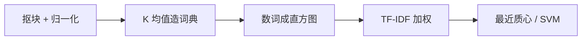

# $\rm Chapter \, 4$ 前神经时代的识别

> **本章假设你已经会**
>
> 1. 卷积与 Sobel 梯度算子：卷积是邻域加权求和，Sobel 是带降噪的差分，见本册 §1.2 与 §1.3。本章的梯度特征直接建立在这两个算子上。
> 2. 采样、混叠与图像金字塔：缩得太小会出假花纹，金字塔是按尺度组织图像的手段，见本册 §1.6。本章 §4.6 的多尺度检测要在金字塔的每一层上跑分类器。
> 3. 特征点、描述子与匹配：定位、描述、匹配、清洗四步流水线，见本册 §2.1；Harris 角点与 SIFT 描述子分别见 §2.2 与 §2.4。本章回答「集齐一堆特征点之后，怎么得到对整幅图的判断」。
> 4. 最大间隔与支持向量机（SVM）：把分类超平面选在离两类样本都最远的地方，见《机器学习与凸优化》§8.2。本章 §4.6 只借用结论，不重推对偶。
> 5. TF-IDF：文本检索里压掉高频虚词的加权方案，见《自然语言处理》§1.8。本章把同一把尺子搬到视觉词上。

前三章各管一段：滤波加工单幅图，特征对齐两幅图，几何恢复被投影丢掉的维度。识别要回答的是那个最大的问题：这张图里是什么。神经网络出现之前，这个问题有一套完整成熟的工程答案：BoVW 把特征点装订成词典做图像检索，HOG 加 SVM 在滑动窗口里找行人，两者在 2000 年代撑起了整个应用视觉。本章把两条流水线从头到尾走一遍，每个环节的账都算到数字，最后指出它们共同的天花板在哪里。全册心智模型走到第四步：图像是函数，识别是把函数压缩成语义，而压缩的方式决定了错误率的下限；前神经时代的压缩方式全部由人设计，这既是它透明的优点，也是它到顶的原因。

## $\rm \S \, 4.1$ 问题：集齐特征点之后呢

识别分两问。第一问是分类（classification）：给整幅图一个名字，这张图是纹理 A 还是纹理 B、这张人脸照是不是同一个人。第二问是检测（detection）：图里有没有某类东西、在什么位置，比如把每一帧里所有行人框出来。检测可以化为反复的分类：拿一个固定大小的窗口在图上逐位置滑动，每个位置问一次「窗口里是行人吗」，这条路线到 §4.6 再展开，先解决分类。

分类的直接做法是拿整幅图和模板逐像素比。这条路走不通的原因前三章已经各给了一半：光照一变所有像素一起变（§1.3 用梯度对付过它），物体一挪动逐像素的对应就错位（§2.1 用局部特征对付过它）。反过来，只用 §2.4 那种稀疏特征点也不够：行人身上大部分是平滑的衣服，角点本来就少；就算点足够多，一张图有几十条「位置加描述向量」，它们仍然不是「这张图是什么」的答案。缺的是一个把局部证据汇总成全局判断的机制。

这个机制有两个流派。词袋流派把每张图写成一份「词频清单」：先造一本视觉词典，再数每张图里各词出现了多少次，词序丢掉、词频留下，这便是词袋（Bag of Visual Words，BoVW）。直方图流派不挑点，在稠密网格上把每个小格子的形状写成梯度方向的统计，这便是梯度方向直方图（Histogram of Oriented Gradients，HOG）。两条路线共用同一个分类器（SVM 或最近质心），差别全在「怎么压缩」。

白话：判断一张图是什么，像判断一封信是谁写的：可以数这封信用了哪些词、各用几次（BoVW），也可以把每行字的笔画走向做成统计表（HOG）；两种办法都先把信压成一小串数字，再拿这串数字做判断。

BoVW 这个名字不是比喻而是出身：它确实诞生于视频检索，把每张图当一篇文档、直方图当检索索引，用户给一张查询图，系统返回直方图最近的图库图片。直方图加最近邻这条线天然就是分类线（最近邻分类），后来才装上 SVM 等更强的分类器。本章实验选最近质心做分类器，也是为了让流水线保持在最简形态，先看清表示本身的贡献。

**本节小结**：分类要求把成千上万个像素压成一小串可比较的数字；BoVW 走稀疏词频路线，HOG 走稠密梯度统计路线，检测则由分类器加滑动窗口拼出来。

## $\rm \S \, 4.2$ BoVW：把特征块装订成词典

第一步是采样。在图上按固定步长密集地抠出 $8\times8$ 的小块，每个小块送进流水线前先做归一化：减去均值、除以标准差。减均值把光照的整体平移从块里洗掉，除以标准差把对比度的整体缩放洗掉，剩下的纯粹是块内的纹理形状。这一步与 §2.4 中 SIFT 描述子归一化的动机相同，只是这里对每一块都做。

第二步是把几万个块聚成一本小词典。聚类用 K 均值（k-means）：给定 $K$ 个候选中心 $\mathbf c_1,\dots,\mathbf c_K$，目标是最小化所有块到各自最近中心的距离之和，

$$
\min_{\mathbf c_1,\dots,\mathbf c_K}\ \sum_{i=1}^{N}\ \big\|\mathbf p_i-\mathbf c_{l_i}\big\|^2 ,
$$

其中 $\mathbf p_i$ 是第 $i$ 个归一化块（64 维向量），$l_i$ 是它最近中心的编号。目标函数不能一步解出，k-means 用两步交替逼近，每步各解一半问题：

$$
l_i=\arg\min_{j}\ \big\|\mathbf p_i-\mathbf c_j\big\|^2,\qquad \mathbf c_j\leftarrow\frac{1}{\big|S_j\big|}\sum_{i\,:\,l_i=j}\mathbf p_i ,
$$

读法：前一半固定中心，把每个块分给最近的中心（分配步，$S_j$ 是分给词 $j$ 的块集合）；后一半固定分配，把每个中心挪到自己那堆块的平均位置（更新步）。两步都让目标函数下降或不变，迭代到中心不再移动为止。初始化用 k-means++：第一个中心随机挑，之后每个新中心按「离已有中心越远概率越大」抽取，避免所有中心挤在同一团里，否则词典里会出现一堆互相重叠的废词。收敛后每个中心叫一个视觉词（visual word），词典就是这 $K$ 个中心。

第三步是数词。把图里每个块就近分给一个视觉词，统计每个词被分到多少次，除以总块数得到归一化直方图 $\mathbf h$。一张 $64\times64$ 的图按步长 4 抠出 225 个块，每块 64 个数，共 $225\times64=14400$ 个数；直方图只有 $K$ 个数。取 $K=64$ 时，压缩比是 225 比 1，这就是「把函数压缩成语义」的第一笔账。

第四步是分类。最简单的分类器是最近质心（nearest centroid）：训练阶段把每类训练图的直方图各求平均，得到类质心；测试时看新图的直方图离哪个质心近，

$$
\hat y=\arg\min_{c}\ \big\|\mathbf h-\boldsymbol\mu_c\big\|^2 ,
$$

$\boldsymbol\mu_c$ 是类 $c$ 的直方图质心。它没有要调的超参数，恰好用来隔离「表示质量」这一个变量：分类器已经笨到极点，准确率还高就只能是表示的功劳。

第五步是给直方图加权。有些视觉词几乎每张图都有，比如噪声块聚出来的词，它们出现得多却不携带类别信息，反而稀释了真正有区分力的稀有词的份额。文本检索早为同样的问题备好了加权方案：词频-逆文档频率（term frequency–inverse document frequency，TF-IDF），把第 $k$ 个词的权重写成

$$
w_k=h_k\cdot\ln\frac{N}{\mathrm{df}_k+0.5},
$$

$N$ 是训练图总数，$\mathrm{df}_k$ 是含词 $k$ 的训练图数。某词在所有图里都出现，比值接近 1，对数接近 0，权重被压掉；只在少数图里出现的词，对数很大，权重几乎不变。分母加 0.5 防止某词恰好没出现在训练集时对数爆炸。加权会整体改变直方图的幅度，所以加权后要把每条直方图重新归一化到单位长度，保证最近质心的距离尺度不因加权方式而漂移；$\mathrm{df}$ 只从训练图上统计，测试图只乘现成的权重。这与《自然语言处理》§1.8 中 LSA 之前的处理是同一把尺子，只是「文档」换成了「图像」、「词」换成了「视觉词」。

五步连起来就是流水线的全貌：

白话：BoVW 像给人发一张「点菜统计表」：不管菜端上来的顺序（词序），只数每道菜点了几份（词频）；词典是提前从成千上万盘菜里归并出来的菜单（聚类），TF-IDF 则是把「哪家都送的免费茶水」从统计表里淡出去，让真正的招牌菜显出来。

**本节小结**：BoVW 五步：归一化抠块、K 均值造词典、数词成直方图、最近质心（或 SVM）分类、TF-IDF 压掉万金油词；一张图从 14400 个数压成 $K$ 个数。

## $\rm \S \, 4.3$ 实验：两类纹理上的迷你 BoVW

实验在两类合成纹理上跑完整流水线。A 类是条纹：正弦光栅叠加标准差 14 的高斯噪声，方向、频率、相位逐图随机；B 类是斑点：8 个随机位置、半径、符号的高斯包叠在同一强度的噪声上。两类各造 15 张训练图、30 张测试图，随机种子固定为 2026，k-means 迭代 30 轮。先从 30 张训练图抠出全部 $30\times225=6750$ 个块聚类造词典，再让流水线处理每张图。测得结果如下表（准确率，60 张测试图）。

| 词典大小 $K$ | 原始直方图 | TF-IDF 加权 |
| --- | --- | --- |
| 4 | 68.3% | 65.0% |
| 16 | 80.0% | 81.7% |
| 64 | 73.3% | 85.0% |

三个现象都值得停下来看。第一，原始直方图在 $K=16$ 处有个峰：$K=4$ 时词典太粗，条纹块和缓斜的斑点块被并进同一个词，直方图分不开两类；$K=64$ 时每个词平均只摊到约 105 个块（$30\times225/64$），单个词的归属在噪声下摇摆，直方图本身变成一个抖动的估计，准确率反而从 80.0% 掉到 73.3%。词典大小不是越大越好，它要在「区分力」与「统计稳定性」之间取平衡。

第二，TF-IDF 的收益随 $K$ 增长，在 $K=64$ 时把准确率抬升 11.7 个百分点。实测 $K=64$ 词典里，最高频的词出现在 30 张训练图中的 16 张（$\mathrm{idf}=0.598$），最稀有的词只出现在 1 张（$\mathrm{idf}=2.996$），两者权重差 5 倍；而 $K=4$ 时每个词都是高频词，加权只是放大了噪声，反而掉了 3.3 个百分点。词表越细，万金油词越显眼，TF-IDF 越有用。

第三，错误是单向的。全部六种配置下，「斑点判成条纹」都是 0 个，「条纹判成斑点」从 19 个（$K=4$）降到 9 个（$K=64$ 加权后）。原因在类的方差结构上：斑点类里斑点的位置、大小逐图随机，直方图本身抖动大，类质心被拉向居中位置，等于张开了网；条纹类的直方图稳定，质心收得紧。噪声再往条纹图的直方图里掺几勺，它就越过中线落进斑点那侧。最近质心只看「离谁近」，不建模每类的散布，这个盲区正是《机器学习与凸优化》§9 泛化视角下更精细模型要补的东西。

白话：这本词典的体检报告说明三件事：菜单太粗分不出菜系，太细又每道菜都像孤品；把免费茶水淡出去在菜多时立竿见影；而错判几乎全是「把条纹认成斑点」，因为斑点那边的直方图本来就撒得开，网大就容易捞进别人家的鱼。

> 竞赛生迁移提示：复现这类实验时，随机性有三处来源（造图的种子、k-means++ 的初始化、测试噪声），缺一处不固定，准确率就会在几个百分点之间漂。本章把三者都锁在同一个种子下，表中数字是可复现的确定值，这正是算法竞赛里「对拍要固定随机种子」的同一纪律。

**本节小结**：实测 $K=16$ 峰值 80.0%，$K=64$ 加 TF-IDF 后 85.0%，$K=4$ 时加权反而有害；错误全部是条纹判成斑点，来自最近质心不建模类内方差。

## $\rm \S \, 4.4$ HOG：把外观写成梯度方向的统计

BoVW 的块是孤立抠出来的，块与块之间的位置关系在数词时丢掉了。HOG 保留位置，只是把位置的粒度放粗：把图切成规则的小格子，每个格子里不记像素值，记「边缘朝哪、多强」。行人检测恰好吃这一套：行人的可分性主要在头肩轮廓、躯干竖直这些中等尺度的形状上，而不在某个像素的精确亮度上。

流程从 §1.3 的 Sobel 算子开始。对每个像素求出梯度分量 $g_x$、$g_y$，换算成幅度与无符号方向，

$$
m=\sqrt{g_x^2+g_y^2},\qquad \theta=\operatorname{atan2}(g_y,g_x)\ \bmod\ \pi ,
$$

$m$ 是边缘强度，$\theta$ 落在 $[0,\pi)$，因为对纹理识别而言 $30^\circ$ 的边缘与 $210^\circ$ 的边缘是同一条线，只是黑白方向相反。把图按 $8\times8$ 像素切成格子（cell），每格内做方向直方图：$0^\circ$ 到 $180^\circ$ 均分为 9 个 bin，格内每个像素按自己的方向投一票，票重是 $m$。最后每个格子做 L2 归一化，

$$
\hat{\mathbf h}=\frac{\mathbf h}{\sqrt{\|\mathbf h\|^2+\epsilon}},
$$

$\epsilon$ 防止平坦格子的除零。真 HOG 还会再走一层：把相邻 4 个格子拼成一个块（block），对拼出的 36 维向量整体再做一次 L2 归一化，

$$
\mathbf v=\frac{\big[\hat{\mathbf h}_1,\hat{\mathbf h}_2,\hat{\mathbf h}_3,\hat{\mathbf h}_4\big]}{\sqrt{\big\|\hat{\mathbf h}_1\big\|^2+\cdots+\big\|\hat{\mathbf h}_4\big\|^2+\epsilon}},
$$

读法：方括号里是 4 个格子直方图首尾相接的长向量，分母是这 4 段幅度的总和，除完之后整块共用一把尺子。块以一个格子为步长滑动（相邻块共享格子），$64\times64$ 的图上能放下 $7\times7=49$ 个块，每块 36 维，得到 $49\times36=1764$ 维。块归一化让每个格子被多种「邻居组合」各归一化一次，对局部光照梯度的鲁棒性比单格子更强。本节的实验只走到格子级归一化的 576 维，已足够说明思想；完整版多出的 3 倍维度换来的是对更刁钻光照渐变的免疫。

这一套设计对光照的免疫力可以逐项推出来。设亮度做仿射变化 $I\mapsto aI+c$（$a$ 是对比度缩放，$c$ 是整体平移），梯度是差分，常数 $c$ 在相邻像素相减时抵消，缩放 $a$ 原样传下去：

$$
\nabla\,(aI+c)=a\,\nabla I .
$$

于是幅度变成 $a$ 倍、方向纹丝不动：方向直方图的形状不变；幅度整体缩放又被格子级 L2 归一化除掉。两个环节各挡一种扰动，合起来对 $aI+c$ 完全免疫，前提是 $a>0$ 且没有像素被截断到 0 或 255 的边界外。读法：梯度把「加了什么常数」赶出特征，归一化把「乘了什么倍数」赶出特征。免疫的边界也要认清：它只对线性光照变化成立，遇到 gamma 变换 $I\mapsto I^{\gamma}$ 这类非线性映射，梯度的方向会被逐像素地掰动，直方图随之变形，免疫失效；Gamma 校正因此常被放在 HOG 之前单独做掉，让进入梯度算子的亮度已经处在线性区。

白话：HOG 像给每个小格子发一张「描边调查表」，不问格子里的墙是什么颜色（亮度），只问墙往哪边倒、倒得多厉害（方向和强度），再把每张调查表统一换算成百分比（归一化），于是换灯、调对比度都动不了它。

**本节小结**：HOG 在稠密格子上把形状写成梯度方向统计，$64\times64$ 的图压成 576 维；$\nabla(aI+c)=a\nabla I$ 加 L2 归一化让它对线性光照变化免疫。

## $\rm \S \, 4.5$ 实验：梯度直方图的可分性与光照鲁棒性

用与 §4.3 相同的两类纹理检验 HOG 思想。对比双方是两套特征配同一个最近质心分类器：原始像素（4096 维，除以 255）与简化 HOG（$8\times8$ 格子、9 个方向 bin、格子级 L2 归一化，576 维）。训练 15 张每类，测试 30 张每类；测试分两组，一组保持原样，一组逐图施加随机仿射光照 $aI+c$，其中 $a$ 在 0.6 到 1.4 均匀抽取、$c$ 在 $-40$ 到 $+40$ 均匀抽取。测得如下。

| 特征 | 原图 | 逐图仿射光照 |
| --- | --- | --- |
| 原始像素（4096 维） | 50.0% | 53.3% |
| 简化 HOG（576 维） | 81.7% | 81.7% |

第一行是原始像素的失败记录，而且失败在更根本的地方：不带光照扰动时它就只有 50.0%，等于抛硬币。原因不难查：两类纹理的像素均值都被造在 128 附近，最近质心比较的是整幅图与两个类均值的距离，而两个类均值本身几乎是同一张「灰板」，像素层面根本没有可分性。加扰动后 53.3% 也只是噪声级的起伏。

第二行说明 HOG 的两个承诺都兑现了。干净测试 81.7%，比原始像素高出 31.7 个百分点：梯度统计把「条纹有主导方向、斑点各向同性」这一结构暴露了出来。仿射光照下仍是 81.7%，混淆矩阵一字未变（都是条纹判成斑点 11 个、反向 0 个）：实测第一张测试图的梯度幅度均值从 118.3 变到 140.8（该图抽到 $a\approx1.19$），但归一化后的直方图没有移动任何分类决策，§4.4 推导的免疫力在数字上精确兑现。还要注意维度：HOG 用七分之一的维度拿到了全部的可分性，压缩没有付出分类的代价，因为它压掉的正是与判断无关的那部分信息。

白话：原始像素像只记「每面墙刷了多深的灰」，两类房子的灰一模一样深，自然猜不出谁是谁；HOG 记的是「每面墙上纹路朝哪倒」，条纹房纹路整齐、斑点房杂乱无章，一查表就分清，而且把灯调亮调暗、把照片调浓调淡，调查表的内容根本不变。

**本节小结**：同一分类器下，像素特征 50.0%（瞎猜），简化 HOG 81.7%，且逐图仿射光照下决策完全不变；576 维对 4096 维，可分性全部来自「压缩的方式」。

## $\rm \S \, 4.6$ 滑动窗口与金字塔：HOG 加 SVM 找行人

分类回答「整幅图是什么」，检测回答「是什么、在哪」。检测的经典做法是滑动窗口（sliding window）：拿一个固定大小的检测窗，在图上按固定步长逐位置平移，每个位置把窗内内容交给分类器打分，得分超阈值的窗口报为检出。位置遍历完一层，再用 §1.6 的图像金字塔换一个尺度从头来，小目标在粗分辨率层上恰好长成窗口大小。这笔账算下来不便宜：$640\times480$ 的图、$64\times64$ 的窗、步长 8 像素，单层有 $(640-64)/8+1=73$ 乘 $(480-64)/8+1=53$ 共 3869 个位置；金字塔六层（逐层缩半）再添上 $1+\frac14+\frac1{16}+\cdots\approx\frac43$ 倍，一张图要分类约 5000 次。检测的成本全部在这笔乘法里，这也是当年行人检测是「离线批处理」任务的算力原因。

分类器选线性 SVM（《机器学习与凸优化》§8.2）：在 HOG 特征空间里找一个把正负样本隔开最远的超平面，判分函数是线性的，

$$
s=\mathbf w^{\top}\hat{\mathbf h}+b ,
$$

$\mathbf w$ 与 $b$ 由最大间隔训练给出，窗口得分 $s$ 超过阈值即报检出。这里线性就够了，原因是 HOG 已经把原始像素的非线性结构（边缘方向、局部统计）整理成了特征，两类在 HOG 空间里近似线性可分；表示越接近语义，分类器越简单，这条规律在下一章会以另一种形式再现。每个窗口位置算一次 HOG 点乘一次权重向量，$576$ 维点乘对 5000 个窗口是可承受的开销。

同一位置邻近的几个窗口会同时超阈值，报告一堆重叠的框，需要用非极大值抑制（§1.5 在 Canny 流水线里已见识过它的边缘版）按得分排序、逐一保留并压掉与已保留框重叠过大的候选，一个行人只留一个框。阈值是这条流水线上最后一个人为旋钮：调低它，检出率上升而误检跟着涨；调高它，误检减少而漏检增多，部署时按应用对两种错误的相对代价来定，不存在两全的默认值。整条流水线在 2005 年的行人基准上做到当时最好水平，靠的不是任何单一环节的新奇，而是每个环节都为「形状可分性」服务过：稠密格子不漏位置，方向直方图抓住形状，归一化吃掉光照，线性 SVM 在整理好的空间里划线。

白话：滑动窗口像安检员拿着一个标准相框在行李传送带上逐寸比对，金字塔让相框同时有远拍和近拍两种规格；SVM 是把成千上万张「行人相框」与「空相框」的最优分界线学出来；NMS 负责同一个行人只报一次，不许一群重叠的相框冒领军功。

**本节小结**：检测等于在金字塔每层的每个位置跑一次分类，$640\times480$ 图约 5000 次窗口分类；HOG 整理表示、线性 SVM 划界、NMS 收口，三者合成前神经时代最成功的检测器。

## $\rm \S \, 4.7$ 为什么手工特征到顶了

把两条流水线并排看，会发现一个共同的结构：整条链路里只有最后一小截（SVM 或最近质心）是从数据里学的，其余全部由人拍板。词典大小 $K$ 是人定的，块的尺寸与步长是人定的，HOG 的格子大小、bin 数、归一化方式全是人定的。数据能改变的是几百个权重，改变不了 14400 个数压成 64 个数（或 4096 个数压成 576 个数）的方式。表示是别人给的，学习只发生在压缩之后，这是前神经时代一切方法的共同形状。

这个形状有三处具体的天花板，本章实验各给了一份证据。

1. 压缩不可逆且误差不可修复：BoVW 数词时丢掉词序，两张词频相同、布局不同的图拿到同一份直方图；某个块被分错了词，误差直通直方图，下游没有任何机制能回头修正。
2. 超参是全局的、任务是局部的：§4.3 里 $K=16$ 对纹理是峰值，换到行人任务上最优值就不同，每个新任务都要重走一遍调参循环，而调参本身不产生新的表示。
3. 不变性靠手工枚举：本章枚举了光照（§4.4 推导），§2.4 枚举了旋转与尺度，但形变、视角、遮挡的清单永远列不完，每补一条不变性都要人工设计一个新环节。

到 2012 年为止，这套方法论在 ImageNet 分类基准上停在约 26% 的错误率，其中相当一部分错误与本章纹理实验里 15% 到 20% 的错误同源：表示被设计定死，分类器再强也只能在设计好的空间里画最好的线。打破天花板的办法只有一个：让压缩方式本身从数据里学出来。这就是下一章的起点，全册心智模型的第五步，压缩不再由人设计，而是由卷积网络从像素直接学出。

白话：手工特征像请了一支固定班底的翻译团队，每个人只认死自己那门行话（边缘方向、视觉词频），班长（SVM）只能在译稿里挑措辞；稿子翻错了，班长无权重翻。神经网络的革新不在于班长更聪明，而在于把整个翻译部换成了可以从样例里自己改行话的班子。

**本节小结**：BoVW 与 HOG 共享「人定表示、机器只学最后一线」的结构，三处天花板（不可逆压缩、全局超参、手工枚举不变性）都源于此；出路是让表示本身可学习，主线交给下一章。

## $\rm \S \, 4.8$ 关键概念回顾

1. 写出 k-means 的目标函数并解释每个符号；为什么 BoVW 的词典必须靠聚类从数据里造，而不能人工列举？
2. 从「一张 $64\times64$ 的图」出发，算清 BoVW 把它压成 $K$ 个数的完整压缩账，并说明每一步丢掉了什么信息。
3. 推导 $\nabla\,(aI+c)=a\,\nabla I$，并说明 HOG 靠哪两个环节分别挡住 $c$ 与 $a$、免疫的适用条件是什么。
4. 滑动窗口检测的总分类次数由哪几个量决定？算出 $640\times480$ 图、$64\times64$ 窗、步长 8、金字塔六层的总窗口数。
5. 「表示是别人给的」具体指什么？用本章与 §2.4 各举一例说明手工设计表示的收益与代价。

## $\rm \S \, 4.9$ 应用与辨析

1. 同事把词典从 $K=16$ 扩到 $K=4096$，期待精度大涨，结果图像检索质量反而下降。用 §4.3 的两个现象（$K$ 的峰值与 TF-IDF 的适用条件）诊断原因，并给出验证方法。
2. 检测器上线后，用户反馈「强阳光下漏检行人增多」。请判断哪一环节最可疑：HOG 的方向直方图、格子归一化，还是阈值？提示：考虑像素截断（clip 到 0 和 255）对 $\nabla(aI+c)=a\nabla I$ 的影响。
3. 有人说：「BoVW 也用了特征匹配和聚类，所以它和 SIFT 一样是『学习出来的表示』。」这个说法混淆了什么？

## $\rm \S \, 4.10$ 答案

4.8.1：目标函数为 $\min\ \sum_i\|\mathbf p_i-\mathbf c_{l_i}\|^2$，$\mathbf p_i$ 是第 $i$ 个归一化块（64 维），$\mathbf c_j$ 是第 $j$ 个词的中心，$l_i$ 是 $\mathbf p_i$ 最近中心的编号（§4.2）。词典必须聚类造，因为「哪些块算同一个词」取决于具体数据里的纹理形态：条纹块与斑点块的形态分布随任务而变，人工既列不全也分不匀，而 k-means 恰好把「高频出现的块形态」自动归成词（§4.3 实测 $K=16$ 时两类已可分 80.0%）。

4.8.2：$64\times64$ 图按步长 4 抠出 $15^2=225$ 个 $8\times8$ 块，共 $225\times64=14400$ 个数（丢掉：块间位置）；每块减均值除标准差（丢掉：块内绝对亮度与对比度）；每块就近分给一个视觉词（丢掉：块与词中心的残差，即块内细节）；数词成 $K$ 维直方图（丢掉：哪个块在哪个位置，词序信息）。$K=64$ 时压缩比 225 比 1（§4.2）。

4.8.3：梯度是相邻像素差分，$\nabla(aI+c)$ 的每个分量等于 $a$ 乘原梯度加「常数之差」，而 $c$ 处处相同、差为零，故得 $a\nabla I$（§4.4）。挡 $c$ 的环节是梯度本身（差分天然消常数）；挡 $a$ 的环节是格子级 L2 归一化（直方图整体缩放 $a$ 倍后被除回）。条件：$a>0$，且 $aI+c$ 不把像素推到 0 或 255 的截断边界外，否则差分被削平、免疫力失效（§4.9 第 2 题的场景）。

4.8.4：总次数等于各层位置数之和，由图像尺寸、窗口大小、步长与金字塔层数决定。单层 $(640-64)/8+1=73$、$(480-64)/8+1=53$，共 3869 个位置；金字塔逐层缩半、窗口位置数按 $1/4$ 递减，六层合计 $3869\times(1+\frac14+\frac1{16}+\frac1{64}+\frac1{256}+\frac1{1024})\approx3869\times1.333\approx5160$ 次（§4.6）。

4.8.5：「表示是别人给的」指从像素到特征的映射方式由人设计、不随数据改变，可学习的只有末端分类器。§2.4 例：SIFT 的尺度空间层数、方向 bin 数、$4\times4\times8$ 描述子布局全是设计决定，好处是可解释、无需大数据，代价是换任务要重新设计；本章例：HOG 的格子与 bin 数、BoVW 的 $K$ 同样如此，§4.7 三处天花板是其系统性代价。

4.9.1：两个机制叠加。其一，$K$ 有统计峰值：$K=4096$ 时每词平均只摊到约 1.6 个块（每图 225 块、训练图仅 30 张），直方图每维都是 0 或极小值，估计噪声完全淹没信号，对应 §4.3 里 $K=64$ 时 80.0% 掉到 73.3% 的机制被放大。其二，TF-IDF 在极端稀疏下失效甚至有害：几乎所有词的 $\mathrm{df}_k$ 都是 1，$\mathrm{idf}$ 全部顶到上界，加权只放大单块误配的噪声。验证：画准确率随 $K$ 的曲线确认峰值位置，检查 $K=4096$ 时直方图的稀疏度（非零词占比）与 $\mathrm{df}$ 分布。

4.9.2：最可疑的是格子归一化环节依赖的前提被破坏。强阳光下高光区像素饱和到 255 截断，截断后 $\nabla(aI+c)=a\nabla I$ 不再成立：截断区内梯度被削为零，直方图的质量从高光格子流失，且流失量随曝光非线性变化，归一化除不干净（§4.4 的适用条件正是「不触界」）。方向直方图本身无罪，是它的输入梯度坏了。排查：对漏检帧打印 HOG 特征与正常帧的逐格差，看差值是否集中在高光格子；若是，加曝光校正或过曝掩码（跳过饱和格子的投票）。

4.9.3：混淆了「从数据里估计参数」与「学习表示」。BoVW 的聚类确实用了数据，但它学到的词典只作用于压缩之后的末端（§4.2 第四步的质心），从像素到直方图的整个映射（抠块方式、归一化、词的数目、TF-IDF 公式）仍由人指定；SIFT 的尺度空间与描述子则连数据估计都没有，全部闭式设计（§2.4）。真正的「学习表示」要连像素到特征的映射本身由数据优化出来，这是下一章卷积网络与本章的分界线。

> 你现在能：亲手跑通 BoVW 全流程并解释词典大小与 TF-IDF 各自的适用条件，写出 HOG 的免疫条件并预判截断光照下它会怎么失效，为一张图算清滑动窗口检测的窗口数，并指出手工特征三处天花板的共同根源。

手工特征把「函数压缩成语义」做到了纯设计方法的上限，剩下的错误不在分类器，而在表示本身不可更改。下一章让压缩方式第一次交还给数据：从最近邻与线性分类器出发，把损失与梯度逐项推完，再走进卷积层，看错误率是怎么从 26% 一路跌破人类水平的。
