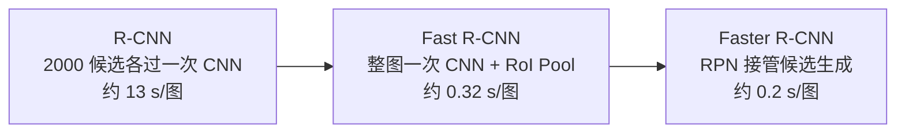

# $\rm Chapter \, 7$ 检测与分割

> **本章假设你已经会**
>
> 1. 滑动窗口检测的窗口数账：$640\times480$ 的图约 5160 次窗口分类，NMS 只在收口处点了个名，见本册 §4.6。本章把 NMS 的算法与阈值账算清。
> 2. 图像金字塔与多尺度组织：见本册 §1.6。§7.5 的候选框是它在网络内部的接棒者。
> 3. softmax 与交叉熵的损失、梯度：见本册 §5.2。检测头的分类分支与分割的逐像素损失照用它，不再重推。
> 4. 卷积与池化的形状账、感受野递推：见本册 §5.6。判断一张特征图「看得多细」全靠这笔账。
> 5. 残差连接的直通通道：见本册 §6.3。§7.7 的跳跃连接借同一个形状，运的是另一种货。

第 6 章毕业的分类机把整张图压成一个标签。本章把「压缩成什么形状」交给任务决定：检测要求除类别外还报出每个物体的位置框，语义分割要求给每个像素各发一个标签。难度跳变只有一处却处处生效：答案不再是定长的量，而是一列长度事先不知道的框，或一张与原图同宽高的标签图。固定形状的网络不会直接吐清单，本章的两条流水线（两阶段的 R-CNN 家族与一阶段的 YOLO）都是对这一跳变的回答。评分也要换尺：框对得齐不齐用交并比量，整套检测器好不好用 mAP 量。实测锚点三处：IoU 矩阵与 NMS 保留序列（§7.3）、同一组预测的三种 AP 算法对照（§7.4）、玩具掩码的 mIoU（§7.7），全部固定数据无随机成分，脚本与输出存于本册实验目录 expCV07（脚本 exp.py，输出 result.txt）。

## $\rm \S \, 7.1$ 问题：答案从定长变成不定长

先把三个任务的输出形状并排列出。分类：整图一个标签，输出是 $C$ 个分数。定位（localization）：图中恰有一个主物体，除类别外还要报出它的框，框用四个数写（左上角与右下角坐标），输出仍是定长，全连接回归头即可。检测（detection）：物体数目未知，输出是一列「框加标签」，长度随图而变。神经网络的每一层都是定形张量到定形张量的映射，不定长输出没有天然的层可接，这是检测难度跳变的第一层。

第二层是框要准。分类错一个类别，损失是交叉熵的一点点；框差几个像素，物体可能整个切掉一半。评价因此要一把「部分对给几分」的尺，这就是下一节的交并比。

解法上有一条现成的路和一条新路。现成的路是 §4.6 的滑动窗口：窗口里有没有物体是定长的分类题，遍历所有位置与尺度即可。但按 §4.6 的账，一张 $640\times480$ 图约 5160 次窗口分类，再乘上类别数；且窗口形状固定，瘦高的人与宽扁的车共用一套窗必然配不上，报出的框还要再修。新路是把答案摊到空间上：卷积特征图本身就是 ${H\times W}$ 的网格，让每个位置各答一小题「这里有没有框、框相对预设形状偏了多少」。预设形状叫锚框（anchor），通常每个位置摆 $k$ 个不同尺度与长宽比的默认框，网络对每个锚输出物体分数与 4 个偏移量，输出张量 ${H\times W\times k\times5}$，从头到尾定形。

偏移量的写法有一笔值得交代的账。直接回归绝对坐标，大框动一个像素与小框动一个像素在损失里同价，尺度小的物体被淹没。通行做法是回归相对量：中心偏移除以锚的宽高归一化，宽高用对数差 ${(\log w/\hat w,\ \log h/\hat h)}$。对数把乘法变加法：真框是锚框两倍宽，无论锚框 50 像素还是 200 像素，目标都是同一个 $\log 2$，回归器学的是与尺度无关的修正规则。§7.5 的 RPN 与 §7.6 的 YOLO 都用这套或其变体。两大家族接下来各自落地。

白话：分类是问「这张相片是什么」，检测是问「相片里有几样东西、各在哪」；前者答案是一张标签，后者是一张清单，而固定形状的网络天生只会答定长题，所以得把清单拆开，摊到网格上让每个格子各答各的。

**本节小结**：检测的两层难点是输出不定长与框要准；解法是把答案摊到卷积特征图的空间格上，锚框加偏移让每个位置输出定形张量，不定长问题转成了逐位置的定长回归。

## $\rm \S \, 7.2$ IoU：框与框的匹配尺

框的记法：轴对齐矩形，四个坐标写成 ${B=(x_1,y_1,x_2,y_2)}$，左上角 ${(x_1,y_1)}$、右下角 ${(x_2,y_2)}$。要比较两个框的重合程度，先解决更小的一步：两条区间 ${[a_1,a_2]}$ 与 ${[b_1,b_2]}$ 的公共长度是多少。交区间的左端是两者左端中靠右的那个，右端是两者右端中靠左的那个，于是

$$
\mathrm{len}\big([a_1,a_2]\cap[b_1,b_2]\big)=\max\big(0,\ \min(a_2,b_2)-\max(a_1,b_1)\big)
$$

读法：min 取靠右的左端，max 取靠左的右端，差为正才有重叠，clamp 到 0 把「不相交」统一成零。矩形的交集是横向与纵向两条区间交的乘积，面积各为其长宽之积。有了交，交并比（Intersection over Union，IoU）定义为

$$
\mathrm{IoU}(A,B)=\frac{\big|A\cap B\big|}{\big|A\cup B\big|}=\frac{\big|A\cap B\big|}{\big|A\big|+\big|B\big|-\big|A\cap B\big|}
$$

读法：分子是两框重合的面积，分母是把两框合起来盖住的地盘（重合部分只算一次，所以要减去一份交集），重合占比越高越接近 1。三条性质逐一可验：

1. 对称：${\mathrm{IoU}(A,B)=\mathrm{IoU}(B,A)}$，分母里两项面积交换不影响。
2. 取值区间 ${[0,1]}$：交集不超任一面积，也不超并集；等于 1 当且仅当两框完全相同。
3. 完全包含时 $\mathrm{IoU}=$ 小面积除以大面积。小框完全在大框内，交集就是小框自己，并集是大框。直觉上「百分之百重叠」，数值却可能很小：小框若是大框的内接正方形，IoU 只有四分之一。这条反直觉是 §7.3 与 §7.4 各埋一次的坑。

与逐像素准确率相比，IoU 把面积归一化掉了：大框小框一视同仁，既罚「该盖没盖」也罚「不该盖盖了」。还有一笔训练端的账：IoU 里的 min 与 max 使得梯度几乎处处为零（坐标微动不改变交集区域），它做得出色的评价尺却当不了直接的损失函数；检测网络训练时回归框都用平滑替代（§7.5 的 smooth L1），IoU 只在匹配与评测时出场，直到后来才有把它可导化的 IoU 损失变体。约定俗成的匹配线：PASCAL VOC 取 IoU $\ge 0.5$ 算命中；COCO 对 0.5 到 0.95 步长 0.05 的十个阈值各算一遍再平均，记作 AP@[.5:.95]。这是约定不是定理，阈值松紧直接改写成绩。

白话：IoU 像两张地皮的重复出售率，卖重的那块除以两块地合起来的大小；两个完全不同大小的地皮哪怕一大含一小，重复出售率也算不上高。

**本节小结**：IoU 用交集除以并集把「框对得齐不齐」压成 0 到 1 的数；坐标实现是两条区间交的 clamp 乘法；完全包含时 IoU 等于面积比，可低至直觉之外。

## $\rm \S \, 7.3$ NMS 与实验：IoU 矩阵、保留序列、阈值的裁量

滑动窗口与锚框都对同一个物体报出一簇高度重叠的框，需要一套收口规则：每个物体只留一条，通常留分最高的。这就是非极大值抑制（Non-Maximum Suppression，NMS）：

1. 全部候选按置信度降序排队。
2. 取队首框放进保留表。
3. 计算它与队列中其余每框的 IoU，凡大于阈值 $t$ 的一律从队列删除（视作同一物体的重复报告）。
4. 回到第 2 步，直到队列空。

每个队首要与其余各框比一次，两两比较共 $O(n^2)$ 次。唯一旋钮是阈值 $t$：调高收得松、留得多，调低收得紧、可能误伤。

实测如下。WSL python3（numpy），数据为手工构造的五个框，无随机成分：A 与 B 大幅部分重叠，C 完全包含于 A（也包含于 B），D 与 A、B、C 无重叠，E 远离其余各框。置信度 A 0.95、B 0.80、C 0.70、D 0.60、E 0.55。IoU 矩阵（对角线为框与自身）：

|      | A | B | C | D | E |
| --- | --- | --- | --- | --- | --- |
| A | 1.0000 | 0.8223 | 0.2500 | 0.0000 | 0.0000 |
| B | 0.8223 | 1.0000 | 0.2500 | 0.0000 | 0.0000 |
| C | 0.2500 | 0.2500 | 1.0000 | 0.0000 | 0.0000 |
| D | 0.0000 | 0.0000 | 0.0000 | 1.0000 | 0.0000 |
| E | 0.0000 | 0.0000 | 0.0000 | 0.0000 | 1.0000 |

数字对得上 §7.2 的推演：A 与 B 交 1444 并 1756，比值 0.8223；A 与 C 是包含关系，IoU 等于面积比 400 除以 1600，恰 0.25；无重叠全为 0；程序复核了对称性。NMS 在两个阈值下的结果：

1. 阈值 0.5：置信度排序为 A、B、C、D、E。A 进保留表，B 与 A 的 IoU 0.8223 被删；C 与 A 只有 0.25，阈值够不着，存活；保留序列为 A、C、D、E，被压制记录只有 B。
2. 阈值 0.2：B 照删，C 的 0.25 这次超过阈值也被删；保留序列为 A、D、E。

包含陷阱在这里现了形：C 明明整个泡在 A 里面，0.5 阈值下却与 A「不算重复」，因为 IoU 只有 0.25。检测器对同一个物体报一大一小两个框时，标准 NMS 留不下正确的那个小的。阈值调到 0.2 能清掉 C，但任何与主框 IoU 超过 0.2 的紧贴小物体也跟着遭殃；工程上的补救（Soft-NMS、按包含关系特判）改的都是这一处，思想都是「抑制量该随重叠方式变化」。

白话：NMS 像点名收作业，分最高的先登记，跟它抄得几乎一样的那份当重复没收；阈值是「多像算抄」的裁量权，定严了漏收真作业（紧贴的小物体），定松了留下一摞重复卷。

**本节小结**：实测 IoU 矩阵验证定义（A-B 0.8223、包含对 A-C 0.25、无重叠 0），NMS 按置信度留头删重；阈值 0.5 保留 A、C、D、E，0.2 保留 A、D、E，包含关系让标准 NMS 在两个方向上都可能错。

## $\rm \S \, 7.4$ mAP：检测精度与三个陷阱

框收好了，整套检测器打多少分？评测集上每类分别算平均精度（Average Precision，AP），各类平均得 mAP（mean Average Precision）。流程四步：

1. 单类预测按置信度降序处理。
2. 逐条判真阳（True Positive，TP）或假阳（False Positive，FP）：与该类尚未被占用的真值框比 IoU，取最大者，达到阈值（VOC 取 0.5）判 TP 并把该真值标记为已占用；否则 FP。已占用的真值再被命中，仍是 FP：一个真值只许配一条预测，重复检测必罚。
3. 逐档累计，得每档精度 $P_i=\mathrm{TP}_i/(\mathrm{TP}_i+\mathrm{FP}_i)$ 与召回 $R_i=\mathrm{TP}_i/N_{\mathrm{gt}}$，$N_{\mathrm{gt}}$ 是该类真值总数。
4. AP 取 PR 曲线下面积。工程算法（VOC 2010 后通行）：先取右侧包络 $\mathrm{env}_i=\max_{j\ge i}P_j$，再对每个召回上升的台阶累加

$$
\mathrm{AP}=\sum_{i:\,R_i>R_{i-1}}\big(R_i-R_{i-1}\big)\cdot\mathrm{env}_i
$$

读法：召回只在 TP 处上涨，每个台阶的高度乘以「走到这条召回线时模型实际拿得到的最高精度」；包络把曲线的中途低谷垫平，含义是评价只认「这个召回档曾经做到过的最好水平」。

实测走查（同上实验目录，固定数据）。猫类 3 个真值、5 条预测，给出的原始顺序刻意不按置信度排；p4 与 g1 高度重叠但 g1 已被 p2 占用，判重复检测 FP，p5 与一切剩余真值 IoU 不足 0.5 判 FP。按正确流程排好序，逐档累计：

| 预测 | 置信度 | 判定 | 累 TP | 累 FP | 精度 $P$ | 召回 $R$ |
| --- | --- | --- | --- | --- | --- | --- |
| p2 | 0.90 | TP(g1) | 1 | 0 | 1.0000 | 0.3333 |
| p4 | 0.85 | FP(重复) | 1 | 1 | 0.5000 | 0.3333 |
| p1 | 0.75 | TP(g2) | 2 | 1 | 0.6667 | 0.6667 |
| p5 | 0.60 | FP | 2 | 2 | 0.5000 | 0.6667 |
| p3 | 0.55 | TP(g3) | 3 | 2 | 0.6000 | 1.0000 |

包络为 1.0000、0.6667、0.6667、0.6000、0.6000（从右往左逐档取最大值）。召回只在 p2、p1、p3 三处上涨，AP 为三个台阶之和：$\frac13\times1.0000+\frac13\times0.6667+\frac13\times0.6000=0.7556$。狗类 2 个真值、3 条预测：r1 空报 FP（P 0.0000、R 0.0000），r2 命中（P 0.5000、R 0.5000），r3 命中（P 0.6667、R 1.0000）；包络恒为 0.6667，AP 为 $\frac12\times0.6667+\frac12\times0.6667=0.6667$。mAP 为两类平均：$(0.7556+0.6667)/2=0.7111$。

同一组数据上的三种错法，程序各算了一遍：

1. 不按置信度排序、按给出顺序直接算：AP(猫) 得 1.0000，比正确的 0.7556 还高。TP 全被排在前几档，各档精度虚高。排序不是形式：置信度定义了「在哪个价位卖出每个 TP」，乱序等于自己给自己抬价。
2. 不取包络、各台阶用当档原始精度：狗类得 0.5833，比正确的 0.6667 低。狗类精度从 0 一路涨到 0.6667，右侧高点理应把前面的低谷垫起来；包络在这组数据上对猫类恰好无效（低谷台阶的召回没动，不贡献面积），对狗类是实打实的差。
3. 允许一个真值被重复占用：p4 会从 FP 变 TP，虚增面积。这条规则专罚重复检测，也是 §7.3 的 NMS 之所以存在的评价面理由。

三个数字各钉死一步：0.7556 是正确值，1.0000 是不排序的假满分，0.5833 是不包络的假折价。另外两条值得记住：mAP 按类平均，类别少而难的类会被多数类稀释（狗类 AP 低但只占一半权重）；COCO 的 AP@[.5:.95] 把十个 IoU 阈值下的 AP 平均，对定位质量的要求比单阈值 0.5 严格得多。

白话：AP 是把「用召回换精度」这笔生意折成面积；排序定卖价，包络保证曲线的坑不算你的错（你只要在某档曾经做到过 0.6667，评价就按 0.6667 记），一个真值一次占用专治一鱼多吃。

**本节小结**：mAP 的四步是按置信度排队、真值一次性占用、逐档精度召回、右侧包络下面积；实测三种错法给出 1.0000（不排序）与 0.5833（不包络）两个假数，正确值 0.7556 与 0.6667 平均成 mAP 0.7111。

## $\rm \S \, 7.5$ R-CNN 家族：两阶段流水线

两阶段的思路顺着 §7.1 的第一条路改良：先由某个环节提名「可能哪里有东西」（候选框，proposal），再对每个候选精分类、精修框。三代机器的进化轴只有一根：把重复劳动合并掉。

R-CNN（Girshick et al., 2014）：用选择性搜索（selective search，基于颜色纹理相似度的分层合并算法）在原图上出约 2000 个候选框；每个候选裁剪缩放到固定尺寸，各自完整过一遍 CNN 提特征；特征接每类一个线性 SVM 打分，再做框回归与 NMS。账很清楚：一张图 2000 次前向，测试约 13 秒每图（GPU，AlexNet 骨干，R-CNN 论文数据）。慢在 2000 次里 1999 次是重复劳动：候选彼此重叠，同一片背景被卷了几百遍。

Fast R-CNN（Girshick, 2015）：整图只过一次 CNN 得整张特征图，候选按坐标投影到特征图上取对应区域。障碍在形状：候选大小不一，而全连接层要定长输入。解决件是感兴趣区域池化（Region of Interest pooling，RoI Pooling）：把候选在特征图上的对应区域划成 ${7\times7}$ 的网格，每个格内独立取最大值，输出恒为 ${7\times7\times C}$ 的定长块，后面的全连接层照常工作。分类与框回归合成一个网络的多任务损失：分类走 §5.2 的交叉熵，框回归走 smooth L1，

$$
\mathrm{smooth}_{L1}(x)=\begin{cases}0.5x^{2} & |x|<1\\ |x|-0.5 & |x|\ge 1\end{cases}
$$

读法：误差小时是二次函数、梯度处处连续好优化；误差大时退成一次函数、梯度封顶为 1，个别离谱的框拖不飞整个批次。这就是 §7.2 说的 IoU 当不了损失时的平滑替身。训练测试都只需要一次前向加每候选一次轻量池化，速度降到约 0.32 秒每图（VGG16 骨干，不含候选生成，Fast R-CNN 论文数据）。

Faster R-CNN（Ren et al., 2015）：候选生成也搬进网络。区域建议网络（Region Proposal Network，RPN）在共享特征图上滑一个小卷积核，每个位置摆 9 个锚框（3 尺度乘 3 长宽比），输出 18 个物体/背景分数与 36 个框偏移；RPN 与分类头共用同一张特征图，「往哪看」与「是什么」在同一次前向里完成，整机约 0.2 秒每图、接近 5 帧/s，两阶段流水线就此定型。

白话：R-CNN 是把两千张剪出来的小照片挨个送全身体检；Fast R-CNN 是全图拍一次片子，再按候选区域在片子上局部放大细看；Faster R-CNN 连「该往哪看」的单子也不劳外部算法，网络自己边看边圈。

**本节小结**：三代共一根进化轴，前向次数从每图 2000 次压到 1 次，手段是共享卷积特征加 RoI Pooling 定形；候选来源从外部算法（选择性搜索）变成网络内部的 RPN，精度与速度在约 0.2 秒每图处汇合。

## $\rm \S \, 7.6$ YOLO：一阶段思想

一阶段的回答更彻底：候选这一中间表示整个不要了。把图划成 ${S\times S}$ 的网格（YOLOv1 取 ${7\times7}$），规定物体中心落在哪个格，哪个格负责报它；每格同时预测 $B$ 个框（各含 4 个坐标加 1 个置信度）与 $C$ 个类概率。置信度有明确定义：该框含物体的概率乘以框与真值的 IoU，所以训练时只有「物体中心落进的格」的一个框被指派为真值目标，其余框的置信度目标压到 0，报框权的分配写进了监督信号本身。YOLOv1 面向 PASCAL VOC 的 20 类、$B=2$，输出张量 ${7\times7\times30}$：一次前向，全图所有框、所有类别分数同时到手，检测头只是几层卷积，正是 §7.1「答案摊到网格」的直接实现。速度账：45 帧/s（Redmon et al., 2016，YOLOv1 论文），是当时两阶段的六倍以上。

代价也在这个张量里。其一，格子粗：${7\times7}$ 的空间分辨率意味着小物体只摊到半格、一格的信息量，定位精度先天受限。其二，一格一组答案：物体中心撞进同一格的多个物体只报得出一组，一群紧挨的羊会丢成一只。其三，回归全靠前向一把抓，没有「先粗后精」的两步校正，框的准头普遍低于两阶段。精度账：YOLOv1 在 VOC2007 上 mAP 63.4%，同榜 Faster R-CNN 约 69.9%，快了六倍多、掉了约 6.5 个点。后续的 SSD（Liu et al., 2016）把锚框铺回多个尺度的特征图，VOC2007 上 74.3% 的 mAP 配 46 帧/s，说明一阶段的精度差距主要来自格子粗与无锚，不来自「一阶段」本身；速度与精度的谱系从此两端都有货，选型看的是延迟预算。

白话：两阶段像先圈重点再逐段精读，一阶段是扫一眼全卷、同时把每道题的答案直接写在格子里；快是因为只读一遍，糙是因为每个格子只有一格子的眼睛，挤在一格里的东西它只能报一个。

**本节小结**：YOLO 用 ${S\times S\times(B\cdot5+C)}$ 的输出张量把检测压成一次前向的回归，45 帧/s 对掉约 6.5 个点的 mAP；格子分辨率与一格一组答案是代价的来源，铺锚框的多尺度一阶段（SSD）把精度拉了回来。

## $\rm \S \, 7.7$ U-Net 与语义分割

分割把「压缩成语义」推到极致：语义分割（semantic segmentation）要求给每个像素各发一个类别标签，输出是与原图同宽高的标签图。输出重新变回定形张量（宽、高、每像素 $C$ 个类别分数），所以全卷积网络天然胜任；把分类网尾部的全连接换成卷积、再上采样回原尺寸，就是 FCN（Long et al., 2014），《深度学习》§7.6.3 已把反卷积与 FCN 的动机讲过。区分两个词：语义分割不区分同类个体，两个挨着的人共用同一标签；要分个体得给每个实例配一条掩码，那是实例分割（instance segmentation，Mask R-CNN 在 Faster R-CNN 上加一条掩码分支，此处点到为止）。

朴素的「逐像素分类」走不远，障碍还是 §5.6 那笔感受野账：卷积与池化一路把空间分辨率砍小、感受野放大，深层特征「懂」但「糙」，直接上采样回去的边界是糊的。U-Net（Ronneberger et al., 2015）的形状账分三条路：

1. 收缩路径：每级两个 ${3\times3}$ 卷积接一次 2 倍下采样，空间减半、通道翻倍，负责「是什么」。
2. 扩张路径：每级反卷积把空间翻倍、通道减半，再接两个卷积，负责把语义铺回空间。
3. 跳跃连接（skip connection）：把收缩路径上同分辨率的特征图，沿通道维直接拼接进扩张路径的同级。细节不用等 decoder 凭空补，encoder 侧原样运过来。

原版 U-Net 的输入输出形状差一块：valid 卷积逐层吃边界，${572\times572}$ 进来、${388\times388}$ 出去，分割图比输入小一圈；工程实现普遍加填充补回同尺寸。训练用逐像素交叉熵：把每像素的真实类别 $y_{ij}$ 与网络在该像素给出的类别分布比一比，

$$
L=-\frac{1}{HW}\sum_{i=1}^{H}\sum_{j=1}^{W}\log p_{ij,\,y_{ij}}
$$

读法：对每个像素取「它所属类别」那一路的对数概率求负、全图求平均，等于把 §5.2 的单点损失做了 ${H\times W}$ 次；损失被谁支配由像素数说了算，背景像素多，背景就说了算，这句话在下面实测里兑成数字。评测把 §7.2 的 IoU 从矩形换成像素集合：逐类算交集像素数除以并集像素数，再按类平均得 mIoU。

玩具实测（${4\times4}$ 掩码，前景 4 像素对背景 12 像素）：预测把 3 个前景像素认对、错认进 2 个，前景 IoU $=3/5=0.6000$；背景交集 11、并集 13，IoU $=0.8462$；mIoU $=0.7231$。注意这组数字的评价面教训：前景错了一半，mIoU 还有 0.72，因为占大头的背景把平均垫高了。mIoU 的类平均对大类友好，与训练端「逐像素交叉熵被背景像素淹没」是同一种不平衡的两个面；U-Net 论文为此用边界加权损失，现代方案多用按类加权或采样，方向一致：别让多数类说了算。

跳跃连接与残差的辨析值得单独一句，因为形状相同、货运不同：残差直通的是梯度，解决深网络「传不到底」的优化问题（§6.3 的实测梯度账）；U-Net 的跳跃直通的是特征，解决分割「细节回不来」的信息问题。一个为训练修路，一个为内容修路，两者在同一网络里并存互不替代。

白话：U-Net 是一台先压紧再展开的打包机，压紧时记住「是什么」，展开时靠侧面的传送带把「在哪里」原样送回来；残差的直通管是给梯度修的泄压阀，跳跃连接是给特征修的高架桥，桥上跑的货和阀里流的压不是一回事。

**本节小结**：语义分割的输出回到定形张量，全卷积网接手；U-Net 用收缩、扩张加同分辨率跳跃三件套把「懂」与「细」拼回一张图，实测玩具掩码前景 IoU 0.6000、背景 0.8462、mIoU 0.7231，类平均掩盖小类差是评价端要补的账。

## $\rm \S \, 7.8$ 关键概念回顾

1. 写出 IoU 的定义式与坐标实现式；完全包含时 IoU 等于什么？用 §7.3 实测中 A 与 C 的数字解释「看着全重叠、数值只有 0.25」从哪来。
2. 复述 NMS 的四步与复杂度量级；§7.3 实测里阈值从 0.5 降到 0.2，保留序列从什么变成什么？这一变化暴露了阈值的什么权衡？
3. 写出 mAP 计算的四步规则，并指认 §7.4 的三个 AP 数字（0.7556、1.0000、0.5833）分别对应哪种做法、每种做法错在哪一步。
4. 用「每图前向次数」与「候选来源」两个维度，比较 R-CNN、Fast R-CNN、Faster R-CNN、YOLO 四台机器，并给出各自的代表速度数字。
5. U-Net 的跳跃连接与残差连接都是直通，通的货与解决的问题各是什么？各对应本册哪一节的哪笔实测账？

## $\rm \S \, 7.9$ 应用与辨析

1. 检测器在一张测试图上对同一个行人报出三个高度重叠的框。给出至少两种可能原因（NMS 阈值设置、框之间的包含关系使 IoU 低于阈值等），并说明排查顺序。
2. 同事报告「mIoU 0.85，分割效果很好」，但你知道前景类只占约 5% 的像素。结合 §7.7 的实测（前景 0.6000 与背景 0.8462 被平均成 0.7231）说明这份报告哪里不可信，验收时应当补要哪个数字。
3. 一阶段检测器把一群紧挨着的羊只报出一只。用 §7.6 的输出张量结构解释这个现象，并说明两阶段流水线为什么较少受此苦。

## $\rm \S \, 7.10$ 答案

7.8.1：${\mathrm{IoU}(A,B)=|A\cap B|/(|A|+|B|-|A\cap B|)}$；坐标实现是横向与纵向两条区间交长的乘积，每条为 ${\max(0,\,\min(\text{右端})-\max(\text{左端}))}$（§7.2）。完全包含时 IoU 等于小面积除以大面积。实测 A 为 $40\times40$、C 为 $20\times20$ 的内接框，IoU $=400/1600=0.25$：小框虽百分之百在大框内，分母被大框面积支配，比值仍只有四分之一（§7.3）。

7.8.2：四步为按置信度降序排队、队首入保留表、删除与其 IoU 大于阈值的其余框、循环到队列空；两两比较 $O(n^2)$（§7.3）。阈值 0.5 保留 A、C、D、E（B 被删），0.2 保留 A、D、E（B、C 被删）。权衡：0.5 清不掉与主框呈包含关系的重复框（C 存活），0.2 能清掉但会误伤任何与主框 IoU 介于 0.2 到 0.5 的紧贴真物体，收口的松紧在两类错误之间摆。

7.8.3：四步为按置信度排队、真值一次性占用下按 IoU 阈值判 TP/FP、逐档累计精度与召回、右侧包络下对召回台阶积分（§7.4）。0.7556 是排序加包络的正确值；1.0000 是不按置信度排序的假满分，TP 恰好排在前几档抬高了各档精度，错在第一步；0.5833 是不取包络的假折价，狗类精度先零后涨，右侧高点本应垫起前面的低谷，错在第四步。

7.8.4：R-CNN 每图 2000 次候选各自前向，候选来自外部的选择性搜索，约 13 秒每图；Fast R-CNN 整图一次前向加 RoI Pooling 定形，候选仍外部，约 0.32 秒（不含候选生成）；Faster R-CNN 前向一次、候选由内部 RPN 生成，约 0.2 秒；YOLO 无候选、一次前向直接回归全部框，45 帧/s（§7.5、§7.6）。

7.8.5：残差直通梯度，解决深网络梯度通道随深度失效的优化问题，实测账是 §6.4 的梯度范数表（plain 停在 $10^{-5}$ 量级、res 指数增长）；跳跃连接直通特征，解决池化抹掉细节后 decoder 补不回的信息问题，实测账是 §7.7 的玩具掩码（无细节来源时边界糊，mIoU 0.7231 的组成暴露前景差）。前者服务训练，后者服务表达（§6.3、§7.7）。

7.9.1：至少两种原因（§7.3）：其一，NMS 阈值偏高，三个框两两 IoU 都低于阈值，全数存活；其二，框间是包含或大错位关系，IoU 低但确属同一物体，标准 NMS 按数值规矩放行。排查顺序：先打印三个框的两两 IoU 矩阵，若最大 IoU 本身低于当前阈值，是包含类问题，降阈值或换 Soft-NMS；若 IoU 高于阈值却未被压制，查置信度排序与实现里的比较符号（大于还是大于等于）。

7.9.2：mIoU 按类平均，背景占 95% 像素，哪怕前景全错、背景全对，mIoU 也停在 0.5 附近；0.85 的数字完全可能由背景一类撑起。§7.7 的玩具账是缩影：前景错一半，mIoU 仍有 0.7231，因为背景的 0.8462 垫了平均。验收应补逐类 IoU，至少要前景类的 IoU，必要时按像素数加权或看最差类（§7.7）。

7.9.3：YOLO 的输出是 ${S\times S\times(B\cdot5+C)}$，每格只有 $B$ 组答案且规定一格管中心落在其中的物体；几只羊中心撞进同一格，该格最多报 $B$ 组，其余被吞（§7.6）。两阶段对每个候选独立分类，物体各有一条候选路径，不共享同一格的答案名额；代价是 2000 次候选分类的前向开销（§7.5）。

> 你现在能：手工算出两个框的 IoU 并跑一遍 NMS 与 AP 走查核对三个陷阱数字，说清两阶段与一阶段各自的快与糙押在哪笔账上，并把 U-Net 的三条路径与残差区分开。

分类学到这里已经完整：整图一个标签、一列框、一片像素标签，三种压缩形状各有机器与评分尺。但卷积的「看」始终是局部的，感受野靠层数硬堆；下一章把序列那边的注意力搬过来，看 ViT 如何把图切成词、CLIP 如何把图和句子拉到同一个空间，以及自监督与生成模型如何把「识别」扩成「理解与创造」。
