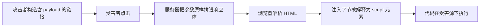

# $\rm Chapter \, 4$ Web 安全

> **本章假设你已经会**
>
> 1. HTTP 的请求-响应模型、报文 = 请求行/状态行 + 头部 + 体，见《计算机网络》§8 与《计算机速通》§23.3。本章实验会直接解剖响应体，不看报文结构会寸步难行。
> 2. 同源策略与 CORS 的使用面：源由协议、主机、端口共同决定，跨源响应默认不被 JavaScript 读到，见《计算机速通》§23.7.1。本章 §4.1 讲它的安全含义。
> 3. Cookie 的 `HttpOnly` 与 `SameSite` 属性各自挡什么，见《计算机速通》§23.7.2。本章 §4.2 与 §4.3 会给出它们各自防御的攻击全貌。
> 4. 最小权限、纵深防御两条原则与威胁建模五问，见 §1.3、§1.5。本章所有防御都会按「防什么、代价是什么」记账。
> 5. 会用 `python3` 跑标准库脚本。本章三个实验只用标准库（http.server、sqlite3、urllib），在 WSL 里完成，全部流量走 127.0.0.1，不访问外网。

第 3 章结尾说，Web 应用同样有一本「数据与代码同住」的账。现在翻开这本账。浏览器把它加载的每份文档圈在一个院子里（§4.1 同源策略），但用户输入会进入院子：反射进 HTML 的搜索词可能被浏览器当成代码执行（§4.2 XSS），别的网站可以借浏览器自动携带的 Cookie 冒充用户发请求（§4.3 CSRF），拼进 SQL 语句的输入可能改写查询的语义（§4.4 SQL 注入）。三类攻击共享同一个形状：**数据被解释成了代码**。最后给这个形状补一道纵深防御（§4.5 CSP）。全程防御视角，实验只复现教科书级的最小机制。

## $\rm \S \, 4.1$ 同源策略：浏览器画的院子

先定义对象。源（origin，在《计算机速通》§23.7.1 已用于 CORS）是一个三元组：

$$
\mathrm{origin}(u) \;=\; \big(\mathrm{scheme}(u),\; \mathrm{host}(u),\; \mathrm{port}(u)\big)
$$

读法：一个 URL 的源就是它的协议、主机、端口三项拼成的三元组；URL 未写端口时按协议补缺省值，http 补 80、https 补 443。两个 URL 当且仅当三元组逐项相等才算同源。同源策略（same-origin policy）是浏览器执行的一条隔离规则：一份文档里的脚本只能读同源文档与响应的数据。它是客户端安全的承重墙，理由直接来自 §1.5 的威胁建模：登录了邮箱的用户随时开着别的网页，如果任一网页的脚本都能读邮箱域的响应，那么任何恶意页面只要让用户访问邮箱，就能把邮件内容整页搬走。隔离的单位必须是源而不只是主机名，因为同一台机器上的 8000 端口可能是你的开发服务器，8443 可能是别人的测试环境。

这条规则精确到什么程度，写出来测一遍最踏实。程序把判定规则实现为三元组比较（脚本 `origin_check.py`，环境 WSL，python3 标准库，输出存 `expSEC04/r_origin.txt`）：

```python
from urllib.parse import urlsplit
DEFAULT_PORT = {"http": 80, "https": 443}
def origin_of(url):
    s = urlsplit(url)
    port = s.port if s.port is not None else DEFAULT_PORT.get(s.scheme)
    return (s.scheme, s.hostname, port)
def same_origin(a, b):
    return origin_of(a) == origin_of(b)
```

对六组 URL 对的实测判定：

| URL A | URL B | 判定 |
| --- | --- | --- |
| `https://paperhub.example/search` | `https://paperhub.example/api/list` | 同源 |
| `https://paperhub.example/` | `http://paperhub.example/` | 不同源（协议） |
| `https://paperhub.example/` | `https://api.paperhub.example/` | 不同源（主机） |
| `https://paperhub.example/` | `https://paperhub.example:8443/` | 不同源（端口） |
| `http://localhost:8000/` | `http://127.0.0.1:8000/` | 不同源（localhost 与 127.0.0.1 是不同主机名） |
| `https://example.com/` | `https://example.com:443/` | 同源（缺省端口补齐后相等） |

第三行值得停一下：子域是不同源，`api.paperhub.example` 被攻破不等于主站被攻破，浏览器层面互不相通（站点想主动放松时用 CORS 显式放行，那是《计算机速通》§23.7.1 的内容，方向相反：同源策略默认拒绝，CORS 是服务器点头）。

现在回答本章开头埋的问题：为什么 Cookie 不受同源策略管。Cookie 的隔离边界不是源，是域：服务器用 `Set-Cookie` 下发时会指定域，之后浏览器向**该域**发请求就自动携带，端口不参与判断，协议历史上也不参与（`Secure` 属性可选地要求仅 https 携带）。这不算疏忽而是设计：Cookie 的本职是「把身份自动附在请求上」，同源策略管的是「读响应」，两者管不同的门。但这个差别正是 §4.3 CSRF 的立足点：Cookie 自动携带，而携带与否不看发起请求的页面是哪个源。

白话：同源策略是浏览器给每个网页划的院子，院墙按协议、主机、端口三件套砌；Cookie 是另一套门禁，认门牌号（域）不认你从哪个院子出门，谁拿门牌谁就能刷。

**本节小结**：源 = 协议 + 主机 + 端口三元组，实测六组判定逐项验证；同源策略隔离的是「读」，Cookie 按「域」自动携带，管的是「带」，两套边界错开的位置就是后两节攻击的入口。

## $\rm \S \, 4.2$ XSS：数据变成代码的第一条路

同源策略信任「院子里的代码」，于是攻击者的目标变成：把自己的代码送进别人的院子。跨站脚本（cross-site scripting，XSS，缩写特意写成 XSS 以免与层叠样式表 CSS 撞车）指：攻击者的输入被服务端或前端原样拼进 HTML，浏览器把这些字节当标记执行。它直接击穿同源策略的前提：脚本已经在受害站点自己的院子里，能读该源的一切数据（Cookie 除外，若 Cookie 带 `HttpOnly`），能以用户身份发同源请求。

按注入路径分三类。反射型（reflected）：恶意输入在请求里、立即被响应原样反射回来，典型如搜索词回显；存储型（stored）：输入被存进数据库（评论区、个人简介），之后**每个**看到该页面的用户都中招，杀伤面最大；DOM 型（DOM-based）：漏洞在前端脚本里，输入不经过服务器，被页面自己的 JavaScript 拼进了 DOM。三类共享同一个根因：数据与代码共用一个通道，解释器分不清哪段是内容哪段是指令。反射型的完整通路画出来是：



每一环都用了系统既有机制的正当用途：链接、回显、HTML 解析，组合起来才是攻击，这正是第 1 章开头那句话的又一个条目：攻击者只是把既有机制用到设计者没打算的用途上。

三类里最隐蔽的是 DOM 型，因为它在服务器日志里不留痕迹。前端代码常见这样的写法：从 `location.hash` 或查询参数取出字符串，经 `element.innerHTML = ...` 直接塞进文档。`innerHTML` 与 `textContent` 的差别正是本章核心机制在浏览器侧的化身：前者把右侧字节当标记解析（数据可以变成代码），后者把右侧字节一律当文本插入（只能变成内容）。服务器返回的 HTML 可以干干净净，漏洞发生在浏览器里那份前端脚本的拼接点上，所以只审服务端模板找不到它，审计对象必须是每一个「输入进 DOM」的插值点。

反射型最小可复现。服务是一个本地 http.server，页面把查询参数 `q` 拼进 HTML（脚本 `xss_demo.py`，两个服务分别监听 127.0.0.1:8931 与 8932，全程本地闭环，输出存 `expSEC04/r_xss.txt`）。访问带 payload 的 URL（payload 里没有绕过技巧，就是最经典的教科书示例）：

```text
请求：/search?q=<script>alert(1)</script>
```

未转义服务的响应体：

```text
<p>搜索词：<script>alert(1)</script></p>
```

浏览器不是文本查看器，它解析 HTML：`<script>` 开头的字节不再是「搜索词的内容」，而是一个脚本元素的开始。因为没有浏览器可跑，实验用 HTML 解析器做同一件事，即判定注入的字节最终被解释成元素还是文本。实测解析器认定的开始标签序列：

```text
['html', 'head', 'meta', 'title', 'body', 'h1', 'p', 'script']
```

`script` 以元素身份出现在序列末尾：注入的字节被解释成了代码。这就是 XSS 的全部机制，`alert(1)` 只是占位，真实攻击里同一段 `<script>` 可以读 DOM、以用户身份调后端接口。修复则只需一行。把拼接改为 `html.escape(q)`，它把 `<`、`>`、`&`、引号替换成 HTML 实体，同一请求的响应体变成：

```text
<p>搜索词：&lt;script&gt;alert(1)&lt;/script&gt;</p>
```

解析器认定的开始标签序列变为：

```text
['html', 'head', 'meta', 'title', 'body', 'h1', 'p']
```

七个标签，`script` 消失；实体在渲染后显示为字面文本 `<script>alert(1)</script>`，用户看到的是搜索词本身，而非执行结果。两个响应的字节几乎一样，解释结果天差地别，因为转义把「可能是标记的字节」提前钉死成了「只能是文本的字节」，这正是 §1.3 最小权限在字符层的应用：内容只拿到「被显示」的权限，拿不到「被解析」的权限。

转义是修复，不是保险。它要求**每一个**插值点都用对的转义函数（HTML 正文、属性、URL、JavaScript 字符串各有各的规则，用错等于没转），而模板引擎与前端框架的出现就是为了让「默认转义」成为安全默认值（§1.3）：现代框架默认对所有插值转义，想不转义要显式声明。这里也要诚实记账：转义防的是「数据进 HTML」，防不了 §4.2 开头说的存储型在数据库里躺着等人的等待期，那要靠输入侧约束与 §4.5 的 CSP 一起兜底。

白话：XSS 是把一句台词塞进了剧本，演员（浏览器）照着演；转义是把台词逐字改写成「台词的说明书」，演员念出来的还是那句话，但不会再把它当剧本指令。

**本节小结**：XSS 三类的公共根因是数据被当成标记，实测未转义时解析器看到 `script` 元素、`html.escape` 后消失；修复靠默认转义与框架兜底，CSP（§4.5）再垫一层。

## $\rm \S \, 4.3$ CSRF：借你的钥匙发请求

第三个入口不用注入任何代码。跨站请求伪造（cross-site request forgery，CSRF）指：攻击者的页面里藏一个指向目标站点的请求，受害者的浏览器**自动**携带目标域的 Cookie 把它发出去，服务器看到的与用户本人操作无异。机制完全建立在 §4.1 结尾那个边界错开上：Cookie 按域携带，不看发起页面；而同源策略拦不住请求发出（跨源请求会真实到达服务器，《计算机速通》§23.7.1 强调过「请求已发出，只是响应不让读」）。对「发出去但改状态」的接口，CSRF 已经得手，根本不需要读响应。

一个具体时序。用户登录了 `paperhub.example`，Cookie 在浏览器里活着；随后打开攻击者页面，页面里有：

```html

```

浏览器为了加载这张「图」，向该 URL 发 GET 并自动附上 Cookie，删除发生在用户没有任何感知的情况下。防御的思路不是拦请求，而是**让合法请求带一样攻击者拿不到的东西**：CSRF 令牌（CSRF token）。服务器在渲染表单时生成一个与用户会话绑定的随机令牌放进页面，提交时要求一并交回并校验。攻击者能发出请求（浏览器替他发），却读不到响应（同源策略），因此也读不到令牌，伪造的请求交不出正确的令牌，校验拒绝。令牌把「你是谁」从浏览器自动管理的凭据（Cookie）换成了页面自己携带的秘密，主动权回到服务器手里。工程上另有两道常见闸：`SameSite` Cookie 让跨站请求不携带 Cookie（《计算机速通》§23.7.2，浏览器默认值已在收紧），以及要求状态变更只用 POST 等带体的方法，堵掉 `` 这类只能发 GET 的通道。注意这些是配合而非替代：令牌是主闸，其余是纵深（§1.3）。

三道闸各挡一个环节，也各有明确的失效面，并排记账：

| 防御 | 阻断的环节 | 各自的失效面 |
| --- | --- | --- |
| CSRF 令牌 | 伪造请求交不出令牌，校验拒绝 | 同源 XSS 能读到页面里的令牌 |
| `SameSite` Cookie | 跨站请求不自动携带 Cookie | 顶层导航的 GET 仍携带 |
| 状态变更只用 POST | `` 这类隐式 GET 通道 | 表单仍可被脚本跨站提交 |

白话：CSRF 是小偷不撬你的保险柜，而是穿着你的睡衣按你家门铃，让管家（浏览器）主动把门打开；令牌等于加了一句只有你本人才知道的暗号，光穿睡衣对不上暗号。

**本节小结**：CSRF 利用「Cookie 自动携带 + 请求无需读响应」这两个事实，防御靠会话绑定的随机令牌断掉伪造请求的交验通道，`SameSite` 与方法约束作纵深。

## $\rm \S \, 4.4$ SQL 注入：同一个根因换了个解释器

把 §4.2 的「数据被解释成代码」原样搬到数据库那侧。SQL 注入（SQL injection）指：用户输入被字符串拼接进 SQL 语句，输入里的引号提前闭合了字符串字面量，剩下的字节被数据库当 SQL 语法执行。上一章 §3.4 说堆溢出碾的是分配器的账，这里改写的是查询的语义，套路同构：解释器只看到一串字节，它没有义务知道哪些字节是程序员的意图。

sqlite3 最小复现（脚本 `sqli_demo.py`，WSL，python3 标准库，内存库三行用户数据，输出存 `expSEC04/r_sqli.txt`）。登录查询用拼接：

```python
q = "SELECT username, role FROM users WHERE username='%s' AND password='%s'" % (u, p)
```

三组实测。第一组，正常输入 `alice` / `horse12`，生成的 SQL 与结果：

```text
SELECT username, role FROM users WHERE username='alice' AND password='horse12'
行数: 1  结果: [('alice', 'user')]
```

第二组，用户名 `admin`，密码字段输入 payload `' OR '1'='1`（又是教科书例子，机制演示不含任何绕过技巧）。拼接出的 SQL 与结果：

```text
SELECT username, role FROM users WHERE username='admin' AND password='' OR '1'='1'
行数: 3  结果: [('alice', 'user'), ('bob', 'user'), ('admin', 'admin')]
```

语义改写发生在运算符优先级上：SQL 里 AND 的结合优先于 OR，这条 WHERE 实际是

$$
\big(\mathrm{username}=\texttt{'admin'} \,\wedge\, \mathrm{password}=\texttt{''}\big)\ \vee\ \big(\texttt{'1'}=\texttt{'1'}\big)
$$

读法：前半句本来是登录条件，被 payload 的前导引号闭合成假；后半句 `OR '1'='1'` 恒真，于是整个条件对每一行都成立，返回全部 3 行，攻击者无需正确密码就拿到了 admin 行。第三组，完全相同的输入改用参数化查询（parameterized query），即 SQL 与数据分开交给驱动：

```python
q = "SELECT username, role FROM users WHERE username=? AND password=?"
con.execute(q, (username, password))
```

实测返回 0 行。区别不在「过滤掉了恶意字符」：payload 的每个字符都原样到达了数据库，实测它被当作一个完整的字面字符串与 password 列做相等比较，库中没有谁密码恰好是这串字符，所以 0 行。参数化把「SQL 代码」与「数据」分成两个通道，解析器先固定语句结构，数据只以字面值入座，注入在构造上不可能，而不是被拦下。这与 §4.2 的转义同工但更彻底：转义是在共享通道里给数据钉上「我是文本」的标签，参数化是干脆修了两条通道。代价账：参数化查询几乎零成本（多数驱动只是换一种调用方式），真正的成本是纪律，所有插值点都要改，动态表名列名等确实无法参数化的位置改用白名单校验（§1.3 安全默认值的反面教材就是留给开发者手拼）。

参数化的对手常常被写成「手工过滤」，值得单独驳一次。最常见的过滤是删掉单引号，实测它对**合法数据**的破坏（脚本 `escape_vs_param.py`，同环境，输出存 `expSEC04/result.txt`）：作者名 `O'Brien` 经删引号过滤后入库变成 `OBrien`，经参数化入库仍是 `O'Brien`，实测两条记录的 distinct 计数为 2。把两头的账并起来看：黑名单过滤面对攻击者要回答无穷多个「payload 变体挡住了没有」，面对正常用户却先把真实姓名改错了；通道分离两头都对，payload 改不了语义（第三组实测），`O'Brien` 原样保存。手工过滤不是参数化的弱化版替代品，是另一条同时伤及可用性的歧路。

白话：拼接 SQL 像填支票时把金额栏和备注栏写在一起，备注里写一句「其余金额随便填」银行也认；参数化是金额、备注各填各的栏，备注写得再放肆也只是一句话。

**本节小结**：SQL 注入是 XSS 的换解释器版本，实测 payload 让 3 行全数返回（优先级 AND 先于 OR 是关键），参数化查询让同一输入返回 0 行，因为它分通道而不是贴标签。

## $\rm \S \, 4.5$ CSP：给脚本发牌照

前两节的修复都有一个「漏一个点就前功尽弃」的问题：转义要覆盖每个插值点，参数化要覆盖每条查询。内容安全策略（content security policy，CSP）从另一头收口：由页面通过 HTTP 响应头（如 `Content-Security-Policy`）声明一份白名单，声明允许从哪些来源加载脚本、页面里允不允许内联脚本，浏览器据此拒绝执行清单之外的一切脚本。即使某个插值点漏了转义、`<script>` 元素真的进了 DOM，来源不在清单里或属于内联代码，浏览器也不执行：注入的字节回到「进得了院子、开不了火」的状态。CSP 与转义的关系是标准的纵深防御（§1.3）：转义假设漏洞不发生，CSP 假设漏洞终将发生并压缩它的爆炸半径；CSP 挡不住注入本身，也不免除任何一处该做的转义。代价同样要记：严格策略会逼着改造内联脚本与第三方依赖，历史上不少站点因此配出带 `unsafe-inline` 的宽松策略，那等于把最关键的一道闸自己拆了，所以 CSP 的强度取决于清单敢不敢写严。

白话：转义是把每扇门锁好，CSP 是在小区门口立规矩「没登记的车一律不许发动」；小偷还是可能溜进院子，但偷了车也点不着火。

**本节小结**：CSP 是浏览器侧的来源白名单，不防注入发生、只防注入得逞，与转义、参数化构成「假设失守」与「假设不发生」的两层。

## $\rm \S \, 4.6$ 关键概念回顾

1. 不看正文，写出源的完整定义，并说明为什么 `https://example.com` 与 `https://example.com:443` 同源，而与 `https://api.example.com` 不同源。
2. §4.1 说 Cookie 的隔离边界不是源，那是什么？端口与协议在 Cookie 携带判断中各扮演什么角色？
3. XSS 三类各自的注入路径是什么？§4.2 的实测里，「未转义」与「html.escape 转义」两种响应体在字节层面差别极小，为什么解释结果完全不同？
4. CSRF 为什么不需要读跨源响应就能得手？CSRF 令牌利用了浏览器的哪条规则保证攻击者拿不到它？
5. §4.4 的 payload `' OR '1'='1` 为什么必须依赖 AND 与 OR 的优先级才能绕过登录？参数化查询返回 0 行的原因，「过滤恶意字符」错在哪？

## $\rm \S \, 4.7$ 应用与辨析

1. 同事说：「我们把所有查询参数都做了 `html.escape`，SQL 注入和 XSS 就都防住了。」指出这句话里的两处错误，并说明两处各自正确的修复。
2. 论文管理器的评论功能要上线。按威胁建模五问（§1.5）过一遍：若只考虑存储型 XSS 与 CSRF 两类攻击，资产、入口与最小防御组合各是什么？
3. `SameSite=Lax` 的 Cookie 与 CSRF 令牌同时部署，是重复建设吗？分别说明两者在什么情形下各自失效，从而论证「配合」的必要性。

## $\rm \S \, 4.8$ 答案

4.6.1：源是三元组 ${(\mathrm{scheme},\ \mathrm{host},\ \mathrm{port})}$，逐项相等才同源（§4.1）。前两者未写端口时按协议补缺省，https 补 443，补齐后三元组相等；后者主机名 `api.example.com` 与 `example.com` 是不同字符串，子域不随父域同源（§4.1 实测第三行）。

4.6.2：边界是域，由 `Set-Cookie` 的域属性指定，浏览器向该域发请求即自动携带（§4.1）。端口不参与判断，同一域不同端口共享 Cookie；协议默认也不参与，`Secure` 属性可选地要求仅 https 携带（§4.1）。

4.6.3：反射型在请求参数里被响应立即反射，存储型先落库再随页面发给每个浏览者，DOM 型由前端脚本把输入拼进 DOM、不经过服务器（§4.2）。字节差别只是 `<` 换成 `&lt;` 等，但前者被解析器认定为 `script` 元素（实测开始标签序列含 `script`），后者只是普通文本，渲染为字面内容；决定性的是浏览器对字节的解释方式，不是字节量（§4.2 实测）。

4.6.4：改状态的请求只要发出即生效，响应内容对攻击者无用，而跨源请求本就能发出（§4.3）。令牌随页面下发给用户、提交时交回校验；攻击者的页面发出请求却因同源策略读不到响应，读不到响应就读不到令牌，交验必然失败（§4.3）。

4.6.5：payload 的前导引号把密码字面量闭合成空串，若 AND 与 OR 同级按序求值，`OR '1'='1'` 挂在整句末尾仍能让条件恒真，但实测的语义改写依赖 AND 优先于 OR，使得恒真分支独立于前半句成立（§4.4 实测 3 行全返回）。参数化返回 0 行是因为 payload 整串被当作字面值与密码列做相等比较，库里无人匹配；「过滤恶意字符」错在参数化根本不过滤任何字符，它分开代码与数据两条通道，注入是构造上不可能而非被拦截（§4.4 实测第四组）。

4.7.1：错误一，`html.escape` 是 HTML 上下文的转义，对 SQL 无意义，SQL 注入的正确修复是参数化查询（§4.4）；错误二，即便只谈 XSS，转义也要按上下文选函数且覆盖每个插值点，漏一点即破，还需 CSP 作纵深（§4.2、§4.5）。正确表述：XSS 用默认转义加 CSP，SQL 注入用参数化加白名单，两者不共用同一道闸。

4.7.2：资产是读者的会话凭据与所有读者的浏览器（评论会被每个人看到）；入口是评论的提交接口与展示页面；损失是任意用户在该源下被代为操作、凭据被读（无 `HttpOnly` 时）；攻击者成本极低（一条评论）；代价决定防御选型。最小组合：展示侧默认转义（治本），加 `HttpOnly` 会话 Cookie（压缩 XSS 收益，见《计算机速通》§23.7.2），再加 CSP 拒绝内联与外部脚本（纵深）；CSRF 侧对评论的写操作用 POST 加令牌（§4.2、§4.3、§4.5）。

4.7.3：不是重复，两者覆盖面不同。`SameSite=Lax` 挡跨站的 POST 与 iframe 请求，但顶层导航的 GET 仍携带 Cookie，若状态变更落在 GET 上它就失效（§4.3）；令牌对同源漏洞（如存储型 XSS 读到页面）无力，因为 XSS 能读到的页面里就有令牌，此时 `SameSite` 与 `HttpOnly` 仍在起作用。任一单点都有明确失效面，组合后互相补位，这正是纵深防御的定义（§1.3、§4.3）。

> 你现在能：用三元组逐项比较判定任意两个 URL 是否同源；解释一段响应体里 `<script>` 与 `&lt;script&gt;` 的解释路径差异；面对一个登录接口，说出拼接与参数化在数据库语义层的差别；为新上线的评论功能配齐「转义、令牌、CSP、Cookie 属性」四件套并说出每件防什么。

Web 这扇门修完了：同源画了院子，转义与参数化把数据钉回数据层，令牌与 CSP 各补一道闸。但目录还有一页与输入无关：密码学原语本身没坏，坏的是用法。下一章收集「原语都对、用法全错」的集锦：ECB 模式、nonce 重用、非常数时间比较，每一项都配实测。
