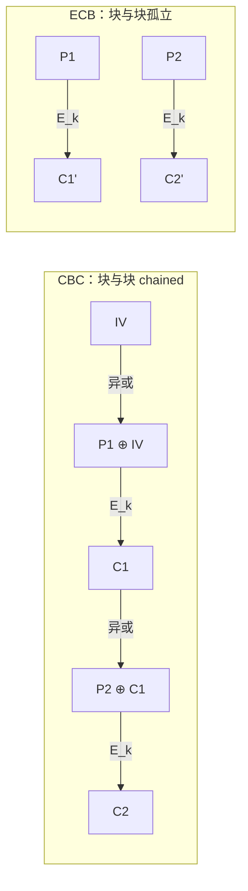

# $\rm Chapter \, 5$ 密码学误用

> **本章假设你已经会**
>
> 1. 分组密码与工作模式的概念：AES 把明文切成 16 字节的块，模式决定块与块之间怎么连，见《24-密码学》§2.2 与 §2.3。本章 §5.1 实测两种模式的结构差异。
> 2. 加密与认证是两件事：MAC 是共享密钥盖的章，AEAD 一次做对两件事，见《24-密码学》§4.2 与 §4.3。本章 §5.2 用篡改实验证明为什么缺一不可。
> 3. 一次性密码本（OTP）与「密钥流绝不能重用」的根源，见《24-密码学》§1.3。本章 §5.4 把这条约束推广到 nonce 与随机数。
> 4. 最小权限与安全默认值两条原则（§1.3），以及第 1 章的目录比喻：安全是系统其他性质失效方式的目录。
> 5. 会用 `python3` 跑标准库脚本。本章实验只用 hashlib、hmac、random、os、time、statistics，在 WSL 完成，不访问外网，脚本与输出存 `_uni5_work/expSEC05/`。

第 4 章结尾预告了这一页目录：前四章的攻击里，代码和数据走错了门；这一章的攻击里，门本身完好，钥匙却插反了。密码学原语（AES、SHA-256、HMAC）经过几十年公开检验，攻击者很难正面攻破，于是他们转向另一个地方：**原语的用法**。本章收录五种典型误用，每种都满足同一个句式：算法是对的，一个使用条件被忽略，安全性整体失效。五种误用是：ECB 模式泄漏结构（§5.1）、无认证加密可被定向篡改（§5.2）、快哈希与过时算法存密码（§5.3）、nonce 重用与随机数熵不足（§5.4）、非常数时间比较泄漏时序（§5.5）。

实验环境统一为 WSL 里的 python3 标准库。为了让每组实验都能固定种子重跑，§5.1 与 §5.2 用一个自制的教学分组密码当 AES 的替身（脚本 `toyfeistel.py`：4 轮 Feistel 结构，轮函数取 sha256 截断，自带可逆性自检）。替身只继承 AES 的两条性质：同密钥同输入必得同输出、可逆。模式的结构性质由这两条导出，不依赖 AES 的强度，所以教学结论不受替身影响。

## $\rm \S \, 5.1$ ECB 模式：确定性的代价看得见

先看最省事的用法。电子密码本模式（electronic codebook，ECB）把明文切成 16 字节的块，每块独立加密：

$$
C_i = E_k(P_i)
$$

读法：第 $i$ 块密文只由第 $i$ 块明文和密钥决定，块与块之间没有任何联系。确定性本身是解密的前提，接收方要能逐块还原，但它是把双刃剑：$E_k$ 是确定的函数，**相同的明文块必得相同的密文块**。明文里凡是重复出现的结构，密文里原样重复，频率信息原封不动带了出来。经典演示是把一张企鹅图用 ECB 加密，企鹅的轮廓在密文图里仍然可见，因为图上相邻的同色区域变成重复的密文块。企鹅图需要读图才能看出效果，这里做它的数值版：构造一张 64×64 字节的合成几何图案（上方 24 行天空、下方 8 行地面、中部椭圆身体、两只 2×2 的眼睛，大块同色加少量细节），用教学密码分别以 ECB 与 CBC 加密，统计 16 字节块的重复率，定义为（总块数 − 不同块数）/ 总块数。

对照组是 CBC（cipher block chaining，密码块链接）模式：

$$
C_i = E_k(P_i \oplus C_{i-1}), \qquad C_0 = IV
$$

读法：第 $i$ 块明文先与上一块密文异或再加密，$C_0$ 的位置由初始向量（initialization vector，IV）充当。相同的明文块处在链的不同位置时，异或上的 $C_{i-1}$ 不同，加密的输入就不同，确定性被链条切断了。两条数据流的形状：



实测结果（脚本 `ecb_demo.py`，图案与密钥由固定种子 20261106 生成，输出存 `expSEC05/result.txt`）：

| 加法 | 块数 | 不同块数 | 重复率 |
| --- | --- | --- | --- |
| 明文本身 | 256 | 22 | 0.9141 |
| ECB 密文 | 256 | 22 | 0.9141 |
| CBC 密文 | 256 | 256 | 0.0000 |

明文 256 块里只有 22 种：最大的三组重复块分别出现 96 次（天空）、74 次（身体中部）、32 次（地面）。ECB 密文的重复组与明文逐一对应，同样只有 22 种，重复率一字不差。攻击者不认识 AES，也不需要认识：他只数重复，就把图案的结构抄走了。CBC 密文 256 块互不相同，结构被链条磨平。取重复组的两个位置看它们的前 8 字节密文：

```text
block@  0: P=aaaaaaaa...  ECB=959b59ad...  CBC=7bc4cad9...
block@  1: P=aaaaaaaa...  ECB=959b59ad...  CBC=1ce63802...
同组两块的 ECB 密文相同: True   CBC 密文相同: False
```

两块明文完全一样，ECB 给出同一份密文，CBC 给出两份毫无关系的密文：链条把位置信息混进了输入。

注意这笔账的成本侧：ECB 省掉的一切（IV 管理、链条依赖）恰恰是它泄漏结构的原因；CBC 要管理 IV，且 CBC 本身只保密不认证，IV 用错会引出 §5.2 的洞。工程上的正确答案是直接用带认证的模式如 GCM（见《24-密码学》§4.3），它把这些选择打包好。ECB 在现代代码里几乎没有合法用途，看到它就该当缺陷报。

白话：ECB 像把文件逐页复印后按页码装订，哪两页内容一样，复印件上一眼看出；CBC 像每页复印前先垫一张前页的透明膜，同样的内容垫出来的底色也不同。

**本节小结**：ECB 的确定性让重复的明文块产生重复的密文块，实测合成图案重复率 0.9141 在 ECB 密文中原样保留，CBC 靠链接与 IV 把它压到 0；默认用认证模式，别用 ECB。

## $\rm \S \, 5.2$ 无认证加密：能改，而且改得准

加密保证偷看不见，但「看不见」不等于「改不了」。解密方拿到密文后无从判断它在路上有没有被动过，因为加密没有附任何与密钥绑定的完整性凭据。这不是理论洁癖：CBC 的结构让篡改可以做到字节级精确。CBC 解密时逐块还原：

$$
P_i = D_k(C_i) \oplus C_{i-1}
$$

读法：第 $i$ 块明文等于本块密文过解密函数后，再异或上一块密文。注意 $C_{i-1}$ 出现在两个角色里：它既是 $P_{i-1}$ 的密文，又是 $P_i$ 的解密输入。攻击者只需要利用第二个角色。设他把 $C_{i-1}$ 翻转一个比特差 $\Delta$（翻转即异或），看两个块各变成什么：

$$
\begin{aligned}
P_i' &= D_k(C_i) \oplus (C_{i-1} \oplus \Delta) \\
&= \big(D_k(C_i) \oplus C_{i-1}\big) \oplus \Delta \\
&= P_i \oplus \Delta
\end{aligned}
$$

读法：本块的解密函数输入没变，多出来的 $\Delta$ 一路透传，$P_i$ 被定向修改了攻击者选定的比特，其余比特不动。而前一块变成 ${P_{i-1}' = D_k(C_{i-1} \oplus \Delta) \oplus C_{i-2}}$，$D_k$ 的输入变了，块密码的语义里这输出是伪随机的，整块变乱码。攻击者不需要密钥，只需要猜到明文里有个值得改的字段。实测（脚本 `cbc_flip.py`，教学密码的 CBC，三块明文 `receipt: total=0`、`amount = 1000.00`、` status= pending`，翻转 $C_1$ 第 9 字节的 0x08 位，这个位置恰好是金额里的 `1`，而 `1` 是 0x31、`9` 是 0x39，两者差 0x08）：

```text
P1' = `×oÏB½·ü¿¦s[|T   hamming(P1,P1') = 57   （整块乱码，57 个比特位变化）
P2' = amount = 9000.00  hamming(P2,P2') = 1   （定向改成功）
P3' =  status= pending  hamming(P3,P3') = 0   （后续不受影响）
```

账单金额从 1000 变 9000，攻击者翻了一个比特，密钥动都没动。接收方若无认证，解密全程无任何报错：乱码块看起来像损坏，金额块看起来完全正常。修复是把完整性补上，用 MAC 给密文盖章，或直接换 AEAD（authenticated encryption with associated data，带认证的加密）。有一个常见错误值得单独点名：在明文上盖 MD5 章再一起加密是无效的。MD5 无密钥，攻击者改完密文重算一遍摘要附上去即可，校验照过（§5.3 还会算 MD5 本身的账）。认证必须用带密钥的 MAC，且覆盖密文与 IV 的全部字节；AEAD（《24-密码学》§4.3）把这些细节打包成一次调用，同时内部管住 nonce（§5.4 的主角）。

> **竞赛生迁移提示**：OJ 语境的「hash」常指把状态映射成下标，冲突了顶多重算；密码学哈希的对手是会主动构造输入的人，两者的威胁模型不同，函数要求也不同。

白话：加密是给信封装进不透明纸，路上谁也读不了；但没有火漆印，邮差可以换信不换封。MAC/AEAD 就是火漆：拆过封，收信人一定看得出来。

**本节小结**：加密只解决机密性；CBC 解密的链接结构让单比特密文篡改定向修改目标块、搅乱前一块，实测改金额只翻 1 个比特且全程无报错；修复靠带密钥的 MAC 或 AEAD，无密钥的哈希校验无效。

## $\rm \S \, 5.3$ 哈希误用：选旧算法，用错场合

哈希的误用分两层：算法过时，和场合错配。场合错配最常见于密码存储。数据库泄露后，攻击者拿着哈希表离线穷举，总成本由一个除法决定：

$$
T_{\text{穷举}} = \frac{N_{\text{候选}}}{r}
$$

读法：候选密码总数 $N_{\text{候选}}$ 除以每秒尝试次数 $r$，就是穷举时间；$r$ 由哈希函数的快慢决定。实测这台机器上的速度（脚本 `kdf_speed.py`，WSL python3，固定输入，输出存 `expSEC05/result.txt`）：对同一短密码算 MD5，20 万次共用 0.117 秒，${r \approx 171}$ 万次/秒；而口令基钥派生函数 PBKDF2-HMAC-SHA256 迭代 10 万轮，单次 34.35 ms，${r \approx 29}$ 次/秒。把这个 $r$ 代进上式算一笔具体的账：10 位纯数字密码有 $10^{10}$ 个候选，MD5 速率下约 1.6 小时穷举完，PBKDF2 十万轮速率下要约 11 年（由实测速率推算）。MD5 比 10 万轮 PBKDF2 快约 5.9 万倍，攻击者的字典在 MD5 面前一秒百万个密码，在慢哈希面前一天不到 300 万个，差出四个数量级。

这正是快慢哈希的设计差别：MD5 的设计目标是给大文件算校验，快是它的本职；密码哈希要的就是慢。pbkdf2、bcrypt、argon2 在内部把哈希循环成千上万轮（argon2 还要占内存，让 GPU 并行也难受），把「慢」做成特性。速度之外还有盐（salt）。同一密码不加盐，哈希值全库相同，攻击者对常见密码做一次预计算，就能打穿所有用户；加盐后每个用户的哈希输入都不同，预计算失去摊销。实测（同脚本）同一密码两个用户：无盐时摘要相同（`9cc2ae8a...`），各加随机盐后不同（`3db783ec...` 与 `5495f275...`）。盐不需要保密，它破坏的是攻击者一次穷举打多个账号的摊销，代价只是每用户多存一段明文盐。

算法过时指 MD5 与 SHA-1。以下为公开文献数据，非本章实测。1. 2004 年，王小云团队公布 MD5 的碰撞构造，今天任何人在笔记本电脑上都能瞬间生成内容不同、MD5 相同的文件对。2. 2008 年，Stevens 等人用 MD5 的选前缀碰撞伪造了一张骗过浏览器校验流程的 CA 证书。3. 2017 年，Google 与 CWI 公布 SHA-1 的首个实碰撞（SHAttered），计算量约 $2^{63.1}$ 次压缩函数，折合 6500 CPU 年加 110 GPU 年。4. 2020 年，Leurent 与 Peyrin 把 SHA-1 的选前缀碰撞成本压到约 4.5 万美元的 GPU 租用。碰撞攻击的杀伤面取决于哈希用在哪个场合：数字签名只签哈希，碰撞意味着攻击者可以做一份无害文件请你签名，再把签名挪到一份摘要相同的恶意文件上；软件完整性校验同理可被调包。三件事要分清：MD5 的碰撞已破；原像攻击（给定摘要反推输入）至今未破；速度快是事实。签名与校验被碰撞否决，密码存储被速度否决，没有一种场合还轮得到它。理论天花板由生日攻击给出（《24-密码学》§3.2）：$n$ 位输出的碰撞成本在 $2^{n/2}$ 量级，MD5 的 128 位输出对应 $2^{64}$ 天花板，早已在现代算力射程内。

> **经验规则**：不自研密码学组合，用成熟库的高层 API（AEAD、password hashing 函数），并把「这算法还在不在推荐清单里」当成和「能不能跑」同级的检查项，见《24-密码学》§10.2 的工程纪律清单。

白话：用 MD5 存密码，等于把家门钥匙挂在一个任何人一秒能试一百万把的锁上；慢哈希是把锁改成一秒只能试一次的保险柜，盐是给每家换锁芯，让小偷的白名单作废。

**本节小结**：密码存储要慢哈希加盐（实测 MD5 每秒约 171 万次对比 PBKDF2 十万轮每秒 29 次，差四个数量级），MD5/SHA-1 的碰撞已是公开可复现的文献事实，签名与校验场合必须淘汰；哈希选型要同时看碰撞、原像与速度三笔账。

## $\rm \S \, 5.4$ nonce 重用与熵不足：随机性是承重墙

《24-密码学》§1.3 讲过，OTP 的完美保密要求密钥流是真随机且只用一次。流密码与计数器模式把这条要求压缩成更省钱的纪律：密钥固定，每次加密换一个 nonce（number used once，一次性数字），密钥流由密钥与 nonce 共同派生。约束随之变成：**同一密钥下 nonce 绝不重用**。违反它的后果可以逐符号算出来。设两条消息在同一次会话里用同一条密钥流 $K$ 加密：

$$
C_1 = M_1 \oplus K, \qquad C_2 = M_2 \oplus K
$$

两式异或，$K$ 与自己异或得零，整个消掉：

$$
\begin{aligned}
C_1 \oplus C_2 &= (M_1 \oplus K) \oplus (M_2 \oplus K) \\
&= M_1 \oplus M_2 \oplus (K \oplus K) \\
&= M_1 \oplus M_2
\end{aligned}
$$

读法：密钥流出现两次，异或自抵消，两段密文的异或就是两段明文的异或。${M_1 \oplus M_2}$ 不是明文，但它是明文间的差：若攻击者猜出 $M_1$（协议里开头常是固定字段或可预测内容），立刻得 ${M_2 = (M_1 \oplus M_2) \oplus M_1}$，一字不差。实测（脚本 `nonce_reuse.py`，密钥流由 sha256 按 nonce 派生，固定种子）：

```text
c1 = c8f30d4502341a69c75aa60c2724af36      明文1 = attack at dawn!!
c2 = cfeb1c41412b5528c712a74d272ffd63      明文2 = flee to the west
c1 ^ c2 == m1 ^ m2  ->  True
按套路猜中 m1 后恢复出的 m2: flee to the west
```

同一 nonce 下，两段密文的异或原样交出了明文的异或，已知明文立刻兑现成另一条的全文。nonce 重用不只属于流密码：ECDSA 签名重用 nonce 会直接泄漏私钥，索尼 PS3 的签名密钥就是这么丢的（《24-密码学》§7.4）。现代 AEAD 把 nonce 管理做进接口（同密钥下 nonce 重用即灾难，见《24-密码学》§4.4），但接口只挡住手动传错，挡不住「随机生成 nonce 撞车」。nonce 若随机生成，碰撞概率按生日账算：96 位 nonce 生成 $n$ 条消息，碰撞概率约 $\dfrac{n^2}{2^{97}}$；${n = 2^{48}}$ 时概率过半，所以公开规范（NIST 的 GCM 口径）把随机 nonce 下的每密钥消息数上限压到 $2^{32}$。这不是杞人忧天，是长跑服务的日常账。

随机数的错误与 nonce 错误是同一堵承重墙的两条裂缝：熵（entropy，不确定性总量）不足。Python 的 `random` 模块是梅森旋转算法，为统计模拟设计，不是为密码学的：它的全部内部状态由种子决定，种子是什么，输出序列就是什么。实测：某服务用 `random` 在 0 到 999999 的种子空间里初始化后生成 16 字符令牌，攻击者只需穷举种子空间，每个种子重新生成一遍令牌比对。实测 9.24 秒命中正确种子 680217，令牌原文完整复现。令牌名义上有 ${36^{16} \approx 2^{83}}$ 种可能，实际熵被种子空间钉死在 ${\log_2 10^6 \approx 20}$ 位：**输出的长度不等于输出的熵，熵的上限是种子的不确定性**。就算不手动设种子，`random` 用系统时间等可预测量初始化的场景同样危险。修复没有代价，纯纪律：安全用途一律用 `os.urandom` 或在其上的 `secrets` 模块，它读操作系统的熵池，16 字节输出对应 $2^{128}$ 种可能，且不泄漏内部状态。

白话：nonce 重用等于两次开锁用同一把一次性钥匙，还把它留在了锁眼里；`random` 生成密钥像用只有一百万种摇法的骰子摇密码，摇出 40 位长串也白搭。

**本节小结**：同密钥下 nonce 重用让 ${C_1 \oplus C_2 = M_1 \oplus M_2}$（实测异或相等、已知明文即恢复全文），随机 nonce 也要按生日账限消息数；熵不足让名义 83 位的令牌实际只有种子那 20 位（实测 9.24 秒穷举命中）；安全随机数只用 os.urandom/secrets。

## $\rm \S \, 5.5$ 时序攻击：比较密码的快慢也是数据

前面四节都盯着数据，这一节的数据藏在时间轴上。服务端校验令牌的常见写法是逐字符比较，遇不同立即返回假。这个函数在 C、Python、JavaScript 里都好写也好读，但它有一个作者没打算公开的输出：**耗时**。首错在第 0 位只比 1 个字符，首错在第 31 位要扫完全部 32 个字符，多扫的每一字符都要付时间。攻击者的流程四步：1. 把候选字符代入令牌的第 $i$ 位，发出请求；2. 记录响应时间，重复多次取均值压噪声；3. 若均值明显跳高，说明比较进行到了第 $i$ 位之后，字符猜对；4. 固定该位，前进到下一位。这样每一位只需试遍字符集，代价从穷举全空间降为逐位恢复。实测（脚本 `timing_cmp.py`，32 字符十六进制秘密，每个首错位置扫 10000 次取均值与中位数，固定种子，输出存 `expSEC05/result.txt`）：

| 首错位置 | 短路比较均值 (ns) | 短路比较中位 (ns) | compare_digest 均值 (ns) | compare_digest 中位 (ns) |
| --- | --- | --- | --- | --- |
| 0 | 307 | 233 | 105 | 104 |
| 15 | 591 | 524 | 124 | 130 |
| 31 | 827 | 802 | 115 | 103 |
| 全对 | 853 | 803 | 168 | 124 |

短路与首错位置近似线性：中位数从 233 ns（首错在 0 位）爬到 802 ns（首错在 31 位），平均每往后一位多付约 18 ns，0 位与 31 位的中位数差约 570 ns。18 ns 远小于网络抖动，攻击者不会指望一次请求测这么准，但可以重复采样：同一猜测发一万次取均值，本实验正是这么做的，这也是远程时序攻击的标准姿势。右边两列是常数时间比较函数 `hmac.compare_digest` 的实测：均值与中位数稳定在 102 到 168 ns 之间，波动与首错位置无关，因为它无论错在哪里都要把全部字节扫完，时间不携带位置信息。把攻击者的账算完：短路比较下，32 字符十六进制令牌每字符 16 个候选，逐位恢复约 512 次基础请求（乘上采样倍数仍可承受）；常数时间比较堵死时间通道后，同一令牌只剩暴力穷举 ${16^{32} \approx 3.4 \times 10^{38}}$ 次，从可操作变回天文数字。修复的代价也在这张表里：常数时间版本在「首错在 0 位」的场景比短路版本付更多时间（104 ns 对 233 ns 之外，短路版本靠提前退出赚的便宜在错误越早时越大），它买安全的方式是放弃提前退出。时序泄漏不止于比较：查表实现的 AES、不隐藏分支的算法实现都有同类问题，远程可测的真实案例在公开文献里不止一例（如 2013 年针对 TLS 记录层填充的 Lucky13 攻击）。通用原则是把依赖秘密的控制流抹平；库作者已替你做好的部分，别亲手拆掉。

> **安全警告**：凡是「比到不同就返回」的逻辑在为秘密服务，不管是令牌、恢复码还是密钥，都换成 `hmac.compare_digest`（字符串）或等价的常数时间例程；这不是性能优化能碰的地方。

白话：保安核对来访名单，第一个字对不上扭头就走，对到第三个字才否就多翻了两页，你站在门外听翻页声，就能一位一位把名单猜出来；compare_digest 是不管对错都把整页翻完的保安，翻页声永远一样。

**本节小结**：逐字符短路比较的耗时线性泄漏首错位置（实测中位 233 到 802 ns，每位约 18 ns），重复采样足以远程利用（约 512 次请求起恢复 32 字符令牌）；hmac.compare_digest 用「永不提前退出」换平坦耗时（实测 102 到 168 ns 与位置无关），密码学比较必须用它。

## $\rm \S \, 5.6$ 五误用速查

| 误用 | 失效的机制 | 本章实测证据 | 缓解 | 代价 |
| --- | --- | --- | --- | --- |
| ECB 模式 | 确定性泄漏结构 | 重复率 0.9141 原样保留 | 认证模式（GCM） | 管理 IV 与 nonce |
| 无认证加密 | 密文可定向篡改 | 翻 1 比特改金额，无报错 | MAC/AEAD | 多算一次认证 |
| 快哈希/过时算法存密码 | 离线穷举便宜 | MD5 每秒 171 万次 vs 慢哈希 29 次 | 慢哈希加盐 | 登录多付约 34 ms |
| nonce 重用/弱随机 | 密钥流泄漏、种子可穷举 | 异或即明文差；9.24 秒复现令牌 | nonce 纪律、os.urandom | 纯纪律 |
| 非常数时间比较 | 耗时泄漏首错位置 | 233 到 802 ns 随位置爬升 | compare_digest | 放弃提前退出 |

## $\rm \S \, 5.7$ 关键概念回顾

1. ECB 模式下，为什么相同的明文块必然产生相同的密文块？CBC 用哪两个机制切断了这条对应关系？实测的重复率各是多少？
2. 攻击者翻转 CBC 密文块 $C_{i-1}$ 的一个比特后，$P_i$ 与 $P_{i-1}$ 各发生什么变化？这个实验证明了「加密」缺少哪一项保证？
3. MD5 的碰撞、原像、速度三笔账分别否决了它的哪些用途？为什么给密文附 MD5 校验和防不了篡改？
4. 写出 nonce 重用后 ${C_1 \oplus C_2}$ 等于什么，并说明攻击者已知 $M_1$ 时为什么能恢复 $M_2$ 全文。`random` 模块生成令牌的问题出在哪，名义熵与实际熵各是多少？
5. 时序攻击测量的量是什么？`hmac.compare_digest` 为什么能消除这个泄漏，它付出的代价是什么？

## $\rm \S \, 5.8$ 应用与辨析

1. 同事说：「配置文件用 AES-CBC 加密了，机密性没问题；再加个 MD5 校验和放在一起传输，防篡改也齐了。」指出这句话里的两处错误，并给出正确的组合。
2. 论文管理器要生成「找回密码」链接里的 32 字符令牌，并在用户提交时校验。同事的方案：用 `random.choice` 生成、用 `==` 比较。指出两处误用，分别估算修复前后攻击者的请求成本。
3. 某系统的用户库里躺着无盐 MD5 密码摘要。直接全部重哈希为什么做不到？设计一个可行的渐进迁移方案，并用本章实测数字说明迁移的价值。

## $\rm \S \, 5.9$ 答案

5.7.1：$E_k$ 是确定性函数，同密钥同输入必得同输出，ECB 逐块独立加密，相同明文块的密文必然相同（§5.1）。CBC 把 $C_{i-1}$（首块为 IV）异或进加密输入，相同明文块处在链的不同位置时输入不同；实测合成图案 256 块中 ECB 重复率 0.9141、CBC 为 0.0000（§5.1）。

5.7.2：${P_i' = P_i \oplus \Delta}$，被攻击者选定的比特定向修改，其余比特不变；${P_{i-1}' = D_k(C_{i-1} \oplus \Delta) \oplus C_{i-2}}$，解密输入被改后输出伪随机，整块乱码（§5.2 推导）。实测翻一个比特把金额 1000 改成 9000，目标块汉明距离 1、前块 57、解密无报错（§5.2）。加密只保证机密性，缺的是完整性认证（§5.2）。

5.7.3：碰撞已破否决签名与文件校验：攻击者可造两份摘要相同的文件调包骗签（§5.3，公开文献数据）；原像未破说明它还像个单向函数，但救不了上述场合；速度否决密码存储，实测 MD5 每秒约 171 万次，穷举成本过低，比 10 万轮 PBKDF2 快约 5.9 万倍（§5.3 实测）。MD5 校验和无效是因为它无密钥：攻击者改完密文可重算摘要一并附上，校验照过；完整性需要带密钥的 MAC 或 AEAD（§5.2）。

5.7.4：${C_1 \oplus C_2 = M_1 \oplus M_2}$，密钥流两次出现自相抵消（§5.4 推导）；已知 $M_1$ 时 ${M_2 = (C_1 \oplus C_2) \oplus M_1}$，实测按固定字段猜中 $M_1$ 后恢复出第二条消息全文（§5.4）。`random` 的问题在种子：全部内部状态由种子决定，实测种子空间 $10^6$ 时 9.24 秒穷举命中；令牌名义熵约 83 位，实际熵被种子钉在约 20 位（§5.4）。修复用 os.urandom/secrets。

5.7.5：测量的是比较耗时，它线性泄漏首错位置 ${T(i) \approx T_0 + i\delta}$，实测短路比较中位数 233 ns（首错在 0 位）到 802 ns（首错在 31 位），每位约 18 ns（§5.5 实测）。compare_digest 无论首错在哪都扫完全部字节，时间不携带位置信息，实测中位 102 到 130 ns 与位置无关；代价是放弃提前退出，错得早也要付全程时间（§5.5 实测对比表）。

5.8.1：错误一，MD5 校验和不提供认证：它无密钥，攻击者改密文后重算摘要即可，这是「哈希当 MAC 用」的典型错误，正确做法是 HMAC 或直接换 AEAD（§5.2、§5.3）；错误二，CBC 需要管 IV，且认证还必须覆盖 IV，手搓组合容易漏，AEAD 把这些细节打包好（§5.2）。另外 MD5 自身已被碰撞攻破，校验场合也不该选它（§5.3）。正确组合：AES-GCM 一类 AEAD，密钥与 nonce 交给成熟库。

5.8.2：误用一，`random.choice` 的输出受种子支配，种子常取自时间或小空间，实测 $10^6$ 种子穷举 9.24 秒复现令牌，攻击者可自领他人令牌（§5.4）；修复用 `secrets.token_hex`（os.urandom 熵源，32 字符十六进制即 $2^{128}$ 种可能）。误用二，`==` 在多数实现里短路，耗时泄漏首错位置，重复采样可逐字符恢复，32 字符十六进制令牌约 512 次基础请求起步（含重复采样再乘倍数）；修复用 `hmac.compare_digest`，时间通道关闭后攻击者只剩 ${16^{32} \approx 3.4 \times 10^{38}}$ 次穷举（§5.5）。

5.8.3：做不到直接重哈希，因为库里存的是 MD5 摘要而非明文密码，新算法（如 PBKDF2）无法从旧摘要推出，强行清空等于逼全部用户重置（§5.3）。渐进方案：给每条记录加算法版本标记；用户下次成功登录时（此刻明文密码在手）立即用加盐 PBKDF2 重哈希并更新标记；未登录的旧账户保持原状但登录接口限速，防止旧摘要在窗口期被穷举；长期未登录者走重置流程。价值账：登录时多付 34.35 ms（实测 10 万轮）用户无感，而数据库再次泄露时，攻击者穷举速度从每秒 171 万次掉到每秒 29 次，成本差约 5.9 万倍（§5.3 实测）。

> 你现在能：看到 ECB 就指出它的结构泄漏并给出重复率的量级；解释为什么加密之后还必须认证、无密钥校验和为什么无效；把密码存储的三笔账（碰撞、原像、速度）讲清并选对慢哈希与盐；说出 nonce 与种子的熵下限；用 `hmac.compare_digest` 换掉一切秘密比较。

五类误用收进目录，这一页的共同教训是：密码学库给的每个参数（模式、IV、nonce、盐、比较函数）都是一条安全前提，跳过任何一条，失效的不是那个参数，而是整套机制。到目前为止，攻击者一直在我方的代码与配置里找错。下一章换一个问题：代码跑起来之后，它被允许碰什么？用户态与内核态、进程与进程、站点与站点之间隔着的那些墙，是第 6 章的主题：隔离与沙箱。
