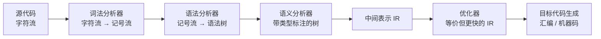

# $\rm Chapter \, 1$ 总览与词法

> **本章假设你已经会**
>
> 1. 正则表达式的三种运算（并、连接、星）与它们描述的语言，见《形式语言与自动机》§1.2。
> 2. DFA 的五元组定义与逐字符转移的运行方式，见《形式语言与自动机》§1.3.1。
> 3. NFA 的「并行押注」语义与子集构造的基本动作，见《形式语言与自动机》§1.3.2。
> 4. 最小 DFA 为何唯一：Myhill–Nerode 定理的等价类视角，见《形式语言与自动机》§2.3。
> 5. python3 语法速成与命令行跑脚本的方法，见《编程语言》§17.2、§17.9。

编译器（compiler）是一个程序：读入高级语言的源代码，吐出语义等价的低级程序（汇编或机器码），后者能被硬件直接执行。合同只有一条：不管中间做多少变换，源程序的可观察行为不允许变。

全册的心智模型从本章立起来：**编译器是逐级降级翻译，每级解决一类歧义，传递一种更接近机器的表示**。歧义分层消掉：字符怎么分组归词法管，词怎么拼成结构归语法管，结构有没有意义归语义管，选哪条等价指令归优化与生成管。本章先在总图上给每级定位，再把第一级完整做完：从正则式出发，经 Thompson 构造、子集构造、最小化，推到一台亲手写得出、跑得动的词法器。全部构造配一份 Python 实现，实验数字先跑后写。

## $\rm \S \, 1.1$ 问题：一层翻译扛不住全部歧义

设想把 `count = count + 1;` 直接翻成 x86 指令，卡住的点不止一个。`count` 对应哪个内存地址，取决于声明表；这个 `+` 是整数加还是别的加，取决于类型；`count + 1` 是一个表达式整体还是 `count` 与 `+1` 两截，取决于分组；甚至在更早的层面，`count77` 到底是一个名字还是 `count` 和 `77` 黏在一起，「哪里算一个词」都没定。一步到位的翻译器要在同一个函数里同时回答这四类问题，函数会大到自己都测不动。

工程答案是分层。编译器流水线（pipeline）分六级，每级吃前级的输出表示，吐出自己的输出表示：



每级消掉哪类歧义，逐行念一遍。

1. 词法分析（lexical analysis，也称扫描 scanning）：字符流里哪些字符绑成一个词、每个词属于哪一类。「分组」歧义在这里消掉：`count77` 判定为一个名字，黏连说法被否决。
2. 语法分析（syntax analysis，也称解析 parsing）：词序列怎么嵌套成结构。「归属」歧义在这里消掉：`count + 1` 是一个表达式整体，运算优先级在此落定。
3. 语义分析（semantic analysis）：结构有没有意义。「含义」歧义在这里消掉：`count` 是否声明过、加号两侧类型是否相容。
4. 降级到中间表示（intermediate representation，IR）：带类型的树降到一种介于源语言与指令之间的表示，谁控制谁、谁用了谁在这里显形。
5. 优化（optimization）：在行为不变的合同内换更快的 IR。「选路」歧义在这里消掉：等价实现有无穷多条，选哪条是这级的全部工作。
6. 目标代码生成：IR 落到具体指令集，指令选择与寄存器分配都在这级。

分层能成立，靠的还是表示：第 3 级不必再读字符，它只看树；第 5 级不必认识源语言，它只看 IR。表示是级与级之间的合同，所以前端可以换语言、后端可以换目标机，合同不变，签约方可换。第 2 章与第 3 章做语法分析，第 4 章走完第 3、4 级，第 6、7 章进入第 5、6 级。

白话：编译器是流水线不是万能翻译机，每一站只回答一个问题，并把答案写成下一站能直接使用的格式；出了错也容易定位是哪一站的合同没履行。

> 本节小结：六级流水线，每级吃一种表示、吐一种更接近机器的表示、消掉一类歧义；表示是级间合同，分层靠它成立。

## $\rm \S \, 1.2$ 词法器的任务：字符流变记号流

词法器（lexer）站在流水线第一级：输入字符流，输出记号（token）流。先立三个词，全册沿用。

1. 词素（lexeme）：源代码里具体的一段字符，如 `count77`。
2. 模式（pattern）：描述一类词素的规则，如「字母开头、后接字母或数字」。
3. 记号（token）：二元组（种类，属性值），如（标识符，`count77`）。种类是词法器输出的词汇表，属性值留给语义级使用。

把 `score = score + 1;` 喂给词法器，输出是记号序列：标识符（`score`）、赋值号、标识符（`score`）、加号、数字（值 1）、分号。空白与注释在这一级消失：它们的作用本来就是分隔，分完组就没有存在的必要了。

词法器的规则为什么用正则表达式写？看三类典型词素的结构：关键字是字母表上的有限串；标识符是「一个字母后接若干字母或数字」；数字是「若干数字后接一个小数点再接若干数字」。全是「有限位置上做有限选择，再拼接、重复」的形状，恰好是正则表达式三种运算能覆盖的；而 Kleene 定理（《形式语言与自动机》§1.3.3）保证每条正则式都有一台等价的有穷自动机，于是「判断某段字符是否符合模式」可以交给机械执行，不需要人盯着字符串猜。

还差一条裁决规则。同一个起点上，多个模式可能同时能匹配：`if8` 站在 `i` 处，关键字模式能匹配出 `if`，标识符模式能匹配出整个 `if8`。行业约定是**最长匹配（maximal munch）**：谁覆盖的字符多谁赢。为什么这条约定重要，§1.7 用实验证据展示一个忘了它的真实翻车现场。

白话：词法器是把字符串切成单词的裁纸刀，模式是刀路图纸，正则式写图纸，自动机当刀本身；切的时候总是往长了切。

> 本节小结：词法器输出（种类，属性值）形式的记号流，模式用正则式书写；Kleene 定理把图纸变成可执行的自动机，最长匹配解决多模式撞车。

## $\rm \S \, 1.3$ Thompson 构造：从正则式到 NFA

现在把图纸变成机器。正则式是「怎么写」，DFA 是「怎么执行」，从图纸直接跳到可执行的确定机器很难，Thompson 构造（Thompson's construction）把它拆成两步：先机械地翻成 NFA（非确定型有穷自动机，non-deterministic finite automaton；ε 边与并行押注的语义见《形式语言与自动机》§1.3.2），下一步再抹平非确定性。构造是归纳的：基础情形给单字符，三种运算各有一条拼装规则。

1. 基础：字符 $a$ 造一个新起点 $s$、一个新接受态 $t$，连一条边 ${s\xrightarrow{\ a}\ t}$；空串 $\epsilon$ 同样两个状态，边上标 $\epsilon$。
2. 并 $r\mid s$：造新起点 $S$ 与新接受态 $T$，新增 2 个状态；加四条 $\epsilon$ 边：$S$ 分岔进两个子片段的起点，两个子片段的接受态汇入 $T$。
3. 连接 $rs$：不新增状态。右片段的起点与左片段的接受态合并为同一个状态（出边随合并搬移），串行接续。
4. 星 $r^*$：造新起点 $S$ 与新接受态 $T$，新增 2 个状态；四条 $\epsilon$ 边：$S$ 既能直接进子片段、也能直接跳到 $T$（重复零次）；子片段的接受态既能回头重进（再来一次）、也能出到 $T$（收工）。

每条规则只添 2 个状态（连接添 0），立得账本：NFA 状态数不超过正则式长度的 2 倍。拿 $(a\mid b)^*abb$ 走一遍：内层 $a$、$b$ 各 2 态，并联加 2 得 6 态；套星加 2 得 8 态；连接三个字符各并掉 1 态，净加 1 加 1 加 1，共 11 态。$\epsilon$ 边的读法：它是「不吞字符就走的传送门」，子集构造下一步会大批量收拾它们。实验跑出的 NFA 恰好 11 态、13 条迁移（其中 $\epsilon$ 边 8 条），与账本一致。

这套构造不追求机器最小，只追求机械：拿着语法树自底向上，每棵子树都能不动脑拼出来。机器大不是问题，因为下一站有压缩工序。

白话：Thompson 构造是搭积木手册，字符是最小积木，三种运算各规定一种插法；照图纸插出来的机器偏大，但每一步都不需要智力。

> 本节小结：Thompson 构造按语法树自底向上拼 NFA，每条规则添状态不超过 2 个，$(a\mid b)^*abb$ 实测 11 态；机械性是它的全部卖点。

## $\rm \S \, 1.4$ 子集构造：从 NFA 到 DFA

NFA 的问题是「押注」：一条边走不走、走哪条，要等看到后面才知道，人可以回溯，机器不能。子集构造（subset construction，《形式语言与自动机》§1.3.2 已给三状态实例）把「并行押注」整体升格为单个状态：DFA 的一个状态就是 NFA 的一个状态集合，含义是「读完目前这段输入后，NFA 可能处于的全部位置」。设 NFA 的迁移边集为 $\Delta$（每条带一个标号，$\epsilon$ 也算合法标号），先给两个工具。对状态集合 $S$ 与字符 $a$：

$$
\mathrm{move}(S,a)=\{\,q':\ \text{存在}\ q\in S,\ q\xrightarrow{\ a}\ q'\,\}
$$

$$
\mathrm{eclose}(S)=\min\{\,T\subseteq Q:\ S\subseteq T,\ q\in T,\ (q,\epsilon,q')\in\Delta\Rightarrow q'\in T\,\}
$$

读法：`move` 问「吞掉一个 $a$ 后能站到哪」，得到一批位置；`eclose` 从这批位置出发把所有 $\epsilon$ 传送门走到头，再无可走为止。「最小集合」指集合包含意义下的最小，闭包（closure）一词即取自这种自封闭结构。算法三步：

1. DFA 起点为 $\mathrm{eclose}(\{q_0\})$。
2. 对已有子集 $S$ 与每个字符 $a$，计算 $\mathrm{eclose}(\mathrm{move}(S,a))$；空集则无边（进死态）。
3. 新子集入队重复第 2 步，直到不再出现新子集。

终止性一眼可见：子集至多 $2^n$ 个（$n$ 为 NFA 状态数），每步要么消耗一个新子集要么封边。正确性靠一条不变式：DFA 读完串 $w$ 后所处的子集，恰等于 NFA 读完 $w$ 后可达状态的全体。对 $w$ 的长度归纳：$w$ 为空时两边都是 $\mathrm{eclose}(\{q_0\})$；归纳步由构造第 2 步与 NFA 语义（先按字符走一步、再封 $\epsilon$）逐项对上。于是两台机器接受同一个语言：NFA 有一条接受路径当且仅当它的可达集合里含接受态。

$(a\mid b)^*abb$ 实测（脚本与复现命令见 §1.6）：子集构造产出 5 个状态。

| DFA 状态 | NFA 子集 | a 边 | b 边 | 接受 |
| --- | --- | --- | --- | --- |
| D0 | {0, 1, 2, 4, 6} | D1 | D2 | 否 |
| D1 | {1, 2, 3, 4, 5, 6, 9} | D1 | D3 | 否 |
| D2 | {1, 2, 3, 4, 6, 7} | D1 | D2 | 否 |
| D3 | {1, 2, 3, 4, 6, 7, 11} | D1 | D4 | 否 |
| D4 | {1, 2, 3, 4, 6, 7, 13} | D1 | D2 | 是 |

盯着 D1 看一眼：读完一个 `a` 后，子集里既有「循环内刚吃掉 a」的位置 5，也有「suffix 链上刚吃掉 a」的位置 9，二者共存于一个子集，所以再读 `a` 又回到 D1 自己。要交代一句诚实话：NFA 状态从 11 涨到 DFA 的 5，这个数不是教条的，$\epsilon$ 边怎么接线有自由度，教科书另一种常见接线给出 8 个状态；构造规则不变、语言不变，中间机器的胖瘦随接线浮动，只有最小化之后（§1.5）的形状是唯一的。

白话：子集构造把「一手抓好几处」的押注游戏改写成「手里攥着一串位置」的确定性游戏，攥的清单本身成了新状态。

> 本节小结：DFA 状态 = NFA 可达状态集，构造三步、至多 $2^n$ 个子集、归纳法守住语言等价；$(a\mid b)^*abb$ 实测 5 态，中间规模随 $\epsilon$ 接线浮动。

## $\rm \S \, 1.5$ DFA 最小化：合并等价状态

子集构造的机器可能带冗余：两个状态若对一切后续输入行为相同，就合得并成一。先定义「行为相同」。记 $\hat\delta(q,w)$ 为从 $q$ 出发读完串 $w$ 后所处的状态，称两个状态 $p,q$ 等价（equivalent），记作 ${p\equiv q}$：

$$
p\equiv q\iff \text{对一切}\ w\in\Sigma^*:\ \hat\delta(p,w)\in F\ \text{与}\ \hat\delta(q,w)\in F\ \text{同真同假}
$$

读法：不管将来喂什么后缀，这两个状态要么一起接受、要么一起拒绝，从外面永远区分不开。《形式语言与自动机》§2.3 的 Myhill–Nerode 定理保证等价类是语言的固有属性，因此合并全部等价对之后得到的最小 DFA 在换名意义下唯一。算法叫划分细化（partition refinement）：

1. 初始划分：接受态一组，非接受态一组（二者对空后缀行为已不同）。
2. 每轮给每个状态算签名（本组号，读 $a$ 落到的组号，读 $b$ 落到的组号，以此类推），签名不同则拆组。
3. 组数不再增加即停；此时每个组就是一个等价类。

对 §1.4 的 5 态 DFA 手推（实验逐轮输出）：初始 2 组；第 1 轮 D3 的 b 边进了接受组、其余没进，拆出 {D3}，得 3 组；第 2 轮 {D0, D1, D2} 内部，D1 读 b 去了 D3 的组而 D0、D2 互相打转，拆出 {D1}，得 4 组 {D0, D2}、{D1}、{D3}、{D4}；第 3 轮签名全部相同，停。最小 DFA 四态：

| 组 | 含义（已攒下的后缀） | a 边 | b 边 | 接受 |
| --- | --- | --- | --- | --- |
| B0 | 无（还没攒到 `a`） | B1 | B0 | 否 |
| B1 | `a` | B1 | B3 | 否 |
| B3 | `ab` | B1 | B4 | 否 |
| B4 | `abb` | B1 | B0 | 是 |

四组恰好是「距离 `abb` 还差多少」的四种进度条，也恰是 Myhill–Nerode 等价类：D0 与 D2 合进同一组并非巧合，读过 `b` 与什么都没读，对将来而言完全一样。从 11 态 NFA 到 5 态 DFA 再到 4 态最小 DFA，机器越来越像问题本身。

白话：最小化是把「换了名字的同一个员工」合并掉；判据不是看档案，是问「将来派什么活都分不出你们俩吗」。

> 本节小结：等价 = 对一切后缀同接受与否，划分细化按签名逐轮拆组，5 态实测收敛到 4 态；最小 DFA 唯一，且每个状态对应一个 Myhill–Nerode 等价类。

## $\rm \S \, 1.6$ 手写词法器：多模式组合与最长匹配

真实的词法器要同时认几十个模式并在结果间裁决。机制有两件。

1. 组合：把全部模式的 NFA 用一个新起点并联（§1.3 规则 2 的连用），再子集构造出一台 DFA；它一步读一个字符，同时推进所有还在存活的模式。
2. 裁决：同一个词素可能命中多个模式，取声明顺序在前的（关键字写在标识符前面，`if` 才不会永远被吃成标识符）；同一模式命中多个长度不同的词素，取最长匹配。

最长匹配的词法循环只需一个变量：每次从位置 $i$ 起跑 DFA，一路记录「最后到达过的接受状态及其位置」，直到卡死或到串尾，然后把最后接受的段落作为下一个词素。核心十几行，与实验脚本逐字一致（变量名照搬）：

```python
def lex(dfa_start, dfa_trans, dfa_accept, text):
    tokens = []
    i, n = 0, len(text)
    while i < n:
        cur = dfa_start
        last_end, last_pats = None, None     # 最后一次踩到接受态：位置与命中的模式集
        j = i
        while j < n and cur is not None:
            if cur in dfa_accept:
                last_end, last_pats = j, dfa_accept[cur]
            cur = dfa_trans[cur].get(text[j])  # 查不到即死态
            j += 1
        if cur is not None and cur in dfa_accept:   # 串尾恰好停在接受态
            last_end, last_pats = n, dfa_accept[cur]
        if last_end is None or last_end <= i:
            return tokens + [("ERROR", text[i])]    # 一个字符都匹配不上
        tokens.append((min(last_pats), text[i:last_end]))  # min 取最高优先级
        i = last_end                            # 从词素末尾继续
    return tokens
```

组合 DFA 从哪来？把四个模式（关键字 `if`；标识符 `[a-z][a-z0-9]*`；数字 `[0-9][0-9]*`；空白 `[ \t]+`）按优先级排序、并联、子集构造。完整脚本零第三方依赖，只含解析器、Thompson、子集构造、最小化与上面的词法循环，共约三百行。在 Git Bash 里用 WSL 的 python3 运行（当前目录任意，脚本与输出都落在 `_uni5_work\expCP01\`）：

```bash
# Shell：Git Bash 调用 WSL；前置条件：装有 python3 的 WSL，无第三方库
wsl bash -c "cd /mnt/c/Users/20811/Desktop/26Fall/_uni5_work/expCP01 && python3 -u exp01.py > result.txt 2>&1"
# 对象：读 exp01.py，写 result.txt；成功验证：命令退出码 0，
# 且 result.txt 结尾出现「反例证据」小节，随机复核一行显示 500/500
```

实测规模账如下（种子 20261106 固定，重跑逐位复现）。

| 模式 | NFA 状态 | DFA 状态 | 最小 DFA |
| --- | --- | --- | --- |
| `if` | 3 | 3 | 3 |
| 标识符 | 245 | 63 | 2 |
| 数字 | 77 | 21 | 2 |
| 空白 | 13 | 5 | 2 |
| 四模式组合 | 340 | 88 | 6 |

数字各有话说。`if` 的 3 态是账本算出来的：字符 2 态、连接并掉 1 态。标识符的 245 态来自字符类展开：`[a-z]` 被解析器摊成 26 路并联的并，按 §1.3 的账本累加，虚胖是解析方式的代价，不是语言的代价。子集构造后的 63 态里大半是并联链留下的子集痕迹，最小化一刀切回 2 态：一个「还没见字母」的起点加一个「已在词中」的接受态。组合机器 340 压到 6，六个状态各有实职：起点、读过 `i`（关键字候选）、`if` 接受、标识符接受、数字接受、空白接受。词法器对样例输入的输出：

```text
输入 'if x1 23 foo9 ifi' -> IF('if') WS ID('x1') WS NUM('23') WS ID('foo9') WS ID('ifi')
输入 'if8'               -> ID('if8')
输入 '9iff'              -> NUM('9') ID('iff')
```

注意 `ifi` 整体成了标识符：最长匹配让 `if` 的候选输给了覆盖更长的标识符词素；`if8` 同理，不会碎成 `if` 和 `8`。token 种类里没出现的东西（空白）被吸收掉了。

白话：组合自动机是一台多头裁纸刀，每个位置所有可能的刀路同时走；停刀时回头看走得最远的那条，平手按声明顺序裁决。

> 本节小结：多模式并联成组合 DFA，词法循环靠「记录最后接受位置」实现最长匹配；组合机器实测 340 态压到 6 态，样例输入切出预期记号流。

## $\rm \S \, 1.7$ 一个真实错误：忘了最长匹配，`if8` 就碎了

把词法循环里的「跑到底再回看」换成更朴素的「从左到右逐模式找第一个能匹配的前缀」，就是每个字符位置上按优先级试探、谁先命中就切谁。听起来也合理，实验给出了翻车现场（result.txt 末节原文）：

```text
反例证据：只按优先级取【能匹配的最短前缀】（无最长匹配）：
  'if8'       -> IF('if') NUM('8')
  'ifi'       -> IF('if') ID('i')
```

排查的推理链：`if8` 按语言定义是合法标识符（字母开头、字母数字结尾），可记号流里它变成了关键字 `if` 后面跟一个数字，语法级会立刻报错「关键字后不能直接跟字面量」。错误不在语法级，往上追一级，发现词法器在位置 0 就交了卷：关键字模式命中 `if` 时它没问过「还能不能切得更长」。修复就是把裁决从「首个命中」改成「记录最后接受、停机回看」（§1.6 的写法），修复后 `if8` 切出 `ID('if8')`、`ifi` 切出 `ID('ifi')`。两类经验归档：最长匹配是词法级的合同，优先级只在长度打平时出场；两者谁也不能单独顶替谁。

白话：切词别见好就收，先把刀推到推不动，再回头挑最长的刀路；否则 `if8` 会被切成两个词，错账记到语法级头上。

> 本节小结：无最长匹配的词法器把 `if8` 切成 IF 与 NUM，错误表层出现在语法级、根因在词法级；修复用「最后接受位置」回看，证据见实验输出末节。

## $\rm \S \, 1.8$ 关键概念回顾

1. 流水线六级各自消掉哪一类歧义？为什么说「表示是级间合同」？
2. 记号、词素、模式三者谁是谁的实例？词法器输出的词汇表由哪个成分决定？
3. Thompson 构造的四条规则各新增几个状态？为什么说整个构造是机械的？
4. 写出子集构造中 $\mathrm{eclose}$ 与 $\mathrm{move}$ 的定义，并陈述保证语言等价的不变式。
5. 划分细化为什么从「接受/非接受」起分？最小 DFA 的唯一性由哪条定理背书？

## $\rm \S \, 1.9$ 应用与辨析

1. 组合词法器的最小 DFA 只有 6 态，标识符单独的最小 DFA 只有 2 态，但组合前子集构造分别给出 88 态与 63 态。解释中间规模的膨胀从哪来、为什么可以放心压掉。
2. 有同事主张「关键字优先级写在标识符前面就够了，最长匹配是多余实现细节」。用本章实验数据反驳，并指出他的词法器会在哪类真实输入上出错。
3. 某教材对 $(a\mid b)^*abb$ 的 NFA 子集构造得到 8 个 DFA 状态，本章实验得到 5 个。两人谁算错了？给出判定标准。

## $\rm \S \, 1.10$ 本章自测答案

1. 词法消分组歧义、语法消归属歧义、语义消含义歧义、优化消选路歧义、生成负责落地（§1.1）。「合同」指每级只依赖前级的输出表示而非源文本：第 3 级不看字符、优化器不认识源语言，所以前端后端可独立更换（§1.1）。
2. 词素是源代码里的字符段，模式是描述一类词素的规则，记号是（种类，属性值）对：`count77` 这个词素是「标识符」种类记号的属性值，而「字母开头后接字母或数字」是它的模式（§1.2）。输出词汇表由种类决定。
3. 基础情形（字符或 $\epsilon$）2 态；并 2 态；星 2 态；连接 0 态（左右片段的接口状态合并）。机械指拿着语法树自底向上套规则即可，无任何需要思考的选择（§1.3）。
4. 定义见 §1.4 两个公式：$\mathrm{move}$ 收「吞一个字符可达的状态集」，$\mathrm{eclose}$ 收「沿 $\epsilon$ 边走到头的最小封闭集」。不变式：DFA 读完 $w$ 所处子集恰为 NFA 读完 $w$ 的可达状态全体，对 $|w|$ 归纳证明，故两机接受集合相同（§1.4）。
5. 因为空后缀就能区分两类：接受态读空串接受、非接受态读空串拒绝，起分合法且必要；更细的初始划分没有必要的。唯一性由 Myhill–Nerode 定理背书：最小 DFA 的状态一一对应语言的右不变等价类（《形式语言与自动机》§2.3；本章 §1.5）。

应用与辨析答案：

1. 膨胀的来源有两处：字符类被解析器摊开成几十路并联（标识符的 NFA 因此 245 态），以及子集构造把「并联链上游的位置组合」原样记进子集（63、88 态里大量子集对一切后缀行为相同）。压掉之所以安全，是因为最小化只合并「行为不可区分」的状态，语言不变；实验的三方复核（500 个随机串上原 DFA、最小 DFA、独立回溯匹配器判定全同）提供了证据（§1.5、§1.6）。
2. 实验数据：无最长匹配时 `if8` 切成 `IF('if') NUM('8')`、`ifi` 切成 `IF('if') ID('i')`（§1.7），而正确结果分别是 `ID('if8')` 与 `ID('ifi')`（§1.6）。他的词法器会在一切「关键字前缀恰好是更长标识符前缀」的输入上出错：`ifi`、`if8`、`iform` 这类合法标识符全部碎裂，语法级随后大面积误报。优先级只在长度打平时有裁决权。
3. 都可能没错。判定标准是语言等价与最小化：NFA 的 $\epsilon$ 边接线存在自由度，不同接线都实现同一语言，子集构造的中间状态数随接线浮动（本章另一种接线给 8 态、本章实现给 5 态，§1.4）。把两台 DFA 各自最小化，若都得到 4 态且迁移表同构，则两人都对；唯一被定理钉死的是最小 DFA 的形状（《形式语言与自动机》§2.3）。

**你现在能做什么**：向同事解释清楚 `count77` 为什么是一个词而不是两个，并拿出一份能跑的 RE→NFA→DFA→最小 DFA 全程实现，对任何输入串给出接受判定与记号流。

下一章把记号流接过去：词法只回答了「哪里是一个词」，没回答「这串词是不是一个合法的句子」。语法分析上篇从上下文无关文法讲起，推导出 FIRST/FOLLOW 集与 LL(1) 分析表，你会看到本章的记号流如何变成一棵语法树。

---

实验记录：本章 §1.3–§1.7 的全部实测数字来自脚本 `exp01.py`（WSL python3 标准库，随机种子 20261106，500 个随机串三方复核），原始输出存于写作工作目录 `26Fall/_uni5_work/expCP01/result.txt`，脚本同目录；复现命令见 §1.6，重跑可逐位复现表中数字。Thompson NFA 11 态 13 条迁移（8 条 $\epsilon$）；子集构造 5 态；最小化 4 态（细分第 1 轮 3 组、第 2 轮 4 组、第 3 轮收敛）；四模式组合 NFA 340 态、DFA 88 态、最小 6 态；反例 `if8` 与 `ifi` 的切分输出见 result.txt 末节。
