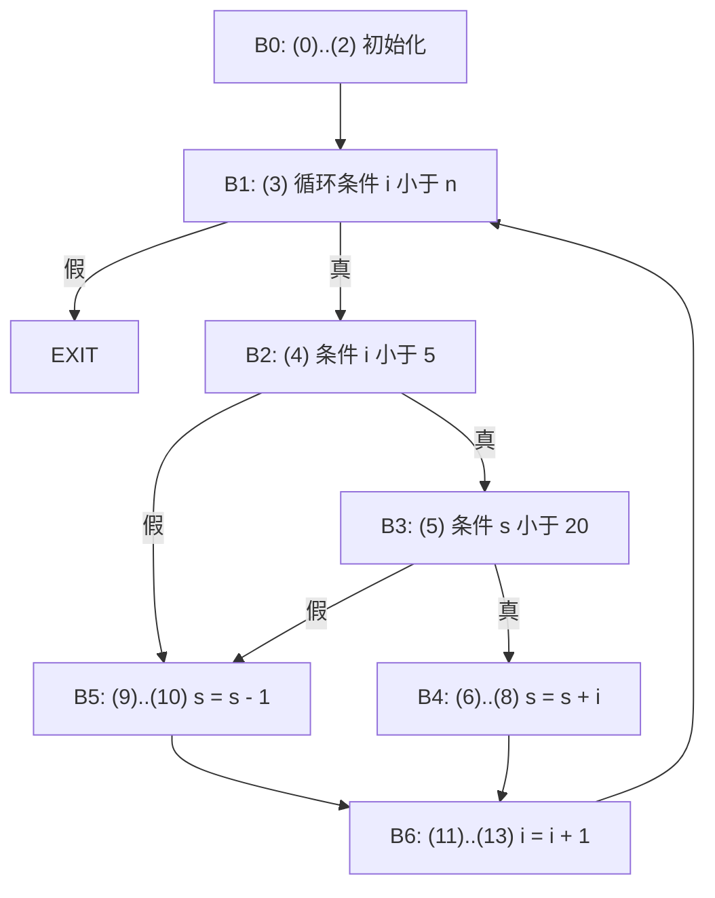

# $\rm Chapter \, 4$ 语义分析与 IR

> **本章假设你已经会**
>
> 1. 编译器六级流水线，以及语义分析与中间表示 IR 各消哪类歧义，见本册 §1.1。
> 2. 递归下降「每个非终结符一个函数」的写法，见本册 §2.6。
> 3. bison 的值栈与语义动作：归约时把子树合成父树，见本册 §3.8。
> 4. 静态类型与动态类型的区别、类型推断的用途，见《编程语言》§16.6.1、§16.6.2。
> 5. python3 函数、字典与命令行跑脚本的方法，见《编程语言》§17.2、§17.9。

第 2、3 章交出一棵唯一的语法树，可它对 §1.1 那句 `count = count + 1;` 只回答了「怎么分组」。还有三个问题悬着：这个 `count` 指的是哪一次声明；`+` 两边的类型配不配、配不上要不要先转换；这棵树最后对应哪几条机器能逐条执行的指令。前两个问题属于流水线第 3 级（语义分析），第三个属于第 4 级（降级到 IR）。本章把两级一口气走完，路线是：语法树瘦身成抽象语法树（§4.1）→ 符号表管名字（§4.2）→ 类型检查管含义（§4.3）→ 表达式降成三地址码（§4.4）→ 控制流降成标签与跳转（§4.5）→ 切基本块、连控制流图（§4.6）→ 一个真实错误（§4.7）。贯穿全章的是一门玩具语言：`int`/`float` 声明、`var` 推断声明、赋值、花括号块、`if`/`else`、`while`，表达式含四则、一元负号、比较与 `&&`/`||`，解析器按 §2.6 的写法手写递归下降。全部数字先跑后写，脚本与输出见章末实验记录。

## $\rm \S \, 4.1$ 问题：语法树里的噪声与空白

先看语法树有多「啰嗦」。§3.3 用 G1 解析 `id + id * id`，归约了 8 次，每次归约生一个内部结点，于是推导树有 8 个内部结点：`E -> T`、`T -> F`、`F -> id` 这类单链产生式各占一个，括号之类的标点也各占一片叶子。后面的阶段关心的只有两件事：一个乘法、一个加法，乘法是加法的右孩子。把单链产生式压扁、标点删掉、只留「运算符当内部结点，名字与常量当叶子」，得到的树叫**抽象语法树**（abstract syntax tree，AST）。上面那句的 AST 只有 2 个内部结点、3 片叶子，层次关系（也就是优先级）原样保留，因为它已经刻在父子结构里，不再需要 `E`、`T`、`F` 三层名字来维持。

AST 不需要再跑一遍算法去「转换」得到：它就是解析时顺手搭的。§3.8 说过，归约时语义动作从值栈上取子结点、合成父结点再压回；把动作写成「为 `E -> E + T` 新建一个 `+` 结点，左右孩子取第 1 个与第 3 个子符号的值」，`E -> T` 的动作写成「原样传上去」，解析结束时值栈顶就是 AST。递归下降里是同一个意思：每个解析函数的返回值就是它那棵子树。这种「语义随语法结构走」的写法叫**语法制导翻译**（syntax-directed translation），本章后面几节的每一趟遍历都是它的变体：按结构递归，子结构的结果拼成父结构的结果。

AST 解决了噪声，没解决空白。树上一片叫 `x` 的叶子不知道自己是哪个 `x`、是什么类型；一个 `+` 结点不知道自己是整数加还是浮点加；`while` 结点更说不出「循环体执行完跳回哪里」。下面四节逐一补上：先给每片名字叶子挂上它的声明，再给每个结点挂上类型，最后把树压平成一串带编号的简单指令。

白话：语法树是一份逐字记录的会议纪要，AST 是删掉寒暄只留决议的版本；可决议里写着「由他负责」，他是谁，纪要本身查不到，得翻花名册。

> 本节小结：AST = 去掉标点与单链产生式、只留运算结构的树，由语义动作在解析时顺手搭成；它还缺名字归属、类型与执行顺序三样信息。

## $\rm \S \, 4.2$ 符号表与作用域：名字指向哪次声明

同一个名字在一个程序里可以声明多次，C、C++、本章的玩具语言都允许内层块重新声明外层已有的名字。规定「一次使用指向哪次声明」的规则叫**作用域**（scope）规则。主流语言用**词法作用域**（lexical scope）：只看源代码的嵌套结构就能定案，不看运行时谁调用了谁。设使用点 $u$ 位于块链 ${b_k\subset b_{k-1}\subset\cdots\subset b_0}$ 中（$b_k$ 是包住 $u$ 的最内层块，$b_0$ 是全局），则

$$
\mathrm{resolve}(x,u)=\text{块 } b_j \text{ 中对 } x \text{ 的那次声明，}\quad j=\max\{\,i:\ b_i \text{ 在 } u \text{ 之前声明过 } x\,\}
$$

读法：从使用点所在的最内层块开始往外一层层找，第一个「在使用点之前就声明过 $x$」的块赢；内层声明把外层同名声明挡住，这叫**遮蔽**（shadowing）。

**符号表**（symbol table）是实现这条规则的数据结构：名字到「声明信息」（类型、声明行、所在深度）的映射。词法作用域与块的进出严格嵌套，正好是栈的形状，于是最直接的实现是**作用域栈**：一个栈，每层一张哈希表。四个操作：进块压一张空表（push）；出块弹掉栈顶表（pop）；声明只写栈顶表，栈顶已有同名即报「重复声明」；查找从栈顶往栈底逐表查，第一次命中即返回。查找最坏要扫 $d$ 张表，$d$ 是当时的嵌套深度。另一种工程实现把它翻过来：一张总哈希表，每个名字挂一个声明栈，出块时把本块声明过的名字各弹一次，查找降到常数次。两者对外行为相同。

实验程序（左列是行号）：

```text
 1 | int x;              8 |     int y;
 2 | int y;              9 |     y = 3;
 3 | x = 1;             10 |     x = x + y;
 4 | {                  11 |   }
 5 |   float x;         12 |   y = 4;
 6 |   x = 2.5;         13 | }
 7 |   {                14 | x = x + y;
```

语义分析器给每次声明发一个唯一编号 `名字.序号`（`x.1` 是第 1 行的 `x`，`x.2` 是第 5 行的 `float x`），对 10 次名字使用的解析结果实验原样输出：

```text
x@L3 -> x.1 (decl L1, depth 0, steps 1)     y@L10 -> y.2 (decl L8, depth 2, steps 1)
x@L6 -> x.2 (decl L5, depth 1, steps 1)     y@L12 -> y.1 (decl L2, depth 0, steps 2)
y@L9 -> y.2 (decl L8, depth 2, steps 1)     x@L14 -> x.1 (decl L1, depth 0, steps 1)
x@L10 -> x.2 (decl L5, depth 1, steps 2)    y@L14 -> y.1 (decl L2, depth 0, steps 1)
```

（第 10 行与第 14 行的 `x` 各出现两次，结果相同，只列一次。）逐条对规则：第 10 行站在深度 2 的块里，`y` 在本层就有（第 8 行），1 步命中；`x` 本层没有，往外一层在深度 1 找到 `float x`，2 步命中，所以这一行是「float 加 int」。第 12 行时深度 2 的块已经弹栈，`y` 只能找到第 2 行的全局 `y.1`，2 步。第 14 行回到全局，两层内块都弹掉了，`x`、`y` 都回到第 1、2 行。10 次使用平均查 1.3 张表。

编号还有一个更要紧的用处：下游从此只认编号。本程序降级后的指令里出现的是 `x.1`、`x.2`、`y.1`、`y.2` 四个互不相同的名字，IR 里不再有块和作用域，「哪个 `x`」这层歧义在此级彻底消掉，正是全册心智模型说的「每级解决一个歧义」。最终状态实测 `x.1 = 5`、`x.2 = 5.5`：内层的浮点 `x` 变成 5.5，外层的整数 `x` 只吃到 `1 + 4`。

白话：符号表像一摞透明胶片，每进一个块往上叠一张，查名字从最上面往下看，先看到的字算数；出块就把最上面那张抽走，底下的字重新露出来。

> 本节小结：词法作用域 = 从内往外找第一个先于使用点的声明；作用域栈按块 push/pop 实现，查找代价随嵌套深度线性；给每次声明发唯一编号后，IR 不再含作用域。

## $\rm \S \, 4.3$ 类型检查：每个结点的类型从哪来

名字找到了声明，下一个问题是「这个运算有没有意义」。`b + 1` 里 `b` 若是布尔值，算出来的东西没有定义；`i = 3.5` 若 `i` 是整数，静默截断会悄悄丢掉 0.5。**类型检查**（type checking）在编译期给每个表达式结点算出一个类型，算不出来就报错。

规则用**类型判断**（typing judgment）书写：${\Gamma\vdash e:\tau}$ 读作「在环境 $\Gamma$ 下，表达式 $e$ 的类型是 $\tau$」，$\Gamma$ 就是 §4.2 那张符号表在当前位置的视图，把名字映到类型。横线上方是前提，下方是结论：

$$
\frac{\Gamma(x)=\tau}{\Gamma\vdash x:\tau}
\qquad
\frac{\Gamma\vdash e_1:\tau_1\quad \Gamma\vdash e_2:\tau_2\quad \tau_1,\tau_2\in\{\mathtt{int},\mathtt{float}\}}{\Gamma\vdash e_1\ \mathtt{op}\ e_2:\ \tau_1\sqcup\tau_2}
$$

读法：左边是说名字的类型就是符号表里登记的类型；右边是说两侧都是数时，四则运算的结果取两者的「上界」，记作 $\sqcup$：${\mathtt{int}\sqcup\mathtt{int}=\mathtt{int}}$，只要有一侧是 $\mathtt{float}$ 结果就是 $\mathtt{float}$。比较运算的前提相同、结论换成 $\mathtt{bool}$；`&&`、`||` 要求两侧都是 $\mathtt{bool}$；`if`、`while` 的条件必须是 $\mathtt{bool}$。赋值 `x = e` 要求 ${\sigma\le\tau}$，其中 $\sigma$ 是 $e$ 的类型、$\tau$ 是 $x$ 的类型，偏序只有一条非平凡关系 ${\mathtt{int}\le\mathtt{float}}$：整数可以放进浮点变量，反过来不行。

规则直接就是算法：自底向上递归，叶子查表，内部结点按规则合成，这正是 §4.1 说的语法制导翻译。检查器顺手做第二件事：凡是规则里「int 被当成 float 用」的地方，在树上插一个显式的转换结点 `itof`，这叫**隐式转换**（coercion）的显式化。插了以后，下游看到的每个 `+` 两侧类型完全相同，「整数加还是浮点加」的歧义消失。

`var k = e;` 是最简单的**局部类型推断**：声明不写类型，先按上面的规则算出 ${\Gamma\vdash e:\sigma}$，再把 ${k:\sigma}$ 登记进符号表。它只看初始化式这一处，与《编程语言》§16.6.2 的 `auto` 同级；Haskell、OCaml 那种跨整个函数解方程组的推断（Hindley–Milner 算法）是选读方向，本章不展开。

还剩一个工程细节：一处错了，别连锁报一串。检查器引入一个特殊类型 $\mathtt{err}$，任何前提里含 $\mathtt{err}$ 的规则直接返回 $\mathtt{err}$ 且不再报错，于是一个病灶只出一条诊断。实验程序与检查器的原样输出：

```text
 1 | int i;                       7 | if (i + 1) f = 0.5;
 2 | float f;                     8 | while (i < 10 && f) i = i + 1;
 3 | var k = i * 2;               9 | var b = i < k;
 4 | var r = f + k;              10 | k = b + 1;
 5 | i = 3.5;                    11 | z = 1;
 6 | f = i + 1;                  12 | int i;

inferred var types: [('k', 3, 'int'), ('r', 4, 'float'), ('b', 9, 'bool')]
conversions inserted: 2
line 5: cannot assign float to int        line 10: + needs numbers, got bool,int
line 7: if condition is int               line 11: undeclared z
line 8: && needs bool, got bool,float     line 12: redeclared i
```

6 处错误行，恰好 6 条诊断，第 10 行的 $\mathtt{err}$ 没有再让赋值多报一条。2 次插入转换分别在第 4 行（`k` 转浮点再与 `f` 相加）与第 6 行（`i + 1` 的整数结果转浮点再存进 `f`）。第 12 行的报错来自 §4.2 的规则：重复声明只在同一层表里查。

转换插在哪一层是有语义后果的。`y = x * i + i / 2`（`i` 整数，`x`、`y` 浮点）实测降级为：

```text
(0) t1 = itof i.1        (3) t4 = itof t3
(1) t2 = x.1 * t1        (4) t5 = t2 + t4
(2) t3 = i.1 / 2         (5) y.1 = t5
```

`i / 2` 两侧都是整数，按规则类型是 $\mathtt{int}$，先做整数除法再转换，`i = 5` 时贡献 2.0 而不是 2.5。这就是 C 语言里 `x * i + i / 2` 的行为，类型规则把它从「容易踩的坑」变成「可推导的结论」。

白话：类型检查是给每个零件贴规格标签，装配前对标签：标签对得上直接装，差一个「整数转浮点」的转接头就自动补上，彻底对不上就停线报警，而且只为同一个坏零件报警一次。

> 本节小结：类型判断 ${\Gamma\vdash e:\tau}$ 加推理规则即检查算法；混合运算按 $\sqcup$ 取上界并插入显式 `itof`；`var` 是只看初始化式的局部推断；$\mathtt{err}$ 类型阻断连锁报错，实测 6 处病灶恰报 6 条。

## $\rm \S \, 4.4$ 三地址码：把树压平成指令串

带类型的 AST 已经没有歧义，但它还是树，而 CPU 执行的是一条接一条的指令，每条只做一次运算。中间表示要往机器那边再迈一步：**三地址码**（three-address code，TAC），每条指令形如 ${x=y\ \mathtt{op}\ z}$，至多一个运算符、至多三个「地址」（名字、常量或编译器生成的临时变量）。机器内部常把它存成**四元式**（quadruple）：(运算符, 参数 1, 参数 2, 结果)。嵌套表达式的中间结果没有源程序名字可放，就放进**临时变量**（temporary）`t1`、`t2`……

降级算法又是一趟语法制导翻译。设 $\mathrm{gen}(e)$ 发射 $e$ 的指令并返回存放结果的地址：叶子不发射任何指令，直接返回名字或常量；一元结点先 $\mathrm{gen}$ 孩子得地址 $a$，再申请新临时 $t$、发射 ${t=\mathtt{minus}\ a}$，返回 $t$；二元结点先左后右 $\mathrm{gen}$ 两个孩子，再申请 $t$、发射 ${t=a\ \mathtt{op}\ b}$；赋值 `x = e` 发射 $\mathrm{gen}(e)$ 再追加一条复制 ${x=a}$。对经典例子 `a = b * -c + b * -c` 的实验原样输出：

```text
(0) t1 = minus c.1         (minus, c.1, _, t1)
(1) t2 = b.1 * t1          (*, b.1, t1, t2)
(2) t3 = minus c.1         (minus, c.1, _, t3)
(3) t4 = b.1 * t3          (*, b.1, t3, t4)
(4) t5 = t2 + t4           (+, t2, t4, t5)
(5) a.1 = t5               (=, t5, _, a.1)
```

临时变量的编号账可以精确算出。记 $I(e)$ 为 $e$ 的内部结点数，$T(e)$ 为 $\mathrm{gen}(e)$ 申请的临时变量数。对树的结构归纳：叶子 ${I=T=0}$；一元结点 ${T(e)=T(e_1)+1}$，而 ${I(e)=I(e_1)+1}$；二元结点

$$
T(e)=T(e_1)+T(e_2)+1=I(e_1)+I(e_2)+1=I(e)
$$

读法：每个内部结点恰好发射一条指令、恰好申请一个新临时，叶子什么都不申请，所以临时变量数等于内部结点数，一条赋值的指令数等于内部结点数加 1。上例内部结点是 2 个 `minus`、2 个 `*`、1 个 `+`，共 5 个，`t1` 到 `t5` 正好 5 个，指令 6 条。随机生成 2000 个含混合类型的表达式（插入的 `itof` 也算内部结点），实测 ${T=I}$ 成立 2000/2000；把 TAC 交给一台逐条执行的解释器，与直接在 AST 上求值的结果一致 2000/2000。

临时变量多不等于花销大。树形代码里每个临时只被它的父结点用一次，用完即死，于是可以回收：「用过即释放、申请时取编号最小的空闲临时」，上例降到 `t1`、`t2` 两个名字轮换，同时活着的最多 2 个。2000 个随机表达式平均每个申请 11.27 个临时，回收后同时活着的峰值平均只有 2.52、最大 5。峰值才是将来要占寄存器的数，第 7 章的寄存器分配处理的正是这个数。上例还有一处浪费：`b * -c` 算了两遍，树看不出两棵子树相同，识别公共子表达式要等第 6 章的数据流分析。

白话：三地址码像把一道连环算式拆成流水线工位，每个工位只做一次加减乘除，中间产品放进编号托盘；托盘编号可以开得很阔绰，因为谁也不会同时用很多托盘，后面自有人回收。

> 本节小结：TAC = 每条至多一个运算的指令串，存为四元式；$\mathrm{gen}$ 后序遍历发射指令，临时数等于内部结点数（归纳可证，实测 2000/2000）；回收后同时活着的临时平均 2.52 个。

## $\rm \S \, 4.5$ 控制流的降级：标签与跳转

表达式压平只用到「顺序执行」。`if` 与 `while` 要求跳过一段或者跳回去，TAC 为此加三种指令：`goto L` 无条件跳到标签 `L`；`if x < y goto L` 条件成立才跳；`ifFalse x < y goto L` 条件不成立才跳。标签只是给某条指令起的名字，降级完成后统一换成指令编号。

翻译方案按结构写。约定 $\mathrm{cond}(B,T,F)$ 发射条件 $B$ 的代码：为真跳到 $T$、为假跳到 $F$，其中某一个可以是「落下」，意思是不跳、顺序执行下一条。那么

```text
if (B) S1 else S2  =>        cond(B, 落下, Lelse)       while (B) S  =>  Lbegin: cond(B, 落下, Lnext)
                             code(S1)                                            code(S)
                             goto Lnext                                          goto Lbegin
                      Lelse: code(S2)                                    Lnext:
                      Lnext:
```

`&&` 与 `||` 不必算出一个布尔值再判断，而是直接拆成跳转，这种写法叫**跳转代码**（jumping code）。`B1 && B2` 的 $\mathrm{cond}$：先发射 ${\mathrm{cond}(B_1,\text{落下},F)}$，$B_1$ 假时直接去 $F$；$B_1$ 真时落到 $B_2$，再发射 ${\mathrm{cond}(B_2,T,F)}$。`B1 || B2` 对称：$B_1$ 真直接去 $T$，假则落到 $B_2$。它天然就是**短路求值**（short-circuit evaluation）：$B_1$ 已定案时，$B_2$ 的代码根本跳不到。在 C 里 `p != 0 && p->x > 0` 能安全写，靠的就是这个翻译。

实验程序与降级结果（14 条指令，实验原样输出）：

```text
源程序                                       TAC
i = 0; s = 0; n = 10;                        (0) i.1 = 0                    (7) s.1 = t1
while (i < n) {                              (1) s.1 = 0                    (8) goto (11)
  if (i < 5 && s < 20) s = s + i;            (2) n.1 = 10                   (9) t2 = s.1 - 1
  else s = s - 1;                            (3) ifFalse i.1 < n.1 goto (14)  (10) s.1 = t2
  i = i + 1;                                 (4) ifFalse i.1 < 5 goto (9)   (11) t3 = i.1 + 1
}                                            (5) ifFalse s.1 < 20 goto (9)  (12) i.1 = t3
                                             (6) t1 = s.1 + i.1             (13) goto (3)
```

对着方案读：第 (3) 条是 `while` 的出口判断，假则跳到 (14)，即程序末尾；第 (4)、(5) 条是 `&&` 的两半，任何一半为假都直接跳到 `else` 分支 (9)；第 (8) 条是 then 分支末尾跳过 else 的 `goto Lnext`；第 (13) 条跳回循环头。「落下」这个约定省了不少指令：若每个条件都老实写成「真跳 T、再 goto F」两条，同一程序实测 17 条，多出的 3 条都是紧跟在条件跳转后的 `goto`。在 500 个随机生成的嵌套 if/while 程序上，落下版本比老实版本总共少 7.8% 的指令（33473 对 36321），两个版本的执行结果一致 500/500。

白话：控制流降级就是把结构化的「如果……否则……」「当……时反复」改写成路标：在岔路口竖一块「不满足就去 9 号工位」的牌子，没牌子的地方就顺着传送带往下走。

> 本节小结：if/while 按固定方案降成条件跳转、无条件跳转与标签；`&&`/`||` 降成跳转代码，短路求值是其自然结果；「落下」约定实测省掉 17 条中的 3 条、随机程序上省 7.8%。

## $\rm \S \, 4.6$ 基本块与控制流图

跳转进了指令串，分析就麻烦了：任意一条指令都可能从别处跳进来，「执行到这里时某变量是什么值」没法只看上一行回答。办法是把指令串切成段，段内保证顺序执行。**基本块**（basic block）是满足两条性质的最长连续指令段：控制只能从第一条进入，只能从最后一条离开（中间不跳入、不跳出）。切分只需要找出每块的第一条，叫**首指令**（leader），三条规则：

1. 整个程序的第一条是首指令。
2. 任何跳转（条件或无条件）的目标是首指令。
3. 紧跟在任何跳转之后的那条是首指令。

从一个首指令到下一个首指令之前，就是一个基本块。两条性质为什么成立：进入一条指令只有两种方式，被跳到或从上一条顺序落下；被跳到的都按规则 2 成了首指令，所以非首指令只能从上一条落下进来，块中段不会被跳入。离开也只有两种方式，跳走或落到下一条；块内任何跳转之后紧跟的那条按规则 3 是下一块的首指令，所以跳转只可能出现在块的最后一条，块中段不会跳出。

把块当结点、可能的控制转移当边，得到**控制流图**（control-flow graph，CFG）：块末是 `goto` 连一条边到目标块；块末是条件跳转连两条边，一条到目标块、一条到下一块（条件不成立时落下）；块末不是跳转连一条边到下一块；落出程序末尾的连到一个虚拟的 EXIT 结点。§4.5 的程序实测首指令为 (0)、(3)、(4)、(5)、(6)、(9)、(11)，切成 7 块、连 10 条边：



源程序的结构全在图上：B1 是循环头，B6 到 B1 的回边是循环；B2、B3 是 `&&` 的两道关卡，任一失败都汇到 B5。把这段 TAC 交给解释器跑完，`s` 实测为 5，与直接在 AST 上执行一致。

图的形状还藏着一个可以精确推出的数。设除 EXIT 外有 $N_b$ 个基本块，其中 $D$ 个以条件跳转结尾，且每个条件跳转的目标与落下点不同。由上面的连边规则，以条件跳转结尾的块出度为 2，其余块出度为 1，EXIT 出度为 0，于是边数 ${E=2D+(N_b-D)=N_b+D}$。记结点总数 ${N=N_b+1}$（含 EXIT），则

$$
E-N+2=(N_b+D)-(N_b+1)+2=D+1
$$

读法：左边是图论里只看点数边数的量，软件工程把它叫圈复杂度（cyclomatic complexity，又名 McCabe 复杂度），常用来估测试要覆盖多少条独立路径；右边是「条件跳转个数加 1」。推导说明二者在这种 CFG 上恒等。本例 ${N_b=7}$、${D=3}$、${E=10}$、${N=8}$，两边都是 4；500 个随机程序上恒等式成立 500/500（平均每个程序 10.67 块、16.36 条边）。注意 `&&` 让一个源码层面的 `if` 贡献了 2 个条件跳转，圈复杂度按降级后的跳转数算，比按源码里的关键字数更准。

规则 3 不能省。实验把它关掉重新切分，§4.5 的程序只剩 4 块，其中 3 条跳转被困在块中段，「只从最后一条离开」的性质当场失效，之后在这种块上做的任何分析都建在错误的前提上。

白话：基本块是一节节没有岔口的直道，CFG 是把直道当路段、岔口当路口画出的地图；后面的优化都在这张地图上算账，地图画错，账全错。

> 本节小结：首指令三规则切出基本块，两条性质由规则 2、3 分别保证；CFG 按块末指令连边；实测样例 7 块 10 边，${E-N+2=D+1}$ 的恒等式推导给全并在 500 个随机程序上验证。

## $\rm \S \, 4.7$ 一个真实错误：用一张平铺的字典当符号表

初学者写符号表，最顺手的是一张全局字典：遇到声明就 `table[name] = info`，遇到使用就 `table[name]`。实验把 §4.2 的作用域栈换成这个版本，对同一个 14 行程序跑：**没有任何报错**，类型检查照样通过，但 10 次名字使用里有 4 次解析错了，全在内层块结束之后：

```text
use      正确      平铺字典
y@L12    y.1       y.2
x@L14    x.1       x.2    （第 14 行两次 x 都错）
y@L14    y.1       y.2
```

诊断链：症状是程序跑出来外层 `x` 实测为 1（正确是 5），而内层浮点 `x` 被算成 9.5，编译期一声不吭。定位方法是把每次使用的解析结果按「使用行 → 声明编号」打印出来，与 §4.2 公式逐条对照，错的 4 行全部指向已经结束的块里的声明。病根：内层声明覆盖了字典里外层的条目，出块时没有任何动作把外层条目恢复，相当于透明胶片只往上叠、从不抽走。第 12 行的 `y = 4` 本该写全局 `y`，实际写进了已经死掉的内层 `y`；第 14 行的 `x = x + y` 则整句跑到了浮点变量上，类型检查还顺手给它插了转换，错得天衣无缝。修复：换回作用域栈（或「每个名字一个声明栈、出块弹栈」的变体）。验证：解析表 10/10 与规则一致，最终 `x.1 = 5`。

这个错误静默，是因为它不违反任何类型规则，只违反作用域规则；检查器只会对自己知道的规则报错。工程上的防线是给符号表单独写一组「嵌套块里同名变量」的回归用例，像本节这样把解析结果整张打出来对账。

白话：平铺字典像只写不擦的白板，新名字写在旧名字上面，下课了也不擦回去；下一节课的人看到的是上一节课留下的字。

> 本节小结：平铺字典符号表在出块后不恢复外层绑定，实测 10 次使用错 4 次且零报错；修复是作用域栈，防线是把解析结果打出来对账。

## $\rm \S \, 4.8$ 关键概念回顾

1. AST 比推导树少了什么、保留了什么？为什么不需要单独的算法把推导树「转换」成 AST？
2. 写出词法作用域的解析规则；作用域栈的四个操作各做什么，查找代价是多少？
3. 解释类型判断 ${\Gamma\vdash e:\tau}$ 的含义；混合运算的规则如何同时决定结果类型和转换插入位置？
4. 证明一条赋值语句降成 TAC 后，临时变量数等于右部表达式的内部结点数。
5. 首指令的三条规则各保证基本块的哪条性质？

## $\rm \S \, 4.9$ 应用与辨析

1. 同事说：「`float y = 5 / 2;` 结果是 2.0，编译器把除法算错了。」用 §4.3 的类型规则说明转换插在哪、为什么结果是 2.0，并给出得到 2.5 的改法。
2. 一段 TAC 共 30 条指令，切出 9 个基本块（不含 EXIT），其中 4 块以条件跳转结尾、且每个条件跳转的目标与落下点不同。不看指令，求 CFG 的边数与圈复杂度，写出推理链。
3. 你的符号表实现通过了所有「未声明变量」「重复声明」的报错测试，却在一个嵌套块程序上算错了结果。列出你会怎么定位，并说明为什么已有的报错测试抓不到它。

## $\rm \S \, 4.10$ 本章自测答案

1. 少了标点叶子与单链产生式（`E -> T`、`T -> F` 之类）的结点，保留运算符结点及其父子结构，优先级就刻在结构里（§4.1）。AST 由归约时的语义动作或递归下降函数的返回值直接搭成，是语法制导翻译的产物（§4.1、§3.8）。
2. 规则见 §4.2 公式：从包住使用点的最内层块往外找，第一个在使用点之前声明过 $x$ 的块中那次声明。push 进块压空表，pop 出块弹表，declare 写栈顶表且查重，lookup 自顶向下逐表查；查找最坏扫 $d$ 张表，$d$ 为嵌套深度（§4.2）。
3. 含义是「在符号表视图 $\Gamma$ 下 $e$ 的类型为 $\tau$」。混合运算规则取 ${\tau_1\sqcup\tau_2}$ 作结果类型；哪一侧的类型低于结果类型，就在哪一侧插 `itof`（§4.3）。
4. 对表达式树结构归纳：叶子不发射指令、不申请临时，${T=I=0}$；一元或二元结点在孩子的临时之外恰好再申请一个，内部结点数也恰好加 1，故 ${T=I}$；赋值额外的一条复制不申请临时（§4.4 公式）。
5. 规则 1 让程序入口落在某块之首；规则 2 让所有被跳入的指令都是块首，保证「只从第一条进入」；规则 3 让每条跳转都处在块尾，保证「只从最后一条离开」（§4.6）。

应用与辨析答案：

1. `5 / 2` 两侧都是 $\mathtt{int}$，按规则结果为 $\mathtt{int}$，先做整数除法得 2；赋给 $\mathtt{float}$ 变量时 ${\mathtt{int}\le\mathtt{float}}$ 成立，才在整个右部外面插 `itof`，得 2.0。编译器按规则办事，没有算错。改成 `5.0 / 2` 后一侧为 $\mathtt{float}$，转换插到 `2` 上，做浮点除法得 2.5（§4.3 的 `i / 2` 实验同理）。
2. 条件跳转结尾的 4 块各出度 2，其余 5 块各出度 1，故 ${E=4\times 2+5=13}$；含 EXIT 共 ${N=10}$ 个结点，圈复杂度 ${E-N+2=5=D+1}$（§4.6 推导；指令总数 30 与结论无关）。
3. 把每次名字使用解析到的声明编号整张打印，与 §4.2 的规则逐条比对，重点看内层块结束之后的使用。报错测试只验证「该报错时报错」，而作用域错误不违反任何报错规则，出错的程序依然通过检查，只能靠解析结果或运行结果对账抓到（§4.7）。

**你现在能做什么**：给一段带嵌套块与 if/while 的小程序，手工或用脚本写出每个名字解析到哪次声明、在哪里插类型转换、降级后的三地址码与临时变量账，并切出基本块、画出控制流图。

到这里，源程序的每个名字都有了唯一编号，每条指令都知道自己的类型，控制流画成了图。可 `x.1`、`t3` 终究只是名字：程序真正跑起来时，它们放在内存的哪里？函数调用时谁来保存、谁来恢复？递归调用的两份 `x.1` 又怎么共存？下一章进入运行时组织，从活动记录与栈帧讲起。

---

实验记录：本章 §4.2–§4.7 全部实测数字来自脚本 `exp04.py`（WSL python3 标准库，随机种子 20261106），原始输出存于写作工作目录 `26Fall/_uni5_work/expCP04/result.txt`；复现命令（Git Bash）：

```bash
wsl bash -c "cd /mnt/c/Users/20811/Desktop/26Fall/_uni5_work/expCP04 && python3 -u exp04.py > result.txt 2>&1"
```

锚点数字：作用域实验 10 次名字使用全部按词法规则解析、平均查表 1.3 张、最终 `x.1 = 5`、`x.2 = 5.5`；平铺字典错 4/10 且零报错、外层 `x` 得 1、内层得 9.5；类型实验 6 处病灶 6 条诊断、插入转换 2 次、`var` 推断出 int/float/bool；`a = b * -c + b * -c` 降为 6 条指令、临时 `t1` 到 `t5`，回收后 2 个；随机 2000 表达式临时数等于内部结点数 2000/2000、TAC 与 AST 求值一致 2000/2000、平均临时 11.27、回收后峰值平均 2.52 最大 5；控制流样例 14 条指令（老实版 17 条）、首指令 7 个、7 块 10 边、${E-N+2=D+1=4}$、`s = 5`；关掉首指令规则 3 剩 4 块且 3 条跳转困在块中段；随机 500 程序 AST 与 TAC 一致 500/500、两版跳转代码一致 500/500、恒等式 500/500、平均 10.67 块 16.36 边、落下版少 7.8% 指令。
