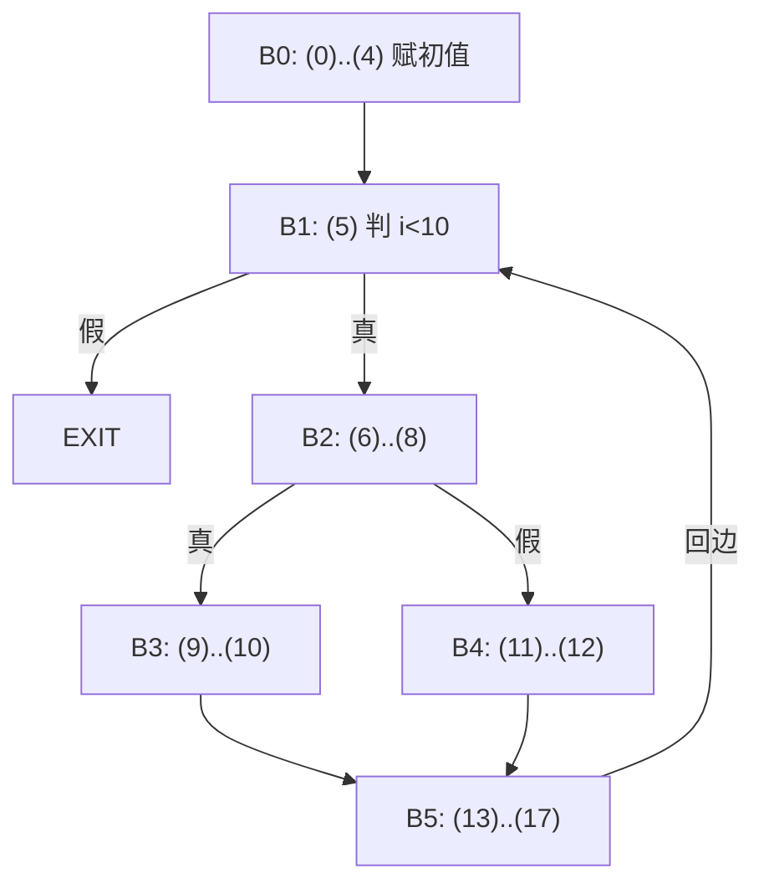

# $\rm Chapter \, 6$ 数据流优化

> **本章假设你已经会**
> 1. 三地址码的形状，以及 `if`/`while` 降成条件跳转与标签的方案，见本册 §4.4、§4.5。
> 2. 首指令三规则切基本块、按块末指令连出控制流图、虚拟 EXIT 结点，见本册 §4.6。
> 3. 「反复套规则，直到一整轮没有变化」的不动点迭代手感，见本册 §2.2、§2.3 的 FIRST 与 FOLLOW。
> 4. 被调者保存寄存器只值得留给跨调用还活着的值，见本册 §5.3。
> 5. 偏序与最大下界的说法，见《范畴论4CS》§1.3.4、§4.2；本章会当场重新定义一遍。

第 4 章交出一张控制流图，第 5 章把名字落到了地址。可图上的每一条指令还带着一层歧义：`z = a + b` 里的 `a` 是哪一次赋的值？这个 `a + b` 前面是不是已经算过？算出来的 `z` 之后还有没有人读？全册的心智模型是逐级降级翻译，每级解决一个歧义；这一级有点特别，表示的语法一个字没变，还是三地址码，变的是附在上面的确定性：**此处到底知道什么**。第 4 章 §4.4 欠下的账（`b * -c` 算了两遍）和第 5 章末尾的问题（编译器怎么知道一个值还活着）都在这里结清。路线是：把「所有路径」压成局部方程（§6.1）→ 到达定值（§6.2）→ 活跃变量（§6.3）→ 可用表达式（§6.4）→ 半格与单调性（§6.5）→ 不动点定理（§6.6）→ 轮数上界（§6.7）→ 迭代解与理想解的差距（§6.8）→ 事实变改写（§6.9）→ 一个真实错误（§6.10）。实验全部在 WSL 的 python3 标准库上跑，种子 20261106，数字先跑后写，见章末实验记录。

## $\rm \S \, 6.1$ 问题：一个程序点上，所有路径的共同事实

全章用同一张图。源程序和它的三地址码如下（§4.4 的降级会把 `x = a + b` 写成 `t = a + b; x = t` 两条，这里合写成一条，省掉一批只用一次的临时变量，编号表更短）：

```text
源程序                            TAC（18 条，括号里的编号同时是下文「定值」的名字）
i = 0; s = 0; a = 4; b = 2;       (0) i = 0       (6) x = a + b                 (12) y = b * b
c = b * b;                        (1) s = 0       (7) y = 0                     (13) z = a + b
while (i < 10) {                  (2) a = 4       (8) ifFalse i < 5 goto (11)   (14) s = s + y
  x = a + b;  y = 0;              (3) b = 2       (9) y = a + b                 (15) s = s + z
  if (i < 5) y = a + b;           (4) c = b * b   (10) goto (13)                (16) i = i + 1
  else { a = x; y = b * b; }      (5) ifFalse i < 10 goto (18)  (11) a = x      (17) goto (5)
  z = a + b;  s = s + y;  s = s + z;  i = i + 1;
}
```

按 §4.6 的规则切出 6 块，加 EXIT 共 ${N=7}$ 个结点、8 条边、2 个条件跳转，${E-N+2=3=D+1}$，§4.6 的恒等式照样成立；解释器实跑 116 条指令，最后 `s = 140`。图上有三处肉眼可见的优化机会：(9) 的 `a + b` 刚在 (6) 算过，能不能不算？(7) 的 `y = 0` 两条分支都会覆盖它，能不能删？(13) 读的 `a` 有两个来源，到底是不是常量？这些答案都是**跨路径的事实**，只盯当前基本块回答不了。



朴素想法是枚举从入口到这里的所有路径，逐条模拟。回边一出现路径就有无穷多条；何况真实执行走哪条取决于运行时的值，「这条指令可能执行到吗」这种语义性质按 Rice 定理不可判定（《形式语言与自动机》§5.4、《计算理论》§2.3）。所以编译器做两步退让。第一，把 CFG 上的每条路径都当作可能发生，哪怕 `i < 5` 和 `i < 10` 其实相关。第二，答案只许往一个方向错：多报一个「可能活着」只是少删一条指令，少报就可能删错。这种宁亏不错的约定叫**保守**（conservative）。无穷多条路径怎么算？靠这样一个观察：任何路径走到块 $B$ 之前，都得先穿过 $B$ 的某个前驱。所以每块只需要两个集合：入口事实 $\mathrm{IN}[B]$ 和出口事实 $\mathrm{OUT}[B]$。入口由前驱的出口合并而来，出口由入口经块内指令变换而来。路径的无穷被折叠成每块两个未知数的有限方程组，这就是**数据流分析**（data-flow analysis）。方程组有环，解法是迭代，§2.2 算 FIRST 时你已经用过同样的手法。

白话：数据流分析是给地图上每个路口贴一张公告，只写「不管你从哪条路来，这里都成立」的话；路无穷多，公告只有有限张，每张只抄相邻路口的公告再加减几笔。

> 本节小结：优化需要跨路径的事实；精确答案不可判定，于是把图上路径全算可行、只往安全方向错，并把无穷路径折叠成每块 IN、OUT 两个未知数的方程组。

## $\rm \S \, 6.2$ 到达定值：这个值是谁写的

对变量的一次赋值叫**定值**（definition），本章直接用指令编号当它的名字。定值 $d$ **到达**（reach）程序点 $p$，是说存在一条从 $d$ 之后走到 $p$ 的路径，路上没有对同一变量的另一次定值。这就是**到达定值**（reaching definitions）分析：回答「此处读到的 `a`，可能是谁写的」。若只有一个定值到达、右边还是常量，就能做常量替换；若把一个假想的「未初始化」定值放在入口，它到达某次读，就是未初始化警告。

看一条指令 `d: x = ...`。穿过它之后，$d$ 新到达了，其他写 `x` 的定值全被挡住，别的定值不受影响。记 $\mathrm{gen}$ 为新产生的定值集、$\mathrm{kill}$ 为程序里所有写 `x` 的定值集，指令就是一个集合函数 ${f(X)=G\cup(X\setminus K)}$。这种把入口事实映到出口事实的函数叫**转移函数**（transfer function）。块由若干指令串成，要的是它们的复合。两条指令依次作用，逐步展开：

$$
\begin{aligned}
f_2(f_1(X))&=G_2\cup\bigl((G_1\cup(X\setminus K_1))\setminus K_2\bigr)\\
&=G_2\cup(G_1\setminus K_2)\cup\bigl((X\setminus K_1)\setminus K_2\bigr)\\
&=\underbrace{\bigl(G_2\cup(G_1\setminus K_2)\bigr)}_{G}\cup\bigl(X\setminus\underbrace{(K_1\cup K_2)}_{K}\bigr)
\end{aligned}
$$

读法：复合后仍是同一形状。新 $G$ 是「后一条生成的，加上前一条生成且没被后一条挡住的」；新 $K$ 是两条挡住的并。于是一个块不管多长，都能归纳地压成一对 $(G,K)$。拿 B5 走一遍：(13) 写 `z`，(14) 写 `s`，(15) 又写 `s`，把 (14) 从 $G$ 里挡掉，(16) 写 `i`。实测 ${\mathrm{gen}=}$`{13,15,16}`、${\mathrm{kill}=}$`{0,1,13,14,15,16}`。(14) 永远出不了 B5，这条事实已经写在块的摘要里了。合并规则由定义里那个「存在一条路径」决定：从任何一个前驱带来的定值都算到达，所以是并。方程组是

$$
\mathrm{IN}[B]=\bigcup_{P\in\mathrm{pred}(B)}\mathrm{OUT}[P],\qquad \mathrm{OUT}[B]=\mathrm{gen}_B\cup\left(\mathrm{IN}[B]\setminus\mathrm{kill}_B\right)
$$

读法：入口是所有前驱出口的并，出口是「块里产生的」加上「入口带来且没被挡住的」。入口块的 $\mathrm{IN}$ 固定为空集，这个固定值叫**边界条件**（boundary condition）；其余块初值也取空集，一轮一轮地扫。「一轮」指把所有块各访问一次，一轮之内立刻用最新值，轮数把最后那轮「什么都没变」的确认也算上。核心循环只有几行（集合用位向量存，`order` 是块的访问序）：

```python
while True:
    changed = False                       # 一轮 = 所有块各访问一次
    for b in order:
        a = boundary if b == start else meetall(OUT[p] for p in preds(b))
        o = gen[b] | (a & ~kill[b]); changed |= (a, o) != (IN[b], OUT[b])
        IN[b], OUT[b] = a, o
    if not changed: break                 # 最后一轮只做「什么都没变」的确认
```

按访问序 B0、B1、EXIT、B2、B4、B3、B5 实测，3 轮收敛（B0 的 OUT 两轮都是 `{0,1,2,3,4}`，EXIT 第 2 轮与 B1 相同，表里略去）：

```text
OUT 集   第 1 轮                       第 2 轮（第 3 轮与之逐块相同，确认收敛）
B1       {0,1,2,3,4}                   {0,1,2,3,4,6,9,11,12,13,15,16}
B2       {0,1,2,3,4,6,7}               {0,1,2,3,4,6,7,11,13,15,16}
B3       {0,1,2,3,4,6,9}               {0,1,2,3,4,6,9,11,13,15,16}
B4       {0,1,3,4,6,11,12}             {0,1,3,4,6,11,12,13,15,16}
B5       {2,3,4,6,9,11,12,13,15,16}    {2,3,4,6,9,11,12,13,15,16}
```

第 1 轮 B1 看不到回边，因为 B5 此时还没被访问、OUT 是初值空集；第 2 轮 B5 的 `{13,15,16}` 等定值才绕回来。读结论：实测 ${\mathrm{IN}[\mathrm{B5}]=}$`{0,1,2,3,4,6,9,11,12,13,15,16}`，其中写 `y` 的只有 (9)、(12)，所以 (14) 读的 `y` 绝不可能来自 (7) 的 `y = 0`；写 `a` 的有 (2)、(11)，所以 (13) 的 `a` 确实两个来源，不是常量。结果用两个独立办法核对：定义级暴力不用 gen/kill，直接从每个定值出发做路径搜索，遇到同变量的写就停，逐块相同；解释器实跑时每进一个块就检查「每个变量最后一次真实写入」是否落在 $\mathrm{IN}$ 里，320 次检查零违反。

白话：到达定值像包裹追踪。每次赋值发出一个写着收件人的包裹，沿着路网四处流；同一收件人的新包裹一到，旧包裹就地作废。路口公告写的是「这里可能见到哪些包裹」。

> 本节小结：转移函数 ${G\cup(X\setminus K)}$ 对复合封闭，一块压成一对 gen、kill；「存在路径」决定合流取并；样例 3 轮收敛，(14) 处的 `y` 只来自 (9)、(12)。

## $\rm \S \, 6.3$ 活跃变量：这个值还有人要吗

变量 `x` 在程序点 $p$ **活跃**（live），是说存在一条从 $p$ 出发的路径，路上先读到 `x`，读之前没有被重新写过。这一问问的是未来，所以信息要逆着控制流走，这就是**反向**（backward）分析。回到 §5.3：跨调用还活着的值才配占被调者保存寄存器，第 7 章做寄存器分配也靠它；更直接的用途是赋值之后 `x` 不活跃，这条赋值就可以删。

单条指令 `x = y op z`，由指令之后推指令之前：`x` 被写，之前不必活；`y`、`z` 被读，之前必须活。所以 ${\mathrm{before}=\{y,z\}\cup(\mathrm{after}\setminus\{x\})}$。顺序不能反：`s = s + y` 之前 `s` 是活的，要先减 `x` 再加读到的变量。这依然是 ${G\cup(X\setminus K)}$，只是作用方向反过来，$G$ 叫 $\mathrm{use}$，$K$ 叫 $\mathrm{def}$。把块内指令从后往前复合（下标 1 是块里靠后的指令），$\mathrm{use}_B$ 是块里**写之前就读**的变量，$\mathrm{def}_B$ 是块里写过的变量。方程组是 §6.2 的镜像：

$$
\mathrm{OUT}[B]=\bigcup_{S\in\mathrm{succ}(B)}\mathrm{IN}[S],\qquad \mathrm{IN}[B]=\mathrm{use}_B\cup\left(\mathrm{OUT}[B]\setminus\mathrm{def}_B\right)
$$

读法：出口是所有后继入口的并（又是「存在路径」），入口是「块里先读的」加上「出口要且块里没写过的」。$\mathrm{IN}$、$\mathrm{OUT}$ 始终按执行方向命名，信息却从 $\mathrm{OUT}$ 流向 $\mathrm{IN}$。边界条件放在出口：本例约定 `s` 是程序的结果，${\mathrm{IN}[\mathrm{EXIT}]=}$`{s}`。按访问序 EXIT、B1、B5、B4、B3、B2、B0 实测，3 轮收敛：

```text
         第 1 轮 OUT    第 1 轮 IN     第 2 轮 OUT    第 2 轮 IN（第 3 轮全同）
B1       {s}            {i,s}          {a,b,i,s}      {a,b,i,s}
B5       {i,s}          {a,b,i,s,y}    {a,b,i,s}      {a,b,i,s,y}
B4       {a,b,i,s,y}    {b,i,s,x}      {a,b,i,s,y}    {b,i,s,x}
B3       {a,b,i,s,y}    {a,b,i,s}      {a,b,i,s,y}    {a,b,i,s}
B2       {a,b,i,s,x}    {a,b,i,s}      {a,b,i,s,x}    {a,b,i,s}
B0       {i,s}          {}             {a,b,i,s}      {}
```

第 1 轮 B1 先于 B2 访问，看到的 $\mathrm{IN}[\mathrm{B2}]$ 还是空集，于是 B1、B0 都漏了 `a`、`b`，第 2 轮补上；§6.10 会看到这一轮的漏报能闯多大的祸。读结论：`y` 不在 $\mathrm{OUT}[\mathrm{B2}]$ 里，(7) 的 `y = 0` 是死的；`c` 不在 $\mathrm{OUT}[\mathrm{B0}]$ 里，(4) 也是死的；`z` 只活在 B5 内部，不出现在任何块的边界上，这种值连跨块的寄存器都不用占。反向的指令级暴力搜索逐块相同，动态核对 172 次零违反。

白话：活跃分析是倒着读剧本。从结局往前翻，每翻到一句台词，就记下「这个角色后面还有戏」；翻到他出场登记的那一行，就可以划掉。

> 本节小结：活跃变量是反向、取并的分析，块摘要是「先读」的 use 与「写过」的 def；样例 3 轮收敛，揪出 (4)、(7) 两条死赋值。

## $\rm \S \, 6.4$ 可用表达式：这个值已经算过了吗

表达式 `a + b` 在程序点 $p$ **可用**（available），是说**每一条**从入口到 $p$ 的路径上都算过它，并且最后一次计算之后没有再写 `a` 或 `b`。**可用表达式**（available expressions）分析回答的就是 (9) 能不能不算。定义里是「每一条」，和前两个分析的「存在一条」正好相反，这一个字翻转了整套配置。比较只算读，不进全集；样例的全集 $U$ 是 `b*b`、`a+b`、`s+y`、`s+z`、`i+1`。

单条指令 `x = a + b` 先生成 `a+b`，再杀掉所有含 `x` 的表达式，顺序不能换：`s = s + y` 生成 `s+y` 又立刻杀掉，块结束时不可用。按 §6.2 的公式复合后，$\mathrm{gen}_B$ 是块里算过且之后没被杀的表达式，$\mathrm{kill}_B$ 是操作数在块里被写过的表达式。B4 里 (11) 写 `a`、(12) 算 `b*b`，实测 ${\mathrm{gen}=}$`{b*b}`、${\mathrm{kill}=}$`{a+b,s+y}`。「每一条」决定合流是交：

$$
\mathrm{IN}[B]=\bigcap_{P\in\mathrm{pred}(B)}\mathrm{OUT}[P],\qquad \mathrm{OUT}[B]=\mathrm{gen}_B\cup\left(\mathrm{IN}[B]\setminus\mathrm{kill}_B\right)
$$

边界条件 ${\mathrm{IN}[\text{入口}]=\emptyset}$：程序刚开始，什么都没算过。其余块的初值却要取全集 $U$，不是空集。原因在回边：算 $\mathrm{IN}[\mathrm{B1}]$ 要和 $\mathrm{OUT}[\mathrm{B5}]$ 取交，这时 B5 还没算过。交运算里 $U$ 是中性元，意思是「这条路暂时没有反对票」；若初值取空集，等于还没开票就判它反对，§6.6 会看到这样确实丢答案。按同样的访问序实测，第 1 轮就到位，第 2 轮确认（B0 的 OUT 恒为 `{b*b}`，EXIT 与 B1 相同，表里略去）：

```text
        IN               OUT
B1      {b*b}            {b*b}
B2      {b*b}            {b*b,a+b}
B3      {b*b,a+b}        {b*b,a+b}
B4      {b*b,a+b}        {b*b}
B5      {b*b}            {b*b,a+b}
```

对照指令读。(9) 的 `a+b` 在 $\mathrm{IN}[\mathrm{B3}]$ 里，冗余；(12) 的 `b*b` 在 $\mathrm{IN}[\mathrm{B4}]$ 里，冗余。(6) 的 `a+b` 不在 $\mathrm{IN}[\mathrm{B2}]$ 里：回边带来了它，可 B0 那条路没算过，一票否决。(13) 的 `a+b` 不在 $\mathrm{IN}[\mathrm{B5}]$ 里：B3 那条路有，B4 那条路 (11) 把 `a` 改了，也是一票否决。指令级暴力逐块相同，动态核对 51 次零违反。用 $\cup$ 的叫 may 分析，事实是「可能」，错只能错在多报；用 $\cap$ 的叫 must 分析，事实是「一定」，错只能错在少报。多报可用会把不同的值错认成同一个，那才是真错，所以 must 分析宁可少报。

白话：可用表达式像多人审批：每条来路都得交一份有效证明，有一条路没交或者证明过期，这张单子就不算数；还没审到的路先算「暂无异议」，不算否决。

> 本节小结：「每一条路径」让合流变成交、初值变成全集；样例 2 轮收敛，(9)、(12) 冗余，(6)、(13) 各被一条路径否决。

## $\rm \S \, 6.5$ 共同骨架：半格与单调函数

三个分析写的是三遍同一个程序，差别只有几个配置项（$U$ 是全集）：

| | 到达定值 | 活跃变量 | 可用表达式 |
| --- | --- | --- | --- |
| 方向 | 前向 | 反向 | 前向 |
| 合流 $\wedge$ | $\cup$ | $\cup$ | $\cap$ |
| 初值 $\top$ | $\emptyset$ | $\emptyset$ | $U$ |
| 序 ${x\le y}$ | ${x\supseteq y}$ | ${x\supseteq y}$ | ${x\subseteq y}$ |
| 允许的错 | 多报定值 | 多报活跃 | 少报可用 |
| 用途 | 常量传播、未初始化检查 | 删死赋值、寄存器分配 | 公共子表达式消除 |

要证一次管三个，就得把「合并」单独拎出来。**半格**（semilattice）是集合 $L$ 配一个二元运算 $\wedge$（读作 meet），满足幂等 ${x\wedge x=x}$、交换、结合；$\cup$ 和 $\cap$ 都满足。这三条恰好是「合并」该有的性质：同一事实合并两次不变，先合谁后合谁无所谓。它诱导一个序 ${x\le y\iff x\wedge y=x}$，读法：$x$ 与 $y$ 合并后还是 $x$，说明 $x$ 已经比 $y$ 更保守，$y$ 能承诺的 $x$ 都不再多承诺。这确实是偏序：自反来自幂等；反对称由 ${x\wedge y=x}$、${y\wedge x=y}$ 加交换律推出 ${x=y}$；传递是因为 ${x\wedge y=x}$、${y\wedge z=y}$ 时 ${x\wedge z=(x\wedge y)\wedge z=x\wedge(y\wedge z)=x\wedge y=x}$。而且 ${x\wedge y}$ 是最大下界：${(x\wedge y)\wedge x=x\wedge y}$ 说明它是 $x$ 的下界，对 $y$ 同理；若 $z$ 同时是两者的下界，${z\wedge(x\wedge y)=(z\wedge x)\wedge y=z\wedge y=z}$，即 ${z\le x\wedge y}$。若有元素 $\top$ 满足 ${x\wedge\top=x}$，它就是最高点，即迭代的初值。**高度**（height）$h$ 是最长严格下降链的步数。全图的状态是 $N$ 个块各一个值，放在积 $L^N$ 上，逐分量比较和合并，高度是 ${N\cdot h}$；位向量有 $D$ 位时 ${h=D}$，因为一条严格下降链每步至少翻一位，翻完为止。三处记号要小心。第一，到达定值和活跃变量里 $\wedge$ 是并，所以**集合越大越低**：序的方向和直觉相反，读 $\le$ 时默念「更保守」而不是「更小」。第二，$\top$ 是最乐观的那头：may 分析取空集（谁也没到达），must 分析取全集（全都可用）。第三，「格」在教材里还有整数向量格的意思，那是《格与密码》册的主角，和这里的序结构无关；严格说完整的格要求上下确界都有，框架只用下确界，所以叫半格。

另一半条件管转移函数。$f$ **单调**（monotone）指 ${x\le y}$ 推出 ${f(x)\le f(y)}$，白话是「开头更保守，结论不会反而更大胆」。它等价于 ${f(x\wedge y)\le f(x)\wedge f(y)}$：若单调，由 ${x\wedge y\le x}$ 得 ${f(x\wedge y)\le f(x)}$，对 $y$ 同理，再用最大下界；反过来，${x\le y}$ 时 ${x\wedge y=x}$，于是 ${f(x)=f(x\wedge y)\le f(x)\wedge f(y)\le f(y)}$。形如 ${f(X)=G\cup(X\setminus K)}$ 的函数对两种序都单调，因为 ${X\subseteq Y}$ 直接推出 ${X\setminus K\subseteq Y\setminus K}$。它其实更强，满足等号：${f(X\cup Y)=f(X)\cup f(Y)}$ 显然；对交，${(X\cap Y)\setminus K=(X\setminus K)\cap(Y\setminus K)}$，再用 ${G\cup(A\cap B)=(G\cup A)\cap(G\cup B)}$。这个「等号」在 §6.8 要派大用场。

白话：半格是三张报表共用的模板，只换「合并规则」这一栏；单调是模板里唯一的职业道德：输入更保守时，输出不许变大胆。

> 本节小结：幂等、交换、结合的 $\wedge$ 诱导偏序，${x\wedge y}$ 是最大下界；$\cup$ 型里集合越大越低；gen/kill 函数单调且对 $\wedge$ 取等号。

## $\rm \S \, 6.6$ 不动点定理：迭代停在哪，和顺序有没有关系

把每块的出口排成向量 ${x\in L^N}$，方程组就写成 ${x=F(x)}$，第 $B$ 个分量 ${F_B(x)=f_B\bigl(\bigwedge_{P}x_P\bigr)}$，入口块的 $\bigwedge$ 换成边界值。$F$ 在 $L^N$ 上单调：$x$ 逐分量变小，$\bigwedge$ 跟着不增，$f_B$ 单调，所以 $F_B$ 不增。方程的解叫**不动点**（fixed point）。定理来自 Kildall 1973（*A Unified Approach to Global Program Optimization*）与 Kam、Ullman 1977（*Monotone Data Flow Analysis Frameworks*）；一般完备格上的版本即 Knaster–Tarski 定理，这里只要有限高度版，自己证。

**定理 1（最大不动点）**：$L$ 有 $\top$ 且高度有限，$F$ 单调，则序列 $\top,F(\top),F^2(\top),\dots$ 必在有限步停在某个 $x^*$，它是**最大**不动点：任何不动点 $y$ 都满足 ${y\le x^*}$。逐步证：
1. 序列下降：${F(\top)\le\top}$ 因为 $\top$ 最高；两边反复套单调的 $F$，得 ${F^{k+1}(\top)\le F^k(\top)}$。
2. 序列停下：高度有限，严格下降不能无限持续，存在 $k$ 使 ${F^{k+1}(\top)=F^k(\top)}$，记为 $x^*$，它满足 ${F(x^*)=x^*}$。
3. $x^*$ 最大：任取不动点 $y$，${y\le\top}$，两边套 $k$ 次 $F$，得 ${y=F^k(y)\le F^k(\top)=x^*}$。

这个证明对应「所有块同时更新、只用上一轮值」的调度（Jacobi 式）；§6.2 的循环是用最新值逐个更新，还可以用工作表（worklist）只重算受影响的块，结论不变。**定理 2（顺序无关）**：从 $\top$ 出发，每步任选一个块 $B$ 做 ${x_B\leftarrow F_B(x)}$，只要每个块不断被轮到（公平），最终都停在同一个 $x^*$。逐步证，记 $x^t$ 为第 $t$ 步后的状态：
1. 恒有 ${x^t\ge x^*}$：开始时 ${\top\ge x^*}$；被更新的分量 ${F_B(x^t)\ge F_B(x^*)=x^*_B}$。
2. 状态只降不升：要证 ${F_B(x^t)\le x^t_B}$。若 $B$ 从没更新过，右边是 $\top$，成立；否则设上次更新在第 $s$ 步，${x^t_B=F_B(x^s)}$，归纳假设给出 ${x^t\le x^s}$，单调给出 ${F_B(x^t)\le F_B(x^s)=x^t_B}$。
3. 由第 2 步和有限高度，状态有限步后不再变；公平性说明此时每块满足 ${x_B=F_B(x)}$，是不动点，由第 1 步它 ${\ge x^*}$，由定理 1 它 ${\le x^*}$，只能相等。

说法要准确：单调性**不**保证不动点唯一，保证的是有一个最大的，而且迭代必到它。§2.2 算 FIRST 走的是同一条路，只是那里从空集往上爬；这和《连续数学》§1.8 的压缩映射正好对照：压缩靠度量上的 ${\rho<1}$ 换来唯一不动点，这里没有度量只有序，唯一性没了，换来的是「最大」。

不唯一不是理论洁癖，样例上逐位独立，每位暴力枚举 ${2^7}$ 种块取值、逐个代方程实测：到达定值 14 位各只有 1 个解，共 1 个不动点；活跃变量和可用表达式各有 **2** 个，多出来的分别在 `c` 位和 `b*b` 位；三者的迭代解都是所有解中最高的。先看 `b*b`：记 $w$ 为 ${\mathrm{IN}[\mathrm{B1}]}$ 的这一位，B0 出口为 1，B2、B3 原样传递，B4 生成，合流后 $\mathrm{IN}[\mathrm{B5}]$ 这一位是 ${w\wedge 1=w}$，经 B5 回到 B1，方程 ${w=1\wedge w=w}$，0 和 1 都是解。把初值错取成空集，实测也 2 轮收敛，却停在 ${w=0}$：B1 到 EXIT 全部丢了 `b*b`，能消除的冗余从 2 处掉到 1 处。答案依然安全，只是亏了。再看 `c`：循环里不读也不写它，方程退化成 ${v=v}$，${v=1}$ 也是解，意思是「`c` 在循环里活着，因为下一圈它还活着」，一个彻头彻尾的循环论证。活跃分析从空集（$\top$）出发才不会被它骗；把初值改成全集，实测 B1 到 B5 全都多出一个 `c`，(4) 就删不掉了。方程本身分不清这两个解，能分清的是出发点。

单调一丢，这些保证全部作废。把转移函数写坏：两块互为前驱，${x=\neg y}$、${y=\neg x}$，一个输入越保守、输出越大胆的函数。从 ${(1,1)}$ 出发实测：先更新 $x$ 停在 ${(0,1)}$；先更新 $y$ 停在 ${(1,0)}$，两个解不可比，没有最大的；Jacobi 式在 ${(1,1)}$ 和 ${(0,0)}$ 间振荡，20 轮上限内不收敛。自环 ${x=\neg x}$ 更干脆，一个不动点都没有。对照组 ${x=y}$、${y=x}$ 单调，不动点 ${(0,0)}$、${(1,1)}$ 两个，从顶出发稳稳到 ${(1,1)}$。真实代码里这种毛病的来路，往往是一句「如果入口已经知道某事实，就撤销某个生成」的特判。

白话：迭代像水从山顶往下流。山坡单调，水只能往低处走；地势有底，水总会停；不管先开哪个闸，水都停在最高的那片平台。下面也许还有更低的平台（也是解，也安全，只是亏），可水到不了。要是地势被挖成了能往回灌的怪样子，水就会打转。

> 本节小结：单调加有限高度保证最大不动点存在、迭代必到、与顺序无关，不动点本身不唯一（样例活跃与可用各 2 个）；初值错了停在更低的解；非单调实测顺序决定结果甚至永不收敛。

## $\rm \S \, 6.7$ 迭代多少轮：三层上界

顺序不影响答案，但决定要跑多久。样例上把访问序整个倒过来：到达定值 3 轮变 6 轮，活跃变量 3 轮变 4 轮，可用表达式 2 轮变 5 轮，解逐块相同。到底最多多少轮？三层上界，一层比一层依赖更多条件。

**第一层，任意单调框架**：判停只看 $x$ 时，每个非末轮至少让某分量降一格，总共只有 ${N\cdot h}$ 格可降，所以轮数不超过 ${N\cdot h+1}$（加的 1 是确认轮；§6.2 的循环还比较 IN，可能多一轮让 IN 跟上，量级不变）。样例三个分析的 ${N\cdot D+1}$ 是 99、57、36，松得离谱。

**第二层，gen/kill 框架，任意访问序**：轮数不超过 ${N+1}$，与位数 $D$ 无关。关键是位与位独立，每一位可以用路径说话。先看 $\cup$ 型前向分析：某一位 $\beta$ 在 $\mathrm{IN}[v]$ 里，当且仅当存在路径 ${b_0\to b_1\to\dots\to b_m=v}$，$\beta$ 在 $\mathrm{OUT}[b_0]$ 里是因为 $b_0$ 产生了它（或 $b_0$ 是入口、边界值含它且不杀它），中间的 ${b_1,\dots,b_{m-1}}$ 都不杀 $\beta$。「当」沿路径归纳，「仅当」是因为迭代只会按这条规则点亮一位。路径可取成除首尾外无重复结点：有重复就剪掉中间那圈，经过的块只少不多，不杀的条件依然成立。EXIT 不在任何环上，所以 ${m\le N-1}$；第 1 轮 $\mathrm{OUT}[b_0]$ 必亮，第 $t$ 轮至少亮到 $b_{t-1}$，于是第 ${m+1\le N}$ 轮全部亮完，再一轮确认，共 ${N+1}$。反向分析就是反向图上的同一件事；$\cap$ 型取补集：

$$
\overline{\mathrm{OUT}[B]}=\overline{\mathrm{gen}_B}\cap\left(\overline{\mathrm{IN}[B]}\cup\mathrm{kill}_B\right)=(\mathrm{kill}_B\setminus\mathrm{gen}_B)\cup\left(\overline{\mathrm{IN}[B]}\setminus\mathrm{gen}_B\right)
$$

读法：「不可用」本身是一个 $\cup$ 型 gen/kill 问题，杀点是它的产生处，生成点挡住它，从 $U$ 降就是补集从空集升，同一个证明直接搬过来。这个上界是紧的：一条 $m$ 块的直线链按倒序访问，定值一轮只前进一块，实测 ${N=5,9,17,33}$ 时恰为 6、10、18、34 轮；正序只要 2 轮。

**第三层，gen/kill 框架，好的访问序**：图做一次 DFS，把后序倒过来得到**逆后序**（reverse postorder，RPO），无环图上它就是拓扑序。按 RPO 编号后，${u\to v}$ 若 $v$ 的编号不大于 $u$ 就叫**后退边**（retreating edge）。定义 $d$ 为所有无环路径上后退边数的最大值（Kam、Ullman 1976；龙书第二版 §9.6 称之为深度），上界是轮数 ${\le d+2}$，读法：$d+1$ 轮把事实传完，1 轮确认。证明接着第二层的见证路径：首尾相同的路径是环，长度至少 2 的环必有一条前进边（否则绕一圈编号只降不升，只能是同一结点），去掉这条边就是无环路径，后退边数同样不超过 $d$；自环单独算一条后退边的路径。把见证路径按后退边切成至多 ${d+1}$ 段，段内全是前进边，访问序顺着它，一轮之内传到段尾；过一条后退边要等下一轮。于是第 $t$ 轮传完前 $t$ 段，第 ${d+1}$ 轮传完全部。样例 ${d=1}$、${d+2=3}$，实测 3、3、2 轮；反向分析的 RPO 与 $d$ 在反向图上算。

每轮是 $O(E)$ 次集合运算，$D$ 位向量每次约 ${D/64}$ 个机器字，结构化代码上总代价接近线性，这是数据流分析能进生产编译器的原因。随机程序上三层一起验证：500 个结构化程序（嵌套不超过 3 层，平均 15.35 个结点，最大 23），$d$ 用枚举简单路径暴力求得，平均 1.49、最大 3：

```text
分析  D均值  RPO轮数 均值/最大   逆RPO      随机序     Jacobi    工作表访问/N
RD    20.7   3.49/5              9.28/15    6.20/11    9.71/16   2.60
LV     7.2   3.12/5              7.21/14    5.08/12    7.65/16   1.65
AE    11.4   2.38/5              8.19/14    5.32/9     8.35/14   1.29
```

（七种调度：RPO、逆 RPO、3 个随机排列、Jacobi、FIFO 工作表。七种调度同解与路径暴力一致均 500/500，${d+2}$、${N+1}$、${N\cdot D+1}$ 三个上界零违反，动态核对共 118480 次检查零违反。）RPO 比倒序快约 2.3 到 3.4 倍，答案却一位不差，定理 2 在此落了地。上界不总顶满：500 个程序里到达定值全部恰好 ${d+2}$ 轮，活跃变量 336 个、可用表达式 139 个顶满，说明上界对它们不总起作用；$k$ 层嵌套循环家族（${N=3k+1}$）实测 ${d=k}$，${k=1}$ 到 6 时到达定值 ${k+2}$ 轮紧贴上界，活跃变量始终 3 轮，可用表达式始终 2 轮。工作表把样例的访问次数从 21、21、14 降到 13、10、8，因为它不重算输入没变的块。

白话：这是传话游戏。队伍顺着传，一轮传到队尾，只有折返处要等下一轮；队伍倒着传，一轮只前进一个人。话的内容不变，耗的轮数差出一个数量级。

> 本节小结：轮数上界依次是 ${N\cdot h+1}$、${N+1}$、${d+2}$，后两层都由「见证路径可取无环」证出；500 个随机程序零违反，RPO 平均 2.38 到 3.49 轮，访问序只影响快慢不影响答案。

## $\rm \S \, 6.8$ 迭代解离理想解有多远：路径合并与常量传播

§6.1 真正想要的是：把每条路径的效果算出来，再合并。设路径 $\pi$ 上的转移函数复合为 $f_\pi$，定义

$$
\mathrm{MOP}(v)=\bigwedge_{\pi:\ \text{入口}\to v}f_\pi(\text{边界值})
$$

MOP（meet over all paths）读作「先走完每条路，最后才合并」；迭代做的是每到一个汇合点就合并再往下走，得到的最大不动点记作 MFP。合并太早可能丢信息，两者什么关系？**任何不动点都不超过 MOP**，所以迭代解是安全的。对路径长度归纳：路径 $\pi$ 由走到前驱 $u$ 的 $\pi'$ 加边 ${u\to v}$ 组成，不动点满足 ${\mathrm{IN}[v]\le\mathrm{OUT}[u]=f_u(\mathrm{IN}[u])\le f_u(f_{\pi'}(\text{边界值}))=f_\pi(\text{边界值})}$，第一个不等号因为 $\wedge$ 是下界，第二个用归纳假设和单调；对每条路径都成立，再用最大下界，得 ${\mathrm{IN}[v]\le\mathrm{MOP}(v)}$。**转移函数满足分配律时两者相等**：分配律即 ${f(x\wedge y)=f(x)\wedge f(y)}$，§6.5 证过 gen/kill 满足。此时把到 $v$ 的路径按最后一个前驱 $u$ 分组（有限高度保证无穷个 $\wedge$ 其实只有有限个起作用），$f_u$ 可以穿过 $\bigwedge$：${\mathrm{MOP}(v)=\bigwedge_{u}f_u(\mathrm{MOP}(u))}$，这说明 MOP 本身是一个不动点，因此 ${\mathrm{MOP}\le\mathrm{MFP}}$，与上一段合起来取等。§6.7 的「路径暴力一致 500/500」正是这个等式的实测：路径暴力算的正是 MOP。

不是所有分析都这么幸运。**常量传播**（constant propagation）问「此处 `x` 是不是常量、是几」：每个变量的格是顶 $\top$（还没见到定值）、中间一排互不可比的常量、底 $\bot$（不是常量，NAC）。${c\wedge c=c}$，不同常量相遇得 $\bot$。它有无穷多元素，高度却只有 2，这正是定理要求「有限高度」而不是「有限集合」的理由；$V$ 个变量的状态高度是 ${2V}$。`x = a op b` 的转移规则：有操作数是 $\bot$ 得 $\bot$，否则有 $\top$ 得 $\top$，否则算出来。这个函数不是 gen/kill 形式，但确实单调：设 ${a\le a'}$、${b\le b'}$。若 $a$ 或 $b$ 是 $\bot$，左边得 $\bot$，不高于任何值；否则若 $a$ 或 $b$ 是 $\top$，对应的 ${a'}$ 或 ${b'}$ 也是 $\top$ 且都不是 $\bot$，两边都得 $\top$；若都是常量，${a'}$、${b'}$ 或相同或为 $\top$，右边是同一常量或 $\top$，都不低于左边。定理 1、2 照用。样例实测 4 轮收敛，第一层上界 ${7\times 2\times 8+1=113}$，$\mathrm{IN}[\mathrm{B1}]$ 里 `b` 恒为 2、`c` 恒为 4，其余都是 $\bot$。它不满足分配律，经典反例（`p` 是参数，运行前未知）：

```text
B0: ifFalse p < 1 goto Le
B1: x = 2; y = 3; goto Ln      B2: x = 3; y = 2
B3: z = x + y
```

实测迭代得 B3 入口 `x`、`y` 都是 $\bot$，出口 ${z=\bot}$；而两条路径各算出 ${z=5}$，MOP 是 5，解释器跑 `p = 0` 和 `p = 5` 也都是 5。直接代入验证分配律失败：记两个前驱的状态为 $m_1$、$m_2$，${f(m_1).z=f(m_2).z=5}$，合并后是 5；${f(m_1\wedge m_2).z=\bot}$。一般单调框架下 MOP 甚至不可计算（Kam、Ullman 1977），所以编译器老老实实接受 MFP：安全，有时亏。

白话：两个人报账，一个说 2 加 3，一个说 3 加 2，总数都是 5；可路口的公告栏只有「x 是几」「y 是几」两格，一合并两格都写上「不确定」，x 和 y 之和是 5 这件事就丢了。公告栏记不下变量之间的关系，这是所有逐变量分析的共同天花板。

> 本节小结：任何不动点都不超过 MOP，分配律下 ${\mathrm{MFP}=\mathrm{MOP}}$，gen/kill 正属此类；常量传播高度为 2、单调而不分配，实测 ${z=\bot}$ 而 MOP 是 5。

## $\rm \S \, 6.9$ 从事实到改写：优化管线

分析只产出事实，改写才动代码。本章的玩具优化器有四个 pass，每个都是前面框架的一次使用：
1. **常量传播**按 §6.8 的结果，把已知常量代进操作数，能算的就地折叠。
2. **公共子表达式消除**（common subexpression elimination，CSE）处理可用的 `y = e`：沿控制流向后搜到每条路径上最近的那次计算，把它改成 `h = e; w = h`，冗余处改成 `y = h`。正确性来自可用的定义：每条路径上最后一次计算之后 `e` 的操作数都没变，而 `h` 只在这些点被写，所以到冗余处时 `h` 正好等于 `e`。
3. **复写传播**（copy propagation）把 `x = y` 之后对 `x` 的读换成读 `y`。「此处 `x` 一定等于 `y`」又是一个 must 型 gen/kill 问题，全集是所有复写，写 `x` 或 `y` 就杀；同一个求解器，换张配置表。
4. **死代码消除**（dead code elimination，DCE）用 §6.3 的结果，在块内从出口往回扫，删掉目标不活跃的赋值。

这些 pass 互相喂饭，所以管线要循环到没有变化。样例实测（「静态」是指令条数，「动态」是实跑条数）：初始 18/116；第 1 遍常量传播 18/116，CSE 19/126，复写传播 19/126，DCE 15/104；第 2 遍四个 pass 全部无变化，停。CSE 一步之后动态条数反而从 116 涨到 126：它只是把计算挪进临时变量，多出一批复写；要等复写传播把读转走、DCE 把没人读的复写删掉，账才结清。最终程序里 `b = 2`、`c = b * b`、`x = ...`、`y = 0` 四条全部消失，`s` 仍是 140；乘法从实跑 6 次降到 0 次（`b*b` 被常量传播折叠成 4），算术指令从 61 次降到 50 次，总条数 116 降到 104。

顺序有影响。不带常量传播比较：先 CSE 得 17 条、106 步、算术 51 次、乘法 1 次；先 DCE 得 16 条、105 步、算术 55 次、乘法 5 次。原因是 §6.3 判定 `c` 此刻已死：DCE 先删了它，`b*b` 在 B4 就不再冗余，只好每次都乘。按条数先 DCE 占优，按运算强度先 CSE 占优，「哪个顺序好」取决于度量；真实编译器的 pass 排布也是这种经验折中，没有全序意义上的最优。

第 4 章的旧账也能结了。`a = b * -c + b * -c` 按 §4.4 降成 6 条（玩具 IR 没有一元负号，`minus c` 写作 `0 - c`），`a` 为出口活跃，只开 CSE、复写传播、DCE：第 1 遍合并两个 `0 - c`，从 6 条到 5 条；这时 `b * t1` 和 `b * t3` 才被复写传播改成同一个文本，第 2 遍再合并，到 4 条；第 3 遍确认。结果 `h11 = 0 - c; h12 = b * h11; t5 = h12 + h12; a = t5`，代入 ${b=3}$、${c=2}$ 前后都是 $-12$。可用表达式只认**文本相同**，这正是它要循环两遍的原因；第 7 章的 SSA 会让这类判断容易得多。

大规模验证用差分：1000 个随机结构化程序，优化前后都交给解释器跑，出口活跃的两个变量结果一致 1000/1000；静态指令从 30108 条降到 23284 条，少 22.7%；动态从 40701 条降到 33975 条，少 16.5%。这些百分比只属于这个生成器：它写出的随机程序本来就废话多，不能外推到真实代码。

白话：分析是体检报告，优化是手术。手术还会连环：这一刀切开才发现下一刀可以下，所以要反复拍片、反复开刀，直到片子上再也看不出能动的地方。

> 本节小结：CSE、复写传播、常量传播、DCE 各用一个框架实例，循环到不变；样例静态 18 降到 15、动态 116 降到 104、乘法 6 降到 0；差分验证 1000/1000。

## $\rm \S \, 6.10$ 一个真实错误：只扫一遍就收工

有人写活跃分析时想：「反向分析嘛，从出口往回扫一遍不就行了？」然后拿结果做 DCE。样例按 EXIT、B1、B5、B4、B3、B2、B0 只跑 1 轮就停，实测 DCE 删掉四条：(2) `a = 4`、(3) `b = 2`、(4) `c = b * b`、(7) `y = 0`。后两条该删，前两条是灾难：严格模式的解释器在 (6) 报「读未定义变量 `a`」；若像真实机器那样读到一个垃圾值（这里按 0 模拟），程序安静地跑完，`s = 0`，而正确答案是 140。

诊断链：症状是优化后结果变了或读到未定义值，先二分 pass，关掉 DCE 就恢复，定位到 DCE；再打印它依据的活跃集，$\mathrm{OUT}[\mathrm{B0}]$ 是 `{i,s}`，而 B2 明明读 `a`、`b`，从 B0 走到 B2 又没有重写，定义上它们必须活着。病根就在 §6.3 的第 1 轮表里：B1 比 B2 先访问，看到的 $\mathrm{IN}[\mathrm{B2}]$ 还是初值空集；边 ${\mathrm{B1}\to\mathrm{B2}}$ 在反向图上是一条后退边（$d$ 就是它贡献的 1），信息要等下一轮才能跨过去。一轮的结果还不是不动点，而从 $\top$ 下降的中间状态**都比答案乐观**（定理 2 第 1 步：${x^t\ge x^*}$），活跃分析的乐观就是少报活跃，少报活跃就是错删，修复只有一条：循环到一整轮无变化，别自作聪明地认定轮数。验证：同样的访问序，跑 2 轮只删 (4)、(7)，`s = 140`，105 条，第 3 轮确认不变；换成文本序 B0、B1、…、EXIT（对反向分析是坏序）更能看出轮数靠不住：跑 1 轮删 13 条，跑 2 轮仍错删 (1)(2)(3)，严格模式又读到未定义的 `a`，要 3 轮才对，第 4 轮确认。500 个随机程序上「只跑一轮」实测错编 136 个（27.2%），完整迭代的管线是 1000/1000 一致。这个错误恶毒的地方在于：没有循环的程序它全能过（RPO 在无环图上就是拓扑序，一轮到位），有循环的也有不少蒙混过关，上面的随机程序里 364 个没出事。写分析器的单元测试若只有直线代码和简单分支，一个都抓不到。防线有两条：测试集里必须有循环，而且要有信息逆着访问序流动的循环；优化器一律配差分测试，拿解释器当裁判。§6.6 已经证明，真正需要的前提是公平地跑到不动点，访问序只管快慢；所以这一类 bug 的症结永远在「停早了」，不在「顺序错了」。

白话：这像只听了第一遍就去录口供。第一遍里后面的人还没开口，他们的证词都按「没话说」记；拿这份笔录判案，就会把明明有人要的东西当垃圾扔掉。

> 本节小结：迭代中途的状态比答案乐观，停早就错；样例只跑一轮错删 `a = 4`、`b = 2`，`s` 从 140 变 0；随机程序错编 136/500；修法是跑到一整轮无变化，并配差分测试。

## $\rm \S \, 6.11$ 关键概念回顾
1. 到达定值、活跃变量、可用表达式的定义里，分别是「存在一条路径」还是「每一条路径」？这如何决定合流运算和方向？
2. 为什么可用表达式除入口外的初值是全集？错取空集后，结果是错还是亏，样例上亏了什么？
3. 写出半格诱导的序。到达定值里 ${x\le y}$ 是哪个集合关系？读 $\le$ 时该怎么想？
4. 证明单调函数从 $\top$ 迭代得到最大不动点。为什么说单调性并不保证不动点唯一？
5. MOP 与 MFP 各是什么？它们有什么大小关系，什么条件下相等，常量传播为什么取不到等号？

## $\rm \S \, 6.12$ 应用与辨析
1. 一个基本块依次是 (1) `x = a + b`、(2) `a = x`、(3) `y = a + b`、(4) `x = y`，全程序没有其他定值。写出它在到达定值下的 gen 与 kill、活跃变量下的 use 与 def、可用表达式（全集只有 `a+b`）下的 gen 与 kill。
2. 某 CFG 有 ${N=20}$、到达定值 ${D=64}$、${d=2}$。写出三层上界的数值。同事发现 RPO 上 4 轮收敛，就在逆 RPO 版本里也写死跑 4 轮，错在哪？
3. 同事给分析加了一条特判：「若入口事实里已有 $e$，本块就不再生成 $e$，反之生成。」上线后偶发不收敛，换访问序结果还会变。用 §6.5、§6.6 解释原因，并给出一个能在测试里抓到它的检查办法。

## $\rm \S \, 6.13$ 本章自测答案
1. 到达定值、活跃变量是「存在」，合流取并；可用表达式是「每一条」，合流取交。方向由事实依赖过去还是未来决定：谁写的、算过没有看过去，前向；还要不要看未来，反向（§6.2–§6.4）。
2. 回边的 OUT 尚未算出时不能算作否决，$U$ 是交的中性元。错取空集仍收敛到一个不动点，只是更低，结果安全但亏；样例丢了 `b*b` 的可用性，可消除的冗余从 2 处变 1 处（§6.4、§6.6）。
3. ${x\le y\iff x\wedge y=x}$。到达定值里 $\wedge$ 是并，所以 ${x\le y}$ 即 ${x\supseteq y}$。读作「$x$ 比 $y$ 更保守」，不是集合更小（§6.5）。
4. 见 §6.6 定理 1 的三步：序列下降、有限高度必停、任一不动点 $y$ 满足 ${y=F^k(y)\le F^k(\top)}$。样例的 `c` 位方程退化成 ${v=v}$，0、1 都是解，单调只保证有最大的一个（§6.6）。
5. MOP 先走完每条路再合并，MFP 在汇合点就合并。${\mathrm{MFP}\le\mathrm{MOP}}$，分配律下相等。常量传播把 $m_1$、$m_2$ 合并时丢了变量间的关系，${f(m_1\wedge m_2)}$ 严格低于 ${f(m_1)\wedge f(m_2)}$，§6.8 的反例实测 $\bot$ 对 5（§6.8）。

**应用与辨析答案**
1. 到达定值：(1) 被 (4) 挡住，${\mathrm{gen}=}$`{2,3,4}`，${\mathrm{kill}=}$`{1,2,3,4}`。活跃变量：(1) 先读 `a`、`b`，(2) 读的 `x`、(3) 读的 `a` 和 (4) 读的 `y` 都已在块内写过，${\mathrm{use}=}$`{a,b}`，${\mathrm{def}=}$`{x,a,y}`。可用表达式：(1) 生成，(2) 写 `a` 杀掉，(3) 再生成，(4) 写 `x` 无关，${\mathrm{gen}=}$`{a+b}`，${\mathrm{kill}=}$`{a+b}`；公式里 gen 优先，所以块出口 `a+b` 可用（§6.2–§6.4）。
2. ${N\cdot D+1=1281}$，${N+1=21}$，${d+2=4}$。4 这个数只对 RPO 成立，逆 RPO 只有 ${N+1=21}$ 的保证；停早的中间状态比答案乐观，may 分析会漏报，后果见 §6.10。应当循环到一整轮无变化（§6.7、§6.10）。
3. 特判让转移函数依赖入口的方式变成「入口越多、输出越少」，不再是 ${G\cup(X\setminus K)}$ 形状，单调性破了，定理 1、2 都不再适用，表现正是 §6.6 的 ${x=\neg y}$ 型振荡与顺序依赖。检查办法：对每个转移函数随机取 ${X\subseteq Y}$ 断言 ${f(x)\le f(y)}$；再用多种访问序跑同一批程序，断言解逐位相同（§6.5–§6.7）。

**你现在能做什么**：给一张控制流图，手工或用 30 行脚本写出三个分析的 gen/kill 与方程，迭代到不动点；判断新分析是否单调、该取什么初值与边界；估出轮数上界；并用差分测试验证基于分析的改写没有改变程序行为。

§6.3 算出的活跃集在这里只用来删指令。可它还有更大的用场：两个变量若在同一点同时活跃，就不能共用一个寄存器，这正是第 7 章干扰图的边。§6.9 还留了一个不舒服的地方：`a` 同一个名字被写两次，到达定值才要算来算去，可用表达式也才只能认文本。若让每个名字只被赋值一次呢？下一章的 SSA 从这里开始。

---

实验记录：全部数字来自 `exp06.py`（WSL2，Python 3.12.3，仅标准库，种子 20261106），两次运行输出逐字节相同，原始输出存于 `26Fall/_uni5_work/expCP06/result.txt`（含三个分析的每轮 IN、OUT 全表）。样例 IR 是手写的三地址码，不经过第 4 章的转换器，切块与连边按 §4.6 规则重新实现；随机程序只含整数加减乘、条件分支和带独立计数器的 `while`，保证终止。复现命令（Git Bash，读脚本、覆盖写 `result.txt`，成功时末行是 `random 1000: semantics equal 1000/1000`）：

```bash
wsl bash -c "cd /mnt/c/Users/20811/Desktop/26Fall/_uni5_work/expCP06 && python3 -u exp06.py > result.txt 2>&1"
```

文献：Kildall 1973（POPL）、Kam 与 Ullman 1976（JACM）与 1977（Acta Informatica）、Aho 等《Compilers: Principles, Techniques, and Tools》第 2 版 §9.2–§9.6。文献出处对应正文 §6.6、§6.7、§6.8 的引用处。锚点数字：样例 ${N=7}$、8 条边、18 条指令、实跑 116 条、`s = 140`；RPO 收敛轮数 3/3/2，倒序 6/4/5，Jacobi 6/4/6；${N\cdot D+1}$ 为 99/57/36，${N+1=8}$，${d+2=3}$；工作表访问 13/10/8 对轮转 21/21/14；不动点个数 1/2/2；空集初值丢 `b*b`、冗余 2 降 1；非单调例停在 ${(0,1)}$ 或 ${(1,0)}$、Jacobi 20 轮不收敛；随机 500 程序七种调度同解与路径暴力一致均 500/500、上界零违反、$d$ 均值 1.49 最大 3；直线链倒序 ${N+1}$ 轮（6、10、18、34）；嵌套 $k$ 层到达定值 ${k+2}$ 轮；常量传播样例 4 轮、反例 ${z=\bot}$ 对 MOP 5；管线静态 18 到 15、动态 116 到 104、算术 61 到 50、乘法 6 到 0；随机 1000 程序一致 1000/1000、静态少 22.7%、动态少 16.5%；只跑一轮错删 (2)(3) 致 `s = 0`、随机错编 136/500。
