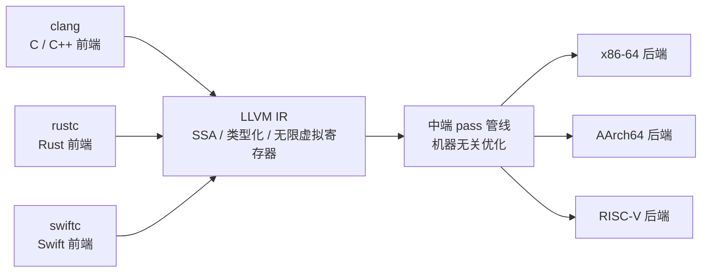
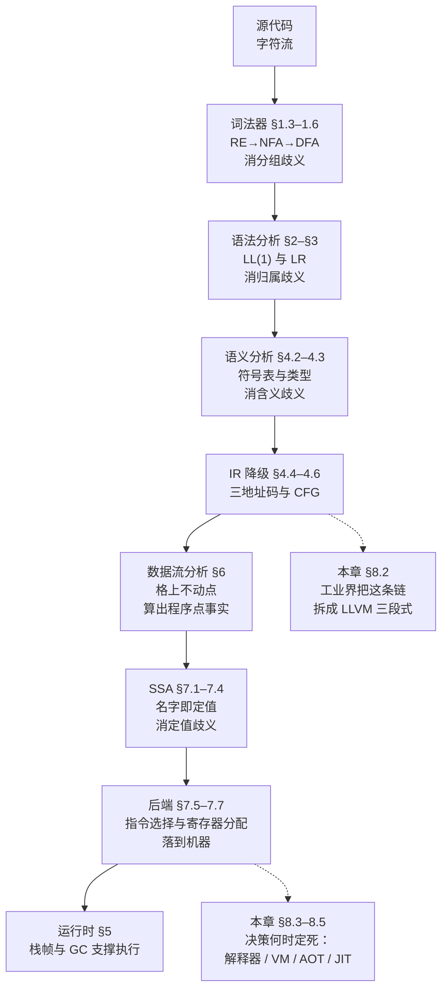

# $\rm Chapter \, 8$ 现代生态：LLVM、JIT 与执行谱系

> **本章假设你已经会**
> 1. 三地址码与 AST 到 IR 的降级，见本册 §4.4；基本块与控制流图的切法，见 §4.6。
> 2. 优化如何从「算出的事实」走到「等价改写」，见 §6.9。
> 3. SSA 的单赋值合同与 φ 函数，见 §7.1；指令选择与寄存器分配如何落到机器，见 §7.5–§7.7。
> 4. 运行时如何支撑执行：栈帧布局与垃圾回收，见 §5.2、§5.5。
> 5. 编译、解释、JIT 三个日常词的大致用法，见《编程语言》§16.7。本章给它们精确的谱系位置。

前七章走完了一条玩具流水线：从字符到记号、到树、到三地址码、到 SSA、到寄存器分配，每一级解决一类歧义，传递一种更接近机器的表示。本章抬头看产业。第一个问题：这条流水线为什么在工业界被拆成可以独立更换的三段，LLVM 如何把「语言 × 机器」的组合爆炸变成线性成本（§8.1、§8.2）。第二个问题：降级的决策不必在编译期一次做完，「什么时候把降级做完」这条轴上排开一整个执行谱系：解释器、字节码虚拟机、AOT 编译、JIT（§8.3），它们各自的延迟与峰值吞吐用同一份负载实测（§8.4、§8.5），顺带诊断一个测错档位的经典翻车（§8.6）。全册收官，§8.7 把九章内容收进一张总图，并指出通往《LLM 从零构建》与性能工程册的接口。

## $\rm \S \, 8.1$ 问题：一套流水线，撑不起一个产业

第 4 章到第 7 章的玩具是「一对一」的：一种玩具语言，一个假想寄存器机，每一级都和相邻级手工焊死。观察一个产业事实：编程语言不断出现，Rust、Go、Swift、Kotlin 都是近二十年的新前端；机器也在不断出现，x86-64、AArch64、RISC-V，加上 GPU 这样的加速器。假设一门语言到一台机器需要一整套 $N$ 级流水线，语言有 $L$ 门、机器有 $M$ 种，逐一配对就要写 $L \times M$ 套完整流水线，每一套里语法分析、数据流分析、寄存器分配全部从零再推一遍。

把账算具体：$L = 5$、$M = 4$ 时是 20 套流水线；语言和机器各自翻倍，直接配对的工作量翻四倍。而流水线的每一级其实只依赖前级的**输出表示**，不依赖源文本（§1.1 的「合同」）：语法分析器不关心字符怎么分组，寄存器分配器不认识源语言。既然如此，让所有语言共享同一种 IR，流水线就从 $L \times M$ 套缩成 $L + M$ 个部件：每门语言一个前端，每种机器一个后端，中间共用一份 IR 和整套优化器。

$$N_{\text{直接配对}} = L \times M, \qquad N_{\text{三段式}} = L + M$$

读法：前端只管「我的语言 → IR」，后端只管「IR → 我的机器」，两边互不认识也能拼起来；5 门语言 4 种机器时，20 套变 9 个部件，且两边各自线性增长。

玩具流水线还有第二处和产业脱节：它的级间表示只活在内存里的变量中。真实流水线的中间表示要能**落盘**（写成文件）、**缓存**（下次直接读）、**按函数切割**（只重做改动到的部分）。这是增量编译（incremental compilation）的物质前提，§8.2 展开。

白话：玩具流水线是一家人包揽从翻译到印刷的全部活；产业的做法是把「译成世界语」和「从世界语印成各国文字」拆成两个行当，世界语（IR）就是行当之间的合同。

> 本节小结：语言与机器两两配对是 $L \times M$ 的组合爆炸；利用「每级只见前级表示」的合同拆成三段，成本降为 $L + M$；级间表示还必须可落盘、可缓存，产业级工程才成立。

## $\rm \S \, 8.2$ LLVM 三段式：把流水线拆成产业分工

LLVM 把这套分工做成了事实标准。三段各自独立演进：

1. **前端（frontend）**：一种语言一个，负责词法、语法、语义分析，把源语言降到 LLVM IR。
2. **中端**：一份共享的优化器，由一条条编译通道（pass，每个 pass 做一类等价改写）串成管线，吃 IR 吐 IR，机器无关。
3. **后端（backend）**：一种机器一个，负责指令选择、寄存器分配、指令调度，把 IR 落成机器码，语言无关。

LLVM IR 的三个设计选择，恰好是本册前三章的直接应用。其一，IR 用 SSA 形式：§7.1 的「一个名字只许定值一次」从教学玩具升级为法定格式，φ 函数原样出现，数据流分析里「这个值是谁写的」的歧义在表示层面就已消掉。其二，IR 带类型、控制流显式成图：基本块与控制流图（§4.6）不是教学抽象，而是 IR 的法定骨架。其三，IR 使用无限的虚拟寄存器，名字随便起；§7.6 的图着色分配正是在后端把无穷多个名字塞回有限的物理寄存器。三件事合起来说：**前几章推导的每一件「理论」，在 LLVM 里都有对应的产业部件**。



注意图上没有从 IR 指回语言或机器的箭头：IR 不认识两端，这正是合同可以独立签约的原因。

IR 为什么是产业杠杆，三条账。第一，组合账：clang、rustc、Swift 编译器都以前端身份对接 LLVM，任何一门新语言只要写出前端，就立刻继承整套优化器和全部既有后端；RISC-V 后端成熟那天，所有 LLVM 系语言免费获得一块新芯片的支持。第二，优化与语言无关：§6.3 的活跃变量、§7.3 的 SSA 构造写成 pass，写一遍，全部前端受益。第三，优化与机器无关：pass 大多不关心目标指令集，后端再处理机器相关部分，两头的知识互不污染。

三段式还顺手解决了大项目的编译时间问题。全量编译的代价近似 $t_{\mathrm{full}}$，与程序总规模成正比；但改一个函数时，真正需要重算的只有这个函数的前端、以及受它影响的部分。前提正是 §8.1 说的两条：IR 可以序列化落盘（LLVM 的位码 bitcode 格式），改动的影响范围可以沿依赖关系追踪。理想情形下，改动一台机器一个函数，编译代价从「整个程序」缩到「受影响的模块」，与总规模脱钩，这就是增量编译，也是「改一行、等一小时」变成「秒级反馈」的原理。工程上有真实的张力：内联与跨模块优化（如链接时优化，Link-Time Optimization，LTO）要求看得更宽，与增量的细粒度互相拉扯，编译器只能在优化强度与重编速度之间定价。还有一条容易推出的结论：IDE 的补全与报错之所以能秒回，是因为前端做完语义分析就能给出诊断，根本不必等后端。

白话：LLVM 像一家翻译公司，各语言译者先把稿子译成世界语（IR），优化部只看世界语、不管原稿是哪国话，各国分社只管把世界语印成本地文字；新语言、新国家都只是多签一份合同。

> 本节小结：三段式把 $L \times M$ 压成 $L + M$；IR 用 SSA、显式控制流与无限虚拟寄存器承接了本册 §4.6、§7.1、§7.6 的全部结论；可落盘的 IR 加依赖追踪给出增量编译，前端单独跑给出 IDE 的秒级反馈。

## $\rm \S \, 8.3$ 执行谱系：降级什么时候做完

换个角度看同一件事。前七章的全部降级决策，表达式怎么拆平（§4.4）、跳转落在哪（§4.5）、每个值放哪个寄存器（§7.6），都**必须**在某一个时刻定死；区别只在于定死的时刻。把「决策完成时刻」当轴，实现方式排成一条谱系：

1. **树遍历解释器（tree-walking interpreter）**：每次执行都现场重新做全部分派。拿到语法树，边走边决定每个结点做什么。前期零成本，每次执行付全价。
2. **字节码虚拟机（bytecode virtual machine，VM）**：把「表达式怎么拆、跳转落哪」一次性降级成指令序列（§4.4 三地址码的直系亲戚），存下来反复执行；运行时只剩一个「取指、分派、执行」的循环。CPython 的 `.pyc`、JVM 的 class 文件都在这个位置。
3. **AOT 编译（Ahead-Of-Time，预先编译）**：连「用哪条指令、放哪个寄存器」也离线定死（§7.5–§7.7），产物是机器码，运行时零决策、零分派。
4. **JIT 编译（Just-In-Time，即时编译）**：折中档。程序先以解释或字节码方式运行，运行中观察哪些代码被反复执行，再在运行中把它们编译成机器码。§8.5 单独算账。

第 6、7 章反复使用的那个三地址码解释器，就是第 1 档的替身：它把 §4.4 的降级结果又逐条解释一遍，每条指令都要现场分派。它比纯树解释器省掉了重新走树的嵌套，却和第 1 档共享同一个处境，运行时承担全部决策。

《编程语言》§16.7 的日常三分法「编译型 / 解释型 / JIT」说的就是实现选了谱系哪一档，而且这是实现的属性不是语言的属性：同一门 Python，CPython 停在第 2 档，PyPy 走到第 4 档。每档的付出与省下也清楚：越往右，前期投入越大、运行时越便宜；JIT 多出一种独特的付法，只为被反复执行的代码付编译费。

白话：解释器是照着菜谱边看边炒，每炒一遍都要重新读谱；字节码 VM 是把菜谱抄成步骤卡片，炒的时候只看卡片；AOT 是中央厨房把切配腌炸全部预制完，出锅只需加热；JIT 是看哪道菜点单率高，才把它预制起来。

> 本节小结：四档实现的唯一分界是「降级决策在何时定死」；越靠右前期成本越高、运行时越便宜；编译型与解释型是实现档位，不是语言标签。

## $\rm \S \, 8.4$ 实测：三档的延迟-峰值账

同一个算术负载，三档各跑一遍。源程序 8 行：外层 `while` 2000 次、内层 20 次，内层体执行 40000 次，每次做一个含乘减加取模的表达式累加。三档共用同一套词法与递归下降前端（§8.2 的分工先兑现一半）：解释器档直接遍历 AST 执行；VM 档先把 AST 编译成 41 条栈式指令再跑取指循环；AOT 档把 AST 直接生成宿主语言的等价代码并一次性编译，模拟「决策全部离线做完、运行时零分派」的 AOT 本质（它不产出机器码，但「离线定死一切决策」这条与真实 AOT 相同）。环境：WSL2、python3 标准库、种子 20261107；耗时取多次运行的最小值，数值每次运行有小幅浮动，结构性的比例关系稳定复现。脚本与原始输出见章末实验记录。

先看静态账与动态账。AST 共 17 个结点，编译成 41 条指令；一次执行中，解释器访问 AST 结点 988009 次，VM 执行指令 1030009 条。VM 的动态条数反而更多，每条却更简单：解释器每访问一个结点都要判断「这是什么、该怎么办」，VM 的指令已经把「怎么办」固化了。
静态条数也顺带量出了降级的形状：17 个结点摊成 41 条指令，平均每个运算结点出 2 到 3 条，操作数先压栈、运算再弹栈取走，树形嵌套被拉平成一串栈操作，这正是 §4.4「把树压平」在栈式指令集上的样子。

| 档位 | 编译期 | 首个结果（运行时视角） | 稳态每次 | 相对解释器 |
| --- | --- | --- | --- | --- |
| 树遍历解释器 | 0 | 76.5 ms | 76.4 ms | 1.0x |
| 字节码 VM | 0.05 ms | 70.6 ms | 70.5 ms | 1.08x |
| AOT | 1.28 ms（离线付） | 2.82 ms | 2.82 ms | 27.1x |

第一处意外值得停在原地：字节码 VM 只跑平了解释器（1.08x），第一版甚至更慢（用字符串操作码、分派链未调时 0.97x）。原因在宿主：我们的 VM 与解释器都跑在 CPython 上，CPython 自己就是一个字节码解释器，两个玩具在同一个「解释器」里竞争，结构的红利被摊平，剩下的差距只有每条指令分派成本的高下。真实世界字节码 VM 的数倍优势发生在更低层：Ruby 1.9 用 YARV 字节码虚拟机替换 1.8 的 AST 遍历执行，提速数倍，但那是 C 实现层对 C 实现层的比较，分派循环被编译成了机器指令。本实验的账恰好把这件事量出来：**分派成本是字节码 VM 的生命线，宿主越快，结构红利兑现得越足**。

第二处是数量级跳变：27.1 倍的提速不在 VM 档出现，在 AOT 档出现。解释器与 VM 每执行一步都要做一次「下一步干什么」的决策，AOT 把全部决策整体搬出了运行时。这正是全册心智模型的量化版本：逐级降级做得越早、越透，运行时越便宜；而 §8.3 的谱系就是「降级进度条」本身。四个实现（解释器、两版 VM、AOT）最终结果逐位相同（$s = 1919943$），三档语义一致由程序断言直接验证。

延迟与峰值是两个指标，别混。看「首个结果」列：AOT 2.82 ms 最快，因为编译在离线付掉了；把离线成本也算进第一次运行，AOT 首跑 4.13 ms，依然最快，但这只因为玩具的编译只要 1.28 ms。真实编译器的编译期是秒到分钟级（经验规则，随代码规模线性到超线性增长，非本章实测），那时「编译放哪边、谁先出结果」就成了 §8.5 与 §8.6 的正题。

白话：这份账表读法是先分行后分列：行决定「你愿不愿意为快付前期成本」，列决定「你关心的是第一口还是每一口」。

> 本节小结：同宿主下字节码 VM 只与树解释器打平，分派成本是 VM 的生命线；数量级提速（27.1x）只在「决策全部离线」的编译档出现；启动延迟与稳态峰值必须分开报告。

## $\rm \S \, 8.5$ JIT：启动延迟与峰值吞吐的讨价还价

JIT 的机制三步：**热点探测**（hot spot，某段代码执行次数超过阈值）、**编译**（把热点编译成机器码，之后的执行走编译版）、**去优化（deoptimization）**（编译版基于投机假设，比如「这个变量一直是整数」；假设被打破时退回解释执行）。现代引擎进一步分层：解释层先跑并收集类型信息，基线编译层快速出粗编译版，优化编译层再慢慢磨快。整套机制赌一件事：值得编译的代码会被执行足够多次。

值不值得，用 §8.4 的实测常数算模型账。设单次解释执行耗时 $t_{\mathrm{interp}} = 76.4$ ms，编译后单次 $t_{\mathrm{native}} = 2.82$ ms，编译一次耗时 $t_{\mathrm{jit}} = 1.28$ ms（玩具编译便宜，真实 JIT 的编译成本见下文扫描）。热身窗为 $w$：前 $w$ 次解释执行，期间触发编译，之后全部走编译版。共执行 $n$ 次（$n > w$）的总耗时：

$$T_{\mathrm{jit}}(n) \;=\; w\, t_{\mathrm{interp}} \;+\; t_{\mathrm{jit}} \;+\; (n - w)\, t_{\mathrm{native}}$$

读法：三段账，热身期 $w$ 次按解释价付，编译费一次付清，剩余 $n - w$ 次按编译价付。它何时追平「永远解释」的 $n\, t_{\mathrm{interp}}$：

$$
\begin{aligned}
T_{\mathrm{jit}}(n) < n\, t_{\mathrm{interp}}
&\iff t_{\mathrm{jit}} < (n - w)\,(t_{\mathrm{interp}} - t_{\mathrm{native}}) \\
&\iff n > w + \frac{t_{\mathrm{jit}}}{t_{\mathrm{interp}} - t_{\mathrm{native}}}
\end{aligned}
$$

读法：第一行把两边共同的 $w$ 次解释价消掉；第二行说编译费必须被「每次省下的钱」在足够多次执行里摊回来；追平点 $n^\ast = w + \dfrac{t_{\mathrm{jit}}}{t_{\mathrm{interp}} - t_{\mathrm{native}}}$。代入常数：$\dfrac{t_{\mathrm{jit}}}{t_{\mathrm{interp}} - t_{\mathrm{native}}} \approx 0.02$，追平点几乎就是热身窗结束处，因为玩具编译太便宜了。累计耗时曲线（$w = 5$）：

| 执行次数 $n$ | 解释器累计 | JIT 累计 | AOT 运行时累计 |
| --- | --- | --- | --- |
| 1 | 76.4 ms | 77.7 ms | 2.8 ms |
| 10 | 764.4 ms | 397.6 ms | 28.2 ms |
| 100 | 7644.5 ms | 651.4 ms | 282.0 ms |
| 1000 | 76444.9 ms | 3189.7 ms | 2820.3 ms |

$n = 1$ 时 JIT 比 AOT 慢 26 倍还比纯解释慢（热身期没赚回编译费）；$n = 1000$ 时 JIT 已比解释器快 24 倍，但相对 AOT 仍慢 13%，多出的正是热身期的解释价与编译费，**JIT 永远追不上 AOT 的稳态，它买的是「不为不跑的代码付编译」**。摊销视角更清楚：

$$\bar{t}(n) \;=\; t_{\mathrm{native}} \;+\; \frac{t_{\mathrm{jit}} \;+\; w\,(t_{\mathrm{interp}} - t_{\mathrm{native}})}{n}$$

读法：平均每次成本等于编译价加上「固定投入除以次数」，$n$ 越大越贴近 $t_{\mathrm{native}}$：$n = 10$ 时 39.8 ms，$n = 100$ 时 6.5 ms，$n = 10000$ 时 2.86 ms。真实 JIT 的编译成本远高于玩具（经验规则：编译一个函数的代价相当于其编译产物的数千到百万次执行），把 $t_{\mathrm{jit}} = c \cdot t_{\mathrm{native}}$ 扫描一遍（$w = 5$）：

| 编译成本 | 追平点 $n^\ast$ |
| --- | --- |
| $10 \cdot t_{\mathrm{native}}$ | 5.4 次 |
| $100 \cdot t_{\mathrm{native}}$ | 8.8 次 |
| $1000 \cdot t_{\mathrm{native}}$ | 43.3 次 |
| $10000 \cdot t_{\mathrm{native}}$ | 388.1 次 |

追平点随编译成本线性右移。选型由此清楚：一次性脚本，$n$ 很小，解释器甚至更划算；短命命令行工具，AOT 把编译费在发布前付掉；长跑服务，$n$ 巨大，JIT 的热身费被摊到接近零，还能拿到 AOT 拿不到的运行时信息（真实类型、真实分支频率）。

白话：JIT 是分期付款买快，先按解释价住着，攒够次数再一次性付编译费换大房子；AOT 是全款预付，住进来就是大房子，但每段代码都得付，哪怕从没人住。

> 本节小结：追平点 $n^\ast = w + \dfrac{t_{\mathrm{jit}}}{t_{\mathrm{interp}} - t_{\mathrm{native}}}$；JIT 稳态永远略逊 AOT，换来的是不为冷代码付费与运行时信息；编译成本越高追平点越靠右，赌注是执行次数。

## $\rm \S \, 8.6$ 一个真实错误：拿冷启动计时冒充峰值

同事 benchmark 三档实现，每档只计时一次冷跑，报告：「解释器最快，编译不值。」用本章的账检查这个结论。冷跑一次要把全部前期工作算进去：解释器 76.5 ms（无前期工作），VM 70.6 ms（编译 0.05 ms），AOT 4.13 ms（含 1.28 ms 编译）。玩具负载下 AOT 仍最快，同事的数字怎么来的？把玩具编译期换成真实量级：设 $t_{\mathrm{jit}} = 30$ s（大项目 release 构建的常见量级，经验规则），冷跑单次计时判「解释器比 AOT 快四百倍」。但会话视角下，追平点 $n^\ast \approx \dfrac{30000\ \mathrm{ms}}{76.4 - 2.8\ \mathrm{ms}} \approx 407$ 次执行，$n = 1000$ 时 AOT 总耗时约 32.8 s，对解释器的 76.4 s 反超 2.3 倍。单次冷跑计量的对象是**启动延迟**，同事把它当成了**峰值吞吐**；两个指标在 §8.4 的表里分列，混用任何一个都会得到方向相反的结论。

对称的错误同样致命：只报热身后的峰值、隐瞒热身期。JIT 服务刚启动或扩容出新实例时，代码全是冷的，§8.5 的曲线显示 $n = 1$ 时 JIT 比稳态慢一个数量级以上；用稳态数字承诺延迟，用户会在冷实例上感受到完全不同的另一回事。排查办法就是把指标拆开报告：首个结果、稳态每次、会话累计，三个数各管一段，缺一个就是有人在替你做决定。这套「先测对、再测快」的纪律，性能工程册整册都在把它变成方法论。

白话：冷启动计时像用候诊时间评价医生水平，热身后的峰值像只看手术台上的表现；病人经历的是全程，三个数字都得给。

> 本节小结：启动延迟与峰值吞吐是两个指标；单次冷跑计时会在编译期变长后彻底颠倒是非，只报峰值会掩盖热身期长尾；指标拆开报告是底线。

## $\rm \S \, 8.7$ 收官：全册流水线总图

九章的部件装回一条线。每一级解决一类歧义、传递一种更接近机器的表示，右侧标注首次建立的章与节：



沿着图把全册合同念一遍：每一级只吃前级的输出表示，不碰源文本，所以级可拆、件可换；本章的 LLVM 把这个合同变成了可签约的产业结构，§8.3 的谱系把「合同里哪部分提前履行」变成了可选的商业决策。玩具实现全部可复现：词法器的自动机构造、LL(1) 与 LR 的分析表、三地址码与数据流方程、SSA 与图着色，脚本都落在各章实验记录里。

三个出口。其一，《LLM 从零构建》§6.6 的 Triton：把「一个程序处理一块数据」的块循环程序交给编译器，块调度与向量化由编译器降级决定，tile 尺寸成为超参数；编译原理的降级合同在 GPU 算子上原样重演。其二，性能工程册：本章 §8.6 的教训（先测对、再测快）在那里升级为完整的「测量、假设、改动、复测」循环。其三，本册的复习总结章：把九章的术语、方程与实验数字重新提取一遍。

白话：全册一句话，编译器是一台歧义粉碎机，每一级粉碎一类歧义，把一种更接近机器的表示交给下一级；学完这册，你看到的不再是「代码变快了」，而是每一级粉碎了什么、付出了什么。

> 本节小结：六级流水线各司其职、表示是级间合同；LLVM 与执行谱系是这个合同在工业界的两种延伸；出口在 GPU 算子编译、性能工程与复习提取。

## $\rm \S \, 8.8$ 关键概念回顾

1. 三段式把 $L \times M$ 套流水线变成 $L + M$ 个部件，依赖的合同是什么？IR 在合同里扮演什么角色？
2. LLVM IR 的哪三个设计选择分别对应本册哪些章节的结论？
3. 解释器、字节码 VM、AOT、JIT 四档的唯一分界是什么？每档前期付什么、运行时付什么？
4. 实测中字节码 VM 与树解释器只打平、27 倍提速出现在 AOT 档，请给出两层解释（宿主层与决策时刻层）。
5. 写出 JIT 追平点公式并解释每个符号；为什么 JIT 的稳态永远追不上 AOT，它又靠什么立足？

## $\rm \S \, 8.9$ 应用与辨析

1. 同事要给一个最多执行 30 次的运维脚本换上 JIT 引擎（热身窗 $w = 5$）。用 §8.5 的扫描表和追平点公式判断值不值，并给替代方案。
2. 团队抱怨「改一行要重编一小时」。从增量编译的两个物质前提出发，给出两条可落地的改进，并说出各自的代价。
3. 一份基准报告写着「JIT 稳态比解释器快 24 倍」。这个数字回答不了哪些问题？至少补哪两个数据才能支撑部署决策？

## $\rm \S \, 8.10$ 本章自测答案

1. 合同：每级只依赖前级的输出表示、不依赖源文本（§1.1、§8.1）。IR 是合同的标准条款：所有前端译到同一份 IR，所有后端从同一份 IR 译出，中端优化只认 IR 不认语言与机器（§8.2）。
2. 其一，SSA 形式对应 §7.1 的单赋值合同与 φ 函数；其二，类型化与显式控制流对应 §4.6 的基本块与 CFG；其三，无限虚拟寄存器对应 §7.6 图着色分配要解决的「无穷名字进有限寄存器」（§8.2）。
3. 分界：降级决策在何时定死（§8.3）。解释器前期付零、每次付全价；VM 前期付一次小编译、运行时付分派；AOT 前期付全量编译、运行时零决策；JIT 运行中为热点付编译、赌执行次数摊回成本（§8.5）。
4. 宿主层：实验的两档都跑在 CPython 上，而 CPython 自己就是字节码解释器，结构红利被摊平，只剩分派成本之差（第一版字符串操作码 0.97x，调优后 1.08x；YARV 对 Ruby 1.8 的数倍提升发生在 C 实现层）。决策时刻层：解释器与 VM 每步都要决定「下一步干什么」，AOT 把决策整体搬出运行时，数量级差距只在这里（§8.4）。
5. $n^\ast = w + \dfrac{t_{\mathrm{jit}}}{t_{\mathrm{interp}} - t_{\mathrm{native}}}$，$w$ 为热身窗次数，$t_{\mathrm{jit}}$ 为编译一次的成本，$t_{\mathrm{interp}} - t_{\mathrm{native}}$ 为每次执行省下的钱（§8.5）。JIT 比 AOT 恒多付热身期解释价与编译费，故稳态略逊；它靠「不为不跑的代码付编译」与运行时收集的真实类型信息立足（§8.5）。

**应用与辨析答案**

1. 不值。查扫描表：$t_{\mathrm{jit}} = 1000 \cdot t_{\mathrm{native}}$ 时追平点已是 43.3 次，脚本只执行 30 次，热身费收不回（§8.5）。替代：AOT 编译成静态可执行文件（编译费在发布前付），或直接解释执行，30 次的会话里解释器的全价远低于编译费（§8.4）。
2. 前提一是 IR 可落盘缓存：把中间表示序列化到磁盘，未改动模块直接复用产物；代价是缓存失效逻辑与磁盘开销。前提二是依赖可追踪：按函数或模块记录依赖图，只重编受影响部分；代价是内联、宏、跨模块优化会扩大受影响面，需要放宽粒度或放弃部分全局优化（§8.2 的张力）。
3. 回答不了启动延迟（首次请求多慢）与热身成本（多少次执行才摊平编译费）。补：首个结果延迟与热身曲线（如 §8.5 的累计表或 $\bar{t}(n)$），再按 §8.6 把首个结果、稳态、会话累计三个指标分开报告，才能判断服务冷启动期的体验与扩容行为（§8.6）。

**你现在能做什么**：给任何一门语言、任何一台机器指出它们在「$L + M$」结构里的位置；对一份基准报告判断它报的是启动延迟、稳态峰值还是会话累计；用 $n^\ast$ 公式对一段代码估算 JIT 划不划算。

全册到站。从「`count = count + 1` 为什么不是一步翻译」（§1.1）出发，到把同一条流水线在 LLVM 的签约桌上、在解释器与编译器的谱系轴上各认领一个位置结束。歧义一层层碎掉，表示一级级逼近机器，而履行合同的时刻，现在由你来选。向前走，《LLM 从零构建》§6.6 会请你用编译器的眼光读 GPU 算子，性能工程册会逼你先测对再测快。

---

实验记录：全部实测数字来自 `exp08.py`（WSL2，Python 3.12.3，仅标准库，种子 20261107），原始输出存于写作工作目录 `26Fall/_uni5_work/expCP08/result.txt`，脚本同目录；四个实现（树遍历解释器、字符串操作码 VM、整数操作码调优 VM、宿主代码生成 AOT）共用同一套词法与递归下降前端，语义一致性由程序断言验证（$s = 1919943$ 四方逐位相同）。耗时为多次运行最小值（解释器 7 次、VM 各 20 次、AOT 300 次），每次重跑有小幅浮动（约一成内），结构性比例（VM 打平、AOT 27 倍量级）稳定复现。JIT 部分为模型账：常数 $t_{\mathrm{interp}}$、$t_{\mathrm{native}}$、$t_{\mathrm{jit}}$ 取自实测，曲线为解析公式并经逐点扫描交叉验证（公式追平点与扫描首个整数解一致）。锚点数字：前端词法 0.015 ms、语法 0.013 ms、AST 17 结点；解释器每次 76.4 ms、动态结点访问 988009 次；VM 静态 41 条指令、动态 1030009 条、第一版 79.0 ms（0.97x）、调优版 70.5 ms（1.08x）；AOT 编译 1.28 ms 离线、每次 2.82 ms（27.1x）、冷跑全算 4.13 ms；JIT 常数 76.4 / 2.82 / 1.28 ms，追平点约等于热身窗，$w = 5$ 时 $n = 1 / 10 / 100 / 1000$ 的 JIT 累计 77.7 / 397.6 / 651.4 / 3189.7 ms 对解释器 76.4 / 764.4 / 7644.5 / 76444.9 ms、AOT 2.8 / 28.2 / 282.0 / 2820.3 ms，编译成本占比（$n = 1000$）0.040%，$t_{\mathrm{jit}} = c \cdot t_{\mathrm{native}}$ 扫描追平点 $c = 10 / 100 / 1000 / 10000$ 对应 5.4 / 8.8 / 43.3 / 388.1 次；30 s 编译期模型账追平点约 407 次。复现命令（Git Bash，读脚本、覆盖写 `result.txt`，末行应为 `[done]`）：

```bash
wsl bash -c "cd /mnt/c/Users/20811/Desktop/26Fall/_uni5_work/expCP08 && python3 -u exp08.py > result.txt 2>&1"
```

文献：Lattner 与 Adve 2005（CGO，LLVM 架构与终身优化设计）、Aycock 2003（ACM Computing Surveys，即时编译简史）、Aho 等《Compilers: Principles, Techniques, and Tools》第 2 版 §9.1（编译器构建中的基础设施视角）。文献出处对应正文 §8.2、§8.5 的引用处。
