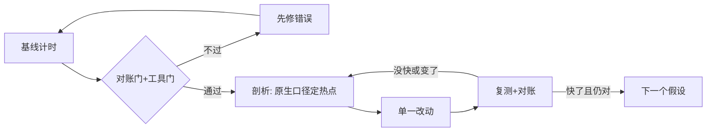

# $\rm Chapter \, 7$ 工具箱：剖析器、火焰图与 sanitizer

> **本章假设你已经会**
>
> 1. 计时用单调时钟，多轮取最速值，上线才看分位数，见本册 §1.2。
> 2. 比值只在同一次运行内比较，跑之前先定口径，见本册 §1.5、§4.1。
> 3. Amdahl 的份额-收益账：加速哪个部分，收益由它的占比封顶，见本册 §1.6。
> 4. C 程序从源码到可执行文件用 gcc 编译，优化级别 `-O0` 与 `-O2` 行为可以不同，见本册 §1.3。
> 5. 线程共享地址空间，无同步的并发读写是灾难的种子，锁是建立先后关系的工具，见本册 §5.1、§5.4。

前六章做每个优化判断，走的都是同一条路：先猜瓶颈在哪，再手写计时验证。程序只有三五个函数时，这条路走得通；真实程序上百个函数互相调用，靠猜的成本就爆炸了。

这一章给假设-验证循环装上专用仪器。剖析器（profiler）回答「时间花在了哪个函数、哪一行」；sanitizer 家族回答「这个程序本身有没有错」。安排如下：先讲剖析器的两大流派与各自的代价模型（§7.1）；然后在埋了三处热点的脚本上做实验，比较「按外观盲改」和「先剖析再改」的修正成本（§7.2）；再实测两种流派的偏差，插桩开销压垮被测对象、采样漏掉短函数（§7.3）；接着讲 perf 与火焰图的读法，定性介绍并标注公开资料（§7.4）；最后用 ASan 与 TSan 各抓一类测不出来的错，收束成「先测对再测快」的五步流程（§7.5）。

实验环境逐项列明（与前六章同一台机器）：

1. WSL2，Ubuntu 24.04，内核 6.6.87.2；Intel Core Ultra 7 255H，16 逻辑核，L3 24 MiB。
2. Python 3.12.3（本章实验不用 numpy）；gcc 13.3.0；随机数据种子 20261107。
3. 本机 WSL2 内核未附带 perf：§7.4 只做定性介绍并标注公开资料来源，不声称实测。统计剖析的实验全部用 python3 的 cProfile 与自制采样器完成。
4. 脚本与完整输出在 `expPE07/`，正文数字取自 `result.txt` 那次正式运行；跨运行绝对值会漂移两三成，比值只在同一次运行内比较（§4.1 立过的规矩）。

复现命令（Shell/WSL，当前目录 `expPE07`；各脚本只读自己的源码、写屏幕输出；成功验证：实验 A 各变体的结果摘要完全一致，实验 C 的 ASan、实验 D 的 TSan 各自打印带行号的报告）：

```bash
python3 -u exp1_profile.py          # A：三处埋点，先盲改 vs 先剖析
python3 -u exp2_bias.py             # B：插桩开销与账本改写 + 采样漏短函数
gcc -O2 -o oob_plain oob.c && ./oob_plain                        # C1：安静地错
gcc -O1 -g -fsanitize=address -o oob_asan oob.c && ./oob_asan    # C2：ASan 当场停机
gcc -O2 -pthread -o race_plain race.c && ./race_plain            # D1：竞争不显形
gcc -O1 -g -fsanitize=thread -o race_tsan race.c -pthread
setarch x86_64 -R ./race_tsan                                    # D2：TSan 当场指认
```

## $\rm \S \, 7.1$ 剖析器两条路：每笔都记 vs 定时抽查

剖析器（profiler）是这样一台仪器：让程序照常运行，它在一旁记录时间去了哪里，最后交出一张占比表。实现思路只有两条，代价模型完全不同。

第一条路是插桩（instrumentation）：在程序里安插记账代码，每个函数调用、每行执行都记一笔。CPython 自带的 cProfile 属于这一族的函数级插桩：每次 Python 函数调用都触发一段 C 写成的簿记逻辑。设被测函数真实耗时 $t_p$，被调用 $N$ 次，每次簿记成本 $\varepsilon$，程序总时长 $T$。插桩后报告里它的份额是

$$
\hat{p} \;=\; \frac{t_p + N\,\varepsilon}{T + N\,\varepsilon}
$$

读法：分子分母都被插桩税 $N\,\varepsilon$ 撑过，$\hat{p}$ 一般不等于真实份额 $t_p/T$；偏差方向取决于 $\varepsilon$ 记在谁的账上（§7.3 会实测：cProfile 3.12 把这笔记到了调用方头上，热门函数的读数反而被腰斩）。插桩的好处是账全：调用次数、每次耗时这些只有它给得出。

第二条路是采样（sampling）：不动被测程序，剖析器每隔固定间隔 $\Delta$ 拍一张快照，记下「此刻 CPU 正在执行哪个函数的哪一行」，跑完后用各函数被拍到的次数除以总样本数当份额。被测对象几乎不付代价，但估计有统计抖动。理由可以两步说清：跑 $T$ 时长约有 ${n \approx T/\Delta}$ 张快照；每次快照是否拍中份额为 $p$ 的目标函数近似一次独立伯努利试验，$n$ 次拍中 $k$ 次服从二项分布，估计值 ${\hat{p} = k/n}$ 的标准差于是为

$$
\sigma(\hat{p}) \;\approx\; \sqrt{\frac{p\,(1-p)}{n}}, \qquad n \;\approx\; \frac{T}{\Delta}
$$

读法：想让份额估计的抖动小于一个百分点，$n$ 要上万；想让总时长只有几十毫秒的函数稳定入镜，$\Delta$ 必须压到比它的单次时长还小。采样漏掉短函数不是玄学，是这条公式在起作用（§7.3 Part B 实测）。

白话：插桩是超市收银台，每件商品都扫一次码，账全，但收银台本身拖慢结账；采样是经理每隔几分钟瞟一眼收银台，谁在忙记一笔，顾客几乎无感，但只瞟几眼就会漏掉「刚放上去又拿走」的东西。

**本节小结**：剖析器把「猜瓶颈」变成「读报表」；插桩全而慢、份额被簿记税改写，采样轻而糙、短函数受抽样方差与间隔粒度双重威胁。选哪条路，取决于你要「全」还是要「真」。

## $\rm \S \, 7.2$ 实验：三处埋点，先盲改还是先剖析

实验 A 是一个 0.484 秒的脚本，里面埋了三个耗时函数：`hotspot_a` 对一个 list 逐个做成员测试查重（写法看起来人畜无害）；`decoy_b` 是三重循环（长得最「算法化」）；`decoy_c` 逐个 `str()` 再拼接（字符串活，三个里最不像嫌疑犯）。三者中 A 是真热点，B、C 是陪跑。

脚本另设一道对账门：每个优化变体跑完，先比对结果摘要的 SHA-1（digest）。摘要变了，说明改的不是性能、是语义，数字作废。速度与正确性从此是两个都要签的字。

盲改剧本模拟「按代码外观猜热点」的固定动作，先改最像算法问题的 B。它的内层 ${(ij+k) \bmod 7}$ 在 $k$ 上以 7 为周期，每连续 7 项之和恒为 $0+1+\cdots+6=21$，于是三重循环可以砍成两重。这是个聪明的改动，实测也确实快了。再按同一思路改 C：列表推导一次生成再 `join`。对照路线只做一件事：先跑一次 cProfile，按 tottime 排序，改榜首。读表先分清两列：tottime 是函数自身耗时，不含它调用的别人；cumtime 把被调函数的时间一并计入。找「该改哪一行」看 tottime，找「这条调用路径总共多贵」看 cumtime。

cProfile 的 tottime 榜前三名：

```text
hotspot_a   tottime 0.312s     （约总时长六成）
decoy_b     tottime 0.126s     （榜首的 2.5 分之一）
decoy_c     tottime 0.046s     （榜首的 6.8 分之一）
```

真热点 A 是三个函数里看起来最无辜的那个，一个函数占了总时长约六成。对照路线据此只改一处：把 list 成员测试换成 `set` 去重。

| 路径 | 改动 | 复测总时长（5 轮中位） | 相对基线 | digest |
| --- | --- | --- | --- | --- |
| 基线 | 无 | 0.484 s | 1.00× | 5709aa1b313c |
| 盲改 1 | B 换周期公式 | 0.356 s | 1.36× | 一致 |
| 盲改 2 | 再改 C 为一次性拼接 | 0.368 s | 1.32× | 一致 |
| 剖析后改 A | list 成员测试换 `set` | 0.168 s | 2.89× | 一致 |
| 全改 | A、B、C 都改 | 0.050 s | 9.62× | 一致 |

这张表里有三个教训。第一，盲改不是没用：1.36× 是真实收益，但它到顶了。用 §1.6 的账算：B、C 合计约 0.172 s，只占基线三成半，就算把两者全部免费化，天花板也只有 ${0.484/(0.484-0.172) \approx 1.55\times}$，而剖析路线对着六成份额的大头下手，一次改动就越过它。第二，盲改 2（1.32×）比盲改 1（1.36×）还慢了一点，两次中位数在运行噪声之内不可分辨。也就是说，没有测量，你连「刚才那次改动是赚是赔」都判不了。第三，成本账：盲改路径花 2 次改动加 2 次复测，拿到 1.3×，离 2× 的目标还差一轮猜测；剖析路径花几秒跑一次 cProfile 加 1 次改动，拿到 2.89×。所谓修正成本，差的就是这段来回。

白话：盲改像在黑屋子里挨个摸口袋找钥匙，剖析是先开灯；灯不挑锁，但让你第一把就摸对口袋。

**本节小结**：热点位置是测量结果，不是代码外观的推论；一次剖析加一次针对性改动，胜过两轮合理但方向错误的聪明改动，且每一步都过对账门。

## $\rm \S \, 7.3$ 偏差实测：插桩压垮被测对象，采样漏掉短函数

§7.1 的两个代价模型不是理论担忧，下面逐条实测（实验 B）。

Part A：函数级插桩的两笔账。被测程序 `work()` 由两块拼成：500 万次对近零成本函数 `tiny` 的调用（含所在循环），加上 800 万次循环的 `payload`。先在原生口径下用扣减法分账：`work` 最速值 0.359 s，`payload` 单独跑最速值 0.197 s，两者相减得 `tiny` 环真实成本 0.162 s，真实份额 ${0.162/0.359 \approx 45\%}$。

套上 cProfile 再跑，第一笔账是总时长：0.846 s，为原生的 2.4 倍，插桩开销 ${(0.846-0.359)/0.359 \approx 135\%}$。这已经满足「压垮被测对象」的判定：测出来的时间分布属于插桩后的程序。

第二笔账是账本内容。报告里 `tiny` 的 tottime 占 25%，而 `work`（循环骨架所在函数）占 52%。对照 §7.1 的公式，方向与「热门函数虚高」相反：cProfile 3.12 的 C 实现把每次调用的事件处理成本记进了调用方的 tottime，于是最忙的 `tiny` 被摊薄，最清闲的骨架反而登顶。若照单全收，下一步优化就该去「优化主循环骨架」了。

Part A2 给出扣减法复核的实操。把 `tiny` 的函数调用内联掉（保留同样的取值与累加），最速值 0.294 s，比原生的 0.359 s 快 1.22×，省下的 $0.065$ s 就是「函数调用这个机制」的全部售价，占 18%。看清楚这笔账的结构：`tiny` 环的 0.162 s 里，循环与取值本身占 0.097 s，调用机制只占 0.065 s。份额大不等于可省的部分大，能省多少由你改掉的机制决定，不由 tottime 的读数决定。

Part A3：逐行插桩有多贵。把 `sys.settrace` 挂上、对同一程序按行记账（规模缩小到百万次量级），原生 0.054 s 的运行涨到 0.469 s，9 倍。这个量级下剖析器自己成了最大开销，被测对象被压垮的极端形态：测出来的程序已经不再是你的程序。

Part B：采样漏短函数。自制采样器：后台线程每隔 $\Delta$ 醒一次，用 `sys._current_frames()` 抓主线程栈顶帧归类，复跑 3 次。被测程序每轮依次做三件事：`steady` 单块忙 20 ms；`blink` 拆成两片各忙 1.5 ms（合计 3 ms）；`sleep` 24 ms。共 20 轮，约 0.94 s。用 perf_counter 逐段累加（开销可忽略的轻量插桩）量出真实墙钟份额：steady 42%、blink 6.4%、空闲 51%。

| 采样间隔 $\Delta$ | 样本数 | blink 样本数 | blink 估计份额 | blink 真实份额 |
| --- | --- | --- | --- | --- |
| 100 ms | 10 | 0 | 0% | 6.4% |
| 50 ms | 19 | 1 | 5% | 6.4% |
| 5 ms | 173 | 11 | 6% | 6.4% |

按 §7.1 的公式逐行核对：$\Delta=100$ ms 时 $n=10$，blink 的期望命中 ${10 \times 0.064 \approx 0.64}$ 个，不足一个，实测就是 0，整段函数从账本上消失；$\Delta=50$ ms 时期望约 1.2 个，实测 1 个，5% 的读数全凭这一个样本落在哪里；$\Delta=5$ ms 时 $n=173$、期望约 11 个，估计 6% 与真值 6.4% 对齐，steady 的估计也从 50% 修到 39%（真值 42%），空闲 51% 对 54%。

还有一处值得标注的现象：$\Delta=100$ ms 与 50 ms 各跑 3 次，结果逐字节相同。原因是采样周期撞上了约 47 ms 的轮周期，两个节拍锁相了。锁相的偏差是系统性的：不随复跑次数平均掉，加大复跑次数救不了，唯一的解法是换 $\Delta$。

白话：插桩的偏差是系统性的，它改了被测对象本身，复跑一万次也平均不掉；采样的偏差是统计性的，加大样本能修，但样本不够时它会把小函数直接抹掉，抹得干干净净、连「可能有」都不提示。

**本节小结**：插桩要付 $N\,\varepsilon$ 的税，记账位置决定份额失真方向，逐行插桩可拖慢一个数量级；采样的可信度由 $T/\Delta$ 决定，短于采样粒度的函数整段消失，还要提防周期锁相。两边的读数都要在原生口径下复核。

## $\rm \S \, 7.4$ perf 与火焰图怎么读

Linux 世界把 §7.1 的采样路线做成了标准工具 perf。`perf stat` 读硬件计数器，回答「程序卡在算力还是访存」，接本册 §1.8 的 roofline：

```bash
perf stat -e cycles,instructions,cache-misses ./bench
```

输出里的 instructions/cycles 比值（IPC）低说明流水线常在等待，cache-misses 高则把等待指向存储层级。`perf record -F 99 -g` 以 99 Hz 抓调用栈，`perf report` 交出占比表。这是纯采样：被测对象只需为每次中断付一次代价，§7.1 的方差公式原样适用。本机 WSL2 内核未附带 perf，本节是定性介绍，读者在原生 Linux 上可自行复现。

火焰图（flame graph）是采样结果的画法。把上万张调用栈快照按相同前缀折叠聚合后画成一张图：横轴是占比，一个函数的矩形越宽，被拍到的次数越多；纵轴是调用栈深度，上面的调用下面的；同一层的兄弟矩形按字母序排列，所以横轴位置不代表时间先后。

读图三句。1. 找平顶（plateau）：顶部不再变窄的那一段，是 CPU 真正耗着的地方。2. 沿它的纵列往下读出完整调用路径，弄清它是被谁调进来的。3. 宽度即份额，直接给出优化收益的 Amdahl 上限（§1.6）。

两点提醒。默认配色是随机暖色，颜色深浅不代表热度，宽度才代表。CPU 火焰图只画「正在执行」的栈，等锁、等 IO 的时间不在图里，那类问题要用 off-CPU 分析，思路是把采样点从「CPU 在跑什么」换成「线程在等什么」。本册 §6.1 ping-pong 曲线延迟区的平坦段，在 CPU 火焰图上几乎隐形，在 off-CPU 视角下才是主角。

来源（公开资料，非本机实测）：Brendan Gregg《The Flame Graph》，Communications of the ACM，2016 年 6 月，及其个人主页 brendangregg.com/flamegraphs.html；perf 工具文档在 perf.wiki.kernel.org。LLVM sanitizer 官方文档给出的 ASan 约 2 倍、TSan 约 5–15 倍运行减速也属此类，§7.5 不重复实测。

白话：火焰图像地层剖面图，每一层是一条调用栈，最宽的那块岩石就是要挖的矿；但剖面图只画固态岩层，液态的等待时间要换一张图。

**本节小结**：perf 把采样剖析做成了带硬件计数器的标准件，火焰图把上万张栈压成「宽度即份额」的一张图；找平顶、读路径、看宽度，颜色和位置都不携带信息。

## $\rm \S \, 7.5$ sanitizer 与「先测对再测快」

剖析器只回答「慢在哪」，不回答「对不对」。一个把结果算错但跑得飞快的程序毫无价值，而且优化本身就会引入新错：§1.3 见过编译器删掉你测的代码，§4.3 的软件预取假设实测被证伪。流程里需要另一族仪器。

sanitizer（工程圈常直称「消毒器」，本义「使洁净者」）是编译期插桩加运行时检查：编译器在每个内存访问或每次内存操作旁边插入检查代码，运行到违规处当场停机并打印报告。注意它就是 §7.1 的插桩路线，代价是实打实的逐次检查税，所以 sanitizer 属于开发与测试构建，不进出厂配置。

实验 C 抓内存越界。`oob.c` 分配 8 个 int（32 字节），循环却写到 `i <= n`，第 9 次写越过边界。普通 `-O2` 构建输出 `sum=36`、退出码 0：程序安静地把边界外的内存写了又读，什么征兆都没有。改用 `-fsanitize=address`（AddressSanitizer，下称 ASan）构建，同一份代码当场停机：

```text
==718==ERROR: AddressSanitizer: heap-buffer-overflow on address 0x503000000060
WRITE of size 4 at 0x503000000060 thread T0
    #0 ... in main .../oob.c:8
0x503000000060 is located 0 bytes after 32-byte region [0x503000000040,0x503000000060)
allocated by thread T0 here:
    #1 ... in main .../oob.c:6
```

报告说出三件事：

1. 出错点：`oob.c:8`，WRITE of size 4。
2. 位置：`0 bytes after 32-byte region`，紧贴那块 32 字节区域的右边界。
3. 来历：这块区域由 `oob.c:6` 的 malloc 分配。

一行越界，三处坐标齐了。报告底部的 shadow bytes 一行里，`[fa]` 正是标在越界地址上的红线（fa 是红区标记）。ASan 的机制是影子内存（shadow memory）：给每 8 字节真实内存配 1 字节状态，每次访问前先查状态。《计算机安全》§3.2 实测过的是同一个工具（那里抓释放后再用，UAF），本实验只补「普通构建安静地错、ASan 构建当场停机」这半张对比图，不重做全套。

实验 D 抓数据竞争（data race）。`race.c` 起两个线程各给全局 `counter` 无锁加 10 万次。普通构建连跑 5 次，输出全是 200000，结果全对。改用 `-fsanitize=thread`（ThreadSanitizer，下称 TSan）构建，输出 `counter=200000` 的同时打印报告：

```text
WARNING: ThreadSanitizer: data race (pid=778)
  Read of size 8 at 0x555555558018 by thread T2:
    #0 add .../race.c:8
  Previous write of size 8 at 0x555555558018 by thread T1:
    #0 add .../race.c:8
  Location is global 'counter' of size 8
```

同一行 `race.c:8` 上，T2 的读与 T1 的写构成竞争，连同两个线程的创建点一起列出。这个对比是本章最要紧的一条边界：结果正确不等于程序正确，这次竞争没显形只是时序上的运气，换台机器、换个负载就可能丢更新。TSan 的原理是给每次内存访问打时钟戳，用 happens-before 关系判定两个访问是否真的无序；锁正是人为建立这种先后关系的工具（本册 §5.4）。一个环境备注：WSL2 默认的地址随机化参数会让 gcc 13 的 TSan 报 `unexpected memory mapping` 起不来，用 `setarch x86_64 -R` 关掉本进程的 ASLR 即可运行，不影响报告内容。

至此把本章收进全册的心智模型，完整的循环是五步：

1. 结果对账门：优化前后摘要一致（§7.2 的 digest）。
2. 工具门：ASan、TSan 构建各跑一遍测试（本节）。
3. 剖析：原生口径复核后定热点（§7.2、§7.3）。
4. 单一改动：一次只动一处，归因才干净。
5. 复测加对账：快了多少、是否还是同一个程序，两个问题各答各的。



「先测对再测快」，测对在这五步里占了三步。

白话：剖析器是教练，告诉你动作慢在哪；sanitizer 是裁判，先确认你没犯规。教练的建议只在没犯规的前提下才有意义。

**本节小结**：ASan 用影子内存抓越界与 UAF，TSan 用时钟戳抓数据竞争，「结果全对」挡不住两者的报告；先测对（对账门加工具门）再测快（剖析、单一改动、复测），五步一步不省。

## $\rm \S \, 7.6$ 关键概念回顾

1. 用自己的话说出插桩与采样的定义，以及两者各自要付的代价（谁为谁付什么）。
2. cProfile 3.12 会把热门函数的 tottime 份额记低，机制是什么？这条偏差的方向由什么决定？
3. 写出采样份额估计的标准差公式，并据此说明：一个只在整场运行里占 30 ms 的函数，要用什么量级的采样间隔才稳定入镜。
4. 火焰图上宽度、高度、平顶各携带什么信息？为什么颜色深浅不携带信息？
5. ASan 与 TSan 各自抓哪类错误？「普通构建连跑 5 次结果全对」能否作为「没有数据竞争」的证据，为什么？

## $\rm \S \, 7.7$ 应用与辨析

1. 排障：同事用 cProfile 剖析一个 Python 服务，报告榜首是主循环函数自身的 tottime（占 52%），准备对它做循环展开。用 §7.3 Part A 的账说明这个计划为什么大概率徒劳，并给出两步复核。
2. 辨析：「采样剖析器是无偏差的，因为它不改动被测对象。」对照 §7.3 Part B 三档 $\Delta$ 的结果，指出这句话在什么条件下成立、什么条件下错得离谱。
3. 应用：一个 30 秒跑完的 C 程序要开始优化了。把「ASan 构建跑测试、TSan 构建跑测试、剖析、基线计时」四个步骤排出顺序，说明每步回答什么问题，以及为什么这个顺序不能乱。

## $\rm \S \, 7.8$ 本章自测答案

概念回顾答案：

1. 插桩在程序里安插记账代码，每个调用或每行都记，账全，代价是每次事件付簿记费 $\varepsilon$、总额 $N\,\varepsilon$，可把被测对象拖慢到变形；采样不动程序，定时抓栈顶快照，被测对象几乎零代价，代价转嫁到统计面：样本少则抖动大，间隔粗则短函数漏记。（§7.1）
2. 机制：cProfile 3.12 的 C 簿记把每次调用的事件处理成本记进调用方的 tottime，热门被调函数自己几乎不加税，于是它的份额被摊薄（实验里 45% 降到 25%），清闲的调用方骨架反而登顶。方向由 $\varepsilon$ 记在谁头上决定：记在被调函数自己头上则热门函数虚高，记在调用方头上则被调函数被摊薄。（§7.1、§7.3）
3. ${\sigma(\hat{p}) \approx \sqrt{p(1-p)/n}}$，${n \approx T/\Delta}$。稳定入镜要求期望样本数显著大于 1：30 ms 的函数在 1 s 的运行里，$\Delta=5$ ms 才给约 6 个样本、仍然偏少；工程上要么把 $\Delta$ 压到亚毫秒，要么让函数在循环里大量重复以累计样本。（§7.1、§7.3）
4. 宽度是该函数被采样到的次数占比，即它占用 CPU 的份额；高度是调用栈深度；平顶是顶部不再变窄的段，标记 CPU 实际耗着的函数。颜色默认随机生成，与热度无关，宽度才携带信息。（§7.4）
5. ASan 抓内存错误（越界、UAF、double-free），TSan 抓数据竞争。不能：实验 D 普通构建 5 次全对，TSan 仍报出竞争；竞争是否显形是时序问题，正确性要靠工具按 happens-before 关系判定，跑几次没出事不构成担保。（§7.5）

应用与辨析答案：

1. 大概率徒劳：Part A 里 `work` 骨架的 52% 正是插桩税的落点，cProfile 把每次调用的簿记记进了调用方 tottime，热函数被摊薄、冷骨架登顶；内联实验也旁证了循环骨架清闲（内联只省下调用机制自身的 0.065 s，占 18%）。两步复核：先做扣减法，把怀疑对象去掉或内联后对比原生总时长，算真实份额；再用采样式工具交叉验证榜首是否换人。若原生口径下榜首仍是主循环本体，才值得动手。（§7.3）
2. 「不改动被测对象」只免掉了插桩税，免不掉统计偏差。成立条件：${n = T/\Delta}$ 足够大，使 $\sigma(\hat{p})$ 小于你在乎的精度，且目标函数总时长显著超过 $\Delta$。错得离谱的情形：$\Delta=100$ ms 时 blink 真实 6.4% 被记成 0%，整段消失；还有锁相陷阱，采样周期接近被测节奏时偏差变成系统性的，复跑也不平均。（§7.3）
3. 顺序：基线计时 → ASan 构建跑测试 → TSan 构建跑测试 → 剖析。基线计时回答「现在多快」，是后面一切比值的地板，必须最先钉死；ASan 回答「内存访问有没有越界」，优化（尤其循环改写）最爱引入这类错；TSan 回答「并发访问有没有竞争」，它判定的是任意调度下的正确性，与跑几次无关；剖析最后上，因为「慢在哪」只有在程序可信之后才值得回答，否则是在给错误的程序提速。（§7.5）

**你现在能做什么**：给任意 Python 脚本挂上 cProfile 并按 tottime 读榜首，而且知道这行读数可能被簿记税改写；用 `-fsanitize=address` 编译一个 C 程序，从报告里读出出错行、越界位置与分配点三处坐标。

下一章把这五步流程放进一个完整案例：从基线测量出发，穿过瓶颈假设、单一改动与复测的循环，把一个程序推到 10×，包括那些假设被实测证伪的弯路。工具已经齐了，接下来练的是把它们连成一条纪律。
