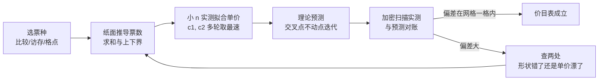

# $\rm Chapter \, 1$ 复杂度框架

> **本章假设你已经会**
>
> 1. 存储层次是一座从寄存器到内存逐层变慢的金字塔，相邻两层一次访问的代价可以差几十倍，见《计算机系统结构》§5.1。
> 2. 计时要走单调时钟加多轮取最速值的纪律，见《性能工程》§1.2。
> 3. 算法竞赛模板里的口诀「冒泡 ${O(n^2)}$、快排 ${O(n\log n)}$」会用但没证过，本章 §1.1 把这三个符号从零定义清楚。
> 4. 对数换底只差常数倍：$\log_2 n=\ln n/\ln 2$，本章对数默认以 2 为底。

全册心智模型一句话：**复杂度是合同，每种算法和每种数据结构都在开张时承诺一张操作价格表，买错表就赔性能**。价格表上写的不是秒数，而是「当输入规模 $n$ 变大时，代价按什么形状增长」。买空调看的是制冷量与房间面积的匹配，不是厂商标的某个具体耗电数字；选算法看的是增长阶与数据规模的匹配，不是「我机器上跑了一次多少毫秒」。本章建立读合同的语言（§1.1 的三种记号）、合同的计价方式（§1.2 的计数模型），再用两个锚点实验打通合同与真实账单：§1.3 实测 ${n^2}$ 排序与 ${n\log n}$ 排序的交叉规模，并与理论预测逐位对账；§1.4 实测同一张 $\Theta(n)$ 合同在三种实现下的单价差。§1.5 收拢读合同时最常见的三种误用。本章实验全部在 WSL2（python 3.12.3，numpy 2.5.4）上真跑过，脚本与完整输出见本册实验记录 `expAD01/result.txt`，随机种子固定 20261107，重跑可得同一串数字。

## $\rm \S \, 1.1$ 合同的语言：增长阶与三种记号

先立任务。你在竞赛里写过冒泡排序，$n=10^5$ 就跑不动；也写过快速排序，$n=10^6$ 稳稳通过。到了开发里问题换了一副面孔：这段代码在数据涨一百倍之后还活着吗？把每个 $n$ 都代进去实测一遍当然能回答，但代价是每换一台机器、每改一行代码都得重测全部规模。

合同思想在这里登场：只记录代价随 $n$ 增长的**形状**，把具体数字留给「按单价换算」这一步。形状是算法自带的、与机器无关的承诺；单价是机器的事，§1.4 专门算这笔账。

设 $T(n)$ 是算法在规模为 $n$ 的输入上的运行代价（此刻先把它当成「以某种方式量出来的总开销」，量法在 §1.2 定义）。增长阶（order of growth）描述 $T(n)$ 的形状，而描述形状需要一张精确的合同用语，就是渐近记号（asymptotic notation）。三个记号逐个定义：

$$
T(n)=\Theta(f(n)) \;\Longleftrightarrow\; \exists\, c_1>0,\; c_2>0,\; n_0:\quad c_1\,f(n)\;\le\; T(n)\;\le\; c_2\,f(n)
$$

读法：存在两个正常数 $c_1,c_2$ 和一个门槛规模 $n_0$，使得对一切 $n\ge n_0$，$T(n)$ 被夹在 $c_1 f(n)$ 与 $c_2 f(n)$ 之间。逐符号说：$f(n)$ 是你选的形状函数（比如 $n^2$ 或 ${n\log n}$）；$c_1$ 与 $c_2$ 是上下两条夹逼线的斜率；$n_0$ 承认「小规模时不算数」，合同只管门槛之后的全部规模。双边夹逼意味着 $\Theta$ 是**等式档位**：$T(n)=\Theta(n^2)$ 说的是 $T$ 就按平方形状计价，不多也不少。

$$
T(n)=O(f(n)) \;\Longleftrightarrow\; \exists\, c>0,\; n_0:\quad T(n)\;\le\; c\,f(n)\quad(n\ge n_0)
$$

$$
T(n)=\Omega(f(n)) \;\Longleftrightarrow\; \exists\, c>0,\; n_0:\quad T(n)\;\ge\; c\,f(n)\quad(n\ge n_0)
$$

读法：$O$ 只保留上界那条线（「不超过这个档位」），$\Omega$ 只保留下界那条线（「不低于这个档位」）。三者是合同里的三种条款：$\Theta$ 是双边定价，$O$ 是单边上限，$\Omega$ 是单边下限。上下界是独立信息：插入排序比较次数最坏 $\Theta(n^2)$、期望也是 $\Theta(n^2)$，两句话合起来才给出完整档位；而「基于比较的排序比较次数是 $\Omega(n\log n)$」是一条下界合同，说任何比较排序都逃不出这个价，第 2 章用决策树证它。

拿一个具体函数把定义走一遍，验证 $T(n)=3n^2+5n+17$ 的档位是平方。下界一侧取 $c_1=3$：后两项恒正，故 $3n^2\le T(n)$ 对一切 $n\ge 1$ 成立。上界一侧，$n\ge 1$ 时每个一次项都能被平方项收编，$5n\le 5n^2$、$17\le 17n^2$，于是

$$
3n^{2}\;\le\;3n^{2}+5n+17\;\le\;3n^{2}+5n^{2}+17n^{2}\;=\;25n^{2}\qquad(n\ge 1)
$$

取 $c_2=25$、$n_0=1$，双侧夹逼成立。同一个 $T(n)$ 也是 $O(n^3)$：取 $c=3$、$n_0=1$，$T(n)\le 3n^3$ 显然成立，可「不超立方」对平方代价的算法是句空话。这个对比就是 $O$ 与 $\Theta$ 的实际距离：一个函数有无穷多个成立的上界档位，只有相差常数倍的那一族档位配得上 $\Theta$。合同上只写 $O$，等于只承诺了「不超过某个价」，没说实际是哪个价。

于是第一处工程误用自己浮出来了：口语里「快排是 ${O(n\log n)}$」把上限条款念成了定价条款。严格说，随机化快排的**期望**比较次数是 $\Theta(n\log n)$，**最坏**是 $\Theta(n^2)$；漏掉「期望」这个限定词，等于把合同里的保证条款当成了无条件条款。这里有个更一般的语法点：档位永远属于某个具体的函数 $T(n)$，而「一个算法的运行时间」同时是好几个函数——最坏情形的 $T_{\text{worst}}(n)$、期望的 $T_{\text{avg}}(n)$、某个输入族上的 $T(n)$。所以说「某某算法是 $\Theta(\cdot)$」之前，必须先说清谈论的是哪一个 $T$；三句话的完整格式是「随机化快排的期望比较次数为 $\Theta(n\log n)$，最坏为 $\Theta(n^2)$，以下讨论假设枢轴均匀随机」。§1.5 把这类读错方式收拢成清单。

这套语言不只给算法用，更是给数据结构用的：这正是全册标题的另一半。数组承诺「按下标取元素一票」，链表承诺「走到哪从哪继续一步」，哈希表承诺「按值取元素平均一票出头」；每张操作价格表都是一份 $\Theta$ 合同，第 3、4 章的堆与符号表会逐张签。学任何新结构时先问一句话：它给哪些操作承诺了什么档位，为兑现这些承诺又收了多少额外内存——问法本身就是本章的产出。

白话：$\Theta$ 是「就这个价」，$O$ 是「最多这个价」，$\Omega$ 是「起码这个价」；商家说「最多」的时候，你可别听成「就是」。

> 本节小结：渐近记号把 $T(n)$ 的增长形状写成合同；$\Theta$ 双边夹逼、$O$ 单边上界、$\Omega$ 单边下界；$n_0$ 之前的规模不在合同管辖内。工程口语把 $O$ 当 $\Theta$ 用，是本章要修的第一处误用。

## $\rm \S \, 1.2$ 计价模型：合同按什么数票

上一节把 $T(n)$ 留成了「某种总开销」，现在把它钉住。计数模型（cost model）规定：算法的代价等于它执行的**基本操作（primitive operation）票数**，比较一次一票、算术一次一票、赋值一次一票；访问一个数组元素一票。这就是教科书里的随机访问机（Random Access Machine，RAM）口径：内存是一张想取哪格就取哪格的格子纸，取任何一格价格相同。

这个模型粗糙得明目张胆。《计算机系统结构》§5.1 的金字塔告诉你，一次内存访问的真实代价随数据住在哪一层浮动几十倍；§1.4 的实测会亲手摸到这条裂缝。模型仍然值得用，因为它把「算法自带的形状」和「机器定的单价」拆成了两本账：形状在模型里是精确可证的定理，单价换算交给实测。

先数票，再问票多少钱，顺序不能反。数票阶段的结论（比如 $\tfrac{n(n-1)}{4}$）在任何机器上都成立，因为它是关于算法本身的组合数学；单价阶段的结论（比如每票 8 纳秒）只在当前这台机器上成立。把两个阶段混在一起，得到的结论两边都靠不住。

拿插入排序把数票走一遍。它逐个把元素插进左侧已排好的前缀：处理第 $i$ 个元素时向左比较、右移，直到找到不大于它的位置。描述它需要逆序对（inversion）：数对 $(i,j)$ 满足 $i<j$ 而 $a_i>a_j$；记 $\mathrm{inv}(a)$ 为数组 $a$ 中逆序对的总数。插入排序处理第 $i$ 个元素时，右移次数恰好等于以 $i$ 结尾的逆序对个数（每个比它大的左侧元素挡它一次、被移一格），比较次数是右移次数再加一次收尾比较；若元素一路顶到最左端则没有那次收尾比较，设这样的元素有 $r$ 个。于是总比较次数满足

$$
C_{\text{ins}}(n)\;=\;\mathrm{inv}(a)\;+\;(n-1)\;-\;r\;\le\;\mathrm{inv}(a)\;+\;n-1
$$

随机输入下 $\mathrm{inv}(a)$ 的期望是多少？全部 $\tfrac{n(n-1)}{2}$ 个数对里，每一个在均匀随机排列下「正序」与「逆序」机会均等，各以概率 $\tfrac12$ 出现，所以

$$
\mathbb{E}[\mathrm{inv}]\;=\;\frac{n(n-1)}{2}\cdot\frac{1}{2}\;=\;\frac{n(n-1)}{4}
$$

这就是插入排序期望 $\Theta(n^2)$ 的完整票据：每对元素贡献半票期望，共 $\tfrac{n^2}{4}$ 票。顺带把最坏情形也对个账：输入完全逆序时逆序对取满 $\tfrac{n(n-1)}{2}$，比较次数翻倍，但档位仍是平方——期望与最坏同档不同价，系数差一倍。归并排序的票是另一种数法。合并两个总长 $k$ 的有序段，每输出一个元素至多比较一次，共输出 $k$ 个，故每次合并至多 $k-1$ 票；自底向上第 $\ell$ 层有 $n/2^\ell$ 次合并、合计元素 $n$ 个，该层至多 $n-n/2^\ell$ 票；层数为 $\lceil\log_2 n\rceil$，加总得

$$
C_{\text{mrg}}(n)\;\le\; n\lceil\log_2 n\rceil\;-\;\bigl(2^{\lceil\log_2 n\rceil}-1\bigr)\;<\;n\lceil\log_2 n\rceil
$$

上界只值半张价签，补下界才完整。每次合并至少「小段元素数」那么多票：设两段长为 $k_1\le k_2$，小段里若有哪个元素从头到尾没跟大段比过，把它与大段里任何一个也没露过面的元素对调，算法看到的输入完全一样、输出却变了，它就无从保证正确；所以小段每个元素至少比较一次，每次合并至少 $k_1$ 票，每层至少 $n/2$ 票，乘以层数得 $C_{\text{mrg}}(n)=\Omega(n\log n)$。上下界合拢，归并的比较票数是 $\Theta(n\log n)$，价签完整。

顺带说清「票种」从哪来。排序场合数比较票，因为比较是排序问题的内在稀缺资源：一次比较只有两种结果，至多分辨 1 比特的不确定性，而区分 ${n!}$ 种排列至少要 $\log_2 n!$ 比特；这笔信息账在第 2 章折算成全体比较排序的 $\Omega(n\log n)$ 集体下限。别的场合数别的票：图算法数边的访问，动态规划数格点的填写。价目表选哪种票，跟着问题的内在稀缺资源走，而不是跟着语句行数走。

价目表其实还有第二栏：空间。归并排序合并时要一个放得下两段的缓冲区，$\Theta(n)$ 的辅助内存；插入排序就地交换，辅助内存 $\Theta(1)$。两栏都要签进合同：归并买到的是 $n\log n$ 的时间档位，付的是线性辅助空间；插入排序省下空间，付的是平方时间。第 2 章给每张排序价目表补全「时间、空间、稳定性、原地性」四栏，这里先立下「空间也是合同条款」的观念。

两个算法定价完毕，现在拿实测对账。对随机数组（种子 20261107）真数比较次数（`expAD01/result.txt`，exp1A）：

| $n$ | 插入实测 | $\tfrac{n(n-1)}{4}+n-1$ | 比值 | 归并实测 | $n\lceil\log_2 n\rceil$ | 比值 |
| --- | --- | --- | --- | --- | --- | --- |
| 64 | 990 | 1071 | 0.924 | 312 | 384 | 0.813 |
| 256 | 17153 | 16575 | 1.035 | 1717 | 2048 | 0.838 |
| 1024 | 264272 | 262911 | 1.005 | 8924 | 10240 | 0.872 |
| 4096 | 4153815 | 4197375 | 0.990 | 43939 | 49152 | 0.894 |

插入一列比值在 0.92 与 1.04 之间晃：晃动来自「单次随机排列的逆序对数围绕期望波动」加上「顶到左端的元素扣票」，属正常，且随 $n$ 增大比值贴向 1。归并一列比值 0.81 至 0.89 且单调爬升：上界里的「每次合并都打满 $k-1$ 票」只在两段恰好逐个较量到最后一元素时发生，随机输入下常有整段提前落位，省下票；$n$ 越大节省比例越低。理论与实测咬合，计数模型立住了。

白话：数票就是给算法开发票，每种算法一张价目表；插入排序平均每对元素收半票，归并排序每人过一道关卡、最多收一趟。

> 本节小结：计数模型把代价钉成基本操作票数，形状定理（$\tfrac{n(n-1)}{4}$ 与 $n\lceil\log_2 n\rceil$）在模型内精确可证，实测计数与理论咬合到个位数百分比；模型刻意忽略「票的单价」，那是 §1.4 的账。

## $\rm \S \, 1.3$ 交叉点：合同兑现要等多久

两张价目表都在手上：插入 $T_1(n)=c_1 n^2$，归并 $T_2(n)=c_2\, n\log_2 n$。$c_1,c_2$ 是单价（每票折多少秒），合同本身不管它们，但交叉点由它们定价：令两账相等，$n>0$ 时约去 $n$，

$$
c_1\,n^{2}\;=\;c_2\,n\log_2 n \;\;\Longrightarrow\;\; n\;=\;\frac{c_2}{c_1}\,\log_2 n
$$

注意 $n$ 同时出现在等号两侧，这是个自指方程：交叉规模 $n^\*$ 依赖 $n^\*$ 自己的对数，没法移项直接解。解法是不动点（fixed point）迭代：记迭代函数 $g(x)=\tfrac{c_2}{c_1}\log_2 x$，从任意起点 $x_0$ 出发反复代入 $x_{k+1}=g(x_k)$。用本章拟合出的单价比走一遍，从 $x_0=64$ 出发的轨迹是

$$
64\;\to\;43.63\;\to\;39.61\;\to\;38.59\;\to\;38.32\;\to\;38.25\;\to\;38.23
$$

五步咬住 38.2。快得不偶然：$g$ 在不动点处的导数是

$$
g'(x^\*)\;=\;\frac{c_2}{c_1\cdot\ln 2\cdot x^\*}\;=\;\frac{7.27}{38.2\times 0.693}\;\approx\;0.275\;<\;1
$$

每迭代一步，误差就缩到原来的约 0.275 倍。对数函数在交叉点附近是段缓坡，坡度不到 0.3，这个自指方程不但可解，还好解。

现在把整条链走成实测。扫 $n$ 用几何网格（${16,\,22,\,32,\,45,\ldots}$，公比约 1.414）而不是等差网格：交叉点位置事先未知，而形状判断要在**数量级**上均匀采样，等差网格的前一半规模全是浪费。对每个规模热身一轮、测多轮取最速（纪律同《性能工程》§1.2），输入用均匀随机排列并固定种子——这里的结论针对「随机输入」这张输入合同；已排序、全重复这类对抗输入下两张价目表都要重写，是第 2 章的锚点实验（`expAD01/result.txt`，exp1B）：

| $n$ | 插入最速 (ms) | 归并最速 (ms) | 归并/插入 |
| --- | --- | --- | --- |
| 32 | 0.008 | 0.010 | 1.29 |
| 64 | 0.039 | 0.024 | 0.62 |
| 128 | 0.137 | 0.054 | 0.40 |
| 512 | 2.505 | 0.304 | 0.12 |
| 1024 | 11.162 | 0.677 | 0.061 |
| 4096 | 228.546 | 7.985 | 0.035 |

比值在 $n=32$ 与 $n=45$ 之间穿过 1，加密扫描（乘数 1.08，各 5 轮取最速）钉住交叉点：

| $n$ | 32 | 35 | 37 | 40 | 44 |
| --- | --- | --- | --- | --- | --- |
| 归并/插入 | 1.36 | 1.14 | 0.97 | 0.86 | 0.74 |

实测交叉点 $n^\*\approx 37$。再从理论侧预测：取拟合区间 $n\in[64,512]$ 内各规模的最速计时，$c_1=\min\, T_1/n^2=8.2\times 10^{-9}$ 秒，$c_2=\min\, T_2/(n\log_2 n)=6.0\times 10^{-8}$ 秒，单价比 $c_2/c_1=7.27$；不动点迭代 $n=7.27\log_2 n$ 从 64 出发收敛到 $n^\*\approx 38.2$。预测 38.2 对实测 37，偏差一格网格之内。归并每票贵 7 倍，这份劣势被 $n\log n$ 对 $n^2$ 的形状优势在 $n\approx 37$ 处兑现；此后差距按形状拉开，$n=4096$ 时归并已快 29 倍，$n$ 再涨十倍差距再翻约一倍。

单价比拟合出来之后，计时表里最右那列也该回头重读一遍。按两张价目表，归并/插入应约等于 $\tfrac{c_2}{c_1}\cdot\tfrac{\log_2 n}{n}$：分子按对数长，分母按线性长，所以比值单调下跌且越跌越快。代进去核：$n=32$ 时 $7.27\times 5/32\approx 1.14$，$n=1024$ 时约 0.071，$n=4096$ 时约 0.021；实测 1.36、0.061、0.035，同量级、同走势。表格里没有一行是孤立的数字，每一列都在复述同一条合同。

形状本身也验了：对 $n\ge 512$ 段做 log-log 线性拟合，插入斜率 2.148，归并 1.309。理论值是 2 和 1，实测都略胖，超出量分别是 0.148 与 0.309。原因回到 §1.2 刻意搁置的那本账：模型里一票一价，现实中 $n$ 大到工作集塞不进缓存后，每票背后的内存访问越来越贵。两家涨价的机理还不一样：插入排序每张比较票背后跟着一次位置跳跃的写回（写回点随逆序对漂移），跳跃访问在缓存上代价最高；归并的访问虽是顺序流，但每层要为合并缓冲新造列表、总共搬移 ${n\log n}$ 次元素，内存流量被乘了个 $\log n$，分配与未命中的账越滚越大。合同没违约——它从没承诺过单价恒定，它只承诺形状。指数级别的判断（平方还是线性对数）在实测里稳稳站住，单价层面的偏差留给下一节。

白话：合同只写「按什么形状涨价」，不写每件货的单价；交叉点 $n^\*$ 是两家店实际打平的客流规模，由单价比 $c_2/c_1$ 定价，理论 38.2 对实测 37，一分不差地兑现。

> 竞赛生迁移提示：你背过「小数据用插入排序更快」，交叉点实验给这句话装上了刻度——在这台机器、这套实现下「小」意味着 $n\lesssim 40$，而刻度位置完全由 $c_2/c_1$ 算出。竞赛模板里的 `std::sort` 混合插入、堆排与快排（introsort），正是把不同价目表按区间拼接的工程化版本。

> 本节小结：交叉规模满足 $n^\*=\tfrac{c_2}{c_1}\log_2 n^\*$，用小 $n$ 拟合单价后不动点迭代可预测交叉点；实测 37 对预测 38.2。log-log 斜率验证形状，斜率偏离理论值的部分是缓存这本账在说话。

## $\rm \S \, 1.4$ 常数是另一本账：同为 $\Theta(n)$ 的三种求和

合同只管形状，那单价能差多少？做个干净的实验：对同一批随机浮点数求和，规模取 100 万与 400 万两档，三种实现都是逐元素扫一遍，按 §1.2 数票完全同价，$\Theta(n)$ 一张；差别只在每票的单价（`expAD01/result.txt`，exp2，各实现多轮取最速）：

| 实现 | $n=10^6$：纳秒/元素 | $n=4\times 10^6$：纳秒/元素 | $n\to 4n$ 时间比 |
| --- | --- | --- | --- |
| Python for 循环 | 11.59 | 12.33 | 4.26 |
| 内建 `sum` | 6.17 | 6.21 | 4.02 |
| numpy `np.sum` | 0.17 | 0.41 | 9.60 |

三行读出三件事。其一，单价差可以到两个数量级：$n=10^6$ 时 for 循环与 numpy 差 66.6 倍。单价差从哪来？Python 的 list 并不直接存浮点数，存的是指向堆上 float 对象的指针；for 循环每加一次，解释器要分发一条字节码、顺着指针找到对象、拆出双精度值、加完再装箱成新对象，五六个动作换一票。内建 `sum` 把循环下沉到 C，省掉字节码分发与装箱，票价便宜近一半。numpy 则更彻底：数组是一整块连续的 float64 内存，没有对象也没有指针追赶，循环以 SIMD 指令一次加多个数，还按成对（pairwise）方式组织求和。同一个数学运算 $\sum x_i$，票面上同价，票价分别是解释器价、C 价、连续内存加流水线价。exp2 的输出里有一行旁证：三种实现的和相对差不超过 $3\times 10^{-14}$，票价不同、货物相同。

其二，形状仍在：for 与 `sum` 的单元素开销在 $n$ 扩大 4 倍后几乎纹丝不动（11.59 到 12.33、6.17 到 6.21），时间比 4.26 与 4.02 贴着理论值 4，$\Theta(n)$ 履约。其三，最刺眼的一行：numpy 的时间比是 9.60，单元素开销从 0.17 涨到 0.41 纳秒。「常数」不是数学常数——一百万个 float64 占 8 MB，四百万个占 32 MB，后者塞不进缓存层，内存访问单价上调（原因见《计算机系统结构》§5.1 的金字塔）。合同的 $n$ 不区分「$n$ 个元素装不装得进缓存」，这层现实要靠性能工程的账本（《性能工程》§1、§4）。

把这本账接回 §1.3 的交叉点公式。交叉规模由单价比 $c_2/c_1$ 经 $n^\*=\tfrac{c_2}{c_1}\log_2 n^\*$ 定价，这个方程对常数出乎意料地不敏感：单价比 7.27 给 $n^\*\approx 38$；涨到 100（exp2 里 for 与 numpy 的量级）给 $n^\*\approx 997$；涨到 1000 也只给 $n^\*\approx 1.4\times 10^4$。单价差翻十倍，交叉点只挪三倍左右，因为方程右侧是对数。这是合同思想的护城河：只要形状占优，单价劣势再大，优势兑现的规模也只在 $\log$ 级地推迟，不会无限期赖账。反过来警惕一条：别拿「单价差 66 倍」去赌「平方算法在小数据上永远赢」，$n^\*$ 是有刻度的，刻度可以算出来。

这个实验对开发的直接含义是选容器。同样一份浮点数据，装在 Python list 里逐个加，每元素约 12 纳秒；装在 numpy 数组里整体求和，缓存装得下时约 0.17 纳秒，差的不是算法，是容器对「每票」的定价。第 4 章讲符号表时同一个问题换一身衣服出现：同样的查找合同，哈希表与平衡树的单价结构完全不同，选错容器的代价随查询次数线性累积。容器是合同的选择，不是语法的偏好。

白话：合同写着「每人收一笔」，没写每笔多少钱；解释器收 12 纳秒、C 代码收 0.2 纳秒，卖的是同一张 $\Theta(n)$ 合同。可单价太离谱时合同也会迟到，迟到的时长按对数计。

> 本节小结：同阶算法单价可差两个数量级（实测 66.6 倍）；形状用 $n$ 扩 4 倍时间比验证（4.26 与 4.02 对 4）；numpy 行暴露「常数」随缓存层级漂移。交叉点对单价比只按对数敏感，渐近优势的兑现日期可以算、不会无限拖。

## $\rm \S \, 1.5$ 三种读错合同的方式

合同的语言立好之后，收拢本章出现过的误用，每种都给本章实测出的证据。

1. **把上限条款念成定价条款**。说「快排是 ${O(n\log n)}$」遗漏了限定词：随机化快排期望 $\Theta(n\log n)$、最坏 $\Theta(n^2)$，无条件念成定价就抹掉了对抗输入下翻倍到平方的可能。写技术文档时的自查：每个 $O$ 都问一句「这是上界声明还是档位声明」，期望与最坏分开报。第 2 章讲排序谱系时会给出快排两种情形的完整推导与对抗输入实测。
2. **只看形状、不看单价与交叉点**。反例不是「常数无所谓」，而是「常数有刻度」：归并单价贵 7.27 倍，交叉点 37；贵 100 倍，交叉点约 1000。看到「$\Theta(n\log n)$ 算法比 $\Theta(n^2)$ 慢」的实测时，先问 $n$ 在交叉点哪一侧，再用 §1.3 的方法把刻度算出来，而不是宣布理论错了。
3. **忘记合同的计价前提**。计数模型承诺「每票同价」，现实里内存访问按缓存层级浮动（§1.4 里 numpy 单元素 0.17 到 0.41 纳秒）。语言层面同一句话也有同款裂缝：同样写下「取第 $i$ 个元素」，Python list 的一票是「解引用指针加核对对象」，numpy 数组的一票是「连续内存一次偏移」，同名操作、不同票价。凡结论涉及数据量大到缓存装不下，先检查价格表是否还按 RAM 口径有效；跨出模型管辖区时，《计算机系统结构》§5.1 与《性能工程》§4 的账本接管。

本章建价目表的全流程收进一张图，供往后各章反复引用：

图上六步里只有两步必须真跑：拟合单价与实测对账——票数的推导在纸面上完成，单价在机器上完成，两本账在哪一步交换信息，箭头画得很清楚。偏差大时的两处排查对应 §1.5 的三种误用：形状错说明票数推导有漏洞，单价漂说明撞上了缓存这本账。

白话：读合同三查。查条款是「最多」还是「就是」，查单价比与交叉刻度，查合同的前提条款（每票同价）在你要签的规模上还作不作数。

> 本节小结：三种误用各有本章实测证据：$O$ 与 $\Theta$ 的条款混淆、忽略交叉点刻度、超出租 RAM 模型的适用域；前两种用 §1.3 的交叉点方法修复，第三种转交存储层次与性能工程的账本。

## $\rm \S \, 1.6$ 关键概念回顾

1. 不看公式，说出 $\Theta$、$O$、$\Omega$ 定义的差别，以及 $c_1,c_2,n_0$ 各自在合同语言里的角色。
2. 插入排序在随机输入下的期望比较次数为什么是 $\tfrac{n(n-1)}{4}+n-1$ 的量级？逆序对在哪一步进入推导？
3. 归并排序比较次数的上界 $n\lceil\log_2 n\rceil$ 是从「每次合并至多 $k-1$ 票」怎么加出来的？
4. 交叉点方程 $n=\tfrac{c_2}{c_1}\log_2 n$ 为什么是不动点方程？本章预测 38.2 对实测 37，靠哪三步把理论接到实测？
5. numpy 求和在 $n$ 从 $10^6$ 涨到 $4\times 10^6$ 时单元素开销翻倍，这违反 $\Theta(n)$ 合同吗？为什么？

## $\rm \S \, 1.7$ 应用与辨析

1. 同事说：「我这版是 ${O(n\log n)}$，你这版是 ${O(n^2)}$，所以我的在任何数据量下都更快。」用本章两本账指出这句话错在哪里，并给出一个它可能为真的 $n$ 范围条件。
2. 你要给一个新算法建价目表：写出本章流程的操作清单（计数模型选票、推导或实测票数、拟合单价、验证形状、预测与实测对账），并说明哪几步必须真跑。提示：对照 §1.2（票数可纸面推导、实测抽查）与 §1.3（单价与交叉点只能实测）分别属于哪类。
3. §1.4 的实验里 for 循环与 `sum` 的单元素开销几乎不随 $n$ 变，numpy 的却从 0.17 涨到 0.41 纳秒。要判断你自己的求和代码会不会出现同样的「单价漂移」，该观察哪个量？把判断规则写成一句话。

## $\rm \S \, 1.8$ 本章自测答案

概念回顾答案：

1. $\Theta$ 要求双侧夹逼（同时存在下界常数 $c_1$ 与上界常数 $c_2$，对 $n\ge n_0$ 全体成立），是精确档位；$O$ 只要求存在上界常数，是「不超过」；$\Omega$ 只要求存在下界常数，是「不低于」。$n_0$ 是门槛规模，承认小规模不算数；$c_1,c_2$ 是夹逼线斜率，对应「合同允许的单价浮动带」（来源：§1.1）。
2. 插入排序处理第 $i$ 个元素的右移次数等于以 $i$ 结尾的逆序对个数，比较次数是右移次数加一次收尾比较；全部逆序对的期望是 $\tfrac{n(n-1)}{2}$ 对各以概率 $\tfrac12$ 逆序，即 $\tfrac{n(n-1)}{4}$，再加每元素恰好一次的收尾票 $n-1$（来源：§1.2）。
3. 每次合并输出 $k$ 个元素至多比较 $k-1$ 次；自底向上每层合计 $n$ 个元素、合并 $n/2^\ell$ 次，该层至多 $n-n/2^\ell$ 票；共 $\lceil\log_2 n\rceil$ 层，求和得 $n\lceil\log_2 n\rceil-(2^{\lceil\log_2 n\rceil}-1)$（来源：§1.2）。
4. 未知数 $n^\*$ 出现在自己方程的对数里，无法两边直接消去，故从初值反复代入直至收敛；三步是：小 $n$ 实测拟合单价 $c_1,c_2$、不动点迭代得预测 38.2、加密扫描实测交叉 37 对账（来源：§1.3）。
5. 不违反。$\Theta(n)$ 承诺的是 $T(n)$ 被夹在 $c_1 n$ 与 $c_2 n$ 之间，常数 $c$ 本身允许随环境（这里是缓存命中率的层级变化）移动；合同管形状不管单价，单价漂移属于 §1.5 第三条误用的管辖范围（来源：§1.4、§1.5）。

应用与辨析答案：

1. 两处错。其一，「是 ${O(n\log n)}$」是上限条款不是档位声明，须换成 $\Theta$ 并报清期望与最坏；其二，「任何数据量」忽略了交叉点：$n$ 低于两版实现的交叉规模 $n^\*$ 时，单价便宜的那版实测更快，形状占优不等于处处占优。它可能为真的条件：当两版档位声明属实（一版 $\Theta(n\log n)$、一版 $\Theta(n^2)$）、单价比有限，且 $n>n^\*=\tfrac{c_2}{c_1}\log_2 n^\*$ 时，前者更快且差距按 $n/\log_2 n$ 拉开（来源：§1.1、§1.3、§1.4）。
2. 流程：选票种（跟问题的内在稀缺资源走）→ 纸面推导票数（求和与上下界）→ 小 $n$ 实测拟合单价（多轮取最速）→ 理论预测（如交叉点的不动点迭代）→ 加密扫描实测对账。必须真跑的是拟合单价与实测对账两步；票数推导可纸面完成，但要像 exp1A 那样用实测计数抽查，防推导本身有漏项（来源：§1.2、§1.3、§1.5 流程图）。
3. 观察量是工作集大小相对缓存各层容量（数据装不装得进缓存）。判断规则一句话：把 $n$ 扩大几倍重测，单元素开销稳定则 RAM 口径的价目表仍有效；一旦越过某层缓存容量、单元素开销跳升，就转用存储层次的账本解释，而不是宣布理论失败。exp2 里 Python list 每元素拖着指针与对象头、工作集早超出缓存，所以 100 万到 400 万看不见新跳变；numpy 数组紧凑，100 万个约 8 MB 恰在层级边缘，400 万个约 32 MB 跌出，跳变才显形（来源：§1.4）。

**你现在能做什么**：拿到任何一段代码，你能写出它的比较次数或基本操作票数的推导，用多轮取最速的实测拟合单价，算出它与对手算法的交叉规模，并判断实测偏差属于形状错误还是单价漂移。

价格表的语言已经就位，下一章开始填表：插入、归并、快排三张排序价目表逐张立账，四栏条款（时间、空间、稳定性、原地性）补全，快排的对抗输入实验告诉你「随机输入」这四个字值多少钱，并用决策树证明「比较排序」这一整类合同的 $\Omega(n\log n)$ 集体下限——你将看到为什么归并那张表已经是这一类的地板价。
