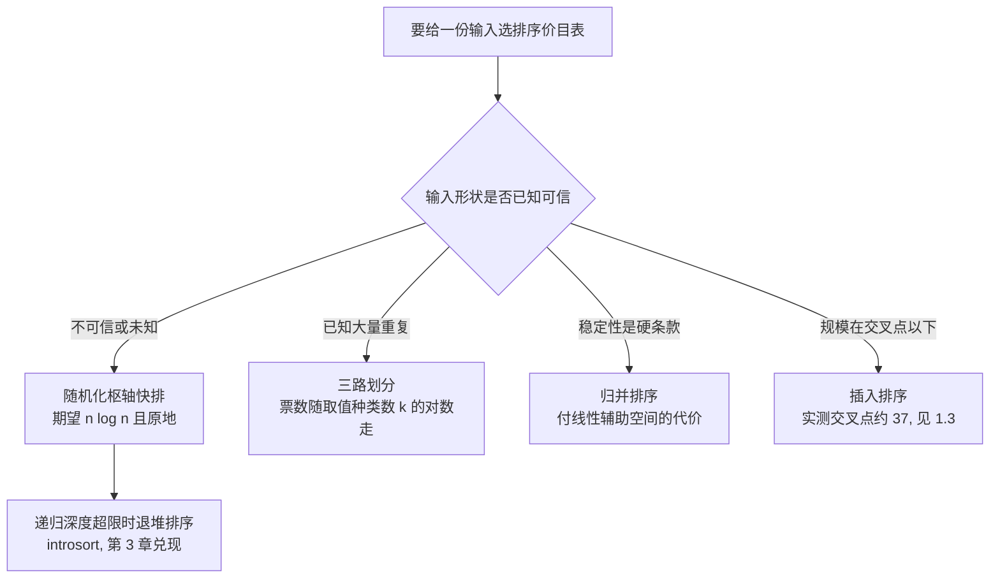

# $\rm Chapter \, 2$ 排序谱系

> **本章假设你已经会**
>
> 1. $\Theta$、$O$、$\Omega$ 的双边/单边含义，以及「档位声明必须说清谈论的是哪个 $T(n)$」的语法，见 §1.1。
> 2. 计数模型与票数账：插入排序期望 $\tfrac{n(n-1)}{4}+n-1$ 票、归并排序上界 $n\lceil\log_2 n\rceil$ 票，见 §1.2。
> 3. 多轮取最速的计时纪律（热身一轮、min over reps、固定种子），见《性能工程》§1.2。
> 4. 空间也是合同条款：归并排序用 $\Theta(n)$ 辅助内存买 ${n\log n}$ 的时间档位，见 §1.2 末段。

全册心智模型继续生效：**复杂度是合同，每种算法开张时承诺一张操作价格表，买错表就赔性能**。上一章签下两张表（插入、归并），并欠了三笔账：快排「期望 $\Theta(n\log n)$、最坏 $\Theta(n^2)$」里的期望从哪算出来（§1.5 第一条误用只念了结论）；「比较排序整体逃不出 $\Omega(n\log n)$」这条集体下限为什么成立（§1.2 只立了信息账的凭据）；已排序、全重复这类对抗输入会怎样撕毁「随机输入」这个前提（§1.3 埋的伏笔）。本章把排序家族的合同签齐、三笔账还清。§2.1 先把合同另两栏条款（稳定性、原地性）写成白纸黑字，因为选排序从来不是只选时间档位；§2.2 给快排建账：划分的票源、最坏情形的精确票数、期望票数 ${2(n+1)H_n-4n}$ 的完整推导，并看清随机化改写的是合同哪一条；§2.3 用决策树证明整类比较排序的地板价；§2.4 与 §2.5 是两个锚点实验：对抗输入上随机化枢轴对固定枢轴的逐位对账（`expAD02/result.txt`，exp1A/exp1B），三路划分在重复元素上的改进账（exp2A/exp2B）。实验环境与上一章相同（WSL2，python 3.12.3），种子固定 20261107，计时热身一轮后多轮取最速，重跑可得同一串数字。

## $\rm \S \, 2.1$ 四栏条款：稳定性与原地性

先立任务。你手头有一份文献列表，先按年份排好了序，现在要再按作者姓氏排，但希望同一年份内部的文献保持原来年份序里的相对次序，也就是「先按年份、再按作者」的多键排序。这件事有个零成本的实现：先按年份做一次稳定排序，再按作者做一次稳定排序，两步完事。它依赖一个此前从没写进合同的条款：键值相等的元素，排序后相对次序保不保持。这个条款叫稳定性（stability）：任何键值相等的两个元素，排序后的先后关系与输入一致，则称该排序是稳定的。另一个条款管内存：排序只在原数组内交换元素、不开辟随输入规模增长的辅助数组，叫原地性（in-place property）。加上时间与空间两栏，每张排序价目表共四栏，上一章结尾预告的「四栏条款」在此兑现：

| 排序 | 时间档位（比较票） | 空间档位 | 稳定性 | 原地性 |
| --- | --- | --- | --- | --- |
| 插入 | 最坏/期望 $\Theta(n^2)$；已排序输入 $\Theta(n)$ | $\Theta(1)$ | 稳 | 是 |
| 归并 | $\Theta(n\log n)$，全输入保证 | $\Theta(n)$ | 稳（平局取左段） | 否 |
| 快排 | 期望 $\Theta(n\log n)$，最坏 $\Theta(n^2)$ | 递归栈 $\Theta(\log n)$ | 不稳 | 是 |

三个格子的理由都已在手上或马上给出。插入排序稳定：§1.2 的实现里元素向左挪的条件是「左侧元素严格大于它」，相等元素从不跨过彼此；原地也是显然的，全部工作在原数组内完成。归并排序的稳定性取决于一条实现约定：两段合并时若首元素相等，取左段的；这条写进实现，归并就稳定；它的原地栏早已签明，$\Theta(n)$ 缓冲区，非原地。快排两栏都不占。不稳定是划分动作亲手造成的，看一个最小反例。递归栈那栏先兑现承诺：朴素的快排递归最坏会开到 $\Theta(n)$ 层（§2.2 的最坏情形输入恰好逐层递归），但只要遵守「先递归较小一侧、较大一侧压栈待处理」的纪律，栈里同时存着的区间长度每入栈一个就至少减半一次（压进去的永远是较大侧的一半），栈深不超过 $\log_2 n$ 层。这是合同细节：同一张时间价目表，栈深条款写 $O(\log n)$ 还是 $O(n)$，取决于这条免费的实现纪律，本章实验代码即按此写。

数组 $[5_a,\ 1,\ 3,\ 5_b,\ 2]$，两个键值同为 5 的元素记作 $5_a,5_b$ 以区分身份，取末元素 2 为枢轴做一次划分（Lomuto 口径，下节细讲）：1 不大于枢轴，与 $5_a$ 交换，得 $[1,\ 5_a,\ 3,\ 5_b,\ 2]$；扫描结束后枢轴与位置 1 的元素交换归位，得 $[1,\ 2,\ 3,\ 5_b,\ 5_a]$。整个过程 $5_a$ 与 $5_b$ 从未直接比较，相对次序却翻了，因为两次交换都从它们头上跳了过去。相等的元素隔着中间元素被交换，这就是快排不稳定的具体机理：不是实现没写好，是划分这个动作自带的副作用。

稳定性在 OJ 上几乎从不计价（判题只验键值序列），在开发里是真金白银的条款：开头那个两步排序法是数据库导出、日志归并、报表分组的日常手段，前提是每一步都稳定。当然也可以把两个键拼成一个比较函数一次排完，但拼接要求键类型可组合、比较代价随键数上涨，稳定排序两步法对任意键列都通用，代价只是多跑一遍。选表时先问次序要不要保、内存给不给，再问时间档位；四栏里任何一栏都可能一票否决。

白话：时间档位是「排多快」，空间档位是「占多少地方」，稳定性是「平局时先来后到乱不乱」，原地性是「要不要另租场地」。竞赛只看第一栏，开发四栏都要签。

> 本节小结：稳定性与原地性是排序合同独立于时间的两栏；插入稳且原地，归并稳但非原地，快排原地但不稳（划分跨元素交换所致）；多键排序靠连续多次稳定排序实现。

## $\rm \S \, 2.2$ 快排的账：划分、最坏与期望

快排的全部工作集中在一个动作：划分（partition）。选定一个参照元素，称枢轴（pivot），把数组重排成三段：不大于枢轴的左段、枢轴自己、大于枢轴的右段，再对左右两段递归。Lomuto 口径取段末元素为枢轴 $p$，用指针 $i$ 标出「不大于 $p$ 区域」的右边界，指针 $j$ 从左向右扫：$a[j]\le p$ 就把它与 $a[i]$ 交换并右移 $i$，否则不动；扫完后枢轴与 $a[i]$ 交换归位。票源只在扫描处：$j$ 对长为 $m$ 的段从段首扫到枢轴前，共 $m-1$ 步，每步恰一次比较，末尾的归位交换不比较。所以划分一张价目：段长减一票。这是快排全部的票源，递归只负责把段切小。边界也钉一下：空段与单元素段不用划分，$C(0)=C(1)=0$。

最坏情形的账可以精确结清。输入已按升序排好、枢轴恒取末元素时，末元素恰是段内最大值，每个 $a[j]\le p$ 都成立，$i$ 一路推进到段尾：左段长 $m-1$，右段空。递归只往左走，段长依次为 $n,\,n-1,\,\ldots,\,2$，各收 $m-1$ 票，总计

$$
C_{\text{worst}}(n)\;=\;(n-1)+(n-2)+\cdots+1\;=\;\frac{n(n-1)}{2}
$$

全重复输入走同一笔账：每个元素都不大于枢轴，划分每层只削掉枢轴自己，把它写成递推更看得清：

$$
C(n)\;=\;(n-1)+C(n-1)\;=\;(n-1)+(n-2)+\cdots+1\;=\;\frac{n(n-1)}{2}
$$

注意这笔账与枢轴怎么选无关：全相等时选谁当枢轴都一样，§2.4 的实测会把这一点钉死。

期望票数从递推式出发。设段长为 $n$ 时枢轴在段内的名次均匀分布于 ${1..n}$（随机化枢轴直接保证；固定枢轴遇均匀随机输入时，末元素的名次同样均匀），名次为 $k$ 时两侧长 $k-1$ 与 $n-k$，各递推。记期望比较数为 $C(n)$：

$$
C(n)\;=\;(n-1)\;+\;\frac{1}{n}\sum_{k=1}^{n}\bigl(C(k-1)+C(n-k)\bigr)
$$

读法：$n-1$ 是本次划分的票；名次 $k$ 以概率 $\tfrac1n$ 出现，两侧子问题各按其长度取期望。两个和式扫过同一批 $C(0),\ldots,C(n-1)$，合并得

$$
C(n)\;=\;(n-1)\;+\;\frac{2}{n}\sum_{k=0}^{n-1}C(k)
$$

解这种「和式挂在递推尾巴上」的方程，标准手法是乘 $n$ 消分母、再错位相减消和式：把 $n$ 换成 $n-1$ 重写一遍，两式相减，

$$
n\,C(n)-(n-1)\,C(n-1)\;=\;2(n-1)\;+\;2\,C(n-1)
$$

移项后除以 $n(n+1)$：

$$
\frac{C(n)}{n+1}\;=\;\frac{C(n-1)}{n}\;+\;\frac{2(n-1)}{n(n+1)}
$$

右端新增项可以裂项：$\tfrac{2(n-1)}{n(n+1)}=\tfrac{4}{n+1}-\tfrac{2}{n}$（通分即验）。令 $D(n)=\tfrac{C(n)}{n+1}$，由 $C(1)=0$ 即 $D(1)=0$ 起逐项累加，裂项让每个中间项两头抵消，只剩首尾：

$$
D(n)\;=\;4\,(H_{n+1}-H_2)\;-\;2\,(H_n-1)\;=\;2H_n+\frac{4}{n+1}-4
$$

其中 $H_n=1+\tfrac12+\cdots+\tfrac1n$ 是调和数（harmonic number），$H_2=\tfrac32$，大 $n$ 时 $H_n=\ln n+0.577\ldots$。乘回 $(n+1)$，常数项归拢：

$$
C(n)\;=\;2(n+1)H_n-4n\;\approx\;2n\ln n\;=\;1.386\,n\log_2 n
$$

这就是「快排期望 $\Theta(n\log n)$」的完整票据：比归并的 $n\log_2 n$ 档位贵约 38.6%。闭合公式可信吗？拿最小规模手验两格。$n=2$：无论如何划分都只收 1 票，公式给 $2\times3\times\tfrac32-8=1$，命中。$n=3$：首次划分收 2 票，枢轴名次 $k$ 均匀，右侧子问题规模合计只算一次非平凡子问题，递推给 $2+\tfrac13\bigl(C(2)+C(0)\bigr)+\tfrac13\bigl(C(1)+C(1)\bigr)+\tfrac13\bigl(C(0)+C(2)\bigr)=2+\tfrac23=2.667$；公式给 $2\times4\times\tfrac{11}{6}-12=2.667$，命中。小格对上，错位相减的每一步才有资格被信任。

贵出来的价钱买到什么，是本节真正的结论。期望公式有两组成立方式：固定枢轴加随机输入，或随机枢轴加任意输入。前者把「输入均匀」当前提条款，前提在谁手里在数据手里，对手递进一篇已排序的日志，前提就没了；后者把随机性搬进算法自己怀里，骰子在自己手里，期望合同对每一个具体输入都成立，对手再也无法用输入形状挑合同毛病。所以随机化买的是合同前提的归属权，保费是每次划分多掷一次骰子，票价几乎为零。枢轴选法其实是一条谱系：固定位置（合同前提在数据手里）、均匀随机（前提在算法手里）、三者取中（取首、中、尾三元素的中位数当枢轴，有序输入上恢复平衡，但可被特定构造骗过），工程库多用三者取中加小段插入排序的混合；本章聚焦谱系两端，因为两端的合同条款差异最清楚。§1.5 第一条误用在此修正完毕：「随机化快排期望 $\Theta(n\log n)$」这句话里，期望是对骰子取的，合同无条件成立于任何输入；「最坏 $\Theta(n^2)$」仍然在册，只是被压成概率上几乎不可能的事件，需要连续掷出极偏的骰子序列。

白话：固定枢轴的快排把「输入是乱的」写进合同前提，前提丢了就赔成平方；随机化把骰子揣进自己兜里，前提永远成立，每次掷骰子的保费约等于免费。

> 本节小结：划分每层收「段长减一」票；已排序与全重复输入都让段长每层只减一，精确收 $\tfrac{n(n-1)}{2}$ 票；期望票数 $C(n)=2(n+1)H_n-4n\approx1.386\,n\log_2 n$，推导靠乘 $n$ 错位相减与裂项；随机化把合同前提从数据手里挪进算法手里。

## $\rm \S \, 2.3$ 决策树：整类合同的地板价

§1.2 立过一张凭据：一次比较至多分辨 1 比特，区分 ${n!}$ 种排列至少要 $\log_2 n!$ 比特。现在把凭据结成定理。只靠「比较两个元素谁大」来获取输入信息的排序算法，统称比较排序（comparison sort）；插入、归并、快排全在此类。任何比较排序在执行中的每一次分岔都由一次比较的结果导航，把所有可能的执行画成一棵二叉树：内部节点是一次比较，两条边是「是/否」，叶子是输出。这棵树叫决策树（decision tree），算法在某个输入上的行为就是从根到某片叶子的走法。

三步推出地板价。第一步，叶子至少 ${n!}$ 片。设各元素键值互异，每片叶子只输出一种固定的元素排列；${n!}$ 种输入排列各自要求不同的正确输出排列，若两种输入走到同一片叶子，叶子的唯一输出不可能同时对两者正确，所以每个输入排列都要有自己专属的叶子。第二步，高度为 $h$ 的二叉树至多 $2^h$ 片叶子，每层至多翻倍。两步合起来：

$$
2^{h}\;\ge\;n!\qquad\Longrightarrow\qquad h\;\ge\;\log_2 n!
$$

最坏情形比较次数就是树高（最坏输入沿最深路径走到叶子），所以 $h\ge\log_2 n!$。第三步，把 $\log_2 n!$ 拆半求和放缩：

$$
\log_2 n!\;=\;\sum_{i=1}^{n}\log_2 i\;\ge\;\sum_{i=\lceil n/2\rceil}^{n}\log_2\frac{n}{2}\;\ge\;\frac{n}{2}\log_2\frac{n}{2}\;=\;\frac{n}{2}\bigl(\log_2 n-1\bigr)
$$

读法：求和的后一半项（约 $\tfrac n2$ 个）里每个 $i\ge\tfrac n2$，每项至少值 $\log_2\tfrac n2$；$n\ge4$ 时右端为正且是 $\Theta(n\log n)$。于是：任何比较排序，最坏情形比较次数为 $\Omega(n\log n)$。

地板价不只是理论装饰，它给了你谈判地位。有人向你推销一个「线性时间、只做比较」的排序库，$\Omega(n\log n)$ 下限当场宣判这张价目表违规：要么它偷用了比较之外的信息（比如键本来就是小范围整数），要么它「线性」量的不是比较票，先查合同前提再谈价格。实测侧同一个用法：给任何比较排序量出 log-log 斜率，贴着 1.1 到 1.2 说明它活在地板价附近，贴着 2 说明某层划分正在只削一个元素，§2.4 的两个斜率就是这把尺子的两个刻度。

这条下限改写三张合同的读法。其一，归并的 $n\lceil\log_2 n\rceil$（§1.2）距地板只差常数倍：§1.3 交叉点实验里归并的形状优势不是归并聪明，是问题本身就收这个价，归并把整类合同的地板价签成了自己的定价。其二，快排期望 $1.386\,n\log_2 n$，比地板贵 38.6%，这份溢价换的是原地执行与顺序访存（§1.4 的单价账里两者都占便宜）。顺带把「最坏」与「下限」的关系说准：决策树证的是最坏情形的下限，随机化快排的最坏情形理论上仍是 $\Theta(n^2)$（连续掷出极偏骰子），下限并不因随机化消失；随机化改变的是最坏情形被触达的方式，对手必须先赌赢你的骰子。其三，下限有自己的前提条款：「只能问比较」。键值是小范围整数时可以不比较、直接数桶（计数排序的思想），$n+k$ 票完事，绕出下限管辖。合同看条款，下界也有适用范围，没有无前提的定理。

白话：比较排序每问一句话只得到「是/否」一比特，${n!}$ 种谜底至少要 $\log_2 n!$ 个问题才能问穿；归并贴着地板价卖，快排加价 39% 卖原地，想比地板还便宜就得换一种问话方式。

> 本节小结：决策树把比较排序的执行画成二叉树；${n!}$ 片叶子、每层翻倍、拆半求和三步得 $\Omega(n\log n)$ 集体下限；归并已是地板价，快排的溢价买原地性，计数排序靠不比较绕开前提。

## $\rm \S \, 2.4$ 对抗输入实测：随机化买的是什么

理论价目表就位：固定枢轴在已排序输入上精确收 $\tfrac{n(n-1)}{2}$ 票，随机化枢轴在任何互异键值输入上期望收 $2(n+1)H_n-4n$ 票，全重复输入让随机化失效（选谁都一样，每层只削一个元素）。实测对账，`expAD02/result.txt` 的 exp1A，$n=8192$，前三列是比较次数实测：

| 输入 | 固定枢轴 | 随机化枢轴 | $\tfrac{n(n-1)}{2}$ | $2(n+1)H_n-4n$ |
| --- | --- | --- | --- | --- |
| 已排序 | 33550336 | 126276 | 33550336 | 124344 |
| 全重复 | 33550336 | 33550336 | 33550336 | — |
| 均匀随机 | 127175 | 130275 | — | 124344 |
| 已排序（$n=2048$） | 2096128 | 24062 | 2096128 | 25420 |

逐行各有其事。第一行：固定枢轴实测 33550336，与 $\tfrac{n(n-1)}{2}=8192\times8191/2$ 逐位命中，最坏情形的账一分不差；随机化在同一输入上收 126276，理论侧可以三层对账：手算近似 $H_n\approx\ln n+\gamma$，$\ln 8192=13\ln 2=9.0109$，加 $\gamma=0.5772$ 得 $H_{8192}\approx9.5882$，代回 $2\times8193\times9.5882-4\times8192=124344$，与程序里逐项求和的精确调和数值 124344 一致，实测 126276 比理论高 1.6%，是单次随机样本绕期望的正常波动（$n=512$ 时实测 5091 对公式 4946 偏 2.9%，$n=2048$ 时 24062 对 25420 偏 $-5.3\%$，方向随机、幅度随 $n$ 缩小）。第二行是本节的眼：全重复输入上随机化枢轴照样收满 33550336 票，与固定枢轴完全相同。随机化的合同承诺「枢轴名次均匀」，可全相等时名次再均匀也改变不了划分结果，所有元素都落进不大于枢轴的一侧。随机化防得住「对手知道枢轴规则」，防不住「元素全相等」，后者是值分布的病，不是枢轴策略的病，药方在 §2.5。第三行：随机输入上两种策略都贴着公式 ±5%，因为此时固定枢轴的名次天然均匀，两份合同恰好同一张。第四行把「波动随 $n$ 缩小」摆上台面：$n=2048$ 的已排序输入上固定枢轴仍是精确的 $\tfrac{n(n-1)}{2}$，随机化 24062 对公式 25420 偏 $-5.3\%$，与 $n=8192$ 的 $+1.6\%$ 方向相反、幅度更小，样本绕期望的正常行为。

比较票是合同，时间是账单。已排序输入上的计时（exp1B，热身一轮后多轮取最速；计时包含比较计数器的开销，两种算法每张比较票均摊同一份计数成本，倍数结论不受影响）：

| $n$ | 固定枢轴最速 (ms) | 随机化最速 (ms) | 慢多少倍 |
| --- | --- | --- | --- |
| 1000 | 25.657 | 0.660 | 38.9 |
| 2000 | 116.578 | 1.433 | 81.3 |
| 4000 | 462.526 | 3.119 | 148.3 |
| 8000 | 1810.328 | 6.950 | 260.5 |

倍数每随规模翻倍几乎翻倍（38.9 到 81.3 到 148.3 再到 260.5），与 $\tfrac{n^2/2}{1.386\,n\log_2 n}\propto\tfrac{n}{\log n}$ 的预测一致：$n$ 翻倍、$\log n$ 只挪一小格，倍数近似乘 2。形状也验了：对 $n\in[1000,8000]$ 做 log-log 拟合，固定枢轴斜率 2.041 对理论 2.0，随机化斜率 1.131 对 $n\log n$ 的 1.0 出头。$n=8000$ 时固定枢轴慢 260 倍，差额全是合同前提被撕毁的赔偿金。

> 竞赛生迁移提示：OJ 数据常刻意打乱，固定枢轴的模板可能从没翻过车；生产数据自带形状，日志按时间戳单调、数据库导出常已按某列排好、主键大量重复。这类「上线后超时」的证据式排查三步走：先看输入形状（是否有序、重复率多高），再对账比较次数（实测恰好 $\tfrac{n(n-1)}{2}$ 就是判决书，说明每层划分都在只削一个元素），最后按病因开药：形状有序换随机化枢轴，值大量重复换三路划分。诊断不需要猜，票数会自己指认凶手。

白话：随机化枢轴是份保险，保的是「对手按输入形状挑你毛病」这类事故，保费一次一次掷骰子；保单条款写得清楚，元素全相等不算保险责任，那得换保险。

> 本节小结：固定枢轴在已排序输入上精确收 $\tfrac{n(n-1)}{2}$ 票（33550336 逐位命中），随机化救回 $n\log n$ 档（实测 126276 对公式 124344）；计时倍数随 $n$ 翻倍而翻倍，log-log 斜率 2.041 对 1.131；全重复输入随机化同样打满平方票，是三路划分的引子。

## $\rm \S \, 2.5$ 三路划分：重复元素上的改进账

病因确诊了：重复元素把两路划分压成每层只削一个元素。三路划分（3-way partitioning，又称荷兰国旗问题解法）对症下药：一次划分把数组切成「小于枢轴、等于枢轴、大于枢轴」三段，而不是两段。实现仍是扫描，靠三条不变量维持三段边界：$lt$ 左侧全部严格小于 $p$，$gt$ 右侧全部严格大于 $p$，$lt$ 与 $i$ 之间全部等于 $p$。指针 $i$ 从左向右扫：$a[i]<p$ 就与 $lt$ 处交换并双双右移（换过来的是等区元素，无需再验），$a[i]>p$ 就与 $gt$ 处交换、$gt$ 左移而 $i$ 不动（换过来的元素还没验过），相等则原地留进等区、$i$ 前进。每步先问一次「小于？」，不是再问一次「大于？」，所以小于情形一票、大于与相等情形各两票。关键在等区：落进等区的元素从此退出战场，不再参与任何后续比较与递归。重复元素不再是负担，而是被一次性清算的存货。

票数先算最极端的。全重复输入：枢轴选定后，其余每个元素两票（不小于、不大于），全部留在等区，无递归，总计

$$
C_{3}(n)\;=\;2\,(n-1)\;=\;8190\qquad(n=4096)
$$

exp2A 实测恰为 8190，逐位命中；两路同一输入收 8386560 票，是它的 1024 倍。一般情形的文献结论（Sedgewick 1977；《算法（第 4 版）》§2.3 命题）：含 $k$ 种不同取值的输入，三路快排期望比较约 $2n\ln k$ 票，票数跟着取值种类数的对数走，而不是跟着 $n$ 的对数走。论证框架：递归每深一层，每元素至多被比较两次、全层合计至多 ${2n}$ 票，而深度由「还剩几种取值」控制，期望上与对 $k$ 个不同值跑快排同阶。本节不展开这条熵账的每一步，改为实测核查它的可证预言：若成立，三路票数除以 $2nH_k$ 应在大范围重复率上近似常数。exp2A，$n=4096$，取值从 $\{0,\ldots,k-1\}$ 均匀抽取：

| 不同取值数 $k$ | 重复率 | 两路实测 | 三路实测 | 三路/两路 | 三路除以 $2nH_k$ |
| --- | --- | --- | --- | --- | --- |
| 4096 | 0 | 59886 | 86284 | 1.44 | 1.18 |
| 2048 | 0.50 | 55623 | 79050 | 1.42 | 1.18 |
| 1024 | 0.75 | 56149 | 79708 | 1.42 | 1.30 |
| 256 | 0.9375 | 72873 | 54085 | 0.74 | 1.08 |
| 1 | 全重复 | 8386560 | 8190 | 0.001 | 1.00 |

比例列在 1.00 与 1.30 之间近似持平，理论预言核查通过。读表三件事。其一，无重复时三路是亏本买卖：86284 对 59886，多付约 44%，因为等区没占到便宜、每个元素却可能多付一问；这份保费在重复率越过 75% 到 93.75% 之间的某个点后回本，全重复时收益 1024 倍。其二，两路的票数随重复率上升先降后升（56149 到 72873 再到 8386560）：重复率越高，等值的元素越容易整段落进同一侧，划分越偏，两路的合同在重复端持续恶化，与 §2.4 的平方票一脉相承。其三，三路在两端都稳：无重复时贴着两路的 $n\log n$ 档（贵四成），全重复时纯线性。

时间是账单的最后一栏。全重复输入计时（exp2B）：

| $n$ | 两路最速 (ms) | 三路最速 (ms) | 倍数 |
| --- | --- | --- | --- |
| 1000 | 23.801 | 0.040 | 588 |
| 2000 | 109.054 | 0.082 | 1335 |
| 4000 | 436.081 | 0.227 | 1921 |

两路按平方涨价、三路按线性涨价，倍数随规模持续拉开。三路自身的规模扩展也验了：全重复输入上 $n=10^4$ 时每元素 44.0 纳秒，$n=10^5$ 时 42.5 纳秒，几乎不动；log-log 斜率 0.985 对线性合同的理论值 1.0，$2(n-1)$ 票的账在计时上兑现。

工程注脚：标准库早就内置了本章的教训。C++ 的 `std::sort` 是 introsort，快排递归深度超限时退回堆排序，封死平方最坏；Java 对基本类型用双枢轴快排、对对象直接用稳定的归并变体 TimSort，正是把「稳定性条款」按类型分别签约。理解了四栏合同与对抗输入，这些选择不再是黑魔法，而是逐条可查的条款组合。本章加上 §1.3 的交叉点，选表的完整决策收进一张图：

图的用法按箭头读：先问形状，形状决定合同风险；四条出路的条款代价都在本章账上算过，唯一没算的是堆排序的堆，第 3 章开张。

白话：两路划分把「等于枢轴」当普通货物来回搬，搬一次算一次钱；三路划分把等值货物一次清仓、永不回炉。没重复时清仓机制白养着（贵四成），重复一多它就是救命的。

> 本节小结：三路划分让等值元素退出战场，全重复输入精确收 $2(n-1)$ 票（8190 逐位命中），一般情形票数随 $k$ 的对数走（比例列 1.00–1.30 持平）；无重复时多付约 44% 保费，重复率约九成回本；计时上两路对三路的倍数随 $n$ 平方级拉开。

## $\rm \S \, 2.6$ 关键概念回顾

1. 不看表格，说出插入、归并、快排四栏条款（时间、空间、稳定性、原地性）各自的值，并说明快排不稳定是由哪个具体动作造成的。
2. 已排序输入与全重复输入，为什么让两路快排收同样精确的 $\tfrac{n(n-1)}{2}$ 票？为什么全重复时换随机化枢轴也救不回来？
3. 期望比较次数 $C(n)=2(n+1)H_n-4n$ 的推导里，「乘 $n$ 错位相减」消去的是什么？「裂项」又是为哪一步服务的？随机化把合同里哪一条前提的归属权换了手？
4. 决策树证明的三步各自断言什么：叶子为何至少 ${n!}$ 片、树高为何 $\ge\log_2 n!$、拆半求和得到什么下限？这条下限的前提被计数排序绕开的究竟是哪一条？
5. 三路划分在全重复输入上收 $2(n-1)$ 票的账怎么走？它的保费在什么输入上支付、在什么重复率附近回本？

## $\rm \S \, 2.7$ 应用与辨析

1. 同事用固定枢轴快排处理「基本按时间戳有序」的业务日志，上线后超时。写出证据式排查的完整步骤（观察输入形状、对账比较票数、按病因修复），并说明为什么「换随机化」与「换三路」各治哪种病、用错药会怎样。
2. 你要排序一千万条记录，内存余量紧张，且排序后还要按第二列再排一次、要求第一列的组内次序不乱。用四栏合同与地板价论证你会选哪张价目表，明确说出你放弃了哪一栏、为什么可以放弃。
3. §2.4 表格里全重复输入的随机化枢轴实测仍收满 33550336 票。这违反「随机化快排期望 $\Theta(n\log n)$」吗？用 §1.1 的「档位声明必须连前提一起念」和 §2.2 推导的前提条款作答。

## $\rm \S \, 2.8$ 本章自测答案

概念回顾答案：

1. 插入：最坏/期望 $\Theta(n^2)$、已排序 $\Theta(n)$，空间 $\Theta(1)$，稳，原地。归并：$\Theta(n\log n)$ 全输入，空间 $\Theta(n)$，稳（平局取左段），非原地。快排：期望 $\Theta(n\log n)$、最坏 $\Theta(n^2)$，栈 $\Theta(\log n)$，不稳，原地。不稳定由划分的跨元素交换造成：相等的元素隔着中间元素被两次交换换序（§2.1 的 $5_a,5_b$ 反例），彼此从未直接比较（来源：§2.1）。
2. 两种输入下每个元素都满足「不大于枢轴」：已排序时末元素恰是最大值，全重复时人人相等，于是划分每层左段长 $m-1$、右段空，段长依次减一，票数同为 $\tfrac{n(n-1)}{2}$。全重复时随机化救不回来，因为随机化承诺的是「枢轴名次均匀」，而名次均匀改变不了「所有元素都落进不大于一侧」这个事实，病在值分布不在枢轴策略（来源：§2.2、§2.4）。
3. 错位相减消去挂在递推尾巴上的和式 $\sum_{k=0}^{n-1}C(k)$（两式相减后只剩 $C(n-1)$ 一项）；裂项 $\tfrac{2(n-1)}{n(n+1)}=\tfrac{4}{n+1}-\tfrac{2}{n}$ 让逐项累加时中间项两头抵消，只剩调和数首尾。随机化把「输入均匀随机」这条前提从数据手里挪进算法手里，换成「枢轴名次均匀」，骰子由算法自己掷，期望合同对每个互异键值输入无条件成立（来源：§2.2）。
4. 叶子至少 ${n!}$ 片：互异键值下每片叶子只输出一种排列，每种输入排列需要专属的正确输出排列；树高 $h$ 满足 $2^h\ge n!$，因为每层至多翻倍；拆半求和得 $\log_2 n!\ge\tfrac n2(\log_2 n-1)=\Theta(n\log n)$，即任何比较排序最坏情形 $\Omega(n\log n)$。被计数排序绕开的前提是「只能通过比较获取输入信息」：键值是小范围整数时直接数桶，不比较（来源：§2.3）。
5. 枢轴选定后其余每个元素两票（先问小于、再问大于），全部落进等区并永久退出，无递归，合计 $2(n-1)$。保费在无重复输入上支付：等区占不到便宜、每元素可能多付一问，实测多付约 44%；重复率从 75% 到 93.75% 之间的某点回本（实测三路/两路从 1.42 翻到 0.74），全重复时收益 1024 倍（来源：§2.5）。

应用与辨析答案：

1. 排查三步。第一步看输入形状：日志按时间戳单调，属 §2.4 的已排序族。第二步对账票数：埋个计数器实测比较次数，若恰为 $\tfrac{n(n-1)}{2}$（或接近），判决成立，每层划分只削一个元素；再查重复率（时间戳精度低时大量相等）。第三步按病因开药：病在输入有序（形状病）换随机化枢轴，病在值大量重复（分布病）换三路划分。用错药的后果：只有重复病却只换随机化，§2.4 第二行实测表明票数一分不降；只有形状病却换三路，多付四成保费、病根没治（来源：§2.4、§2.5）。
2. 选归并。四个理由连成链：其一，第二列还要再排一次且组内次序不乱，这正是 §2.1 的多键排序法，前提是每一步稳定，三张表里只有插入与归并稳定，而插入的 $\Theta(n^2)$ 档位在一千万规模上按 §1.3 的交叉点账早已不可接受；其二，时间档位取归并的全输入 $\Theta(n\log n)$ 保证，距 §2.3 地板价只差常数；其三，放弃的是空间栏，$\Theta(n)$ 辅助内存，题目允许（内存余量紧张但仍够归并缓冲，若连这也不够，四栏逼你回到快排并放弃稳定性条款，改用「原数组附带原下标做装饰键」的替代法，代价是多一倍内存与一次装饰比较）；其四，快排的原地与 38.6% 溢价在此都换不来稳定性条款，四栏里本题的硬条款是稳定性与时间（来源：§2.1、§2.3）。
3. 不违反。期望公式 $C(n)=2(n+1)H_n-4n$ 的推导有一节前提条款：递推式里「枢轴名次为 $k$ 时两侧长 $k-1$ 与 $n-k$」只在元素互异时成立，因为划分按「不大于枢轴」切分，互异时切分位置才由名次唯一决定；全重复时人人等值，无论枢轴落在哪里，所有元素都进左侧，名次的均匀性帮不上忙。所以完整读法是「元素互异的输入上，随机化快排期望比较 $\Theta(n\log n)$」；§1.1 的语法要求档位声明连同前提一起念，漏前提的合同才是被违反的合同（来源：§1.1、§2.2、§2.4）。

**你现在能做什么**：拿到任何一个排序实现，你能数清它在指定输入上的比较票数、念全它四栏条款里省略掉的部分，并对「有序、重复多」两类对抗输入给出票数级的诊断与对症的修复方案。

排序的三张主表签齐了，但四栏合同还留着一格空白：有没有一种结构，把 $\Theta(n\log n)$ 写成全输入无条件条款、又保持原地？第 3 章的堆用「一棵存在数组里的完全二叉树」签下这张表，它还附带一个排序给不了的承诺：随时以 $O(\log n)$ 取出当前最小元，而不必等排完。那张价格表叫优先队列，是下一章开张的第一张价目。
