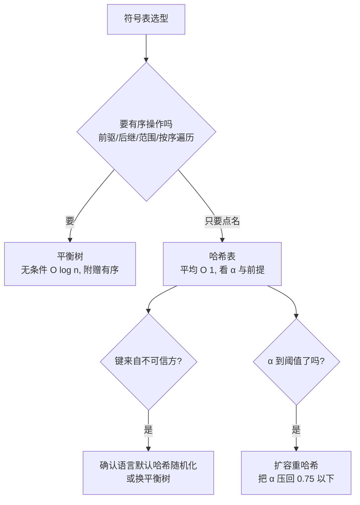

# $\rm Chapter \, 4$ 符号表与哈希

> **本章假设你已经会**
>
> 1. $\Theta$、$O$、$\Omega$ 的双边/单边含义，以及「档位声明必须说清谈论的是哪个 $T(n)$」的语法，见 §1.1。
> 2. 计数模型：代价按基本操作票数计，票种跟着问题的内在稀缺资源走，见 §1.2。
> 3. 多轮取最速的计时纪律（热身一轮、min over reps、固定种子），见《性能工程》§1.2。
> 4. 随机化买的是什么：对抗输入会撕毁「随机输入」这条前提条款，见 §2.4。
> 5. 第 3 章见过一种装进数组的树（二叉堆，只承诺随时取最小元）；本章的树换一种存法：节点加指针，回答的问题是「按值点名」。

全册心智模型继续生效：**复杂度是合同，每种数据结构开张时承诺一张操作价格表，买错表就赔性能**。第 1 章末段埋过一张没签的合同：「哈希表承诺按值取元素平均一票出头」。本章把它签掉，连同它的竞争者一起。§4.1 从按值点名的任务出发立起符号表（symbol table）的价目框架与二叉搜索树（binary search tree，BST）；§4.2 推 BST 随机插入的平均账并用第一个锚点实验对账，排序插入把同一张表撕到 $\Theta(n)$；§4.3 用平衡化把最坏情形写进合同；§4.4 换赛道讲哈希与链地址；§4.5 推开放寻址的探查期望，跑第二个锚点实验：负载因子扫描对 Knuth 曲线；§4.6 实证撕毁合同前提的两种真实方式（可变键与碰撞攻击，第三个实验）。实验环境与前两章相同（WSL2，python 3.12.3，numpy 2.5.4），种子固定 20261107，脚本与完整输出见本册实验记录 `expAD04/result.txt` 与 `expAD04/supp.txt`，重跑可得同一串数字。

## $\rm \S \, 4.1$ 点名任务与二叉搜索树

先立任务。贯穿项目里的论文资料管理器迟早要回答：给定 DOI，把那条论文记录取出来。数组能做到，代价是从头扫到尾，期望 $\tfrac{n}{2}$ 票比较（本章票种沿用 §1.2 的口径：一次键比较一票）；排序数组加二分查找只要 ${\lceil\log_2 n\rceil}$ 票，可插入一条新记录要把后面全部元素搬移一格，期望又是 $\tfrac{n}{2}$ 票写回。两张半成品合同各自便宜一半、贵另一半，而点名与追加在实际服务里同样频繁。要的是查找、插入、删除同时便宜的结构。

定义（符号表）：符号表是键值对的集合，支持三个操作：put（放入或更新一个键值对）、get（按键取值）、delete（按键删除）。本章的账全部记在这三个操作上。

定义（二叉搜索树）：每个节点存一个键，并满足对任何节点：左子树全部键小于它，右子树全部键大于它。这条不变量把全树的键排成全序，点名查找于是从根出发走一条单一路径：每个节点比较一次键，小了往左、大了往右、相等命中。插入走同一条路径，在末端空位挂上新节点；一次成功查找或插入的比较票数恰好等于目标键的深度（边数）加一。

形状决定价目，这是本章的主台词。最好的形状：$n$ 个键恰好平衡，深度约 ${\log_2 n}$，每票操作对数档。最坏的形状：插入序恰好已排序，第 $i$ 个键插入时右子树已是长 $i-1$ 的链，收 $i-1$ 票，建满全树共

$$
\sum_{i=1}^{n}(i-1)\;=\;\frac{n(n-1)}{2}
$$

票，此后每次点名平均 $(n+1)/2$ 票。BST 的合同没有在「树长什么样」上写死任何条款，它把形状留给插入序。合同要成立，必须先回答：真实插入序下，树平均长什么样？这是下一节的推导任务。

白话：符号表是电话簿，BST 是一本「每页只看一行就能翻到人」的电话簿；翻得快不快，全看这本簿子是被谁、按什么顺序填的。

> 本节小结：符号表的三个操作是 put/get/delete；BST 用「左小右大」不变量把查找与插入压成同一条根到叶的路径，票数等于深度加一；深度完全由插入序决定，最坏已排序时退化成链（$\Theta(n)$）。

## $\rm \S \, 4.2$ 随机插入的账：$2\ln n$ 从哪来

设 $n$ 个键按大小排名 ${1,\ldots,n}$，插入序是均匀随机排列。先备两件工具。

定义（调和数）：$H_n=\sum_{k=1}^{n}\frac{1}{k}$。它与对数咬合：${\ln(n+1)\le H_n\le 1+\ln n}$（把 $1/k$ 与积分 $\int_1^{n+1}\frac{dt}{t}$ 逐段比较可得），渐近式 ${H_n=\ln n+\gamma+o(1)}$，${\gamma\approx 0.5772}$。

**引理 1（祖先判据）**：在建树过程中，两个键 ${j,k}$（${j\ne k}$）被比较过当且仅当其中一个是另一个的祖先（每次比较都发生在插入路径上，分属两棵子树的键永不照面）；而 $j$ 是 $k$ 的祖先，当且仅当 $j$ 是闭区间 ${[\min(j,k),\max(j,k)]}$ 内全体键中**第一个被插入**的。

证明。把插入过程看成逐步「剥外壳」：第一个插入的键是根，比它小的键全部进左子树、大的进右子树，各子树内部再按这些键在插入序里的相对次序递归建树。于是 $j$ 与 $k$ 的命运由「包含二者的最小子树」决定，只要剥外壳时剥掉的是开区间 ${(j,k)}$ 之外的键，二者就落在同一侧、继续同住一棵子树；一旦剥掉的是区间内部的键，二者被分进两棵子树，从此永不比较。而闭区间 ${[\min,\max]}$ 内的键按插入时间先后被逐个剥到，所以最先被剥到的区间内键，就是插入序中该区间最早的键：它是 $j$ 或 $k$ 时二者之一成为祖先，是别的键时二者永分。两条合起来即得判据，同时给出概率：闭区间长 $d=|j-k|+1$，均匀随机排列下每个键先被插入的机会均等，故 $j$ 是 $k$ 的祖先的概率为 $\tfrac{1}{|j-k|+1}$。$\square$

**推论（平均深度）**：排名为 $k$ 的键的期望祖先数（即期望深度，边数）为

$$
\sum_{d=1}^{k-1}\frac{1}{d+1}\;+\;\sum_{d=1}^{n-k}\frac{1}{d+1}\;=\;\bigl(H_k-1\bigr)+\bigl(H_{n+1-k}-1\bigr)
$$

读法：左侧按「到 $k$ 左边的距离 $d$」与「到 $k$ 右边的距离 $d$」分两段求和，每段里隔 $d$ 位排名的键以 $\tfrac{1}{d+1}$ 的概率当上祖先。再对 $k$ 求平均，需要恒等式 $\sum_{k=1}^{n}H_k=(n+1)H_n-n$（交换求和序：$1/d$ 在 $H_k$ 里出现于所有 ${k\ge d}$，共 $n-d+1$ 次）。于是平均深度为

$$
\frac{1}{n}\sum_{k=1}^{n}\Bigl(H_k+H_{n+1-k}-2\Bigr)\;=\;\frac{2(n+1)H_n-4n}{n}\;\approx\;2\ln n+2\gamma-4
$$

成功查找的比较票数是深度加一，平均 ${2(n+1)H_n/n-3\approx 2\ln n-1.85}$。这就是 BST 随机插入的合同：**平均对数档，常数来自 ${2\ln n}$**。顺带对上第 2 章的旧账：把推论对全体有序键对求和，得建树总票数期望 $2(n+1)H_n-3n$，其主体正是快排期望比较数 $2(n+1)H_n-4n$ 的同一套账——${j,k}$ 被比较的概率 $\tfrac{2}{|j-k|+1}$ 就是引理 1 那个 $\tfrac{1}{|j-k|+1}$ 的无序对版本，BST 多出的 $n$ 票是每次插入在叶位的收尾确认。

随机插入只是前提条款之一，先把理论钉进实测。每个 $n$ 用 10 个种子取均值，深度记账另用 BFS 独立核对过（`expAD04/result.txt`，exp1）：

| $n$ | 随机平均深度实测 | 理论 $2(n+1)H_n/n-4$ | 随机最大深度 | 排序插入平均深度 |
| --- | --- | --- | --- | --- |
| 512 | 9.67 | 9.66 | 17.8 | 255.5 |
| 1024 | 11.26 | 11.03 | 21.9 | 511.5 |
| 2048 | 12.20 | 12.41 | 23.7 | 1023.5 |
| 4096 | 13.60 | 13.79 | 26.2 | 2047.5 |

实测贴着理论走，偏差在抽样波动之内。四栏之外还有两笔账。其一，成功查找平均票数：$n=4096$ 时随机插入理论 14.79（即 ${2\ln 4096-1.85}$），排序插入 $(n+1)/2=2048.5$，差两个数量级还多。其二，计时（exp1B，$n=2048$，多轮取最速）：随机插入 0.94 毫秒、排序插入 71.89 毫秒，比值 76.4，与票数比值 71 咬合（票数：排序 ${\tfrac{n^2}{2}\approx 2.10\times 10^6}$ 对随机 ${n(2\ln n-0.85)\approx 2.95\times 10^4}$）。最大深度也在对数区：四个规模下 ${\tfrac{\text{最大深度}}{\ln n}}$ 为 2.85、3.16、3.11、3.15，缓慢爬升；理论上随机 BST 的最大深度以约 ${4.31\ln n}$ 为渐近速度（Devroye 1986 的概率结果），有限 $n$ 下比值仍明显低于渐近常数，方向一致。

白话：随机填的 BST 平均深度是 ${2\ln n}$，查一个人平均问十几句；按顺序填的 BST 是一根链，查最后一个人要问完全队。

> 本节小结：引理 1 把祖先判据化为「区间第一」，给每对键 $\tfrac{1}{|j-k|+1}$ 的祖先概率；求和得平均深度 $2(n+1)H_n/n-4$、成功查找 ${2(n+1)H_n/n-3\approx 2\ln n-1.85}$ 票；实测逐位咬合；排序插入把同一段代码撕到平均 $(n+1)/2$ 票。

## $\rm \S \, 4.3$ 平衡化：把最坏情形写进合同

§4.2 的合同带着一条前提条款：插入序随机。真实工作负载不守约——论文按年份批量导入，键就近似有序，树立刻退成链。修法有两条路，本节走第一条：让结构在**任何插入序**下都自动保持对数形状，这叫平衡化（balancing）；另一条路是放弃形状、改用算术定位，留给 §4.4。

平衡化的全部本钱是一手局部手术：旋转（rotation）。设节点 $x$ 有父亲 $p$（$x$ 是 $p$ 的左孩子），$x$ 的右孩子是 $y$。右旋把 $y$ 提上来当新的子树根，$x$ 成为其左孩子，$y$ 原来的左孩子改挂到 $x$ 的右手上。三次指针改写，$O(1)$ 票；中序次序（左小右大）在手术前后逐一核对不变，BST 不变量毫发无损。左旋对称。旋转只动三个节点，子树内部与外部一概不知情。

定义（AVL 树）：每个节点额外存自己子树的高度，并维持不变量「左右子树高度差不超过 1」。插入或删除后沿路径回溯，用旋转修复失衡，任何输入下树高保持对数。

对数是怎么锁死的？设 $N(h)$ 为高不超过 $h$ 的 AVL 树的最少节点数。最歪的合规树是一侧恰好矮一截、另一侧合规：$N(0)=1$，$N(1)=2$，$N(h)=1+N(h-1)+N(h-2)$。由 ${N(h-1)\ge N(h-2)}$ 得 ${N(h)\ge 2N(h-2)}$，于是 ${N(h)\ge 2^{\lceil h/2\rceil}}$，即 $n$ 个键的树高 ${h\le 2\log_2 n}$。递推解得精确些时 $N(h)=F_{h+3}-1$（斐波那契数），用 $F_{k}\ge\varphi^{k-2}$（$\varphi=\tfrac{1+\sqrt5}{2}$）得

$$
n\;\ge\;\varphi^{h}\quad\Longrightarrow\quad h\;\le\;\log_{\varphi}n\;\approx\;1.44\,\log_2 n
$$

读法：无论插入序多恶劣，AVL 的高都塞进 ${1.44\log_2 n}$ 以内，三操作全部无条件 ${O(\log n)}$ 票。这就是平衡树价目表的全部含义：§4.2 那条「平均 ${2\ln n}$」升级成「最坏 ${1.44\log_2 n}$」，代价是每节点多存一个高度、更新时多一段回溯修复。

工程里更常见的是红黑树（red-black tree）：把平衡条件换成一套颜色约束，树允许稍歪，但更新路径上的旋转次数摊还 $O(1)$，插入删除比 AVL 更便宜。C++ 的 `std::map` 与 Java 的 `TreeMap` 底层就是它。两种平衡树任选其一，合同条款相同：全输入无条件对数档；红黑把常数压力从查找挪到更新。平衡树还附赠一样哈希给不出的东西：中序遍历按序吐出全部键，前驱、后继、范围查询各收 ${O(\log n)}$ 票（范围查询另加输出量），§4.6 选型时这是决定性的一栏。

白话：AVL 给每棵子树发一条「左右差不超一」的红线，谁越线当场旋转复位；红线换来的是「无论你怎么填，永远是矮胖树」。

> 本节小结：旋转是 $O(1)$ 票、保不变量的局部手术；AVL 的高度差不变量把最坏树高压到 ${1.44\log_2 n}$（由 ${N(h)\ge 2N(h-2)}$ 与斐波那契递推 $N(h)=F_{h+3}-1$ 锁死）；红黑树是同合同的低更新常数变体。合同从「平均对数」升级为「无条件对数」。

## $\rm \S \, 4.4$ 哈希：把点名变成一次算术

另一条路干脆不维护形状：让每个键的存放位置由键**算**出来。取桶数组大小 $m$，配一个哈希函数（hash function）$h$ 把键映到 ${\{0,\ldots,m-1\}}$；查找就是算 $h(k)$、到第 $h(k)$ 个桶里翻。键 ${k_1\ne k_2}$ 而 $h(k_1)=h(k_2)$ 时发生碰撞（collision），链地址法（chaining）的应对是每个桶挂一条链表，碰撞的键在链里排队。

定义（负载因子）：$\alpha=n/m$，已存键数除以桶数。它是哈希表合同里的核心变量，价目表按它开价。

票种声明：检查一个链表节点（一次键比较）记一票；算哈希、按桶下标取桶是固定成本，不进票数（那是单价账，同 §1.2 的分工）。全部推导需要一个前提：**哈希函数把键均匀撒到 $m$ 个桶里，且各键相互独立**。先按这个前提把账推完，前提本身什么时候失效是 §4.6 的主题。

链地址的成功查找账。目标键自己 1 票，加上同桶且排在它前面的键。对其余 $n-1$ 个键中的任何一个，它与目标键同桶的概率是 $\tfrac{1}{m}$；由对称性，「排得比目标早」与「排得比目标晚」各占一半，故期望同桶且在前的键数为 $\tfrac{n-1}{2m}$。于是

$$
S_{\text{chain}}(\alpha)\;=\;1+\frac{n-1}{2m}\;\approx\;1+\frac{\alpha}{2}
$$

读法：命中那一票加上平均半个同桶者。不成功查找更简单：把整条链翻到底，期望链长按线性性恰为 $n\cdot\tfrac{1}{m}=\alpha$ 票。两张票都与 $\alpha$ **线性**相关：$\alpha$ 控制在常数水平（实现里靠扩容把 $\alpha$ 压回低位），三操作就都是平均 $O(1)$ 票。第 1 章那句「平均一票出头」兑现于此。

实测对账（$m=4096$，键为均匀随机大整数，`expAD04/result.txt`，exp2）。链地址成功查找实测：$\alpha=0.25$ 时 1.13 票（理论 1.12），$0.75$ 时 1.36（理论 1.38），$0.95$ 时 1.47（理论 1.48）；不成功实测 0.253、0.752、0.948 对理论 ${\alpha=0.25,0.75,0.95}$。两组数字逐位咬合，均匀前提在随机键下兑现。

> 竞赛生迁移提示：你写过 `std::map` 与 `unordered_map`，前者的三操作是无条件 ${O(\log n)}$（红黑树），后者是平均 $O(1)$、最坏 $O(n)$（哈希）。价目表现在有名字了：`unordered_map` 的合同带「均匀前提」条款，键分布被人为操控时它会按 §4.6 的方式赔钱；需要按序遍历或范围查询时只有前者卖。

白话：哈希表把「翻电话簿」改成「报名字直接算出页码」，页码算得准，一步到位；算出来撞页了，就在那一页排队里挨个问。

> 本节小结：哈希函数把键算到桶号，碰撞由桶内链表吸收；负载因子 $\alpha=n/m$ 定价，链地址成功 $1+\tfrac{\alpha}{2}$ 票、不成功 $\alpha$ 票（对称性与线性性各推一式）；合同是平均 $O(1)$，前提是均匀散列，实测在随机键下逐位兑现。

## $\rm \S \, 4.5$ 开放寻址：没有链时的探查账

链地址有隐性租金：每个桶挂一条链对象，顺着指针走是内存跳转，缓存不友好（《计算机系统结构》§5.1 的金字塔在这里开价）。开放寻址（open addressing）把全部键直接装进桶数组本身：撞了就按固定步长找下一个空位，线性探测（linear probing）的步长是一格，探查序列为 ${h(k),h(k)+1,h(k)+2,\ldots}$（对 $m$ 取模）。票种不变：检查一个槽位一票。

为把期望探查数推成公式，先立理想模型。均匀哈希假设（uniform hashing assumption）：每次探查落点独立且均匀随机，等价于每个键的探查序列是 ${\{0,\ldots,m-1\}}$ 的随机排列。这是**假设**而非事实：线性探测的落点恰恰不独立（下一段量它的差距），但理想模型的推导值得完整走一遍，它是所有变体的参照价。

**引理 2（插入=成功查找）**：键 $k$ 的成功查找探查数等于它插入时的探查数。证明：插入时 $k$ 停在第 $c$ 个探查位，前 $c-1$ 个槽位当时已被占；此后槽位只会增客不会腾空，成功查找沿同一序列走，前 $c-1$ 位仍被占，第 $c$ 位正是 $k$。$\square$

理想模型下的不成功账。探查至少 $i$ 次，当且仅当前 $i-1$ 次全落在被占槽位；条件在已探结果上，剩余槽位中被占的比例仍约 $\alpha$（${n,m}$ 大、$\alpha$ 固定时精确），故

$$
P(\text{至少 } i \text{ 探})\;\approx\;\alpha^{i-1},\qquad
U_{\text{unif}}(\alpha)\;=\;\sum_{i\ge 1}P(\text{至少 } i \text{ 探})\;\approx\;\sum_{i\ge 0}\alpha^{i}\;=\;\frac{1}{1-\alpha}
$$

读法：几何级数求和，$\alpha$ 越满越贵，${\alpha\to 1}$ 时爆炸。成功账由引理 2 转成积分：建表过程负载从 0 爬到 $\alpha$，平均成功探查数等于把各负载下的不成功价取平均：

$$
S_{\text{unif}}(\alpha)\;=\;\frac{1}{\alpha}\int_{0}^{\alpha}\frac{dt}{1-t}\;=\;\frac{1}{\alpha}\ln\frac{1}{1-\alpha}
$$

读法：换元 $u=1-t$ 直接积分；除以 $\alpha$ 是把「插入全程的累计票价」摊到 $n$ 个键头上。

线性探测的真实账比理想贵，原因是**一次聚集**（primary clustering）：第 2 格被占的概率是 $\alpha$，但第 3 格被占的条件概率高于 $\alpha$——探到第 2 格被占，说明脚下已是成片被占的「簇」，簇内下一格更可能继续被占；探查序列被簇拉长，簇又被拉长的探查继续加长。精确计数是一维停车问题，Knuth 解出（TAOCP 卷 3 §6.4）：不成功 $\tfrac12\bigl(1+\tfrac{1}{(1-\alpha)^2}\bigr)$。成功价由引理 2 的积分现成推出：

$$
S_{\text{LP}}(\alpha)\;=\;\frac{1}{\alpha}\int_{0}^{\alpha}\frac{1}{2}\Bigl(1+\frac{1}{(1-t)^2}\Bigr)\,dt\;=\;\frac{1}{2\alpha}\Bigl(\alpha+\frac{1}{1-\alpha}-1\Bigr)\;=\;\frac{1}{2}\Bigl(1+\frac{1}{1-\alpha}\Bigr)
$$

读法：括号里 $\tfrac{1}{1-\alpha}-1$ 化简为 $\tfrac{\alpha}{1-\alpha}$，除以 $\alpha$ 即得。不成功价里那个平方来自簇长的重尾：理想模型下长簇按 $\alpha^i$ 指数衰减，线性探测下簇与簇粘连，尾部厚得多。本章不重推停车问题的计数，公式的对错交给实测裁决——这正是锚点实验的分工。

负载因子扫描（$m=4096$，随机互异键，成功价取建表平均探查数，不成功价取 8000 个缺席键的平均探查数，`expAD04/result.txt`，exp2）：

| $\alpha$ | 线性探测成功 实测/理论 | 线性探测不成功 实测/理论 | 均匀模型不成功理论 | 链地址成功 实测/理论 |
| --- | --- | --- | --- | --- |
| 0.25 | 1.17 / 1.17 | 1.39 / 1.39 | 1.33 | 1.13 / 1.12 |
| 0.50 | 1.52 / 1.50 | 2.56 / 2.50 | 2.00 | 1.24 / 1.25 |
| 0.67 | 2.16 / 2.02 | 5.97 / 5.09 | 3.03 | 1.32 / 1.33 |
| 0.75 | 2.49 / 2.50 | 8.33 / 8.50 | 4.00 | 1.36 / 1.38 |
| 0.90 | 5.78 / 5.50 | 58.31 / 50.50 | 10.00 | 1.43 / 1.45 |
| 0.95 | 9.21 / 10.50 | 132.95 / 200.50 | 20.00 | 1.47 / 1.48 |

${\alpha\le 0.75}$ 段，线性探测两列与 Knuth 曲线咬合到百分之几，且不成功价已明显贵过均匀模型的 2 倍、3 倍——一次聚集的罚款实收在账上。$\alpha=0.95$ 一行是本章最诚实的学费：实测 132.95 对渐近 200.50，差了三成。补一个 $m$ 扫描揭晓原因（`expAD04/supp.txt`）：$\alpha=0.95$ 固定，把桶数从 4096 加到 16384、65536、262144，不成功实测依次为 68.1、149.9、250.0、199.1，最后贴回渐近值 200.5。Knuth 公式是 $m\to\infty$ 的渐近合同；$\alpha=0.95$ 时尾部由超长簇贡献，4096 槽的圆桌装不下它们，簇绕回起点自截了尾部，测出的均值偏低且方差巨大（同一配置两次独立抽样，一次 68.1、一次 132.95）。合同条款齐全地写着：**这条渐近曲线要 $m$ 足够大才兑付，而 $\alpha$ 逼近 1 时「足够大」本身飞出天际**。工程结论就是行业约定：实现层在 $\alpha$ 越过阈值（约 0.7 到 0.75）时扩容重哈希，把表永远摁在渐近合同便宜的那一段。

白话：线性探测像占车位，一旦连成一片车龙，后来者要从龙尾排队；负载八成时车龙还短，九成五时整条街是一列车，公式上那个平方就是车龙的账。

> 本节小结：开放寻址把键直接装进数组，线性探测按步长一格找空位；理想模型不成功 $\tfrac{1}{1-\alpha}$、成功 $\tfrac{1}{\alpha}\ln\tfrac{1}{1-\alpha}$（引理 2 把成功账转成积分）；真实线性探测因一次聚集贵到 Knuth 的 $\tfrac12(1+\tfrac{1}{(1-\alpha)^2})$ 与 $\tfrac12(1+\tfrac{1}{1-\alpha})$；实测在 ${\alpha\le 0.75}$ 咬合，$\alpha=0.95$ 处渐近合同失效，加大 $m$ 才收回。

## $\rm \S \, 4.6$ 两种撕合同的方式：可变键与碰撞攻击

到本节为止，合同的前提已列了三项：键在表里不能变（§4.4 的哈希按键算位置）、键分布均匀且不可被预言（§4.4 均匀散列、§2.4 的对抗输入）、渐近区有效（§4.5 刚交过学费）。本节实证前两项怎么在真实代码里被撕。

错误一：可变对象做键。演示（`expAD04/result.txt`，exp4）：

```python
class Bad:
    def __init__(self, x): self.x = x
    def __hash__(self): return hash(self.x)
    def __eq__(self, other):
        return isinstance(other, Bad) and self.x == other.x

d = {}
k = Bad(1)
d[k] = "paper A"      # 插入，哈希按当时的 x=1 算
k.x = 99              # 之后修改字段
print(k in d)         # False：按 x=99 算出的桶里没有它
print(len(d))         # 1：条目还躺在表里，成了幽灵
```

机制在哈希表的两步查找里：先按 $h(k)$ 定位桶，再在桶内用相等比较找键。键的字段一改，第一步就把它引到另一个桶，第二步永远落空；旧条目既删不掉（delete 也找不到它）也读不出，还占着位置。修复就是把键做成不可变：用 `tuple` 代替 `list`、用 `str` 或 `int` 做标识符、或只把不参与修改的字段纳入哈希。Python 只允许可散列对象做字典键，是语言层替你守的防线，自定义 `__hash__` 时防线就交回你手上。

错误二：碰撞攻击（hash flooding）。均匀前提说「键把桶撒匀」，可键是外面递进来的。攻击者构造一批 $h$ 值全同的键，全部挤进一个桶，链地址的成功查找从 1 票出头涨到链长的一半。实测（$n=2000$，$m=2048$，`expAD04/result.txt`，exp3）：随机键成功查找平均 1.47 票（理论 $1+\tfrac{\alpha}{2}=1.49$），对抗键精确收 $\tfrac{n+1}{2}=1000.5$ 票（理论值一字不差）；全表点名 2000 个键，随机键 0.182 毫秒、对抗键 38.3 毫秒，210 倍。放回服务场景：一次请求解析若干表单键，$n$ 个请求被点名 $n$ 次，总代价从 $O(n)$ 涨到 $O(n^2)$，攻击者用低速请求拖垮高成本服务。2011 年前后这波攻击迫使主流语言把哈希计算默认随机化——每次进程启动换一个种子，$h$ 对攻击者不可预演（Python 至今保留 `PYTHONHASHSEED` 环境变量可关掉它）。这与 §2.4 随机化快排是同一课：随机化买的不是平均更快，是「对抗输入到场时合同仍然有效」。

两张价目表都在手上，选型按条款走：



白话：合同撕毁不靠运气，靠你把合同的前提当空气——键会变、键能被预言、表敢塞满，三条各有一场实测事故等着。

> 本节小结：可变键让哈希定位与相等比较互相矛盾，幽灵条目删不出（exp4）；碰撞攻击撕毁均匀前提，单次查找 $\tfrac{n+1}{2}$ 票、总代价 $O(n^2)$（exp3），行业解法是随机化哈希种子；选型先问有序性与键来源，再管负载因子。

## $\rm \S \, 4.7$ 关键概念回顾

1. 不看正文，复述引理 1（祖先判据）的内容，以及概率 $\tfrac{1}{|j-k|+1}$ 里那个 $+1$ 从哪来。
2. 随机 BST 的平均深度为什么是 $2(n+1)H_n/n-4$？指出求和与恒等式 ${\sum_k H_k=(n+1)H_n-n}$ 各在哪一步进场。
3. 链地址成功查找 $1+\tfrac{\alpha}{2}$ 的推导中，对称性论证具体对称在哪两件事上？
4. 引理 2（插入=成功查找）如何证明？它在把成功价写成 ${\tfrac{1}{\alpha}\int_0^\alpha U(t)\,dt}$ 时扮演什么角色？
5. $\alpha=0.95$ 的线性探测实测 132.95 对 Knuth 渐近 200.50，偏差属于公式错、实现错还是别的什么？`supp.txt` 的 $m$ 扫描哪一步把它钉死？

## $\rm \S \, 4.8$ 应用与辨析

1. 论文资料管理器新增需求：「按标题前缀列出全部论文」。哈希表能接这单吗？选哪种结构，各操作的票数怎么估？
2. 同事在线上线性探测表（$m=10^6$，$\alpha=0.9$）测得不成功查找约 55 票，宣布「Knuth 公式错了，实测比它的 50.5 还贵」。写一份两步排查，判断该信谁。
3. 缓存服务用字典把请求参数映射到响应，键是包含 `list` 字段的对象。会出什么事？给出两种修法并比较代价。

## $\rm \S \, 4.9$ 本章自测答案

概念回顾答案：

1. $j$ 与 $k$ 被比较当且仅当一个是另一个的祖先，而 $j$ 是 $k$ 的祖先当且仅当 $j$ 在闭区间 ${[\min,\max]}$ 内的键里第一个被插入；闭区间长 $|j-k|+1$，均匀随机排列下每个键都有均等的先手机会，$+1$ 是把 ${j,k}$ 自己也算进区间（来源：§4.2 引理 1）。
2. 排名 $k$ 的键的期望祖先数为 $(H_k-1)+(H_{n+1-k}-1)$（两段求和各管左右）；对 $k$ 平均时用交换求和序的恒等式 ${\sum_k H_k=(n+1)H_n-n}$ 化掉两个调和数前缀和，得 $2(n+1)H_n/n-4$（来源：§4.2 推论）。
3. 对称一：其余每个键与目标键同桶的概率同为 $\tfrac{1}{m}$；对称二：给定同桶，「排在目标之前」与「排在目标之后」机会均等，故期望前驱数为 $\tfrac{n-1}{2m}$（来源：§4.4）。
4. 插入时停在第 $c$ 个探查位，前 $c-1$ 位当时已被占且此后不会腾空，成功查找沿同序列走、在第 $c$ 位遇到 $k$；于是平均成功价就是建表各负载下不成功价的平均，即对负载 $t$ 从 0 到 $\alpha$ 积分再除以 $\alpha$（来源：§4.5 引理 2）。
5. 三者都不是实现错，也不是公式错，是渐近合同的适用域问题：$\alpha=0.95$ 时尾部由超长簇贡献，$m=4096$ 的环上簇绕回自截，均值偏低且方差爆炸（同配置两次抽样 68.1 与 132.95）；$m$ 扫描到 262144 时实测 199.1 贴回 200.5，钉死为有限尺寸效应（来源：§4.5）。

应用与辨析答案：

1. 接不了。前缀匹配是范围查询：键的哈希把前缀相同的键撒到不相邻的桶里，哈希表对「有序性」一票不卖。选平衡树：把键塞进红黑/AVL，定位到下界（${O(\log n)}$ 票），中序向右扫到前缀失效为止（另加输出量票）。只点名、不前缀的部分若量很大，可树表并用：树管范围、哈希管点名（来源：§4.3、§4.4、§4.6 选型图）。
2. 两步。第一步核适用域：$m=10^6$ 足够大、$\alpha=0.9$ 尚在渐近区内（对照 §4.5 的 $m$ 扫描），公式没资格先被判死刑。第二步核统计口径：$\alpha=0.9$ 附近不成功价的方差已显著（本章 $m=4096$ 同配置两次抽样差到 2 倍），55 对 50.5 的偏差要先检查抽样次数与「缺席键」是否真缺席、键是否真均匀；若都排除，再看键分布是否被业务特征拉偏（比如时间戳键聚簇），那属于撕均匀前提而非公式失效（来源：§4.5、§4.6）。
3. 键含可变字段：对象插入后 `list` 一改，哈希变位，缓存条目成幽灵——读不回、删不掉、还占容量（exp4 的机制）。修法一：键改用不可变结构（把 `list` 冻结成 `tuple`），代价是构造键时多一次拷贝；修法二：只把稳定字段纳入键、可变部分挪进值，代价是等价类的粒度变粗、可能误命中。前者安全、后者省票，按「可变字段是否参与相等性」定夺（来源：§4.6）。

**你现在能做什么**：面对一个「查得慢」的表，你能先问三件事——负载因子多少、键分布能不能被操控、键会不会中途变——再用本章两条理论曲线判断偏差来自聚集、扩容欠账还是被撕毁的前提。

价目表签到这里，数据结构的「点名」一章收口：树与哈希各有一张合同，条款差异全部可推、可测、可裁决。下一章把键值对换成图上的顶点与边：邻接表不过是「数组加链」的老相识，但 DFS 与 BFS 会第一次让「票种」跟着图的结构走——稠密与稀疏的图，连选哪种表示法都是一笔 §4.6 式的选型。
