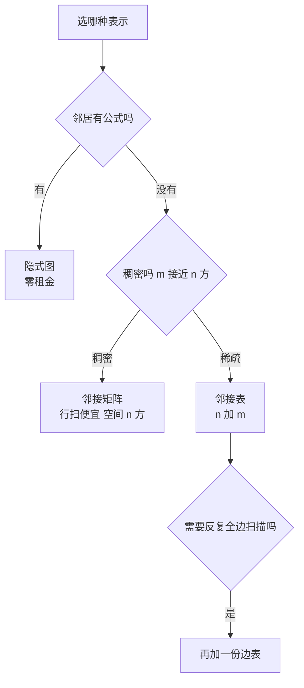

# $\rm Chapter \, 5$ 图基础

> **本章假设你已经会**
>
> 1. $\Theta$、$O$ 的档位语法，以及「说复杂度必须同时说清票种」的计价模型，见 §1.1 与 §1.2。
> 2. 三张老价格表：数组按下标取、链表按链走、哈希表按值点名各是多少票，见 §4.4。
> 3. 「出队的是谁」由结构说了算：堆按优先级出，普通队列按先来后到出，见 §3.1。
> 4. 《图论与网络》§1.4 已从线性代数一侧看过邻接矩阵；本章从代价一侧把它再看一遍。
> 5. 计时纪律（多轮取最速、固定种子、先跑后写），见《性能工程》§1.2。

全册心智模型继续生效：**复杂度是合同，每种结构开张时承诺一张操作价格表，买错表就赔性能**。前四章的合同都签在「找到元素」上：数组按位取，树按键寻，哈希直接算。本章换任务：数据之间的关系不再是键到值的一对一映射，而是任意两个元素之间都可能牵手。图（graph）把这种多对多正式化，本章的内容可以压成一句话：**关系的存法决定「顺着关系走」的价格**。§5.1 立任务与定义；§5.2 把四种表示（邻接矩阵、邻接表、边表、隐式图）的空间与遍历账逐笔对到实测；§5.3 推出两个遍历算法 DFS 与 BFS 并证明 BFS 的层序就是无权最短路；§5.4 实测两种遍历各自的结构峰值（栈深与队峰值）；§5.5 把遍历当计数器数连通分量；§5.6 给图发两种证件：二分图判定与拓扑排序（入度表实现，环检测有实测）。实验环境同前几章（WSL2，python 3.12.3；本章全部用标准库，未用 numpy），种子固定 20261107，脚本与完整输出见本册实验记录 `expAD05/result.txt`，重跑可得同一串数字。

## $\rm \S \, 5.1$ 任务的换挡：从「找元素」到「走关系」

先立任务。论文资料管理器的需求清单迟早长出这样几条：引用网络里，论文 A 引用了论文 B、C、F；课程系统里，先修课是一张「学完 3 才能学 7」的网；编译时，模块之间互相依赖，改了一个文件想知道会牵连谁。三件事的共同点：元素本身好找（第 4 章的哈希表已经把点名压到一票出头），难的是回答「它的邻居是谁」「从它能走到哪」。存储的瓶颈第一次不在元素上，而在**关系**上。

定义（图）：图 $G=(V,E)$ 由顶点集 $V$ 与边集 $E$ 组成，每条边是顶点对。边不分方向的叫无向图，分方向的（写成有序对 $u\to v$）叫有向图。顶点 $v$ 挂着的边数叫度（degree），有向图再分出度（outgoing degree）与入度（incoming degree）。本章限定简单图：无自环、无重边，记 $n=|V|$、$m=|E|$。

新任务在合同里长这样：给定顶点 $u$，列出它的全部邻居（一次**邻居查询**）；或者更进一步，从源点出发，把所有可达的顶点各访问一次（一次**遍历**）。两张价目表都按票计，本章票种声明：检查一条边记录的一端记一票（邻接表里沿链看一个条目、矩阵里看一个格，各算一票）。空间另记：存关系的字节数单独一笔账，与时间票分开。

白话：图不是一种新数据，是老数据换了个问题。字典回答「这个词什么意思」，图回答「从这个词能顺藤摸到哪里」；藤怎么缠起来的，先得选一种缠法记下来。

> 本节小结：图把多对多关系正式化为 $G=(V,E)$；新任务从「找元素」换成「邻居查询」与「遍历」；票种是一次边检查一票，空间单独记账。

## $\rm \S \, 5.2$ 四张租金表：邻接矩阵、邻接表、边表与隐式图

同一张图有四种存法，租金与查邻居的价格各不相同。

定义（邻接矩阵）：$n\times n$ 的布尔矩阵 $A$，$A[u][v]=1$ 当且仅当边 $(u,v)$ 存在；无向图下 $A$ 对称。

定义（邻接表）：长度为 $n$ 的数组，第 $u$ 格挂一条链表，装着 $u$ 的全部邻居。

定义（边表）：直接把 $m$ 条边存成 $(u,v)$ 对的列表。

定义（隐式图）：不存边，邻居由规则当场算出。$32\times 32$ 网格上顶点编号 $i$ 的邻居就是上下左右四个编号：查邻居是四次算术，图本身一个字节都不占。

四张表的**空间合同**由计数直接给出。邻接矩阵是 $n^2$ 个格，与 $m$ 无关，$\Theta(n^2)$；邻接表是 $n$ 个表头加每条边记两份（无向图 $u$ 的表和 $v$ 的表各记一次），$\Theta(n+m)$；边表 $\Theta(m)$；隐式图除 visited 数组外零租金。**邻居查询**的价格：矩阵要扫一整行 $n$ 格才知道全部邻居；邻接表 $\deg(u)$ 票，最坏 $\Theta(n)$；边表最惨，回答任何一次邻居查询都要全表扫 $\Theta(m)$，它根本不卖这张查询；隐式图 $O(1)$，代价是只在邻居有公式时才买得起。

理论账对完，钉进实测（$n=1024$，稀疏 $m=4096$、稠密 $m=262144=n^2/4$，随机简单图，tracemalloc 计分配字节，`expAD05/result.txt`，exp1）：

| 表示 | 稀疏 $m=4096$ 空间 | 稠密 $m=262144$ 空间 | 空间合同 |
| --- | --- | --- | --- |
| 邻接矩阵 | 8,454,136 B | 8,454,808 B | $\Theta(n^2)$，与 $m$ 无关 |
| 邻接表 | 154,528 B | 4,500,696 B | $\Theta(n+m)$ |
| 边表 | 262,368 B | 16,992,424 B | $\Theta(m)$，稠密时反超矩阵 |

三处都值得读。其一，矩阵两列几乎一字不差：8,454,136 对 8,454,808，差 0.008%。$\Theta(n^2)$ 不看 $m$ 不是渐近修辞，是把稠密图的边翻 64 倍也纹丝不动的实测事实。逐项核对：每行一个 Python 列表，56 字节头加 1024 个 8 字节指针共 8248 字节，乘 1024 行约 8.45 MB，与实测咬合到千分之一。其二，边表在稠密图上是最贵的表示：1690 万字节，是矩阵的两倍。每个二元组 $(u,v)$ 都是带 56 字节头的小对象，$m$ 一大，对象头的租金把省下的格子全吃回去；稀疏时它反而最省。其三，邻接表随 $m$ 按比例走，两种规模下都稳居便宜的一档或次便宜的一档。

遍历的时间账（全图 BFS，多轮取最速）：

| 规模 | 矩阵 BFS | 邻接表 BFS | 矩阵格扫描 | 邻接表边检查 |
| --- | --- | --- | --- | --- |
| 稀疏 $m=4096$ | 27.60 ms | 0.75 ms | $n^2=1{,}048{,}576$ | $2m=8{,}192$ |
| 稠密 $m=262144$ | 38.40 ms | 58.81 ms | $n^2=1{,}048{,}576$ | $2m=524{,}288$ |

读法：稀疏图上邻接表快 37 倍，票数差 128 倍再被单价差往回吃掉一部分；稠密图上**矩阵反而快 1.5 倍**，尽管票数是邻接表的两倍。这不是合同错了，是两张票的单价不同：矩阵行扫走的是连续内存，一次寻址带出一整段；邻接表每查一条边记录跳一次指针（《计算机系统结构》§5.1 的金字塔在这里开价）。合同承诺的是票数便宜，时间还得看每张票的单价，§1.1 早把这两层分开了。顺带一提，枚举全部边是边表的主场：稠密图上 18.3 ms，邻接表 60.9 ms，矩阵 29.0 ms。

第四张表当场验证：$32\times 32$ 网格的隐式 BFS 跑两次分别 6.27 与 2.99 ms，遍历期只为 visited 与队列分配了约 9.5 KB。图本身零字节，这是四种存法里唯一「图不占内存」的买法，前提是邻居有公式可算。



白话：邻接矩阵是包场，不管来几个人场租一样；邻接表按人头收；边表是把 relationships 打包成一个名单，名单短时最省、名单一长最贵；隐式图干脆不订场，规则在哪儿邻居就在哪儿。

> 本节小结：空间 $\Theta(n^2)$ 对 $\Theta(n+m)$ 对 $\Theta(m)$ 对零租金；邻居查询矩阵 $O(n)$、邻接表 $\deg$ 票、边表不卖、隐式 $O(1)$；实测中矩阵尺寸与 $m$ 无关、边表稠密时反超矩阵、BFS 稀疏 37 倍差距而稠密矩阵反胜，票数与单价是两本账。

## $\rm \S \, 5.3$ 深度优先与广度优先：同一张图，两条路

遍历的任务：从源点 $s$ 出发，恰好访问一次所有可达顶点。第一个坑在动手之前：无向图里每条边存两份，走到 $v$ 再看它的邻居会把 $u$ 又列出来；不记账，遍历就在两点之间打转。所以每个算法都配一张 visited 名册，访问过的顶点打勾，打过勾的不进候选。

两个算法共享一副骨架：手里一个候选袋，每次取一个顶点，检查它的全部边，没打勾的邻居打勾入袋。差别只在**取法**。深度优先搜索（depth-first search，DFS）用栈，后进先出，一头扎到底再回头；广度优先搜索（breadth-first search，BFS）用队列，先进先出，按层扫过去。两个核心各十行：

```python
from collections import deque

def bfs(adj, s):                  # 广度优先：队列
    seen = [False] * len(adj)
    seen[s] = True
    order = []
    q = deque([s])
    while q:
        u = q.popleft()           # 先来后到
        order.append(u)
        for v in adj[u]:
            if not seen[v]:
                seen[v] = True
                q.append(v)
    return order

def dfs(adj, s):                  # 深度优先：显式栈
    seen = [False] * len(adj)
    seen[s] = True
    order = []
    st = [s]
    while st:
        u = st.pop()              # 后来居上
        order.append(u)
        for v in adj[u]:
            if not seen[v]:
                seen[v] = True
                st.append(v)
    return order
```

把这段存成 `bfs_demo.py`，贴入一张 12 顶点、14 条边的固定小图（边表见 `expAD05/result.txt` exp2(a)），运行 `wsl python3 bfs_demo.py`，输出的两条访问序与实测一致。同一张图，两条路长得完全不同：

1. DFS 序：${0,11,5,10,4,3,7,2,8,6,1}$。0 号先把 11 号摁进栈，接着 11 号的 5 号、5 号的 10 号，一路扎到链的尽头才开始回头；序是「一路走到底」的形状。
2. BFS 序：${0,1,6,8,11,2,7,5,3,10,4}$。0 号的全部邻居先到齐，再轮到他们的邻居；序是「一圈一圈荡开」的形状。
3. 两种序都只有 11 个顶点：9 号在这张图里一条边都不挂，谁也走不到它。遍历天然只覆盖一个连通块，这个伏笔 §5.5 收。

复杂度账，邻接表版：每个顶点至多打勾入袋一次（visited 名册保证），出袋时查它的每条边记录一次，无向图共 $2m$ 条记录，合计

$$
T_{\text{遍历}}\;=\;\Theta(n+m)
$$

读法：顶点进袋出袋各一次 $n$ 票，边记录检查 $2m$ 票，两个加数独立出现，谁也不能省掉。矩阵版的账在 §5.2 实测过：每个出袋顶点扫一整行，$\Theta(n^2)$，与 $m$ 无关。

BFS 还暗藏一张额外的合同。定义 $\operatorname{dist}(s,v)$ 为 $s$ 到 $v$ 的最少边数（无权最短路的「权」就是每条边一票）。**命题：BFS 首次访问 $v$ 时的层号（入袋时的批次）恰等于 $\operatorname{dist}(s,v)$。** 证明用归纳。先把队列的一个结构性质立起来：不变量说队列中层号从队首到队尾单调不减，且只出现相邻两层的顶点。初始队列只有 $s$（层 0），成立；每步出队一个层 $d$ 的顶点，只往队尾塞层 $d+1$ 的顶点，队首到队尾的层号仍非降。于是顶点严格按层批次出队。归纳假设层 $d$ 以内的顶点全部被访问时层号无谎：层 $d+1$ 的 $v$ 被某个层 $d$ 的 $u$ 发现，沿发现路径走得 $\operatorname{dist}(s,v)\le d+1$；反过来若 $\operatorname{dist}(s,v)<d+1$，设 $d'<\operatorname{dist}(s,v)$ 为该最短路倒数第二个顶点的层，由归纳假设该顶点已出队，它出队时会检查这条边并把 $v$ 以更早的层号入袋，与「层 $d+1$ 才首次访问」矛盾。$\square$ 这就是「BFS 即无权最短路」，《图论与网络》§6.1 把它排在最短路三层塔的底层；有权版要等第 6 章的 Dijkstra。

DFS 的十行还有一个常见写法：递归。递归 DFS 不自建栈，用的是函数调用栈，每层调用压一个栈帧，栈帧里有什么、越界写的后果，见《计算机安全》§2.1。语法糖的代价是「栈」从你手里交给了运行时，§5.4 实测这根栈有多脆。

白话：DFS 是走迷宫时顺着一条道走到黑，撞墙了退一格换岔路；BFS 是水漫进来，一圈一圈淹过去，先淹到的离水龙头近。两种策略用的容器只差在「后进先出」还是「先进先出」四个字上。

> 本节小结：两算法同骨架不同取法，visited 名册防打转；邻接表下统一 $\Theta(n+m)$、矩阵下 $\Theta(n^2)$；BFS 层序经归纳证明就是无权最短路；递归 DFS 把栈交给运行时，风险在 §5.4 实测。

## $\rm \S \, 5.4$ 栈深与队峰值的实测：两种结构各自的死法

时间合同两算法相同，空间合同不一样：值得单独立一笔的是**结构峰值**，即遍历全程候选袋里同时容纳的最大元素数。DFS 的峰值记栈深，BFS 的峰值记队峰。

先看一张最朴素的图：5000 个顶点的链，${0\text{--}1\text{--}\cdots\text{--}4999}$。实测（`expAD05/result.txt`，exp2(b)）：

1. 递归 DFS：Python 默认递归上限 1000，跑到深度 999 抛 `RecursionError`，链还没走完五分之一。
2. 把上限放宽到 100000 后跑完，实测最大递归深度恰为 5000，用时 2.4 ms。递归深度等于当前链长：这条链上每个栈帧都还在等下一层的返回，一帧不落。
3. 显式栈 DFS：峰值为 1。出栈一个顶点只推入它唯一的没见过的邻居，袋里永远只有一个候选。
4. BFS：队峰同样为 1。链上每层只有一个顶点。

同一张链图，递归死得响亮，显式栈安静地省着。但别把显式栈想成永远的小袋子：星形图（一个中心挂 $n-1$ 个叶）上，中心出栈时一口气把全部叶子推入，栈峰 $\Theta(n)$。显式栈的最坏峰值同样是线性合同，只是死得安静：内存慢慢涨，不抛异常。递归那条则把上限写死在运行时里，默认 1000 深度，调用栈是真实内存，不是抽象（《计算机安全》§2.1）。

BFS 的队峰在哪张大图上爆？稠密图。实测 $n=1024$、$m=262144$ 的随机稠密图 BFS 队峰 1012，几乎整张图同时在队列里（exp2(c)）；§5.2 的稀疏图上队峰 627；§5.3 的小图上栈峰队峰各 4。道理在层结构上：队峰约等于最大的一层的大小，稠密图一层的邻居就接近全图。合同读法：BFS 的空间峰值在稠密图上逼近 $\Theta(n)$，这不是实现瑕疵，是层序遍历本身的形状。

白话：递归 DFS 像摞盘子，摞到一千个侍应生罢工；显式栈自己端盘子，端多高看图长什么样；BFS 的队列像候车厅，稠密图发车前全城的人都在厅里。

> 本节小结：链图实测递归死于默认深度 999、显式栈峰与队峰均为 1；星形图与稠密图分别把栈峰、队峰顶到 $\Theta(n)$；两种遍历的时间合同相同，空间峰值合同各随图的形状走。

## $\rm \S \, 5.5$ 连通分量：把遍历当计数器

定义（连通分量）：无向图里极大的连通顶点集；两个顶点连通，指存在一条路径相连。§5.3 的演示图上，遍历从 0 号出发只盖住 11 个顶点，9 号自成一块：那是一张有两个连通分量的图。

计数算法是遍历的直接复用：外层把 visited 名册扫一遍，遇到没打勾的顶点就起一次 BFS（或 DFS），把该顶点所属的整个分量打勾，分量数加一。票数照旧 $\Theta(n+m)$：每个顶点仍只入袋一次，每条边记录仍只被检查一次，外层扫描只是把没活干的遍历补齐。从 0 号出发一次遍历就盖住全图，等价于说分量数为 1；exp1 的随机图实测 visited $=1024$，正是这一情形。

这个 $c$（分量数）在别的册子里露过面：《线性代数》§7.8 用关联矩阵证明了 $\operatorname{rank}A=n-c$，矩阵的秩恰好比顶点数少一个遍历数出来的分量数。同一张图，遍历一口、矩阵一算，报的是同一个数，两册的账在此对上。

白话：连通分量是图里的岛屿，遍历是一次登岛搜索；外层循环是海军陆战队的调度表，没登陆过的岛就再派一队，派几队岛就有几座。

> 本节小结：连通分量用「外层扫名册、未访问即起一次遍历」计数，总票数仍 $\Theta(n+m)$；分量数 $c$ 与《线性代数》§7.8 的 $\operatorname{rank}A=n-c$ 是同一个数的两种取法。

## $\rm \S \, 5.6$ 二分图与拓扑排序：给图发两种证件

两种常见任务都只对特定形状的图签发证件，判定本身就是一次遍历或一次计数。

### $\rm \S \, 5.6.1$ 二分图：一张两色证件

定义（二分图）：顶点集可以分成两半，使每条边都横跨两半的图。等价说法：色数不超过 2（顶点染两色、相邻异色，《图论与网络》§2.1 给了色数的完整账）。判定算法照抄 BFS：源点染红入队，出队时把未染色的邻居染成对面色，遇到已染色却与自身同色的邻居，判定失败。这不是新算法，是给 §5.3 的 BFS 加了一支笔。

证件什么时候签不出？**命题：图可二分当且仅当不含奇数长的环。** 「无奇环则可染」：对每个分量跑双色 BFS，上面按层染色，同层同色、相邻层异色，每条边的两端要么相邻层（异色）、要么不被检查到矛盾，染色成功即给出划分。「有奇环则不可染」：沿环走一圈，颜色必须逐边交替，走偶数步才能回到出发色；环长为奇数时回到起点的颜色与出发色相反，矛盾。$\square$

### $\rm \S \, 5.6.2$ 拓扑排序：一张顺序证件

换有向图。课程先修链里，边 $u\to v$ 表示「修完 $u$ 才能修 $v$」；任务要一个全序，让每条边的起点都排在终点前面。这叫拓扑排序（topological sort），它只对无环有向图（directed acyclic graph，DAG）存在：环上的顶点互相要求「对方在前」，谁也排不进去。顺序从哪来？看**入度**：入度为 0 的顶点没有任何「前置要求」，必然可以排在最前。拿掉它之后，被它指向的顶点少了一个前置，入度减一，减到 0 的顶点接着上场。这就是 Kahn 算法，入度表是它的记账本：

```python
def topo(n, edges):
    indeg = [0] * n
    adj = [[] for _ in range(n)]
    for u, v in edges:
        adj[u].append(v)
        indeg[v] += 1
    q = deque(i for i in range(n) if indeg[i] == 0)
    order = []
    while q:
        u = q.popleft()
        order.append(u)
        for v in adj[u]:          # 拿掉 u：v 的前置少一个
            indeg[v] -= 1
            if indeg[v] == 0:
                q.append(v)
    return order
```

正确性三段给全。第一段，输出合法：$u$ 被输出时 $\operatorname{indeg}[u]=0$，而 $u\to v$ 的减一发生在 $u$ 出队的时刻，故 $u$ 出队前 $v$ 的剩余入度只统计尚未输出的顶点，输出序的任何前缀都不含 $v$ 的未满足前置，前缀合法，归纳到全序。第二段，DAG 上必输出全部：任何非空 DAG 存在入度为 0 的顶点，否则每个顶点都有前驱，从任一点沿前驱无限倒退，顶点有限必走重，走出一个环，矛盾；每输出一批就少一批顶点，归纳到底。第三段，卡住即有环：输出不足 $n$ 个时队列空了，剩余顶点入度全大于 0，个个有未输出的前驱，沿前驱倒退必走重，环就在剩余顶点里。于是「输出满 $n$ 个」与「无环」互为充要，环检测是这个算法的免费赠品。

实测（$n=10000$，随机 DAG $m=30000$，`expAD05/result.txt`，exp3）：Kahn 输出满 10000 个，事后逐边核对位置 ${\operatorname{pos}[u]<\operatorname{pos}[v]}$ 全部成立；边检查恰 $30000=m$ 次，每条边记录一生只被看一次，与 §5.3 的遍历账同款；队峰 1652，用时 57.6 ms。同一张图补一条回边 ${26\to 0}$，输出停在 9576 个，剩余 424 个顶点入度不归零，算法自己报告了环的存在。

白话：拓扑排序是点名发毕业证，只发「前置全修完」的学生；每发一个，就给他教过的学生销一门前置，销够了也发。发到一半卡住，剩下的人互相等人，环就在他们中间。

> 本节小结：二分图判定是带笔的 BFS，充要条件是无奇环（交替染色论证）；Kahn 算法用入度表按「前置清零」发序，合法性、完备性、卡住即有环三段证明闭合；实测每边恰查一次、队峰 1652、加一条回边即停 9576/10000。

## $\rm \S \, 5.7$ 关键概念回顾

1. 四种表示的空间合同分别是多少？为什么稠密图上边表实测反超邻接矩阵？
2. 邻接表 BFS 的 $\Theta(n+m)$ 里两个加数各来自哪一步？矩阵版为什么与 $m$ 无关？
3. §5.3 的演示图上，两种遍历的访问序形状差在哪？9 号顶点为什么两次都缺席？
4. 链图实测中递归 DFS 死于哪里、显式栈峰值是多少？星形图会改变哪一个结论？
5. BFS 首次访问 $v$ 的层号等于 $\operatorname{dist}(s,v)$，归纳证明的「反证那一步」用到了什么？
6. Kahn 算法正确性三段证明里，「卡住即有环」是怎么倒推出环来的？

## $\rm \S \, 5.8$ 应用与辨析

1. 论文资料管理器要存引用网络（十万篇论文、平均每篇引 20 篇），并支持「点开一篇列出它引的全部论文」。选哪种表示？空间多少字节量级？如果还要支持「谁引用了它」的反向查询，账怎么记？
2. 同事在一条长 5000 的依赖链上跑递归 DFS 判连通，程序崩了，他认为是图太大内存不够。用 §5.4 的实测数字写出排查结论与两种修法。
3. 课程系统的先修关系存成有向图后，拓扑排序输出了一半停住。已知教务在数据库里改过一条记录。问题最可能出在哪？你打算怎么定位是哪条边？

## $\rm \S \, 5.9$ 本章自测答案

概念回顾答案：

1. 矩阵 $\Theta(n^2)$ 与 $m$ 无关、邻接表 $\Theta(n+m)$、边表 $\Theta(m)$、隐式零租金；边表每条边是带 56 字节头的对象，$m$ 到 $n^2/4$ 量级时对象头的租金使它实测 16.99 MB，超过矩阵的 8.45 MB（来源：§5.2）。
2. $n$ 来自每个顶点至多入袋出袋一次，$2m$ 来自出袋时逐条检查边记录（无向图每边两份记录）；矩阵版每个出袋顶点扫一整行 $n$ 格，共 $n^2$ 格，与边数无关（来源：§5.2、§5.3）。
3. DFS 一路扎到底再回头，BFS 按层荡开（两条实测序见 §5.3）；9 号是孤岛，一次遍历只覆盖一个连通分量（来源：§5.3、§5.5）。
4. 递归死于深度 999（默认上限 1000），显式栈峰值 1；星形图不改变递归的结论（深度照样是链长），但把显式栈峰值顶到 $\Theta(n)$，中心出栈时一次推入全部叶子（来源：§5.4）。
5. 反证那一步假设 $\operatorname{dist}(s,v)<d+1$，取最短路上倒数第二个顶点，由归纳假设它已出队，出队时必检查那条边、以更小的层号发现 $v$，与首次访问层号矛盾；靠的是「出队即查全部出边」这一事实（来源：§5.3 命题证明）。
6. 卡住时队列空而顶点未输出完，剩余顶点入度全大于 0，即每个都有未输出的前驱；顶点有限，沿前驱链倒退必走重复顶点，重复即环（来源：§5.6 第二段证明）。

应用与辨析答案：

1. 平均度 20 的稀疏图，选邻接表：空间 $\Theta(n+m)$，$n=10^5$、$m=2\times10^6$，量级约百万级条目加十万个表头，比 $\Theta(n^2)=10^{10}$ 格的矩阵省三个数量级。反向查询需要一份转置邻接表（边 $u\to v$ 同时记入 $v$ 的入边表），空间翻倍到 $2\Theta(n+m)$，两次查询各 $\deg$ 票（来源：§5.2 空间与邻居查询账）。
2. 不是内存不够。实测：递归深度恰为链长 5000，Python 默认上限 1000，深度 999 处抛 `RecursionError`；同一张图显式栈峰值仅 1。修法一：改显式栈 DFS（§5.3 十行）；修法二：`sys.setrecursionlimit` 放宽后可跑通（实测深度 5000 用时 2.4 ms），但要记得调用栈占真实内存，链再长一个数量级就轮到内存说话（来源：§5.4）。
3. 出在有人把某条先修边改成了反向或加了环形依赖，使某子集的入度永远不归零。定位：跑 Kahn 时记录「卡住时仍在图中（入度大于 0）的顶点集合」，本次实验同款操作剩 424 个；这个集合里沿前驱链倒退找重复顶点，重复处即坏边（来源：§5.6 环检测实测）。

**你现在能做什么**：拿到任何一张关系数据，你能先问三件事——稠密还是稀疏、要正向邻居还是双向、邻居有没有公式——然后从四张租金表里选一张，并顺手用一次遍历报出连通分量数。

四张租金表签完，遍历把「走关系」的价格压到 $\Theta(n+m)$，BFS 还附赠了无权最短路。但引用网里的边有轻重（引用强度、传输延迟），每条边一票的 BFS 立刻不够用：下一章把票改成「按边权计价」，Dijkstra 会带着第 3 章的堆出场，最小生成树的割性质则把贪心的合法性一次证完。
