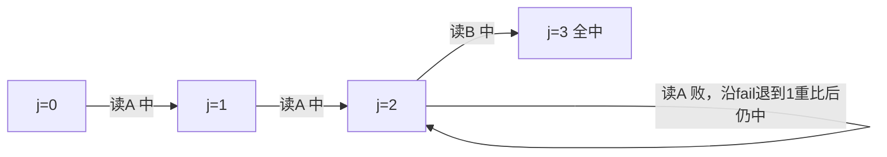

# $\rm Chapter \, 7$ 字符串算法

> **本章假设你已经会**
>
> 1. 比较票计价模型：报价格先报「数的是什么票」，见 §1.2。
> 2. 随机输入与对抗输入是两张不同的输入合同，随机化买期望、写死的最坏要单独验，见 §2.4。
> 3. 《形式语言与自动机》§1.2 已把正则表达式定义为一种语言；本章 §7.6 只借用这个名字与该册 §1.3 的有穷自动机接口，不需要构造细节。

全册心智模型继续生效：**复杂度是合同，每种算法开张时承诺一张操作价格表，买错表就赔性能**。前六章的合同签在数字与图上，本章把合同签在字符上。同一个任务「在一串文本里找另一串模式」，三张合同竞标：朴素匹配按「每个对齐从零重比」开价，最坏 $\Theta(mn)$；KMP 把失配时已经付出的比对信息折成 fail 链，签下「文本指针永不回退，每字符至多 2 张比较票」的合同，最坏也只按文本长度计价；Boyer–Moore 算法（Boyer–Moore algorithm）从右往左比对，用坏字符规则把「每次对齐挪一格」改写成「挪好几格」，签的是典型文本条款，最坏条款里藏着退路。§7.1 立任务与朴素合同；§7.2 完整推导 KMP 的 fail 链与两本账；§7.3 实测对账；§7.4 Boyer–Moore 与坏字符实测；§7.5 换任务看后缀数组一瞥；§7.6 收口到自动机接口。实验环境同前几章（WSL2，python 3.12.3，标准库 random，未用 numpy），种子固定 20261108，脚本与完整输出见本册实验记录 `expAD07/result.txt`，重跑可得同一串数字。

## $\rm \S \, 7.1$ 任务与朴素合同：每个对齐重头比对

先立任务。论文资料管理器要加全文搜索：给定文本 $T$（长 $n$）与模式 $P$（长 $m$），报告 $P$ 在 $T$ 中出现的全部起点。字符串匹配（string matching）的输入是两个字符序列，输出是一列下标；它比符号表的点查询难在键不是单个元素而是一段连续切片，且切片的起点事先未知。

朴素的办法是枚举起点，逐一验收。定义（对齐，alignment）：起点 $i$ 处的一次对齐，指检查 ${T[i]=P[0],\,T[i+1]=P[1],\,\ldots}$ 是否逐字符成立。朴素算法从左到右试遍 ${i=0,1,\ldots,n-m}$，每次对齐从 $P$ 的第一个字符比起，遇失配即弃、全中即报。十行骨架，连同比较票计数器一起给出（后面所有实测都靠这个计数器对账）：

```python
def naive_match(T, P):
    """返回 P 在 T 中的全部起点与比较票总数"""
    n, m = len(T), len(P)
    hits, tickets = [], 0
    for i in range(n - m + 1):
        k = 0
        while k < m and T[i + k] == P[k]:
            tickets += 1        # 全中票：又对上一个字符
            k += 1
        if k < m:
            tickets += 1        # 失配票：对不上的那一比
        else:
            hits.append(i)
    return hits, tickets
```

存成 `naive_match.py`，调 `naive_match("A" * 200000, "A" * 63 + "B")`，返回 `([], 12795968)`：零次命中、12,795,968 张比较票，与 §7.3 的 exp1 实测同源。观察点在 `tickets` 的形状，命中数反而是配角。

账目按比较票清算。随机文本上，一半对齐在第一票就死（首字符对不上），账摊平后每对齐期望约 2 张票，全文 $\Theta(n)$，不坏。合同怕的是对抗输入，§2.4 的教训在这里原样重演：取 $T$ 为 $n$ 个字符 A 排成的串，$P$ 为 $\mathrm{A}^{63}\mathrm{B}$（63 个 A 加一个 B，$m=64$）。每个对齐先吃 63 张全中票、再在 B 上吃 1 张失配票，整整 $m$ 张；对齐共 $n-m+1$ 个，最坏账

$$
(n-m+1)\cdot m \approx mn.
$$

失配弃掉整个对齐时，前 63 张全中票承载的信息随之丢弃；下一个对齐又从 $P[0]$ 比起，把几乎同样的 63 张票再付一遍。文本指针 $i$ 在失配后回退，是这份合同一切浪费的总根源。KMP 的全部工作就是让 $i$ 永不回退。

白话：朴素算法像拿一张名单逐门核对住户，敲错一户就退回大门口，从第一户重新敲起；门牌越规律，重敲的浪费越大。

> 本节小结：匹配任务按对齐枚举开价，随机文本上朴素约每对齐 2 票、全文 $\Theta(n)$；最坏文本（$\mathrm{A}^n$ 搜 $\mathrm{A}^{63}\mathrm{B}$）每个对齐付满 $m$ 票，合同最坏 $\Theta(mn)$，病因是文本指针回退。

## $\rm \S \, 7.2$ KMP：把已付的票折成 fail 链

失配那一刻，真的什么信息都没有了吗？失配发生在模式第 $k$ 位（$P[0..k-1]$ 已与文本对上），于是文本里刚被读过的一段 $T[i..i+k-1]$ 完全等于 $P[0..k-1]$：这段文本的内容不需要回看文本就知道，它就是模式自己的一段前缀。下一个有希望的对齐 $i+s$（$s>0$）若要全中，必须保住这段已读文本的尾部，而「能保住尾部」只跟 $P$ 的形状有关。这就是 KMP 算法（Knuth–Morris–Pratt algorithm）的全部出发点：失配后的去留问题，与文本无关，只与模式有关，可以预先算好。

先给失败时唯一要用到的形状量。定义（真前后缀与 fail 值）：串 $s$ 的真前缀指长度小于 $|s|$ 的前缀，真后缀同理。对 ${k\ge 1}$，$\operatorname{fail}[k]$ 定义为 $P[0..k-1]$ 的最长相等真前后缀的长度（没有则为 0），$\operatorname{fail}[0]=0$。整条 $\operatorname{fail}$ 表叫 fail 链（failure function），也叫失配指针。

引理（安全跳跃）：失配在模式第 $k$ 位时，新对齐挪移 $s$ 格（$0<s<k$）还有全中的可能，当且仅当

$$
P[0..\,k-s-1] = P[s..\,k-1],
$$

即 $s=k-\ell$，其中 $\ell$ 是 $P[0..k-1]$ 的某个相等真前后缀的长。证明：挪移 $s$ 格后，旧对齐已确认的文本尾部 $T[i+s..i+k-1]$ 落在新对齐的模式位 $0..k-s-1$ 上，新对齐要求它等于 $P[0..k-s-1]$；旧对齐又确认过它等于 $P[s..k-1]$。同一段文本被要求等于两个模式段，二者必须相等，恰是「长 $k-s$ 的前缀等于长 $k-s$ 的真后缀」。反过来相等时，重叠段内无矛盾，对齐仍有希望。$\square$

于是 $s<k-\operatorname{fail}[k]$ 的所有对齐都在重叠段内注定失配，可以整批跳过；最大安全跳跃是 $s=k-\operatorname{fail}[k]$，若还想继续跳，候选长度沿 fail 链逐级递减。经典实现把这套跳跃改写成等价的记账方式：文本指针 $i$ 不动，模式指针 $k$ 沿 fail 链下滑到下一个候选长度后重比同一个文本字符。两种写法是同一张合同，后者省去下标的来回换算。

fail 表可以在 $O(m)$ 内自左向右推出，这是一段标准的归纳构造。$\operatorname{fail}[1]=0$（长度 1 的串没有真前后缀）。归纳假设 $\operatorname{fail}[1..j-1]$ 已正确，算 $\operatorname{fail}[j]$：记 $f=\operatorname{fail}[j-1]$，即 $P[0..j-1]$ 的最长相等真前后缀的长，比较 $P[j]$ 与 $P[f]$。若相等，则 $P[0..f]$ 是 $P[0..j-1]$ 的最长相等真前后缀，添上公共末字符后 $P[0..f]$ 升级为 $P[0..j]$ 的长 $f+1$ 的相等真前后缀；它还是最长的，因为任何更长的候选 $L>f+1$ 掐头去尾后（$L-1>f$）都是 $P[0..j-1]$ 的相等真前后缀，与 $f$ 的最大性矛盾。若不等，令 $f\leftarrow\operatorname{fail}[f-1]$ 下滑重比：次长的候选只能从「当前候选再掐尾」里来，$\operatorname{fail}$ 的定义保证下滑严格递减、必停在 0，此时再比一次 $P[j]$ 与 $P[0]$ 定终局。汇总成规则：

$$
\operatorname{fail}[j]=
\begin{cases}
f+1, & P[j]=P[f],\\[2pt]
0, & f=0 \text{ 且 } P[j]\ne P[0].
\end{cases}
$$

代码十二行，下滑与充值两个动作各占一行（本册实验就是用它计的票）：

```python
def build_fail(P):
    m = len(P)
    fail = [0] * m
    f = 0
    for j in range(1, m):
        while f > 0 and P[j] != P[f]:
            f = fail[f - 1]     # 下滑票：候选长度降级
        if P[j] == P[f]:
            f += 1              # 命中票：充值 +1
        fail[j] = f
    return fail
```

拿 $\mathrm{A}^3\mathrm{B}$（即 `AAAB`）走一遍，它是 §7.3 实测模式 $\mathrm{A}^{63}\mathrm{B}$ 的微缩版：

1. $j=1$（A）：$f=0$，$P[1]$ 与 $P[0]$ 比中，充值得 $f=1$，$\operatorname{fail}[1]=1$。
2. $j=2$（A）：$f=1$，$P[2]$ 与 $P[1]$ 比中，$f=2$，$\operatorname{fail}[2]=2$。
3. $j=3$（B）：$f=2$，$P[3]=\mathrm{B}$ 与 $P[2]=\mathrm{A}$ 失配，下滑 $f=\operatorname{fail}[1]=1$；再与 $P[1]=\mathrm{A}$ 失配，下滑 $f=\operatorname{fail}[0]=0$；终局比 $P[3]$ 与 $P[0]$ 仍失配，$\operatorname{fail}[3]=0$。三张票里两张是下滑票。

得到 ${\operatorname{fail}=[0,1,2,0]}$。把 A 的个数换成 63，第 3 步的那条下滑链就变成 62 张下滑票——这正是 §7.3 实测里「充值打满、存款清空」的来历。

两本账现在都齐了。构建的账用势能法（potential method）记：给过程记一个随时可查的存款数 $\varphi=f$（当前 fail 指针值）。两类票分开数：检查票每算一个 $\operatorname{fail}[j]$ 恰付一张，共 $m-1$ 张；下滑票每付一张，$\varphi$ 至少降 1，而 $\varphi$ 只被「检查票命中」充值、每次加 1，全程充值至多 $m-1$ 次，$\varphi$ 又从不低于 0，所以下滑票至多 $m-1$ 张。合计 ${\le 2(m-1)}$。扫描同理：文本指针走 $n$ 步，每步恰付一张检查票，共 $n$ 张；模式指针 $k$ 只被命中的检查票充值（每次加 1，至多 $n$ 次），每张下滑票让 $k$ 至少降 1 且 ${k\ge 0}$，下滑票至多 $n$ 张。扫描合计 ${\le 2n}$。

这份合同与众不同的条款要念清楚：价格与字母表大小、模式形状、文本形状全部解耦，最坏即定价。§2.4 里随机化快排用概率把对抗输入的平方账稀释成期望；KMP 不靠运气，直接把最坏写进合同。两章合起来是同一句话的两种读法：对付对抗输入，要么随机化买期望，要么预计算买最坏不变。

白话：KMP 是一位不撕废稿的抄写员，抄错一个字不整页重来，而是翻到自己「最近还成立的前缀」那页接着抄；fail 链就是这本稿纸的目录，预先把每一页的退路都写好。它失效的边界也有：退路只记「相等前缀」这一种信息，模式里字符越不重复，退路越短、跳跃越猛；若任务变成「两个串差多少」（编辑距离），fail 链那种单线退路不够用，那是第 8 章动态规划的地界。



模式 AAB 的扫描状态图：状态只有「已匹配长度 $j$」，文本字符决定转移；j=2 读到 A 时先吃一张下滑票再回到原状态，这在 $\mathrm{A}^{n}$ 文本上每个位置重演一次，是 §7.3 实测的主角。

> 本节小结：fail 值定义最长相等真前后缀，安全跳跃引理把「失配后怎么挪」化成模式的自身形状；构建与扫描各用一本势能账，票数上界 $2(m-1)$ 与 ${2n}$，合同最坏即定价、与输入形状解耦。

## $\rm \S \, 7.3$ 实测：最坏文本兑现合同，fail 构建逐票对账

exp1 在最坏文本上让两张合同对垒：$T=\mathrm{A}^{200000}$，$P=\mathrm{A}^{63}\mathrm{B}$（`expAD07/result.txt`，exp1）。朴素逐次计数 12,795,968 张比较票，与理论 ${(n-m+1)\cdot m=12795968}$ 一票不差，$mn$ 上界 $12800000$ 只差尾部不存在的对齐；KMP 计数 399,937 张，拆账为 $n=200000$ 张检查票加 199,937 张下滑票：指针充值 $n$ 次、终局结余停在 63，下滑票恰为充值减结余，合计 ${2n-m+1}$，比 ${2n}$ 合同上界省下的正是那 63 张结余；199,937 又恰等于对齐数 $n-m+1$，每个注定空手的对齐各吃一张下滑票。票数比 31.99 倍；秒表只是注脚（朴素 0.48 秒，KMP 0.02 秒）。两算法都报 0 次命中（模式含 B、文本无 B），排除「谁提前退出」的歧义。同一对算法换到随机二进制文本（同一长度、随机模式）：朴素降为每字符 2.00 票，KMP 每字符 1.47 票，比值缩到 1.36。两张输入合同各念各的价：对抗文本上朴素按 $m$ 倍赔，随机文本上大家都是线性，差距只剩常数。

exp2 给 fail 链的构建账逐票对账（`expAD07/result.txt`，exp2），五种模式、上界 $2(m-1)$：

| 模式 | 下滑票 | 检查票 | 合计 | 占 $2(m-1)$ |
| --- | --- | --- | --- | --- |
| $\mathrm{A}^{63}\mathrm{B}$ | 62 | 63 | 125 | 0.99 |
| AB 交替（$m=64$） | 0 | 63 | 63 | 0.50 |
| 随机二进制 | 29 | 63 | 92 | 0.73 |
| 随机四字母 | 19 | 63 | 82 | 0.65 |
| 全不同字母（$m=8$） | 0 | 7 | 7 | 0.50 |

$\mathrm{A}^{63}\mathrm{B}$ 把上界吃掉 99%：前 62 位每算一个 fail 值付一张命中票、充值 1，最后一位的 B 引发从 62 一路清零的下滑链，62 张下滑票一张不少。这是势能论证的极端兑现——充值打满、存款清空。fail 语义另用暴力（对每个前缀枚举全部真前后缀取最长）抽查两种模式，逐位一致，排除了「fail 算错但账恰好好看」的可能。

> 本节小结：最坏文本上朴素 12,795,968 票对 KMP 399,937 票（31.99 倍），两者都与理论逐票咬合；fail 构建在 $\mathrm{A}^{63}\mathrm{B}$ 上用掉 $2(m-1)$ 上界的 99%，势能账的两端（充值与清零）都被实测摸到。

## $\rm \S \, 7.4$ Boyer–Moore：从右往左，跳着对账

KMP 的合同已经免赔最坏，能不能把期望条款也压低？朴素与 KMP 都从模式左端比起，第一个字符不对才知道这轮没戏；Boyer–Moore 反过来，从模式最右端往左比。直觉是：右端一票失配，暴露的信息量大，因为失配的是「离起点最远」的位置，规则允许一次挪很多格。

定义（坏字符规则，bad-character rule）：右往左比对，失配在模式位 $j$，失配的文本字符记 $c=T[i+j]$。在 $P[0..m-2]$ 里查 $c$ 最后一次出现的下标 $p$：有则挪 ${\max(1,\,j-p)}$ 格（$p$ 落在失配位右侧时折算为负，退到最保守的 1 格），无则挪 $j+1$ 格（跨过这个模式里根本没有的字符）。论证照旧是「跳过的对齐注定空手」：挪移少于 $j-p$ 格（正位移情形）时，文本位置 $i+j$ 对到的模式位落在 $p$ 右边且至多到 $P[m-2]$，那里没有字符 $c$，注定立刻再失配。预处理一张「每个字符在模式中最后一次出现位置」的表，查询每票 $O(1)$。加上从右往左的比对循环，代码不足二十行：

```python
def bm_badchar(T, P):
    """坏字符规则版：返回命中起点与比较票"""
    m = len(P)
    last = {c: i for i, c in enumerate(P[:-1])}  # P[0..m-2] 内最后出现下标
    hits, tickets, i = [], 0, 0
    while i <= len(T) - m:
        j = m - 1                                # 从模式最右端起比
        while j >= 0 and T[i + j] == P[j]:
            tickets += 1
            j -= 1
        if j >= 0:
            tickets += 1                         # 失配票
            i += max(1, j - last.get(T[i + j], -1))
        else:
            hits.append(i)
            i += m                               # 全中：整个模式跨过去
    return hits, tickets
```

注意末字符不进 `last` 表：全中时用 ${i\leftarrow i+m}$ 整体跨过，失配发生在 $j=m-1$ 时表里也查不到比它更靠右的候选，下限 `max(1, ...)` 把两种退化情形兜住。

这份合同的条款要分两栏念。典型文本栏：英文式文本上失配字符常常根本不在模式里，一挪就是 $j+1=m$ 格，整段整段地跳；实测（exp3）见下。最坏栏：坏字符规则单独使用时仍有每对齐只挪 1 格的构造，$T=\mathrm{A}^{n}$ 配 $P=\mathrm{B}\mathrm{A}^{m-2}$（模式首位是 B，其余全是 A）：右端一长串 A 全中，最后在模式首位失配，失配字符 A 在模式里出现得太靠右，$j-p$ 折算为负，规则只能批最保守的 1 格，账回到 $\Theta(mn)$。完整 Boyer–Moore 还有一条好后缀规则（good-suffix rule）补强跳跃，本册只立坏字符这半张合同，够读典型条款；想签全合同需要再加防退化的修正条款，见字符串专著。

实测 exp3（`expAD07/result.txt`，exp3）：文本为 100 万字符的英文式词流（29 个英文词按种子随机连缀），播种 7 处模式 `compiler`（$m=8$）。朴素对齐尝试 999,993 次、比较票 1,023,059 张；KMP 同文本约同价（票数比 1.00，随机友好文本上二者都是线性，差距不在形状）；坏字符版对齐尝试只有 143,894 次，平均每次对齐后文本指针前进 6.95 格（朴素至多 1 格），比较票 157,097 张，票数比 6.51 倍。失配跳跃分布：跳 8 格（整模式跨过）占 100,688 次，约七成失配对齐享有的正是「字符不在模式里、整段跳过」的大格；跳 6、7 格的合计近两万次。三算法报出的 7 处命中位置逐一相同，正确性对拍通过。

白话：坏字符规则像从合同末行往前核对条款，末行就对不上时，直接把合同翻过一整页再核，而不是一行一行捋；它失效的边界是文本里全是「贴脸的近邻字符」，那时每页只能翻一行，合同退化回朴素的价。

> 本节小结：坏字符规则用失配字符在模式中的最后出现位置定跳跃下界，跳过的对齐注定失配；典型文本上平均前进 6.95 格、票数省 6.51 倍，最坏构造（$\mathrm{A}^{n}$ 搜 $\mathrm{B}\mathrm{A}^{m-2}$）仍会退回 $\Theta(mn)$。

## $\rm \S \, 7.5$ 后缀数组一瞥：查询海量时，把账预付

前三节的合同都按「一次查询」计价：给一对 ${(T,P)}$，付一趟扫描的票。论文资料管理器的全文搜索不是这个形状：文本（全部论文）基本固定，查询（用户搜词）每天几万次。同一文本反复收费，就该把账分两段：预付一段建索引，之后每次查询付小钱。这是第 4 章符号表的老思路，只不过键从单词换成了子串。

定义（后缀与后缀数组）：后缀（suffix）指 $T[i..n-1]$，即从位置 $i$ 直到串尾的一段；后缀数组（suffix array）$\operatorname{sa}$ 把全部 $n$ 个后缀按字典序排好，依次记录各后缀的起点下标。它管用靠一条平凡引理：任何子串都是某个后缀的前缀。于是「$P$ 是否出现」等价于「是否存在以 $P$ 开头的后缀」，而在按字典序排好的后缀序列里，以同一前缀开头的后缀必连成一段，两次二分即可定位。查询账 ${O(m\log n)}$：每次二分 ${O(\log n)}$ 轮，每轮一次前缀比较至多 $O(m)$ 张字符票。空间租金是两个长度 $n$ 的整数数组，$O(n)$。

拿 $T=$ `abab` 落一次地：四个后缀按字典序排好是 `ab`（起点 2）、`abab`（起点 0）、`b`（起点 3）、`bab`（起点 1），于是 ${\operatorname{sa}=[2,0,3,1]}$。查 `ba`：有序后缀里以 `ba` 开头的只有起点 1 的 `bab`，一次二分就锁定。真实文本里以同一前缀开头的后缀是一段连续区间，两次二分取左右端点，还能顺带数出出现次数。

构建账粗算：把 $n$ 个后缀当普通字符串排序，每两两比较至多 $O(n)$ 张票，排序共 ${O(n\log n)}$ 次比较，合计 ${O(n^2\log n)}$，$n$ 大了付不起。倍增法把比较对象换成「长度 ${1,2,4,\ldots}$ 的前缀的秩」，每轮用上一轮的秩做一次 ${O(n\log n)}$ 的排序，共 ${\log n}$ 轮，合计 ${O(n\log^2 n)}$；更精的构造能压到线性（SA-IS 一类算法），本册不展开。一瞥的边界也划清楚：LCP 数组、后缀树、压缩索引都在此之后；后缀数组不擅长频繁修改的文本，改一处要动一大片序，那是另一张合同的活。

白话：后缀数组是给整本书造的索引页，把「从每页开头到书尾」的全部片段按字典序上架；查子串变成查索引，翻两下就到。失效边界：索引必须先付工本费与书架费，而且书一改版，索引页几乎重排。

> 本节小结：查询海量时合同分两段，后缀数组预付 ${O(n\log^2 n)}$ 建索引，之后每次子串查询 ${O(m\log n)}$、空间 $O(n)$；「子串即某后缀的前缀」这条引理是全节的承重墙。

## $\rm \S \, 7.6$ 收口：三张合同的共同形状，正则的接口

回头看 KMP 扫描在干什么：任意时刻的全部记忆只有「已匹配长度 $j$」，读进下一个文本字符后，落到哪个状态完全确定。状态只有 ${0..m}$ 共 $m+1$ 个，转移与历史无关——这正是《形式语言与自动机》§1.3 定义的有穷自动机（finite automaton），KMP 等于把「模式 $P$ 对应的那台自动机」装进了一个长度 $m$ 的整数数组：显式转移表要按「状态 × 字符」铺开 $m\cdot|\Sigma|$ 格，fail 链用「失配时沿链下滑」把表压扁。坏字符表同样是「预计算 + 每票 $O(1)$ 查表」的自动机套路，只是状态换成了对齐位置。

单模式之外，真实任务搜的常是模式而不是固定串：日志里找 `ERROR.*timeout`，词法器把 `if`、标识符、数字的规则同时挂在字符流上。fail 链只记一条单线退路，接不住「或、重复、通配」这些正则运算；一般化的路子是先把正则表达式编译成自动机再在文本上走格子——《形式语言与自动机》§1.2 定义正则表达式与正则语言，《编译原理》§1.3 的 Thompson 构造把正则式造成带不确定转移的自动机，§1.4 的子集构造把它确定化，§1.6 把多条规则组合成词法器并处理最长匹配。多模式固定串（一次找几个词）也有同源的合同：把 KMP 的 fail 链搬到「模式的字典树」上，即 Aho–Corasick 自动机。本章三张合同，到这一节都归到同一台机器的不同档位上。

> 竞赛生迁移提示：竞赛里手写的 KMP、Z 函数、哈希匹配在开发里对应 `grep`、`ripgrep` 与各语言标准库的正则引擎；它们背后就是本节的自动机档位。选型时先问查询次数：一次性扫描用 KMP 或 Boyer–Moore 档，文本固定查询海量用索引档。

## $\rm \S \, 7.7$ 关键概念回顾

1. 朴素匹配的最坏账 ${(n-m+1)\cdot m}$ 是怎么数出来的？构造文本与模式，并说明每个对齐付几张票。
2. fail 值的定义是什么？安全跳跃引理里，为什么「能保住已读文本尾部」恰好等价于模式自身的相等真前后缀？
3. fail 构建的 ${\le 2(m-1)}$ 论证里，势能 $\varphi$ 是什么、谁充值谁花钱？$\mathrm{A}^{63}\mathrm{B}$ 的实测账单如何兑现「充值打满、存款清空」？
4. KMP 扫描的「每字符至多 2 张票」与 §2.4 随机化快排的期望账，在对付对抗输入的思路上有何本质不同？
5. 坏字符规则的跳跃量怎么论证「跳过的对齐注定空手」？给出一个让每对齐只挪 1 格的对抗构造。
6. 后缀数组靠哪条引理把子串查询变成二分？预处理与查询两段的账各是多少？

## $\rm \S \, 7.8$ 应用与辨析

1. 论文资料管理器的全文搜索：文本约 ${5\times 10^6}$ 字符且基本固定，用户查询每天数万次。该用本章哪张合同，两段账怎么付？如果改成一次性脚本（搜一遍就丢），选型怎么变？
2. 同事在四字母 DNA 文本上用朴素匹配超时，他认为「随机数据不会触发最坏」。用 §7.3 的实测数字判断他的说法对一半在哪、错在哪，并给出改法。
3. 把 §7.4 的对抗构造代进坏字符规则逐位推一遍：$T=\mathrm{A}^{n}$、$P=\mathrm{B}\mathrm{A}^{m-2}$ 时每个对齐的跳跃是几格、付几票？这时该换本章哪张合同？

## $\rm \S \, 7.9$ 本章自测答案

概念回顾答案：

1. 取 $T=\mathrm{A}^{n}$、$P=\mathrm{A}^{63}\mathrm{B}$：每个对齐先 63 张全中票再 1 张失配票，共 $m=64$ 张；对齐 $n-m+1$ 个，合计 ${(n-m+1)\cdot m}$，量级 $mn$（来源：§7.1）。
2. $\operatorname{fail}[k]$ 是 $P[0..k-1]$ 最长相等真前后缀的长。挪移 $s$ 后，同一段文本尾既要等于旧对齐确认的 $P[s..k-1]$，又要等于新对齐要求的 $P[0..k-s-1]$，二者相等即「长 $k-s$ 的前缀等于真后缀」（来源：§7.2）。
3. $\varphi$ 取当前 fail 指针值；检查票命中充值 1，下滑票花钱、每张至少清 1。实测 $\mathrm{A}^{63}\mathrm{B}$ 检查票 63 张打满充值、下滑票 62 张清空存款，合计 125 对上界 126 占 99%（来源：§7.2、§7.3）。
4. 随机化快排靠概率分布把对抗输入的坏账摊成期望，最坏条款仍在合同背面；KMP 不依赖分布，fail 链把最坏直接定价为 ${2n}$ 票，任何输入不涨价（来源：§7.2、§2.4）。
5. 挪移小于 $j-p$ 格时，失配字符 $c$ 对到的模式位在 $p$ 右侧、那里没有 $c$，立刻再失配，跳过不丢解。构造 $P=\mathrm{B}\mathrm{A}^{m-2}$：右端 A 全中、末位失配，$c=\mathrm{A}$ 的最后出现在失配位近旁，$j-p$ 折算后规则只批 1 格，账回 $\Theta(mn)$（来源：§7.4）。
6. 引理：任何子串是某后缀的前缀，故字典序有序的后缀里以 $P$ 开头者连成一段，两次二分定位。预处理 ${O(n\log^2 n)}$（倍增法），查询每次 ${O(m\log n)}$，空间 $O(n)$（来源：§7.5）。

应用与辨析答案：

1. 文本固定、查询海量，用索引档：后缀数组预付 ${O(n\log^2 n)}$ 构建一次，之后每次查询 ${O(m\log n)}$、数万次查询摊平后近乎免费；空间另付 $O(n)$ 整数数组。改成一次性脚本则索引白付，直接 KMP 扫描 ${\le 2n}$ 票或坏字符版更省（来源：§7.5、§7.3）。
2. 对一半：均匀随机文本确实触发不了最坏——§7.3 随机对照实测朴素每字符 2.00 票、全文线性，随机对齐的死活与后续位置无关，期望每对齐约 2 票；错在他把「我看着像随机」当成了输入合同：真实 DNA 带长重复片段与低复杂度区（poly-A、ATATAT 一类周期段），正是 §7.1 最坏构造的形状，朴素每字符可被推到 $m$ 票。改法：换 KMP，${2n}$ 票上界对任何文本成立，不必先证明数据是随机的（来源：§7.3、§7.1、§7.2）。
3. 每个对齐右端 $m-2$ 个 A 全中（$m-2$ 票），在模式首位 B 处失配（1 票），$c=\mathrm{A}$ 在 $P[0..m-2]$ 中的最后出现太靠右，$j-p$ 折算为负被下限抬到 1 格；每对齐 $m-1$ 票、共挪 $n$ 次，$\Theta(mn)$。此时换 KMP：模式首位 B 与文本里的 A 处处失配，指针停在 0，每字符恰付 1 张检查票、全文 $n$ 票，比 ${\le 2n}$ 的合同价还便宜（来源：§7.4、§7.2）。

**你现在能做什么**：拿到一个「找子串」的任务，你能先问查询是一次性还是海量、输入是随机还是规律文本，然后从朴素、KMP、坏字符、后缀数组四张价目表里挑对那张，并用比较票计数核对实现是否真按合同收费。

字符串匹配问的是「在不在」，答案是离散的命中位置；两个串的差距一旦需要量化（这篇论文改了多少字、这两段代码漂移多远），比较票就不够用了，得给「不同」本身定价。下一章动态规划从最长递增子序列起步，把编辑距离这类「两串对齐」的账算成一张填表合同，也是全册算法部分收束前的最后一段上坡。
