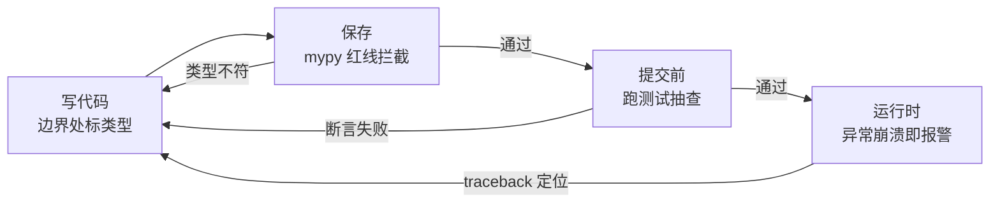

# $\rm Chapter \, 1$ 类型与静态检查

> **本章假设你已经会**
>
> 1. 名字绑定：Python 变量是贴在对象上的标签，类型跟着对象走而不是跟着名字走，见《编程语言》§17.1。
> 2. 用 python3 命令行跑脚本、读懂一段 traceback 报错栈，见《编程语言》§17.2 与 §17.9。
> 3. 进程抽象：程序运行起来是一个进程，没被接住的异常会让它当场终止，见《操作系统》§1.2。
> 4. C++ 的类型检查体感：把 `char*` 当 `int` 传，编译器直接拒收，你从没在编译期之外见过这类错。

全册心智模型一句话：**正确性是论证出来的：spec 是合同，测试是抽查，抽象屏障是防火墙**。竞赛代码的正确性靠「过了全部样例」背书，但样例只是抽查，抽查通过不等于论证完成。本册的任务就是把「论证」拆成一套可执行的工序，而这套工序的第一件工具是类型：它在你按下回车运行之前就开始工作。本章先立起「错误暴露时机」的三界光谱（§1.1），再用两个锚点实验量出动态检查的两种死法：崩溃形态在 0.2 毫秒内叫停你（§1.2），静默形态污染 21599 条记录、180 天后才在审计里现形（§1.3）；然后演示静态检查器 mypy 如何在第一行代码运行之前报出同样的错（§1.4），最后把三界的管辖范围收拢成一张对照表（§1.5）。本章实验全部在 WSL2（python 3.12.3，mypy 2.4.1）上真跑过，脚本与完整输出见本册实验记录 `expSW01/result.txt`。

## $\rm \S \, 1.1$ 三界光谱：错误在什么时候被谁发现

先立任务。你写了两千行的数据清洗脚本，改了其中一行，现在要回答一个问题：这行改动有没有把程序改坏？把全部输入跑一遍当然能回答，但真实系统的输入空间无穷无尽，跑不全。于是「程序坏没坏」这个问题的答案，取决于你**在哪个环节、用什么工具**去查：同一个 bug，有人三秒内被工具拍在脸上，有人半年后才被用户投诉发现。区别不在粗心，在检查发生的时机。

按暴露时机给检查分层，得到三个界。第一界是**静态检查**（static checking）：不运行程序，只对代码文本做分析，编译器查语法和类型、linter 查可疑写法，都属于这一界。第二界是**动态检查**（dynamic checking）：程序运行时，每次求值都核对操作与类型是否匹配，列表越界、除零、`None` 上取属性，都是运行时当场报错。第三界是**无检查**：那段代码写下的约定既没有人机检查，运行时也碰不出异常，比如本该相加的两个数被拼接成了字符串，只要两边都是 `str`，Python 心满意足地给你拼一个错的。

三界检查器认识的东西不同，这是理解全部本章的关键台阶。先给主角下一个够用的定义。**类型**（type）是一个值集合加上定义在这些值上的操作集：`int` 是整数集合，其上定义了加、减、比较；`str` 是字符串集合，其上定义了拼接、切片。说「`"共" + 15` 是类型错误」，意思就是加号左右两侧的值分属两个集合，而没有任何一个集合把「字符串拼整数」这个操作定义进去。集合与操作都在手边，检查才有的放矢；下面按暴露时机把检查器排开。`python3 -m py_compile` 只做语法分析，它能确认括号配平、缩进合法，但对「字符串加整数」睁眼瞎，因为语法层根本没有类型这个概念；mypy 这类类型检查器在语法之上加了一层类型推理，能看出「这个位置承诺收 `int`、你递来 `str`」；而 Python 解释器运行到那一行时，做的是最诚实的核对：对象上到底有没有这个操作。层层往上，检查发生得越来越早，代价是检查器要靠注解去「相信」更多东西。这一点 §1.4 会展开，先记住：越早的界越便宜，但管辖范围越小。

语言的默认配置落在光谱的不同位置，同一个错误放进两种语言就能看出时刻差。先看 C++：

```cpp
int label_len(int pages) {
    std::string s = "共" + pages + "页";   // str + int：编译期直接拒收
    return s.size();
}
```

这行代码在编译阶段就报错，类似 `invalid operands to binary expression ('std::string' and 'int')`，可执行文件根本没有机会诞生，更谈不上「跑到第几条记录才炸」。再看 Python：

```python
def label(pages):
    return "共" + pages + "页"   # 语法合法；str + int 的账记到运行时
```

解释器对它毫无异议，写错类型照样启动、照样跑，直到坏点被执行的那一瞬才炸。同一个人在两种语言里的错误率未必差多少，差的是**发现错误的时刻**，而时刻决定了代价：编译期发现，改三分钟；生产环境发现，见 §1.3 那本半年账。

白话：静态检查像食材进厨房前的验收，动态检查像炒菜时尝味，无检查那道菜端上桌咸淡全凭运气；验收越靠前，翻车越便宜。

> 本节小结：错误暴露时机分三界：静态（不运行就查）、动态（运行时逐次核对）、无检查（约定没人看管）；越早的界越便宜、管辖越小；语言的差别不在错误多少，在错误什么时候现形。

## $\rm \S \, 1.2$ 崩溃形态：动态检查的暴露时刻实测

场景来自贯穿项目的清洗管道。爬虫源 A 把论文页数字段写成字符串 `"15"`，源 B 写成整数 `15`，管道按源 A 的口径编写，标签函数是这样的：

```python
def label(pages):
    return "共" + pages + "页"
```

源 A 的数据喂进来一切正常；某天源 B 混进一条 `pages` 为整数 `15` 的记录，`"共" + 15` 这个操作对 `str` 和 `int` 没有定义，Python 当场抛 `TypeError`。现在把这个错误放进一条 1000 条记录的管道里实测（坏记录埋在第 847 条，脚本 `expSW01/exp1_exposure.py`）：前 846 条全部成功，第 847 条上管道终止，异常类型 `TypeError`。管道从启动到崩溃的墙钟时间是 0.181 毫秒；把坏点单独拎出来反复抛 200 次，单次抛错耗时最速 0.41 微秒、中位数 0.46 微秒。

这组数字值钱的地方不是快，是**暴露条件可以被精确陈述**。动态检查发生在求值那一刻，所以一次类型错误的暴露时刻，等于首次执行到含错语句的时刻。先把崩溃现场的真实证据看一眼，这是那段管道实际打印的 traceback（`expSW01/result.txt` 补充段）：

```text
Traceback (most recent call last):
  File "<string>", line 7, in <module>
  File "<string>", line 3, in label
TypeError: can only concatenate str (not "int") to str
```

读法自下而上：最底行是诊断句「`str` 只能拼接 `str`，不能拼 `int`」，中间两行是调用栈，从循环体（第 7 行）进到 `label` 函数体（第 3 行）。行号、函数名、两个操作数的实际类型，证据链一步到位。然后把这个暴露条件写成一行式：

$$
T_{\mathrm{exp}} \;=\; t_{\text{first reach}}
$$

读法：$T_{\mathrm{exp}}$ 是错误的暴露时刻，${t_{\text{first reach}}}$ 是执行路径第一次踏进坏点的时间。坏点在第几行、藏在多深的调用链里都不影响公式，唯一影响它的是「这条路径被没被走到」。本例 0.181 毫秒就炸，是因为坏点恰好躺在主路径上：清洗循环每条记录都要过。假如这条坏记录只在「用户上传 PDF 且字段缺失」的分支里出现，暴露时刻就从毫秒变成那次上传发生的时刻，可能是上线后第三个月。

崩溃形态有个常被低估的优点：**它自带证据**。`TypeError` 的 traceback 会指到具体行号和两个操作数的实际类型，你打开日志五分钟就能定位。更妙的是对照实验：对含错的源文件跑 `python3 -m py_compile`，返回码 0，语法检查完全放行（`exp1_exposure.py` 末段实测）。这说明两层静态设施里，语法层对类型错误一无所知，唯一在工作的检查器是运行时那个，而它抓住了错。崩溃不是缺陷，是动态检查在忠实地报告合同违约。

白话：崩溃形态的错误像烟雾报警器，烦人但救命；它响得越早、越靠近坏点，你修得越便宜。

> 本节小结：动态检查的暴露时刻等于首次执行到坏点的时刻；崩溃形态单次抛错耗时亚微秒级、traceback 自带行号证据；但语法层检查对它完全失明，暴露与否只取决于执行路径有没有踩到。

## $\rm \S \, 1.3$ 静默形态：一份跑半年才炸的账

同一个加号，换一种类型组合，死法完全不同。清洗管道里还有一处汇总逻辑：

```python
def total_pages(rec_a, rec_b):
    return rec_a["pages"] + rec_b["pages"]
```

当两个页码都是字符串时，`"12" + "13"` 对 Python 完全合法，结果是拼接 `"1213"`。这就是**静默错误**（silent failure）：操作对类型有定义，值是错的，异常一个都不抛。实测（`exp1_exposure.py` 静默段，100 对记录）：异常数 0，从第 1 对起就错，100 对全部错，示例 `"12"+"13"` 产出 `"1213"` 而不是 `25`。动态检查在这里不是失职，它的合同本来就只承诺「操作对类型是否有定义」，`str + str` 有定义，它就放行。

静默错误自己不会现形，它靠时间积累出受害者。拿贯穿项目的归档操作算这笔账（脚本 `expSW01/exp2_halfyear.py`）：

```python
def add_to_shelf(book, shelf=[]):
    shelf.append(book)
    return shelf
```

这行代码的坑在默认参数的求值时机。推导一遍：`def` 是一条可执行语句，解释器执行到它时创建函数对象，同时把默认值 `[]` 创建出来，存进函数对象的 `__defaults__` 属性里；此后每次调用不带第二个实参时，形参 `shelf` 绑定的都是**同一个列表对象**，函数体里的 `append` 改的是这个共享对象，改动在调用之间存活。模拟 180 天、每天 120 次归档调用（约定每次返回的货架上恰好是本次那 1 本书）：第 2 次调用起结果就错了，全程异常数 0；到第 180 天审计时，共享货架上堆了 21600 条记录，而单次调用的约定上限是 120 条，累计产出错误结果 21599 次。对照版本把默认值换成哨兵 `None`、函数体内按需新建列表，同样 21600 次调用错误数为 0。

把两份账并排放，暴露时刻的差距一目了然：崩溃形态 0.181 毫秒暴露；静默形态第 2 次调用起就开始错，没人知道，直到 180 天后审计，受害记录 21599 条。审计代码朴素得刺眼，它只问了一个所有调用方都懒得问的问题：

```python
shared = add_to_shelf.__defaults__[0]      # 把函数对象藏的默认值翻出来
assert len(shared) <= CALLS_PER_DAY, "货架溢出：默认列表被共享了"
```

这行审计能活下来，恰恰因为问题太不像错误：每次归档都「成功」返回，返回值类型对、长度是整数、能遍历，唯一错的是内容。修复只需把默认值换成哨兵，让每个调用各自新建列表：

```python
def add_to_shelf(book, shelf=None):
    shelf = [] if shelf is None else shelf   # 哨兵模式：每次调用新建
    shelf.append(book)
    return shelf
```

这就是本章标题里「类型为什么省命」的一半答案：错误暴露得越晚，它造成的损害越不限于「让你加班」，而是混进数据、被下游当真、被备份固化；抓它要靠人翻出函数对象内部，成本按月计。另一半答案在 §1.4：把暴露时刻从「运行半年」拉回「按下回车之前」，有专门的工具。

> **竞赛生迁移提示**：竞赛里你几乎遇不到静默类型错误，因为 OJ 判题器替你做了值核对：答案错就 WA，当场现形。真实系统没有判题器，错误的值会一路流进数据库。开发里「测试通过」不等于「值正确」，测试只覆盖你想到的输入，见第 2 章。

白话：崩溃像味精放多了，一口就吐出来；静默错误像盐罐子标签贴错，全家喝了一个月齁汤，直到体检报告出来才知道。

> 本节小结：静默错误的操作对类型合法、值是错的、异常数为 0；它的暴露靠外部审计而不是检查器；可变默认参数是它的经典温床，默认值在 `def` 执行时创建一次、全体调用共享；180 天账本上 21599 条受害记录对照崩溃形态的 0.181 毫秒，说明暴露时刻是错误代价的第一变量。

## $\rm \S \, 1.4$ 静态检查：在第一行代码运行之前报错

《编程语言》§17.6 已经教过类型标注（type annotation）的语法：`def label(pages: int) -> str`。本节回答标注真正买到了什么：让静态类型检查器（type checker）接手你的合同。检查器读源码、读注解，推理每个表达式值的类型，**不执行任何一行**。静默形态的测试文件 `bugB.py` 长这样，`total_pages` 的形参处补上了 §1.3 缺失的那句承诺：

```python
def total_pages(a: int, b: int) -> int:
    return a + b

record_a = {"pages": "12"}   # 爬虫给的是字符串
record_b = {"pages": "13"}
print(total_pages(record_a["pages"], record_b["pages"]))
```

对 §1.2 与 §1.3 的同款错误做静态实测（脚本 `expSW01/exp3_static.py`，三个文件：含崩溃形态的 `bugA.py`、上面这个 `bugB.py`、正确版 `okA.py`）：先跑语法检查，三个文件全部放行，返回码 0；再跑 mypy，冷缓存 3.6 秒、热缓存 1.4 秒，报 3 处错，零行代码被执行：

```text
bugA.py:3: error: Unsupported operand types for + ("str" and "int")  [operator]
bugB.py:7: error: Argument 1 to "total_pages" has incompatible type "str"; expected "int"
bugB.py:7: error: Argument 2 to "total_pages" has incompatible type "str"; expected "int"
Found 3 errors in 2 files (checked 3 source files)
```

读这份输出：崩溃形态在定义处（第 3 行）就被指认「字符串加不了整数」，静默形态在调用处（第 7 行）被指认「承诺收 `int`、递来的是 `str`」。3.6 秒的检查换来这两处判决，而运行时的静默形态要 180 天才等到审计。这就是静态检查省的命：它把暴露时刻从「坏点首次被执行」改写成「检查器运行的时刻」，两者相差的是程序整个生命周期。写成一行式：

$$
T_{\mathrm{exp}}^{\text{static}} \;\le\; t_{\text{check}} \;\ll\; T_{\mathrm{exp}}^{\text{dynamic}}
$$

读法：静态暴露时刻不超过检查时刻 $t_{\text{check}}$（检查通过时错误根本不存在，标注谎报时在检查现场暴露），远小于动态暴露时刻（等于首次执行到坏点的时刻，见 §1.2）。

但静态检查的管辖边界必须说清，否则下一章你会带着错误的期待去写测试。第一，**检查器只核对承诺过的地方**。`bugB` 里的 `total_pages` 若不写 `int` 注解，mypy 对字符串相加一声不吭，因为 `str + str` 在类型层面完全自洽：`"1213"` 这个错值不是类型错误，§1.3 的静默形态要靠「在边界处标注收 `int`」才能进静态检查的管辖。第二，**它不核对值**：`total_pages(12, 13)` 返回 47，mypy 照样放行，类型对、答案错的事只有测试和 spec 能抓，那是第 2、3 章的主场。第三，标注本身也是代码，会过期：改了函数忘了改注解，检查器就把谎言当合同执行，所以标注必须挂进每次保存都跑的机械检查里，而不是写完束之高阁。

这三条边界正好给出**防御式编程**（defensive programming）的第一个可执行动作：在模块入口处写注解，让外部数据进管之前先过一遍类型核对；管道深处信任已核对过的类型，不再层层设防。防线要设在边界上，因为爬虫给的 `pages` 到底是 `str` 还是 `int`，只有在边界处声明一次，整条管道才共享同一份事实。顺手把类型标注从一个纪律升级为机械流程。命令行下（Bash/Zsh 通用，当前目录为项目根，mypy 已安装）：

```bash
mypy pipeline/bugA.py pipeline/bugB.py pipeline/okA.py
```

它读这三个文件、写标准输出（报错清单）并返回退出码（0 通过、1 发现错误），不修改、不运行任何文件；成功验证看末行 `error count` 为零，报错含义直接印在每行冒号之后。编辑器把同一条命令挂在保存事件上，报错就是红波浪线，错误在它有机会运行之前死掉。

白话：类型标注是把「咱说好了要 int」这句口头约定，变成一台每次保存都自动核对的机器；没写注解的地方，机器管不着，这是它省命的方式，也是它的盲区。

> 本节小结：mypy 不执行代码就报出 §1.2 的崩溃错误与 §1.3 的调用处类型不符（冷缓存 3.6 秒 3 处错）；静态检查把暴露时刻提前到检查时刻，但只管辖注解覆盖处、不核对值；防御式编程的第一步是在模块边界写注解、让检查进机械流程。

## $\rm \S \, 1.5$ 三界对照与三种读错方式

一个类型错误在 Python 里走完三界的样子，收进一张对照表：

| 检查器 | 暴露时机 | 能抓 | 抓不住 | 本章实测 |
| --- | --- | --- | --- | --- |
| 语法检查（py_compile） | 编译/保存 | 括号、缩进、语法 | 一切类型问题 | 对崩溃 bug 返回码 0 |
| 类型检查器（mypy） | 运行前 | 注解管辖内的类型不符 | 值的错误、未标注处 | 3.6 秒报 3 处错 |
| 动态检查（解释器） | 坏点被执行时 | 操作对类型无定义 | 类型合法但值错 | 0.181 ms 崩溃 / 180 天静默 |

表里三行合起来是一道防御纵深，从左到右，检查越来越晚、证据越来越真、代价越来越高。往后各章的工作流把这道纵深画成流程：



三道关卡共用一个原则：**让错误在它最便宜的死法里死掉**。类型不符死在保存时，输入不合约定死在测试里，残余漏网死在运行时崩溃的 traceback 里。围绕这道纵深，收拢三种读错方式：

1. **把动态语言当成无检查**。Python 每次求值都在核对类型，`"共" + 15` 不是「没检查」，是「检查了但太晚」。正确读法是 §1.2 的公式：动态检查全知全觉，只是暴露时刻等于首次执行到坏点，晚是它的全部问题。
2. **把 mypy 当免测金牌**。mypy 通过只能证明「注解管辖内类型自洽」，不证明值正确：`"1213"` 若注解声明收 `str`，检查器笑容满面地放行。类型对、答案错的错误，测试和 spec 的管辖区，见第 2、3 章。
3. **把标注当文档不当代合同**。注解写了但没人跑 mypy，等于合同签了没人执行，谎言过期不究。标注的价值全在「挂进机械流程」这个动作里，工具不跑，注解只是贴在代码上的愿望。

边界最后说一句：静态检查的收益随团队规模和代码寿命上升，两行一次性脚本不标注也不亏；但贯穿项目这种要活过整个学期、被多人改动的代码库，边界标注是性价比最高的第一笔投资。第 3 章的 spec 会把同样的思想推进一层：类型核对的是「值属于哪个集合」，spec 核对的是「值满足什么关系」，合同从类型层升到行为层。

白话：三道关卡各管一段，早死的便宜、晚死的贵；三道都躲过的错误，靠审计抓，那就要按半年计价了。

> 本节小结：三界构成防御纵深，越早越便宜、管辖越小；三种误用分别是低估动态检查、高估 mypy、把标注当文档；静态检查管类型集合，行为层合同是第 3 章 spec 的事。

## $\rm \S \, 1.6$ 关键概念回顾

1. 静态检查、动态检查、无检查三界的分界线是什么？各自的检查器分别「认识」代码的哪个层面？
2. 用 ${T_{\mathrm{exp}} = t_{\text{first reach}}}$ 解释：为什么同一个类型错误，有人 0.2 毫秒内撞见，有人三个月后才撞见？
3. `"12" + "13"` 得 `"1213"`，动态检查为什么不报错？它的合同承诺的到底是什么？
4. 可变默认参数的共享发生在哪个时刻？请按「`def` 语句被执行时创建函数对象」的顺序完整推导一遍。
5. mypy 报出 `bugB.py:7` 的两处错误靠的是什么信息？如果 `total_pages` 不写 `a: int, b: int` 注解，同样的调用 mypy 还能抓住吗？

## $\rm \S \, 1.7$ 应用与辨析

1. 同事说：「我跑了一遍，没报错，代码就是对的。」用 §1.2 的暴露公式和 §1.3 的半年账，指出这句话在什么条件下成立、在什么条件下是灾难。
2. 你要接手一个没有标注的旧清洗模块，爬虫源刚从 A 换成 B（`pages` 从字符串变整数）。列出你的动作顺序：先在哪一层装检查、标注写在哪里、为什么不在每个函数里都塞 `isinstance` 判断？
3. `py_compile`、mypy、运行时异常三道关卡各花多少秒（用本章实测数字），各自在什么情况下会漏过同一个错误？构造一个能连过三关的错误，并说出哪道设施（第 2 章的哪个工具）负责它。

## $\rm \S \, 1.8$ 本章自测答案

概念回顾答案：

1. 分界线是「程序是否被运行」。静态检查只读代码文本：语法层认识记号与结构（括号、缩进），类型层在此之上认识注解与类型推理；动态检查在求值时核对「操作对对象的类型是否有定义」；无检查指操作对类型有定义、值对错无人核对的地带（来源：§1.1、§1.2）。
2. 公式说暴露时刻等于首次执行到坏点的时刻，与代码规模无关、只与执行路径有关。坏点在主路径上则 0.181 毫秒暴露，在罕见分支里则要等那个分支第一次被走进，可能是上线后第三个月（来源：§1.2）。
3. 因为 `str + str` 有定义：动态检查的合同只承诺「操作对类型是否定义」，拼接合法它就放行，不核对语义上是否该相加（来源：§1.3）。
4. `def` 是可执行语句：执行到它时创建函数对象，同时创建默认值列表并存入 `__defaults__`；此后每次缺省调用，形参绑定同一个对象，`append` 的改动跨调用存活（来源：§1.3）。
5. 靠 `total_pages` 形参上的 `a: int, b: int` 注解与调用处实参的 `str` 类型推理比对。不写注解则 mypy 无合同可查，`str + str` 类型自洽，抓不住（来源：§1.4）。

应用与辨析答案：

1. 成立条件：跑的路径恰好覆盖全部坏点且坏点全属崩溃形态。灾难条件：存在类型合法但值错的坏点（异常零个、结果全错），或坏点在没跑到的分支里，静态检查又因无标注而失明；此时「没报错」只说明抽查没抽中，§1.3 的 21599 条受害记录就是这份自信的半年账（来源：§1.2、§1.3）。
2. 顺序：先跑 mypy（先量出存量），在模块入口与公共函数签名处补注解（边界设防），让外部数据先过类型核对再进管道；不在每个函数里塞 `isinstance`，因为边界已核对过的类型在管道深处是共享事实，层层设防重复劳动且掩盖「边界没守住」这个真正信号（来源：§1.4、§1.5）。
3. py_compile 亚秒级、mypy 冷 3.6 秒热 1.4 秒、运行时异常要等坏点被执行（0.181 毫秒到 180 天不等）。漏法：类型合法但值错可连过三关（如 `"12"+"13"` 全程无异常）；它由第 2 章的单元测试负责抽查，再往上一层由第 3 章的 spec 书面化「该相加」这个行为约定（来源：§1.2、§1.3、§1.5）。

**你现在能做什么**：拿到一段 Python 代码，你能在 60 秒内判断它的类型约定写在哪一层：跑一次 `py_compile` 与 mypy，对照运行时异常日志，说出每个错误该由哪道关卡拦、为什么拦不住。

类型这层合同核对的是「值属于哪个集合」，但集合对了答案仍可能错。下一章引入第二件论证工具：测试。你将看到同一函数三个埋 bug 的变体在三套测试下的抓取率实测，以及「覆盖率 100% 却漏抓全部 bug」这个谎言的完整拆解。
