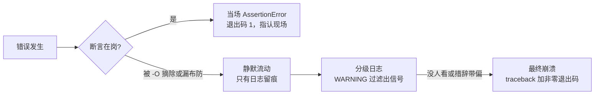

# $\rm Chapter \, 7$ 调试与防御

> **本章假设你已经会**
>
> 1. traceback 的基本读法：异常类型、行号、调用链三段证据，见第 1 章 §1.2。
> 2. 预言机从哪来：测试是用「已知答案的输入」抽查实现，见第 2 章 §2.1。
> 3. RI 与 checkRep：构造器建立不变量、关键操作之后断言，见第 4 章 §4.2 与 §4.4。
> 4. 竞态 bug 的指纹：同一输入跑两次结果不同；宽窗口能把低概率交错拉成必现，见第 6 章 §6.2。
> 5. git 提交是带父指针的快照链，`git bisect` 的命令用法，见《Git与团队协作》§19.1 与 §19.7。

前六章把正确性论证的工序摆满了：类型在运行前查（第 1 章），测试在提交前查（第 2 章），spec 与 RI 把合同写明白（第 3、4 章），接口把变更隔开（第 5 章），并发把交错钉住（第 6 章）。但论证是人做的，人会漏：漏一条副作用条款、漏一个 rep 入口、漏一条持锁前提，错误就从缝里钻进正在运行的系统。本章处理「钻进来之后」的阶段。先立调试的总形状：它是假说检验循环，不是改改看（§7.1）；再训练第一项读证技能，把 traceback 当证据链而不是当噪音（§7.2）；然后用锚点实验一量出二分调试的价格表：在 100 个提交里钉住坏提交，实测平均 6.72 次测试，对得上 ${\log_2 100}$ 的账（§7.3）；接着把断言与日志排成三层布防，各管一段、各有失效边界（§7.4）；再用锚点实验二回答「为什么不能只靠 print」：同一个静默错误，断言版当场报警并退出码 1，print 版跑完全程还报告成功（§7.5）；最后补上调试之前的那道防线，一份代码审查清单（§7.6）。本章实验全部在 WSL2（python 3.12.3，git 2.43.0）上真跑过，脚本与完整输出见本册实验记录 `expSW07/result.txt`。

## $\rm \S \, 7.1$ 调试的形状：从「改改看」到假说检验

先立任务。第 6 章结尾留了一个尴尬：竞态 bug 测试全绿之后照样翻车。更一般的场景是：你面对一个正在出错、或出过错的东西，手头只有现象（某天凌晨总量对不上、某个请求返回了奇怪的结果），代码在哪一行错、从哪个提交开始错，全都不知道。**调试**（debugging）指从可观察的故障现象出发，找出并修掉根因的系统过程。它有一个总形状：**假说检验循环**。每一轮做四件事：

1. **复现**（reproduction）：用固定的输入与操作序列稳定地触发同一故障。
2. **假说**：列出一个候选原因集合，挑最可疑的先验。
3. **检验**：设计一个能区分假说的实验，只动一个变量。
4. **回归**：修完把这次故障写成一个测试，防它卷土重来（第 2 章 §2.1 的测试先行，在这里反向用一次）。

第 1 步是全部后续步骤的地基，值得单独强调：不能稳定复现的故障无法检验任何假说，因为你改完之后连「修好没有」都答不出来。竞赛里你其实天天在做这件事：WA 了先造一个暴力对拍，把随机数据缩小到最小的那组，这正是**最小复现**（minimal reproduction）的手法——把触发故障的输入砍到最小，砍掉的每一段都与故障无关，嫌疑范围随之缩小。第 6 章 §6.2 量过竞态 bug 的指纹：同一输入两次结果不同。对这类故障，复现手段就是把读改写之间的窗口拉宽（插一个 `sleep(0)`），把深夜才出现一次的低概率交错搬上实验台。复现不了的时候不要急着改代码，先改环境让故障能复现。

「改改看」为什么不行？因为它一次动多个变量：换了一行写法、顺手改了个名字、又调了参数，故障消失了也不知道是哪个动作起效，故障加重了更回不去。假说检验把变量隔离成一次一个，每轮实验都产出确定的信息：这个假说被排除了，或者被证实了。拿 §7.5 会实测的去重 bug 把循环走一遍：复现，取一条线上总量对不上账的数据，砍到只剩带重复标题的一批；假说，去重的合并分支保留错了记录；检验，在合并后放一句断言，第一次运行就在第 300 批触发；回归，把这一批写进测试集，§2.1 的测试先行在这里反向用了一次。本章后面两件工具都是这个循环的具体化：二分调试把「定位」一步做成机械流程（§7.3），断言把「检验」一步变成常驻岗哨（§7.4）。

白话：调试像医生看病，先让症状稳定出现，再一项一项排除，而不是一把药全吃下去看死活。

> 本节小结：调试是假说检验循环：复现、假说、检验、回归；复现是地基，最小复现把嫌疑范围砍小；竞态故障靠拉宽窗口复现；一次只动一个变量是检验的纪律。

## $\rm \S \, 7.2$ 堆栈阅读法：第一份证据怎么读

复现之后，第一份到手的证据通常是崩溃现场的 traceback。第 1 章 §1.2 读过一个最小的：三行里认出了异常类型与行号。现在给完整读法，先补一个正式定义。**调用栈**（call stack）是运行时维护的一本账：当前执行到哪一行、这一行是从哪个函数的哪一行调进来的，一层层记上去；异常抛出时这本账被整本打印，就是 traceback。所以 traceback 不是报错信息，是故障现场的完整快照，每行都有用。

拿一个贴近贯穿项目的现场做读法示范（后端在汇总页数时崩溃）：

```text
Traceback (most recent call last):
  File "server.py", line 41, in handle_request
    total = shelf.total_pages()
  File "shelf.py", line 17, in total_pages
    return sum(p["pages"] for p in self._papers)
TypeError: unsupported operand type(s) for +: 'int' and 'str'
```

自底向上读，每段证据回答一个问题。最底行回答「什么违约」：`TypeError` 加诊断句，`int` 和 `str` 相加没有定义，这是 §1.3 静默形态的近亲，只是这次撞上了不放过混型的操作。中间的调用链回答「怎么走到」：违约现场在 `shelf.py` 第 17 行 `total_pages` 内部，由 `server.py` 第 41 行的 `handle_request` 调进来。行号回答「在哪断」。三个答案凑齐之后，读法里最关键的一步是：**沿调用链往上找第一个你说了算的帧**。违约发生在 `total_pages` 里，但它只是在替别人数钱；真正的问题是页数里混进了字符串，而字符串是从 `add` 的调用方塞进来的。嫌疑人不在最底帧，在这条链的上游，顺着 `_papers` 的写入方向回溯。只看最底行就动手改 `total_pages`，是堆栈阅读最常见的误读：把报信的当肇事者。

traceback 是死后的验尸报告，只告诉你「断的时候」各帧在哪；要活着看，用调试器。《终端与工具》§5.5 已经教过：**断点**（breakpoint）让程序停在指定行，把调用栈每一帧的局部变量摊开看，再单步推进。两者的分工是：traceback 给出断点的位置（停在第 17 行），断点让你在那一刻检查 `_papers` 里到底混了什么、是谁在上一帧递进来的。

还有一版 traceback 更长，头部多了一段。当一个异常在 `except` 块里处理时又抛出新的异常，Python 会把两份栈都打出来，中间用一行分隔：

```text
During handling of the above exception, another exception occurred:
  File "pipeline.py", line 23, in ingest
    records = clean(raw)
  File "pipeline.py", line 9, in clean
    r["pages"] = int(r["pages"])
ValueError: invalid literal for int() with base 10: '共15页'
```

读法不变，仍自底向上，但要认得分隔行：`During handling ...` 之下是新异常，它之上那段（`The above exception` 开头引出的）是**原始异常**。新异常常常只是原始异常在传播路上换了件衣服，根因在上面那段。用 `raise 新异常 from 原异常` 显式 chaining 时，分隔行会写成 `The above exception was the direct cause`，这句是在替你担保因果：底下那个就是根子。漏读分隔行、只盯着最后一段查，是第二常见误读：你在排查「转换失败」，真正的案子在「谁把「共15页」塞进了页数字段」。

白话：异常链像转诊单，最后一站说你病了，但病历首页写的才是你从哪来的；`from` 就是医生签的那句「病因就是这个」。

白话：读 traceback 像看事故监控的回放，底行是撞车那一瞬；倒着放录像，找出第一个归你管的路口，肇事的改装车通常是从那里开上来的。

> 本节小结：调用栈是运行时的账本，异常时整本打印成 traceback；自底向上读，三段证据分别回答什么违约、怎么走到、在哪断；定位的关键是沿链上溯找第一个自己说了算的帧；验尸（traceback）与活体观察（断点）配合使用。

## $\rm \S \, 7.3$ 锚点实验一：二分调试，用 ${\log_2 n}$ 次测试钉住坏提交

复现了故障，也读会了现场，下一个问题是它从哪来的。论文资料管理器的管道上周五还好好的，今天 `top_k` 开始返回页数最小的几篇。中间隔着 100 个提交（编号 0 到 99），埋雷的提交是其中某一个，此后的每个提交都带着它。任务：用最少的测试次数找到它。

朴素办法是线性排查：从上周五的提交 0 开始逐个测。每次测试就是把该提交的代码跑一遍测试套件（预言机对账，§2.1），好提交通过、坏提交失败。埋雷位置均匀分布时，平均要测 ${(n+1)/2 = 50.5}$ 次，最坏 99 次。二分调试利用一个比「位置未知」更强的信息：**好与坏沿提交历史是单调的**——提交 0 已知好，提交 99 已知坏，那么好区在前、坏区在后，中间只有一条坏分界线。于是测中间那个提交：好，分界线在右半；坏，分界线在左半。每测一次，待定区间至少砍半。从 100 个提交出发，砍到只剩 1 个的次数满足：

$$
n \;\to\; \frac{n}{2} \;\to\; \frac{n}{4} \;\to\; \cdots \;\to\; 1, \qquad T \;\ge\; \log_2 n
$$

读法：$n$ 是待查提交数，每测一次区间至少减半，减到 1 需要 $T$ 次；${n = 100}$ 时 ${T \ge 6.64}$，即至多 7 次。这就是你在 OJ 上用熟的二分查找，只是被查找的数组换成了提交历史（§19.7 已给过 `git bisect` 的命令用法，这里补它的账）。

实测分两步（脚本 `expSW07/exp1_bisect.py` 与 `exp1b_git.sh`，输出在 `result.txt`）。第一步是统计账：把「测试」实现为真实执行——每个提交的 `top_k` 源码被 `exec` 载入、与预言机在 21 组输入上对账——埋雷位置随机取 1000 次。结果：

```text
bisect tests: mean=6.72 median=7 min=6 max=7 | log2(100)=6.64
linear tests: mean=49.47 median=50 min=1 max=99 | (n+1)/2=50.5
identification correct: 1000/1000
total wall time: 4.52s
```

二分平均 6.72 次，与理论值 6.64 对上；中位数 7，最多 7 次。线性平均 49.47 次，与 ${(n+1)/2 = 50.5}$ 的偏差来自整数取整；最坏 99 次。1000 轮全部指认正确。50.5 对 6.72，约 7.5 倍；这个差距随 $n$ 越拉越大：一万次提交的历史，线性平均五千次，二分至多 14 次。第二步是真账：在真实 git 仓库里埋一遍雷——100 个提交各写入一版 `pipeline.py`，雷埋在第 37 号（丢了 `reverse=True`），`git bisect run` 让 git 全自动执行「检出、跑测试、按结果切半」的循环，实测 `tests executed: 7`，git 指认的坏提交正是第 37 号，与埋雷位置一致。

实验第二步用的正是这套全自动流程（WSL Bash，仓库里有 100 个提交，雷埋在第 37 号，`test_commit.py` 是对账脚本，退出码 0 表好、1 表坏）：

```bash
git bisect start                         # 进入二分状态
git bisect bad HEAD                      # 今天：坏（top_k 返回页数最小的）
git bisect good HEAD~99                  # 上周五：好
git bisect run python3 test_commit.py    # git 自动「检出、测试、按结果切半」
```

git 依次检出待测提交、把 `pipeline.py` 换成该提交的版本、跑测试脚本，实测共执行 7 次测试，末行打印 `<hash> is the first bad commit`，指认的正是第 37 号提交。命令层 §19.7 已教过，这里补上了它每一步在做什么：把 §7.2 读 traceback 的人工回溯，换成测试结果驱动的机械切半。

二分的便宜有前提，把这两条当成它的合同读：1. **单调**：一旦变坏不再变好。如果历史上修过这个 bug 后来又改坏，好坏沿历史不再单调，二分会把分界线指到错的地方。2. **测试可靠**：同一个提交测两次，结论必须相同。flaky 测试是二分的毒药——一次误报（把好提交报成坏）就把搜索整个带偏，§6.2 量过的竞态指纹（同输入两次结果不同）正是 flaky 的来源。所以跑二分之前先把测试的确定性修好，这一步省不得。

复现方式（WSL Bash，当前目录为本册实验记录 `expSW07`，脚本只读，git 实验在子目录 `gitrepo` 里创建真实仓库，输出重定向到 `result.txt`；成功验证是 bisect 平均值落在 6.6 到 7 之间、`identification correct: 1000/1000`、git 指认的提交号与埋雷位置一致）：

```bash
python3 exp1_bisect.py && ./exp1b_git.sh
```

白话：线性排查像从第一页开始逐页翻词典找单词；二分调试就是词典本身的用法，翻中间一页，太靠前就扔掉前一半。

> 本节小结：坏分界线沿提交历史单调时，二分把定位成本从平均 ${(n+1)/2}$ 压到 ${\lceil \log_2 n \rceil}$，实测 100 提交平均 6.72 次对上理论 6.64，真实 git bisect 用 7 次测试指认埋雷提交；两条合同前提是历史单调与测试可靠，flaky 测试会让二分整盘指错。

## $\rm \S \, 7.4$ 断言与日志的层次：三层布防

二分找到坏提交之后，你仍然要读代码找出那一行。更省的姿态是让错误当场自首：在它发生的地方等它，而不是事后追捕。这一节把防御工事排成三层，各层的职责、武器与失效边界都不同。

第一层是**断言**（assertion）。`assert 条件, 消息` 在条件为假时抛 `AssertionError`，它是写在代码里的合同检查，判据是你对系统内部状态的承诺。第 4 章 §4.4 的 checkRep 就是它：关键操作之后查 RI。这里要把断言与测试的分工说透，这是本章最重要的一个台阶。测试的预言机在测试时工作，对有限个挑出来的输入抽查；断言把同一份预言机知识搬进实现内部，在**每一次真实运行**上对**每一条真实数据**全查。测试是质检员抽检，断言是生产线上的探针。§7.5 会实测这两种岗哨在同一静默错误上的暴露速度差。

断言有一条必须钉住的失效边界：它可以被整体摘除。实测（`expSW07/result.txt` 的 `-O` 段）：

```bash
python3 -O -c "assert False; print('survived')"   # 返回码 0，打印 survived
```

`-O`（优化模式）把全部 assert 从字节码里剥掉，`assert False` 都不报错。所以断言管的是内部不变量，管不了合同边界：对调用方输入的违约必须用 `raise` 报告，异常不会被优化掉。一句话分工：assert 防自己人（实现的内部承诺），raise 防外人（调用方的合同违约）。

第二层是**日志**（logging）。断言一响就中断执行，日志不中断，它只记录。最小用法（标准库 `logging`，两行布防、一处开关）：

```python
import logging
log = logging.getLogger("pipeline")      # 全模块共用一个记录器
log.debug("batch %d: uniq=%d", i, len(seen))     # 细节流水，默认不输出
log.warning("batch %d: 合并保留了较小页数", i)    # 可疑信号
```

**日志级别**（log level）把记录分成几档：DEBUG 是开发期细节，INFO 是正常里程碑，WARNING 是可疑但不致命，ERROR 是故障已发生。级别开关决定哪些档真正输出，分级的意义用实测说话（`exp2` 的日志段，同一 500 批的运行）：DEBUG 级 606 行，WARNING 级 106 行；把级别调到 WARNING，流水全部静默，值班的人只看 106 行可疑信号，不被淹没。比行数更要紧的是措辞。《分布式系统》§1.5.1 那次双扣费的证据式排查里，故障的帮凶之一是日志措辞：「响应丢失、结果未知」被记成「失败」，重试逻辑与排查的人都被这个标签带偏了方向；修复之一就是把措辞从「失败」改成「结果未知」。证据还要留到事后能对比：《计算机安全》§8.1 的依赖漂移排查没有任何报错可看，唯一的证据是两次冻结的环境快照做差分——日志与留档是这类静默故障仅存的证人。系统服务怎么把日志落进文件与 journald，见《计算机系统》§13.2。

第三层是崩溃与 traceback。前两层都没拦住的错误最终抛异常，traceback 是验尸报告（§7.2 的读法），监控把非零退出码和 ERROR 级日志变成对人的呼叫。三层纵深画在一起：



白话：断言是安检门，违禁品进门当场拦下并指认；日志是监控录像，不拦人，事后回放靠它；崩溃是火烧起来了才响的警报，动静最大，损失也最大。

> 本节小结：断言把预言机从测试时的抽查升级为每次运行的全查，但会被 `-O` 摘除，所以只管内部不变量、合同边界用 raise；日志不中断执行，分级过滤信号，措辞与留档决定事后排查的方向；崩溃与 traceback 是最后一层。三层是纵深，不是三选一。

## $\rm \S \, 7.5$ 锚点实验二：print 与断言，静默错误的暴露速度

「先加 print 看看」是调试里最常见的口头禅，§7.4 的台阶已经暗示了它的天花板。这个实验把天花板量出来。场景：论文去重管道，500 批、每批 2000 条记录。埋雷在去重逻辑：重复标题的两条记录应当保留页数大的那份，实现却保留了先看到的。这是 §1.3 的静默形态：操作全程无异常，每批 2000 进、1999 出，长度完全正常，只有值错；重复标题从第 300 批起才混入，前 299 批干净。

先量损害（脚本 `expSW07/exp2_print_vs_assert.py`，输出在 `result.txt`）：真实总量 30503350，管道报出 30501287，差 2063；值被改掉的批次 106 个，首个坏批次是第 300。裸跑的退出码是 0，程序认为自己成功了。然后把同一条管道放进三种处境，各跑一次完整运行（子进程实测）：

| 处境 | 退出码 | 输出 | 机器的判决 |
| --- | --- | --- | --- |
| 裸跑 | 0 | 0 行 | 成功 |
| print 调试 | 0 | 500 行 | 成功 |
| 断言 | 1 | traceback | 第 300 批违约，当场指认 |

print 路线的成本有两笔。第一笔是时间：进程内实测裸跑 0.0884 秒，插桩后 0.1025 秒（1.16 倍，换来 500 行输出），这笔不贵。第二笔贵得多：**判据留在了人脑里**。500 行输出里没有任何一行「看起来错」，每行都是 `in=2000 uniq=1999` 这样的正常形状；要看出错，你必须知道每个标题应保留的最大页数，也就是把预言机装进脑子逐行对账。而且一轮往往不够：先打印长度，发现全部正常；再打印值，才有线索。至少两轮插桩重跑，机器时间 0.2 秒起步，人读 500 行。print 的本质是把证据倒给人看，机器的判决自始至终是「成功」。

断言路线把同一份预言机知识写成一句 `assert` 放进管道：合并结果必须等于按「保留最大页数」重算的结果。

```python
expect = merge_max(b)                                  # 预言机：该保留哪几条、各多少页
got = {t: r["pages"] for t, r in seen.items()}
assert got == {t: r["pages"] for t, r in expect.items()}, \
    "batch %d: dedup 违反后置条件" % i
```

第一次运行到第 300 批即触发，实测 0.1195 秒，`AssertionError: batch 300: dedup 违反后置条件`，退出码 1。诚实读这笔账：断言版每批多做一次合并对账（检查不是免费的，§4.5 算过这笔账），所以触发时刻 0.1195 秒并不比裸跑全程的 0.0884 秒短。它买到的是三样 print 给不了的东西：机器判决（退出码 1，监控和 CI 能自动响应）、精确指认（批次与判据写在错误消息里，不用人从 500 行里找）、永远在岗（每次运行都查，不需要人重跑插桩）。管道规模一大，差距是数量级的：跑一小时的管道，print 路线意味着人读几十万行，断言路线是第 36 分钟的一次自动报警。

复现方式（WSL Bash，当前目录为本册实验记录 `expSW07`，单脚本既是被测管道又是驱动器，输出重定向到 `result.txt`，全程约 5 秒；成功验证是 `assert` 行退出码 1 且指认 batch 300、`print` 行退出码 0、`-O` 行打印 survived、两档日志行数 606 对 106）：

```bash
python3 exp2_print_vs_assert.py
```

白话：print 像把整仓库的监控录像拷给你自己回家慢慢看，还不告诉你哪天出的事；断言像装了联动报警的摄像头，出事那一秒自动指认房间。

> 本节小结：同一静默错误，断言版退出码 1、0.12 秒内指认第 300 批，print 版退出码 0、500 行证据全靠人脑对账且至少两轮重跑；断言的判据就是测试的预言机，搬进实现内部就从抽查变成全查；代价是每批一次对账的运行时开销，以及被 `-O` 摘除的失效边界。

## $\rm \S \, 7.6$ 代码审查清单：错误进门之前的防线

调试、断言、日志都在错误已经发生之后工作。还有一道更便宜的防线：让另一双眼睛在代码进门之前把它看一遍。**代码审查**（code review）指提交前由作者之外的人按清单通读改动。它与机械检查的分工要说清：类型注解、语法、格式这类机械可查的，交给 mypy 与 linter（§1.4 已把 mypy 挂进保存流程）；清单管的是机器查不了的判断题。下面这份清单的每一条都来自本册前面量过的失守方式：

1. 合同条款全吗？前置、后置、副作用三样都写了吗？没写的副作用等于允许一切（§3.5）。
2. rep 漏了吗？有没有方法把可变的内部结构直接递给外部（§4.3）？
3. RI 谁建立、谁保持？新增操作会不会破坏既有不变量？关键操作后面挂 checkRep 了吗（§4.2、§4.4）？
4. 有没有检查再行动的缝？复合操作要不要升级成 ADT 的原子方法（§6.6）？
5. 边界有类型注解吗？外部数据的入口过静态核对了吗（§1.4）？
6. 静默路径有断言吗？这段代码出错是崩溃形态还是静默形态？静默路径上至少布一处断言（§1.3、§7.4）。
7. 预言机独立吗？新功能的测试答案是从 spec 抄的，还是从实现抄的（§2.1）？
8. 措辞会带偏排查吗？日志与注释有没有把「结果未知」写成「失败」（§7.4）？

> **竞赛生迁移提示**：OJ 没有 code review，因为判题器就是全自动的审查者，而判题器只核对输出。团队开发里的审查是人肉判题器，审的是判题器管不了的那一半：合同合不合理、不变量有没有人守、下一个排查的人会不会被措辞带偏。清单的价值在「按单逐条」而不是「凭感觉看看」，人凭感觉会漏，机器按单不漏。

落地方式通常挂在代码托管平台的评审页上：作者提交改动时附上改了什么、spec 哪条变了、哪些测试覆盖；审查者先读测试与 spec、再读实现，因为 §2.1 说预言机独立，实现自己的说法不算数。改动越小审得越细，攒一大票再审的清单八条一条都顾不上——审查的成本随改动尺寸超线性增长，勤提交小改动是给审查者省命。

白话：审查像建筑工程里的图纸会审，错画一根梁，纸上改一条线，工地上就不用返工；等浇了混凝土再发现，那就是本章前五节在教的事。

> 本节小结：审查是运行之前的防线，与 mypy/linter 分工管判断题；清单八条全部来自前面各章实测过的失守方式；按单逐条对抗「凭感觉」的遗漏。

## $\rm \S \, 7.7$ 关键概念回顾

1. 调试与「改改看」的区别是什么？假说检验循环的四步各解决什么问题，二分调试与断言分别落在哪一步上？
2. traceback 自底向上读时，三段证据各回答什么问题？为什么嫌疑人往往不在最底帧？
3. 二分调试把定位成本从多少压到多少？它的两条合同前提是什么，各自被违反时会发生什么？
4. 断言与测试的分工是什么（抽查对全查）？断言与异常的分工是什么（防自己对防外）？`-O` 实测说明了什么？
5. §7.5 的实验里，print 路线与断言路线在退出码、输出量、定位方式上各差在哪？「判据留在人脑」是什么意思？
6. 代码审查清单为什么按单逐条，而不是凭印象通读？八条清单分别对应前面哪章的哪种失守方式？

## $\rm \S \, 7.8$ 应用与辨析

1. 同事用 `git bisect` 找一个偶发故障的引入提交，测了 9 次后 git 指认了提交 14，但提交 14 的改动看起来毫不相干。用 §7.3 的两条合同前提分析哪里出了问题，给出修复顺序。
2. 你给管道入口写校验：`assert isinstance(pages, int)`。同事指出这在生产上靠不住。说出两层理由（一层关于 `-O`，一层关于合同边界的归属），并给出正确写法与日志措辞。
3. 接手一个「测试全绿、线上数据偶尔对不上」的服务。给出你的排查顺序：先做什么、再做什么，每一步分别用本章哪节、哪章的哪件工具。

## $\rm \S \, 7.9$ 本章自测答案

概念回顾答案：

1. 区别在是否隔离变量：改改看一次动多处，好了不知为何好；假说检验每轮只动一个变量，产出确定信息。四步中复现解决「能否检验」、假说解决「先查谁」、检验解决「信不信」、回归解决「防复发」。二分是「定位」一步的机械化，断言是「检验」一步的常驻化（来源：§7.1、§7.3、§7.4）。
2. 最底行回答什么违约（异常类型与诊断句），调用链回答怎么走到（谁调进谁），行号回答在哪断。最底帧常在库或被调函数内部，它可能只是报信的；沿链上溯找第一个自己说了算的帧，嫌疑人通常在那里（来源：§7.2）。
3. 从平均 ${(n+1)/2}$ 次压到 ${\lceil \log_2 n \rceil}$ 次，100 提交实测 6.72 对 50.5。前提一是历史单调，被违反时二分把分界线指错位置；前提二是测试可靠，flaky 测试的误报会把搜索整个带偏（来源：§7.3）。
4. 断言对每次运行的每条数据全查，测试对挑出的输入抽查；assert 防实现内部承诺被自己破坏，异常防调用方违反合同；`-O` 实测 `assert False` 被剥掉仍打印 survived，所以生产输入校验不能用 assert（来源：§7.4）。
5. 退出码 0 对 1；500 行人读对 traceback 自动指认；两轮以上插桩重跑对一次运行常驻。「判据留在人脑」指 print 只倒证据，判断对错要人知道预言机并逐行对账，机器全程报成功（来源：§7.5）。
6. 人凭印象会漏，按单逐条把遗漏率从「印象」降到「清单覆盖」；八条分别对应 §3.5 副作用、§4.3 rep 泄漏、§4.2/§4.4 不变量与 checkRep、§6.6 检查再行动、§1.4 边界注解、§1.3/§7.4 静默路径、§2.1 预言机独立、§1.5.1 措辞（来源：§7.6）。

应用与辨析答案：

1. 两个嫌疑都在前提上。其一，偶发故障意味着测试不可靠（同一提交两次结论可能不同），flaky 的误报会把二分带向错半区，指认自然落在不相干的提交上；其二，如果历史上修过又改坏，单调前提破了，指认同样不可信。修复顺序：先修测试的确定性（偶发故障先按 §6.2 的宽窗口手法让它必现，测试两次同结论），再确认坏区间单调（可疑时段内无人提交过修复），然后重跑二分（来源：§7.3、§6.2）。
2. 第一层理由：生产常以 `-O` 运行，实测 assert 被整体剥除，校验形同虚设。第二层理由：调用方输入是合同边界上的外部违约，按分工该由异常报告，不该混进「防自己人」的 assert 里。正确写法是显式检查后 `raise TypeError(...)`（或依赖 §1.4 的边界类型注解加 mypy 拦截）；日志措辞记「拒绝了不合法输入 ${X}$，原因……」，不要记「失败」，更不要把细节吞掉，下一个排查的人靠这句话定向（来源：§7.4、§1.4）。
3. 顺序：先复现，拿一条线上出错的数据做成最小复现，复现不了先按 §6.2 加宽窗口制造必现；再布岗，在怀疑的管道段按 §7.4 布断言与分级日志，让静默错误当场自首；然后定位，退出码 1 的现场若仍未指认来源，按 §7.3 对提交历史跑二分（前提：测试已修成可靠）；最后回归，把本次故障写成测试防复发。每一步的确定性证据是退出码、traceback 与指认的批次或提交，不是「看起来好了」（来源：§7.1 至 §7.5）。

**你现在能做什么**：拿到一段 traceback，你能在 60 秒内完成三问答卷：什么违约、怎么走到、第一个你说了算的帧在哪，并说出下一步该布断言还是该跑 `git bisect`。

调试是论证失守之后的补救，它的每一件工具（对拍、二分、断言、日志）都在为漏掉的论证擦屁股，但擦得再勤也不如少漏。下一章回到源头：Git 的快照链怎么让「改坏了就回去」成为常态，重构凭什么判断没改坏，以及整套课程收束时，这些工序在真实工程里怎么排成一条流水线。

