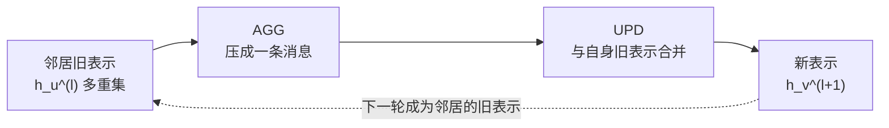

# $\rm Chapter \, 4$ GNN 与消息传递

> **本章假设你已经会**
>
> 1. 1-WL 颜色细化的更新式与直方图判据，多重集要保重复、签名要排序，见本册 §2.2；正则图上 WL 一轮都不动，见本册 §2.3。
> 2. 节点特征的三条诉求（定长、与编号无关、只依赖结构），见本册 §1.1；手工特征的天花板盘点，见本册 §2.7。
> 3. 节点嵌入的打分函数锁死在内积上，见本册 §3.3；邻接行维数跟着 $n$ 走的毛病，见本册 §1.1 与 §3.7。
> 4. 矩阵是动词的读法与 ${(A^k)_{uv}}$ 数游走，见《线性代数》§7.1 与《图论与网络》§1.4。
> 5. 实验环境约定：WSL2（python3.12.3，numpy 2.5.4），本章所有算法手写、不依赖 networkx；种子 20261108；实验脚本与完整输出在 `expGL04/result.txt`，以下数字重跑可逐位复现。

第 3 章把「学表示」做成了「学一张矩阵的好近似」，但章末留了一个口子：内积之外什么也表达不了。本章把这个口子撑开，走本册主线的最后一级台阶：不再让节点先变成向量、再交给通用模型，而是让「**怎么合并邻居的信息**」本身成为模型里可学习的部分，这就是消息传递（message passing）。本章三个任务：给消息传递一个精确定义（§4.2）；把它最常用的实例 GCN 从头推导出来并手算对账（§4.3、§4.4）；证明它的表达力恰好被 1-WL 压住，并造出一对 WL 能分、两层 GCN 读不出的图，把这个不等式跑成数字（§4.5、§4.6）。

## $\rm \S \, 4.1$ 问题：聚合规则也该交给参数

先把第 3 章的缺口摆成一句可操作的话。整条流水线到目前为止分两段：第一段把图翻译成特征（手工体检表、游走嵌入），这一段完全由人设计；第二段拿特征做分类、聚类，这一段才交给参数。图结构只在第一段出场，而第一段没有参数。后果具体化成两条。其一，§3.3 的打分函数 $\mathbf z_u^\top\mathbf c_v$ 被锁死在内积上，邻居多、邻居杂的节点和邻居少而专一的节点，在模型眼里只有内积一个数字的差别，聚合方式没有商量余地。其二，每换一个任务就要重新设计一遍特征口径（第 1 章四组特征就是四套口径），而监督学习的全部意义本来是把「什么算相关」交给数据。

所以诉求是：把第一段里「邻居的信息怎么合并」这一步参数化，让梯度下降去决定每个邻居该占多大分量、合并完该怎么变换。这是一个新的对象：模型本体里带着图结构，每层都按图的边表做一次信息交换。它与前几章的关系也该说清：第 2 章的 1-WL 每轮收集邻居颜色、按名单发新号，那个协议不带任何参数；本章要做的，本质上是给这个协议装上旋钮。装上之后表达力反而受制于原协议，这笔看似反直觉的账在 §4.5 算清。

白话：前几章是先请翻译把图译成表格、再让模型读表；本章让模型自己长出耳朵，直接在图上开会，会的开法（谁的话占多大分量）由训练决定。

> 本节小结：缺口是「合并邻居」这一步没有参数；诉求是把聚合交给梯度，模型本体按边表逐层交换信息；协议原型就是 §2.2 的颜色细化。

## $\rm \S \, 4.2$ 消息传递：一轮可学习的颜色细化

定义先行。记第 $\ell$ 层节点 $v$ 的表示为 $h_v^{(\ell)}$（第 0 层就是输入特征 $x_v$）。**消息传递**的一层做两步：

$$
m_v^{(\ell+1)}=\operatorname{AGG}\bigl(\{\!\{h_u^{(\ell)}:\,u\in N(v)\}\!\}\bigr),\qquad
h_v^{(\ell+1)}=\operatorname{UPD}\bigl(h_v^{(\ell)},\,m_v^{(\ell+1)}\bigr)
$$

读法：$\{\!\{\cdot\}\!\}$ 是多重集括号，邻居的旧表示作为**带重复的名单**进入聚合，两个相同的邻居不能合并成一条；$\operatorname{AGG}$ 把名单压成一条消息 $m_v^{(\ell+1)}$，求和、取平均、取最大都是候选；$\operatorname{UPD}$ 把自己的旧表示 $h_v^{(\ell)}$ 与消息合并成新表示。整个框架（Gilmer et al., 2017）只有这两个槽位是自由的，具体模型就是 $\operatorname{AGG}$ 与 $\operatorname{UPD}$ 的不同填法。

把它和 §2.2 的 WL 更新式并排放：WL 第 $r$ 轮取「自己的旧颜色，加排序后的邻居颜色多重集」去 hash 出新颜色；消息传递取「自己的旧表示，加聚合后的邻居表示多重集」去 UPD 出新表示。三个对应关系值得逐条钉死。其一，结构完全同构：都只看一跳邻居，都把邻居当多重集。其二，$\operatorname{hash}$ 换成了可学习的 $\operatorname{UPD}$，签名到新号的对应不再由首次出现顺序决定，而是由参数决定。其三，一个容易漏的差别：WL 对名单**排序**（保序信息），$\operatorname{AGG}$ 通常**求和或平均**（丢序信息），求和是多重集的函数，却比排序粗得多：${\{0,2\}}$ 与 ${\{1,1\}}$ 排序后是两种名单，求和后都是 2。§2.2 当时警告过这个碰撞会静默合并颜色类，现在它换了一身衣服回来，成为 §4.5 表达力不等号的来源。

层数与观察半径的对应也在此立好：$L$ 层消息传递，一个节点的表示最多吸收 $L$ 跳外的信息，这个半径叫**感受野**（receptive field）。WL 那边第 $r$ 轮的签名同样只含 $r$ 跳内的账。两边按层按轮一一对齐，这就是本章实验里「两层对两轮、三层对三轮」的由来。

一轮消息传递的信息流可以画成一条流水线：



读法：每个节点每轮走一遍这条线；虚线是关键，本轮的输出是下一轮的输入，$L$ 层就是把这条线串 $L$ 次，信息沿边表逐跳扩散。

白话：每轮开一次圆桌会，人人收一份邻居发言的多重集，按自己的口味压缩成一条摘要，再和自己的旧发言合成新一轮发言；口味（$\operatorname{AGG}$、$\operatorname{UPD}$）是训练出来的，会议规则（图）是给定的。

> 本节小结：消息传递 = AGG 压邻居多重集 + UPD 合并自身；与 1-WL 结构同构，差别在 hash 可学习、排序换成了更粗的求和；$L$ 层的感受野对应 WL 第 $L$ 轮。

## $\rm \S \, 4.3$ GCN 逐层推导：座次固定，翻译可学

框架有了，最常用的填法是**图卷积网络**（Graph Convolutional Network，GCN；Kipf & Welling, 2017）。从最朴素的想法推起：邻居的表示加权平均一下。写出来是 ${(AXW)}$ 里的 ${AX}$ 部分，但它有三个毛病。其一，没有自身项：节点自己的旧表示完全不进入本轮，上一层学到的东西一层层被邻居冲掉。其二，没有归一化：度数大的节点把 $d_v$ 份邻居直接相加，特征尺度随度数爆开，不同节点的表示没法比。其三，$X$ 与 $W$ 的变换放在聚合之后还是之前无所谓（线性时），但变换矩阵必须全图共享，否则参数随节点数增长，回到 §1.1 反对邻接行的老理由。共享还有一笔明账：$L$ 层、每层 $W^{(\ell)}$ 是 $d_{\ell}\times d_{\ell+1}$ 的矩阵，参数总量是 $\sum_{\ell}d_{\ell}d_{\ell+1}$，只跟层数和宽度有关，与 $n$ 一刀两断；$n=20000$ 的图和 $n=20$ 的图用同一份参数，这正是 §1.1「定长」诉求在模型侧的兑现。

第一步修：给每个节点加**自环**（self-loop），把对角线补上，$A$ 变成 $A+I$；度数也随之变成 $d_v+1$，记 $\hat D=\operatorname{diag}(d_1{+}1,\dots,d_n{+}1)$。第二步修：行归一化，$D^{-1}(A+I)$ 的每一行是邻居加自身的凸组合（权重非负、行和恰为 1），尺度问题解决。但行归一化有个偏向：自身项权重 $1/(d_v+1)$，度数越大，自己上一层的发言被稀释得越狠；而且矩阵不对称。GCN 的选择是**对称归一化**，定义**归一化邻接矩阵**：

$$
\hat A=\hat D^{-1/2}(A+I)\hat D^{-1/2},\qquad \hat A_{uv}=\frac{A_{uv}+1}{\sqrt{(d_u+1)(d_v+1)}}
$$

读法：每个格子的权重由两端的度数共同决定，各承担一个 $\sqrt{\cdot}$。自身项 $\hat A_{vv}=1/(d_v+1)$ 与行归一化相同；邻居项从 $1/(d_v+1)$ 变成 $1/\sqrt{(d_u+1)(d_v+1)}$，两者的比值是 $\sqrt{(d_v+1)/(d_u+1)}$：低度数的邻居在对称口径下占更大的份额。这是经验约定而非定理，配套的理由是谱上的：$\hat A$ 的特征值全部落在 $[-1,1]$（Kipf & Welling, 2017 的谱论证），深层堆叠时数值不容易炸。归一化方式的账可以实测：星形 $K_{1,3}$ 上 $\hat A$ 的行和，中心是 ${1.3107}$、叶子是 ${0.8536}$，而行归一化的行和恒为 1；对称口径不再保证凸组合，换来的是两端尺度都保得住。

层公式随之成型：

$$
H^{(\ell+1)}=\sigma\bigl(\hat A\,H^{(\ell)}\,W^{(\ell)}\bigr)
$$

读法：$\hat A$ 固定（结构不学），$W^{(\ell)}$ 是本层全部参数（翻译可学），$\sigma$ 逐元素作用。注意 $\hat A H^{(\ell)} W^{(\ell)}$ 的次序可以换成交换后的 $(\hat A H^{(\ell)})W^{(\ell)}$，先把邻居信息按座次表汇总、再各自翻译。一句话概括 GCN 的分工：**座次表固定，翻译器可学**。$\hat A$ 的行和后面会反复用到，给它一个记号：

$$
r_v=\sum_u \hat A_{vu}=\frac{1}{\sqrt{d_v+1}}\Bigl(\frac{1}{\sqrt{d_v+1}}+\sum_{u\in N(v)}\frac{1}{\sqrt{d_u+1}}\Bigr)
$$

读法：$r_v$ 只由「自己的度加邻居的度」决定，与特征、参数全无关系；它是 §4.6 主角的物理量。聚合之外，多层堆叠就是反复套用层公式，$L$ 层套 $L$ 个 $W$，感受野 $L$ 跳。

白话：座次表（$\hat A$）按度数印死，谁的发言占多少份额全看场上人数；每人的翻译器（$W$）全场合用，练的就是这份翻译。

> 本节小结：自环保住自身信息，对称归一化 $\hat A_{uv}=1/\sqrt{(d_u{+}1)(d_v{+}1)}$ 稳尺度；层公式 $\sigma(\hat A H^{(\ell)} W^{(\ell)})$ 里结构固定、参数只在 $W$；行和 $r_v$ 只依赖局部度数。

## $\rm \S \, 4.4$ 实测一：手写一层 GCN，与手推对账

公式要过手才算立住。取四节点环 $C_4$（边 ${(0,1)}$、${(1,2)}$、${(2,3)}$、${(3,0)}$），全员度数 2，加自环后 $\hat d_v=3$，于是 $\hat A=(A+I)/3$，每个格子的权重都是 $1/3$。取特征与权重 $X=\begin{pmatrix}1&0\\2&1\\0&1\\1&1\end{pmatrix}$、$W=\begin{pmatrix}0&1\\-2&0\end{pmatrix}$，手推一遍 $H=\operatorname{relu}(\hat A X W)$。第一步 $S=XW$：

| 节点 | $S$ 的行 | $N(v)\cup\{v\}$ 求和后 $/3$ | $\operatorname{relu}$ 后 |
| --- | --- | --- | --- |
| 0 | ${[0,\ 1]}$ | ${[-4/3,\ 4/3]}$ | ${[0,\ 4/3]}$ |
| 1 | ${[-2,\ 2]}$ | ${[-4/3,\ 1]}$ | ${[0,\ 1]}$ |
| 2 | ${[-2,\ 0]}$ | ${[-2,\ 1]}$ | ${[0,\ 1]}$ |
| 3 | ${[-2,\ 1]}$ | ${[-4/3,\ 2/3]}$ | ${[0,\ 2/3]}$ |

读法：中间列是「自己加三个邻居」按 $1/3$ 权重的求和，例如节点 0 的邻居是 ${\{0,1,3\}}$，第一列求和 ${0+(-2)+(-2)=-4}$，除以 3 得 $-4/3$，被 ReLU 归零。这份手推账与代码实现的最大误差是 ${0.0}$（`expGL04/result.txt` 的 `[exp1]` 段，逐位一致）。两个观察顺手记账。第一列全军覆没不是巧合：$W$ 的第一列把特征压成负数，ReLU 把整列关死，「死通道」在玩具上就现形。第 1 列剩下的值 ${4/3,1,1,2/3}$ 恰好是邻居特征本身的平均，权重 $1/3$ 均匀时聚合退化成取平均。

自环的作用也值得当场称一遍。星形 $K_{1,2}$ 上让两个叶子带**不同**的特征（5 与 3），去掉自环后聚合，两个叶子的表示完全相同（${1.41421356}$，`[exp1b]` 段）：它们互为对称（twin），自己的特征因为没加自环而根本没进公式；加回自环，两者分开成 ${5.8165}$ 与 ${3.8165}$。自环就是「自己上一层的发言也进本轮议程」，不是可选的礼貌，是信息通路本身。最后一个坑先埋在账里：把 $\hat D$ 里的 $d_v+1$ 误写成 $d_v$，形状不报错、数值全错，$C_4$ 上与正确结果的最大偏差 ${0.6667}$（`[exp1c]` 段）。

这份手推账还顺手给 §4.5 的对齐框架提供了第一份样本：$C_4$ 全员同度，第 0 轮颜色全同，第 1 轮签名也全同，于是四个节点在第 1 轮的颜色相同；上表四个 $\operatorname{relu}$ 行各不相同，差别全部来自特征 $X$ 的不同，而不是结构。若把 $X$ 换成全同，四个读出也会变得完全一样，这正是「颜色相同则表示只能是同一函数值」的最小演示。

白话：手推一遍才知道，一层 GCN 就是「按座次表求和、再翻译、再砍掉负数」三步；自环忘了加，自己的话就传不下去。

> 本节小结：$C_4$ 手推账与代码零误差对上；无自环时 twin 节点表示重合（实测 ${1.4142}$），自环是自身信息通路；$\hat d$ 用错 $d$ 的静默 bug 偏差 ${0.6667}$。

## $\rm \S \, 4.5$ 对齐定理：GCN 的表达力不超过 1-WL

现在把 §2.2 的协议和 §4.2 的框架正式接起来。主张（对齐定理）：固定深度 $L$、固定全部参数、节点特征全同（或让 WL 直接拿特征当初始颜色）时，若两张图 1-WL 在第 $L$ 轮的颜色直方图相同，则 $L$ 层 GCN 的图级读出对**任意**参数都相同。逆否命题是实用形态：GCN 能分开的两张图，1-WL 必能在某轮分开，记作 GCN $\le$ 1-WL。

证明是对「层」的归纳，主张的中间形态：第 $\ell$ 层的节点表示是第 $\ell$ 轮颜色的函数，$h_v^{(\ell)}=f^{(\ell)}(c^{(\ell)}(v))$，函数 $f^{(\ell)}$ 由参数决定。

1. 底步 $\ell=0$：$h_v^{(0)}=x_v$，全同特征下是常函数，当然只是颜色的函数；按度初始化的口径下，度本身就在 $c^{(0)}$ 里，后文用到的度数信息也由颜色决定。
2. 归纳步：$h_v^{(\ell+1)}=\sigma\bigl(\sum_{u\in N(v)\cup\{v\}}\hat A_{vu}\,h_u^{(\ell)}\bigr)$。代入归纳假设，和式变成「邻居颜色多重集」经 $f^{(\ell)}$ 逐项映射后求和。求和是多重集的函数，但比 WL 的排序粗：名单 ${\{0,2\}}$ 与 ${\{1,1\}}$ 排序后不同、求和后相同。粗不影响方向：求和结果仍然由签名决定，而 WL 的 $\operatorname{hash}$ 恰好按签名编号，签名相同当且仅当新颜色相同。于是 $h_v^{(\ell+1)}$ 只是 $c^{(\ell+1)}(v)$ 的函数。$\sigma$ 逐元素复合不破坏这一点，$\hat A$ 的权重由度数决定、度数在颜色里（底步），两处细节都不添乱。
3. 读出：图级嵌入取 $\sum_v h_v^{(L)}=\sum_v f^{(L)}(c^{(L)}(v))$，把每种颜色的计数乘上函数值再求和，只依赖第 $L$ 轮直方图。归纳完毕。

一句话复盘：GCN 每层能看见的账，WL 同一轮的签名全都有；GCN 用求和代替排序，只可能比 WL 更粗，不可能更细。不等号因此是单向的。它也可以很紧：把求和换成**单射**的多重集编码（GIN，Xu et al., 2019，用 $(1+\varepsilon)$ 倍自身加邻居和，再过 MLP），理论上可以追平 WL。这说明差距不在「看得少」，在「编码粗」；至于「注意力聚合」（让权重也由数据决定）怎么改写座次表，机制本身见《深度学习》§13.2，图上的用法本册第 8 章展开。

白话：GCN 是拿着缩写版名单（求和）开会的 WL；缩写只会丢信息不会添信息，所以 WL 分不出的会，GCN 更开不出结果。

> 本节小结：归纳证得 $h_v^{(\ell)}=f^{(\ell)}(c^{(\ell)}(v))$，求和比排序粗是不等号唯一来源；故 GCN $\le$ 1-WL，单射聚合（GIN）可取到等号；$L$ 层恰对 WL 第 $L$ 轮。

## $\rm \S \, 4.6$ 实测二：WL 两轮能分、两层 GCN 读不出的 11 节点对

定理是「分不出 $\Rightarrow$ 读不出」，严格性要靠实例撑：找一个 WL 能分、GCN 不能分的图对。构造记号 $S(\ell_1,\ell_2,\ell_3)$：一个中心，三条腿，腿 $\ell$ 是从中心走 $\ell$ 步到叶子的链。取 $S(2,4,4)$ 与 $S(2,3,5)$，都是 $n=11$、10 条边。选这两组腿长是因为一份短账：腿 2 贡献一节「度为 2、邻居度为 ${\{1,3\}}$」的中间人；腿 $\ell\ge3$ 贡献一节 ${\{2,3\}}$ 节、$\ell-3$ 节 ${\{2,2\}}$ 节、一节 ${\{1,2\}}$ 节和一片叶。把 $\{2,4,4\}$ 与 $\{2,3,5\}$ 逐项对账，这些份数完全相同，于是**第 1 轮 WL 签名的多重集逐字相同**（实测 `[exp2]` 段：${(1,(2,))}$ 三个、${(2,(1,2))}$ 两个、${(2,(1,3))}$ 一个、${(2,(2,2))}$ 两个、${(2,(2,3))}$ 两个、${(3,(2,2,2))}$ 一个）。腿长的差别全藏在第 2 轮以后：4 腿与 5 腿多出的中节排在不同深度的位置上。

WL 那边第 2 轮就亮了牌：11 种签名里 6 种计数不同，例如「自己 ${\{1,2\}}$ 节、邻居是叶加 ${\{2,2\}}$ 节」的签名，两图计数 ${2}$ 对 ${1}$；「自己 ${\{2,2\}}$ 节、邻居是 ${\{1,2\}}$ 节加 ${\{2,3\}}$ 节」的签名，${2}$ 对 ${0}$。按 §2.3 方向一，这已经是两图不同构的铁证。

GCN 这边按 §4.5 的预言分层核对。第一层闸门在结构上就焊死了：§4.3 的 $r_v$ 只由局部度数决定，第 1 轮签名相同保证 $r$ 的多重集相同（实测 `rowsum(A_hat)` 两组完全一致，最大 ${1.116025}$、最小 ${0.908248}$）。而两层 GCN 的求和读出有个可以整行写出的恒等式：当两层权重 $w_1,w_2>0$ 时（$w_2<0$ 时全体 ReLU 归零、读出同为 0，照样相等），

$$
\sum_v h_v^{(2)}=w_2\sum_u h_u^{(1)}\,r_u=w_1\,w_2\sum_u r_u^{\,2}
$$

读法：第一步用 $\hat A$ 的列和等于行和（对称矩阵），把对 $v$ 的求和折到对 $u$；第二步代入 $h_u^{(1)}=w_1 r_u$。整条式子里只剩 $r$，第 2 轮的信息在求和中**逐项抵消**。实测：取 $w_1=0.7$、$w_2=1.3$，左端 ${9.9353133935}$，右端 ${w_1w_2\sum r_v^2={9.9353133935}}$，分毫不差。五颗种子的随机权重（隐藏维 8）全部兑现：

| 种子 | $S(2,4,4)$ 读出 | $S(2,3,5)$ 读出 | 差 |
| --- | --- | --- | --- |
| 20261108 | ${0}$ | ${0}$ | 平凡相等 |
| 20261109 | ${0}$ | ${0}$ | 平凡相等 |
| 20261110 | ${0}$ | ${0}$ | 平凡相等 |
| 20261111 | ${20.180876666321}$ | ${20.180876666321}$ | ${3.55\times10^{-15}}$ |
| 20261112 | ${16.920243957429}$ | ${16.920243957429}$ | ${0}$ |

三个种子读出恒 0 不是失败样本，是 ReLU 的死通道：每个隐藏通道的两层权重至少一端为负，整层被关死，两图同为 0，属于「平凡相等」。两个活种子把读出算到小数 12 位仍相同，最大差 ${3.55\times10^{-15}}$，是浮点噪声级别。节点级却不是这样：活种子下，两图节点表示的多重集已经分开（最大差 ${2.75\times10^{-2}}$ 与 ${2.31\times10^{-2}}$）。信息进了节点表示，死在求和读出，这正是 §4.5 里「编码粗」在可操作层面的位置：聚合、读出、深度是三道独立的闸门。把深度补上，三层 GCN 读第 2 轮的账，活种子的读出差变成 ${1.05\times10^{-2}}$ 与 ${4.43\times10^{-3}}$，两图分开了，与「$L$ 层对 $L$ 轮」的对应完全咬合。

边界如实交代：本实验是全同特征、求和读出、单隐藏通道到 8 通道的口径；只测了这对蜘蛛图与其权重的五颗种子，不外推到一般图族；死种子的相等是平凡相等，不代表表达力。所有数字见 `expGL04/result.txt` 的 `[exp2]` 段。造这类图对的思路可以复用：想让第 $r$ 轮平手而第 $r+1$ 轮分裂，就把差别藏进「中节排布的深度」里，让每条腿贡献的局部份数逐项对齐；腿长 ${\{2,4,4\}}$ 对 ${\{2,3,5\}}$ 是 $r=1$ 的最小构造之一，同样的手法定期地给出更深的对。

白话：两张图的户口本第一页一模一样（第 1 轮签名），第二页才分你我（第 2 轮）；两层 GCN 拍的是全班合影（求和读出），合影只看第一页的人数账，所以两班照片洗出来一张样；单看每个人的座位（节点表示）其实已经不同，换三层相机就拍得出差别。

> 本节小结：$S(2,4,4)$ 与 $S(2,3,5)$ 第 1 轮签名多重集相同、第 2 轮 6 种计数不同；两层 GCN 读出恒等式只剩 $r$，五种子最大差 ${3.55\times10^{-15}}$；节点级已分开（${2.75\times10^{-2}}$）、三层读出分开（${1.05\times10^{-2}}$），三道闸门各就各位。

## $\rm \S \, 4.7$ 常见错误与证据式排查

错误一：聚合忘了自环。症状是 twin 节点（对称位置）永远给出相同表示，任务上表现为对称位置的区分率停在随机水平。证据就是 §4.4 的 ${K_{1,2}}$ 实验：叶子特征 5 与 3，无自环时表示同为 ${1.41421356}$。根因：${AX}$ 里没有对角线，节点自己的旧表示不进本轮议程。排查手段：挑一对对称节点，人为把特征拉开再看是否仍重合。

错误二：$\hat D$ 用了 $d_v$ 而不是 $d_v+1$。加自环后度数变了，归一化分母必须跟着变；忘改则形状对、数值错、不崩溃，是最隐蔽的一类静默失效。证据：$C_4$ 上与正确结果的最大偏差 ${0.6667}$。排查手段：拿全同特征的小图手推一行，与代码逐位对；或者断言 $\hat A$ 的对角元等于 $1/(d_v+1)$。

错误三：用两层 GCN 区分需要多轮 WL 的图对，分不出就下「GCN 表达力不行」的结论。§4.6 的账说明三层闸门各管一段：深度不够时信息没到（本例两层只读第 1 轮，差别在第 2 轮）；读出太粗时信息进了节点表示却在求和里抵消。排查手段：先跑 1-WL 找到分裂轮数 $r^\*$，让 $L\ge r^\*$；再看节点级表示是否已分开，分开而读出相同则换读出（拼接、单射读出），而不是换层数。

> 本节小结：三个坑都有实测证据：无自环 ${1.4142}$ 重合、$\hat d$ 错写偏差 ${0.6667}$、深度与读出的责任要分层拆；排查的共同起点是小图手推账加 WL 分裂轮数。

## $\rm \S \, 4.8$ 动手实践：亲手推一遍 $P_4$ 上的一层 GCN

前置条件：装了 python3 的终端（WSL 或 Linux/macOS 均可）；在用户主目录新建练习目录，不碰已有文件。

```bash
mkdir -p ~/gl04-practice && cd ~/gl04-practice
```

读法：新建目录 `gl04-practice` 并进入；`-p` 使目录已存在时不报错。把下面代码存成该目录下的 `gcn1.py`（对象：新建文件），运行 `python3 gcn1.py`。

```python
import numpy as np

edges = [(0, 1), (1, 2), (2, 3)]          # 路径 P4
n = 4
A = np.zeros((n, n))
for u, v in edges:
    A[u, v] = A[v, u] = 1.0
d = A.sum(1)
dh = d + 1                                 # 加自环后的度数
Dh = np.diag(1.0 / np.sqrt(dh))
Ah = Dh @ (A + np.eye(n)) @ Dh
X = np.array([[1.], [2.], [0.], [1.]])
W = np.array([[3.]])
print(np.round(Ah, 6))
print(np.round(np.maximum(Ah @ X @ W, 0.0), 6))
```

成功验证：第一段输出是 $\hat A$，对角元依次 ${0.5,\ 0.333333,\ 0.333333,\ 0.5}$，边缘元 ${0.408248}$（即 $1/\sqrt{6}$）；第二段输出 ${[3.949490,\ 3.224745,\ 3.224745,\ 1.5]}$。动手推一遍第二段：$XW={[[3],[6],[0],[3]]}$，节点 0 的权重是自身 $1/2$ 加邻居 $1/\sqrt6$，读出 $\tfrac12\cdot3+\tfrac{1}{\sqrt6}\cdot6={3.949490}$；节点 1 的读出 $\tfrac{6}{\sqrt6}+\tfrac13(3+0)={3.224745}$；中间两个节点对称，数值相同。典型错法两处：把 `dh` 写回 `d`，第二段输出会整体偏移（对照 §4.7 错误二）；把 ReLU 去掉，本例无负数看不出差别，把 `X` 首行改成 `[[-1]]` 再跑，就会看到截断。与 `expGL04/result.txt` 的 `[exp4-practice]` 段逐位核对。

> 本节小结：$P_4$ 手推的四个读出与代码一致；自查点集中在 `dh` 与 ReLU 两处；对称位置的读出相同是检查点而非巧合。

## $\rm \S \, 4.9$ 关键概念回顾

1. 消息传递的一层做哪两步？$\operatorname{AGG}$ 的输入为什么必须是多重集而不是集合？它与 §2.2 的 WL 更新式有哪三处对应、哪一处关键差别？
2. 从 ${AXW}$ 到 $\sigma(\hat A H^{(\ell)} W^{(\ell)})$ 修了哪三个毛病？对称归一化的权重 $\hat A_{uv}$ 怎么读？它与行归一化在自身项、邻居项上各差在哪？
3. 写出对齐定理的实用形态（逆否命题），并指出证明中「求和比排序粗」这一步用在哪。
4. §4.6 的图对为什么第 1 轮 WL 平手？两层 GCN 的读出恒等式里只剩哪个物理量，为什么第 2 轮的信息会抵消？
5. 聚合、读出、深度三道闸门各挡住了什么？分别对应 §4.6 实测的哪个数字？

## $\rm \S \, 4.10$ 应用与辨析

1. 应用：把 $S(2,4,4)$ 与 $S(2,3,5)$ 的一层 GCN 写出来（$\hat A$ 用代码算），验证读出恒等式 $\sum_v h_v^{(2)}=w_1w_2\sum_u r_u^2$ 在 $w_1=1.1$、$w_2=0.4$ 时仍成立；再把 $w_2$ 改成负数，解释读出为什么变成 0。
2. 排障：同事报告「同一张图上，度数相同的节点在 4 层 GCN 里表示几乎一样，任务区分率很低」。诊断最可能的原因（提示：感受野与 WL 稳定划分的关系），并说明这组症状指向层数与表达力设计，而不是优化失败。
3. 辨析：「GCN 每层都能看见 WL 同轮签名的全部信息，所以只要层数够深，GCN 总能区分 WL 能区分的图。」这句话哪里对、哪里越界？

## $\rm \S \, 4.11$ 本章自测答案

概念回顾答案：

1. 两步：$\operatorname{AGG}$ 把邻居旧表示的多重集压成消息，$\operatorname{UPD}$ 把消息与自身旧表示合成新表示（§4.2）。多重集保重复：两个同色邻居与一个该色邻居是两种名单，换成集合会把「多」这个结构信息扔掉（§4.2，回收 §2.2）。三处对应：都只看一跳、都把邻居当多重集、签名机制同构；关键差别：WL 排序、GCN 求和，求和更粗（§4.2、§4.5）。
2. 三个毛病：无自身项（加自环 $A+I$）、无归一化（对称归一化）、参数随节点数增长（$W$ 全图共享）（§4.3）。$\hat A_{uv}=(A_{uv}+1)/\sqrt{(d_u+1)(d_v+1)}$：两端各承担一个 $\sqrt{\cdot}$。自身项两种口径同为 $1/(d_v+1)$；邻居项从 $1/(d_v+1)$ 变为 $1/\sqrt{(d_u+1)(d_v+1)}$，低度邻居份额变大（§4.3，$K_{1,3}$ 行和 ${1.3107}/{0.8536}$）。
3. 实用形态：GCN（任意参数）能分的图对，1-WL 必能在某轮分开（§4.5）。用在归纳步：求和结果由邻居颜色多重集决定，故仍是颜色的函数，方向上不可能超过 WL（§4.5）。
4. 腿长差别全部藏在「中节的排布深度」上，第 1 轮签名只写局部度数，两图份数逐项相同（§4.6 开头短账）。恒等式只剩 $r_u$：$\sum_v h_v^{(2)}=w_1w_2\sum_u r_u^2$；求和把对 $v$ 的账折到对 $u$，第 2 轮信息逐项抵消（§4.6）。
5. 聚合：求和编码粗，信息进不了节点表示之外更细的结构；读出：节点表示已分开但求和读出相同（实测节点多重集差 ${2.75\times10^{-2}}$、读出差 ${3.55\times10^{-15}}$）；深度：两层只读第 1 轮，三层读出分开（${1.05\times10^{-2}}$）（§4.6）。

应用与辨析答案：

1. 代码同 §4.8 模板换边表；恒等式对任意正权重成立，因为推导只用了「$\hat A$ 对称（列和等于行和）」与 $h_u^{(1)}=w_1r_u$，不依赖具体数值（§4.6）。$w_2<0$ 时第二层预激活全为负（$\hat A h^{(1)}\ge0$），ReLU 输出全零，读出为 0，与另一图同为 0，属平凡相等（§4.6）。
2. 症状指向表达力而非优化：4 层感受野 4 跳，若图上 WL 在两三轮就稳定，第 4 层的聚合在稳定划分里打转，同轮同色的节点表示趋同（§4.5 的对齐方向：颜色相同则表示只能相同）。这恰好是过平滑的前兆，机理与层数扫描的实测留给第 5 章。优化失败的表现是 loss 不降或震荡，与「表示几乎一样但 loss 正常」相反。
3. 对的部分：每层信息的上限确由 WL 同轮签名给出（§4.5 归纳）。越界有二：其一「总能区分」不成立，求和聚合与求和读出都可能把已经到达的信息抵消掉，§4.6 的两层读出就是反例；其二层数加深有自己的代价（感受野重叠、表示趋同），不是免费的表达力提升，见第 5 章的过平滑账。

**你现在能做什么**：给你一张图和一层 GCN 的规格，你能手推 $\hat A$ 与 $\sigma(\hat A X W)$ 的每个数字并和 numpy 对账；给你一对「分不开」的图，你能用 1-WL 找到分裂轮数，判断该加层、换单射聚合还是换读出。

消息传递的引擎装好了，但本章的 $W$ 全是手拍或随机的：损失怎么定、邻居怎么采样、层数加深时感受野重叠会把表示压向哪里，这些训练侧的账是第 5 章的任务。届时对齐定理会换一面出场：WL 稳定之后 GCN 再深也分不出新东西，那正是过平滑的精确含义。
