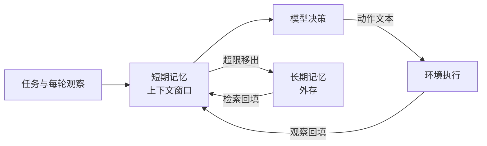

# $\rm Chapter \, 2$ 上下文与记忆

> **本章假设你已经会**
>
> 1. agent 循环的四步与「上下文是循环的唯一状态」，见本册 §1.2。
> 2. 解析-执行-回填三拍，以及消息列表长度的对账公式 $L_t=1+2t$，见本册 §1.4。
> 3. 实验预算与对照实验的安排方式（除待测变量外其余不动），见本册 §1.5。
> 4. 实验环境约定：本章全部实验在 WSL2 的 python3 上运行，无外网、无 LLM API；模型用确定性规则模拟，关键信息的「位置依赖」用可调检索模型近似，固定种子 20261108，脚本与完整输出在 `_uni5_work/expEA02/`。

第 1 章把循环立了起来，也留下一个没算的账：每轮回填两条消息，上下文只增不减。世界 #1 走 14 轮堆到 29 条还无伤大雅，真任务动辄几百轮，而上下文窗口（context window）有硬上限，装不下那天必须砍内容。本章把这笔账算全：先算增长的代价（§2.1），再分清窗口内外的两种记忆（§2.2），然后给出三种砍法并逐一定义（§2.3），在 50 步以上的长任务模拟器上量出三种砍法的任务完成率（§2.4），最后是排障（§2.5）与动手（§2.6）。

## $\rm \S \, 2.1$ 问题：每轮都在变长的账单

第 1 章对过消息条数的账：第 $t$ 轮结束时列表长度是 $L_t=1+2t$。工程上真正计费的不是条数而是词元（token），模型输入输出的最小计量单位，一条消息从几十到几百词元不等。给每类消息记一个折算值，就能把账从条数换成词元：本章实验里，模型的思考与动作消息记 28，普通观察记 32，含关键事实的观察记 52。设平均每条 $\bar{c}$ 个词元，第 $t$ 轮那次调用要读进整个列表，输入约为 $\bar{c}(1+2t)$；一个跑 $T$ 轮的任务，累计输入是逐轮之和：

$$
S_T=\sum_{t=1}^{T}\bar{c}\,(1+2t)=\bar{c}\,(T+T^{2})\approx \bar{c}\,T^{2}
$$

读法：$\bar{c}$ 是每条消息的平均词元数，$T$ 是总轮数。单轮开销随 $t$ 线性涨，累计开销随 $T$ 平方涨，这就是「每轮都在变长」的准确含义。本章实验里 $\bar{c}\approx 31$（各类消息按 28/32/52 折算的加权平均），可以顺手推出封顶何时开始省钱：设滑窗把单次输入封在 $W\bar{c}\approx 50\times 31=1550$ 词元，令 $\bar{c}(1+2t)=1550$ 解得 $t\approx 24$，即第 24 轮之后全保留的单次调用开始比滑窗贵；§2.4 的表 B 里两条累计曲线在第 20 轮还重合、第 30 轮已分开（26800 对 26200），与这个解析估计吻合。跑到 71 轮时，全保留累计 153760 词元，是滑窗 89500 的 1.72 倍。

账单还只是代价的便宜一头。贵的那头在模型内部：注意力计算量随输入长度增长，长输入还可能超出窗口上限，《自然语言处理》§16.2 专门讲注意力为什么撑不长；服务端对长输入的计费与延迟见《LLM从零构建》§12.8。窗口上限是硬约束：装不下时，调用直接失败，没有任何迂回。所以问题不是「要不要砍」，而是「砍什么、留下来的还能不能用」。

白话：上下文像一块桌面，每轮都往上添两张纸，桌子却不会变大。账单告诉你添纸有多贵，窗口上限告诉你桌子有多小，剩下的问题是往抽屉里收哪些纸、收走的纸还找不找得回来。

> 本节小结：消息条数按 $L_t=1+2t$ 长，输入词元按 $\bar{c}(1+2t)$ 涨，一个任务的累计输入约为 $\bar{c}T^{2}$；窗口上限是硬约束，砍内容迟早发生，砍法的选择是本章主题。

## $\rm \S \, 2.2$ 新概念：短期记忆与长期记忆

先把两种记忆分清。**短期记忆**（short-term memory）就是当前调用里摆着的全部文本，即上下文窗口内的内容：模型这一轮能「看见」的只有它。**长期记忆**（long-term memory）是窗口之外、但可以被取回窗口的存储：落盘的对话记录、数据库、向量库都算。两者的分工和桌面与档案柜一样：桌面小、伸手就到，档案柜大、但要起身去翻。

长期记忆进窗口的通道有一套成熟做法：把文档切块、按相关性检索、把命中的片段拼进提示，这就是检索增强生成（Retrieval Augmented Generation，RAG），最小代码与流程见《AI工程》§36.2.3；检索按相似度取回的实现（把文本变成向量再比距离）见《AI工程》§36.2.7。第 1 章说「上下文是循环的唯一状态」，学完本节可以把这句话升级：状态分两层，窗口内一层、可检索的外存一层，第 1 章描述的是没有外存的退化情形。



> 竞赛生迁移提示：这层结构你在算法竞赛里见过同构物。CPU 寄存器快但只有几十个槽位，内存大但要走总线，编译器决定什么留在寄存器、什么溢出到内存；短期记忆是寄存器，长期记忆是内存，上下文管理策略就是那个决定溢出与重灌的调度者。差别在于寄存器卸载不丢数据，而上下文的移出如果不进外存就真的丢了，这个差别正是三种策略命运的分水岭。

有了外存，就多了一类设计决策。定义**上下文管理策略**（context management policy）：每轮决定哪些内容留在窗口、哪些移出、移出的内容如何取回的规则。它由三个自由度组成。

1. 留什么：新观察全部进窗口，还是先过滤？
2. 删什么：超限时删最老的、最不相关的，还是先压缩再存？
3. 怎么找回：删掉的是永久丢失，还是进了外存可以检索回来？

第 2.3 节的三种策略就是这个三自由度上的三个具体选择。在动手比较之前，还要给伪 LLM 补一条关键性质：模型用不用得上窗口里的信息，取决于信息摆在哪个位置。公开文献把这种现象称为 lost in the middle：同一条信息放在上下文开头、中间或末尾，模型利用它的准确率明显不同，靠近两端好、埋在中间差（Liu et al., 2023, *Lost in the Middle: How Language Models Use Long Contexts*）。这不是本章实测，是文献报告的行为；本章用一条可调的检索模型来近似它，定义在 §2.4 的实验设置里。

白话：短期记忆是桌面，长期记忆是档案柜，RAG 是跑腿取档案的助理。但桌面上摆着的东西也分顺眼和碍眼：压在一摞纸最底下的单据，虽然「在桌面上」，跟锁进抽屉差不多。工程上还常把长期记忆再细分（跨对话的情节记忆、入库的知识等），分层清单见《AI工程》§37.2；本册只取「窗口内/窗口外可检索」这两层的划分，够用且不引多余术语。

> 本节小结：短期记忆＝窗口内文本，长期记忆＝可检索的外存，RAG 是两者之间的标准接口；上下文管理策略要在留什么、删什么、怎么找回三个自由度上做选择；模型对窗口内信息的利用随位置变化，这是后面一切比较的前提。

## $\rm \S \, 2.3$ 三种截断策略

三种策略都从同一个触发条件出发：消息数超过上限 $W$ 就动手，差别只在怎么动手。设 $W=50$ 条。

1. **滑窗截断**（sliding window）：删掉最老的消息，直到列表回到 $W$ 条以内。窗口像一格一格往前推的取景框，框内永远是最新的历史。代价明确：被删的消息永久消失，若有关键事实在里面，就是丢了。它把「删什么」答成「删最老的」，把「怎么找回」答成「不找回」。
2. **摘要压缩**（summarization）：把最老的一段（实验里取 30 条）合并成一条摘要消息放回列表头，而不是直接删。内容上有机会保住关键事实，但有两个新的损失来源：其一，摘要是伪 LLM 写的，写摘要这一步本身可能丢细节，实验里给每条关键事实 70% 的单次保留率；其二，摘要被放在列表最老端，位置衰减让它「存着却用不上」。更隐蔽的是压缩会反复发生：摘要自己变老后会被下一轮摘要再合并，保留率按次连乘，§2.4 会算这笔账。
3. **检索回填**（retrieval backfill）：滑窗删掉的消息不丢弃，而是原样写入外存；在需要做决策的时刻，先按当前需求检索外存，命中就把那条观察原样拼回窗口末端再决策。它把「怎么找回」答成「精确找回，并放回模型最好用的位置」，代价是检索这一步可能失手，实验里命中率取 90%。

三种策略在同一张图上各占一角。按 §2.2 的三个自由度对齐着看：

| 策略 | 留什么 | 删什么 | 怎么找回 |
| :--- | :--- | :--- | :--- |
| 滑窗 | 最近 $W$ 条 | 最老的，直接删 | 不找回 |
| 摘要压缩 | 最近 $W$ 条加一条摘要 | 最老一段，压成摘要 | 摘要还在列表里，位置最老 |
| 检索回填 | 最近 $W$ 条 | 最老的，但原样入库 | 决策前检索，取回拼在末端 |

三者的差异浓缩在维护逻辑里，实验代码（`expEA02/exp.py`）的骨架如下：

```python
while len(msgs) > 50:                    # 三种策略共用同一条触发线
    if policy == 'slide':                # 删最老一条，口令标记为永久丢失
        drop(0)
    elif policy == 'sum':                # 最老 30 条并成 1 条摘要放回头部
        for f in facts_in_first_30:      # 每条口令 70% 概率活进摘要
            keep(f) if rng.random() < 0.70 else lose(f)
        replace_first_30_with_summary()
    elif policy == 'retrieve':           # 删最老一条，但先原样写入外存
        store[msgs[0]] = raw_text
        drop(0)
```

决策侧只有检索回填多一步：投递前先查外存，命中就把那条观察原样拼回窗口末端，再走统一的位置衰减模型。注意三个分支都不改第 1 章的循环骨架，只改 `context += [text, obs]` 那一行之后的维护逻辑，这正是把策略做成可插拔部件的意义。

> 本节小结：滑窗删最老且不找回；摘要把老内容压成一条摘要、内容可能留存但位置最老、且压缩反复发生保留率连乘；检索回填把删掉的原样入库、决策前取回窗口末端；三者分别牺牲内容、位置与检索命中率。

## $\rm \S \, 2.4$ 锚点实验：长任务下三种策略的任务完成率

任务世界沿用第 1 章网格世界的风格并拉长：$8\times 8$ 网格，约 10% 密度的墙，路线上依次摆 1 个起点、5 个取件站、5 个投递站。每个取件站的观察里含一个 4 位投递口令（关键事实）；第 $k$ 个投递站需要报出第 $\pi(k)$ 次取件的口令，$\pi$ 是随机排列，且约束口令从获得到使用的间隔在 8 至 45 步之间。移动走 BFS 最短路，生成时要求总移动步数不少于 55。实测这批任务：移动步数 min/median/max 为 55/58/77，加上取投事件共 10 轮，总轮数均值 69.6，口令间隔 min/median/max 为 8/30/45 步。共 200 个世界，种子 20261108。

伪 LLM 的边界先说清，和第 1 章 §1.3 的诚实声明同一个精神。移动是查表的 BFS 最短路，与上下文无关；整条链路上唯一依赖上下文的部件是投递口令的回忆，用可调检索模型近似：设口令所在消息距列表末端 $g$ 条，则用对它的概率为

$$
p_{\text{use}}(g)=\begin{cases}1, & g\le 24\\ \exp\left(-\dfrac{g-24}{\tau}\right), & g>24\end{cases}
$$

读法：$g\le 24$ 是近端可靠带，刚看过不久的信息几乎不丢；超出后按尺度参数 $\tau$ 指数衰减，$\tau$ 越大模型对远处信息越宽容。24 条与 §2.2 的位置依赖文献对应，$\tau$ 就是那个「可调」旋钮，主实验取 $\tau=40$，鲁棒性检查在 20 与 80 各跑一遍。检索回填条件的命中率取 90%，摘要的单次保留率取 70%。三个指标：任务完成率（5 个口令全对的任务占比）、投递正确率（报对口令数除以 5）、关键事实丢失率（决策时口令已不在上下文的次数除以 5）。样本量 200 的考虑和第 1 章 §1.5 的 50 个世界同源：世界间的墙位、路长、口令间隔差异不小，只跑十几个世界，条件间的差距容易混进世界难度的运气里；200 个世界配平之后，剩下的差异才能安心归给策略本身。脚本与完整输出在 `_uni5_work/expEA02/exp.py` 与 `result.txt`。

| 条件 | 完成率 | 投递正确率 | 丢失率 | 平均累计输入词元 |
| :--- | :--- | :--- | :--- | :--- |
| 全保留（不截断上限） | 1% | 40% | 0% | 148366 |
| 滑窗 | 0% | 20% | 76% | 87347 |
| 摘要压缩 | 0% | 18% | 74% | 88741 |
| 检索回填 | 52% | 87% | 7% | 87726 |

读这张表分四步。

1. 全保留那一行拆掉了最普遍的错觉：窗口够大就万事大吉。它什么都不丢（丢失率 0%），正确率却只有 40%，因为口令在列表里躺了三四十轮，位置衰减把「在上下文里」和「用得上」拆成了两件事。完成率 1% 正是 $0.40^{5}\approx 1\%$：五个投递口各自独立，整体成功率是连乘。
2. 滑窗败在第一通道：76% 的口令在用之前就被推出窗口，永久消失。间隔中位数 30 步，一步两条消息，60 条的间隔对 50 条的窗口，大部分口令注定进不了决策时刻的视野，正确率 20% 里剩下的全是间隔短的幸运情形。
3. 摘要压缩和滑窗几乎打平（18% 对 20%），这个结果值得停下来看。它确实救回了一部分内容，丢失率只略低于滑窗，但救回的内容被放在列表最老端，$g$ 巨大，$p_{\text{use}}$ 衰减到接近零；再算上压缩连乘的账：窗口 50 条、每压一次净减 29 条，约每 15 轮压一次，70 轮里压约 4 次，$0.70^{4}\approx 24\%$ 的口令能活到最后，与实测丢失率 74% 对得上。存活的这批又因位置太老而用不上，两头的损失叠完，就剩 18%。摘要不是保险箱，它把「丢失」换成了「流失＋放错位置」。
4. 检索回填全面领先：正确率 87%，完成率 52%，而累计词元开销 87726，与滑窗的 87347 几乎相同（回填只多了 5 次命中各约 40 词元的注入，不到 0.5%）。它赢在同时堵住两个通道：外存原样保存（丢失率 7%，剩下的是那 10% 检索失手），回填把口令放到列表末端（$g$ 近似为 0，落在可靠带内）。注意它比全保留还好：全保留让信息留在它出生的老位置，回填让信息搬到使用现场。

把四个条件排回一条因果链，丢失率在其中的角色就清楚了：策略决定两件事，内容还在不在（丢失率）与内容离使用现场多远（位置分布）；这两件事决定投递正确率；五个投递口独立连乘决定完成率。丢失率因此是中介指标，不是终点指标：全保留和检索回填的差距（1% 对 52%）完全发生在丢失率同为最低的两个条件之间，证明位置通道独立起作用。比较任何两种策略时，先分清差距来自哪个通道，再谈谁更好，否则就是把两个自变量混在一个因变量里猜。

token 预算账取世界 #0 单独对：71 轮里，全保留的单次调用输入从 540 涨到 4300 词元，累计 153760；滑窗封顶后单次稳定在 1500 上下，累计 89500，两者的比值到任务结束时是 1.72。逐轮数字摘录：

| 轮次 $t$ | $L_t=1+2t$ | 全保留单次输入 | 滑窗单次输入 | 全保留累计 | 滑窗累计 |
| :--- | :--- | :--- | :--- | :--- | :--- |
| 10 | 21 | 540 | 540 | 2700 | 2700 |
| 30 | 61 | 1800 | 1560 | 26800 | 26200 |
| 50 | 101 | 3040 | 1540 | 76060 | 57660 |
| 71 | 143 | 4300 | 1500 | 153760 | 89500 |

前 25 轮两条曲线重合（列表还没超限），之后全保留按 $\bar{c}T^{2}$ 走抛物线，滑窗走直线；$t=71$ 时消息数 143 恰为 $1+2\times 71$，第 1 章的对账公式在这里依然逐轮成立。

换 $\tau$ 再跑一遍，看结论对检索模型有多敏感：

| 条件 | $\tau=20$ | $\tau=40$ | $\tau=80$ |
| :--- | :--- | :--- | :--- |
| 全保留 | 0%（22%） | 1%（40%） | 6%（60%） |
| 滑窗 | 0%（14%） | 0%（20%） | 0%（21%） |
| 摘要压缩 | 0%（14%） | 0%（18%） | 0%（23%） |
| 检索回填 | 41%（84%） | 52%（87%） | 60%（90%） |

表内是完成率，括号内是投递正确率。排序在三个 $\tau$ 下都不变：检索回填最高，滑窗与摘要垫底，全保留随 $\tau$ 放宽而爬升（40% 到 60% 的正确率）却始终追不上回填，因为它的信息永远留在老位置。即使对远处信息最宽容的 $\tau=80$，全保留的完成率也只有 6%。整个实验（200 世界乘 4 条件乘 3 个 $\tau$ 加 token 细账）在纯 CPU 的 python3 上约 25 秒跑完。最后照例声明边界：移动永远最优、环境全知、检索模型是合成的，三者都比真实世界乐观或失真；能定性迁移的是「内容、位置、找回」三个通道各自独立的结论，具体百分比不能，真实系统须按第 6 章的评测方法另测。检索回填还有一个本任务里被隐藏的前提：它要求策略在决策时刻知道「现在需要什么」，投递口令场景里需求是显式的（报哪个闸口的口令写在任务状态里）；需求模糊的真实任务里，构造检索查询本身就是难点，取错块的风险见 §2.5 错误五，工程形态见《AI工程》§36.2.3。

白话：这场比的是三种收拾桌子的方式。滑窗只留最近一摞，旧单据直接进碎纸机；摘要把旧单据抄成一行小字贴在桌角，字迹还越抄越淡；检索回填把旧单据存进档案柜，要用时跑腿取来放在手边。桌面再小，会跑腿的那个完成得最好。

> 本节小结：200 个 50 步以上的长任务上，全保留完成率 1%（0% 丢失但位置衰减，$0.40^{5}$）、滑窗 0%（76% 丢失）、摘要 0%（74% 流失且位置最老）、检索回填 52%（7% 失手）；token 账上全保留累计 153760 对滑窗 89500（1.72 倍）；排序在 $\tau\in\{20,40,80\}$ 下不变。

## $\rm \S \, 2.5$ 常见错误与证据式排查

错误一：把「在上下文里」当成「用得上」。最常见的辩护是「我窗口够大，全留着就行」，全保留那一行就是证据：丢失率 0%，正确率 40%。排查方法：对关键信息记录它被使用那一刻距列表末端的条数 $g$，若 $g$ 普遍超过几十条，就该考虑摘要后重注或检索回填，而不是指望模型自己翻出来。

错误二：把摘要当一次性保险箱。压缩不止发生一次，每次都按保留率连乘，$0.70^{4}\approx 24\%$ 的存活率就是这么算出来的。排查方法：给每条关键事实记一个「已被压缩几次」的计数器，任何策略只要压缩可能重复触发，就要按连乘评估长期存活率，而不是按单次保留率。

错误三：建了外存却不回填，或检索了却拼不进提示。只写库不取回，行为退化成滑窗；取回了但拼在列表最老端，行为退化成摘要。排查方法：在决策时刻打印窗口末端若干条消息，确认用到的关键事实以新消息的身份出现在近端；检索日志里「命中」和「注入成功」是两件事，分开计数。

错误四：用消息条数管理预算。窗口上限按词元算，不按条数算：本章实验里一条含口令的观察 52 词元，普通观察 32 词元，同样 50 条，词元数能差出三成。排查方法：维护列表的同时维护词元累计值，触发条件用词元数而不是条数；对账时把 $L_t=1+2t$ 与词元账分开核对，前者查结构，后者查预算。

错误五：把检索命中当成检索正确。回填命中只保证「取回了一条相关内容」，不保证取回的就是要用的那条：真实系统里外存按相似度检索，问「A 闸口口令」可能取回 B 闸口的口令，模型拿到错的比没有更糟，因为它会自信地用错。本章模拟器里外存按精确事实存取，没有建模这种错取，这是它比真实系统乐观的又一处。排查方法：抽检若干次回填内容与决策所需是否对得上；把「命中」「取对」「注入」三个计数分开记，哪个环节掉率一目了然。

> 本节小结：五个坑各配一个检查动作：记录使用时刻的距离 $g$、给关键事实计压缩次数、把「命中」与「注入」分开验证、用词元而非条数做触发条件、把「命中」与「取对」分开抽检。

## $\rm \S \, 2.6$ 动手实践：十分钟手摇滑窗与丢失

前置条件：装了 python3 的终端（WSL 或 Linux/macOS 均可）；在用户主目录新建练习目录，不碰已有文件。

```bash
mkdir -p ~/ea02-practice && cd ~/ea02-practice
```

读法：新建目录 `ea02-practice` 并进入；`-p` 让目录已存在时不报错。把下面 12 行存成该目录下的 `slide.py`（对象：新建文件），运行 `python3 slide.py`。

```python
W, msgs, fact_at = 8, ['任务'], {}
for t in range(1, 21):                    # 20 轮
    msgs += ['A', 'O']                    # 回填 assistant 与 tool 各一条
    if t == 3:
        fact_at['c1'] = len(msgs) - 1     # 第 3 轮的观察里出现口令
    while len(msgs) > W:                  # 滑窗：只留最近 W 条
        msgs.pop(0)
        fact_at = {k: (None if v in (0, None) else v - 1) for k, v in fact_at.items()}
print('不截断该有的消息数', 1 + 2 * 20)
print('滑窗截断后的消息数', len(msgs))
print('用口令时它还在吗', fact_at['c1'] is not None)
```

成功验证：输出三行，依次为 `不截断该有的消息数 41`（$1+2\times 20$，对上 §1.4 的公式）、`滑窗截断后的消息数 8`、`用口令时它还在吗 False`。对照读：结构上列表本该长到 41 条，滑窗把它摁在 8 条，省下的 33 条里就有那个口令。第 3 轮拿到的口令下标是 6，滑窗每轮从头上撕掉一至两条，到第 7 轮前后它就被推出窗口，`fact_at['c1']` 变成 `None`。这就是滑窗 76% 丢失率的最小化身。进阶题：把 `while` 那三行换成摘要逻辑（最老 4 条并成 1 条，事实各有 50% 概率存活进摘要），跑 20 次取平均，看口令存活率是否接近 $0.5^{k}$ 的连乘预测。

常见失败：若第二行输出不是 8 而是 9、10 往上走，多半是把循环内的 `while` 写成了 `if`，每轮最多删一条、列表净生长，第一行的对账照样通过、第二行才露馅，这正是 §2.5 错误四说的「预算没有真正生效」的小型版本。

> 本节小结：12 行脚本复现滑窗丢失：不截断应有 41 条、截断后剩 8 条、口令在第 3 轮进上下文、第 7 轮前后消失；对账公式在「本该有的数量」上依然成立。

## $\rm \S \, 2.7$ 关键概念回顾

1. 短期记忆与长期记忆分别对应什么？RAG 在两者之间扮演什么角色？
2. 全保留条件的丢失率是 0%，投递正确率却只有 40%，哪条机制造成了这个落差？完成率 1% 与正确率 40% 之间是什么算术关系？
3. 摘要压缩有哪两个损失来源？为什么它的表现和滑窗几乎打平？
4. 检索回填比全保留完成率高 50 个百分点，它赢在哪里？token 开销上付出了多少？

## $\rm \S \, 2.8$ 应用与辨析

1. 排障：你的 agent 在 100 轮的任务里频繁「忘记」早期查到的编号。给出三处检查，说明各自预期看到什么证据。
2. 应用：把 §2.4 任务的投递站从 5 个增到 8 个，其他设置不变，哪个条件的完成率跌得最狠？用「完成率是各投递口正确率的连乘」推理。
3. 辨析：「摘要压缩保留了内容，所以一定不差于滑窗。」用 §2.4 的数据判断这句话，并指出它错在哪一层。

## $\rm \S \, 2.9$ 本章自测答案

概念回顾答案：

1. 短期记忆是当前调用上下文窗口内的全部文本，长期记忆是窗口之外可检索的外存（§2.2）。RAG 是把外存内容按相关性检索并拼进提示的标准接口，最小流程见《AI工程》§36.2.3；有了它，「上下文是唯一状态」升级为「窗口内一层加可检索外存一层」的两层结构（§2.2）。
2. 位置衰减：口令还在列表里，但距末端 $g$ 条太远，$p_{\text{use}}(g)$ 指数衰减到很小（§2.4）。完成率是五个独立投递口正确率的连乘，$0.40^{5}\approx 1\%$（§2.4）。
3. 来源一：写摘要本身可能丢细节，单次保留率 70%；来源二：摘要放在列表最老端，位置衰减让存住的内容用不上；且压缩反复发生，存活率按 $0.70^{4}\approx 24\%$ 连乘（§2.4）。它和滑窗打平是因为两头的损失叠加后与滑窗的直接丢失几乎等效，正确率 18% 对 20%（§2.4）。
4. 它同时堵住两个通道：外存原样保存使丢失率降到 7%（剩余为检索失手），回填把事实挪到列表末端、落在近端可靠带内（§2.4）。开销：累计词元 87726 对滑窗 87347，多出不到 0.5%（§2.4）。

应用与辨析答案：

1. 检查一：打印决策时刻口令距列表末端的条数 $g$，若普遍超过 24 条，是位置衰减（§2.5 错误一）。检查二：核对滑窗或压缩是否把含编号的消息删掉了，在删除处打日志，若删除时刻早于使用时刻，是第一通道丢失（§2.3）。检查三：若有外存，分开统计检索命中率与注入成功率，命中但没注入等于没检索（§2.5 错误三）。
2. 全保留跌得相对最缓但依然最惨之外，滑窗与摘要先归零：更多投递口意味着更长路线，口令间隔整体变大，被推出窗口与被反复压缩的比例上升，两者本来就近乎归零；检索回填从 $0.87^{5}\approx 52\%$ 跌向 $0.87^{8}\approx 28\%$；全保留从 $0.40^{5}\approx 1\%$ 跌向 $0.40^{8}\approx 0.07\%$，跌幅最狠的是全保留（每个新增投递口都在连乘里再乘一次 0.40），绝对值上滑窗与摘要没有多少可跌的空间（§2.4）。
3. 不成立。§2.4 的实测是摘要 18% 对滑窗 20%，摘要反而略差：它保留了内容却把内容放在最老位置，位置衰减吃掉了内容的可用性，还要叠加压缩连乘的流失（§2.4）。这句话错在把「保留内容」当成了唯一目标，而实验表明可用性由内容与位置两个通道共同决定（§2.2、§2.4）。

**你现在能做什么**：不依赖任何模型 API，你能用 $\bar{c}T^{2}$ 说出一个长任务的上下文开销曲线，能定义并区分滑窗、摘要、检索回填三种策略各自牺牲的东西，能读懂一张完成率-丢失率对照表并指出「在上下文里」和「用得上」的差别，能在十行脚本里亲手复现滑窗丢失。

下一章接着管循环里最容易出错的一拍：动作本身。本章里工具调用只有 `move` 一个名字、解析失败回填一层保护；真系统里工具几十上百个，schema 怎么写、超时重试怎么做、一次能不能并发调几个，是第 3 章「工具与函数调用」的全部内容。
