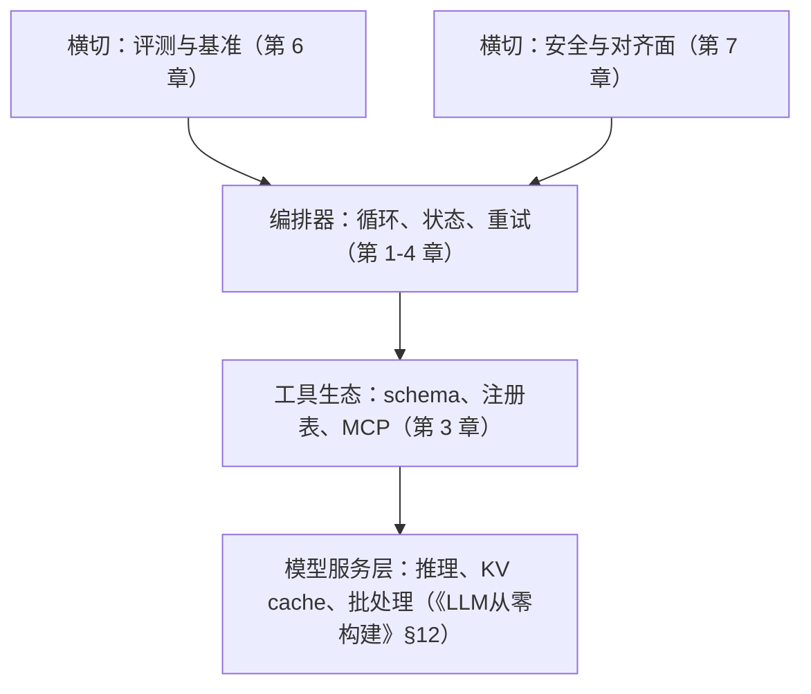

# $\rm Chapter \, 8$ 工程实录与收束

> **本章假设你已经会**
>
> 1. agent 循环的四步（感知-决策-行动-反馈）与「上下文是循环的唯一状态」，解析-执行-回填三拍，见 §1.2 与 §1.4。
> 2. 上下文开销随轮数按 $\bar{c}T^{2}$ 增长的账，滑窗、摘要压缩、检索回填三种截断策略的取舍，见 §2.1 与 §2.3–§2.4。
> 3. 重试的两条纪律：错误反馈回填优于原样重发，重试以工具幂等为前提，见 §3.3。
> 4. 复述拉回与专职检查者各自的成功账，以及「漂移大才上检查者」的分界，见 §4.5 与 §5.7。
> 5. 分数是「模型乘 harness」的读数（§6.2）；实验环境约定同前几章：WSL2 的 python3、无外网、无 LLM API，伪 LLM 表驱动，固定种子 20261108，脚本与完整输出在 `_uni5_work/expEA08/` 的 `exp.py` 与 `result.txt`。

前七章把循环造了出来：第 1 章立骨架，第 2 章管记忆，第 3 章接工具，第 4 章管决策，第 5 章接多个循环，第 6 章给分数配误差，第 7 章给动作配闸门。本章回答最后一类问题：这台机器从演示跑通到产品上线，中间隔着一张账单。演示阶段一天几十次调用，贵便宜都没感觉；产品化之后每天几十万次调用，同一份代码按词元计价，账单结构立刻成为设计约束。本章先给 agent 产品栈分层（§8.2），再推导每步调用的成本与延迟公式（§8.3），然后在规则世界实测两笔账：单 agent、编排多角色与缓存的成本-延迟账（§8.4），失败重试的边际成本曲线（§8.5）；之后是排障与实践（§8.6–§8.7），最后收束全册：八章的能力栈地图（§8.8）与全站接口（§8.9）。

## $\rm \S \, 8.1$ 问题：demo 跑通和产品上线之间差一张账单

第 1 章末尾留过一个承诺：循环开出的新账单里，每个动作都是一次完整的模型调用，延迟与费用按轮数涨，这笔账在本章细算。现在兑现它，先看按直觉报价会漏掉什么。

直觉的算法是线性外推：一次调用一份钱，20 轮的任务就是 20 份。这个算法漏了三个非线性项。第一项在 §2.1 已经推过：消息列表每轮变长，第 $t$ 次调用的输入随 $t$ 增长，全任务的输入词元按 $\bar{c}T^{2}$ 走抛物线，20 轮任务的账不是 20 份单价，而是 20 份各不相同的价加总。第二项在第 5 章：编排多角色把一次调用拆成多次，调用数变了，可词元数往哪个方向变，取决于角色之间传全文还是传摘要。第三项在第 3 章：调用会失败，重试的代价取决于失败是彼此独立的还是同一个错误反复出现。

三笔账都不难算，难在把它们放进同一个口径：词元怎么折成钱，钱之外还要算延迟，失败要折算成「每成功一次的成本」。本章把记价单位先立起来，再让实验对账。

白话：给 agent 报价像给长跑配速，第一公里的感觉和第三十公里不是一个配速；按第一公里配速签合同，后半程必赔。稳的报法是把每公里的配速表先列出来。

> 本节小结：demo 到上线隔着一张账单；线性外推漏掉三个非线性项，上下文的 $\bar{c}T^{2}$ 项、多角色的通信形态、重试的相关性；本章先定记价口径再实测。

## $\rm \S \, 8.2$ 新概念：agent 产品栈的四层

定义（编排器，orchestrator）：驱动 agent 循环的程序外壳，负责维护消息列表、调用模型、解析工具调用、执行并把观察回填、控制重试与预算。第 1 章我们手写的那十几行循环，就是它的最小形态。

真实系统里，编排器不是全部。把一个 agent 产品的部件按「换谁不碰谁」分组，得到四层：

1. **模型服务层**：推理引擎、KV cache、批处理、量化（《LLM从零构建》§12 的全部对象）。换模型或换服务方式，只动这一层。
2. **编排器层**：循环、状态、重试、预算，本册第 1 至第 4 章的内容都住在这里。
3. **工具生态层**：schema、注册表、MCP 接入（§3.2 与 §3.5）。加一个工具不该碰前两层。
4. **横切层**：评测（第 6 章）与安全（第 7 章）。它们不是单独一层，而是贴在每一层上的检查：评测给编排器的每个版本打分，安全给工具生态的每次调用设闸。



分层的判据是改动隔离，而判据之所以成立，是因为各层的变更频率不同：模型服务层按月换，编排器按周调，工具按天加。第 6 章 WebArena 上「模型没变、分数翻四倍」的那批 harness 增益，落在本图上就是编排器层与横切层的改动；它们不要训练一分钱，这正是工程实录里最便宜的那部分分数。

白话：模型服务层是发动机，编排器是车架和油门，工具生态是拖挂接口，评测与安全是年检和保险。四样提供动力的只有一样，可少装任何一样都上不了路。

> 本节小结：产品栈分四层，模型服务、编排器、工具生态加横切的评测与安全；分层的判据是改动隔离，各层变更频率不同；第 6 章 harness 增益的位置在编排器与横切层。

## $\rm \S \, 8.3$ 记价：每步调用的成本与延迟公式

记价需要四个词元量：$c_0$ 是每次调用都携带的常驻输入（系统提示加工具 schema），$o$ 是每步模型输出（思考加动作），$w$ 是每步回填的工具观察。沿用第 1 章的消息结构，第 $t$ 次调用时上下文长度为

$$
L_t \;=\; c_0 + (t-1)(o+w)
$$

（第 2 章按消息条数记 $L_t=1+2t$，本章按词元数记，同一份列表的两种量纲。）设输入价 $p_{\mathrm{in}}$、输出价 $p_{\mathrm{out}}$（美元每词元），单步成本是输入加输出两笔：

$$
c_t \;=\; L_t\,p_{\mathrm{in}} + o\,p_{\mathrm{out}}
$$

全任务成本是 $T$ 步加总：

$$
C(T)\;=\;\sum_{t=1}^{T}c_t\;=\;T\,c_0\,p_{\mathrm{in}} \;+\; \frac{(o+w)\,T(T-1)}{2}\,p_{\mathrm{in}} \;+\; T\,o\,p_{\mathrm{out}}
$$

读法：中间一项带着 $T(T-1)$，它就是 $\bar{c}T^{2}$ 在账单上的化身。拿实验参数钉一下：$c_0=2000$、$o=150$、$w=400$、$T=22$ 时，三项分别是 \$0.026、\$0.076、\$0.008，账面合计 \$0.111；§8.4 实测同一档任务是 \$0.145，多出的部分是漂移漫游步与复述行的损耗，账面给下界，实测是机理加损耗（§4.5 的同款口径）。

延迟走另一条公式。设 prefill 吞吐 $s_p$、decode 吞吐 $s_d$（词元每秒），单次调用延迟为

$$
\ell_t \;=\; \frac{L_t}{s_p} + \frac{o}{s_d}
$$

两条吞吐的差距是延迟账的主角：《LLM从零构建》§12.2 讲过 decode 逐词生成、每词都要过一遍全部权重，比 prefill 慢一到两个量级。取 $s_p=8000$、$s_d=45$（建模约定，公开服务指标的常见量级），$L_t=13000$ 的一次调用要 prefill 1.6 秒、decode 3.3 秒；§8.4 实测单 agent 全任务 106.3 秒里，decode 合计约 78 秒、prefill 约 28 秒。为省输入词元所做的优化，在延迟上只兑现有零头；连续批处理（《LLM从零构建》§12.4）救的是吞吐，不是单次请求的这段 decode。

成本公式还差最后一块：提示缓存（prompt caching）。agent 的消息列表只追加不改动，前一次调用的前缀原样出现在下一次调用的输入里，服务端对命中前缀的部分按折扣价计（公开价目惯例为输入价的 0.1 至 0.25 倍，本实验取 $\kappa=0.1$，建模约定）。命中份额 $f_t$ 随 $t$ 爬升，单步成本变为

$$
c_t^{\text{cache}} \;=\; \big[\kappa\,f_t + (1-f_t)\big]\,L_t\,p_{\mathrm{in}} + o\,p_{\mathrm{out}}, \qquad f_t \;\approx\; 1-\frac{o+w}{L_t}
$$

缓存折扣的适用条件就在 $f_t$ 的分子里：新增部分只有 $(o+w)$，前提是前缀逐字节不变。第 2 章三种截断策略里，全保留与检索回填只往列表尾部追加，前缀稳；滑窗从头部丢弃、摘要压缩重写列表，前缀每次重构，缓存跟着全灭。

编排的账最后单独立一条：调用数与词元数是两个独立变量。第 5 章按判定数记账，流水线比单 agent 贵约 2.4 倍；本章按词元记账，结果会反过来。同一台机器，换计价单位，大小关系翻转，这本身就是本节要立的规矩：报成本先报单位。

白话：输入价像按页数收的复印费，页数越翻越多时按页收费才是大头；输出价像按小时收的口述费，慢而贵；缓存是复印机认得昨天复印过的页，昨天的页按折扣收。编排是雇了几个助理，他们之间传卡片还是传整本纪要，复印费差出一个倍数。

> 本节小结：$C(T)$ 的中间项按 $T^2$ 增长，与 §2.1 的账对上；延迟由 decode 主导，省输入在延迟上只兑现有零头；缓存折扣的前提是前缀只追加不重写；编排的调用数与词元数是两本账，报成本先报单位。

## $\rm \S \, 8.4$ 锚点实验一：单 agent、编排与缓存的成本-延迟账

实验把第 4、5 章的行为层照搬过来，只新增计价层。世界：150 个任务，最短路径 $L^{*}$ 落在 6 到 38 步（实测均值 22.12、中位 23.0），预算 ${B=\lceil1.8\,L^{*}\rceil}$ 均值 40.2 步。行为层：执行步为查表最优步（第 1 章约定；决策质量的税已在第 4 章单独量过，本章隔离组织与计价结构）；每步以概率 $d$ 发生无声滑步（主格 $d=0.02$，另扫三档）；单 agent 每 8 步复述目标、拉回率 0.9（一次机会，§4.5 口径）；流水线带规划者（一次给对路线的概率 0.75）与检查者（程序化比对位置，必检出、当步拉回，§5.7 口径），审计划查出率 $v=0.875$。计价层用 §8.3 的公式与参数。全部条件跑同一批世界，脚本与完整输出在 `_uni5_work/expEA08/`。

主格（$d=0.02$）的账：

| 条件 | 成功率 | 调用数 | 输入词元 | 每任务成本 | 成本/成功 | 每任务延迟 |
| :--- | :--- | :--- | :--- | :--- | :--- | :--- |
| A 单 agent＋复述 | 94.3% | 23.4 | 227,229 | \$0.1447 | \$0.1534 | 106.3 秒 |
| A＋前缀缓存（只换计价） | 94.3% | 23.4 | 227,229 | \$0.0298 | \$0.0316 | 106.3 秒 |
| B1 编排·结构化状态 | 94.0% | 25.6 | 54,673 | \$0.0422 | \$0.0449 | 93.8 秒 |
| B2 编排·全文转发 | 94.0% | 25.6 | 192,859 | \$0.1251 | \$0.1331 | 111.1 秒 |

B1 与 B2 的行为完全相同（同一批轨迹，同一随机流），差别只在通信账：B1 的执行者与检查者各背一份小上下文（角色提示 1200 与 1000 词元，共享状态每步增 80 词元）；B2 的每个角色都背全历史（每步多 550 词元，同 §2.1 的增长律）。四层读法。

1. **通信形态决定编排的词元账**。B1 的输入词元只有 A 的 0.24 倍，B2 是 0.85 倍：把全历史压成结构化状态（§5.2 共享状态一极）省下约四分之三的输入；角色间互发全文（§5.2 消息传递一极的笨版）则几乎不省。第 5 章按判定数记的 2.4 倍与这里的 0.24 倍同时成立，因为它们量的是不同的东西。
2. **缓存改写了排序**。命中率 90.3%，A 的成本降 79.4%，成本/成功从 \$0.1534 压到 \$0.0316，低于 B1 的 \$0.0449。第 2 章「全保留最贵」的结论在缓存价目下不再成立：全保留恰好是最缓存友好的策略，逐字节不变的前缀正是折扣的来源。
3. **延迟由 decode 主导**。B1 的输入词元是 A 的四分之一，延迟却只是 0.88 倍：prefill 省下的时间在 decode 面前是零头。B2 延迟 111.1 秒反超 A，多出来的全是每步第二跳的 decode。此账未计排队与网络往返，真实编排的延迟还要更高。
4. **成功率各有天花板**。A 的 94.3% 低于账面连乘的 0.959，差额是漫游烧预算的尾部；B1 的 94.0% 贴着规划上限 0.960，编排买不回判定质量（§5.7 低质量区全体趴下的结论在这里以成本形式重现）。

漂移扫描把编排的立足点钉出来：

| $d$ | A 成功率 | A 成本/成功 | B1 成功率 | B1 成本/成功 | A＋缓存成本/成功 |
| :--- | :--- | :--- | :--- | :--- | :--- |
| 0.01 | 96.0% | \$0.1420 | 94.0% | \$0.0442 | \$0.0298 |
| 0.02 | 94.3% | \$0.1534 | 94.0% | \$0.0449 | \$0.0316 |
| 0.04 | 89.7% | \$0.1815 | 94.0% | \$0.0462 | \$0.0362 |
| 0.08 | 78.0% | \$0.2476 | 94.0% | \$0.0489 | \$0.0473 |

编排的成功率对漂移免疫（94.0% 平稳，检查者当步拉回），单 agent 从 96.0% 滑到 78.0%（复述一次机会，§4.5 的指数税）。成本/成功的交叉要读两遍：不挂缓存时，B1 在所有漂移档都便宜；挂上缓存后，A＋缓存在 ${d\le 0.04}$ 更便宜，到 $d=0.08$ 才追平（\$0.0473 对 \$0.0489）。缓存放大了「单 agent 够用」的区域，编排的立足点收窄到高漂移任务、成功率结构与延迟形态。

数字的适用范围照例钉住：规则世界，状态摘要 80 词元每步是理想化压缩（压不住这么小，B1 的账就近 B2），排队延迟未计，绝对价位是建模约定；可迁移的是结构（通信形态决定编排词元账、缓存奖励只追加策略、编排对漂移免疫），不可迁移的是具体倍数，真实系统须按第 6 章方法另测。整个实验在纯 CPU 的 python3 上约 2 秒跑完。

白话：单 agent 是一个人抱着全部会议纪要开会，会越开抱得越多；结构化编排是三个人共用一块只写结论的白板；全文转发编排是每人把整本纪要复印一份再开会，钱全花在复印上。缓存像给纪要装了复印机认页：昨天的页按折扣算，于是「抱着不撒手」反而成了最省钱的姿势。

> 本节小结：同批 150 世界上，编排对 A 的调用倍数 1.10、词元倍数 0.24（结构化状态）或 0.85（全文转发）；缓存命中率 90.3%，把 A 的成本/成功从 \$0.1534 压到 \$0.0316，反超编排的 \$0.0449；延迟由 decode 主导；编排的成功率对漂移免疫，立足点在高漂移与结构，不在词元折扣。

## $\rm \S \, 8.5$ 锚点实验二：失败重试的边际成本曲线

第二笔账在单步尺度上：一次调用失败了，重试预算买什么。失败分两种危害。环境瞬时失败（概率 $e=0.2$，建模约定）：网络抖动、超时，重发即可解，前提是工具幂等（§3.3）。格式失败（概率 $f=0.15$）：模型产出的调用不合 schema；它是相关失败，同一个上下文重发，同样的错误倾向原样再现，原样重发买不到修复。把错误观察回填进上下文再重试（§3.3 的自愈），以修复率 $q=0.85$ 解掉格式失败（建模约定）。

重试预算 $K$ 是允许的尝试次数上限，第 $K$ 个槽位的账用两个边际量读：$\Delta C(K)$ 是把预算从 $K-1$ 提到 $K$ 多花的钱，$\Delta S(K)$ 是多买到的成功率。设 $S(K)$ 为 $K$ 次预算内的单步成功率，两种策略各有闭式：

$$
S_{\text{P1}}(K)=(1-f)\big(1-e^{K}\big), \qquad S_{\text{P2}}(K)=(1-f)\big(1-e^{K}\big)+f\big(1-(1-q)^{K-1}\big)\big(1-e^{K-1}\big)
$$

（P1 原样重发只解瞬时失败；P2 反馈重试多出第二项：格式失败后至少一次成功修复、再闯过瞬时关。）边际成本有一个统一形状：第 $K$ 槽只在前面 $K-1$ 槽都没买成时才被烧到，所以

$$
\Delta C(K) \;=\; 1.1\times\big(1-S(K-1)\big)
$$

（每次尝试计 1 单位 $C$，每次重试因错误观察回填使上下文加长，额外 $+0.1C$。）每格 50 万步的蒙特卡洛与闭式对账：

| 策略 | $K$ | 成功率 | 边际成本 | 边际成功 | 每成功成本 |
| :--- | :--- | :--- | :--- | :--- | :--- |
| P1 原样重发 | 1 | 0.680 | ${1.000\,C}$ | $+0.680$ | ${1.5\,C}$ |
| P1 原样重发 | 2 | 0.816 | ${0.352\,C}$ | $+0.136$ | ${2.6\,C}$ |
| P1 原样重发 | 5 | 0.849 | ${0.167\,C}$ | $+0.00109$ | ${153\,C}$ |
| P2 反馈重试 | 2 | 0.918 | ${0.352\,C}$ | $+0.238$ | ${1.5\,C}$ |
| P2 反馈重试 | 5 | 0.999 | ${0.003\,C}$ | $+0.00247$ | ${1.4\,C}$ |

三层读法。第一层，P1 的成功率封顶在 $1-f=0.85$：瞬时失败被预算消掉之后，剩下的格式失败一个都修不了，第 2 槽到第 5 槽的边际成功从 0.136 衰减到 0.001。第二层，P1 的边际成本有一条地板：$1-S_{\text{P1}}(\infty)=f$，所以 $\Delta C$ 永远不低于 ${1.1f=0.165\,C}$，这 ${0.165\,C}$ 买到的成功恒为零；第 5 槽每成功 ${153\,C}$，就是把预算开满 5 档时为准付的价。第三层，P2 没有这条地板：反馈把格式失败从永久失败改成修复率 $q$ 的可解失败，$S_{\text{P2}}(K)$ 收敛到 1，边际成本随之衰减到 ${0.003\,C}$，第 5 槽每成功仍只要 ${1.4\,C}$。同样的预算上限，钱花在「重发」还是「回填」，第 5 槽的价钱差一百倍。

工程结论落在预算的定档上：瞬时失败的重试买到第 2 槽为止（第 3 槽已到 ${7.4\,C}$、第 4 槽 ${32\,C}$），格式失败的钱不该花在重发预算上，该花在错误信息回填与 schema 修复上；这两件事分别在第 3 章的 §3.3 与 §3.2 立过规矩，本节给它们标了价。

白话：瞬时失败像电话占线，挂了重拨就行；格式失败像把地址写错了，原样重拨一百次还是查无此人；错误回填是让接线员把「查无此人」念给你听，你才改得掉地址。重试槽位像拍卖会上的加价：瞬时失败这场的牌越来越少人抢，格式失败那场永远有一笔没人拿走也永远要付的底价。

> 本节小结：边际成本 $\Delta C(K)=1.1\times(1-S(K-1))$；P1 的 $1-S$ 收敛到 $f$，地板 ${0.165\,C}$ 的槽位买到恒为零的成功，第 5 槽每成功 ${153\,C}$；P2 靠反馈回填拆掉地板，第 5 槽每成功 ${1.4\,C}$；重试预算定档在瞬时失败的第 2 槽，格式失败的钱花在回填。

## $\rm \S \, 8.6$ 常见错误与证据式排查

错误一：按调用数报价。第 5 章流水线 2.4 倍的判定数与本章 0.24 倍的词元数并不矛盾，它们是两本账；只看调用数会把编排判成贵四倍，漏掉状态压缩省下的四分之三输入。排查动作：任何成本结论旁边标出计价单位（调用、词元、美元、秒），单位没标的不进决策。

错误二：为省输入优化延迟。decode 占单 agent 延迟的七成（78 秒对 28 秒），把上下文砍到一半，延迟只降一成多。排查动作：延迟报告拆 prefill 与 decode 两列再谈优化（《LLM从零构建》§12.2 的两阶段机理是拆分的依据）。

错误三：给会重写历史的策略挂缓存。滑窗丢头部、摘要重写列表，前缀每次重构，缓存折扣全灭；更糟的是账面上还留着缓存命中率的高预估。排查动作：核对消息列表是否只追加（全保留与检索回填合格，§2.3），命中率实测对不上预估时先查前缀稳定性。

错误四：重试预算照抄框架默认值。第 5 槽在原样重发下每成功 ${153\,C}$，默认值开到 5 档等于把预算的地板槽位全买下。排查动作：把失败日志按瞬时与格式分箱（同一调用重复失败是格式），瞬时留 2 档，格式走回填，预算余量给修复率而不是次数。

> 本节小结：四个高频坑各配一句检查动作，报价先标单位、延迟拆两阶段、缓存先验前缀稳定性、重试预算按失败分箱定档。

## $\rm \S \, 8.7$ 动手实践：十分钟算一张 agent 账单

前置条件：装了 python3 的终端（WSL 或 Linux/macOS 均可）；在用户主目录新建练习目录，不碰已有文件。

```bash
mkdir -p ~/ea08-practice && cd ~/ea08-practice
```

读法：新建目录 `ea08-practice` 并进入；`-p` 让目录已存在时不报错。把下面 14 行存成该目录下的 `bill.py`（对象：新建文件），运行 `python3 bill.py`。

```python
PIN, POUT, KAPPA = 0.60e-6, 2.40e-6, 0.1     # 美元/词元；缓存读价倍率
SP, SD = 8000, 45                             # prefill / decode 吞吐（词元/秒）
C0, O, W, T = 2000, 150, 400, 22              # 常驻输入、每步输出、观察、步数
Ls = [C0 + t * (O + W) for t in range(T)]     # 第 t 次调用的上下文
plain = sum(L * PIN for L in Ls) + T * O * POUT
cached = sum((L - (O + W)) * KAPPA * PIN + (O + W) * PIN for L in Ls) + T * O * POUT
print(f"无缓存 ${plain:.4f}  缓存后 ${cached:.4f}  省 {1-cached/plain:.0%}")
print(f"延迟：prefill {sum(Ls)/SP:.0f}s + decode {T*O/SD:.0f}s")
```

成功验证：输出两行，第一行是 \$0.1105 对 \$0.0247、省 $78\%$，第二行是 prefill 21 秒加 decode 73 秒。把 $T$ 改成 38 再跑，无缓存账涨到 \$0.2913、$T^2$ 项的贡献到八成，复现 §8.3 的抛物线；再把 `KAPPA` 改成 1.0，缓存行与无缓存行重合，这条折线就是「前缀稳定性」的价格。整张表没有用任何真实 API，四行公式就是 §8.3 的全部机制。

> 本节小结：14 行脚本复现成本公式与缓存折扣；$T$ 与 $\kappa$ 两个旋钮分别复现 $T^2$ 项与前缀前提；数字与 §8.4 实测同源（实测多出的部分是漂移与复述的损耗）。

## $\rm \S \, 8.8$ 收束：八章的能力栈地图

本册八章在 §8.2 的产品栈上各装了一件设备，全册心智模型「agent＝把 LLM 的下一词预测变成对世界的动作循环：感知-决策-行动-反馈」把它们串成一台整机。按栈从内到外报一遍账，每件设备的锚点数字都是本册实测：

1. 循环骨架（§1）：感知-决策-行动-反馈首尾相接，上下文是唯一状态；同一批 50 个世界上，单轮 34% 对循环 100%（§1.5），这一跳是 agent 与聊天机器人的分界。
2. 记忆（§2）：窗口是桌面、外存是档案柜；70 轮长任务上全保留累计 153,760 词元对滑窗 89,500，检索回填以几乎相同的词元拿下 52% 对 0% 的完成率（§2.4），位置通道与内容通道各自独立。
3. 工具（§3）：schema 是手的说明书，协议保证形状不保证质量；错误回填与幂等前提在本章标了价（§8.5）。
4. 规划（§4）：开环剧本、闭环贪心与树搜索对每步正确率 $p$ 的敏感性全表实测；规划漂移是不复述时 $(1-d)^{L^{*}}$ 的指数税（§4.5），复述把税改成按段结清。
5. 协作（§5）：分工、辩论、编排三范式；无检查者的流水线在 $p{=}0.95$ 也只有 30.7%（§5.7），检查者的价值随漂移增大，本章补上了它的价签。
6. 评测（§6）：成功率是随机变量，500 题的 Wilson 区间宽 7.8 个百分点（§6.3），pass@k 连 $n$ 一起报，泄漏把分买高而区间无异常（§6.5）。
7. 安全（§7）：接管率 75.8% 与任务完成率 100% 同时成立（§7.4），防线修在执行层，白名单把 1137 次危害尝试的执行压到 0 而接管率纹丝不动（§7.6）。
8. 工程（本章）：账单把前面七章的每一件设备标价；通信形态、缓存与重试相关性三个词元级结构，决定了同一份行为逻辑在账面上的倍数差。

八件设备合起来的读法是一句话：行为逻辑决定成功率的上限，工程账单决定这条上限值多少钱；两张表并排读，才是第 6 章「分数是模型乘 harness」的完整兑现。

白话：八章像给一台整机装件：骨架、记忆、手、路线图、同事、考卷、门锁、账本。装到第八件才发现，前七件的价值最后都要在账本上换算成钱与秒，而账本自己不提供任何能力，它只决定前面七件买不买得起。

> 本节小结：八章各交付一件栈上设备，锚点数字全部实测；行为逻辑给成功率上限，工程账单给它的价格，两表并排才是完整的工程实录。

## $\rm \S \, 8.9$ 全站接口：这套循环在别的册叫什么

四条交接线，各指一处。其一，《LLM从零构建》册是模型服务层的原生地：agent 的每一步动作都是那边 §12 的一次推理服务调用，本章的量纲（词元、prefill 与 decode、缓存折扣）全部是 §12.2 至 §12.8 的产出；分数侧的口径（§11 的统计纪律、§19.7 的榜单落差）与成本侧的账（§20.4 的毛利拆解）是本册第 6 章与 §8.4 的上游。

其二，《强化学习》册给循环配了正式语言：§1.2 的 MDP 五件套在第 1 章 §1.2 已逐项对齐，两册的分界在策略住哪，RL 把策略训进权重、试错成本由训练环境承担（《强化学习》§1.1），agent 把策略摆在上下文里、每一步重新读一遍。两条路在 agent 化的 RL 上会合：把环境的成败信号接回权重更新，可验证奖励的 GRPO 在《LLM从零构建》§10.6；《强化学习》§1.6 的分工表早给这两册排了座次。

其三，《计算机安全》册是第 7 章的原型库：工具白名单对应 §6.3 seccomp 的焊窗思想，威胁建模五问对应 §1.5，提示注入与 SQL 注入同根因（§4.4 的「数据变成代码」）；agent 场景补上的只有一条，被关进沙箱的不是代码，是模型签发的每一次工具调用。

其四，评测章是本册 §6 与《LLM从零构建》§11、§19 的合称：成功率配区间、pass@k 报口径、污染靠私有保留集。本章把第三列补进评测报告：成本/成功 \$0.0316 对 \$0.1331 这类读数。harness 的每一分增益（§6.2 的 WebArena 账）最终都落在这张账单上，工程实录的「实录」二字由它兑现。

出了本册，这套四步循环在各册换名字不换骨架：在《强化学习》里是策略与环境交互，在《自然语言处理》里是注意力窗口上的一次次续写（§16.2 讲窗口为什么撑不长，第 2 章的 $\bar{c}T^{2}$ 在那里的机理），在《分布式系统》里是多角色之间的消息与共识（§5 引过的失败三件套）。循环不变，变的只是「世界」由谁扮演。

白话：本册教的循环是一句通用语法：感知进来、决策拍板、动作出去、反馈回填。模型册给这句话配发动机，强化学习册配训练场，安全册配门锁，评测册配裁判，分布式册配多人版的规矩。

> 本节小结：四条接口各指一处，模型服务与成本在《LLM从零构建》、正式语言在《强化学习》、防线原型在《计算机安全》、分数纪律在评测章；循环同构，世界换人扮演。

## $\rm \S \, 8.10$ 关键概念回顾

1. 写出第 $t$ 次调用的上下文长度 $L_t$ 与全任务成本 $C(T)$ 的展开式。哪一项按 $T^2$ 增长？它与第 2 章的哪笔账是同一件事？
2. 为什么延迟账里 decode 占七成而 prefill 只占零头？这条比例决定了哪一类优化在延迟上白做？连续批处理救的是什么？
3. 实验一里 B1 对 A 的调用倍数 1.10 与输入词元倍数 0.24 为什么能同时成立？它与第 5 章 2.4 倍的判定数账如何对账？B2 为什么两头不讨好？
4. 重试第 $K$ 槽的边际成本公式是什么？P1 的地板 ${0.165\,C}$ 从哪来？P2 为什么没有地板？

## $\rm \S \, 8.11$ 应用与辨析

1. 排障：你的 agent 服务月账单里 92% 是输入词元，团队在「换便宜模型」与「上编排多角色压缩上下文」之间争论。用本章的账给出处理顺序与每一步的预期收益。
2. 应用：任务每步调用成本 $C$，失败构成是 20% 瞬时加 15% 格式失败。给出重试预算的定档方案，并用 §8.5 的数字说明第 3 至第 5 槽在两种策略下各值多少钱。
3. 辨析：「B1 的成功率 94.0% 与 A 的 94.3% 几乎相同，成本只有 0.29 倍，所以编排永远比单 agent 划算。」判断这句结论是否成立，用本章全部数字链给出理由。

## $\rm \S \, 8.12$ 本章自测答案

概念回顾答案：

1. $L_t=c_0+(t-1)(o+w)$（§8.3）；$C(T)=T\,c_0\,p_{\mathrm{in}}+\frac{(o+w)T(T-1)}{2}p_{\mathrm{in}}+T\,o\,p_{\mathrm{out}}$（§8.3）。中间项带 $T(T-1)$，是 $T^2$ 项，与 §2.1 的 $\bar{c}T^{2}$ 是同一笔账的两种量纲（那边按消息条数，这边按词元）。
2. decode 逐词生成、每词过全部权重，比 prefill 慢一到两个量级（§8.3，《LLM从零构建》§12.2）；实测 78 秒对 28 秒。砍输入词元的优化在延迟上只兑现有零头；批处理救吞吐，不救单次请求的 decode。
3. 调用数由「每步几跳」决定（B1 每步至多两跳加规划，1.10 倍），词元数由「每跳背多少」决定（结构化状态每步 80 词元，0.24 倍）；第 5 章的 2.4 倍是判定数口径，三本账互不矛盾，报成本先报单位（§8.3、§8.4）。B2 每个角色背全历史，词元 0.85 倍接近不省，延迟反超，钱全花在复印上（§8.4 读法 1 与 3）。
4. $\Delta C(K)=1.1\times(1-S(K-1))$：第 $K$ 槽只在前 $K-1$ 槽都没买成时被烧到（§8.5）。P1 的 $1-S_{\text{P1}}(\infty)=f=0.15$，地板 ${1.1f=0.165\,C}$，这些槽位买到恒为零的成功；P2 靠反馈修复把格式失败改成可解失败，$S_{\text{P2}}(K)$ 收敛到 1，边际成本随 $K$ 衰减到 ${0.003\,C}$（§8.5）。

应用与辨析答案：

1. 第一步查缓存：92% 输入占比且消息列表只追加，是前缀缓存的满分场景，§8.4 实测同结构任务降 79.4%，先吃这口免费的；前提是核对前缀稳定性（§8.6 错误三）。第二步才谈换模型：输出占比小，便宜模型省的是输出价与单价，收益上限远小于缓存。编排放最后：它不是折扣手段，0.24 倍词元依赖状态摘要真的压得住（§8.4 读法 1），且它买的是成功率结构与漂移免疫（§8.4 扫描），不是账单折扣。
2. 先分箱（§8.6 错误四）：瞬时 20% 走重发，2 档封顶，第 3、4 槽每成功 ${7.4\,C}$ 与 ${32\,C}$（§8.5 P1 的账）；格式 15% 不走重发，上错误观察回填（§3.3），回填后第 5 槽每成功 ${1.4\,C}$。对照数字：原样重发第 5 槽 ${153\,C}$ 买一次成功，同样的槽位在反馈重试下 ${1.4\,C}$，差两个量级；预算的余量应该买修复率（更好的错误信息、schema 修复），不是买次数。
3. 不成立，三个前提各断一处。其一，0.29 倍依赖状态摘要每步 80 词元的理想压缩，全文转发的同款编排是 0.86 倍（§8.4），压不住就是另一个价。其二，94.0% 的成功率有规划上限 0.960 封顶，低漂移时编排买不到成功率（$d=0.01$ 时 A 反而 96.0%），只有 $d=0.08$ 时免疫优势才兑现（§8.4 扫描）。其三，缓存把 A 的成本/成功压到 \$0.0316，低于 B1 的 \$0.0449：在 ${d\le 0.04}$ 的区域，编排既不更便宜也不更可靠。这句话成立的范围只剩「高漂移、状态压得住、不挂缓存」的交集，那是 §5.7「漂移大才上专职检查者」的窄带，不是「永远」。

**你现在能做什么**：你能给一个 agent 任务列出 $L_t$、算出 $C(T)$ 并把账单拆成输入、输出、缓存、延迟四列，能用「通信形态、缓存前提、重试相关性」三个结构判断一份编排方案值不值，也知道了重试预算的第 5 槽在错误回填前后差两个量级。

全册八章到此收官。感知-决策-行动-反馈这条循环，从第 1 章的十几行手写骨架走到本章的账单与栈图，每一件设备都带着自己的实测锚点；下一站不是新章，而是 `12-复习总结` 里的 R1：把八件设备合上卷子重新提取一遍，检验哪些已经长在你手上。复盘之后，§8.9 的四条接口就是你在全站其余各册的入场券。
