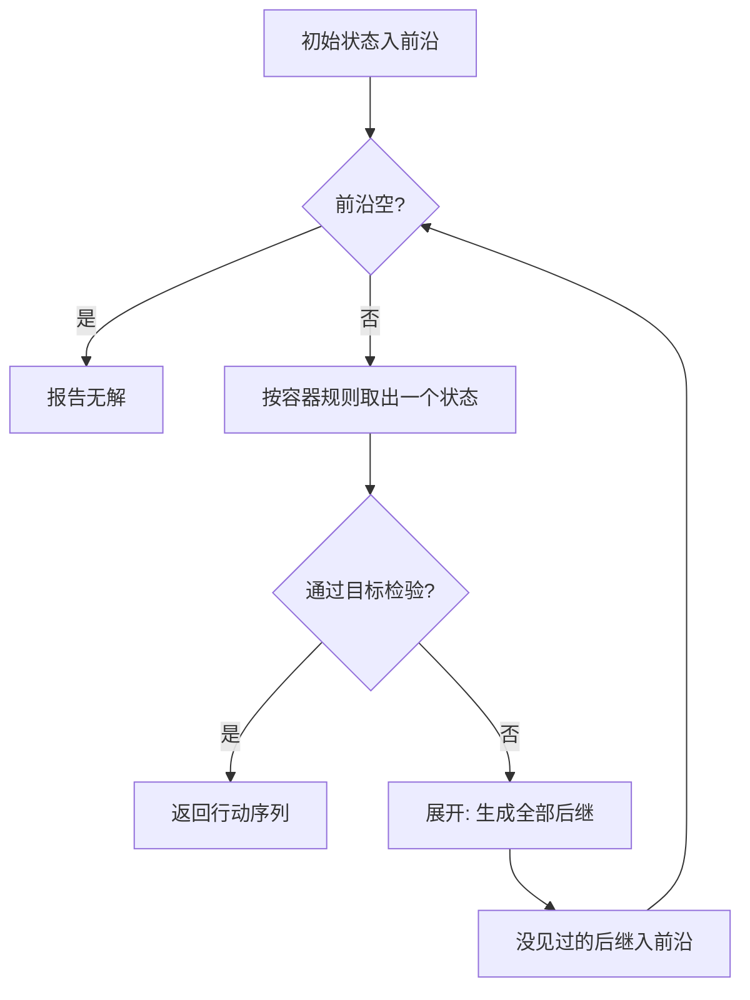

# $\rm Chapter \, 1$ 无信息搜索

> **本章假设你已经会**
>
> 1. 图上 BFS 与 DFS 的遍历骨架：队列负责「先来的先走」，栈负责「一条路走到黑」，见《算法与数据结构》§5.3。
> 2. 堆与优先队列的合同：出队永远给出当前最小元素，见《算法与数据结构》§3.1 与 §3.2。
> 3. Dijkstra 的惰性删除写法：同一个状态允许在堆里留多个过期条目，出队时跳过，见《算法与数据结构》§6.2。
> 4. 增长阶记号 $\Theta$ 与 $O$ 的读法，见《算法与数据结构》§1.1。

全册的心智模型从本章立起来：智能就是在巨大搜索空间里找行动序列。把「思考」变成「搜索」，把「不确定」变成「概率」。这句话听起来像口号，本章的任务是让它变成可操作的程序：一个问题要满足什么条件才能被「搜」，搜索算法长什么样，怎么评价谁搜得好，以及为什么最朴素的几个搜索已经能解八数码这样的谜题，却在真正的难题面前撞墙。

本章只讲「无信息搜索（uninformed search）」：算法除了问题定义本身，对状态空间一无所知，既不知道目标在哪，也不知道某个状态离目标还有多远。学完本章你能对任意一个可建模为状态空间的问题，写出 BFS、DFS、UCS 三种求解器，并用展开节点数、生成节点数与耗时三本账量化它们。下一章在这个骨架上装上「离目标还有多远」的估计器，就得到 A*。

## $\rm \S \, 1.1$ 把「想清楚」写成「搜出来」：状态空间建模

人在解八数码谜题时说的话是「把 1 挪上去，再把 3 挪到左边」，这听起来像推理。但只要问一句「你怎么知道该挪 1 而不是挪 6」，答案就会露出底牌：要么是试出来的，要么是「看了一眼局势觉得靠谱」。搜索的立场是把这两句话都翻译成同一个动作：从当前局面出发，枚举所有合法走法，挑一条路走下去，不行就回头换一条。会试、会回头，就能解谜题；所谓「聪明」，先放到第 2 章再说。

要让程序能「枚举所有走法」，问题必须先被写成五元组。搜索问题（search problem）由五样东西组成：

1. 状态空间（state space）：所有可能局面的集合，以及每个局面的全部合法走法。
2. 后继函数（successor function）：输入一个状态，输出走一步能到的所有状态。这一步走过的动作记下来，就是行动序列。
3. 初始状态（start state）：搜索的出发点，八数码里是打乱后的棋盘。
4. 目标检验（goal test）：一个函数，回答「这个状态是不是终点」。
5. 一步代价（step cost）：从状态走一步到后继的花费，常常全是 1，也可以不是。

以八数码为例把五元组填出来。棋盘是 $3\times 3$ 的九宫格，八个滑块加一个空格，滑块只能滑进空格。状态就是一个九元排列，比如打乱态 ${724506831}$，其中 ${0}$ 代表空格；后继函数是「空格与上、下、左、右相邻的滑块交换」，合法走法有 2 到 4 个；初始状态是输入棋盘；目标检验是与标准排列 ${123456780}$ 比对，即空格在右下角；一步代价先取 1，§1.5 会故意换成别的看看会发生什么。写成公式，一个状态的后继集合是：

$$
\mathrm{succ}(s)=\{\,s' :\text{把 } s \text{ 的空格与一个相邻滑块交换得到 } s'\,\}
$$

读法：$\mathrm{succ}$ 是后继函数，$s$ 是当前状态，${s'}$ 是交换一次空格后得到的每一个新排列，花括号把它们收集成一个集合，八数码里这个集合最多 4 个元素。

这里有一个此刻就该记下的坑：状态不等于棋盘之外的任何附加信息。「我上一步是从哪来的」不是状态的一部分，它是搜索算法自己记的账。把附加信息混进状态，状态空间会无谓地膨胀，这是新手建模最常见的错误。反过来，状态的粒度也该按需选取：题目若限制「最多走 $k$ 步」，剩余步数就必须编进状态里，否则「同一棋盘、剩余步数不同」会被误判成同一个局面。状态选粗了无解可寻，选细了空间爆炸，建模是在这两头之间走钢丝。

白话：建模就是把「这个问题有哪些局面、局面之间怎么走、从哪出发、走到哪算完、每步花多少钱」五件事写死，写死之后，剩下的全是机械的图搜索。

> 本节小结：搜索问题五元组＝状态空间＋后继＋初始＋目标检验＋代价；八数码的状态是一个九元排列，后继由空格交换产生。

## $\rm \S \, 1.2$ 通用骨架：前沿、展开与四张成绩单

五元组写好后，所有无信息搜索共享同一副骨架，差别只在「下一个处理谁」。算法维护一个叫前沿（frontier）的容器，装着「已经发现、还没处理」的状态；每一轮从中取出一个状态，生成它的全部后继，这叫展开（expand）；生成出来的新状态没见过就放进前沿。生成（generate）专指新建后继记录这个动作，它与展开是一对要分开数的量，§1.5 的三本账全靠这个区分。



骨架里还有一处没写进图里但缺它不可：已见集合（explored set），即「展开过的状态」的花名册。没有它，同一个状态会经由不同走法反复入队，八数码里随便一个局面都能被三四条不同的路径再次走到，指数账立刻雪上加霜；实现上 BFS 常用一张哈希表兼作已见集合与「已发现」标记。判重是新状态入前沿前的最后一道关卡，本章所有算法都默认开着它。骨架的终止性也由它担保：状态空间有限时每个状态至多入队一次、展开一次，循环的总轮数以状态数为上界。

「按容器规则取出」只有两个朴素选项，对应两个经典算法。

1. 前沿是先进先出队列：最早发现的状态先被处理，一层一层向外扩散，这就是广度优先搜索（Breadth-First Search，BFS）。
2. 前沿是后进先出栈：最新发现的状态先被处理，一条路走到黑再回头，这就是深度优先搜索（Depth-First Search，DFS）。

评价搜索算法看四张成绩单。完备性（completeness）：问题有解时算法是否保证找到解。最优性（optimality）：找到的解是否保证代价最小。时间复杂度与空间复杂度：各花多少。四张成绩单都挂在三个参数上，先给符号：分支因子（branching factor）$b$ 是平均每个状态生成的后继数，$d$ 是最浅解的深度（从初始状态到目标最少走几步），$m$ 是状态空间里路径的最大深度。八数码的 $b$ 是 ${2.67}$，这个数不是猜的，§1.5 会实测出来。

白话：搜索就是把状态当成图上的点、把后继当成边，前沿是「发现了还没逛」的边界，队列和栈决定逛的顺序，完备性管「能不能找到」，最优性管「找到的是不是最省的」。

> 本节小结：所有无信息搜索共享「取出、检验、展开、入前沿」的循环；BFS 用队列、DFS 用栈；四张成绩单是完备性、最优性、时间、空间。

## $\rm \S \, 1.3$ BFS 与 DFS：证明与缺口

先证 BFS 的两条好性质。记号约定：状态 $s$ 的深度 $\operatorname{dep}(s)$ 是从初始状态到它的最少步数。

**性质一（BFS 按层访问）**：BFS 弹出状态的深度单调不减。证明用不变量：前沿里只存深度为 $k$ 或 $k+1$ 的状态，其中 $k$ 是当前正在弹出的深度。归纳起步，初始状态深度 ${0}$，前沿只含它。归纳步：弹出深度 $k$ 的状态生成的后继深度只可能是 $k+1$（若该后继没被更浅的方式到达过）或更浅（但更浅的早已见过、不入队），所以新入队的都是 $k+1$；队列先进先出，深度 $k$ 的排在深度 $k+1$ 的前面弹完。于是深度严格分层，逐层推进。

**性质二（BFS 单位代价下最优）**：每步代价全为 1 时，BFS 第一次遇到目标时的深度就是最少步数。由性质一，BFS 先处理完所有深度小于 $k$ 的状态才处理深度 $k$ 的；设最优解深度为 $d^*$，目标会在某个深度 $d^*$ 的状态被生成时或被弹出时命中，而深度小于 $d^*$ 的状态里没有目标（否则与 $d^*$ 是最浅解矛盾）。所以 BFS 不会漏掉更省的解，$d^*$ 就是答案。这里有个实现级细节：单位代价下 BFS 可以在「生成时」就做目标检验，因为首次生成目标的层必定最浅；这个便宜 UCS 占不了，§1.4 会解释为什么。

BFS 的完备性条件是：$b$ 有限且有解。理由接在性质一后面：$b$ 有限保证每一层的状态有限，BFS 逐层推进，只要解存在、深度为 $d^{*}$，第 $d^{*}$ 层及之前的所有状态迟早被走遍，目标必然被碰到。若分支因子无限，第 ${0}$ 层就生不完，永远走不到深处。代价方面，BFS 要把见过的状态全记下来防重访：

$$
\text{时间与空间均为 } O(b^{d})
$$

读法：最坏情形下 BFS 把深度 $d$ 以内的整棵树走遍并全部记住，$b$ 是分支因子，指数是解的深度；空间与时间同阶，因为每个生成过的状态都占一条记录，已见集合加上前沿峰值几乎就是全部已生成状态。指数是这套方法真正的天花板：$b=10$、$d=15$ 就是一千万亿量级。

DFS 是另一极端。它不记整个见过的集合，只记当前路径，这笔空间账可以当场算出来：递归到深度 $k$ 时，栈里存的是路径上 $k$ 个状态，外加每一层还没展开完的兄弟分支；每层兄弟至多 $b-1$ 个，$k$ 最深到 $m$，合计不超过 $k+(b-1)m \le bm$ 个，量级就是 $O(bm)$。这是它对 BFS 唯一的结构性优势。但两条性质全塌。

1. 完备性塌在无限深的空间里：若某条分支无限延伸且无解，DFS 沉下去就回不了头。有限空间加路径判重可以救回完备性，但前提是「有限」。
2. 最优性塌在访问序上：DFS 返回的是「按走法顺序第一条撞上的路径」，与长短无关。它甚至不知道该往多深走：限深猜小了没解（§1.5 实测 200 个实例里 200 个找不到），限深猜大了返回的解可能更贵（同批实测有实例多走 2 步）。

白话：BFS 是水波扩散，圆到哪解到哪，解保证最浅但圆里的水全要记在账上；DFS 是钻探，省账本但钻头可能永远斜着钻，钻到的东西也不保证是最浅的。

> 本节小结：BFS 按层访问故单位代价下最优、$b$ 有限时完备，时间空间 $O(b^d)$；DFS 空间 $O(bm)$ 但完备性与最优性都无保证。

## $\rm \S \, 1.4$ UCS：按代价出队

一步代价全是 1 的假设太奢侈。送货要按公里计费，八数码也可以规定「移动编号为 $t$ 的滑块花费 $t$」。这时「步数最少」和「花费最小」是两回事，BFS 的最优性证明第 1.3 节就失效了：它按层扩散，层浅不等于花费小。一致代价搜索（Uniform-Cost Search，UCS）把「层」换成「累计花费」：给每个状态记一个 $g(n)$，即从初始状态到它的已找到路径的最小代价；前沿改用按 $g$ 排序的优先队列，每次取出 $g$ 最小的状态展开。它就是《算法与数据结构》§6.2 的 Dijkstra，只是把「单源到全图」收窄成「单源到目标」，出队第一次命中目标就停。两者的关系有个好记的说法：每步代价全为 1 时，UCS 的出队序退化为按层排队，行为与 BFS 重合；差别只在实现自由度，BFS 敢在生成时提前收工，UCS 不能。

UCS 有两条铁律，各有各的证明。

**铁律一（目标必须在出队时检验）**：不能在生成时检验。反证：设目标 $G$ 第一次被生成时经过的路径代价为 $c$，若存在代价 ${c' < c}$ 的更优路径，这条路径的前段可能还没被展开，$G$ 完全可能经由它以更小的 $g$ 再次被生成。BFS 敢在生成时检验，是因为单位代价下「先生成」与「先到达」同步；代价不均时这个同步没了。

**铁律二（出队即最优）**：当 $G$ 被出队时，其 $g$ 值等于真实最优代价 $C^{*}$。证明：反设出队时 $g(G)=c > C^{*}$。沿最优路径看，把它切成前段与后段：前段是已经展开完的状态，后段的第一个状态记为 $n$。$n$ 的前驱展开时，$n$ 已被生成入队，且带着 $g(n)$ 等于最优路径前段代价，而前段代价加上最后一步不超过 $C^{*}$，故 $g(n)\le C^{*} < c$。优先队列取最小，$g$ 更小的 $n$ 必须先于 $G$ 出队，与 $G$ 已出队矛盾。唯一的漏洞是 $n=G$ 自己：那意味着 $G$ 在队列里挂着 $g=C^{*} < c$ 的记录，出队取到的就该是 $C^{*}$，同样矛盾。所以出队即最优。

这条证明其实悄悄用了一个前置事实，值得单独钉住：UCS 出队状态的 $g$ 值单调不减。反证：设 $u$ 先出队、$x$ 后出队且 $g(x) < g(u)$。若 $x$ 在 $u$ 出队时已在前沿里挂着 $g(x)$ 的记录，堆取最小与 $u$ 先出队矛盾；否则 $x$ 的这条记录来自它的最优前驱 $w$ 更晚的展开，而 $g(w)=g(x)$ 减去一步正代价，比 $g(x)$ 更小，于是「比 $g(u)$ 小却出队更晚」的罪名落在 $w$ 头上，同样的论证向它追究。沿最优路径一步步往回走，$g$ 每步至少减 $\varepsilon$ 而又非负，这条「出队更晚却更小」的链条有限步内必然断掉；断头处的前驱要么在 $u$ 出队时仍挂在前沿，要么早已展开、在 $u$ 出队之前就把后继的记录送进了前沿，两种情形都与「堆取最小却让 $g(u)$ 先出队」矛盾。所以每次出队的 $g$ 都不低于此前任何一次，前沿的最小值只往上走。

完备性需要一个此前隐含的条件：每步代价不小于某个正数 $\varepsilon$。有了它，路径代价随长度至少线性增长，前沿里的最小 $g$ 只增不减，算法不会在同一代价上无限打转；若允许零代价步，算法可能在零代价环里永远出队同一批状态。时间与空间的最坏账是：

$$
O\!\left(b^{1+\lfloor C^{*}/\varepsilon \rfloor}\right)
$$

读法：$C^{*}$ 是最优解总代价，$\varepsilon$ 是最小单步代价，两者相除再向下取整给出「有效深度」，即最优解最多含多少步；其余符号同 §1.3。代价越碎，同样的 $C^{*}$ 能塞进越多步，账就越接近指数。

白话：BFS 问「谁离起点步数少」，UCS 问「谁离起点花钱少」；把队列换成堆、把层换成累计花费，最优性就从「只对单位代价成立」升级成「对所有正代价成立」，代价是目标必须等到出队才认。

> 本节小结：UCS 按累计代价 $g$ 出队，目标在出队时检验；正代价下完备且最优，复杂度 $O(b^{1+\lfloor C^{*}/\varepsilon \rfloor})$。

## $\rm \S \, 1.5$ 实测：八数码上的对垒与验证

证明之外，本章的每个算法都在八数码上真跑过。环境为 WSL 里的 python3（仅标准库），脚本与全部输出存于 `26Fall/_uni5_work/expIA01/`，随机数种子固定为 ${20261108}$，任何人重跑得到同一串数字。复现命令如下。

```bash
# 环境: WSL 的 Bash; 前置: 目录里有 python3, 无第三方依赖
cd /mnt/c/Users/20811/Desktop/26Fall/_uni5_work/expIA01
python3 expIA01.py    # 只读自身代码, 输出到标准输出; 与随附 result.txt 逐字节一致
```

成功验证：末行打印「断言全部通过」，且六组实验段（E0 至 E5）齐全；常见失败是行列式环境里把脚本按 Windows 换行读入导致的缩进报错，用 `dos2unix` 处理即可。口径先钉死：展开指出队并生成过后继的状态个数（目标不被展开），生成指新建后继记录的次数（含重复）；单实例耗时只有几毫秒，量级仅供参考，节点数才是主锚点。打乱步数故意取 30 步：随机游走会往回走，打乱太短则最优解太浅，三个算法都转两圈就收工，对比不出差距。

第一件事是把状态空间本身量出来。从目标状态出发 BFS 走遍整个可达空间：

1. 可达状态恰为 ${181440}$ 个，与理论值 $9!/2$ 严格相等。一半的排列永远到不了，原因是奇偶性：把九宫格黑白染色，空格每走一步黑白交替，滑块序列的逆序数奇偶每步也翻一次，两类排列互不相通。
2. 枚举全程展开 ${181440}$、生成 ${483840}$，平均每个状态生成 ${2.67}$ 个后继，这就是八数码的分支因子，§1.2 预告的数在此兑现。
3. 剩下的一半排列是永远无解的「暗物质」，$9!-{181440}={181440}$ 个。这也顺带解释了随机打乱为何永远可解：从目标一步步走出来的状态，沿原路返回必然可达。

然后取 5 个较难实例（从目标随机打乱 30 步再选最深的 5 个，最优解 8 到 14 步），三个算法各跑一遍，单位代价，合计账如下：

| 算法 | 展开节点 | 生成节点 | 耗时合计 |
| --- | --- | --- | --- |
| BFS | ${5755}$ | ${15934}$ | ${6.5}$ ms |
| UCS | ${9474}$ | ${25334}$ | ${18.4}$ ms |
| IDDFS | ${19945}$ | ${54786}$ | ${21.2}$ ms |

三个算法的解长度逐一相等，程序断言通过，这正是 §1.3 与 §1.4 两条最优性定理在单位代价下的实测形态。分实例的展开账更能看出规律，括号里是各自的最优步数：

| 实例（最优步数） | BFS 展开 | UCS 展开 | IDDFS 展开 |
| --- | --- | --- | --- |
| 实例${0}$（14） | ${3595}$ | ${5892}$ | ${13465}$ |
| 实例${1}$（12） | ${1402}$ | ${2344}$ | ${4575}$ |
| 实例${2}$（10） | ${318}$ | ${513}$ | ${800}$ |
| 实例${3}$（10） | ${338}$ | ${551}$ | ${869}$ |
| 实例${4}$（8） | ${102}$ | ${174}$ | ${236}$ |

表里还有一处自查口径：生成约为展开的 ${2.67}$ 倍，与 E0 量出的平均后继数严丝合缝，两笔独立来源的账对上了。但展开账拉开了差距：UCS 是 BFS 的 ${1.65}$ 倍，且实例越难倍数越大。原因不在定理而在实现自由度：单位代价下 BFS 允许在生成时检验目标，最浅层一碰目标就收工；UCS 必须等目标出队，多付一整层的展开，外加堆操作的常数。空间账则完全倒过来：BFS 收工时记着 ${5893}$ 个状态，迭代加深只攥着一条当前路径。

> 竞赛生迁移提示：展开与生成分开统计是 AI 教材的习惯，OJ 题解里常把它们混称「访问节点数」。写题解时先声明自己数的是哪一笔，否则同一道题两个「节点数」能差出 $b$ 倍。

迭代加深（Iterative Deepening，IDDFS）是给 DFS 补最优性的办法：限深 ${0}$ 跑一遍、限深 ${1}$ 跑一遍，逐轮加一，直到找到解。它看起来在做大量重复功，实测的逐轮展开数是 ${1, 5, 13, 21, 37, 69, 133, 213, 373, 645, 1189, 1941, 3437, 3723}$，最后一轮才找到 14 步解，总计 ${11800}$ 次展开，是 BFS 同实例 ${3249}$ 次的 ${3.6}$ 倍。重复的代价是几何级数的尾项而非指数爆炸：每轮都要重走前一轮的路，但前一轮的规模只有后一轮的约 ${1/b}$，全部前轮加起来只是最后一轮的一个常数倍。

DFS 的两条缺口也各拿到一个实测证据。完备性：200 个随机实例上限深取「最优减一」，200 个全部找不到解，因为棋盘图是二部图，解的步数奇偶固定，差一步的限深在原理上就无解。最优性：限深放宽到「最优加二」，有 ${3}$ 个实例返回的解恰好多走 2 步；超出量全是偶数，同样是二部性在约束，任何解与最优解同奇偶。

最后一组实验故意拆 BFS 的台。把一步代价改成「移动编号为 $t$ 的滑块花费 $t$」，再用 UCS 按新代价重解同一批实例：5 个实例里有 1 个，BFS 那条步数最少的路径加权重 ${59}$，而 UCS 找到加权重 ${51}$ 的路径。步数最少不等于花费最小，最优性永远是「相对某个代价函数」的最优性。作为交叉验证，UCS 的最优性本身也程序化复核过：在只有 ${360}$ 个可达状态的六数码（$2\times 3$ 棋盘）上，用与 Dijkstra 完全独立的 Bellman-Ford 不动点松弛算出真实最短代价，31 个起始状态逐一对账，不一致 ${0}$ 个。

白话：这一节做的事是拿数据对口供。定理说 BFS 最优，实测三个解一样长；定理说 DFS 不保证最优，实测真有实例多走 2 步；定理说最优性以代价函数为前提，实测一换代价 BFS 就输给 UCS。

> 本节小结：八数码实测，$b=2.67$、全空间 ${181440}$；单位代价下三算法解等长但展开账 BFS ${5755}$ ＜ UCS ${9474}$ ＜ IDDFS ${19945}$，空间账反向；换代价函数后 BFS 路径实测非最优（${59}$ 对 ${51}$）。

## $\rm \S \, 1.6$ 代价账与通往启发式

把四张成绩单并成一张表，$b$、$d$、$m$、$\varepsilon$ 的含义同前：

| 算法 | 时间 | 空间 | 完备 | 最优 |
| --- | --- | --- | --- | --- |
| BFS | $O(b^{d})$ | $O(b^{d})$ | 是（$b$ 有限） | 单位代价下是 |
| DFS | $O(b^{m})$ | $O(bm)$ | 无限深时否 | 否 |
| IDDFS | $O(b^{d})$ | $O(bd)$ | 是 | 单位代价下是 |
| UCS | $O(b^{1+\lfloor C^{*}/\varepsilon \rfloor})$ | 同左 | 是（$\varepsilon>0$） | 是 |

表里最刺眼的一格是 BFS 与 UCS 的空间：指数。实测里 BFS 记 ${5893}$ 个状态还能承受，但 $d$ 每加 1 记录数乘 $b$，这是无信息搜索的死穴。IDDFS 用 ${3.6}$ 倍时间换 $O(bd)$ 空间，救了记忆没救指数，展开的节点数本身仍是指数。

真正的出路在表格外：三个算法在前沿里瞎排队的根本原因，是它们对「离目标还有多远」一无所知。八数码里一个离目标只差两步的局面和一个刚打乱的局面，在 UCS 眼里只是两个 $g$ 值，谁先展开全看谁花的路费少。下一章给每个状态加一个不问来历、只看局面的估计器 $h(n)$，比如八数码的曼哈顿距离，让优先队列按 $g+h$ 排队。这一字之差就是 A* 算法，展开节点数会掉一个量级，而最优性居然还能保住，条件是 $h$ 不高估。

在下一章到来之前，选型的直觉可以先立起来：空间紧、深度有界，选 IDDFS，用 ${3.6}$ 倍时间换线性空间；单位代价且要最优，BFS 配生成时检验最省；代价不均，UCS 没有对手；空间无限深还用裸 DFS，§1.5 的两份实测证据就是事故报告。这些都不是永恒法则，条件一变结论就变，表里的每一格都写着自己的适用前提。

> 本节小结：四算法对比表里，空间指数是无信息搜索的死穴；出路是给前沿一个「离目标多远」的估计，那是第 2 章 A* 的事。

## $\rm \S \, 1.7$ 关键概念回顾

1. 搜索问题五元组是哪五件？「上一步从哪来」属于其中哪一件，还是根本不属于？
2. BFS 按层访问的不变量是什么？由它推出单位代价最优性，中间还差哪一步？
3. UCS 为什么必须在出队时而不是生成时做目标检验？这个理由为什么拦不住 BFS？
4. UCS 最优性证明里，若最优路径上「第一个未展开的状态」恰好是目标自己，矛盾是怎么闭合的？
5. 迭代加深的重复展开为什么只是常数倍而不是指数倍？实测的倍数是多少？
6. 八数码可达状态恰为 $9!/2$ 的奇偶性论证，每走一步翻动的是哪两样东西的奇偶？

## $\rm \S \, 1.8$ 应用与辨析

1. 把论文资料管理器的「推荐引用」做成搜索：从当前论文出发，沿着引用边走，找一条到某篇综述的路径。引用图有几十万个节点、无环但深。三种算法里你会选哪个做第一版？错选 DFS 会在什么输入上出事故？
2. 同事声称「UCS 一定比 BFS 慢，因为堆比队列慢」。用本章实测的展开账与耗时账评价这句话对多少、错多少。
3. 某题规定滑块每移一步代价 1，但「空格连着移两步算一步、代价 1.5」。BFS 还最优吗？UCS 的完备性条件还满足吗？

## $\rm \S \, 1.9$ 本章自测答案

概念回顾答案：

1. 五元组：状态空间、后继函数、初始状态、目标检验、一步代价。「上一步从哪来」是算法记的账，不进状态空间；混进去会让状态空间无谓翻倍（§1.1）。
2. 不变量：前沿只含深度 $k$ 与 $k+1$ 的状态，且深度 $k$ 的全部排在前面。有了分层，还需「深度小于 $d^{*}$ 的层里没有目标」这一句，才能断言首次命中即最浅（§1.3）。
3. 代价不均时，先生成目标的路径未必最省，更优路径的前段可能尚未展开，目标仍会以更小的 $g$ 再次入队。BFS 在生成时检验安全，靠的是单位代价下「先生成」与「先到达」同步（§1.4）。
4. 若那个状态就是 $G$ 自己，它挂在队列里的 $g$ 值是 $C^{*}$，小于出队取到的 $c$，而堆取最小，矛盾同样成立（§1.4）。
5. 每轮重复的工作量是上一轮的约 $1/b$，几何级数求和被末轮支配，总计约为末轮的 $b/(b-1)$ 倍；八数码 14 步实例实测 ${3.6}$ 倍（§1.5）。
6. 空格所在格的黑白，与滑块排列的逆序数奇偶，每走一步同时翻一次，状态可解性由两者的组合守恒，故恰有一半排列可达（§1.5）。

应用与辨析答案：

1. 第一版选 BFS（或下一章的 A*）。引用图深且解可能很浅，DFS 会先顺着一支引用链钻到几十万节点的深度，路径判重也救不了「解就在旁边两层却最后才撞上」的访问序；BFS 按层扩散，浅解先出，代价是记录已访问集合的空间（§1.3、§1.2）。
2. 对的一半：同规模问题上 UCS 的展开与耗时确实更高，实测展开 ${9474}$ 对 ${5755}$、耗时 ${18.4}$ 对 ${6.5}$ ms。错的一半：「一定」不成立，两者解的是不同的问题，代价不均时 BFS 根本不最优（实测加权重 ${59}$ 对 ${51}$ 的那条路径），拿正确性换速度不叫快；即便单位代价，差距也来自目标检验时机而非堆本身（§1.5、§1.4）。
3. BFS 不再最优：1.5 的优惠步使「多走一步反而便宜」成为可能，步数最少不等于代价最小。UCS 的完备性条件仍满足：每步代价最小 ${1}$，取 $\varepsilon=1$，代价随步数线性增长，不会在零代价环打转；用 UCS 按 $g$ 出队即可（§1.4）。

**你现在能做什么**：拿纸笔把任何一个小谜题写成五元组，然后解释清楚为什么「最省的解」这个词离开代价函数就没有意义。

下一章把 UCS 的优先队列换一个排序依据：$g(n)$ 之外加上对未来代价的估计 $h(n)$。你会看到两个不算难的不等式（可采纳与一致）如何保证这个看似投机的改动既快一个量级又不错解一个字节。

---

实验记录：本章 §1.5 全部实测数字来自脚本 `expIA01.py`（八数码三搜索对垒、限深 DFS 缺口统计、加权变体、Bellman-Ford 交叉验证，python3 标准库，种子 ${20261108}$，WSL 运行，总耗时约 ${0.6}$ 秒），原始输出存于写作工作目录 `26Fall/_uni5_work/expIA01/result.txt`，重跑可逐位复现表中数字。
