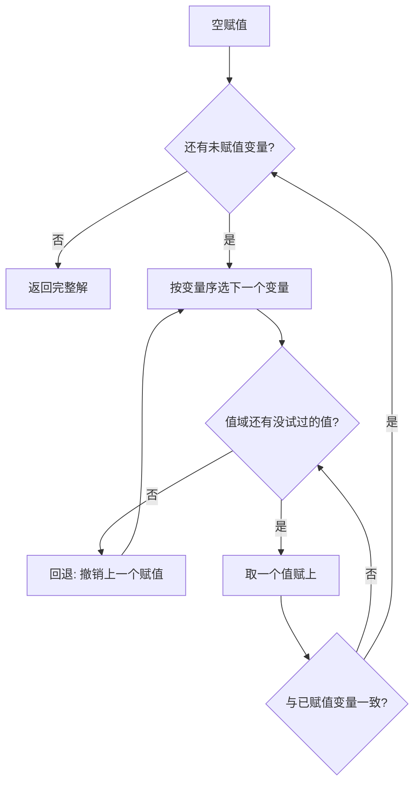

# $\rm Chapter \, 4$ 约束满足问题

> **本章假设你已经会**
>
> 1. 搜索问题五元组，以及「状态不等于附加信息」的建模纪律，回读《84-人工智能导论》§1.1。
> 2. 前沿、展开与已见集合构成的通用搜索骨架，回读《84-人工智能导论》§1.2。
> 3. 指数账 $O(b^{d})$ 为什么是无信息搜索的死穴，回读《84-人工智能导论》§1.3 与 §1.6。
> 4. 松弛问题的思想：把难题换成简单题，换取可靠的信息，回读《84-人工智能导论》§2.8。

前两章里，问题的答案是一条路径：从初始状态出发，一步一步走到目标。本章换一类问题，它的答案不是「怎么走」，而是「每个格子填什么」：给论文分配审稿人、给课程排教室、给地图上色、在数独里填数。共同点是有一批变量、每个变量有一组候选值、变量之间存在互相牵制的规则，要找的是让所有规则同时成立的完整填法。这就是约束满足问题（Constraint Satisfaction Problem，CSP）。

把思考变成搜索的心智模型在本章再进一层。第 1 章学会了搜，但通用搜索对「约束」视而不见：它要等到真的撞上一个不一致的局面，才知道走错了。而约束本身是白给的免费信息，里面藏着大量「这么填注定失败」的判断。本章的全部内容可以概括成一句话：在失败发生之前，把约束蕴含的信息用掉。你会看到四个层层递进的机制：回溯、前向检查、变量与取值排序、弧相容传播，以及它们在 n 皇后和着色图上的实测账单。

## $\rm \S \, 4.1$ 从「找一条路」到「填一张表」：CSP 与约束图

一个约束满足问题由三样东西组成：

1. 变量集（variables）：$X_{1}, \ldots, X_{n}$，是要填的所有空格。
2. 值域（domain）：每个变量 $X_{i}$ 的候选值集合 $D_{i}$，变量不一定同域。
3. 约束（constraints）：限定哪些取值组合可以同时出现的规则。

解（solution）是对每个变量各选一个值、使全部约束同时成立的完整赋值。注意它和第 1 章的两点不同：解不是路径而是完整填法，没有「先后」与「代价」可言；评价标准只有「成立/不成立」，没有「更省的解」。

以澳大利亚地图着色为例把三样东西填出来。七个州 WA、NT、SA、Q、NSW、V、T 各是一个变量，值域都是红绿蓝三色，约束是「每一条边界两端的州颜色不同」。写成公式，对每条相邻关系 $(X_{i}, X_{j})$ 要求：

$$
X_{i} \neq X_{j}
$$

读法：$X_{i}$ 与 $X_{j}$ 是共享一条边界的两个州的变量，约束只许它们取不同颜色。这个约束只牵扯两个变量，叫二元约束（binary constraint）；本章从头到尾只处理二元约束，多元约束的处理是一般化问题，思路相同但记账更重。

把变量当点、把约束当边画出来，就得到约束图（constraint graph）。它是本章所有算法的工作底图：前向检查沿着边传播，弧相容按边对账，后面每个复杂度公式的 $E$ 都数的是这张图上的边。着色问题的约束图就是地图本身；排课表里变量是课程、值是时段、边是「有学生同时选了这两门课」；论文资料管理器里给论文自动分组也一样：变量是论文，值是组号，边是「这两篇被标记为主题互斥」。同一个结构在不同外衣下反复出现，这是 CSP 值得单独学一章的理由。

n 皇后也能装进这个框架，而且装法本身就是一课。八皇后问题要求棋盘上八个皇后互不攻击。若把「每个格子里有没有皇后」都当变量，变量有 ${64}$ 个、值域是放与不放，约束图几乎两两相连。更聪明的建模是利用一个先验事实：每行恰好一个皇后。让变量是行 $X_{0}, \ldots, X_{7}$，值是列号 ${0}$ 到 ${7}$，约束是任意两行不同列且不同对角线。变量从 ${64}$ 个缩到 ${8}$ 个，「每行一后」直接编进了变量定义，不再当约束花成本。这正是 §1.1 说的建模走钢丝：粒度选对了，问题尺寸先降一个量级。

那么能不能直接拿第 1 章的搜索来解 CSP？能，但账很难看。状态取偏赋值（partial assignment），即已赋值变量及其取值；后继是给下一个变量试一个值；目标检验是「完整且一致」。分支因子是候选值个数之和，解的深度是 $n$，通用搜索只能在指数空间里蒙着眼一路撞到底。更重要的是，约束图上明摆着的信息（「这两个州不能同色」）在通用搜索眼里一文不值，非等撞车才被间接用到。CSP 求解器做的事，就是把约束从「撞车后才知道」变成「出手前就料到」。

白话：CSP 是填表问题，约束图是表格的关系网；建模时把结构性事实（如每行一后）编进变量定义，剩下的才交给约束。

> 本节小结：CSP＝变量＋值域＋约束，解是满足全部约束的完整赋值；约束图以点记变量、以边记约束；n 皇后建模成「行取列值」后变量数从 ${64}$ 降到 ${8}$。

## $\rm \S \, 4.2$ 回溯搜索：给 DFS 装上即时检查

朴素做法是枚举所有 $d^{n}$ 种完整赋值逐一验证。回溯搜索（backtracking search）只改一个地方：填的过程中，每给一个变量赋值，立刻检查它与已赋值变量之间的约束，不一致就当场放弃这个值，退回去试下一个。放弃整棵子树就是剪枝。它就是 DFS 加即时一致性检查：深度优先保证同一时刻只押一条未完成的填法，内存只需当前路径。



有两个实现级事实值得钉住。其一，固定变量序下不需要 §1.2 的已见集合：第 $k$ 层的节点恰是「前 $k$ 个变量的一个赋值」，同一个偏赋值只有一条到达路径，判重自动成立。换成后面 §4.4 的动态变量序后，同一组赋值可能经不同顺序被到达两次，重复确实存在，但实测中它的代价通常远小于动态序挣回来的收益，这是经验规则而非定理。其二，回溯没有改变最坏情形：最坏仍要数完 $O(d^{n})$ 个节点，CSP 求解在计算意义上是困难问题（一般的 CSP 求解是 NP 完全的，3-可满足性问题可以翻译成它，这是可验证的事实而非猜想）。启发式的价值全部体现在平均情形，下面的实测会给出具体倍数。

白话：回溯就是填格子，填到与已有内容冲突就擦掉换一个数，换成穷举省掉的是「明知冲突还要填完」的全部劳动。

> 本节小结：回溯＝DFS＋逐变量增量赋值＋即时一致性检查；固定变量序免判重；最坏复杂度仍 $O(d^{n})$，收益在平均情形。

## $\rm \S \, 4.3$ 前向检查：让约束提前说话

回溯仍然浪费。看这个局面：三个变量两两相连、每个只有红蓝两色（三角形二着色）。给第一个变量赋红之后，第 2、第 3 个变量都只剩蓝——而它们互连，注定有一个无值可填。回溯对这份死亡判决书毫无反应，它还要傻乎乎地把第 2 个变量赋上蓝、再轮到第 3 个变量时才发现走投无路。失败其实在第一笔赋值时就注定了，只是没人去验。

前向检查（forward checking）把验的动作提前：每赋一个值 $v$ 给变量 $X_{i}$，立刻从每个未赋值的邻居 $X_{j}$ 的值域中删掉与 $v$ 冲突的值；任何一个值域被删空，立刻回退，不再往下走。它把「轮到我才发现」改成「你一出手我就知道」。约束信息由此从一次性用品变成可以反复使用的推理件：每笔赋值都触发一轮沿约束图边的清扫。

前向检查是本章第一个传播（propagation）机制。传播的意思是：一个变量的变化沿着约束图的边引起邻居值域的变化，像水波一样扩出去。前向检查的水波只扩一轮（从新赋值出发到直接邻居），后文会看到让波扩到平息的完整版本。

白话：前向检查＝赋一笔值，就把所有邻居账本上作废的选项划掉；谁的账本划空了，立即回头。

> 本节小结：前向检查在每次赋值后清理邻居值域，空域即回退；它是第一层传播，波只扩一轮。

## $\rm \S \, 4.4$ 变量序与取值序：MRV、度启发式与 LCV

前向检查给了我们一样回溯没有的东西：动态值域。每一步都能看到每个未赋值变量还剩几个选择，这些信息够支撑两个排序启发式。

最少剩余值（Minimum Remaining Values，MRV）决定先填谁：永远选值域最小的变量。理由是一道算术题：值域只剩一个值的变量无论迟早都要填，而且此刻填它没有任何风险（它的值已别无选择，错了立即暴露）；反过来，值域宽裕的变量推迟填，损失也小。MRV 的座右铭是先难后易：尽早走进最窄的巷子，死也死在最前面，剪掉的子树最大。注意 MRV 必须配前向检查才有意义：值域不动态更新，所有未赋值变量的候选数永远相等，MRV 就退化成固定序，等于没装。

两个变量的值域并列最小时选谁？度启发式（degree heuristic）：选在约束图上邻居最多的那个。它的逻辑同型：邻居多的变量一旦定下来，能清理的账本最多，信息扩散最快。本章 §4.6 的地图实例里，SA 与五个州相邻、度最高，是天然的第一笔。

选好了变量，按什么顺序试它的值？直觉恰恰与 MRV 相反：值要随和。最少约束值（Least-Constraining Value，LCV）优先尝试删掉别人选项最少的值：给变量 $X_{i}$ 试值 $c$ 前，数一数 $c$ 会从邻居值域里挤掉几个值，挤得越少越先试。逻辑是：变量的顺序反正都要轮一遍（变量序改变的是探索顺序，不是「填不填」），所以变量要先堵最窄的口子；而某个具体值选哪个是可选的，选随和的值给后面留余地。一句话记住这对不对称：变量先难，取值先易。

LCV 不是免费的：每个候选值的评估都要做相容性判断，判断次数与邻居数和值域大小成正比。它是不是好买卖要靠实测说话，§4.6 会给出一组「帮了忙」和一组「帮倒忙」的对照，先立此存照：变量序的收益是结构性的，取值序的收益是实例性的。

白话：MRV 挑最没退路的变量先填，LCV 挑最不碍事的值先试；一个为了早失败，一个为了晚失败。

> 本节小结：MRV（配动态值域）与度启发式决定变量序，先难后易；LCV 决定取值序，先易后难；前者收益稳定，后者是经验规则。

## $\rm \S \, 4.5$ 弧相容与 AC-3：把传播推到不动点

前向检查有盲区。回到 §4.3 的三角形二着色：给 $X_{0}$ 赋红后，前向检查把 $X_{1}$、$X_{2}$ 的值域都清成 {蓝}，没有清空，检查通过。但 $X_{1}$ 与 $X_{2}$ 相连、两者都只剩蓝，矛盾就藏在这对未赋值变量之间。前向检查的水波只从新赋值出发扩一轮，邻居之间的对账它不管。要看穿这类失败，需要把对账本身定义清楚。

弧（arc）$(X_{i}, X_{j})$ 指约束图中一条有向边：从 $X_{i}$ 的视角看 $X_{j}$。称弧 $(X_{i}, X_{j})$ 相容，若 $D_{i}$ 中每个值在 $D_{j}$ 中都有支撑（support）：

$$
\forall v \in D_{i},\ \exists w \in D_{j}:\ (v, w) \text{ 与约束相容}
$$

读法：$v$ 是 $X_{i}$ 值域里的任意一个候选值，$w$ 是 $X_{j}$ 值域里的某个候选值，符号 $\exists$ 要求「存在至少一个」这样的 $w$ 与 $v$ 不冲突；这个 $w$ 就叫 $v$ 的支撑。所谓弧相容，就是 $X_{i}$ 的每个候选都不孤悬——在邻居那里找得到伴。三角形二着色的失败此刻可以精确表述为：赋红后，弧 $(X_{1}, X_{2})$ 不相容，因为 ${蓝}$ 在 $D_{2}$ 里没有支撑（唯一候选 ${蓝}$ 与它同色）。

检查并修复一条弧的操作叫 revise。对弧 $(X_{i}, X_{j})$：扫描 $D_{i}$ 的每个 $v$，若在 $D_{j}$ 中找不到支撑就删掉 $v$；只要删了至少一个值，$D_{i}$ 就变了，所有指向 $X_{i}$ 的其他弧 $(X_{k}, X_{i})$ 可能因此失效，全部重新入队待查。AC-3（Arc-Consistency 3）把这件事做到底：初始时把约束图每条边的两个方向共 ${2E}$ 条弧全部入队，然后不断出队、revise，队列空时整个约束图达到弧相容状态，即每条弧的两个方向都相容。

弧相容算法有三条定理要证，它们合起来才是「可以放心用」的完整凭据。

**定理一（终止）**：AC-3 必然停止。取势函数 $\Phi = \sum_{i} |D_{i}|$，即所有值域的大小总和。出队的弧做一次 revise，要么什么都不删（此时不入队任何新弧，队列纯消耗），要么至少删一个值、$\Phi$ 严格减 ${1}$。「删了值」的出队至多 $\Phi$ 的初始值 $nD$ 次（$D$ 为值域大小上界，$\Phi$ 非负且有下界），「没删值」的出队不产生新工作，所以整个过程的出队次数有限。

**定理二（不删真值）**：若当前偏赋值存在一致的完整扩展 $\sigma$，则 AC-3 删掉的任何值都不是 $\sigma$ 给出的值。对删除次数归纳：第一次 revise 前，$\sigma(x_{j}) \in D_{j}$ 对所有未赋值 $j$ 成立（$\sigma$ 是合法扩展）；revise$(X_{i}, X_{j})$ 要删 $v$，须 $v$ 在 $D_{j}$ 中无支撑，但 $\sigma(x_{j})$ 就在 $D_{j}$ 里（归纳假设）且与 $v=\sigma(x_{i})$ 一致（$\sigma$ 一致），故 $v$ 有支撑、不会被删。归纳闭环：任何一轮删的都不是 $\sigma$ 的值，$\sigma$ 的值永远留在值域里。

**推论（可靠失败）**：AC-3 报告某值域为空，当且仅当可以断言当前偏赋值没有任何完整解扩展。若有扩展，定理二说 $\sigma$ 的值还留在每个值域里，值域不可能空——所以空域就是死刑判决，且绝无冤案。

**定理三（终态弧相容）**：队列空时每条弧都相容。看弧 $(X_{i}, X_{j})$：它最后一次被 revise 后，要么什么都没删（结论直接成立），要么删了值并重新入队了所有指向 $X_{i}$ 的弧。但注意 revise$(X_{i},X_{j})$ 的结论只依赖 $D_{j}$，而 $D_{j}$ 在那之后若再变小，弧 $(X_{i},X_{j})$ 会被再次入队（入队规则保证），直到它重查过为止。队列空意味着没有任何待重查的弧，故每条弧最后一次检查的结论在终态仍成立。

复杂度也能当场算出来。每条弧 $(X_{i}, X_{j})$ 初始入队一次，此后只在 $D_{j}$ 变小时被重新入队，而 $D_{j}$ 整个过程中至多缩小 $D$，故出队至多 ${1+D}$ 次；一次 revise 至多做 ${|D_{i}| \cdot |D_{j}|} \le D^{2}$ 次支撑判断。总判断数的上界为：

$$
E \cdot (1 + D) \cdot D^{2} = O(E D^{3})
$$

读法：$E$ 是约束图的边数，$D$ 是值域大小上界；三个因子依次是「弧的条数、每条弧被反复检查的次数、每次检查的成本」。这是最坏情形上界，实际中支撑判断常因提前命中而提前退出。

AC-3 与前向检查的关系现在可以说清：前向检查等价于「只从新赋值出发做一轮局部 revise」，AC-3 是把这轮水波推到不动点。三角形二着色上二者分出了高下，本章实测（§4.6 的 E2）给出账目：同一实例，朴素回溯 ${10}$ 个节点判死，前向检查 ${4}$ 个，AC-3 只用 ${2}$ 个。

最后一个诚实的提醒：弧相容是必要条件不是充分条件。把三个变量排成三角形，约束改成 $X_{1}=X_{2}$、$X_{2}=X_{3}$、$X_{3}\neq X_{1}$，值域都是 {红, 蓝}。静态跑 AC-3：每个值都能在邻居那里找到支撑，一个值都删不掉，检查全部通过（§4.6 的 E5 实测剪除 ${0}$）。但三个变量只能取两个值且首尾相牵，解显然不存在，回溯要走 ${10}$ 个节点才能证明。这组约束与三角形二着色同构（把相等换成「不许异色」即是），同样的实例挂上搜索做增量传播（每赋一值跑一次 AC-3，这个组合叫维护弧相容，Maintaining Arc Consistency，MAC），失败在第一个赋值后立刻现形，实测只花 ${2}$ 个节点。结论：传播与搜索必须咬合在一起，单独任何一个都不完整。

白话：弧相容给每个候选值验明「在邻居处有靠山」，AC-3 把验的动作循环到全图安静；空域是可靠的失败信号，但「全图相容」不担保有解，最后的裁决仍要靠搜索。

> 本节小结：弧 $(X_{i},X_{j})$ 相容＝$D_{i}$ 中每个值在 $D_{j}$ 中有支撑；AC-3 用 revise 循环到不动点，终止、不删真值、输出弧相容，复杂度上界 $O(ED^{3})$；弧相容是必要非充分，实战用 MAC 把传播嵌进回溯。

## $\rm \S \, 4.6$ 实测：n 皇后与着色图上的账

证明之外，本章每个机制都在实例上真跑过。环境为 WSL 里的 python3（仅标准库），脚本与全部输出存于 `26Fall/_uni5_work/expIA04/`，种子固定为 ${20261108}$，节点数等确定性计数任何人重跑逐位一致；耗时随机器浮动，量级仅供参考。复现命令如下。

```bash
# 环境: WSL 的 Bash; 前置: python3, 无第三方依赖
cd /mnt/c/Users/20811/Desktop/26Fall/_uni5_work/expIA04
python3 expIA04.py    # 输出与随附 result.txt 一致; 全部断言通过
```

口径钉死：节点＝搜索树中一次「给某变量试一个值」的赋值尝试；检查＝一次二元约束相容性判断（前向检查、revise 与 LCV 评估中的判断都计入）；剪除＝从值域删除一个值的动作（被撤销的也计入）；revise＝AC-3 出队一条弧并检查一次。四个求解器共用同一套检查器与校验器，求出的解全部通过独立的逐对验证。

第一组实验是 n 皇后求第一个解，$n$ 取 ${8}$、${12}$、${16}$，四种求解器对垒。$n=8$ 的账：

| 求解器 | 节点 | 检查 | 剪除 | revise | 耗时 |
| --- | --- | --- | --- | --- | --- |
| 回溯 BT | ${876}$ | ${2438}$ | ${0}$ | ${0}$ | ${0.3}$ ms |
| FC+MRV | ${75}$ | ${777}$ | ${291}$ | ${0}$ | ${0.2}$ ms |
| FC+MRV+LCV | ${39}$ | ${1645}$ | ${149}$ | ${0}$ | ${0.2}$ ms |
| MAC | ${20}$ | ${4214}$ | ${222}$ | ${1509}$ | ${0.9}$ ms |

$n=16$ 的账（$n=12$ 的节点数为 BT ${3066}$、FC+MRV ${153}$、LCV ${32}$、MAC ${51}$，趋势与下表相同）：

| 求解器 | 节点 | 检查 | 剪除 | revise | 耗时 |
| --- | --- | --- | --- | --- | --- |
| 回溯 BT | ${160712}$ | ${827932}$ | ${0}$ | ${0}$ | ${76.3}$ ms |
| FC+MRV | ${44}$ | ${1411}$ | ${278}$ | ${0}$ | ${0.3}$ ms |
| FC+MRV+LCV | ${332}$ | ${22890}$ | ${1508}$ | ${0}$ | ${3.4}$ ms |
| MAC | ${21}$ | ${26547}$ | ${233}$ | ${6113}$ | ${4.6}$ ms |

四条读数。其一，朴素回溯的指数本性肉眼可见：$n$ 从 ${8}$ 到 ${12}$ 再到 ${16}$（每次只加 ${4}$ 个皇后），节点数 ${876} \to {3066} \to {160712}$，最后一跳 ${52.4}$ 倍，$n=16$ 一次就要 ${83}$ 万次相容性判断。其二，前向检查把节点数压掉三个数量级（$n=16$ 时 ${44}$ 对 ${160712}$，约 ${3652}$ 分之一），证实 §4.3 的论断：约束里的信息提前用，收益是数量级的。其三，MAC 的节点数全场最少（${20}$、${51}$、${21}$），但它是用推理开销换的：$n=8$ 时每解一个节点平均要做 ${75}$ 次 revise，检查总数是前向检查的 ${5.4}$ 倍，小问题上墙钟时间反而垫底（${0.9}$ ms 对 ${0.2}$ ms）；到 $n=16$ 朴素回溯膨胀到 ${76.3}$ ms，MAC 的 ${4.6}$ ms 反超。推理强度是按问题难度买的，小账本上不划算，大账本上非它不可。其四，LCV 在 $n=8$、${12}$ 上把节点数从 ${75}$、${153}$ 压到 ${39}$、${32}$，在 $n=16$ 上却从 ${44}$ 恶化到 ${332}$——§4.4 立此存照的经验规则在这里兑现了两面。节点数也非单调：FC+MRV 在 $n=16$ 的 ${44}$ 比它在 $n=12$ 的 ${153}$ 更小，因为求「第一个解」的路径依赖访问序，不同 $n$ 的实例难度不随 $n$ 平滑增长。

作为独立校验，同一套朴素回溯枚举 $8$ 皇后全部解，得 ${92}$ 个（与组合数学的已知常数严格相等），共 ${46752}$ 次检查、${5.0}$ ms——解校验器的正确性由此钉在公认常数上。

第二组实验验证传播的阶梯。三角形二着色（不可满足）上，朴素回溯 ${10}$ 个节点判死，前向检查 ${4}$ 个，MAC ${2}$ 个，恰好按 §4.3 与 §4.5 的论证逐级减半。等式/不等式三角形（同样不可满足）上，静态 AC-3 剪除 ${0}$、通过检查，朴素回溯 ${10}$ 个节点证明无解——「弧相容通过不等于有解」拿到了实测证据；换 MAC 只花 ${2}$ 个节点。

第三组实验对着色问题量传播的总体效果：${50}$ 个随机图（${15}$ 个变量、跨色对连边概率 ${0.45}$、平均 ${32.8}$ 条边，均按植入着色构造以保证可解），四种求解器全部解出，账目汇总：

| 求解器 | 解出 | 节点中位 | 节点均值 | 检查合计 | 耗时合计 |
| --- | --- | --- | --- | --- | --- |
| 回溯 BT | 50/50 | ${102}$ | ${237.0}$ | ${23111}$ | ${3.8}$ ms |
| FC+MRV | 50/50 | ${15}$ | ${17.1}$ | ${1932}$ | ${4.3}$ ms |
| FC+MRV+LCV | 50/50 | ${15}$ | ${16.9}$ | ${4679}$ | ${3.0}$ ms |
| MAC | 50/50 | ${15}$ | ${15.6}$ | ${3461}$ | ${50.6}$ ms |

节点均值从 ${237.0}$ 降到 ${17.1}$，前向检查一个人就挣到 ${13.9}$ 倍；中位数 ${102}$ 对 ${15}$ 说明改善是普遍的、不是少数实例拉动的；反过来，BT 均值 ${237}$ 远高于中位 ${102}$，暴露了少数难实例造成的重尾。两条诚实的注脚：MAC 的节点均值 ${15.6}$ 与 FC 的 ${17.1}$ 几乎重合，剪除总量也是 ${1362}$ 对 ${1402}$。在这批稀疏图上，弧相容的额外传播轮次几乎没有增量收益，AC-3 的威力要等约束更稠密、传播能级联时才兑现（三角形实例上它就比 FC 少一半节点）；而 MAC 的耗时合计 ${50.6}$ ms 是 BT 的 ${13.3}$ 倍，再次验证「推理开销在小规模上吞掉节点收益」。变量序的另一个侧面也有数据：地图着色的教科书实例（WA、NT、SA、Q、NSW、V、T）朴素回溯只花 ${11}$ 个节点就解出（${7}$ 个变量、${4}$ 次无效尝试），因为固定序恰好让约束图的核心变量 SA 第三个出场。度启发式会把 SA 提到第一，但在这个小实例上收益无从体现，教科书实例的「顺手」不等于启发式无效。

白话：这一节拿数据对口供。定理说约束信息提前用有数量级收益，实测节点数除以三千；定理说传播开销真实存在，实测小问题上 MAC 最慢；定理说弧相容非充分，实测一个值都删不掉的无解实例。

> 本节小结：n 皇后实测 BT 节点 ${876} \to {3066} \to {160712}$，FC/MAC 压到几十；MAC 节点最少但推理开销大，难度上去了才回本；着色图实测 FC 均值 ${13.9}$ 倍节点削减；弧相容非充分与传播阶梯各拿到实测证据。

> 竞赛生迁移提示：OJ 搜索题里的「剪枝」大多是手工版的前向检查——预处理先打表、可行性剪枝提前退出。CSP 的贡献不是发明剪枝，而是把剪枝标准化：一致性检查、传播、变量序、取值序拆成可以独立组合与单独评测的部件。写题解时用这套词汇拆解你的剪枝，能立刻看清哪一层贡献了多少。

## $\rm \S \, 4.7$ 两个典型错误与证据式排查

错误一：在静态值域上跑 MRV，以为装了启发式。症状：代码里有「选候选值最少的变量」，节点数却与朴素回溯一模一样。病根：MRV 的输入是动态值域，没配前向检查时所有未赋值变量的候选数恒等于 $d$，并列最小永远取到编号最小的变量，选出的恰好是固定行序。排查办法：在变量选择处打印「选中变量、当前各变量值域大小」，若每次打印都是满域，说明前向检查没接上。本章 FC+MRV 与 BT 在同一实例上的节点数 ${75}$ 对 ${876}$，差距本身就是前向检查在工作的证据。

错误二：把「弧相容通过」当「有解」。症状：AC-3 全图检查通过、一个值都没删，程序断言问题可解，随后搜索却报无解。病根：§4.5 的定理二只保证「有解时不误删」，它的逆命题「不删值则有解」不成立：三个等式加一个不等式的实例（值域 {红, 蓝}）里，每个值都有支撑但解不存在，实测剪除 ${0}$ 而朴素回溯要走 ${10}$ 个节点才判死。排查办法：对静态弧相容的结论加一层警惕：凡是「检查通过」的输出，语义都是「未发现矛盾」，不是「矛盾不存在」；要结论，让搜索走到完整赋值。

白话：启发式失灵先查它的输入（值域是不是真的动态了），检查通过先问语义（是「没查出」还是「不存在」）。

> 本节小结：MRV 脱离前向检查退化为固定序；弧相容通过只意味着「未发现矛盾」，两个错误都有本章实测数字作对照。

## $\rm \S \, 4.8$ 关键概念回顾

1. CSP 的三要素是什么？它的解与第 1 章搜索问题的解在哪两点上不同？
2. n 皇后的变量、值域、约束各是什么？「每行一后」为什么该编进变量定义而不是当约束？
3. 回溯搜索为什么在固定变量序下不需要已见集合（§1.2 的骨架在这里省了什么）？
4. MRV 为什么必须配前向检查？没有它 MRV 会退化成什么？
5. 弧 $(X_{i}, X_{j})$ 相容的定义是什么？「支撑」指什么？
6. AC-3 的三条定理各担保什么？「不删真值」的逆命题为什么错误？

## $\rm \S \, 4.9$ 应用与辨析

1. 论文资料管理器要把 ${20}$ 篇论文分进 ${3}$ 个专题文件夹，其中若干对论文被标记为主题互斥（不能同文件夹）。把它建模成 CSP：变量、值域、约束、约束图各是什么？若互斥对很少，四种求解器里选哪个做第一版？互斥对稠密到接近不可满足时呢？
2. 同事说「MAC 的节点数最少，所以它总是最快」。用本章 $n=8$ 与 $n=16$ 皇后的两份账评价这句话对多少、错多少。
3. 给 §4.5 的等式/不等式三角形加上第四个变量 $X_{4}$，约束 $X_{4}=X_{1}$，值域仍为两值。静态 AC-3 会剪除值吗？MAC 与朴素回溯各大约要走多少节点？先推理再动手验证。

## $\rm \S \, 4.10$ 答案

概念回顾答案：

1. 变量集、值域、约束（§4.1）。两点不同：解是完整赋值不是路径；评价只有成立与否、没有代价与最优性（§4.1）。
2. 变量是行 $X_{0}, \ldots, X_{7}$，值域是列号 ${0}$ 到 ${7}$，约束是任意两行不同列且不同对角线。「每行一后」是结构性事实，编进变量定义使变量从 ${64}$ 个缩到 ${8}$ 个，当约束则每个格子都要付一致性检查的成本（§4.1）。
3. 第 $k$ 层节点恰是前 $k$ 个变量的赋值，同一偏赋值只有一条到达路径，判重自动成立；省掉的是整个已见集合及其存储（§4.2）。
4. MRV 的输入是各变量当前值域大小，不配前向检查则候选数恒为 $d$、并列最小永远取最小编号，退化为固定序；实测 FC+MRV 与 BT 节点数 ${75}$ 对 ${876}$ 的差距即由此而来（§4.4、§4.6）。
5. $D_{i}$ 中每个值 $v$ 都在 $D_{j}$ 中存在一个与之相容的 $w$，这个 $w$ 就是 $v$ 的支撑；有支撑＝不孤悬（§4.5）。
6. 终止（势函数 $\Phi=\sum|D_{i}|$ 严格下降且有下界）；不删真值（存在一致扩展时扩展值永不被删）；终态弧相容（队列空即无待重查弧）。逆命题不成立：删值为零不蕴含可满足，E5 实例实测剪除 ${0}$ 而无解（§4.5、§4.6）。

应用与辨析答案：

1. 变量是 ${20}$ 篇论文，值域是 ${3}$ 个文件夹编号，约束是每对互斥论文不同号，约束图以论文为点、互斥对为边（§4.1）。互斥对少时图稀疏、传播增量小，回溯甚至裸 FC+MRV 足够，MAC 的推理开销不划算（实测稀疏图上 MAC 耗时 ${50.6}$ ms 对 BT ${3.8}$ ms）；互斥对稠密接近不可满足时，早失败的价值飙升，MAC 的空域判决能省掉指数级的无效子树，类似三角形实例上 ${2}$ 节点对 ${10}$ 节点的差距会被放大（§4.6）。
2. 对的一半：节点数确实全场最少（${20}$、${51}$、${21}$）。错的两处：「总是」不成立——$n=8$ 时 MAC 耗时 ${0.9}$ ms 反而慢于 FC+MRV 的 ${0.2}$ ms 与 BT 的 ${0.3}$ ms，推理开销在小规模上吞掉节点收益；而且 MAC 在 $n=12$ 的 ${51}$ 还多于 FC+MRV+LCV 的 ${32}$，节点数最少也不是在每种配置下成立。正确的说法是条件化的：问题足够难（如 $n=16$ 的 ${76.3}$ ms 对 ${4.6}$ ms）时 MAC 才兼得两项（§4.6）。
3. 静态 AC-3 仍然一个值都删不掉：$X_{4}$ 的每个值在 $X_{1}$ 处都有支撑（$X_{4}=X_{1}$ 且 $X_{1}$ 值域满），原有三条约束的相容性也没被破坏（§4.5 的论证可逐条核）。朴素回溯的账分文不变，仍是 ${10}$ 个节点：$X_{4}$ 排在变量序最后，而 $X_{3}$ 处的两个分支都注定失败，搜索从未轮到 $X_{4}$；MAC 仍在第一个赋值后失败，约 ${2}$ 个节点（$X_{1}$ 的两个候选各一次）。数字以重跑脚本为准，推理给的是量级。

**你现在能做什么**：随手挑一个生活中的分配问题（排值日、分座位），写出变量、值域、约束，指出约束图上度最大的变量，并说出 MRV 会从它开始还是最后才碰它。

本章的约束是硬性的：允许或不允许，没有中间地带。下一章把「硬性」放宽成「带置信度」——变量之间的依赖不再是不等式，而是条件概率，约束图升级为贝叶斯网。全册心智模型的后半句「把不确定变成概率」从那里开始。

---

实验记录：本章 §4.6 全部实测数字来自脚本 `expIA04.py`（n 皇后四求解器对垒、${92}$ 解常数校验、三角形二着色传播阶梯、${50}$ 个植入着色随机图汇总、等式/不等式三角形弧相容检验，python3 标准库，种子 ${20261108}$，WSL 运行，总耗时约 ${0.2}$ 秒），原始输出存于写作工作目录 `26Fall/_uni5_work/expIA04/result.txt`；节点、检查、剪除、revise 为确定性计数，重跑逐位复现，耗时项随机器浮动。
