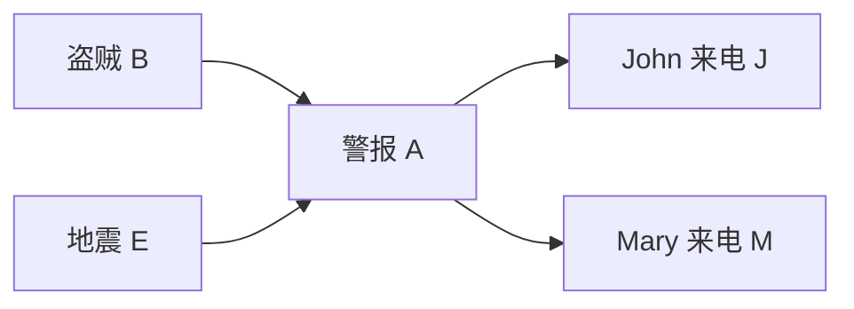

# $\rm Chapter \, 5$ 贝叶斯网

> **本章假设你已经会**
>
> 1. 条件概率、边缘化与链式法则，回读《19-概率论》§3.1。
> 2. 独立的定义 ${p(x,y)=p(x)p(y)}$ 与它与不相关的关系，回读《19-概率论》§3.2。
> 3. 链、分叉、对撞三种基本结构与 d-分离判据的陈述，回读《19-概率论》§8.4 与 §8.5。本章把那份「机械判据」变成线性时间的程序，并逐条对账。
> 4. 约束图与「约束信息提前用」的传播思想，回读《84-人工智能导论》§4.1 与 §4.3。

第 4 章的约束是硬性的：两个州不许同色，没有中间地带。现实里的知识大多软得多：警报响了，盗贼多半来了，但也可能是地震；John 打来电话，警报多半响了，也可能他看错了。把「不许」换成「多大概率」，变量之间的牵制就从约束变成条件概率，约束图升级为贝叶斯网（Bayesian network）。全册心智模型的后半句「把不确定变成概率」从本章开始兑现。本章管表示：哪些变量直接相互作用，图在背后担保哪些条件独立；第 6 章管使用：给定证据算查询。

## $\rm \S \, 5.1$ 联合分布的表装不下

把「报警」这件事的全部不确定性写下来，最直接的办法是联合分布表：$B$（盗贼）、$E$（地震）、$A$（警报）、$J$（John 来电）、$M$（Mary 来电）五个二值变量，表有 $2^{5}=32$ 行，指定其中 ${31}$ 个数（最后一个由归一化决定）。五个变量还数得过来；一段文本的每个词、一张体检单的每项指标，几百个变量就是 $2^{n}-1$ 个数，永远填不完。这是《19-概率论》§8.1 的出发点，本章沿同一条路往前走。

出路与第 4 章同型：别把知识平均摊在所有变量上，把它按「谁直接影响谁」拆开。影响警报的直接因素是盗贼和地震，不是 John 的心情；John 打不打电话只取决于警报响没响。直接因素画成箭头，得到这张图：



每个变量配一张条件概率表（Conditional Probability Table，CPT），内容是「给定直接原因的取值，它自己取各值的概率」。报警网的五张表是本章后续所有实验的固定实例：

1. ${P(B=1) = 0.001}$、${P(E=1) = 0.002}$：盗贼与地震都罕见，且图上没有边连接它们，两者先验无关。
2. ${P(A=1 \mid B, E)}$：两个都发生 ${0.95}$，只有盗贼 ${0.94}$，只有地震 ${0.29}$，都没有 ${0.001}$。
3. ${P(J=1 \mid A=1) = 0.90}$、${P(J=1 \mid A=0) = 0.05}$；${P(M=1 \mid A=1) = 0.70}$、${P(M=1 \mid A=0) = 0.01}$：John 比 Mary 更依赖警报，Mary 即使没警报也偶而来电。

CPT 加上这张有向无环图（DAG），联合分布就被拆成了每变量一个因子：

$$
P(X_{1}, \ldots, X_{n}) \;=\; \prod_{i=1}^{n} P\bigl(X_{i} \mid \mathrm{Pa}(X_{i})\bigr)
$$

读法：$\mathrm{Pa}(X_{i})$ 是 $X_{i}$ 在图上的全部父节点，连乘把联合分布写成 $n$ 个因子的积，第 $i$ 个因子是 $X_{i}$ 自己那张 CPT。报警网的账：$B$ 与 $E$ 各 ${1}$ 个数、$A$ 四个父节点组合、$J$ 与 $M$ 各两个，共 ${10}$ 个数，对比全表的 ${31}$ 个。一般地，若每个变量至多 $k$ 个父节点，参数量从 $2^{n}-1$ 降到 ${n \cdot 2^{k}}$：表从指数变成了线性乘指数的小头。压缩的代价是断言了一批「不影响」：没有边画出来，就是宣称影响可以忽略。

白话：贝叶斯网把「谁直接影响谁」画成箭头，每个变量只背一张以直接原因为条件的小表；全分布那张装不下的大表，被这些小表的乘积替掉了。

> 本节小结：$n$ 个二值变量的全表要 $2^{n}-1$ 个参数；贝叶斯网用 DAG 加 CPT 把它拆成每变量一张小表，参数量 ${n \cdot 2^{k}}$；省参数的代价是图上的每处「无边」都在断言独立。

## $\rm \S \, 5.2$ 语义：图在背后担保什么

上面的拆法看起来只是「挑了个方便的顺序做链式法则」，但它的内容比这多：因子分解断言了一批条件独立，而且断言得对。先用两步把这件事证给读者看。设变量按拓扑序排好（父节点永远排在孩子前面），先证最后一个变量 $x_{n}$：给定全部前驱时，它的行为只由父节点决定。由因子分解式，固定 ${x_{1}, \ldots, x_{n-1}}$ 后对 $x_{n}$ 归一化：

$$
P(x_{n} \mid x_{1}, \ldots, x_{n-1}) \;=\; \frac{\prod_{i=1}^{n} P(x_{i} \mid \mathrm{Pa}(x_{i}))}{\sum_{x_{n}'} \prod_{i=1}^{n} P(x_{i} \mid \mathrm{Pa}(x_{i}))} \;=\; P(x_{n} \mid \mathrm{Pa}(x_{n}))
$$

读法：求和只对 $x_{n}$ 的候选值 ${x_{n}'}$ 做；拓扑序保证 $x_{n}$ 不是任何更早变量的父节点，所以 $i<n$ 的因子全都不含 $x_{n}$，在分子分母里原样出现而被约掉，剩下恰好是归一化过的 $x_{n}$ 因子。要推广到每个变量，还差一步：把 $x_{n}$ 边缘化后，剩余分布仍是同一形式的因子分解。这也是一行的账：$x_{n}$ 只出现在自己的因子中，

$$
P(x_{1}, \ldots, x_{n-1}) \;=\; \prod_{i<n} P(x_{i} \mid \mathrm{Pa}(x_{i})) \cdot \sum_{x_{n}'} P(x_{n}' \mid \mathrm{Pa}(x_{n}')) \;=\; \prod_{i<n} P(x_{i} \mid \mathrm{Pa}(x_{i}))
$$

读法：末尾那个求和恰好把 $x_{n}$ 的因子归一化成 ${1}$，联合分布退回 $n-1$ 个变量的同型分解，图上相当于摘掉一个叶节点。对缩小后的网络重演上面两步，归纳到底就得到：每个变量给定拓扑序全部前驱时，条件分布等于给定父节点的条件分布。前驱里除父节点外的那些变量，对它是真正多余的。

这条性质已经是图语义的实质内容，但工程上更好用的是全局版本：不看拓扑序，直接在图上判。判据就是《19-概率论》§8.5 的 d-分离（d-separation），本章 §5.3 给激活路径的精确定义、§5.4 给判定算法。两个方向合起来是贝叶斯网的语义：

1. 可靠性（本章的对象）：图上 d-分离的每一对变量，在分布中真的条件独立。凡判定器说「独立」，分布担保成立。
2. 单向性：反过来不担保。分布里真实存在的独立，图可能一个都没表达（图是分布的 I-映射（I-map），通常不是完美映射）。§5.5 会实测这个单向性有多疼。

白话：因子分解不是记号游戏，它真的担保「d-分离 ⇒ 条件独立」；但图只承诺这一侧，分布里多出来的独立它管不着。

> 本节小结：因子分解 ⇒ 每个变量给定前驱只需父节点（末位除法＋叶节点边缘化两步归纳）；全局语义是「d-分离 ⇒ 条件独立」，方向单一，反向不担保。

## $\rm \S \, 5.3$ 三种结构与激活路径

d-分离判据的全部内容在三种局部结构里（《19-概率论》§8.4 已逐个推导），这里把它们收拢成判定算法需要的形状。考察一条路径的中间节点 $V$，两端的边怎么接它，决定 $V$ 何时放行信息：

| 结构 | 中间节点处两端箭头 | 无证据时 | 给定 $V$（或其后代） |
| --- | --- | --- | --- |
| 链 | ${u \to V \to w}$ | 放行 | 掐断 |
| 分叉 | ${u \leftarrow V \to w}$ | 放行 | 掐断 |
| 对撞 | ${u \to V \leftarrow w}$ | 掐断 | 放行 |

前两行直觉一致：中间节点不知道任何消息时，消息自由穿过；一旦它的值被观测，不确定性被吸收，两侧隔断。第三行反着来：$u$ 与 $w$ 本是两个独立的原因，观测到共同结果 $V$（甚至只观测到 $V$ 的某个后代）就把它们拴在一起。报警网给了一手实例：盗贼与地震先验无关，警报一响它们就竞争解释，观测「警报响但地震也发生了」会把盗贼的概率从 ${0.001}$ 的先验拉高又压回去，这个现象叫解释消除（explaining away）。

把这些局部规则拼成整体：一条无向路径在证据集 $Z$ 下叫激活路径（active trail），若每个中间节点 $V_{i}$ 都满足

$$
\begin{aligned}
&V_{i} \text{ 处为链或分叉} \;\Rightarrow\; V_{i} \notin Z; \\
&V_{i} \text{ 处为对撞} \;\Rightarrow\; V_{i} \text{ 或它的某个后代属于 } Z.
\end{aligned}
$$

读法：逐节点检查路径的每个中间点，链与分叉要求「没被观测」，对撞要求「有观测到达它或它的后代」；全部节点过关，路径才活着。称 $X$ 与 $Y$ 在 $Z$ 下 d-分离，记 ${X \perp_{d} Y \mid Z}$，若 $X$ 到 $Y$ 的所有路径都不激活。可靠性定理说：${X \perp_{d} Y \mid Z}$ 成立时，分布中 ${X \perp Y \mid Z}$ 成立。这个定理的形式证明不在本章展开，本章给它两重支撑：§5.2 的因子分解论证提供了局部版本，§5.5 的几千道数值查询提供实证核对。

白话：一条路径活不活，看每个中间节点的箭头形状和证据位置；链与分叉怕被观测，对撞求着被观测；全部堵死才是独立。

> 本节小结：链与分叉无证据放行、被观测掐断；对撞相反，被观测（或后代被观测）才放行；所有路径都死记作 ${X \perp_{d} Y \mid Z}$，它担保分布中的条件独立。

## $\rm \S \, 5.4$ d-分离的完整算法：可达性

判定 ${X \perp_{d} Y \mid Z}$ 的朴素做法是枚举全部路径逐条检查。路径数是指数的：$k$ 个菱形结构串成一条链，中间就有 $2^{k}$ 条简单路径。好在激活性有个关键性质：一条路径活不活，只取决于它经过的节点与证据的关系，跟路径的前半截怎么绕无关。这提示我们别枚举路径，改为在「节点＋进入方向」的状态图上做可达性搜索，状态至多每节点两个。

算法分两阶段。第一阶段把证据的祖先闭包 ${\mathrm{Anc}(Z) = Z \cup \{V : V \text{ 是某个证据节点的祖先}\}}$ 算出来，一次深度优先搜索即可。理由藏在激活判据里：对撞放行要求「对撞节点或其后代有证据」，而「$V$ 的后代有证据」等价于「$V$ 属于 $\mathrm{Anc}(Z)$」，先算好这张集合，第二阶段就只需查表。第二阶段从 ${(X, \uparrow)}$ 出发做广度优先，$\uparrow$ 表示球从 $X$ 的孩子一侧进入（沿边逆行），$\downarrow$ 表示从父亲一侧进入（顺边走）。扩展规则恰好是三种结构的复述：

| 当前状态 | 条件 | 扩展动作 |
| --- | --- | --- |
| ${(V, \uparrow)}$ | ${V \notin Z}$ | 入队 ${( \text{父}, \uparrow )}$（链）与 ${( \text{子}, \downarrow )}$（分叉） |
| ${(V, \uparrow)}$ | ${V \in Z}$ | 停止，不再扩展 |
| ${(V, \downarrow)}$ | ${V \notin Z}$ | 入队 ${( \text{子}, \downarrow )}$（链） |
| ${(V, \downarrow)}$ | ${V \in \mathrm{Anc}(Z)}$ | 入队 ${( \text{父}, \uparrow )}$（对撞被证据打开） |

读法：第一行是从孩子逆行进入 $V$，$V$ 处箭头背向路径来路，继续往父走是链、折返向子走是分叉，两者都要求 $V$ 无观测；第四行是顺行进入 $V$ 后想逆行出去，此时 $V$ 在路径上是两个箭头的汇聚点（对撞），只有 $V$ 有证据或后代有证据才放行。从 $X$ 出发所有被标记「可达」的节点 $Y$ 都与非 d-分离；判 ${X \perp_{d} Y \mid Z}$ 就看 $Y$ 是否可达。

为什么这扫描就是 d-分离？需要一条双向的引理。

**引理（状态刻画激活路径）**：状态 ${(V, d)}$ 被标记可达，当且仅当存在一条从 $X$ 到 $V$ 的激活路径，其进入 $V$ 的方向与 $d$ 一致。

1. （标记 ⇒ 有活跃路径）对入队顺序归纳。种子 ${(X, \uparrow)}$ 对应空路径，成立。设 ${(u, d')}$ 已标记，核对扩展表把 ${(V, d)}$ 入队的那一步：每条规则恰好是在 $u$ 的 witness 路径末尾接一条边，且新中间节点 $u$ 的激活条件成立。${(u, \uparrow)}$ 且 ${u \notin Z}$ 时向父扩是链通过、向子扩是分叉通过；${(u, \downarrow)}$ 且 ${u \notin Z}$ 时向子扩是链通过；${(u, \downarrow)}$ 且 ${u \in \mathrm{Anc}(Z)}$ 时向父扩是对撞通过。延长后的路径逐节点满足激活判据。
2. （活跃路径 ⇒ 标记）对路径长度归纳。设 ${X = V_{0} - V_{1} - \cdots - V_{k} = V}$ 激活，归纳假设 ${(V_{k-1}, d')}$ 已被标记（方向由 $V_{k-1}$ 处的进出方式决定）。查扩展表：$V_{k-1}$ 处是链或分叉时，激活条件给了 ${V_{k-1} \notin Z}$，表中恰有对应行把 ${(V_{k}, d)}$ 入队；$V_{k-1}$ 处是对撞时，激活条件正是 ${V_{k-1} \in \mathrm{Anc}(Z)}$，第四行规则接管。归纳推进到 ${(V, d)}$。

两个方向合起来：$Y$ 可达等价于存在激活路径，等价于非 d-分离，判定器与定义严格一致。复杂度也随之清楚：状态至多 ${2V}$ 个，每个状态至多入队一次，每次扩展沿该节点的全部入边或出边各走一遍，总账 ${O(V + E)}$，与图的大小成线性。

拿报警网走一遍 ${B \perp M \mid A}$ 的判定。证据 ${Z = \{A\}}$，${\mathrm{Anc}(Z) = \{A, B, E\}}$。队列从 ${[(B, \uparrow)]}$ 开始：

1. 出队 ${(B, \uparrow)}$：${B \notin Z}$，标记 $B$；孩子只有 $A$，入队 ${(A, \downarrow)}$。
2. 出队 ${(A, \downarrow)}$：${A \in Z}$，不标记、不向子扩；${A \in \mathrm{Anc}(Z)}$，向父扩，入队 ${(B, \uparrow)}$（已标记，跳过）与 ${(E, \uparrow)}$。
3. 出队 ${(E, \uparrow)}$：${E \notin Z}$，标记 $E$；孩子 $A$ 的 ${(A, \downarrow)}$ 已访问。队列空。

可达集为 ${\{B, E\}}$，$M$ 不在，判定 d-分离。全表数值核对（§5.5 的口径）：${P(M \mid A, B) = P(M \mid A)}$，偏差 ${1.1 \times 10^{-16}}$，确为条件独立。反向对照 ${B \perp E \mid A}$：同一扫描在第 2 步把 ${(E, \uparrow)}$ 入队并标记 $E$，判定不分离，对应解释消除的激活对撞。

白话：判定器不数路径，只沿着「节点＋来向」的状态图扩散，规则表就是三种结构的翻译；扫完看目标亮没亮灯，全程线性时间。

> 本节小结：d-分离可用两阶段可达性算法精确判定，先算证据祖先闭包 $\mathrm{Anc}(Z)$，再按四条扩展规则做状态搜索；正确性由双向归纳引理担保，复杂度 ${O(V + E)}$，对指数多的路径免疫。

## $\rm \S \, 5.5$ 实测：判定器对账与单向性的代价

证明之外，本章的每个论断都真跑过。环境为 WSL 里的 python3（仅标准库），脚本与全部输出存于 `26Fall/_uni5_work/expIA05/`，种子固定为 ${20261108}$，查询数、一致数、CI 数全是确定性计数，任何人重跑逐位一致；总耗时 ${0.19}$ 秒。复现命令如下。

```bash
# 环境: WSL 的 Bash; 前置: python3, 无第三方依赖
cd /mnt/c/Users/20811/Desktop/26Fall/_uni5_work/expIA05
python3 expIA05.py    # 输出与随附 result.txt 一致; 全部断言通过
```

口径钉死，三件事。其一，判定器即 §5.4 的可达性算法，判的是图。其二，数值核对判的是分布：从五张 CPT 枚举 ${32}$ 行联合分布，按证据分层，逐层检验 ${P(x, y \mid z) = P(x \mid z) P(y \mid z)}$，容差 $10^{-9}$。其三，容差站得住：全表核对下，真独立的偏差全部不超过 ${2.2 \times 10^{-16}}$（浮点舍入量级），而真依赖的查询偏差最小 ${1.5 \times 10^{-4}}$、中位数 ${3.3 \times 10^{-2}}$，两类之间隔着近六个数量级，容差放在中间不存在误判带。

第一组实验是手推对账。§5.3 与 §5.4 手推过七条查询的图判定，判定器与全表核对逐条对质：

| 查询 | 手推 | 判定器 | 全表核对 | 偏差 |
| --- | --- | --- | --- | --- |
| ${B \perp E \mid \varnothing}$ | 分离 | 分离 | 独立 | ${2.2 \times 10^{-16}}$ |
| ${B \perp E \mid A}$ | 不分离 | 不分离 | 依赖 | ${8.6 \times 10^{-2}}$ |
| ${B \perp J \mid \varnothing}$ | 不分离 | 不分离 | 依赖 | ${8.0 \times 10^{-4}}$ |
| ${B \perp J \mid A}$ | 分离 | 分离 | 独立 | ${5.6 \times 10^{-17}}$ |
| ${J \perp M \mid \varnothing}$ | 不分离 | 不分离 | 依赖 | ${1.5 \times 10^{-3}}$ |
| ${J \perp M \mid A}$ | 分离 | 分离 | 独立 | ${5.6 \times 10^{-17}}$ |
| ${B \perp M \mid \varnothing}$ | 不分离 | 不分离 | 依赖 | ${6.5 \times 10^{-4}}$ |

七条全中，且图判定与数值核对在每一行同向。第二组把对账铺满：报警网上枚举全部查询，${5}$ 个变量取无序对 ${10}$ 种、条件集取剩余变量子集 ${8}$ 种，共 ${80}$ 道。判定器报独立 ${21}$ 道，全表核对独立恰好 ${21}$ 道，逐道一致，零误报零漏报。第三组做压力：${20}$ 个随机 DAG（${6}$ 个二值节点、按随机拓扑序以 ${0.4}$ 概率连边、CPT 参数在 ${0.05}$ 到 ${0.95}$ 间均匀采样），每图 ${240}$ 道查询，共 ${4800}$ 道，判定器与数值核对一致 ${4800}$ 道，其中真独立 ${1927}$ 道。到此为止，§5.2 的可靠性定理在 ${4880}$ 道查询上无一反例。

第四组实验开始拆台，对象是 §5.2 预告的单向性。保持分布不动（五张 CPT 原封），只换图：

| 图 | 查询数 | 判定器与数值一致 | 判定器报独立 | 数值真独立 |
| --- | --- | --- | --- | --- |
| 报警网（忠实） | ${80}$ | ${80}$ | ${21}$ | ${21}$ |
| 完全图（${10}$ 条边全连） | ${80}$ | ${59}$ | ${0}$ | ${21}$ |
| 删边图（删去 ${E \to A}$） | ${80}$ | ${57}$ | ${44}$ | ${21}$ |
| ${20}$ 个随机 DAG（${6}$ 节点） | ${4800}$ | ${4800}$ | ${1927}$ | ${1927}$ |

完全图那一行是「图漏报独立」的极端：边全部画满，任何两变量之间都有直接边相连，判定器一道独立都找不到（${0}$ 道）；可分布没变，真独立仍是 ${21}$ 道，判定器全部视而不见。图是分布的 I-map，只担保「分离 ⇒ 独立」，画得太满不撒谎，但也不干活。删边图那一行是更危险的方向：随手删掉 ${E \to A}$ 这条边而 CPT 不改，判定器立刻开始报假独立，${44}$ 道独立声明里 ${23}$ 道被数值核对当场戳穿，例如 ${E \perp A \mid B}$ 被判分离，实际偏差 ${5.8 \times 10^{-4}}$，警报的真实机制（${P(A \mid B, E)}$ 里明明有 $E$）被图否认了。无边 ⇒ 独立的担保，只在图本身忠实于分布时成立；图一撒谎，判定器的每一条输出都成了谎言的传声筒。

白话：忠实图上判定器四千八百道查询零失误；图画满就漏报独立，图删边就谎报独立。判定器的可信度完全押在「图真的背书了这个分布」上。

> 本节小结：手推 ${7}$ 条、全扫 ${80}$ 条、随机压力 ${4800}$ 条，忠实图上判定器与数值核对全部一致；完全图实测漏报 ${21}$ 道独立，删边图实测 ${23}$ 道假独立，单向性与忠实性前提各拿到实测证据。

> 竞赛生迁移提示：d-分离判定器之于贝叶斯网，就像 AC-3 之于 CSP：把一张语义模糊的图变成逐条可核验的输出。第 4 章实测过传播的输出语义是「未发现矛盾」，本章同理，判定器输出「分离」是担保，输出「不分离」只是「图不担保」。带着这层语义去读任何 PGM 库的 API 文档，`is_d_connected` 之类函数的返回值该信哪一半，立刻清楚。

## $\rm \S \, 5.6$ 两个典型错误与证据式排查

错误一：把「不 d-分离」读成「一定相关」。症状：用判定器筛变量相关性，看到「不分离」就把两变量写进特征对。病根：§5.2 的单向性。不分离只是图不担保独立，分布仍可能因参数选择而独立；极端是完全图，判定器输出「不分离」的比例 ${100\%}$，而实测 ${21}$ 道真独立被它全部漏报（§5.5 第四组第一行）。排查办法：判定器的输出语义是「图担保的独立清单」，负向输出没有语义；要负向结论，回到分布数值或收紧模型。

错误二：改图不改表。症状：手工调整网络结构（删一条「觉得多余」的边、合并两个节点）后，继续沿用旧 CPT 与旧判定结论，推断结果悄悄失真。病根：联合分布由图和 CPT 共同定义，改图等于换了一组独立性断言，旧 CPT 不再是它的因子分解；删边图实测 ${44}$ 道独立声明错 ${23}$ 道（§5.5 第四组第二行），错得毫无规律可循。排查办法：每动一次结构，就把「当前图上判定器报独立的所有查询」对当前分布数值重跑一遍，一致数必须等于报独立数，本节的对账脚本就是这套排查的原型。

白话：判定器只担保正向输出；图和表是一根绳上的两只蚂蚱，动哪只都得重新对账。

> 本节小结：负向输出无语义（完全图 ${0}$ 对 ${21}$），结构与参数必须同动（删边 ${23}$ 道假独立），两个错误各有本章实测数字作对照。

## $\rm \S \, 5.7$ 关键概念回顾

1. $n$ 个二值变量的联合分布全表要多少个参数？贝叶斯网把它压到多少？压缩的代价是什么？
2. 贝叶斯网的因子分解式是什么？「末位除法」与「叶节点边缘化」两步各自证出了什么？
3. 三种基本结构各自的激活条件是什么？「解释消除」发生在哪一种上？
4. 对撞放行为什么要查证据的祖先闭包 $\mathrm{Anc}(Z)$，而不是只查 ${V \in Z}$？
5. 可达性算法的状态是什么？引理的两方向各担保算法不漏报、不谎报什么？
6. I-map 语义担保哪个方向？完全图与删边图分别用哪组实测数字暴露了担保的边界？

## $\rm \S \, 5.8$ 应用与辨析

1. 论文资料管理器要建模「会议 $C$、论文 $P$、关键词 $K$、引用数 $N$」：会议决定论文主题（${C \to P}$），主题决定关键词（${P \to K}$），主题与会议共同影响引用（${P \to N}$，${C \to N}$）。$K$ 与 $C$ 之间 d-分离吗？观测 $P$ 之后呢？再用数值构造一组 CPT 验证你的判断。
2. 同事说：「报警网的判定器 4800 道查询零失误，所以只要图上不分离，两个变量就一定相关。」用 §5.5 的完全图实验评价这句话。
3. 把 §5.4 的算法用手推走查 ${E \perp J \mid A}$（提示：$E$ 出发唯一的活路要穿过对撞节点 $A$，而 $A$ 在证据里）。它应当分离还是不分离？用全扫 ${80}$ 道的结果对照你的判断。

## $\rm \S \, 5.9$ 答案

概念回顾答案：

1. 全表 $2^{n}-1$ 个；每个变量至多 $k$ 个父节点时压到 ${n \cdot 2^{k}}$ 个。代价是图上每处无边都在断言「这个影响可忽略」，断言错了概率就失真（§5.1）。
2. 因子分解式 ${P(X_{1}, \ldots, X_{n}) = \prod_{i} P(X_{i} \mid \mathrm{Pa}(X_{i}))}$。末位除法证出最后一个变量给定全部前驱时只依赖父节点；叶节点边缘化证出摘掉末位后剩余分布仍是同型分解；两者合起来归纳出每个变量的有序 Markov 性（§5.2）。
3. 链与分叉：中间节点不在证据集时激活，被观测掐断；对撞：中间节点或其后代在证据集中才激活。解释消除发生在对撞上：观测共同结果使两个独立原因变得相关（§5.3）。
4. 对撞放行条件是「节点或其后代有证据」；「$V$ 的后代有证据」等价于「${V \in \mathrm{Anc}(Z)}$」。只查 ${V \in Z}$ 会漏掉「观测对撞节点的后代」这一半情形（§5.4）。
5. 状态是（节点，进入方向）二元组。标记 ⇒ 有活跃路径，担保算法不谎报可达（每个标记都有真实激活路径背书）；活跃路径 ⇒ 标记，担保不漏报（任何激活路径都会被逐步扩散捕获）（§5.4）。
6. 只担保「d-分离 ⇒ 条件独立」。完全图暴露下界：担保为真但空转，${0}$ 道独立对 ${21}$ 道真独立；删边图暴露前提：图不再背书分布后担保失效，${44}$ 道声明 ${23}$ 道错（§5.2、§5.5）。

应用与辨析答案：

1. 无观测时 $K$ 到 $C$ 的路径 ${K \leftarrow P \leftarrow C}$ 是链，$P$ 无观测，激活，不分离；${K \leftarrow P \to N \leftarrow C}$ 那条还在 $N$ 处被对撞掐住，不影响结论。观测 $P$ 后链被掐断，剩余路径上的 $N$ 是对撞节点且无证据，仍掐住，判定 ${K \perp_{d} C \mid P}$。数值上取 ${P(K=1 \mid P)}$ 与 ${P(K=1 \mid P, C)}$ 逐条核对即可，只要 CPT 忠实于图，偏差应在舍入量级（§5.3、§5.4）。
2. 前半句对：忠实图上 ${4800}$ 道查询零失误是实测事实。后半句错在方向：零失误说的是「报独立时确实独立」，完全不涉及「不分离 ⇒ 相关」。完全图上判定器 ${80}$ 道查询全报不分离，其中 ${21}$ 道实际独立，负向输出的错误率超过四分之一。「不分离」没有语义，这是 I-map 单向性的直接后果（§5.2、§5.5）。
3. 走查：队列 ${[(E, \uparrow)]}$，标记 $E$，入队 ${(A, \downarrow)}$；${A \in Z}$，不向子扩，但 ${A \in \mathrm{Anc}(Z)}$，向父扩入队 ${(B, \uparrow)}$ 与 ${(E, \uparrow)}$；标记 $B$，$B$ 的孩子 $A$ 已访问；队列空。$J$ 不可达，判定分离。手推表七条里没有这条查询，但 §5.5 的全扫 ${80}$ 道覆盖了它：判定器报分离，数值核对为独立。判定依据是警报吸收了地震的全部信息，John 的行为只看警报（§5.4、§5.5）。

**你现在能做什么**：随手画一个四个变量的网络（比如天气、带伞、淋湿、心情），对其中一对变量口头列出全部路径并逐条判活，再说出哪条路径在什么证据下会翻转。

本章解决「图担保哪些独立」。但知道谁独立只是省钱的前提，真正的目标仍是回答查询：警报响了，盗贼来的概率是多少？下一章正面进攻推断：先看枚举推断为什么慢得不可接受（重复子问题），再看变量消元如何利用独立性把求和拆开，独立性直接决定推断的代价账。

---

实验记录：本章 §5.5 全部实测数字来自脚本 `expIA05.py`（可达性判定器、七条手推对账、${80}$ 道全扫、${4800}$ 道随机 DAG 压力、完全图与删边图对照，python3 标准库，种子 ${20261108}$，WSL 运行，总耗时 ${0.19}$ 秒），原始输出存于写作工作目录 `26Fall/_uni5_work/expIA05/result.txt`；查询数、一致数、CI 数、偏差为确定性结果，重跑逐位复现。
