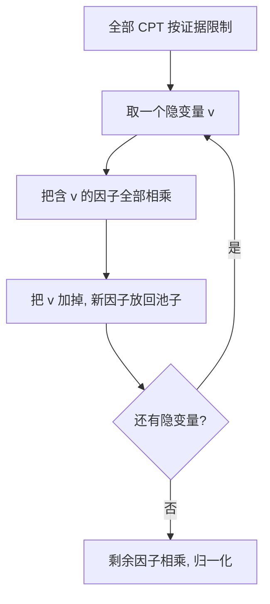

# $\rm Chapter \, 6$ 精确推断

> **本章假设你已经会**
>
> 1. 贝叶斯网的两件套：有向无环图加 CPT，联合分布写成每变量一个因子的连乘，回读《84-人工智能导论》§5.1 与 §5.2。
> 2. 图担保的独立：链式、分叉、汇连三种结构与解释消除，回读《84-人工智能导论》§5.3。
> 3. d-分离的可达性判定算法，回读《84-人工智能导论》§5.4。
> 4. 指数账 $O(b^{d})$ 为什么致命，以及「提前用掉免费信息」的思路，回读《84-人工智能导论》§1.3 与 §4.3。

第 5 章管表示：图加 CPT 把联合分布压缩成连乘，参数从指数降到线性乘指数的小头。压缩只是把知识存了起来，医生手里握着疾病与症状的网络，病人发烧、咳嗽，他要从网里算出「患流感的概率」。本章管使用：给定一部分变量的观测值（证据），求另一部分变量的后验分布。这项计算叫推断（inference），本章做精确推断（exact inference），答案与定义严格一致，不做任何近似。

全册心智模型「把不确定变成概率」的下半场由此展开：概率不只用来存，还要用来算。两件武器依次登场。枚举推断按定义老实算，账单是指数的；变量消元只用一条初等的代数律就把账单压回来，而压回来多少，取决于一个看似无关紧要的选择——先消哪个变量。消元序与树宽的账是本章的主菜，§6.5 的实测会给出三百倍的价差。

## $\rm \S \, 6.1$ 推断问题：从联合分布里问出一句话

贝叶斯网回答的问题都有同一个形状。设网中全体变量为 ${X_{1}, \ldots, X_{n}}$，证据（evidence）$e$ 是其中一部分变量的观测值，查询（query）$Q$ 是我们要问的变量，剩下既没观测也不发问的变量统称隐变量（hidden variable），其赋值记为 $h$。要算的是后验 ${P(Q \mid e)}$，按条件概率定义展开：

$$
P(Q \mid e) \;=\; \frac{P(Q, e)}{P(e)} \;=\; \alpha \sum_{h} P(Q, e, h)
$$

逐符号读：${P(Q, e)}$ 是「查询取某值且证据成立」的联合概率；分母 $P(e)$ 是证据本身出现的概率，它不随 $Q$ 的取值变化；$\alpha$ 是归一化常数，数值上等于 $1/P(e)$，作用是让 $Q$ 的各取值概率加和为一；求和号遍历隐变量的每一种赋值组合，把「证据里没提到的那部分世界」的账并进来。第 5 章的分解在此接上：任意一个完整赋值的概率由 §5.2 的连乘给出，于是求和号里每一项都是 $n$ 个 CPT 表项的乘积。

为什么不能直接查表？因为查询涉及「没被观测的部分」。联合分布表有 $2^{n}$ 行（§5.1 的账），证据把其中一部分行的概率归拢，但剩下的行仍要按隐变量逐个求和；网一上规模，这张表本身就装不下。报警网（§5.1 的五节点网）只有 ${32}$ 行，还能整表硬算；本章 §6.5 会用 ${16}$ 节点的网格网给出对照：整表 ${65536}$ 行，而消元只碰几百个表项。推断的全部技巧，都花在「不把整张表摊开」上。查询也可以一次问一组变量，做法是把每个查询变量留到最后，本章只取单个查询变量，多查询等于多做几遍。

白话：推断就是拿着压缩过的概率账本，现场结算出针对你问题的那句话；结算方式若不对，压缩省下的力气会全部赔进去。

> 本节小结：推断＝给定证据 $e$，算 ${P(Q \mid e)}$；定义式的三步是乘出联合、按隐变量求和、归一化；难点在联合分布的指数规模。

## $\rm \S \, 6.2$ 枚举推断：按定义老实算，以及它浪费在哪

枚举推断的完整流程是三步：对每一种完整赋值，把 $n$ 个 CPT 表项乘出该赋值的联合概率；丢掉与证据不符的行；剩下的行按查询取值分桶求和、相除归一。它不需要图，也不需要任何独立性知识，是检验其他一切推断算法的「笨但准」基准。最小的工作例是一段三节点的链 ${A \to B \to C}$，证据 ${C=1}$，查询 $A$。按定义把 $B$ 的两种取值并账：

$$
\begin{aligned}
P(A=1, C=1) &= P(A=1)\, P(B=1 \mid A=1)\, P(C=1 \mid B=1) + P(A=1)\, P(B=0 \mid A=1)\, P(C=1 \mid B=0) \\
&= {0.1} \times {0.9} \times {0.8} + {0.1} \times {0.1} \times {0.1} = {0.073} \\
P(A=0, C=1) &= {0.9} \times {0.2} \times {0.8} + {0.9} \times {0.8} \times {0.1} = {0.216}
\end{aligned}
$$

两个数一归一，后验是 ${0.073 / 0.289 = 73/289 \approx 0.2526}$。手算到这里还轻松，问题出在规模：枚举推断（enumeration inference）把这套动作不加优化地推到任意网上，遍历隐变量的每种赋值，每次都把 $n$ 个 CPT 表项乘一遍，再把与证据相符的行加总。它的乘法账是 $2^{n}$ 行乘每行 ${n-1}$ 次，例如报警网 ${32 \times 4 = 128}$ 次乘法。

浪费在哪里？在一行与另一行之间。看一条六节点的链 ${X_{1} \to \cdots \to X_{6}}$：枚举乘出全部 ${64}$ 行，其中 ${X_{6}}$ 那张 CPT 只有 ${4}$ 个表项，每个表项却在 ${2^{4}=16}$ 行里被重复相乘——固定 ${x_{5}}$ 与 ${x_{6}}$ 后，${x_{1}}$ 到 ${x_{4}}$ 还有 ${16}$ 种组合，每种都要重新乘一次同样的数。写成嵌套求和看得更狠：内层的 ${\sum_{x_{6}} P(x_{6} \mid x_{5})}$ 只依赖 ${x_{5}}$、总共只有 ${2}$ 个不同的值，却因嵌在外层求和里，被 ${x_{1}}$ 到 ${x_{4}}$ 的 ${16}$ 种组合各算一遍，${16}$ 份拷贝只值 ${2}$ 份。按科目记账的思路，这个表项乘一次就够，之后只查表。重复的还不止它：任何一张 CPT 的表项都被「与它无关的变量」的各种组合反复重乘。隐变量越多，这种平铺式的浪费越触目，§6.5 实测的对照是：六链上枚举 ${320}$ 次乘法、消元 ${18}$ 次；${16}$ 节点网格上枚举 ${983040}$ 次、消元 ${592}$ 次。

> 竞赛生迁移提示：枚举推断就是不带记忆化的暴力搜索，变量消元就是在按结合律给求和式「加括号」，加括号的方式决定中间结果的规模。这与矩阵链乘法是同一道题：乘法满足结合律，但不同的括号序代价悬殊，OJ 上用区间 DP 找最优括号序的那套直觉可以整套搬过来，只是本章的「矩阵维度」换成了图结构，§6.4 的树宽就是它的替身。

白话：枚举把每笔流水单独结一遍；其实科目相同的流水可以先归并再结算，归并省下的就是全部重复劳动。

> 本节小结：枚举推断按定义遍历 $2^{n}$ 行、每行乘 ${n-1}$ 次；浪费在「同一张 CPT 的表项被无关组合反复重乘」；修法不是加快乘法，而是先归并、后求和。

## $\rm \S \, 6.3$ 变量消元：把公共子式只算一次

变量消元（variable elimination）的基础构件是因子（factor）：一张只涉及少数变量的表，每个表项是这些变量在该取值组合下的概率。它像一本只记几个科目的分账，CPT 本身就是因子，消元过程中还会不断造出新的因子。三个操作定义如下：

1. 限制（restrict）：把证据变量的取值固定进因子，只保留与证据相符的表项。这是查表，不花乘法。
2. 乘（multiply）：把若干因子逐表项相乘并成一张大表，变量取并集。
3. 消元（sum out）：从一张因子表里删掉变量 $v$，把 $v$ 取值不同的表项加在一起。

流程是一条直线：所有 CPT 先按证据做限制，然后按某个序逐个消去隐变量——每次把含该变量的因子全部乘起来，再把这个变量加掉，产出的新因子放回池子；隐变量消完，池里剩下的因子只含查询变量，相乘后归一化即得答案。

在报警网上走一遍。证据 ${J=1, M=1}$，查询 $B$，消元序取 ${[E, A]}$：

1. 限制证据：${P(J \mid A)}$ 变成只含 $A$ 的因子，${P(M \mid A)}$ 同理；${P(B)}$、${P(E)}$、${P(A \mid B, E)}$ 不动。
2. 消 $E$：把 ${P(E)}$ 与 ${P(A \mid B, E)}$ 相乘得含 ${A, B, E}$ 三个变量的因子（${8}$ 个表项，${8}$ 次乘法），再把 $E$ 加掉，得含 ${A, B}$ 的因子（${4}$ 个表项）。
3. 消 $A$：把上一步的因子与两个来电因子相乘（${4}$ 个表项乘 ${3}$ 个因子，${8}$ 次乘法），加掉 $A$，得只含 $B$ 的因子。
4. 收尾：与 ${P(B)}$ 相乘，归一化，得 ${P(B=1 \mid J=1, M=1) = 0.284171835}$。

三步合计 ${18}$ 次乘法，与实测逐位一致（§6.5 的 E1）；枚举同一道题要 ${128}$ 次。正确性不需要任何高级武器，只用分配律：与 $v$ 无关的因子可以提出求和号：

$$
\sum_{v} \Bigl( \prod_{f:\, v \,\in\, \mathrm{vars}(f)} f(v, \cdot) \Bigr) \cdot \Bigl( \prod_{g:\, v \,\notin\, \mathrm{vars}(g)} g \Bigr) \;=\; \Bigl( \prod_{g:\, v \,\notin\, \mathrm{vars}(g)} g \Bigr) \cdot \sum_{v} \prod_{f:\, v \,\in\, \mathrm{vars}(f)} f(v, \cdot)
$$

读法：$\mathrm{vars}(f)$ 表示因子 $f$ 涉及的变量集；左边是枚举的算法——每行把所有因子乘齐再对 $v$ 求和；右边是消元的算法——先把不含 $v$ 的因子整块提到求和号外面，求和只碰含 $v$ 的那一小撮。每个隐变量上用一次分配律，连起来就是整个消元流程，所以消元的结果与枚举逐位相同；§6.5 的三方对账（解析、枚举、消元）与十三个消元序同答会反复钉住这一点。

开销也能当场算出来。消去变量 $v$ 时把 $k$ 个因子并成一张表，若并出的表含 $s$ 个变量，乘法计 ${(k-1) \cdot 2^{s}}$ 次。把每一步的 ${(k-1)}$ 加起来有个漂亮的收尾：每次消元让池中因子数净减 ${k-1}$ 个，而因子数从 $n$ 个 CPT 出发最后归一，全程 ${(k-1)}$ 的总和不超过 ${n-1}$。于是若整个过程中最大的中间因子含 ${w+1}$ 个变量，总乘法不超过：

$$
(n-1) \cdot 2^{w+1} \;=\; O(n \cdot 2^{w})
$$

读法：$w$ 就是下一节的主角树宽（treewidth）；指数的底还在，但指数的位置从变量总数 $n$ 搬到了树宽 $w$。网稀疏则 $w$ 小，这正是第 5 章那些「无边」独立性断言在推断端的回报：结构越稀疏，公共子式越多，消元越便宜。



加法也按同一口径记账，报警网实测 ${16}$ 对 ${12}$：枚举对每个与证据相符的行记分子、分母两次累加，消元只对被加掉的表项记一次。乘法是主菜，加法是汤，但两者的方向一致——消元把每一类开销都从「按行平摊」改成「按科目归并」。

白话：消元先把证据按进账本，然后逐个科目结清；每结一科，只翻有这一科的那几页，翻完的页码就再也不会整本重扫。

> 本节小结：因子＝只涉及少数变量的表；消元＝限制证据、逐变量「乘齐再加掉」；正确性靠分配律把无关因子提出求和号；总乘法上界 ${(n-1) \cdot 2^{w+1}}$，指数位置从 $n$ 搬到树宽 $w$。

## $\rm \S \, 6.4$ 消元序：同一道题，三百倍的价差

§6.3 的报警网只有两个隐变量，怎么消都便宜；真正的问题在隐变量一多时出现。消元序决定每一步并账的规模：先消的变量选得好，每一步只把相邻的小因子并起来；选得坏，远处的变量被提前拽进同一张中间表，表的大小指数爆炸。直觉是「会师」：两个变量若在好几个因子里各出现一次，先消谁都行；怕的是序让一串互不相干的变量提前在同一张表里会师，中间表厚得像整张联合表。

把这件事在图上说清。第一步道德化（moralization）：把每个节点的所有父节点两两连边，再把全图去掉方向。连父节点的理由在消元里看得见：${P(A \mid B, E)}$ 这张因子表本来就让 $B$ 与 $E$ 在同一张表里会师，图必须提前记下这笔账。第二步在道德图上模拟消元：删去变量 $v$ 前，先把 $v$ 的邻居两两连边（这些邻居马上要在同一张因子表里会师），再删掉 $v$；这一步可能新增的边叫填充边（fill edge），新增得越多，中间因子越大。整个过程中出现过的最大团（两两相连的变量组）减一，就是这棵图的树宽，它是最优消元序下最大中间因子的变量数减一，也是 §6.3 开销公式里的 $w$。

麻烦在于最优序难找：判定一棵图的树宽是否不超过 $k$ 是 NP 完全问题（Arnborg、Corneil 与 Proskurowski，1987）。实战退而求次，用贪心启发式：最小填充（min-fill）每一步挑「删掉它新增填充边最少」的变量先消。它是经验规则不是定理，§6.5 会给它记一笔功，也会记一笔它并非全能的账。

把这套流程在报警网上走一遍。全网只有 $A$ 有两个父节点 $B$ 与 $E$，道德化只加一条 $B$–$E$ 边，道德图的最大团 ${\{B, E, A\}}$ 含三个变量，树宽 ${2}$；§6.3 的开销公式给上界 ${(5-1) \cdot 2^{3} = 32}$ 次乘法，实测 ${18}$ 次——上界留有余量，但量级不虚报。反过来把账用在一维链上：链的道德图就是链本身，树宽 ${1}$，好序消元每一步只碰两个变量，总乘法线性于链长，§6.5 六链的 ${18}$ 次乘法就是这条线性账。第 7 章把链摊到时间轴上时，这条账会以「前向算法」的名字重逢。

网格网解释了什么叫「会师」。按拓扑行主序消元，桌面上的变量始终压在一条对角带里：消完前几行，桌上只剩当前行与下一行交界处的一小撮变量，带的宽度随网格的短边走、不随长边走，所以 ${4 \times 4}$ 的好序最大因子是 ${6}$、${5 \times 5}$ 是 ${7}$。而一个坏序会在早期把第一行与最后一行的变量拽进同一张表，此后每一步的表都横跨整个网格，${16}$ 个变量的表就是 ${65536}$ 个表项——枚举的灾难在坏序下换了个名字重新上演。

「好序」的名字取的是「与建模拓扑序一致、信手可得」之意，不是最优性的断言：E3 里最小填充在乘法总数上就赢过它，最优序的存在与否谁也无法当场验明。

白话：消元像整理摊在桌上的文件，每次合并一份，桌上同时摊开的文件越多越挤；消元序就是整理的次序，树宽是无论怎么排都需要的最小桌面宽度，而找到最省桌面的排法本身就是难题。

> 本节小结：消元序只影响代价不影响答案；道德图连父节点、去方向，消元的每一步在图上是「连邻居、删点」；最大中间因子对应最大团，最优序 NP 完全，实战用最小填充贪心。

## $\rm \S \, 6.5$ 实测：四笔账

证明之外，本章每个机制都在实例上真跑过。环境为 WSL 里的 python3（仅标准库），脚本与全部输出存于 `26Fall/_uni5_work/expIA06/`，种子固定为 ${20261108}$，乘法与加法计数是确定性结果，任何人重跑逐位一致；耗时随机器浮动，量级仅供参考。复现命令：

```bash
# 环境: WSL 的 Bash; 前置: python3, 无第三方依赖
cd /mnt/c/Users/20811/Desktop/26Fall/_uni5_work/expIA06
python3 expIA06.py    # 输出与随附 result.txt 一致; 全部断言通过
```

口径钉死：乘法＝因子表逐表项相乘的一次标量乘法，把 $k$ 个因子乘成 $R$ 项的表记 ${R(k-1)}$ 次，枚举按 $2^{n}$ 行乘每行 ${n-1}$ 次计；加法＝消元求和或累加边缘时的一次标量加法；中间因子规模＝因子含变量个数；证据在因子建立时即做限制，不计乘法；枚举按「完整乘出联合表再求和」的最贵口径，不给按证据跳行的捷径。四个实验共用同一套因子实现，后验全部通过与解析解或枚举的对账断言。

**第一笔（E0）：三方对账。** 三链（§6.2 手算的 ${73/289 \approx 0.2526}$）上，枚举与消元都与解析解在小数点后十二位一致，乘法 ${16}$ 对 ${6}$。六链 ${X_{1} \to \cdots \to X_{6}}$、证据 ${X_{6}=1}$、查询 ${X_{1}}$，解析解用分数递推独立算出 ${0.677966156477}$（从证据端往回逐层折算，这个递推正是第 7 章前向算法的雏形），枚举 ${320}$ 次乘法、消元 ${18}$ 次乘法，三方同答。

**第二笔（E1）：报警网，枚举对消元。** 证据 ${J=1, M=1}$，查询 $B$：

| 方法 | 乘法 | 加法 | 后验 |
| --- | --- | --- | --- |
| 枚举（整表 ${32}$ 行） | ${128}$ | ${16}$ | ${0.284171835}$ |
| 消元（序 ${[E, A]}$） | ${18}$ | ${12}$ | ${0.284171835}$ |

即便放水让枚举只乘与证据相符的 ${8}$ 行（${32}$ 次乘法），它仍比消元贵；而 §6.3 已逐表项走过消元的 ${18}$ 次从哪来。加法的账同方向：枚举对每个相符行记两次累加（分子一次、分母一次），消元只对被加掉的表项记一次，实测 ${16}$ 对 ${12}$。小网上差距看着温和，贵在下一笔实验里指数级放大。

**第三笔（E2）：${16}$ 节点网格网，价差成形。** ${4 \times 4}$ 网格，节点 ${(i,j)}$ 以 ${(i-1,j)}$ 与 ${(i,j-1)}$ 为父节点，CPT 随机生成；证据 ${G33=1}$（右下角），查询 ${G03}$（右上角）：

| 方法 | 乘法 | 最大中间因子 | 耗时 |
| --- | --- | --- | --- |
| 枚举（${65536}$ 行） | ${983040}$ | ${16}$ 变量 | ${356.7}$ ms |
| 消元（拓扑行主序） | ${592}$ | ${6}$ 变量 | ${1.34}$ ms |

同一后验 ${0.580769244}$，乘法相差 ${1661}$ 倍；消元桌上同时摊开的最多 ${6}$ 个变量，枚举则把 ${16}$ 个变量的整表摊满。

**第四笔（E3）：消元序实验，本章主菜。** ${5 \times 5}$ 网格（${25}$ 节点），证据 ${G40=1}$（左下），查询 ${G04}$（右上）。全联合表要 ${33554432}$ 行，按口径推算逾 ${8}$ 亿次乘法，枚举直接出局。十种消元序对垒：拓扑行主序（好序）、最小填充贪心、最大填充贪心（每步挑加边最多的变量，反教材）、${10}$ 个随机序：

| 消元序 | 最大中间因子 | 乘法 | 加法 | 耗时 |
| --- | --- | --- | --- | --- |
| 好序（拓扑行主序） | ${7}$ 变量 | ${1776}$ | ${1588}$ | ${2.53}$ ms |
| 最小填充贪心 | ${7}$ 变量 | ${1136}$ | ${972}$ | ${1.28}$ ms |
| 最大填充贪心 | ${16}$ 变量 | ${575936}$ | ${371324}$ | ${826.78}$ ms |
| 随机序最好（#9） | ${10}$ 变量 | ${4848}$ | ${3772}$ | ${3.64}$ ms |
| 随机序最差（#3） | ${14}$ 变量 | ${41456}$ | ${44236}$ | ${50.81}$ ms |

四条读数。其一，正确性与代价分离：十三个序给出的后验逐位相同（${0.658667622}$），§6.4 的「序只改账单不改答案」拿到实测。其二，序的价差触目：好序 ${1776}$ 次乘法对最大填充 ${575936}$ 次，${324.3}$ 倍；最大中间因子 ${7}$ 对 ${16}$ 个变量，指数的位置就在这里。其三，随机序整体落在两者之间：${10}$ 个序的最大因子从 ${10}$ 到 ${14}$，乘法从 ${4848}$ 到 ${41456}$（最差随机是好序的 ${23.3}$ 倍），说明坏序不需要刻意构造，随手一排就会中招。其四，两笔诚实的注脚：最小填充与好序的最大因子打平（都是 ${7}$），但乘法总数 ${1136}$ 反而比好序的 ${1776}$ 少四成，最大因子不是唯一的开销指标，每步乘几个因子同样记账；随机序 #1 与 #2 的最大因子同为 ${11}$，乘法却是 ${7512}$ 对 ${13328}$，同一指标下的价差同样存在。另外把 E2 与 E3 相连看，网格从 ${16}$ 节点加到 ${25}$ 节点，好序最大因子从 ${6}$ 涨到 ${7}$，乘法从 ${592}$ 涨到 ${1776}$（三倍），树宽每加一，账单翻一倍还多。

白话：这一节拿数据对口供。对账实验说三种算法同答，序实验说同答的十三种排法价差三百倍，网格实验说树宽加一、账单翻倍。

> 本节小结：三方对账钉正确性（${73/289}$ 与 ${0.677966156477}$ 双锚点）；报警网 ${128}$ 对 ${18}$、网格 ${983040}$ 对 ${592}$；序实验好序 ${1776}$ 对最大填充 ${575936}$（${324.3}$ 倍），随机序整体居中；最小填充在乘法总数上反超好序，最大因子不是唯一指标。

> 竞赛生迁移提示：消元序之于推断，约等于变量序之于第 4 章的回溯，但方向相反——回溯想先撞死在窄巷里，消元想先结清小账；两者都把「顺序」当成一等的优化对象。写题解遇到「按什么顺序合并区间/集合」的 DP 时，树宽这把尺子可以用来预判状态数上限。

## $\rm \S \, 6.6$ 两个典型错误与证据式排查

错误一：消元序里混入证据或查询变量。症状：程序在消某一步时崩溃（找不到任何含该变量的因子），或者最后断言「剩余因子只含查询变量」失败。病根：证据变量的因子在限制后不再含它自己，按序消它时池子里空无一物；查询变量被消掉后则无处出答案。这不是假想的坑：本章实验脚本的第一版把含全部 ${25}$ 个节点的贪心序原样喂给消元器，在证据变量 ${G40}$ 处因子池为空，当场崩溃；修正为把序过滤到隐变量后通过。排查办法：消元前断言序与查询、证据变量不交，并逐变量打印「该变量名下的因子个数」，为零即暴露。

错误二：把未归一化的数当后验。症状：报出的「概率」小得离谱，或查询的两个取值加起来不到 ${1}$。病根：只算了分子 ${\sum_{h} P(Q, e, h)}$，忘了除以 ${P(e)}$。实测里证据本身概率只有 ${P(J=1, M=1) = 0.0020841}$，直接拿分子当答案会比真后验 ${0.284171835}$ 小约 ${480}$ 倍（${1/0.0020841}$）。排查办法：输出前断言查询变量各取值的概率加和为 ${1}$（容差 ${10^{-9}}$）；再随手抽一个查询，用枚举口径独立算一遍对账，两个数在小数点后九位一致才放行。

白话：崩溃先查序里有没有不该出场的人，数值不对先问归一化做没做；两个错误都能用一行断言拦住。

> 本节小结：序必须只含隐变量（证据与查询变量禁入）；分子不是后验，除掉 ${P(e)}$ 才是；两个错误的排查都成本极低，写进断言即可。

## $\rm \S \, 6.7$ 关键概念回顾

1. 推断任务的三要素是什么？主公式里的 $\alpha$ 数值上等于什么、起什么作用？
2. 枚举推断慢在哪？六链上 ${P(X_{6} \mid X_{5})}$ 的每个表项被重复乘了多少次、理想情况下该乘几次？
3. 因子的定义是什么？限制、乘、消元三个操作各做什么，哪个不花乘法？
4. 消元的正确性靠哪条代数律？请写出「把不含 $v$ 的因子提出求和号」的等式。
5. 道德图怎么画？消元的「连邻居、删点」在图上对应什么？树宽的定义是什么？
6. 为什么十三个消元序同答不同价？最优序难找在什么地方？
7. 把证据条件进因子与「先算联合、最后归一化」在结果与开销上各是什么关系？
8. 枚举推断的账单是指数的，为什么本章还要从它讲起？

## $\rm \S \, 6.8$ 应用与辨析

1. 论文资料管理器要建模「论文质量 $Q$、发表渠道 $C$ 共同决定引用数 $N$」，其中 ${Q \to N}$、${C \to N}$，$Q$ 与 $C$ 先验独立。观测到 ${N}$ 偏高，求 ${P(Q=1 \mid N)}$：写出限制、消元、归一化的全部步骤，画出道德图，指出最大中间因子含几个变量。
2. 同事说「十三个消元序后验完全一样，可见消元序无所谓」。用 §6.5 的 E3 账单评价这句话对多少、错多少。
3. 动手验证：把 E2 的证据与查询对调（证据 ${G00=1}$，查询 ${G33}$），先预测好序的最大中间因子与乘法量会不会变，再改脚本重跑核对。

## $\rm \S \, 6.9$ 答案

概念回顾答案：

1. 证据（观测到的变量与取值）、查询（要问的变量）、隐变量（其余变量）（§6.1）。${\alpha = 1/P(e)}$，把 ${\sum_{h} P(Q, e, h)}$ 归一成真正的条件分布，使查询各取值加和为一（§6.1）。
2. 慢在每行独立乘、无记忆：六链上该 CPT 每个表项在 ${2^{4}=16}$ 行里被重复相乘，理想情况把表建成因子后每表项只乘一次（§6.2）。
3. 因子是只涉及少数变量的概率表；限制把证据固定进因子（查表，零乘法）；乘把若干因子并成一张并集变量的大表；消元把某变量的各取值行加掉（§6.3）。
4. 分配律（结合律）。等式见 §6.3：${\sum_{v} (\prod_{f \ni v} f) \cdot (\prod_{g \not\ni v} g) = (\prod_{g \not\ni v} g) \cdot \sum_{v} \prod_{f \ni v} f}$，右边就是消元一步（§6.3）。
5. 道德图＝每个节点的父节点两两连边再去方向；「连邻居、删点」在图上制造填充边，过程中的最大团减一即树宽（§6.4）；树宽是最优序下最大中间因子的变量数减一（§6.3、§6.4）。
6. 序改变每步并账的规模从而改变中间因子大小，但分配律保证结果不变（§6.3、§6.5 的十三序同答 ${0.658667622}$）；难在判定树宽是否不超过 $k$ 是 NP 完全的（Arnborg 等，1987），故用最小填充贪心（§6.4）。
7. 两条路给出同一个后验（条件概率定义担保），开销不同：证据条件进因子让后续每张表更小、与证据相连的变量可能整个消失；先算联合则全程背着证据变量的维度走（§6.3、§6.5 的口径即按前者计）。
8. 它是推断定义的直译，不依赖图与独立性知识，天然是其他推断算法的正确性基准（§6.5 的三方对账拿它当裁判）；网小的时候它也是可用的工具，报警网整表不过 ${32}$ 行（§6.2）。

应用与辨析答案：

1. 限制证据：${P(N \mid Q, C)}$ 固定 ${N=1}$ 后仍是含 ${Q, C}$ 的因子；$Q$ 与 $C$ 的先验不动。消元 ${N}$：把 ${P(Q)}$、${P(C)}$、限制后的 ${P(N \mid Q, C)}$ 相乘得含 ${Q, C}$ 的因子（${4}$ 表项），加掉 $N$ 后得含 ${Q}$ 的因子；归一化即后验。道德图把 $Q$ 与 $C$ 连边（共同父节点），最大中间因子含 ${2}$ 个变量，树宽 ${1}$（§6.3、§6.4）。
2. 对的一半：后验确实与序无关，十三序同答。错的部分：序决定代价，E3 里好序 ${1776}$ 次乘法、${2.53}$ ms，最大填充 ${575936}$ 次、${826.78}$ ms，差 ${324.3}$ 倍；${25}$ 节点的网就已是「能算」与「算不动」的分界。正确说法是条件化的：答案不挑序，账单挑（§6.5）。
3. 证据 ${G00=1}$、查询 ${G33}$ 只是沿反对角线翻转了角色，图结构未变，好序仍是拓扑行主序，最大中间因子仍是 ${6}$ 变量、乘法量级不变；变的是后验数值。重跑结果以脚本输出为准，预测的量级若与实测不符，优先检查消元序是否真的还是拓扑行主序（§6.5）。

**你现在能做什么**：手边随便画一个五节点的贝叶斯网，标出证据与查询，把每个节点父节点连边画出道德图，再口算一个消元序的最大中间因子是几个变量。

枚举到消元，是把「重复的劳动」变成「共享的中间结果」；但当网摊开到时间轴上——今天的证据影响明天的推断，明天又影响后天——求和要沿时间一路滚下去，消元的中间因子就是那时的「信念」。第 7 章把贝叶斯网接上时间，看链上消元如何变成前向算法，再在精确推断够不着的地方换武器：抽样。

---

实验记录：本章 §6.5 全部实测数字来自脚本 `expIA06.py`（三链与六链三方对账、报警网枚举对消元、${16}$ 节点网格对垒、${25}$ 节点网格十三种消元序对垒，python3 标准库，种子 ${20261108}$，WSL 运行，总耗时 ${1.38}$ 秒），原始输出存于写作工作目录 `26Fall/_uni5_work/expIA06/result.txt`；乘法、加法、最大因子、后验为确定性结果，重跑逐位复现，耗时项随机器浮动。文中 E3 的「逾 ${8}$ 亿次乘法」是按口径的算术推算（${33554432} \times {24}$），非实测。
