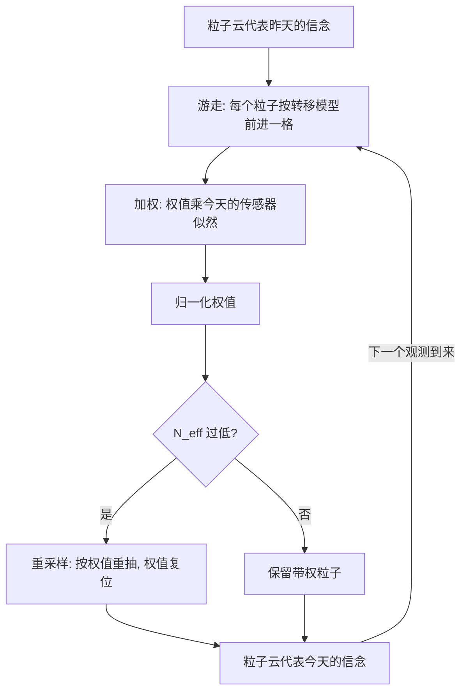

# $\rm Chapter \, 7$ 时间与采样

> **本章假设你已经会**
>
> 1. 条件概率、边缘化与链式法则，回读《19-概率论》§3.1。
> 2. 贝叶斯网的两件套与 CPT 连乘语义，回读《84-人工智能导论》§5.1 与 §5.2。
> 3. 链式结构与三种基本独立形态，回读《84-人工智能导论》§5.3。
> 4. 变量消元的三个操作与分配律论证，回读《84-人工智能导论》§6.3。
> 5. 六链上「从证据端逐层折算」的递推与三方对账（答案 ${0.677966156477}$），回读《84-人工智能导论》§6.5。本章会把它长成前向算法。

第 1 至第 6 章的推断都是一锤子买卖：证据一次到齐，查询一次问完。真实任务不是这样。今天下了雨，你对明天的判断就该变；机器人走了十步，每一步的里程计读数都在改写它的位置信念；警报昨晚报过一次，今天再响时「盗贼」的嫌疑就不只是第 5 章那道静态题。证据沿时间一条一条地来，信念就得一条一条地更新。本章把贝叶斯网摊到时间轴上，得到隐马尔可夫模型（Hidden Markov Model，HMM），并给出两个精确武器：前向算法管「今天是什么状况」，维特比算法管「整段历史最可能怎么走过」。

全册心智模型「把不确定变成概率」在这里走到最后一站：概率不只要算得出，还要带得走。当状态空间大到建不起任何表时，前向算法的账本写不下了，我们换一种表示，用一群带权重的样本顶替整个分布，这就是粒子滤波（particle filter）。本章的四个实验全部真跑过：前向与穷举对账到机器精度，维特比与穷举对出同一条路径，粒子数翻百倍误差只缩十倍的曲线，以及拒绝采样 81% 的试验连一个合格样本都收不到的现场。

## $\rm \S \, 7.1$ 把时间摊进图里：隐马尔可夫模型

设想一个只有两种天气的世界：雨或晴。你摸不到天气本身，只能看室友带没带伞。模型的全部参数是三张小表：初始分布 ${P(X_{0})}$，雨天晴天各一半；转移模型（transition model）${P(X_{t} \mid X_{t-1})}$，昨天雨则今天雨的概率 ${0.7}$、昨天晴则今天雨的概率 ${0.3}$；传感器模型（sensor model）${P(E_{t} \mid X_{t})}$，雨天的室友有 ${0.9}$ 的概率带伞，晴天只有 ${0.2}$。这套结构叫隐马尔可夫模型：「马尔可夫」指状态的一步记忆，「隐」指状态本身看不见、只能透过 $E_{t}$ 的窗口窥视。雨伞世界出自 Russell 与 Norvig 的《Artificial Intelligence: A Modern Approach》第 3 版第 15 章，参数原样沿用。

三张小表背后站着两条假设，它们正是 §5.3 链式结构在时间轴上的两份合同。其一，马尔可夫假设：给定现在，未来与过去无关，${X_{t}}$ 一旦知道 $X_{t-1}$，就不再需要更早的任何信息。其二，传感器独立假设：今天的观测只由今天的状态决定。两条合起来，联合分布沿链分解：

$$
P(X_{0}, E_{1}, X_{1}, \ldots, X_{T}, E_{T}) \;=\; P(X_{0})\, P(E_{1} \mid X_{1})\, \prod_{t=1}^{T} P(X_{t} \mid X_{t-1})\, P(E_{t} \mid X_{t})
$$

读法：每个状态变量 $X_{t}$ 只挂两条边，一条来自 $X_{t-1}$（转移），一条通向 $E_{t}$（传感器）；整张图就是 §5.3 的链式结构首尾相接，参数量从 ${2^{2T+1}}$ 行的联合表降到每张小表的常数项。观测序列写成 ${e_{1:t}}$，意思是「从第 1 天到第 $t$ 天的观测取值」，例如雨伞世界的前五天 ${e_{1:5} = }$〔有伞，有伞，无伞，有伞，有伞〕。

有了模型，时间轴上的问题分四种，区别全在「问什么、以什么为条件」：

1. 滤波（filtering）：${P(X_{t} \mid e_{1:t})}$，用截至今天的证据，判断今天的状态。
2. 预测（prediction）：${P(X_{t+k} \mid e_{1:t})}$，${k>1}$，往未来伸一截。
3. 平滑（smoothing）：${P(X_{k} \mid e_{1:t})}$，${k<t}$，用后见之明修正过去的判断。
4. 解码（decoding）：${\arg\max_{x_{1:t}} P(x_{1:t} \mid e_{1:t})}$，找出最可能的一整条状态序列。

这四个问题的朴素解法是同一个：枚举全部状态序列。$T$ 天、每天 $S$ 种状态，序列有 ${S^{T}}$ 条，每条要乘 ${T}$ 个因子。雨伞世界 $T=5$ 时 ${2^{5}=32}$ 条，手算都行；$T=30$ 时约 ${10^{9}}$ 条；$T=100$ 时 ${2^{100}}$，宇宙的原子数都不够分摊。本章余下的任务就是把这个指数账单压回线性。

白话：HMM 是一台被布蒙住的自动售货机，你听不见内部零件（状态），只能听掉币声（观测）；模型就是「零件怎么磨损」与「声音怎么发出」两张说明书。

> 本节小结：HMM＝链式贝叶斯网＋时间轴；三件套是初始分布、转移模型、传感器模型；四种问题滤波、预测、平滑、解码；朴素枚举 ${S^{T}}$ 条序列，指数级，不可行。

## $\rm \S \, 7.2$ 前向算法：沿时间滚动的消元

前向算法的核心是一个消息（message）：

$$
f_{1:t}(j) \;=\; P(X_{t}=j,\ e_{1:t})
$$

读法：$f_{1:t}(j)$ 是「第 $t$ 天状态为 $j$ 且这 $t$ 天的观测恰好都发生」的联合概率。注意它是联合而不是条件，暂时没有归一化；真正的滤波分布是 ${P(X_{t} \mid e_{1:t}) = \alpha\, f_{1:t}(j)}$，$\alpha$ 是归一化常数（§6.1 的老角色）。这个定义选得刁钻也选得必要：联合形式让递推只做乘法，除法留到最后一步。

递推由定义式直接推。把 $e_{1:t}$ 拆成「前 $t{-}1$ 天」与「今天的 $e_{t}$」，对 $X_{t-1}$ 的取值求和：

$$
\begin{aligned}
P(X_{t}=j,\ e_{1:t}) &= \sum_{i} P(X_{t}=j,\ X_{t-1}=i,\ e_{1:t-1})\, P(e_{t} \mid X_{t}=j) \\
&= P(e_{t} \mid X_{t}=j) \sum_{i} P(X_{t}=j \mid X_{t-1}=i)\, f_{1:t-1}(i)
\end{aligned}
$$

两步各用一条假设。第一步把 $P(e_{t} \mid X_{t})$ 提出求和号，靠传感器独立假设：今天的观测与更早的一切无关，只认 $X_{t}$。第二步把联合折成转移概率乘旧消息，靠马尔可夫假设：给定 $X_{t-1}$，$X_{t}$ 与更早的观测无关，这正是 §5.3 链式结构的原话。于是整个滤波是一个两步循环：先预测，把旧消息卷上转移模型；再更新，逐点乘今天的传感器似然；最后归一化。用矩阵一行写完：

$$
f_{1:t} \;=\; \alpha\; \mathrm{diag}\bigl(P(e_{t} \mid \cdot)\bigr)\; \mathsf{T}^{\top}\, f_{1:t-1}
$$

读法：$\mathsf{T}$ 是转移矩阵，$\mathsf{T}^{\top} f$ 做的就是「每条来路按转移概率加权求和」；$\mathrm{diag}(\cdot)$ 把似然写在对角线上做逐点乘。在雨伞世界走前两步。第 1 天有伞：${(0.5 \times 0.9,\ 0.5 \times 0.2) = (0.45,\ 0.10)}$，和为 ${0.55}$（它就是 ${P(e_{1})}$），归一化得 ${f_{1:1} = (0.818182,\ 0.181818)}$。第 2 天又有伞：预测步 ${(0.818182 \times 0.7 + 0.181818 \times 0.3,\ 0.818182 \times 0.3 + 0.181818 \times 0.7) = (0.627273,\ 0.372727)}$；更新步乘似然 ${(0.627273 \times 0.9,\ 0.372727 \times 0.2) = (0.564545,\ 0.074545)}$，和 ${0.639091}$，归一化得 ${P(X_{2} \mid e_{1:2}) = (0.883357,\ 0.116643)}$。两天伞把「下雨」的信念从 ${0.5}$ 抬到 ${0.883}$。

开销账：预测步是 ${S^{2}}$ 次乘加（$S$ 个去向、每个汇 $S$ 条来路），更新步 $S$ 次，全程 ${T}$ 步，总计 ${O(T \cdot S^{2})}$，从 ${2^{T}}$ 压到线性于 $T$，这就是 §6.4 许诺过的重逢：树宽 ${1}$ 的链上，消元每步只碰两个变量，把这套流程沿时间轴滚起来，滚出来的因子就叫消息。§6.5 六链的「从证据端往回逐层折算」是同一件事的反方向（backward message）；把两个方向的消息相乘再归一，得到的就是平滑分布；平滑的推导本章不展开，第 43 册《具身智能》§2.2 在连续状态空间把这条递归（贝叶斯滤波递归）完整推过一遍，接口已经对齐。预测也无须新机器：对今天的滤波分布只做预测步、不做更新步，就是 ${P(X_{t+1} \mid e_{1:t})}$。

白话：前向算法像滚雪球。到昨天为止的所有旧账压成一枚雪球（消息），今天只需让雪球滚过转移模型这张坡、再沾一层观测的雪，昨天的全部历史就都进了球里，谁也不用回头重算。

> 本节小结：消息 ${f_{1:t}(j)=P(X_{t}=j, e_{1:t})}$；递推两步＝预测（卷转移）＋更新（乘似然）；两条假设各自支撑一步；滤波 ${=\alpha f_{1:t}}$，预测＝只做预测步；总开销 ${O(T \cdot S^{2})}$，与 §6.4 的树宽账在链上重逢。

## $\rm \S \, 7.3$ 维特比：把求和号换成 max

解码问的是一整条序列：${\arg\max_{x_{1:t}} P(x_{1:t},\ e_{1:t})}$。把 $2^{T}$ 条序列每条算一遍再取最大，又是指数账单。维特比算法（Viterbi algorithm，Viterbi 1967 年为卷积码解码提出，*IEEE Transactions on Information Theory* 13(2):260–269）用一次替换把账压下来：前向算法在递推里对来路求和，维特比改成取最大。消息的定义换成

$$
m_{1:t}(j) \;=\; \max_{x_{1:t-1}} P(x_{1:t-1},\ X_{t}=j,\ e_{1:t})
$$

读法：${m_{1:t}(j)}$ 不再是「到 $j$ 的总流量」，而是「经过 $j$ 的那条最贵路径的价格」。递推式与 §7.2 只差一个运算符：

$$
m_{1:t}(j) \;=\; P(e_{t} \mid X_{t}=j) \max_{i} P(X_{t}=j \mid X_{t-1}=i)\; m_{1:t-1}(i)
$$

正确性靠一个交换论证：若全局最优序列在时刻 $t$ 经过状态 $j$，它的前缀必是「到 $j$ 为止」的最优前缀。因为倘若另有一条到 $j$ 的前缀价格更高，把原来的后缀接上去，总价格只会更高，与原序列最优矛盾。所以逐状态只留一条最好前缀不丢解；每步记下 argmax 的来路，称为回溯指针（backpointer），$T$ 步后从最贵的终点沿指针往回走，整条序列就倒了出来。雨伞世界走前两步：${m_{1:1} = (0.45,\ 0.10)}$（与 ${f_{1:1}}$ 的未归一化值相同）；${m_{1:2}}$ 的雨格取 ${\max(0.45 \times 0.7,\ 0.10 \times 0.3) \times 0.9 = 0.2835}$，晴格取 ${\max(0.45 \times 0.3,\ 0.10 \times 0.7) \times 0.2 = 0.027}$，指针都指向雨。开销与前向同阶，${O(T \cdot S^{2})}$。

滤波与解码是两个不同的问题，混用会出错。滤波逐时刻回答「今天最可能是什么」，解码回答「整段历史连起来最可能怎么走」；前者是每个时刻各自的边缘最大，后者是联合最大。把每个时刻的滤波答案硬拼成一条序列，两段之间可能被转移概率判成不可能，拼出的序列概率可以是 ${0}$。正确的做法只有一个：老老实实跑维特比。两条路径的差距可以很小：§7.5 的 E1 里最优序列 ${0.011573604}$，第二名 ${0.007876480}$，只差 ${1.47}$ 倍，证据再变一天，答案就可能翻转。

> 竞赛生迁移提示：把转移概率取对数，维特比就是有向无环图上的最长路，回溯指针就是 DP 的前驱数组；你写过的「DAG 上 dp[u] = max(dp[v] + w)」逐字成立，只是边权从路径长度换成了概率的对数。也注意它与第 1 章搜索的区别：搜索里前沿要存所有候选，维特比每个状态只留一条，因为「到该状态的最优前缀」这一交换论证担保了其余全是废牌。

白话：前向算法问每天的总客流量，维特比问每天哪条是最贵的包道；到每个站点只留最贵的一条前缀，其余的路再宽也到不了最贵的终点。

> 本节小结：维特比＝前向递推的 max 版；正确性靠「最优序列的前缀也是到该点的最优前缀」的交换论证；回溯指针倒出序列；开销 ${O(T \cdot S^{2})}$；滤波逐点最大与解码联合最大是两个问题，不能互相冒充。

## $\rm \S \, 7.4$ 粒子滤波：状态多到建不起表时，用样本当信念

前向算法的账单里有两处「建表」：消息是 $S$ 维向量，转移是 ${S \times S}$ 矩阵。雨伞世界 $S=2$，随便建；机器人位姿住在 ${\mathrm{SE}(3)}$ 里（第 43 册第 1 章），状态连续、十几个自由度，任何表都摊不开。按维度把连续状态切成网格也一样死：每维切 $m$ 格，${K}$ 维状态空间就是 ${m^{K}}$ 个格子，维度一加指数爆炸。出路是换掉「分布要用表表示」这个默认设置：用一群带权重的样本代表分布。每个样本叫一个粒子（particle），粒子云就是 belief 的替身。

粒子滤波的每一步都对着 §7.2 的递推，只是把求和换成数样本：

1. 游走（预测步）：每个粒子按转移模型独立采样下一代，相当于把 ${f_{1:t-1}}$ 卷上转移核。
2. 加权（更新步）：每个粒子的权值乘上它在今天的传感器似然 ${P(e_{t} \mid x^{[i]})}$，再归一化，相当于逐点乘似然。
3. 重采样（resampling）：按权值有放回重抽 $N$ 个粒子、权值复位为 ${1/N}$，相当于把连续的权值兑现成离散的拷贝数。

三步走完，粒子云在分布意义上就是 ${f_{1:t}}$ 的近似；循环往复，信念沿时间滚动。重采样不是可选项：不加它，权值的方差随时间膨胀，几个回合后几乎全部权值集中到一个粒子上，其余全是陪跑。健康的指标是有效样本量（effective sample size）${N_{\mathrm{eff}} = 1/\sum_{i} (w^{[i]})^{2}}$，它在 ${N}$ 与 ${1}$ 之间，过低就触发重采样；重采样的代价是样本枯竭（sample impoverishment）：同一条好轨迹被抄 $N$ 遍，多样性受损。这套机制第 43 册《具身智能》§2.4 已经给过退化实锤（${N_{\mathrm{eff}}}$ 第五步掉到 ${1.00}$ 的实测）与 Gordon–Salmond–Smith 测试场，本章不再重复推导，直接接口。整个循环画出来是：



粒子滤波还有一层身份：它是 E3 将要实测的似然加权（likelihood weighting）沿时间轴的推广：证据不出现在采样里，而是折进权值。这个联系不是巧合，§7.5 的两笔实验会用同一套权重语言说话。

白话：精确滤波像做全民普查，每一步都登记全部人口；粒子滤波像派一千个调查员满城跑样本点——人少答案糙一点，但永远出得了结果，加人手就慢慢变准。

> 本节小结：粒子滤波＝把分布表示从表换成带权样本；三步「游走、加权、重采样」分别对应预测、更新、权值兑现；${N_{\mathrm{eff}}}$ 治退化但引样本枯竭；连续状态、超大状态空间的默认武器。

## $\rm \S \, 7.5$ 实测：四笔账

证明之外，本章每个机制都在实例上真跑过。环境为 WSL 里的 python3（numpy 2.5.4），脚本与全部输出存于 `26Fall/_uni5_work/expIA07/`，种子固定为 ${20261108}$，总耗时 ${1.43}$ 秒。前向、穷举、维特比与精确枚举是确定性算术，任何人重跑逐位一致；采样实验固定种子后同样逐位一致，粒子数曲线的量级结论对种子不敏感。复现命令：

```bash
# 环境: WSL 的 Bash; 前置: python3 + numpy
cd /mnt/c/Users/20811/Desktop/26Fall/_uni5_work/expIA07
python3 expIA07.py    # 输出与随附 result.txt 一致; 全部断言通过
```

口径钉死：E0 的穷举对每个时刻单独入账「前缀概率」：每条完整序列按其前 $t$ 步的部分概率记进第 $t$ 个时刻的桶，再加和归一，得到的是滤波而非平滑；E2 的精确参考是 ${K=50}$ 状态 HMM 的前向算法，模型本来就是离散的，前向就是精确解、无任何近似成分；粒子滤波与精确前向吃同一条固定的观测序列，各次试验只重抽粒子，比较的是滤波器自身的随机性；误差指标是全变差距离（total variation distance）${0.5\sum_{x} \lvert \hat{p}(x) - p(x) \rvert}$ 在 ${30}$ 步上的均值，多次试验取中位数。

**第一笔（E0）：雨伞前向对账穷举。** 证据〔有伞，有伞，无伞，有伞，有伞〕，五天全部 ${2^{5}=32}$ 条序列入账：

| $t$ | 前向 ${P(X_{t}=\text{雨} \mid e_{1:t})}$ | 穷举同列 | ${P(e_{1:t})}$ |
| --- | --- | --- | --- |
| 1 | ${0.818181818}$ | ${0.818181818}$ | ${0.550000000}$ |
| 2 | ${0.883357041}$ | ${0.883357041}$ | ${0.351500000}$ |
| 3 | ${0.190667940}$ | ${0.190667940}$ | ${0.120445000}$ |
| 4 | ${0.730794005}$ | ${0.730794005}$ | ${0.055812650}$ |
| 5 | ${0.867338890}$ | ${0.867338890}$ | ${0.034303700}$ |

五个时刻逐位一致，最大偏差 ${2.220 \times 10^{-16}}$，机器精度级。三条读数。其一，§7.2 手算的 ${0.818182}$ 与 ${0.883357}$ 都在表上，算法与手算是同一件事。其二，第 3 天的无伞是重锤：${0.883 \to 0.191}$，一条反证据把信念打回原形，随后两天有伞又拉回 ${0.867}$。其三，${P(e_{1:t})}$ 一路从 ${0.55}$ 跌到 ${0.0343}$；这条证据序列本身是罕见事件；递推里它不碍事，只当每步的归一化常数，这是「消息取联合形式」的直接回报。

**第二笔（E1）：维特比对账穷举。** 同一证据序列，维特比给出路径〔雨，雨，晴，雨，雨〕、概率 ${0.011573604}$；对全部 ${32}$ 条序列穷举，同路径同概率。第二名 ${0.007876480}$，只差 ${1.47}$ 倍。两个注脚：其一，解码的答案在第 3 天取「晴」，与滤波在第 3 天的答案（${P(\text{雨})=0.191}$，晴占优）一致，但这是巧合而非规律，二者问的是不同问题（§7.3）；其二，最优与次优贴得这么近，说明解码答案对证据敏感，实用中应报出路径概率而不是只报路径。

**第三笔（E2）：粒子数-精度曲线。** 状态是环上 ${K=50}$ 个格点，转移是步进均值 ${2}$、步长 ${\sigma_{w}=2}$ 的高斯核（环上截断归一）；观测 ${z = \sin(2\pi x / K) + \mathcal{N}(0,\ 0.3^{2})}$：非线性，而且环上总有两个状态共用同一读数，传感器天然带歧义。粒子滤波按 §7.4 三步循环（按权值有放回重抽），精确参考是同一模型的前向算法。${30}$ 步全程 TV 误差的试验中位数：

| 粒子数 ${N}$ | 试验数 | TV 误差中位数 | 四分位距 |
| --- | --- | --- | --- |
| 10 | 400 | ${0.591966}$ | [${0.560564,\ 0.635100}$] |
| 30 | 200 | ${0.359674}$ | [${0.343560,\ 0.378932}$] |
| 100 | 80 | ${0.207251}$ | [${0.197334,\ 0.220049}$] |
| 300 | 30 | ${0.118717}$ | [${0.112430,\ 0.122014}$] |
| 1000 | 10 | ${0.066564}$ | [${0.064859,\ 0.068573}$] |
| 3000 | 5 | ${0.036780}$ | [${0.035720,\ 0.037215}$] |

双对数坐标下对 ${N \ge 30}$ 的五点做线性拟合，斜率 ${-0.495}$，与理论值 ${-1/2}$ 只差百分之一：误差按 ${1/\sqrt{N}}$ 缩减，这是蒙特卡洛方法的共同汇率。读成白话：粒子从 ${100}$ 加到 ${1000}$（十倍），误差从 ${0.207}$ 缩到 ${0.0666}$（${3.11}$ 倍，恰约 ${\sqrt{10}}$）；想让误差减半，粒子翻四倍。四分位距全程窄于中位数的两成，说明曲线不是运气。第 43 册《具身智能》§2.6 的 Gordon–Salmond 模型实测（${50}$ 粒子 RMSE ${8.2}$、${5000}$ 粒子 ${4.9}$）是同一规律在非线性连续世界的回声。

**第四笔（E3）：报警网上的三种采样。** 网络、CPT 与证据 ${J=1, M=1}$ 全部沿用第 5、6 章的报警网。精确枚举独立算得 ${P(J=1, M=1) = 0.0020841}$、${P(B=1 \mid J=1, M=1) = 0.284171835}$，与 §6.5 的消元结果、§6.6 的「${480}$ 倍」注脚逐位对上，跨章对账白拿一笔免费验证。三种方法在同一批随机流上估计同一后验，每档 ${N}$ 重复几百次试验取 RMSE：

| 方法 | ${N}$ | RMSE | 说明 |
| --- | --- | --- | --- |
| 先验采样＋拒绝 | 100 | ${0.43179}$ | 接受率 ${0.00206}$，零接受试验占 ${81.1\%}$ |
| 似然加权 | 100 | ${0.32741}$ | 全部样本参与 |
| 先验采样＋拒绝 | 1000 | ${0.33572}$ | 接受率 ${0.00212}$，零接受试验占 ${11.4\%}$ |
| 似然加权 | 1000 | ${0.23506}$ | 全部样本参与 |
| 先验采样＋拒绝 | 10000 | ${0.10943}$ | 接受率 ${0.00207}$，零接受试验占 ${0}$ |
| 似然加权 | 10000 | ${0.08335}$ | 全部样本参与 |

先验采样（prior sampling）按拓扑序把全网采完，拒绝采样（rejection sampling）丢掉与证据不符的样本。接受率实测 ${0.00206}$ 到 ${0.00212}$，正好落在 ${1/480}$ 附近：证据太稀有，${N=100}$ 时 ${81.1\%}$ 的试验连一个合格样本都收不到，估计量压根没有定义；${N=10000}$ 才勉强稳住。似然加权让证据只进权值不进丢弃名单，每个样本都出力，RMSE 在三档 ${N}$ 上全部更低（${0.32741}$ 对 ${0.43179}$，${0.23506}$ 对 ${0.33572}$，${0.08335}$ 对 ${0.10943}$）。但便宜不是免费：权值高度集中（警报响时 ${0.9 \times 0.7 = 0.63}$，没响时 ${0.05 \times 0.01 = 0.0005}$），有效样本量远小于名义 ${N}$，这正是粒子滤波引入 ${N_{\mathrm{eff}}}$ 的同一笔账。

白话：这一节拿数据对口供。E0 说前向与穷举逐位同答，E1 说维特比与穷举选出同一条路，E2 说粒子的汇率是 ${1/\sqrt{N}}$，E3 说证据稀有时拒绝采样先饿死、似然加权把每口饭都吃到。

> 竞赛生迁移提示：${1/\sqrt{N}}$ 这条汇率管所有朴素蒙特卡洛：想精度翻倍，样本翻四倍，硬堆样本是对数级的胜利换不来指数级的需求。OJ 上「随机撒点估计概率」的题按这条账设期望；想突破汇率只能换方差缩减或换确定性算法，与 §6 的消元是同一个哲学——能用结构就别用蛮力。

> 本节小结：E0 前向对穷举 ${2.2 \times 10^{-16}}$；E1 维特比同路径同概率、次优差 ${1.47}$ 倍；E2 斜率 ${-0.495}$ 对理论 ${-0.5}$，误差按 ${1/\sqrt{N}}$；E3 接受率 ${1/480}$、${N=100}$ 时 ${81.1\%}$ 试验零接受，似然加权三档全胜；精确锚点 ${0.284171835}$ 与第 6 章跨章对账。

## $\rm \S \, 7.6$ 两个典型错误与证据式排查

错误一：穷举口径写成了平滑。症状：前向与穷举对不上，本章实验脚本第一版的实测最大偏差是 ${0.117}$，不是 ${10^{-16}}$；更早的破绽在对账表里：「${P(e_{1:t})}$」一列五个时点全是同一个数 ${0.0343037}$。概率不可能大于 ${1}$，一列全是 ${8.8}$、${2.8}$ 的数，账一定记错了对象。病根：穷举把每条完整序列的全长概率同时记进五个时刻的桶，算出的是 ${P(X_{t} \mid e_{1:5})}$（平滑分布，用后见之明修历史），而前向算的是滤波分布，两列本来就不该相等。排查办法：对账之前先核对「证据概率」列随 $t$ 递减且各不相同；修正口径为前缀概率逐时点入账后，偏差立刻降到机器精度。这个错误不是假想的坑，它就是本章脚本的第一版。

错误二：重采样把索引当粒子。症状：${N=100 > K=50}$ 时程序当场崩，实测报错 `IndexError: index 79 is out of bounds for axis 0 with size 50`。病根：按累积权值查表（searchsorted）得到的是「选中了第几号粒子」的编号，直接把这个编号写回粒子数组当状态用；${N > K}$ 时编号越界崩掉，${N < K}$ 时更糟：不崩，但粒子编号被悄悄当状态值参与运算，结果全错且无任何报错。排查办法：重采样后断言粒子值域不越出状态集；修法是一行 `parts = parts[idx]`，把编号兑换成粒子。回溯指针（§7.3）是它的孪生坑：指针存的是「从哪来」，回溯时同样要先兑换再前进。

白话：对账表里的荒唐数（概率大于 1、一列数纹丝不动）是账记错对象的口供；崩溃的索引越界和沉默的「编号当状态」是同一个手滑的两种下场，断言一行就能拦住。

> 本节小结：穷举要按前缀口径入账，滤波与平滑不许互相冒充；重采样的返回值是编号，必须兑换成粒子；两个错误都能用一行断言或一眼概率检查拦下。

## $\rm \S \, 7.7$ 关键概念回顾

1. HMM 的三件套各是什么？它们分别对应 §5.3 哪种结构里的哪条边？
2. 滤波、预测、平滑、解码四个问题的条件集各是什么？哪个用不到「未来的证据」？
3. 前向消息 ${f_{1:t}(j)}$ 定义成联合还是条件？为什么递推可以一直不做归一化、留到最后？
4. 前向递推的两步各靠哪条假设支撑？请写出递推式并给每项标注角色。
5. ${O(T \cdot S^{2})}$ 的两个因子从哪来？它与 §6.4 的树宽账是什么关系？
6. 维特比与前向递推只差哪个运算符？「最优序列的前缀也是到该点的最优前缀」如何用反证说清？
7. 粒子滤波的三步各对应贝叶斯滤波递推的哪一步？重采样治什么病、又引入什么新病？
8. E2 的斜率 ${-0.495}$ 说明什么汇率？E3 的接受率与 §6.6 的哪个注脚对上了？

## $\rm \S \, 7.8$ 应用与辨析

1. 论文资料管理器要给每篇论文维护一个「相关／过时」的隐状态：转移模型是「今年相关则明年仍相关的概率 ${0.8}$，今年过时则明年翻红的概率 ${0.1}$」，传感器是「相关论文被你打开的概率 ${0.6}$、过时论文被打开的概率 ${0.05}$」。某论文连续两天被打开，写出前向两步的手算过程并给出 ${P(X_{2}=\text{相关} \mid e_{1:2})}$。
2. 同事说：「第 3 天滤波说晴天占优（${P(\text{雨})=0.191}$），所以最优序列第 3 天当然是晴天；我把每天的滤波答案拼起来就是维特比。」用 E0 与 E1 的数据评价这句话对多少、错多少。
3. 动手验证：把 E2 外推：按 ${1/\sqrt{N}}$ 汇率预测 ${N=12000}$ 时的 TV 误差中位数，改脚本加一档 ${N=12000}$ 重跑核对，量级若不符先检查重采样是否把编号当成了粒子。

## $\rm \S \, 7.9$ 答案

概念回顾答案：

1. 初始分布 ${P(X_{0})}$、转移模型 ${P(X_{t} \mid X_{t-1})}$、传感器模型 ${P(E_{t} \mid X_{t})}$（§7.1）。转移与传感器正是链式结构的两条边：$X_{t}$ 只挂一条来自 $X_{t-1}$ 的转移边和一条通向 $E_{t}$ 的观测边（§7.1）。
2. 滤波以 ${e_{1:t}}$ 为条件问 ${X_{t}}$；预测以 ${e_{1:t}}$ 问 ${X_{t+k}}$；平滑以 ${e_{1:t}}$ 问更早的 ${X_{k}}$；解码以 ${e_{1:t}}$ 问整条序列。滤波与预测不用未来证据；平滑与解码用（§7.1）。
3. 联合（§7.2）。递推里每个因子都是概率，乘加不减归一性以外的信息；归一化常数每步吸收当步证据的似然，数值上留给 $\alpha$，最后一步一次除清；中途归一只是数值卫生，不改变答案（§7.2）。
4. 预测步靠马尔可夫假设（给定 $X_{t-1}$，$X_{t}$ 与更早观测无关），更新步靠传感器独立假设（$E_{t}$ 只认 $X_{t}$）（§7.2）。递推式 ${f_{1:t} = \alpha\, \mathrm{diag}(P(e_{t} \mid \cdot))\, \mathsf{T}^{\top} f_{1:t-1}}$：$\mathsf{T}^{\top} f$ 是按转移概率加权汇流，diag 项是逐点乘似然，$\alpha$ 归一（§7.2）。
5. $T$ 是步数，${S^{2}}$ 是预测步「每个去向汇 $S$ 条来路」的乘加量（§7.2）。树宽 ${1}$ 的链上消元每步只碰两个变量，把消元沿时间滚起来就是前向算法，两者是同一笔账（§6.4、§7.2）。
6. 求和换 max（§7.3）。反证：若全局最优序列在 $t$ 经过 $j$ 而其前缀不是到 $j$ 的最优前缀，换上更优前缀、保留原后缀，总概率更高，矛盾（§7.3）。
7. 游走对应预测（按转移采样≈卷转移核）、加权对应更新（乘似然）、重采样对应权值兑现（§7.4）。重采样治权值退化（${N_{\mathrm{eff}}}$ 崩到 1），引入样本枯竭（好轨迹被抄 $N$ 遍、多样性受损）（§7.4）。
8. 蒙特卡洛误差按 ${1/\sqrt{N}}$ 缩减：精度翻倍要粒子翻四倍（§7.5）。E3 实测接受率 ${0.00206}$ 到 ${0.00212}$，约 ${1/480}$，与 §6.6「分子比真后验小约 ${480}$ 倍」的 ${1/0.0020841}$ 同源（§6.6、§7.5）。

应用与辨析答案：

1. 第 1 步：${(0.5 \times 0.6,\ 0.5 \times 0.05) = (0.30,\ 0.025)}$，和 ${0.325}$，归一 ${f_{1:1} = (0.923077,\ 0.076923)}$。第 2 步预测：相关 ${0.923077 \times 0.8 + 0.076923 \times 0.1 = 0.746154}$，过时 ${0.253846}$；更新：乘似然 ${(0.746154 \times 0.6,\ 0.253846 \times 0.05) = (0.447692,\ 0.012692)}$，和 ${0.460385}$，归一得 ${P(X_{2}=\text{相关} \mid e_{1:2}) = 0.972414}$。两次「被打开」把相关信念抬到 ${0.97}$（§7.2）。
2. 对的部分：E1 的最优序列第 3 天确实是晴，与滤波结论一致。错的部分：这是巧合不是推理链。滤波的 ${0.191}$ 是「第 3 天状态」的边缘最大，维特比选的是联合最大的整条序列，两者定义不同；把逐时刻答案硬拼可被转移概率判成不可能（拼出概率 ${0}$ 的序列），E1 里最优与次优只差 ${1.47}$ 倍也说明近邻序列随时可能换答案。正确说法：滤波答「今天」，维特比答「整段」，谁也不能替谁（§7.3、§7.5 的 E0 与 E1）。
3. 按汇率预测：${0.036780 \times \sqrt{3000/12000} \approx 0.0184}$。重跑实测以脚本输出为准；若偏差远超 ${1/\sqrt{N}}$ 的量级，优先按 §7.6 错误二检查重采样返回值是否先兑换成粒子、再检查 TV 指标是否在重采样前用带权直方图计算（§7.5、§7.6）。

**你现在能做什么**：合上本章，拿一张草稿纸把雨伞世界前两步的前向递推重算一遍，对上 ${0.818182}$ 与 ${0.883357}$ 这两个数——对上了，滤波递推就是你的了。

前向与维特比解决了「世界在怎么变」的问题，但知道天下雨不等于知道该不该带伞出门：信念之后还有决策。第 8 章把概率搬上效用函数，走进马尔可夫决策过程，在不确定的世界里选行动，并顺路把 AI 导论这条线收拢成一张地图。

---

实验记录：本章 §7.5 全部实测数字来自脚本 `expIA07.py`（雨伞前向对账穷举、维特比对账穷举、${K=50}$ 环上 HMM 的粒子数-精度曲线、报警网三种采样法对垒，python3＋numpy 2.5.4，种子 ${20261108}$，WSL 运行，总耗时 ${1.43}$ 秒），原始输出存于写作工作目录 `26Fall/_uni5_work/expIA07/result.txt`；E0 的最大偏差、E1 的路径与概率、E2 的误差表与斜率、E3 的精确锚点为确定性结果，重跑逐位复现。文中 §7.6 的两个错误是本章脚本开发过程中真实踩到并留下的第一版证据（最大偏差 ${0.117}$、`IndexError` 报错原文）。
