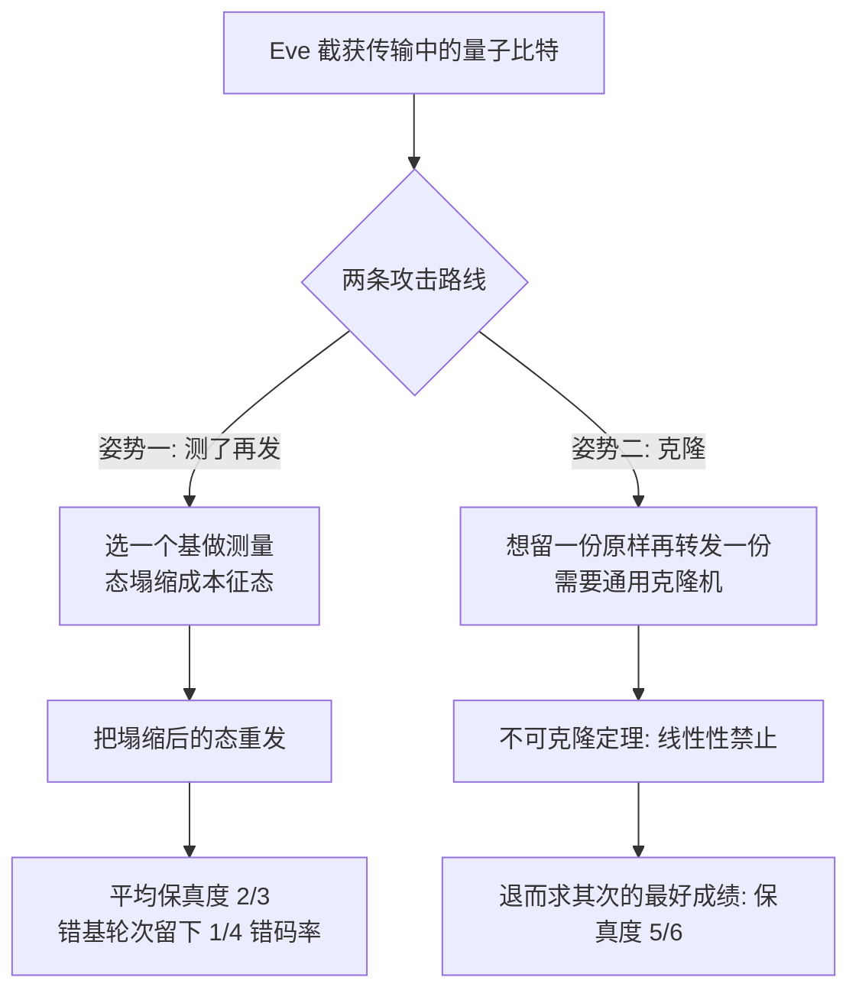

# $\rm Chapter \, 1$ 威胁模型与不可克隆

> **本章假设你已经会**
>
> 1. 复数的共轭、模长与内积笔算，见《量子力学》§1.3 与 §1.4；
> 2. ket、bra 与态矢量的记号读法，见《量子力学》§1.4 与 §3.2；
> 3. 投影测量与 Born 规则的陈述，见《量子力学》§6.2 与 §6.3；
> 4. 张量积 $\otimes$ 怎么把两个小系统拼成大系统，见《量子力学》§1.7。
>
> 缺哪条先回读哪条。狄拉克记号与密度算子的要点本章 §1.2 会当场重立一遍，不回读也能跟上主线。

全册的心智模型先立起来：量子通信的任务不是传得快，而是传得**不可偷、不可仿**。光纤里跑的经典信号可以被分束器无声无息地抄走一份，收信方毫无察觉；量子信道要把这件事变成物理上做不到的事。本章回答三个递进的问题：经典保密到底差在哪一环（§1.1），量子信道靠哪两条物理规则补上这一环（§1.2），以及窃听者在规则内最多能做到什么程度（§1.3 与 §1.4）。学完本章你能独立证明不可克隆定理、算出两种窃听姿势的保真度账，并用一个纯 numpy 脚本把 2/3 与 5/6 这两个数亲手测出来。

## $\rm \S \, 1.1$ 经典保密的极限：密钥分发是绕不开的坎

先把对手写清楚。按威胁建模五问的路数（见《计算机安全》§1.5）：我们要保护的是信道上传输的信息，对手 Eve 能读到信道上的全部信号、能篡改它们，但没有量子计算机级别的算力假设要防，因为她根本不需要算，信道是明文的。安全目标取机密性这一条（CIA 三元组见《计算机安全》§1.1）：Alice 发给 Bob 的内容，Eve 看不懂也算不出来。

经典世界的麻烦从一条平凡事实开始：**复制是免费的**。信道上跑的是比特流，Eve 用一个分束器或一个镜像端口抄走一份完整副本，原始信号分毫未损，Bob 收到的与他该收到的一模一样，事后没有任何痕迹能提示「被抄过」。密码学能补救，但补救的账要算清楚。一次性密码本能做到完美保密（定义与两行证明见《密码学》§1.3）：密钥与明文等长、真随机、只用一次，密文与明文统计独立，Eve 拿到密文也推不出任何东西。但 Shannon 定理同时宣判了这个方案的代价（同在《密码学》§1.3）：完美保密必须有等长密钥，省不掉。于是链条卡在一个自举悖论上：要用 OTP 保密通信，先得把等长的密钥安全地送到 Bob 手里；要把密钥安全地送过去，又得先有一条保密信道。鸡生蛋。

工程界的退路是计算安全（口径见《密码学》§1.5）：不追求「Eve 原则上推不出」，只追求「Eve 在合理时间内算不动」，比如破译需要约 $2^{128}$ 次操作。这个口径成立与否挂在数学难题的难度上，而难度假设是人的判断，不是物理定律。算法进步、算力进步、乃至量子计算机对大数分解的降维打击（这一仗的账在第 8 章与后量子密码里算，见《计算机安全》§1.6 对「完美安全不存在」的成本分析），都可能让昨天的「算不动」变成今天的秒破。

量子通信的提案是让物理定律直接出面接管这一环：密钥不再编码在「可复制的比特流」上，而是编码在单量子系统的态上。这个信道自带两条经典比特没有的物理规则：测量会打扰态（§1.2 的塌缩），复制被定理禁止（§1.3）。Eve 想偷，就得测；测了，就会在 Bob 那头留下可检验的痕迹。剩下的问题是「痕迹有多大、Eve 能不能做得更隐蔽」，那是 §1.4 与第 2 章的定量内容。

白话：经典保密输在「抄走一份不留痕」；OTP 能补但先把问题原样推给了密钥分发；量子信道的卖点是把「偷」和「扰」焊死在一起，偷必留痕，且复印机不存在。

> 本节小结：经典信道复制免费且无痕，完美保密被密钥分发卡住，计算安全挂在难度假设上；量子信道用测量塌缩与不可克隆这两条物理规则补位，全册要算的就是「偷必留痕」这四个字的定量版本。

## $\rm \S \, 1.2$ 量子比特与测量：窃听者必须遵守的两条规则

把载体的最小单元立起来。一个量子比特（qubit）的态是二维复向量空间里的单位向量，狄拉克记号当场立一遍：ket $|\psi\rangle$ 就是一个列向量，bra $\langle\psi|$ 是它的共轭转置行向量，内积 $\langle\phi|\psi\rangle$ 是 bra 乘 ket 得到的复数。取两个标准基向量作「经典世界的 0 和 1」的对应物：

$$
|0\rangle=\begin{pmatrix}1\\0\end{pmatrix},\qquad |1\rangle=\begin{pmatrix}0\\1\end{pmatrix}
$$

任意量子比特态写成叠加（superposition）：

$$
|\psi\rangle=a|0\rangle+b|1\rangle,\qquad |a|^{2}+|b|^{2}=1
$$

读法：$a$ 与 $b$ 是复数振幅，$|a|^{2}$ 与 $|b|^{2}$ 各是一个概率，约束式说总概率为 1。经典比特只能是 0 或 1，量子比特是这两个基向量的任意复线性组合，多出来的自由度正是后面一切故事（能叠加所以信息量大、会塌缩所以偷了留痕、线性所以不可克隆）的共同源头。

窃听者绕不开的第一条规则是 Born 规则的陈述（完整推导见《量子力学》§6.3）：在基 $\{|0\rangle,|1\rangle\}$（习惯称 Z 基）上测量，测得 0 的概率是 $p_{0}=|a|^{2}=|\langle 0|\psi\rangle|^{2}$，测得 1 的概率是 $p_{1}=|b|^{2}$。第二条规则是态更新（塌缩，collapse）：测得 0 之后，态**变成** $|0\rangle$；测得 1 之后变成 $|1\rangle$。振幅 ${a,b}$ 里原本携带的全部信息（相位、两个振幅的比例）在塌缩那一刻被抹掉，只剩测量结果对应的那一个基向量。测量不是「看一眼」，是一次有破坏性的拷问。

测量基不止一组。取两个叠加态 $|+\rangle=\bigl(|0\rangle+|1\rangle\bigr)/\sqrt{2}$ 与 $|-\rangle=\bigl(|0\rangle-|1\rangle\bigr)/\sqrt{2}$（习惯称 X 基），它们同样构成一组正交基。把同一个 $|\psi\rangle$ 改写成 $c_{+}|+\rangle+c_{-}|-\rangle$，在 X 基上测量就按 $|c_{+}|^{2}$ 与 $|c_{-}|^{2}$ 出概率、塌缩到 $|+\rangle$ 或 $|-\rangle$。同一个态，选不同基测量，答案完全不同：Z 基测量抹掉的是 X 基的信息，反之亦然。Eve「选错基」会付出什么代价，§1.4 会一笔一笔算。

最后补一件度量工具。塌缩之后 Bob 手里的可能不是一个确定的纯态，而是「以概率 $p_{i}$ 处于 $|\psi_{i}\rangle$」的账本，写成密度算子（density operator）$\rho=\sum_{i}p_{i}|\psi_{i}\rangle\langle\psi_{i}|$，纯态是它取 $p_{i}=1$ 的特例（混态的完整语义见《量子力学》§9.2）。本章只用它上面的一个数：保真度（fidelity）

$$
F=\langle\psi|\rho|\psi\rangle\in[0,1]
$$

读法：$|\psi\rangle$ 是「原本该是」的态，$\rho$ 是「实际到手」的态（可能是混态），$F$ 量化两者像不像，$F=1$ 完全一致，$F=0$ 完全垂直。全册评价攻击与协议都用这一个指标。

塌缩的态更新值得亲手走一遍才记得牢，§1.5 的 C 部分用固定种子把「测前概率、抽样、塌缩后复测」逐步打印出来。这里先把结论剧透：测前 $P(0)=0.75$ 的一个态，测得 1 之后，复测一万次得 0 的频率是 0.0000，态已经真的变成 $|1\rangle$，不是「还没看清」。

白话：量子比特是带概率解释的二维复向量；测量按振幅模方出结果，并把态砸回结果对应的基向量上；换基测量问的是不同的问题；保真度是全册通用的「像不像」打分器。

> 本节小结：两条规则（Born 概率与塌缩更新）加一个指标（保真度）是本章全部装备；测量基是 Eve 的自由度也是她的软肋，§1.4 就在这里设伏。

## $\rm \S \, 1.3$ 不可克隆定理：线性性禁止复印机

现在证明全册最重要的定理。Eve 的梦想是一台复印机：喂进任意一个要传输的态，吐出两份一模一样的副本，一份转发给 Bob 一份自留。把这台机器的合同写严：存在幺正算子 $U$ 与一张「白纸」初态 $|e\rangle$，使得对**每一个**输入态 $|\psi\rangle$ 都有

$$
U\bigl(|\psi\rangle\otimes|e\rangle\bigr)=|\psi\rangle\otimes|\psi\rangle
$$

读法：左边是「输入态拼白纸」，右边是「两份相同的副本」，$U$ 是整个装置的演化，幺正保证它是物理允许的封闭演化（《量子力学》§5.2 的幺正性）。这就是通用克隆（universal cloning）合同。**不可克隆定理（no-cloning theorem）**说：这样的 $U$ 不存在（Wootters 与 Żurek 1982、Dieks 1982 独立指出；系统陈述见《量子力学》§10.3）。

证明只要两步，全部用线性性。

第一步，任取两个态 $|\psi\rangle$ 与 $|\phi\rangle$，合同对它们分别成立：

$$
U\bigl(|\psi\rangle|e\rangle\bigr)=|\psi\rangle|\psi\rangle,\qquad U\bigl(|\phi\rangle|e\rangle\bigr)=|\phi\rangle|\phi\rangle
$$

第二步，把叠加态 $\bigl(|\psi\rangle+|\phi\rangle\bigr)/\sqrt{2}$ 喂进去，用两种方式算输出，再要求它们相等。方式一，$U$ 是线性算子，可以先展开再演化：

$$
U\Bigl(\frac{|\psi\rangle+|\phi\rangle}{\sqrt{2}}|e\rangle\Bigr)=\frac{|\psi\rangle|\psi\rangle+|\phi\rangle|\phi\rangle}{\sqrt{2}}
$$

方式二，叠加态自己也是合法输入，合同直接要求输出是它的两份副本：

$$
U\Bigl(\frac{|\psi\rangle+|\phi\rangle}{\sqrt{2}}|e\rangle\Bigr)=\frac{\bigl(|\psi\rangle+|\phi\rangle\bigr)\otimes\bigl(|\psi\rangle+|\phi\rangle\bigr)}{2}=\frac{|\psi\rangle|\psi\rangle+|\psi\rangle|\phi\rangle+|\phi\rangle|\psi\rangle+|\phi\rangle|\phi\rangle}{2}
$$

两式相等。若 $|\psi\rangle$ 与 $|\phi\rangle$ 线性无关，则四个乘积态 $|\psi\rangle|\psi\rangle,\ |\psi\rangle|\phi\rangle,\ |\phi\rangle|\psi\rangle,\ |\phi\rangle|\phi\rangle$ 线性无关（线性无关向量的张量积仍线性无关），比较 $|\psi\rangle|\phi\rangle$ 的系数：左边是 0，右边是 $1/2$。矛盾。所以合同在一切叠加输入上必然崩塌，除非所有想克隆的态都挤在同一条复数射线上，而同一条射线上的态物理上是同一个态。结论：**不存在对两个线性无关态同时有效的克隆机**，通吃全部态的复印机更不存在。

补一个两行的硬版本，它把「哪样的态对还能被同一台机器克隆」钉死。设 $U$ 同时克隆 $|\psi\rangle$ 与 $|\phi\rangle$，对两条克隆等式两边取内积，左内积用 $U$ 的幺正性（$U^{\dagger}U=1$）直接消掉：

$$
\langle\psi|\phi\rangle\,\langle e|e\rangle=\langle\psi|\phi\rangle^{2}\ \Longrightarrow\ \langle\psi|\phi\rangle=\langle\psi|\phi\rangle^{2}
$$

复数等于自己的平方，解只有 0 与 1：$|\psi\rangle$ 与 $|\phi\rangle$ 要么正交，要么是同一个态。一台机器的「可克隆名单」至多是一组互相正交的态。CNOT 门恰好在名单 $\{|0\rangle,|1\rangle\}$ 上当复印机（$|0\rangle|0\rangle\to|00\rangle$，$|1\rangle|0\rangle\to|11\rangle$），这与定理不矛盾，而且正是答案所在：经典比特的全部信息只待在这两个基态里，所以经典信息可复制；量子信息藏在任意叠加的振幅与相位里，把这些态也纳入名单的要求线性性满足不了。



定理的推论直接落在威胁模型上。其一，传输途中被无声拷贝不可能：Eve 想留副本就必须动用某个物理过程，而任何过程都无法做到「两份皆真」。其二，定理只禁「完全克隆」，不禁「部分克隆」：造一台机器让输出的每一份与输入**像而不全等**，线性性拦不住它，§1.4 会把这条路线推到物理允许的极限 5/6。其三，防护的代价由定理反向承担：Bob 也无法把收到的态复制备份，量子信息的脆弱性与防窃听的强度是同一条物理规则的两面。

白话：复印机的合同在叠加输入上自相矛盾，矛盾来自「先展开再演化」与「先演化再展开」必须给出同一个答案；能被同一台机器克隆的态至多一组正交基，经典比特恰好住在这样一组基里，量子比特不住。

> 本节小结：不可克隆定理的证明是线性性的两步自查（展开顺序矛盾加内积平方方程）；它禁的是通用复印机，不禁「像而不全等」的部分克隆，后者最好的成绩是 §1.4 的 5/6。

## $\rm \S \, 1.4$ 窃听的两种姿势：测了再发与最优克隆

定理关上了大门，Eve 从窗户爬。她手里有两个现实选项，本节把两者的保真度账都算到底。

### $\rm \S \, 1.4.1$ 姿势一：截听-重发

最朴素的攻击：Eve 选一个测量基（就选 Z 基），对截获的 $|\psi\rangle=a|0\rangle+b|1\rangle$ 做测量，按结果把塌缩态重发给 Bob。记 $p=|a|^{2}$。Bob 收到的态按结果概率加权，是个混态：

$$
\rho_{\mathrm{B}}=p\,|0\rangle\langle 0|+(1-p)\,|1\rangle\langle 1|
$$

它与原态的保真度逐项算出：

$$
F=\langle\psi|\rho_{\mathrm{B}}|\psi\rangle=p\cdot|a|^{2}+(1-p)\cdot|b|^{2}=p^{2}+(1-p)^{2}
$$

读法：第一项是「Eve 测得 0（概率 $p$）、重发 $|0\rangle$、而原态确实在 $|0\rangle$ 方向有成分 $p$」的贡献，第二项对称。这个 $F$ 依赖输入态：$p=0$ 或 $1$（输入恰是 Z 基本征态）时 $F=1$，Eve 毫发无伤；$p=1/2$ 时 $F=1/2$，最差。要对「任意来的态」给一个总分，就取 Haar 随机（Haar random）平均：对所有纯态一视同仁的均匀分布。Haar 随机量子比特的 $p=|a|^{2}$ 在 $[0,1]$ 上均匀分布（Haar 测度的标准性质：把态写成本征基下的 $p=\cos^{2}(\theta/2)$，测度下 $\cos\theta$ 在 $[-1,1]$ 均匀，故 $p$ 均匀；§1.5 实测的平均值独立印证了这一点），于是

$$
\overline{F}=\int_{0}^{1}\Bigl(p^{2}+(1-p)^{2}\Bigr)\mathrm{d}p=\frac{1}{3}+\frac{1}{3}=\frac{2}{3}
$$

这就是截听-重发的成绩单：平均保真度 2/3。它离 1 很远，这意味着攻击很吵，吵在哪里马上看第 2 章的主角 BB84 怎么用它。设 Alice 发的是 X 基的 $|+\rangle$（编码比特 0），Eve 有 1/2 概率选错基（选了 Z）：测得 0 或 1 各以概率 $|\langle 0|+\rangle|^{2}=1/2$，态塌缩成 Z 基本征态；Bob 拿到的态再过 X 基测量，$|\langle+|0\rangle|^{2}=1/2$，错码概率 1/2。Eve 选对基时无伤。合计每轮错码率：

$$
P_{\mathrm{err}}=\frac{1}{2}\times\frac{1}{2}=\frac{1}{4}
$$

Eve 每偷一轮，Bob 与 Alice 的账本上就平均多出 1/4 的错码。这个数是第 2 章检测率推导的地基，§1.5 的 D 部分先用蒙特卡洛把它测出来（实测 0.247050，20000 轮）。

### $\rm \S \, 1.4.2$ 姿势二：最优克隆机

测了再发的破绽是塌缩太狠：信息直接被抹成测量结果。更精的做法是不做投影测量，改做一个「软拷贝」：设计一个演化，把输入态**部分地**印到空白系统上，原态与拷贝各带一点彼此的信息，谁都不是完美的，但都尽量像。这门手艺的最优解是 Buźek 与 Hillery 1996 年给出的通用克隆机（Buźek–Hillery, Phys. Rev. A 54, 1844 (1996)），本节把它完整立起来并亲手算出它的保真度。

装置占三个量子比特：输入比特 $x$、空白比特 $y$、机器比特 $m$，机器比特自带一组正交基 $|\uparrow\rangle,|\downarrow\rangle$（与输入的 0/1 无关，防止撞名）。克隆机的全部内容是两条演化规则：

$$
\begin{aligned}
|\Phi_{0}\rangle&=\sqrt{\tfrac{2}{3}}\;|00\rangle|\uparrow\rangle+\sqrt{\tfrac{1}{6}}\;\bigl(|01\rangle+|10\rangle\bigr)|\downarrow\rangle,\\
|\Phi_{1}\rangle&=\sqrt{\tfrac{2}{3}}\;|11\rangle|\downarrow\rangle+\sqrt{\tfrac{1}{6}}\;\bigl(|01\rangle+|10\rangle\bigr)|\uparrow\rangle,
\end{aligned}
$$

读法：$|00\rangle$ 的第一位是克隆 $a$、第二位是克隆 $b$，$|\uparrow\rangle$ 与 $|\downarrow\rangle$ 是机器比特的态；输入 $|0\rangle_{x}|0\rangle_{y}$ 被映成 $|\Phi_{0}\rangle$，输入 $|1\rangle_{x}|0\rangle_{y}$ 被映成 $|\Phi_{1}\rangle$。先验算它物理合法：$|\Phi_{0}\rangle$ 的模方账是 $2/3+1/6+1/6=1$，$|\Phi_{1}\rangle$ 同样；两者占据的六个槽位（克隆对、机器态的组合）两两不同，故 $\langle\Phi_{0}|\Phi_{1}\rangle=0$。内积保持由此对一切输入成立：$\langle a\Phi_{0}+b\Phi_{1}|a'\Phi_{0}+b'\Phi_{1}\rangle=a^{*}a'+b^{*}b'=\langle\psi|\phi\rangle$，线性延拓补全，$V$ 是一个等距算子（isometry），可扩充成大空间上的幺正演化。§1.5 的 B 部分数值复核这一步（偏差 $1.11\times 10^{-16}$）。

现在算保真度。输入 $|\psi\rangle=a|0\rangle+b|1\rangle$ 的输出是 $|\Phi(\psi)\rangle=a|\Phi_{0}\rangle+b|\Phi_{1}\rangle$，克隆 $a$ 的态是对克隆 $b$ 与机器求迹（$\operatorname{Tr}_{b,m}$ 的定义见《量子力学》§9.2）：

$$
\rho_{a}=\operatorname{Tr}_{b,m}\Bigl(|\Phi(\psi)\rangle\langle\Phi(\psi)|\Bigr)
$$

展开后按「槽位重合才存活」逐块清点。对角两块：$|\Phi_{0}\rangle$ 里克隆 $a$ 取 0 的槽位带幅度平方 $2/3+1/6=5/6$、取 1 的带 $1/6$，$|\Phi_{1}\rangle$ 对称地是 $1/6$ 与 $5/6$，且各自无跨槽位的相干项，故对角贡献是两个对角矩阵。交叉块 $X=\operatorname{Tr}_{b,m}\bigl(|\Phi_{0}\rangle\langle\Phi_{1}|\bigr)$ 的每个矩阵元是「$|\Phi_{0}\rangle$ 与 $|\Phi_{1}\rangle$ 在同一 $(b,m)$ 槽位上的幅度乘积」之和：重合的槽位只有 $(b,m)=(0,\uparrow)$ 处的 $\sqrt{2/3}\cdot\sqrt{1/6}=1/3$ 与 $(b,m)=(1,\downarrow)$ 处的 $\sqrt{1/6}\cdot\sqrt{2/3}=1/3$，且都落在 $a$ 取 0 行、$a$ 取 1 列，合计

$$
\rho_{a}=|a|^{2}\begin{pmatrix}\frac{5}{6}&0\\[2pt]0&\frac{1}{6}\end{pmatrix}+|b|^{2}\begin{pmatrix}\frac{1}{6}&0\\[2pt]0&\frac{5}{6}\end{pmatrix}+ab^{*}\begin{pmatrix}0&\frac{2}{3}\\[2pt]0&0\end{pmatrix}+a^{*}b\begin{pmatrix}0&0\\[2pt]\frac{2}{3}&0\end{pmatrix}
$$

代进保真度定义，对角项与相干项分开收账：

$$
F=\langle\psi|\rho_{a}|\psi\rangle=\frac{5|a|^{4}+2|a|^{2}|b|^{2}+5|b|^{4}}{6}+\frac{8|a|^{2}|b|^{2}}{6}=\frac{5\bigl(|a|^{2}+|b|^{2}\bigr)^{2}}{6}=\frac{5}{6}
$$

最后一步用归一化 $|a|^{2}+|b|^{2}=1$，中间的 $2+8=10$ 把交叉项并了进来。结论干净得反常：**对每一个输入态，保真度都是 5/6，与 ${a,b}$ 无关**。克隆 $b$ 的账逐槽位重算一遍（机器基在两条规则间对调，重合槽位算出来形状全同），结果一样；§1.5 的 B 部分在 2000 个 Haar 随机态上逐态复核，最大偏差 $1.11\times 10^{-15}$。

两件事要说透。其一，「逐态 5/6」比「平均 5/6」强得多：姿势一的成绩是平均意义下的 2/3，个别态能到 1 也有的态只有 1/2；克隆机对所有态一视同仁，这正是「通用（universal）」二字的含义。其二，两份克隆与机器比特三者之间是纠缠的，不是两张独立的复印件：$\rho_{a}$ 之所以带 $\frac{1}{6}$ 的对角噪声底与 $\frac{2}{3}$ 的相干残渣，正是因为被积掉的那部分信息躲进了克隆 $b$ 与机器里。Eve 想读出自己的那份，还得再测量，测量就把她带回姿势一的世界。

5/6 是不是极限？是，而且是定理级的。Buźek 与 Hillery 在同一篇论文里证明：任何对全部单量子比特态一视同仁的 1 到 2 克隆装置，保真度不能超过 5/6（证明的关键是完全正定性，即「先混合后克隆」与「先克隆后混合」必须给出同一结果这一物理一致性，它对机器参数构成矩阵不等式，把 $2/3$ 与 $1/6$ 这组系数钉死）。于是三本账连成一条线：$F=1$ 被不可克隆定理禁止（§1.3），$F=5/6$ 被最优性定理允许且封顶，中间的每个数物理上都做得到但没人必须用。

白话：姿势一「测了再发」平均 2/3，破绽是塌缩抹信息；姿势二「软拷贝」不抹信息而是把信息分摊到三个量子比特上，每一份都像而不全等，最好成绩逐态 5/6，且这是上界。

> 本节小结：截听-重发的平均保真度 2/3、错基轮错码率 1/4；最优通用克隆机逐态保真度 5/6，由槽位账一行积分算出，上界由完全正定性钉死；两份克隆相互纠缠，读取又回到姿势一。

## $\rm \S \, 1.5$ 实测：三本账对账

本章的实测锚点有三个：截听-重发的平均保真度 2/3、最优克隆机的逐态保真度 5/6、BB84 单轮错码率 1/4，外加塌缩走查。实验环境：WSL，python3 加 numpy，纯态矢量模拟，无任何量子计算框架；种子固定 20261109；脚本与本节全部输出存于写作工作目录 `26Fall/_uni5_work/expQI01/`（`expQI01.py` 与 `result.txt`），总耗时 0.27 秒。核心代码摘录（克隆机与保真度函数）：

```python
# 8 维输出空间 = 克隆a x 克隆b x 机器，指标顺序 (a, b, m)
s23, s16 = np.sqrt(2/3), np.sqrt(1/6)
Phi0 = np.zeros(8, dtype=complex)          # V|0>|blank> = |Phi0>
Phi0[0*4 + 0*2 + 0] = s23                  # |00>|up>
Phi0[0*4 + 1*2 + 1] = s16                  # |01>|down>
Phi0[1*4 + 0*2 + 1] = s16                  # |10>|down>
Phi1 = np.zeros(8, dtype=complex)          # V|1>|blank> = |Phi1>
Phi1[1*4 + 1*2 + 1] = s23                  # |11>|down>
Phi1[0*4 + 1*2 + 0] = s16                  # |01>|up>
Phi1[1*4 + 0*2 + 0] = s16                  # |10>|up>
V = np.column_stack([Phi0, Phi1])          # 8x2 等距算子

def clone_fidelity(psi):
    Phi = psi[0]*Phi0 + psi[1]*Phi1        # 输出 |Phi(psi)>
    T = Phi.reshape(2, 2, 2)
    rho_a = np.einsum("ijm,kjm->ik", T, T.conj())   # 对 b,m 求迹
    return float(np.real(psi.conj() @ rho_a @ psi))
```

三本账与理论的对照：

| 账目 | 口径 | 理论 | 实测 |
| --- | --- | --- | --- |
| 截听-重发（Z 基）保真度 | 2000 个 Haar 随机态的平均 | 2/3 = 0.666667 | 0.666572 |
| 最优克隆机保真度 | 逐态（每个态各测一次） | 5/6 = 0.833333 | 0.8333333333 |
| BB84 单轮错码率 | 20000 轮频率 | 1/4 = 0.25 | 0.247050 |

对账细节逐条给出。第一，截听-重发的实测平均 0.666572 与 2/3 偏差 $9.45\times 10^{-5}$，量级符合 $1/\sqrt{N}$ 的统计涨落；实测最小值 0.500000、最大值 0.999664，正好落在理论区间 $[1/2,\,1)$ 的两端附近（端点是测度零的特态，有限采样只能逼近），中间那些态各不相同，这就是「平均 2/3」与「逐态 5/6」的口径差别。第二，克隆机的等距性复核 max $|V^{\dagger}V-I|=1.11\times 10^{-16}$，是双精度浮点的机器精度；2000 个随机态上克隆 $a$ 与克隆 $b$ 的保真度最小值、最大值全都是 0.8333333333，逐态最大偏差 $1.11\times 10^{-15}$，五个手选检验态 $|0\rangle,|1\rangle,|+\rangle,|-\rangle$ 与 $|i\rangle$（$i$ 是虚数单位）也逐个给出 0.8333333333，与「逐态常数」的解析结论一致。第三，塌缩走查（固定态 $\frac{\sqrt{3}}{2}|0\rangle+\frac{1}{2}|1\rangle$）的原始输出：

```text
测量前 |psi> = 0.866025|0> + 0.500000|1>
Born 规则：P(0) = |<0|psi>|^2 = 0.750000，P(1) = 0.250000
抽样 u = 0.829863 -> 本轮测量结果：1
塌缩后态：|1>（再次 Z 测量必得 1，概率 1）
塌缩后复测 10000 次：得到 0 的频率 = 0.0000
```

抽样值 $0.829863$ 大于 $0.75$，本轮测得 1，态塌缩成 $|1\rangle$；之后复测一万次得 0 的频率为 0.0000。测前态里明明还有 $|0\rangle$ 方向的 $0.75$ 概率质量，一次测量之后它整个消失，这就是「测量有破坏性」的直接证据。第四，BB84 单轮错码率 20000 轮测得 0.247050（4941 轮错码），与 1/4 偏差 0.0030，同样在 $1/\sqrt{N}\approx 0.007$ 的涨落带内；错码全部来自「Eve 选错基且塌缩态恰好骗过 Bob」的复合事件，理论乘积 $1/2\times 1/2$ 得到确认。

> 本节小结：2/3、5/6、1/4 三个理论数在固定种子下全部复现，前两个的偏差分别在 $10^{-4}$ 与 $10^{-15}$ 量级；塌缩走查直接展示了「测前的 0.75 概率质量在测后清零」。

## $\rm \S \, 1.6$ 关键概念回顾

1. 不可克隆定理的证明用了线性性的哪一步、内积的哪一步？CNOT 能同时克隆 $|0\rangle$ 与 $|1\rangle$，这为什么与「不存在通用克隆机」不矛盾？
2. 截听-重发攻击的平均保真度 2/3 是对哪个分布取的平均？它对哪类输入态等于 1，对哪类输入态只有 1/2？
3. 「平均保真度 2/3」与「逐态保真度 5/6」的口径差别是什么？为什么后者是一个强得多的成绩？
4. 测量的两条规则（概率与态更新）各自的内容是什么？Eve 选错测量基时，她抹掉的是哪组基上的信息？

## $\rm \S \, 1.7$ 应用与辨析

1. 同事提议：Eve 先用最优克隆机制作克隆，把其中一份转发给 Bob，自留一份，等以后 Alice 公开测量基（第 2 章的 BB84 确实会公开基）再读自己的那份。这个方案能把错码率从 1/4 降下来吗？提示：先问转发给 Bob 的那一份本身带多少噪声。
2. 经典光纤上 Eve 用分束器分走 10% 光功率，Bob 的误码率几乎不变，这是经典窃听的免费午餐。把同样的分束器装上量子信道，它还是免费午餐吗？被 §1.2 与 §1.3 的哪几条物理事实拦住？
3. 有人声称把 §1.5 脚本里 $\sqrt{2/3}$ 与 $\sqrt{1/6}$ 换成别的系数（保持各态归一）就能让保真度超过 5/6。这个声称与哪条定理冲突？动手改脚本试一轮，观察数值结果怎么回应他。

## $\rm \S \, 1.8$ 本章自测答案

概念回顾答案：

1. 线性性用在第二步：机器先分别克隆两个基态，则对叠加输入「先展开再演化」得到 $|\psi\rangle|\psi\rangle+|\phi\rangle|\phi\rangle$ 的组合；合同又要求「直接克隆叠加态」得到带全部交叉项的展开式。两者必须相等，而四个乘积态线性无关，交叉项系数 0 对 $1/2$ 直接矛盾。内积用在硬版本：两条克隆等式两边取内积，幺正性消掉 $U$，得 $\langle\psi|\phi\rangle=\langle\psi|\phi\rangle^{2}$，可克隆名单至多一组正交基。CNOT 的名单恰是 $\{|0\rangle,|1\rangle\}$ 这一组，它对叠加输入 $|+\rangle$ 输出 Bell 态而非 $|+\rangle|+\rangle$，合同在叠加处崩塌，与定理完全一致（§1.3）。
2. 对 Haar 随机分布（对所有纯态均匀）取平均：$p=|a|^{2}$ 在 $[0,1]$ 均匀，$\overline{F}=\int_{0}^{1}\bigl(p^{2}+(1-p)^{2}\bigr)\mathrm{d}p=2/3$。输入恰为 Z 基本征态（$p=0$ 或 1）时 $F=1$，Eve 无伤；输入为 $p=1/2$ 的态（如 $|+\rangle$）时 $F=1/2$，最差（§1.4.1）。
3. 平均口径允许成绩依赖输入：有的态接近 1、有的只有 1/2，均值才 2/3。逐态口径要求每个态、包括相位与比例任意的叠加态都拿到同一个分；5/6 意味着不存在任何「Eve 的偏科」，这是「通用」二字的严格含义，也是它接近上界的原因（§1.4.2）。
4. 规则一：测得某结果的概率等于态在该基向量上振幅的模方（Born 规则）。规则二：得到结果后态立刻塌缩为该结果对应的基向量，原振幅信息全部丢失。Eve 用 Z 基测量就抹掉 X 基（相位与比例）的信息，重发的态因此必然带着「她选了 Z 基」的指纹，Bob 换基一验就现形（§1.2、§1.4.1）。

应用与辨析答案：

1. 降不下来，反而更糟。转发给 Bob 的那一份是 5/6 保真度的含噪态（$\frac{5}{6}|+\rangle\langle+|+\frac{1}{6}|-\rangle\langle-|$ 的形状），Bob 在它身上做 X 基测量每轮已有 $1/6$ 概率读错，这还没算 Eve 自留那份被读取时的动静；而姿势一直接转发塌缩态，选对基的轮次是无损的。克隆机的「安静」是假象：它的噪声底是逐轮恒定的 $1/6$，在任何基下都藏不住，第 2 章的检测率推导会把它算成可观的 QBER（§1.4.2）。
2. 不是。经典分束器工作的前提是信号由大量独立光子组成，抽走 10% 只降信噪比。量子信道每比特是单个量子系统，没有「10% 的态」可分：要么整个态被完整路由（那是 Bob 收到，不是 Eve 偷到），要么 Eve 对它做测量或耦合，立刻触发塌缩与不可克隆这两条规则；她能构造的最好「软分束」就是 5/6 的部分克隆，且纠缠结构决定了残缺信息必被抹掉一部分，事后对账必留痕（§1.1、§1.2、§1.3）。
3. 与最优性定理冲突：Buźek 与 Hillery 证明了通用 1 到 2 克隆的保真度上界 5/6，完全正定性把 $\sqrt{2/3}$ 与 $\sqrt{1/6}$ 钉死。改系数后要么等距性复核 $|V^{\dagger}V-I|$ 立刻偏离机器精度（演化不物理），要么逐态保真度掉下 5/6 且开始依赖输入态（不再通用），数值上两条路都试不通（§1.4.2、§1.5）。

**你现在能做什么**：合上讲义，只用线性性和一次取内积，在两分钟内把不可克隆定理讲给另一个人听，并回答「那 CNOT 为什么行」。

第 2 章把本章的三件装备组装成第一台完整的机器：BB84 协议逐轮走一遍，把「Eve 偷一轮留下 1/4 错码率」升级成「偷 $s$ 比例就有确定的检测概率」的推导，Alice 与 Bob 第一次能对整个信道说出「这段线路被窃听的概率是多少」。

---

实验记录：本章 §1.5 全部实测数字来自脚本 `expQI01.py`（截听-重发保真度、Buźek-Hillery 型克隆机逐态保真度与等距性复核、测量塌缩走查、BB84 单轮错码率蒙特卡洛，python3 + numpy，纯态矢量模拟，种子 20261109，WSL 运行，总耗时 0.27 秒），原始输出存于写作工作目录 `26Fall/_uni5_work/expQI01/result.txt`，重跑可逐位复现表中数字。
