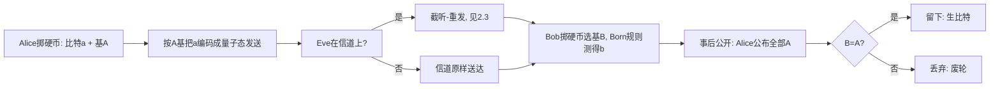

# $\rm Chapter \, 2$ BB84

> **本章假设你已经会**
>
> 1. 量子比特的两套正交基：计算基 $\lvert0\rangle$、$\lvert1\rangle$ 与 Hadamard 基 $\lvert+\rangle$、$\lvert-\rangle$，以及 $\lvert\langle0\vert+\rangle\rvert=1/\sqrt2$ 这类内积怎么算，见《量子力学》§3.3。
> 2. Born 规则与测量坍缩：测量的概率由态在各基向量上的分量模方给出，测后态塌到抽中的那一个，见《量子力学》§6.3。
> 3. 不可克隆定理：不存在能复制任意未知量子态的物理过程，且「只看不动」的测量同样不存在，见《量子力学》§10.3。
> 4. 一次性密码本与完美保密：无条件保密要求双方预先共享与消息等长的真随机密钥，且只用一次，见《密码学》§1.3。
> 5. 第 1 章 §1.1 立下的威胁模型：窃听者 Eve 控制整条量子信道，公开信道上她能听也能改，但改动会被察觉。

全册的心智模型是：量子通信的任务不是传得快，而是传得不可偷、不可仿。第 1 章把这个口号兑现成了两条物理定律（§1.3 的不可克隆、§1.2 的测量留痕），但定律是防御资源，不是协议：手里有一把好锁，不等于知道门该怎么装。本章装上这门锁，讲第一个完整的量子密钥分发协议 BB84（Bennett–Brassard 1984，以两位提出者与年份命名）。

它解决的问题在《密码学》§1.3 就埋下了：一次性密码本给出了唯一已知的无条件保密方案，前提是双方先共享等长密钥。可密钥怎么送过去？用保密信道送，那保密信道本身又需要密钥，死循环；用公钥密码（《密码学》§1.5）绕开，得到的只是计算安全，而且 RSA、ECC 这类方案依赖的大整数分解与离散对数问题恰有已知的量子多项式算法（Shor 算法，其骨架相位估计见《量子力学》§5.3.4）。BB84 的思路是把死结剪开：密钥不送，双方从同一条不安全的量子信道里现场生成一致的随机比特，再用公开信道当场验货。本章你能走完协议的每一轮，推出窃听者的指纹公式，用蒙特卡洛对账，并算出「被窃听到什么程度就干脆不产密钥」的阈值。下一章换一种更狠的安全思路：让纠缠本身出面给设备验明正身。

## $\rm \S \, 2.1$ 密钥要从信道里现场长出来

先把任务钉死成可检验的形式。Alice 与 Bob 手里各有一个「掷硬币」的真随机源，最终目标是两人手里出现两串完全相同、且除他俩外任何人都不知道信息的比特串；Eve 控制两人之间的全部信道。注意这跟「发消息」是两件事：密钥分发完成后，真正的话再用一次性密码本走经典信道（《密码学》§1.3），BB84 本身一步用户数据都不传。这也正是心智模型的落点：这套系统天生不是为了快，一条信道每轮只能挤出一比特生比特的一半左右，比光纤直连慢几个数量级；它卖的是「不可偷不可仿」。

「不可偷」与「不可仿」在本章各对应一条具体的物理机制。不可仿：Eve 无法把信道上的量子态复制一份存起来慢慢研究，因为未知态不可克隆（《量子力学》§10.3）；她若想知道内容，必须当场测量。不可偷：当场测量无法不留痕，因为她不知道用哪套基去测，乱测就会扰动，扰动可检出。这两条合起来给出了一个经典世界没有的对称局面：Eve 想拿到信息就必然留指纹，想不留指纹就必然拿不到信息。BB84 的全部设计，就是让这个对称局面变成一本可以逐轮记的账。

> 本节小结：任务不是传消息而是现场生成共享密钥；不可仿由不可克隆担保，不可偷由测量扰动担保；本章把这两条定律做成一本逐轮可对账的账。

## $\rm \S \, 2.2$ 协议逐轮：四个态、三次抽签、一次筛选

BB84 用四个量子态当字母表，两两分属两套基：

$$
\lvert0\rangle,\ \lvert1\rangle \;\;(\text{$Z$ 基，即计算基})\qquad\qquad \lvert+\rangle=\frac{\lvert0\rangle+\lvert1\rangle}{\sqrt2},\ \ \lvert-\rangle=\frac{\lvert0\rangle-\lvert1\rangle}{\sqrt2}\;\;(\text{$X$ 基，即 Hadamard 基})
$$

读法：$\lvert0\rangle$ 与 $\lvert1\rangle$ 是 $Z$ 基的两个基向量，分别代表比特 ${0}$ 和 ${1}$；$\lvert+\rangle$ 与 $\lvert-\rangle$ 是 $X$ 基的两个基向量，分别代表比特 ${0}$ 和 ${1}$。同一个比特值在两套基里有两种不同的物理载体，这是后面一切戏法的舞台。

协议的一轮只有三掷一筛，每一掷都是等概率的抛硬币：

1. Alice 掷两枚硬币：比特 ${a\in\{0,1\}}$ 与基 ${A\in\{Z,X\}}$，各自等概率。
2. Alice 把 $a$ 按基 $A$ 编码后发送：$A=Z$ 发 $\lvert0\rangle$ 或 $\lvert1\rangle$，$A=X$ 发 $\lvert+\rangle$ 或 $\lvert-\rangle$。
3. Bob 独立掷一枚硬币选基 $B$，按 Born 规则测量，记下结果 $b$。
4. 全部轮结束后，Alice 在公开信道公布每一轮的基 $A$。只公布基，永远不公布比特。
5. 筛选（sifting）：Bob 只保留 $B=A$ 的轮，双方各自删掉其余轮，留下的比特串叫生比特（raw key）。

第 3 步藏着一个必须当场算清的事实：${B\neq A}$ 时 Bob 的结果是纯随机的。以 $A=Z$、$B=X$ 为例，Alice 发的是 $\lvert0\rangle$，Bob 用 $X$ 基测量，Born 规则给出：

$$
P(b=0)=\lvert\langle0\vert+\rangle\rvert^{2}=\Bigl\lvert\tfrac{1}{\sqrt2}\Bigr\rvert^{2}=\frac{1}{2},\qquad P(b=1)=\lvert\langle0\vert-\rangle\rvert^{2}=\frac{1}{2}
$$

读法：$\langle0\vert+\rangle$ 是 $\lvert0\rangle$ 在 $X$ 基第一个基向量上的分量，模方就是抽中它的概率；两个分量模方各半，所以测量等于重新抛一次硬币，而且这次抛硬币还会把态永久塌缩掉（《量子力学》§6.3），Alice 发的原始信息在这一轮已经丢了。筛选存在的意义就是把这些废轮扔掉：$P(B=A)=1/2$，生比特长度约为发送轮数的一半。



白话：每一轮双方各自抛硬币、互不通气；基对上了，Bob 手里的结果与 Alice 发的一致；基没对上，Bob 抛的是自己的硬币，结果没用。事后对一遍基，把对上的留作生比特。

> 本节小结：四个态两套基；每轮 Alice 掷比特与基、Bob 掷基；错基测量是纯随机并破坏原态；公布基不公布比特，筛选后留下约一半的生比特。

## $\rm \S \, 2.3$ 窃听的指纹：每个被截听的筛选比特有四分之一概率出错

现在让 Eve 上场。她的攻击方式叫截听-重发（intercept-resend）：以概率 $s$ 对一轮动手（$s$ 叫窃听率，$s=0$ 完全不动手，$s=1$ 每轮都动手）；动手时她截下量子态，自己掷一枚基 ${E\in\{Z,X\}}$ 测量，把测得的经典结果按 $E$ 基重新编码发给 Bob。这已是她能做的最自然攻击：克隆留备份被《量子力学》§10.3 禁止，「只看不动」被测量坍缩禁止，想知道就得先测，测完原来那个态没了，只好拿自己的重发顶上。

推导指纹只用条件概率。我们关心的是「既被截听、又通过筛选」的轮，即 Eve 动了手且 $B=A$ 的轮。按她掷出的基 $E$ 分两种情况：

1. $E=A$（概率 $1/2$）：她用对了基，测得就是 $a$，重发的态与 Alice 发的逐比特相同。Bob 看到的与无 Eve 时完全一样，不出错。
2. ${E\neq A}$（概率 $1/2$）：她用错了基，测量把态塌缩到 $E$ 基的某个基向量上，重发的态在 $A$ 基下是对半叠加（§2.2 第 3 步算过的那个 $1/2$）。Bob 用 $B=A$ 测量，两个结果各半，蒙错概率 $1/2$。

两种情况合起来，每个被截听又筛留下来的比特出错的条件概率是：

$$
q_{\text{att}}=P(E\neq A)\cdot P(\text{Bob 蒙错}\mid E\neq A)=\frac{1}{2}\times\frac{1}{2}=\frac{1}{4}
$$

读法：$q_{\text{att}}$ 是「在被截听且筛留的比特里，Bob 的比特与 Alice 的比特不符」的概率；两个因子依次是 Eve 掷错基的概率、掷错基之后 Bob 蒙错的概率。再把未被截听的轮（零错误，§2.4 前的模型里信道是理想无噪的）摊进来，全部筛选比特的总误码率（Quantum Bit Error Rate，QBER）是：

$$
q=s\cdot q_{\text{att}}=\frac{s}{4}
$$

读法：$s$ 是每轮被截听的概率，被截听的那部分贡献 $q_{\text{att}}$，其余贡献零，加权平均就是 $s/4$。

这里最容易算错两次，各错在一步。第一种：直接写 $q_{\text{att}}=1/2$，理由是「Eve 掷错基的概率是一半」。这一步漏了错基之后 Bob 还有一半概率蒙对：错基的扰动要再乘一个 $1/2$ 才落到 Bob 的账上。第二种：把 $1/4$ 当成全部筛选比特的 QBER。$1/4$ 只对被截听的那部分成立，$s=1$ 时总 QBER 才是 $25\%$；$s=0.1$ 时 QBER 只有 $2.5\%$，指纹淡到必须靠统计手段才能捞出来，这正是下一节检测率公式要干的事。

还有一句必须说清分量的实话：$E=A$ 时 Eve 完全无痕。指纹不是「抓现行」，是统计疑点；QBER 升高只说明「有人在动」，不直接指认是谁、在哪一轮。把 $25\%$ 读成「每四个被截听的筛选比特错一个」，别读成「每四轮抓到一次」，后者是两种错觉的合体。

白话：Eve 想偷看就得先猜基；猜对白看，猜错就在 Bob 的账上留下一个四分之一概率的错。她的窃听率 $s$ 直接决定 Alice 和 Bob 数出来的 QBER $s/4$，偷得越多，指纹越浓。

> 本节小结：截听-重发在被截听的筛选比特上留下 $1/4$ 的错误率，总 QBER 等于 $s/4$；$E=A$ 的轮完全无痕，检测是统计性的不是当场抓人。

## $\rm \S \, 2.4$ 检测率：$1-(1-s/4)^{N}$，一场统计对赌

有了指纹公式，还差一步把它变成「当场报警」。流程是：Alice 与 Bob 从生比特里随机抽 $N$ 个比特，在公开信道上亮出各自手中的值逐一比对；这 $N$ 个比特从此作废（已在公开信道曝光）。$N$ 个里只要有一个不一致，就判定信道上有窃听（或噪声过大），整个本轮密钥作废。

检测率公式从两件事推出。第一，单个抽测比特出错的概率就是 QBER $q=s/4$，因为抽测比特是筛选比特的随机样本，§2.3 的加权平均对它们原样成立。第二，各轮的抽签（Alice 的两掷、Eve 的两掷、Bob 的一掷）彼此独立，所以 $N$ 个抽测比特的错误事件相互独立。于是「全部正确」的概率是连乘，「至少一个错」取补集：

$$
p_{\text{det}}=1-(1-q)^{N}=1-\Bigl(1-\frac{s}{4}\Bigr)^{N}
$$

读法：$p_{\text{det}}$ 是 $N$ 个抽测比特里出现至少一个错误的概率；$(1-q)^{N}$ 是 $N$ 个全对的概率，$q=s/4$ 由 §2.3 给出。

代入 $N=64$（一个很小的样本）看看这场对赌的价格：

| 窃听率 $s$ | 漏检概率 $(1-s/4)^{64}$ | 检测率 $p_{\text{det}}$ |
| --- | --- | --- |
| ${0.1}$ | ${0.198}$ | ${0.802}$ |
| ${0.2}$ | ${0.038}$ | ${0.962}$ |
| ${0.5}$ | ${0.00012}$ | ${0.99988}$ |
| ${1.0}$ | 约 $1.0\times10^{-8}$ | 约 ${1.0000000}$ |

这个表说明两件事。对 Eve：她哪怕只截听一成的轮，一成的 QBER 也会在 64 个抽测比特上以八成概率留下至少一个错；想压低漏检概率，她必须把 $s$ 压到接近零，而压 $s$ 就是压她自己的信息量。对 Alice 和 Bob：$N$ 是「浪费的密钥」与「漏检风险」之间的定价，$N$ 越大检测越灵敏、可用密钥越少；$N$ 的选择不影响指纹本身的浓度，只影响把它捞出来的把握。公式形状不变的前提下，若 Eve 改用更隐蔽的攻击把每个被截听比特的错误率从 $1/4$ 压到别的常数 $c$，检测率就换成 $1-(1-sc)^{N}$，账还是这本账，§2.7 会回到这一点。

白话：抽测就是抽样验货。每抽一个，抓到问题的概率是 $s/4$；抽 $N$ 个想全放过去，Eve 靠的是连乘 $(1-s/4)^{N}$，这个数随 $N$ 指数式缩水。

> 本节小结：公开抽测 $N$ 个筛选比特并弃用它们；检测率 $p_{\text{det}}=1-(1-s/4)^{N}$；独立性来自每轮抽签独立；$N$ 是密钥消耗与漏检风险之间的定价参数。

## $\rm \S \, 2.5$ 实测：蒙特卡洛对账

上面每个公式都在仿真里真跑过。环境为 WSL 里的 python3 加 numpy（实验环境 numpy 2.5.4），脚本与全部输出存于 `26Fall/_uni5_work/expQI02/`，随机数种子固定为 ${20261109}$，任何人重跑得到同一串数字。复现命令如下。

```bash
# 环境: WSL 的 Bash; 前置: python3 与 numpy; 脚本只读自身代码, 输出走标准输出
cd /mnt/c/Users/20811/Desktop/26Fall/_uni5_work/expQI02
python3 expQI02.py    # stdout 即随附 result.txt; 种子固定, 重跑逐位一致, 总耗时约 3 秒
```

成功验证：末行打印「断言全部通过」，四段实验 E0 至 E3 齐全。常见失败是环境里没有 numpy 报 ImportError，装上即可；脚本全部用向量化数组，没有逐比特的 Python 循环，这是 3 秒能跑完一千多万轮的原因。有一点先交代清楚：截听-重发是纯经典随机过程（每一步都是掷硬币），量子性只进了「错基测量等概率随机」这一个输入，所以整场仿真可以用 numpy 的整数随机数完成，不需要量子模拟器，这本身就是 §2.2 与 §2.3 推导全部成立的一个旁证。

E0 是极限情形自检：$s=0$ 时 40 万轮的生比特零错误；$s=1$ 时 QBER 实测 ${0.2492}$，被截听的筛选比特错误率同为 ${0.2492}$，双双贴住理论值 $0.25$。E1 把窃听率从 ${0}$ 扫到 ${1.0}$，每档 ${1000000}$ 轮发送：

| $s$ | 筛选比特数 | 模拟 QBER | 理论 $s/4$ | 偏差 | 被截听筛选比特错误率 |
| --- | --- | --- | --- | --- | --- |
| ${0.0}$ | ${500036}$ | ${0.0000}$ | ${0.0000}$ | ${+0.0000}$ | （无样本） |
| ${0.1}$ | ${500179}$ | ${0.0250}$ | ${0.0250}$ | ${-0.0000}$ | ${0.2500}$ |
| ${0.2}$ | ${499943}$ | ${0.0500}$ | ${0.0500}$ | ${+0.0000}$ | ${0.2505}$ |
| ${0.3}$ | ${499536}$ | ${0.0746}$ | ${0.0750}$ | ${-0.0004}$ | ${0.2489}$ |
| ${0.4}$ | ${499852}$ | ${0.0998}$ | ${0.1000}$ | ${-0.0002}$ | ${0.2490}$ |
| ${0.5}$ | ${500609}$ | ${0.1250}$ | ${0.1250}$ | ${+0.0000}$ | ${0.2497}$ |
| ${0.6}$ | ${500372}$ | ${0.1504}$ | ${0.1500}$ | ${+0.0004}$ | ${0.2502}$ |
| ${0.7}$ | ${499549}$ | ${0.1763}$ | ${0.1750}$ | ${+0.0013}$ | ${0.2517}$ |
| ${0.8}$ | ${500465}$ | ${0.1996}$ | ${0.2000}$ | ${-0.0004}$ | ${0.2494}$ |
| ${0.9}$ | ${500135}$ | ${0.2254}$ | ${0.2250}$ | ${+0.0004}$ | ${0.2502}$ |
| ${1.0}$ | ${499396}$ | ${0.2507}$ | ${0.2500}$ | ${+0.0007}$ | ${0.2507}$ |

两笔独立来源的账对上了：模拟 QBER 与理论 $s/4$ 的最大偏差是 ${0.0013}$（在 $s=0.7$ 档），而「被截听的筛选比特错误率」一列在 11 个档位上各自独立地贴住 $0.25$；全部 ${11}$ 档合计，被截听的筛选比特共 ${2751598}$ 个，其中错误 ${688413}$ 个，错误率 ${0.2502}$。QBER 列与错误率列是两种不同的统计口径（前者对全部筛选比特、后者只对被截听者），两者却通过 ${q=s\times q_{\text{att}}}$ 这条乘法链互相钉死，明细账与汇总账各记各的、最后对成一笔，这正是这本账值得信的原因。

E2 直接检验检测率公式：每次试验发送 ${128}$ 轮（期望筛出约 ${64}$ 个筛选比特），全体作对照，共 ${20000}$ 次试验：

| $s$ | 理论 $1-(1-s/4)^{64}$ | 模拟检测率 | 偏差 |
| --- | --- | --- | --- |
| ${0.0}$ | ${0.0000}$ | ${0.0000}$ | ${+0.0000}$ |
| ${0.1}$ | ${0.8022}$ | ${0.7982}$ | ${-0.0040}$ |
| ${0.2}$ | ${0.9625}$ | ${0.9613}$ | ${-0.0012}$ |
| ${0.3}$ | ${0.9932}$ | ${0.9928}$ | ${-0.0004}$ |
| ${0.4}$ | ${0.9988}$ | ${0.9986}$ | ${-0.0003}$ |
| ${0.5}$ | ${0.9998}$ | ${0.9999}$ | ${+0.0000}$ |
| ${1.0}$ | ${1.0000}$ | ${1.0000}$ | ${-0.0000}$ |

曲线的形状值得盯一眼：$s=0.1$ 处检测率已经是八成，$s=0.3$ 处九成九以上。安全不是靠 Eve「不敢」，是靠「几乎必被看见」。表里还附了一笔自查：每档试验的平均筛选比特数为 ${63.90}$ 至 ${64.06}$，与期望 ${64}$ 相符，说明检测率的对照是在正确的样本量上做的。

> 竞赛生迁移提示：这张表的每个数字都是经典随机数算出来的。仿真量子协议不等于仿真量子计算机：只要攻击模型里每个测量都能归约成「掷硬币」，numpy 向量化就是最快的实现。判据是问一句「这个步骤有没有非经典的自由度（叠加、相干）留在账面上」；BB84 逐轮账面上没有，第 3 章的 CHSH 就有了。

白话：这一节做的事是拿数据对口供。公式说 QBER 是 $s/4$，11 个档位实测最大偏差千分之一出头；公式说被截听者错四分之一，275 万个样本实测 0.2502；公式说 64 个抽测比特八成抓住一成窃听，实测 0.7982 对理论 0.8022。

> 本节小结：E0 极限自检、E1 扫描对账（QBER 与 $s/4$ 最大偏差 ${0.0013}$、被截听错误率 ${0.2502}$）、E2 检测率曲线吻合（$s=0.1$ 时 ${0.7982}$ 对 ${0.8022}$）；全部断言通过，种子 ${20261109}$ 可复现。

## $\rm \S \, 2.6$ 从生比特到安全密钥：蒸馏三步与安全率小账

抽测通过只说明「没有大窃听」，不说明「生比特可以直接当密钥用」：其一，被截听的少量比特仍可能混在里面；其二，抽测中公开比对的比特虽然弃用了，但 Eve 对剩余比特的信息只能被定界、不是零。把生比特压缩成真正安全密钥的过程叫密钥蒸馏（key distillation），共三步：

1. 筛选：§2.2 已做，留下一半。
2. 抽测：§2.4 已做，牺牲 $N$ 个比特，换来 QBER 的估计值 $q$。
3. 蒸馏两件套：纠错（error reconciliation）让 Bob 的串与 Alice 的完全一致，代价是在公开信道泄漏一些信息，泄漏量的下限由二元熵 $h(q)$ 刻画；隐私放大（privacy amplification）把纠错后的串按哈希压缩，把 Eve 残存的信息压到密码学可忽略。

两个公式。二元熵（binary entropy）$h(q)$ 定义为：

$$
h(q)=-q\log_{2}q-(1-q)\log_{2}(1-q)
$$

读法：$h(q)$ 衡量「以错误率 $q$ 翻硬币」这个随机源含有的不确定性大小，$q=0$ 或 $1$ 时为零（结果完全确定），$q=1/2$ 时为 ${1}$ 比特（完全随机）。纠错至少要泄漏 $h(q)$ 比特每比特，是信息论的下限：Bob 手中的串相对 Alice 的串恰有这么多不确定性要消掉。Shor–Preskill 定理（2000）证明，纠错与隐私放大各按 $h(q)$ 压缩后，每筛选比特可安全保留：

$$
r=1-2h(q)
$$

读法：$r$ 是每筛选比特最终能留下的安全密钥份额；两个 $h(q)$ 各管一件事，第一个是纠错在公开信道上必须泄漏的，第二个是 Eve 至少可能掌握、必须用压缩抹掉的。这是定理级结论，本章只取接口当账本用，不展开它的证明；它的价值在于对 Eve 的攻击方式不做假设（§2.7 第 2 条）。$r$ 为负时读作「协议拒绝产出」，不是真的得到负密钥。

把三步的消耗合成一本小账：每发送轮贡献 $1/2$ 个筛选比特（筛选），筛后又牺牲一半（抽测），剩下按 ${\max(0,\,1-2h(q))}$ 压缩，$q=s/4$。实测脚本的 E3 段给出：

| $s$ | $q=s/4$ | $h(q)$ | $1-2h(q)$ | 安全比特/发送轮 |
| --- | --- | --- | --- | --- |
| ${0.00}$ | ${0.0000}$ | ${0.0000}$ | ${+1.0000}$ | ${0.2500}$ |
| ${0.10}$ | ${0.0250}$ | ${0.1687}$ | ${+0.6627}$ | ${0.1657}$ |
| ${0.20}$ | ${0.0500}$ | ${0.2864}$ | ${+0.4272}$ | ${0.1068}$ |
| ${0.30}$ | ${0.0750}$ | ${0.3843}$ | ${+0.2314}$ | ${0.0578}$ |
| ${0.40}$ | ${0.1000}$ | ${0.4690}$ | ${+0.0620}$ | ${0.0155}$ |
| ${0.44}$ | ${0.1100}$ | ${0.4999}$ | ${+0.0002}$ | ${0.0000}$ |
| ${0.50}$ | ${0.1250}$ | ${0.5436}$ | ${-0.0871}$ | ${0.0000}$ |
| ${1.00}$ | ${0.2500}$ | ${0.8113}$ | ${-0.6226}$ | ${0.0000}$ |

账目里最重要的一个数是阈值：$1-2h(q)=0$ 解出 $q^{*}\approx{0.1100}$，对应窃听率 $s^{*}\approx{0.4401}$。两条腿读它。安全腿：QBER 一旦实测超过约 $11\%$，说明窃听率已超四成，此时不是「密钥带点水分」，而是协议直接中止、一个比特也不给；Eve 若想全截听（$s=1$），她会在抽测里被百分之百抓住（§2.4 表末行），蒸馏账上的 $-0.62$ 只是同一结论的另一面。工程腿：$s=0.4$ 时每发送轮只剩 ${0.0155}$ 个安全比特，现实中再叠加信道损耗与光源缺陷（第 6 章算这本账），可用密钥率进一步缩水，所以工程系统对 QBER 的容忍红线通常定得比理论阈值低得多。

白话：蒸馏就是「先对齐、再压干」。纠错花掉一份 $h(q)$，隐私放大再花一份，剩多少由 $q$ 决定；$q$ 过了约 $11\%$ 这条线，这份账连本金都保不住，协议宁可白跑。

> 本节小结：蒸馏三步＝筛选、抽测、纠错加隐私放大；安全率 $r=1-2h(q)$（Shor–Preskill 接口）；安全比特每发送轮 $0.25$ 个起步，QBER $11\%$（窃听率约 $44\%$）处归零。

## $\rm \S \, 2.7$ 适用条件与限制

把本章公式的每个前提摆上台面，它们就是系统失效时的排查清单。

1. 公开信道必须认证。没有认证，Eve 可以对 Alice 扮演 Bob、对 Bob 扮演 Alice，两头各跑一遍 BB84：对她而言每轮都是「合法 Bob」，QBER 为零，两把密钥全在她手里，而 Alice 和 Bob 各自毫无异样。认证（信息论安全的消息认证码或少量预共享密钥的哈希）封死这条路。所以严格地说 BB84 的输出是「把少量预共享秘密增殖成大量共享密钥」，不是无中生有；这跟「不可偷不可仿」不矛盾，仿不了的是量子态，冒充得了的是通信双方。
2. 截听-重发不是最优攻击。Eve 换更聪明的测量能把每个被截听比特的指纹从 $25\%$ 压低（最优个体攻击约压到 $14.6\%$，Fuchs–Peres 型攻击），但压不掉两点：指纹仍随 $s$ 线性增长，且 $1-2h(q)$ 的证明不假设攻击方式，QBER 账对任意攻击照算。这正是把 QBER 当总账科目、而不是盯着某一种攻击建模的原因。
3. 理想单光子源是本章的隐藏假设。真实的弱激光脉冲偶尔一次发出多个光子，多光子的轮 Eve 可以分走一个不留痕，威胁模型破了口子；修补方案叫诱骗态，连同衰减光源的账一起放在第 6 章。
4. 检测率公式假定轮间独立、Eve 不做跨轮自适应。若她能根据已公开的信息调整后续策略，检测率的连乘要用更细的界，但 QBER 与 $1-2h(q)$ 的账本不变，因为它们只依赖单轮的扰动统计。
5. 信道损耗不是泄密。光子丢了 Eve 也拿不到（除非那一轮本来就多光子，见第 3 条），损耗只是把「每发送轮 0.25 比特」的账再打折扣。工程上「看 QBER 还是看损耗」是两个独立的仪表：前者管安全，后者管产量。

白话：这套协议的边界不在量子物理，而在工程前提：认证要先行、光源要老实、噪声账要单记。物理定律担保的是「QBER 账这本账本身可信」。

> 本节小结：认证不可省（否则两头冒充、零指纹）；最优攻击压低指纹但压不掉线性增长与 $1-2h(q)$；多光子与损耗是现实账，归第 6 章。

## $\rm \S \, 2.8$ 关键概念回顾

1. 为什么 ${B\neq A}$ 时 Bob 的测量结果均匀随机？写出那一步的内积计算，并说明这次测量对 Alice 发出的态做了什么不可逆的事。
2. $25\%$ 是「什么的」错误率？把 $1/4$ 误当成全部筛选比特的 QBER，在 $s=0.1$ 时会把 QBER 高估几倍？
3. 检测率公式 $1-(1-s/4)^{N}$ 用到哪两个前提？「各轮独立」具体指哪些抽签之间的独立？
4. 蒸馏的两件套各为什么恰好要花一个 $h(q)$？两个 $h(q)$ 对应的两件事能不能合并成一步做？
5. 没有认证信道的 BB84 会死于什么攻击？攻击过程中系统实测的 QBER 是多少？为什么这么低？

## $\rm \S \, 2.9$ 应用与辨析

1. 你想把 $s=0.1$ 时的漏检概率压到 $10^{-6}$ 以下，$N$ 至少取多大？给出数量级估计，并说明这样一改，每发送轮的安全比特账（§2.6 表）要相应动哪一格。
2. 同事把检测率公式记成 $1-(1-s/2)^{N}$，理由是「Eve 掷错基的概率是一半」。在 $s=0.1$、$N=64$ 下他的公式给出多少？与正确值差多少个百分点？指出他漏掉的那一步。
3. Eve 耍赖：她每轮都只测 $Z$ 基、按测得结果重发 $Z$ 基态，声称「我只在 Alice 用 $X$ 基的轮里留痕，Alice 又不知道哪轮被我动了」。算出她这套方案在被截听且筛留比特上的错误率，并判断它是否比均匀掷基更隐蔽。

## $\rm \S \, 2.10$ 本章自测答案

概念回顾答案：

1. $\lvert\langle0\vert+\rangle\rvert^{2}=\lvert\langle0\vert-\rangle\rvert^{2}=1/2$，两个结果概率相等（§2.2）。测量同时把态永久塌缩到 $X$ 基的一个基向量上，Alice 的原态信息丢失且无法恢复（《量子力学》§6.3；§2.2）。
2. 它是「被截听且筛留的比特」的错误率。$s=0.1$ 时真 QBER 是 ${0.025}$，误用 $1/4$ 会高估 ${10}$ 倍，直接后果是把正常信道误判成被满负荷窃听（§2.3）。
3. 两个前提：单比特错误概率为 $q=s/4$；$N$ 个错误事件相互独立。独立性来自 Alice 的比特与基、Eve 的动手与基、Bob 的基每轮独立抽签，轮与轮之间无共享状态（§2.4）。
4. 纠错的泄漏 $h(q)$ 是 Bob 相对 Alice 的不确定性下限，由信息论给出；隐私放大的 $h(q)$ 是 Eve 至少可能掌握的信息，必须压缩掉。两笔来源不同（Bob 缺的与 Eve 有的），物理上对应公开信道上不同性质的操作，合并会把泄漏算少（§2.6）。
5. 中间人攻击：Eve 两头冒充，各自与 Alice、Bob 跑一遍协议。全程 QBER 为 ${0}$，因为每条腿上她都是合法的一端，根本不需要窃听任何「别人的」信道（§2.7）。

应用与辨析答案：

1. $(1-0.025)^{N}\le10^{-6}$，取对数得 $N\ge\ln(10^{-6})/\ln(0.975)\approx{549.7}$，即 $N$ 至少约 ${550}$。改动落在 §2.6 小账的抽测项：牺牲的筛选比特从「期望 ${64}$ 个对应 ${128}$ 轮」变成约 ${1100}$ 轮对应同样规模，每发送轮的安全比特账相应从 ${0.25\times(1-2h)}$ 再乘上更小的留用比例，产量下滑是这次改动的价格（§2.4、§2.6）。
2. 他的公式给 $1-(1-0.05)^{64}=1-0.95^{64}\approx{0.9624}$，比正确值 ${0.8022}$ 高约 ${16}$ 个百分点。他漏的一步：Eve 掷错基（概率 $1/2$）之后，Bob 用对基测量仍有一半概率蒙对，错误率要再乘 $1/2$ 得 $1/4$ 而非 $1/2$，于是 $q$ 应为 $s/4$ 不是 $s/2$（§2.3、§2.4）。
3. 分两种筛留轮算。$A=Z$ 的轮：Eve 用对基，零痕迹；$A=X$ 的轮：她把对半叠加态塌缩成 $Z$ 基基向量再重发，Bob 用 $X$ 基测量，蒙错概率 $1/2$。被截听且筛留比特的总错误率 $=\frac{1}{2}\times0+\frac{1}{2}\times\frac{1}{2}=\frac{1}{4}$，与均匀掷基完全相同（§2.3）。她只是把指纹从均匀撒改成了只撒在 $X$ 基轮上，总量一分没少；又因为她动手时根本不知道 $A$（$A$ 事后才公布），连「挑着撒」都做不到。更一般地，对称的测量基选择改变不了这个 $1/4$，指纹由「重发」这个动作决定，不由她选哪把尺子决定（§2.7 第 2 条）。

**你现在能做什么**：把 BB84 一轮的五步（两掷、一掷、公布基、筛选）背出来，并解释 $q=s/4$ 里每个符号是从哪一次抛硬币来的。

BB84 里 Eve 是个被账本拷问的窃听者：她做了什么，QBER 就说什么。下一章 E91 换一个更狠的思路：Alice 干脆不发态，让一对纠缠粒子出面，用贝尔不等式（《量子力学》§11.3 的 CHSH 量）当场给整条链路验明正身。你会看到「窃听者的存在」从一个待检统计量变成一个连不等式都过不去的代数事实。

---

实验记录：本章 §2.5 全部实测数字来自脚本 `expQI02.py`（BB84 逐轮仿真：QBER 扫描对账、截听子集错误率、检测率蒙特卡洛、密钥蒸馏小账与阈值二分求解；python3 加 numpy 2.5.4，种子 ${20261109}$，WSL 运行，总耗时约 ${3}$ 秒），原始输出存于写作工作目录 `26Fall/_uni5_work/expQI02/result.txt`，重跑可逐位复现表中数字。
