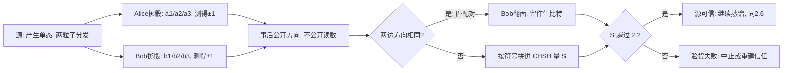

# $\rm Chapter \, 3$ E91 与纠缠

> **本章假设你已经会**
>
> 1. 单态 ${\lvert\Psi^-\rangle=(\lvert01\rangle-\lvert10\rangle)/\sqrt2}$ 与四个 Bell 态：整体有确定的态，单独看任何一边却是五五开的最大混态，见《量子力学》§8.3。
> 2. 单态关联公式：两边沿 $\hat n$、$\hat m$ 方向测量时关联函数为 ${E=-\hat n\cdot\hat m}$，在 $xz$ 平面内就是 ${E=-\cos(\theta_A-\theta_B)}$，见《量子力学》§8.3.4 与 §11.3.1。
> 3. CHSH 量 $S$ 的定义（四个关联按 ${+,+,+,-}$ 组合）与经典上界 ${\lvert S\rvert\le2}$ 的完整证明，见《量子力学》§11.2、§11.3.2。
> 4. 量子侧的 ${2\sqrt2}$ 与 Tsirelson 界：量子力学给 CHSH 量划下的第二条天花板，见《量子力学》§11.3.3、§11.3.4。
> 5. BB84 的 QBER 账与约 ${11\%}$ 的中止阈值：$q=s/4$ 的指纹公式与蒸馏账 $1-2h(q)$，见本册 §2.3、§2.6。

全册的心智模型是：量子通信的任务不是传得快，而是传得不可偷、不可仿。第 2 章的 BB84 把「不可偷」做成了逐轮可查的 QBER 账，但那本账有一个默认前提没写在封面上：Alice 的光源真的发出她声称的四个态，Bob 的探测器真的按他声称的基在测。设备要是靠得住，账本才靠得住。本章的 E91 协议（Ekert 1991，以提出者 Artur Ekert 命名）把这个前提从公理降级为待检对象：源可以搬进陌生人的实验室，甚至搬进 Eve 的实验室，因为纠缠本身自带一张验货网：贝尔不等式。

这一步的代价与收获都要算清楚。收获是安全信任面的收缩：双方不再需要审计设备内部，只需要看一个统计量 $S$ 是否越出不等式划定的界，这套思路后来发展成设备无关（device-independent）安全，§3.7 给它一瞥。代价是效率与工程难度：纠缠对要成对送达，出密钥的设置组合只占少数，统计检验要攒够样本。本章你能走完协议的每一轮，把单态关联公式落成十二格蒙特卡洛数字，亲眼看到经典模型在十万次随机尝试里摸不到天花板 ${2}$，量子在同样多的随机方向上越线而从不突破 ${2\sqrt2}$，最后看着 Eve 上场把 $S$ 从 ${2.83}$ 踩回 ${1.42}$。

## $\rm \S \, 3.1$ BB84 留下的缺口：账本可信，仪器呢？

BB84 的安全证明（第 2 章 §2.6 的 $1-2h(q)$）从一句话开始：Alice 发的确实是 ${\lvert0\rangle}$、${\lvert1\rangle}$、${\lvert+\rangle}$、${\lvert-\rangle}$ 这四个态之一。这句话在纸上是公理，在现实里是一台物理设备。第 1 章的威胁模型里 Eve 控制信道，但没碰 Alice 的实验室；把威胁模型收紧一档：设备本身来路不明（供应商不可信、二手市场、远端托管的加密机），BB84 的账就记在别人的纸上：一台说谎的光源可以发出 Eve 完全知道的态，QBER 漂亮地停在零，密钥却从第一比特起就在 Eve 手里。

E91 把问题倒过来问：如果把「造态」这件事整个外包，交给一个谁也不信任的源向两边分发成对的粒子，安全还剩多少？答案取决于这个源发的是什么。若它发的是真正的单态，双方拿到了两样东西：沿同方向测量的完美反关联（可以当场变成一致的密钥比特），和沿斜方向测量的强关联（强到任何「预先藏答案」的经典机制都仿不出来）。若它偷工减料，发的是事先对好答案的经典对（比如两只分好左右的手套），反关联还在，密钥表面上还能对上，但斜方向的关联立刻露馅：手套模型给出的关联函数是常数，拼出的 CHSH 量恰好贴着经典天花板 ${2}$，而真纠缠给 ${2\sqrt2}$。也就是说，冒充真纠缠的代价是付不起的：经典仿品要么过不了密钥那关（反关联对不上），要么过不了验货那关（$S$ 越不过 ${2}$）。这个「要么」就是本章全部安全的来源。

> 竞赛生迁移提示：这组结构的原型是「用输出分布反推实现是否作假」。评测数据无法逐字节审计生成器时，改查它满足的统计判据：真品满足、所有作弊实现都不满足的判据。CHSH 是这类判据里最锋利的一个，因为「所有经典实现」这边有完整证明（《量子力学》§11.3.2），不是经验规律。

> 本节小结：BB84 的账本默认设备诚实；E91 允许源不可信，用「匹配对出密钥、其余对验 CHSH」把信任问题变成一个可测的统计量；经典仿品付不起越界的代价。

## $\rm \S \, 3.2$ 协议逐轮：一对纠缠、三次抽签、两种用途

协议一轮只有三步，外加事后的一次对账。先钉死记号：双方测的是自旋沿某方向的分量，方向用与 $\hat z$ 轴的夹角记，观测量是 ${A(\theta)=\cos\theta\,Z+\sin\theta\,X}$（《量子力学》§11.2 的写法），读数 ${\pm1}$。

1. 源（可以不受信任，甚至可以是 Eve 本人）每轮产生一个单态 ${\lvert\Psi^-\rangle}$，把两个粒子分发给 Alice 与 Bob，一人一个。
2. Alice 掷骰子，从三个方向里均匀选一个：${a_1=0^\circ}$、${a_2=45^\circ}$、${a_3=90^\circ}$；Bob 独立掷骰子，从 ${b_1=45^\circ}$、${b_2=90^\circ}$、${b_3=135^\circ}$ 里选。各自测量，记下读数（${\pm1}$，不记成比特也行，翻面在下一步）。
3. 全部轮结束后，双方公开每一轮选的方向（只公布方向，永远不公布读数），把轮次分成两类。

分类的依据是两边方向是否相同。匹配对（matching settings）是方向相同的两类轮：${(a_2,b_1)}$ 两边都是 ${45^\circ}$，${(a_3,b_2)}$ 两边都是 ${90^\circ}$。单态在方向相同时关联 ${E=-1}$，两边读数必然相反，Bob 把自己的读数翻面，两边比特一致，留作生比特。非匹配的轮不浪费：从里面取 ${(a_1,b_1)}$、${(a_3,b_1)}$、${(a_3,b_3)}$、${(a_1,b_3)}$ 四类组合，把它们的关联按 CHSH 的符号规则拼起来：

$$
S = E(a_1,b_1) + E(a_3,b_1) + E(a_3,b_3) - E(a_1,b_3)
$$

读法：$E(a_i,b_j)$ 是「Alice 选 $a_i$ 且 Bob 选 $b_j$」那些轮里，两边读数乘积的平均；前三项带正号、最后一项带负号，这个不对称是 CHSH 的全部机关（《量子力学》§11.2）。六个关键设置对的理论关联列成一张表，后面两节全部对账都对着它：

| 设置对 | 方向差 $\Delta$ | 理论 ${E=-\cos\Delta}$ | 用途 |
| --- | --- | --- | --- |
| ${(a_2,b_1)}$：${45^\circ,45^\circ}$ | ${0^\circ}$ | ${-1}$ | 生比特（翻面对齐） |
| ${(a_3,b_2)}$：${90^\circ,90^\circ}$ | ${0^\circ}$ | ${-1}$ | 生比特（翻面对齐） |
| ${(a_1,b_1)}$：${0^\circ,45^\circ}$ | ${45^\circ}$ | ${-\tfrac{1}{\sqrt2}}$ | 验 CHSH |
| ${(a_3,b_1)}$：${90^\circ,45^\circ}$ | ${45^\circ}$ | ${-\tfrac{1}{\sqrt2}}$ | 验 CHSH |
| ${(a_3,b_3)}$：${90^\circ,135^\circ}$ | ${45^\circ}$ | ${-\tfrac{1}{\sqrt2}}$ | 验 CHSH |
| ${(a_1,b_3)}$：${0^\circ,135^\circ}$ | ${135^\circ}$ | ${+\tfrac{1}{\sqrt2}}$ | 验 CHSH（带负号进 $S$） |

四个 CHSH 项的角度差是三个 ${45^\circ}$ 加一个 ${135^\circ}$，代入公式：${S=-\tfrac{1}{\sqrt2}-\tfrac{1}{\sqrt2}-\tfrac{1}{\sqrt2}-\tfrac{1}{\sqrt2}=-2\sqrt2}$，绝对值 ${2\sqrt2\approx2.828}$。这组角度是精心排的：相邻设置错开 ${45^\circ}$，让四项关联全部指向同一个方向，把量子的违背顶到 Tsirelson 界上（《量子力学》§11.3.3）。

白话：源每轮寄出一对「分开前就咬合好」的粒子。双方各掷骰子选一把量角器去测，测完先不着急，攒够轮数再对方向：方向相同的轮，读数必然一反一正，翻面后就是共享的随机比特；方向不同的轮，读数乘积的平均值被拿去拼 $S$。源若发的是真纠缠，$S$ 会顶在 ${2.83}$；若发的是任何经典仿品，$S$ 摸不到 ${2}$。

> 本节小结：三个方向对三个方向；匹配对 ${(a_2,b_1)}$、${(a_3,b_2)}$ 出密钥，四类非匹配对拼出 $S$；真单态给 ${S=-2\sqrt2}$，协议的验货标准是 ${\lvert S\rvert>2}$。

## $\rm \S \, 3.3$ 单态关联落成数字：${E=-\cos(\theta_A-\theta_B)}$

验货网是否可靠，取决于关联公式本身，所以先把这条公式在仿真里钉死。推导链条在《量子力学》§11.3.1 走过一遍，这里把四步摆齐：对单态，${Z\otimes Z}$ 与 ${X\otimes X}$ 作用后都变回负自身（${Z\otimes Z\lvert01\rangle=-\lvert01\rangle}$、${X\otimes X\lvert01\rangle=\lvert10\rangle}$，两项各占一半，合起来整体翻号），而交叉项 ${Z\otimes X}$、${X\otimes Z}$ 的期望为零（作用结果与原态正交）。于是沿 ${\theta_A}$、${\theta_B}$ 两个方向的观测量 ${A=\cos\theta_A Z+\sin\theta_A X}$、${B=\cos\theta_B Z+\sin\theta_B X}$ 的关联是：

$$
\begin{aligned}
E(\theta_A,\theta_B) &= \cos\theta_A\cos\theta_B\underbrace{\langle Z\otimes Z\rangle}_{-1} + \sin\theta_A\sin\theta_B\underbrace{\langle X\otimes X\rangle}_{-1} + \cos\theta_A\sin\theta_B\underbrace{\langle Z\otimes X\rangle}_{0} + \sin\theta_A\cos\theta_B\underbrace{\langle X\otimes Z\rangle}_{0} \\
&= -\bigl(\cos\theta_A\cos\theta_B+\sin\theta_A\sin\theta_B\bigr) = -\cos(\theta_A-\theta_B)
\end{aligned}
$$

最后一步是余弦差角公式，逐符号读：${\theta_A-\theta_B}$ 是两边测量方向的夹角，公式说夹角为零时关联 ${-1}$（必然相反），夹角转开时关联按余弦回升，转过 ${180^\circ}$ 时到 ${+1}$。验证实验 E0 做了两件独立的事。第一件是零蒙特卡洛的纯代数核对：把单态矢量、四个投影算符直接交给 numpy 算 ${P(a,b)=\langle\Psi^-\rvert(P_a\otimes P_b)\lvert\Psi^-\rangle}$，与公式 ${\tfrac14(1+abE)}$ 逐格比对，十二个角度对上最大偏差 ${2.22\times10^{-16}}$，单精度机器误差量级；联合分布恒等式本身也单独核对到 ${5.55\times10^{-17}}$。第二件是真正的蒙特卡洛：每个角度对按精确联合分布抽 ${1{,}000{,}000}$ 轮读数，用样本均值估计 $E$。选六格看账：

| ${(θ_A,θ_B)}$ | 公式值 | 仿真值 | 偏差 |
| --- | --- | --- | --- |
| ${(0^\circ,0^\circ)}$ | ${-1.000000}$ | ${-1.000000}$ | ${0.000000}$ |
| ${(0^\circ,45^\circ)}$ | ${-0.707107}$ | ${-0.707498}$ | ${-0.000391}$ |
| ${(0^\circ,90^\circ)}$ | ${0.000000}$ | ${+0.001122}$ | ${+0.001122}$ |
| ${(45^\circ,135^\circ)}$ | ${0.000000}$ | ${-0.000698}$ | ${-0.000698}$ |
| ${(0^\circ,180^\circ)}$ | ${+1.000000}$ | ${+1.000000}$ | ${0.000000}$ |
| ${(90^\circ,0^\circ)}$ | ${0.000000}$ | ${-0.001128}$ | ${-0.001128}$ |

全部十二格的最大偏差是 ${0.001128}$，出现在 ${(90^\circ,0^\circ)}$ 格。这个数不该是零，也不该吓人：单轮读数乘积的方差是 ${1-E^2}$ 量级，${10^6}$ 轮的均值统计涨落就在 ${10^{-3}}$ 量级，实测最大偏差正好落在这个量级上。公式与代数核对（偏差 ${10^{-16}}$）和蒙特卡洛（偏差 ${10^{-3}}$ 但随 $N$ 缩水）是两条独立证据链，前者证公式对，后者证抽样器没写错。§3.4 与 §3.5 的对账全部建立在这条已验公式上。

> 本节小结：单态关联 ${E=-\cos(\theta_A-\theta_B)}$ 由四个期望值（${-1,-1,0,0}$）直接加出；代数核对偏差 ${10^{-16}}$ 量级、百万轮蒙特卡洛偏差 ${10^{-3}}$ 量级且与统计涨落吻合，公式钉死。

## $\rm \S \, 3.4$ 经典一侧的蒙特卡洛：随机模型摸不到 2

现在站到仿品那边，替所有想冒充纠缠的机制算一次总账。「预先藏答案」模型的通用写法在《量子力学》§11.2 已立：两粒子共享隐藏参数 $\lambda$，Alice 的读数 ${a_x(\lambda)\in\{\pm1\}}$ 只依赖 $\lambda$ 和她自己的选择 $x$，Bob 同理。关联是普通平均：

$$
E(x,y)=\sum_\lambda p(\lambda)\,a_x(\lambda)\,b_y(\lambda)
$$

把四个 $E$ 按 $S$ 的符号拼起来、对同一个 $\lambda$ 并项（《量子力学》§11.3.2 的推导，三行完事）：

$$
C(\lambda)=\bigl(a_0+a_1\bigr)b_0+\bigl(a_0-a_1\bigr)b_1\in\{-2,+2\}
$$

读法：$C(\lambda)$ 是单个 $\lambda$ 下四项的代数和。${a_0}$ 与 ${a_1}$ 都是 ${\pm1}$，要么相等（第一项 ${\pm2}$、第二项消失）、要么相反（第二项 ${\pm2}$、第一项消失），两条路都把 $C$ 锁死在 ${\pm2}$；那个减号的全部作用就是保证「既相等又相反」的路不存在。于是 ${\lvert S\rvert\le2}$ 对一切这类模型成立。这个上界是定理，本来不需要蒙特卡洛；跑一遍的价值在于看清「离天花板有多近、从哪条路接近」。

实验分两层。E2a 是穷举：确定性答案单总共只有 ${2^4=16}$ 张（${a_0,a_1,b_0,b_1}$ 各自独立取 ${\pm1}$），逐张代入，16 个 $C$ 值全部落在 ${\{-2,+2\}}$ 里，无一例外。E2b 是随机搜索：造 ${100{,}000}$ 个随机局域隐变量模型，一半是「常数答案单」（对应手套模型的推广：不管哪个方向都按藏好的表作答，再以概率 $f\sim[0,0.5]$ 翻面加噪），一半是「${\mathrm{sign}(\cos)}$ 应答表」（应答随 $\lambda$ 与测量方向的夹角逐段翻转，方向带随机偏移，这是贴着量子关联形状仿造的最像仿品），每个模型在 ${2000}$ 点的 $\lambda$ 网格上算 $S$。结果：

| 模型族 | 模型数 | $\max\lvert S\rvert$ | $\lvert S\rvert>2$ 个数 |
| --- | --- | --- | --- |
| 常数答案单＋翻面噪声 | ${50{,}000}$ | 与 sign 族合并统计 | 与 sign 族合并统计 |
| sign(cos) 应答表＋噪声 | ${50{,}000}$ | 与常数族合并统计 | 与常数族合并统计 |
| 全部合并 | ${100{,}000}$ | ${1.996000}$ | ${0}$ |

十万次随机尝试，最远的摸到 ${1.996}$，没有一个越过 ${2}$——不是运气，E2a 的穷举已经说明了为什么：确定性模型每个都贴不住 ${2}$ 的全部「额度」除非退化成常数表，而任何噪声只会把 $S$ 往零压（翻面概率 $f$ 把每边关联乘上 ${1-2f}$）。顺带把手套模型放回坐标系：它就是「方向相同反关联」的直觉图片，形式化后是常数答案单的特例，实测它给 ${S=-2}$，恰好贴着天花板。直觉没有错，错的是以为直觉够用：它只配得上 ${2}$，而自然界发到 ${2\sqrt2}$。

> 本节小结：${C(\lambda)\in\{\pm2\}}$ 的两行证明锁死 ${\lvert S\rvert\le2}$；16 张答案单穷举与 ${10^5}$ 个随机模型搜索都确认上限，最高摸到 ${1.996}$，零越线；手套模型贴着 ${2}$，是经典直觉的极限不是世界的极限。

## $\rm \S \, 3.5$ 量子一侧的蒙特卡洛：随机方向越线与 ${2\sqrt2}$ 天花板

量子这边跑对偶的两层。E1 用 §3.2 的固定角度做高精度估计：四对设置各抽 ${2{,}000{,}000}$ 轮，四个关联的仿真值与理论值偏差最大 ${0.001046}$（在 ${(a_1,b_1)}$ 格，仍是 ${10^{-3}}$ 统计涨落），拼出的 ${S=-2.828062}$，与理论 ${-2\sqrt2=-2.828427}$ 偏差 ${0.000365}$。绝对值 ${2.828062}$ 越过 ${2}$ 这条线整整 ${0.828}$，相当于 ${830}$ 倍统计涨落，不是边界上的擦线，是碾压。

E2c 换随机方向：${a_0,a_1,b_0,b_1}$ 四个方向各自独立均匀撒在圆上，共 ${200{,}000}$ 组，每组用已验公式 ${E=-\cos(\Delta)}$ 算 $S$。这层实验回答一个固定角度回答不了的问题：违背是这组神奇角度的特技，还是量子关联的常态？答案在数据里：${\lvert S\rvert}$ 的均值 ${1.2189}$、中位数 ${1.2111}$，最大值 ${2.827969}$；越过 ${2}$ 的方向组占 ${16.00\%}$。随机抓一把方向，六分之一的机会违背贝尔不等式：违背是常态，只是随机方向很少顶到 ${2\sqrt2}$，要顶满需要 §3.2 那种 ${45^\circ}$ 错开的排布。同时，${200{,}000}$ 组的最大值 ${2.827969}$ 距离 ${2\sqrt2=2.828427}$ 还差 ${0.000458}$，与 E1 的估计偏差同量级：天花板是被逼近的，从没被碰到，更没被穿过，这正是 Tsirelson 界（《量子力学》§11.3.4）说的「量子也有自己的天花板」。

两张对账表并排放着看：经典侧十万模型最高 ${1.996}$、零越线；量子侧二十万方向组 ${16\%}$ 越线、最高 ${2.828}$ 贴着上限。中间那道缝——${2}$ 与 ${2\sqrt2}$ 之间——只允许量子住进去。E91 的验货标准 ${\lvert S\rvert>2}$ 之所以可行，就是因为这条缝够宽：真品的统计特征与一切仿品的公共上界之间隔着 ${0.828}$，比蒙特卡洛的统计噪声大三个数量级。

> 本节小结：固定角度 ${\lvert S\rvert=2.828062}$（偏差 ${0.000365}$）；随机方向 ${16\%}$ 越线、峰值 ${2.827969}$ 不破 ${2\sqrt2}$；违背是量子关联的常态，${2}$ 与 ${2\sqrt2}$ 之间是只有量子能住的缝。

## $\rm \S \, 3.6$ Eve 在场：$S$ 掉回不等式以内

验货网成立的前提是「仿品付不起越界的代价」，这一节让 Eve 亲自试一次。攻击模型沿用第 2 章的截听-重发思路，搬到纠缠语境：Eve 控制信道（或干脆取代源），每轮截下两个粒子，在 $Z$ 基（即 ${0^\circ}$ 方向）各测一次，单态保证她测得 ${(0,1)}$ 或 ${(1,0)}$ 各半；她按测得结果重发对应的乘积态 ${\lvert0\rangle\lvert1\rangle}$ 或 ${\lvert1\rangle\lvert0\rangle}$。想克隆被 §10.3 禁止，想知道就得测，测完纠缠就没了，她只能拿经典关联顶包。

先推被攻击态的关联公式，三步。第一，重发后双方共享的态是经典混合 ${\tfrac12(\lvert01\rangle\langle01\rvert+\lvert10\rangle\langle10\rvert)}$：一半的轮是 ${\lvert0\rangle}$ 配 ${\lvert1\rangle}$，一半反过来，无任何相干。第二，乘积态 ${\lvert u\rangle}$（$Z$ 本征态，${u=\pm1}$）上测 ${A(\theta)}$，期望是 ${u\cos\theta}$：${Z}$ 分量贡献 ${u}$，$X$ 分量在 $Z$ 本征态上期望为零。第三，对混合态两项求平均，Alice 读数 ${u}$、Bob 读数 ${-u}$，乘积恒为 ${-1}$：

$$
E_{\text{Eve}}(\theta_A,\theta_B)=\sum_{u=\pm1}\tfrac12\,(u\cos\theta_A)(-u\cos\theta_B)=-\cos\theta_A\cos\theta_B
$$

读法：单态公式里的 ${\sin\theta_A\sin\theta_B}$ 项消失了，因为它来自相干叠加；Eve 的测量把相干拆成了经典掷签，关联退化成「两边 $Z$ 分量的乘积」。把六对设置代进去，四个 CHSH 项变成 ${-\tfrac{1}{\sqrt2},0,0,+\tfrac{1}{\sqrt2}}$，于是 ${S_{\text{Eve}}=-\tfrac{1}{\sqrt2}-\tfrac{1}{\sqrt2}=-\sqrt2\approx-1.414}$，掉回不等式以内。密钥这边同样塌方：匹配对 ${(45^\circ,45^\circ)}$ 的关联从 ${-1}$ 退到 ${-\cos^245^\circ=-\tfrac12}$，由 ${E=2P(\text{同号})-1}$ 得同号概率 ${P=\tfrac14}$，Bob 翻面对齐后每个密钥比特有 ${\tfrac14}$ 概率出错；匹配对 ${(90^\circ,90^\circ)}$ 更惨，关联退到 ${0}$，两边读数完全独立，翻面后一半是错的。实验 E3 的对账（每对设置 ${1{,}000{,}000}$ 轮）：

| 设置对 | 理论 $E$（Eve 在） | 仿真 $E$ | 理论 $E$（无 Eve） |
| --- | --- | --- | --- |
| ${(a_1,b_1)}$ | ${-0.707107}$ | ${-0.706426}$ | ${-0.707107}$ |
| ${(a_1,b_2)}$ | ${0.000000}$ | ${-0.000620}$ | ${0.000000}$ |
| ${(a_1,b_3)}$ | ${+0.707107}$ | ${+0.708116}$ | ${+0.707107}$ |
| ${(a_2,b_1)}$ | ${-0.500000}$ | ${-0.499970}$ | ${-1.000000}$ |
| ${(a_2,b_2)}$ | ${0.000000}$ | ${-0.002646}$ | ${-0.707107}$ |
| ${(a_2,b_3)}$ | ${+0.500000}$ | ${+0.501262}$ | ${0.000000}$ |
| ${(a_3,b_1)}$ | ${0.000000}$ | ${-0.000804}$ | ${-0.707107}$ |
| ${(a_3,b_2)}$ | ${0.000000}$ | ${-0.001170}$ | ${-1.000000}$ |
| ${(a_3,b_3)}$ | ${0.000000}$ | ${-0.001382}$ | ${-0.707107}$ |

两张汇总仪表并排：无 Eve 时 ${S=-2.828630}$（越线 ${0.829}$）、两个匹配对密钥 QBER 都是 ${0.000000}$；Eve 在场时 ${S=-1.416728}$（对理论 ${-\sqrt2=-1.414214}$，偏差 ${0.0025}$，掉回 ${2}$ 以内），密钥 QBER 变成 ${0.250015}$ 与 ${0.499415}$，平均 ${0.374715}$。两个仪表同时动了，而且方向互相印证：QBER 远超第 2 章 §2.6 的 ${11\%}$ 中止线，就算不查 $S$，蒸馏账也会让协议拒产；$S$ 则在 QBER 之外多给了一条独立证据：不是信道太吵，是纠缠被换成了经典关联。

这里埋着一个我亲手踩过的坑，值得写下来。E3 脚本第一版把密钥 QBER 打成 ${1-\text{同号率}}$，无 Eve 情形印出「QBER ${=1.000000}$」，与「理想单态零错误」直接矛盾；排查发现错在忘了 Bob 的翻面步骤：匹配对期望读数相反，Bob 翻面对齐之后，出错当且仅当原始读数同号，所以 QBER 等于同号率本身，不是它的补。这个坑在 BB84 里没有对应物（那里 Alice 主动发态，不存在翻面），是纠缠协议特有的记账细节：先约定谁翻面，再定义错误。

白话：Eve 想知道每对粒子的「答案」，就得在半路拆开测量；一拆，纠缠变成普通的经典关联，$S$ 从 ${2.83}$ 掉到 ${1.42}$，密钥从零错误变成平均 ${37.5\%}$ 错误。她不是可能被抓，是必被抓——除非她选择不碰，而那等于没有窃听。

> 本节小结：截听-重发把关联退化成 ${E_{\text{Eve}}=-\cos\theta_A\cos\theta_B}$；$S$ 掉到 ${-\sqrt2}$（实测 ${-1.416728}$），密钥 QBER 涨到 ${25\%}$ 与 ${50\%}$（实测 ${0.250015}$、${0.499415}$）；验货网与 QBER 账两表齐动。

## $\rm \S \, 3.7$ 设备无关一瞥：不等式是更强的一张网

把前六节的逻辑收拢，会得到一个比 BB84 强得多的安全姿态，它有个名字：设备无关（device-independent，DI）安全。BB84 的账本要审计每台设备的行为；E91 式的账本只问一个问题：观察到的统计是否让 ${\lvert S\rvert}$ 越过 ${2}$。越线了，那么无论盒子内部是什么电路、什么算法、什么供应商，盒子之间必然共享着非经典的关联，任何「预先藏答案」的解释都被 §3.4 的证明排除；不越线，就中止。类比是口试追问：不看你笔记写了什么（设备内部构造），只看你在一组交错追问下的回答是否自洽（测量统计）；失效边界也要说清：口试默认考官的问题独立于考生的准备，对应两条物理假设：测量方向的选择是真随机的、且两边选择与读数之间没有超光速的串通（实验上对应类空间隔）。这两条不是装饰：若 Eve 能预测你选哪个方向，她可以只在会暴露的轮次分发真纠缠，其余轮次全发仿品，网就漏了。

这个姿态有代价与边界。其一，DI 不免俗的信任根只剩随机性与相对论因果结构，随机数发生器成了新的关键设备（顺带一提，贝尔测试本身可以反过来担当随机性认证，这是后话）。其二，真实实验有漏洞要关死：探测效率不够高时，Eve 可以利用「没被探测到的轮次随她解释」做文章（探测漏洞），两边距离不够远时可以互相串供（局域性漏洞）；2015 年的几个实验首次同时关死了两者。其三，把「本章的直觉」升级成「带误差条的安全定理」，即窃听率与 $S$、QBER 之间的定量换算，那是 Ekert 1991 之后一系列工作（如 EK09 型 DI-QKD 安全证明）的内容，定理级证明不在本书范围，这里立的只是接口：DI 安全的账本科目叫 $S$，记账规则是贝尔不等式，审计标准是越线与否。

> 本节小结：DI 安全把信任面收缩到「统计越线＋测量选择随机＋类空间隔」三条；代价是随机性成为新信任根、漏洞必须关死、定量安全证明是另一层内容；本章立接口不立定理。

## $\rm \S \, 3.8$ 适用条件与限制

本章每个结论的适用范围，就是它失效时的排查清单。

1. $S$ 是统计量，检验需要样本。${2.828}$ 与 ${2}$ 的缝再宽，单轮读数只有 ${\pm1}$，要把它分辨开需要足够的轮数：E1 每对设置 ${2{,}000{,}000}$ 轮才把统计涨落压到 ${10^{-3}}$。轮数不足时「越线」可能是涨落，安全判定必须带置信区间做。
2. 噪声会吃掉违背。真实信道若有去极化噪声，所有关联按可见度 $v$ 缩水，$S$ 变成 ${2\sqrt2\,v}$；${v<\tfrac{1}{\sqrt2}\approx0.7071}$ 时 $S$ 落回 ${2}$ 以内，验货网失明。注意失明不等于失窃：$S$ 不再报警时 BB84 的 QBER 账（第 2 章）仍在运转，两套协议的仪表量程不同，工程上按信道质量选。
3. 出密钥的轮次是少数。三选三的设置里只有两对匹配，占比 ${\tfrac29}$；再算上检验轮不产钥，同等信道质量下 E91 的密钥率低于 BB84。这是把「源不可信」买下来的价格。
4. 本章只验了一种攻击。双侧 $Z$ 基截听-重发是直觉上最自然的攻击，不是最优攻击；更聪明的攻击（含个体攻击、 collective 攻击）下 $S$ 与 QBER 的定量关系是定理级内容，本章的 ${-\sqrt2}$ 只代表这一种攻击的指纹。
5. 类空间隔与探测漏洞在仿真里不存在，在实验里必须关死。矢量仿真的轮次没有时空结构，`numpy` 不会串供；真实贝尔测试要把两边选择与测量做到类空间隔、把探测效率提到漏洞关死的阈值以上，否则 §3.7 的两条物理假设落空。

> 本节小结：$S$ 检验要样本量、噪声压可见度（${v<0.71}$ 网失明）、密钥率 ${\tfrac29}$ 起步、本章攻击只是代表、真实实验还要关两个漏洞；每一条都是排查清单的一行。

## $\rm \S \, 3.9$ 关键概念回顾

1. E91 的验货标准为什么选 ${\lvert S\rvert>2}$ 而不是某个经验阈值？「${2}$」这条线是谁证明的、对哪些模型成立？
2. 匹配对 ${(a_2,b_1)}$ 出的密钥比特，其一致性由单态的哪条性质担保？Bob 翻面这一步若省掉，双方会得到什么样的「密钥」？
3. 手套模型（每对粒子分好左右、沿任何方向按藏好的答案作答）算出的 $S$ 是多少？它在哪个设置对上与单态一致、在哪个设置对上暴露？
4. 推 ${E_{\text{Eve}}=-\cos\theta_A\cos\theta_B}$ 时，单态公式里的 ${\sin\theta_A\sin\theta_B}$ 项去哪了？这一步对应 Eve 的哪个物理动作？
5. ${(90^\circ,90^\circ)}$ 匹配对在 Eve 攻击下 QBER 是 ${50\%}$ 而 ${(45^\circ,45^\circ)}$ 是 ${25\%}$，差别来自 $\cos$ 的哪个取值？由此说明 Eve 该选哪个测量基更「温柔」，以及她为什么做不到对两个匹配对都温柔。

## $\rm \S \, 3.10$ 应用与辨析

1. 同事把协议的测量方向改成 ${a_1=0^\circ,a_2=30^\circ,a_3=60^\circ}$、${b_1=30^\circ,b_2=60^\circ,b_3=90^\circ}$，声称「角度对称，应该一样好」。用 ${E=-\cos(\theta_A-\theta_B)}$ 算出四个 CHSH 项与 $S$，判断验货是否还成立，并指出这组角度牺牲了什么。
2. Eve 换一种更省事的攻击：只截获发往 Bob 的单边粒子，在 $Z$ 基测量后重发，Alice 那边的粒子不动。判断此时匹配对 ${(90^\circ,90^\circ)}$ 的关联与 $S$ 各退化到什么程度（提示：Alice 的粒子仍是纯的单态一角，单看是最大混态；Bob 拿到的是 $Z$ 本征态）。这种单边攻击与双边攻击哪个更隐蔽？
3. 信道噪声把所有关联按可见度 ${v=0.8}$ 缩水。算出此时 E91 的 $S$ 与 ${(45^\circ,45^\circ)}$ 匹配对的密钥 QBER，判断验货网与密钥质量各自还剩多少，并对照第 2 章 §2.6 的 ${11\%}$ 阈值说明这套链路还能不能产钥。

## $\rm \S \, 3.11$ 本章自测答案

概念回顾答案：

1. 因为 ${2}$ 是定理不是经验值：任何局域隐变量模型的 ${C(\lambda)\in\{\pm2\}}$ 锁死 ${\lvert S\rvert\le2}$（《量子力学》§11.3.2），对全部「预先藏答案」机制成立、不依赖模型细节。用经验阈值就得为每个新攻击重新标定，用定理阈值则一劳永逸（§3.4）。
2. 方向相同则关联 ${E=-1}$，两边读数必然一反一正。省掉翻面，双方得到的是逐比特完全相反的两串：各自单独看都是好密钥，但拿去加密同一份消息会对不上，第一步纠错就要把这 ${100\%}$ 的「错误」修掉（§3.2）。
3. ${S=-2}$：四个设置对的关联全是 ${-1}$，按符号拼成 ${-1-1-1+1=-2}$，贴着经典天花板。它与单态在两个匹配对（${\Delta=0}$）上一致，在 ${\Delta=45^\circ}$ 的对上暴露：单态给 ${-\tfrac{1}{\sqrt2}}$，手套给 ${-1}$（§3.4）。
4. 那一项来自两粒子间的相干叠加；Eve 在 $Z$ 基的测量把叠加拆成经典混合，$X$ 方向的相干性被摧毁，期望归零。物理动作就是「测量」本身，与她之后怎么重发无关（§3.6）。
5. 差别来自 ${\cos90^\circ=0}$ 与 ${\cos45^\circ=\tfrac{1}{\sqrt2}}$：匹配对的 ${E_{\text{Eve}}=-\cos^2\theta}$，${\theta=90^\circ}$ 时退到 ${0}$（完全随机）、${\theta=45^\circ}$ 时退到 ${-\tfrac12}$。Eve 选 $Z$ 基是因为它对 ${0^\circ}$ 测量最温柔，但没有任何单一基能同时温柔于 ${45^\circ}$ 和 ${90^\circ}$，两个匹配对方向差 ${45^\circ}$，这正是「猜对一半、错一半」的基困境在纠缠语境的重演（§3.6）。

应用与辨析答案：

1. 四个 CHSH 对的角度差：${(a_1,b_1)}$ ${30^\circ}$、${(a_3,b_1)}$ ${30^\circ}$、${(a_3,b_3)}$ ${30^\circ}$、${(a_1,b_3)}$ ${90^\circ}$。${S=-\cos30^\circ\times3-\cos90^\circ=-\tfrac{3\sqrt3}{2}\approx-2.598}$。验货仍成立（${\lvert S\rvert>2}$），但这组角度不是最优：牺牲了 ${2\sqrt2-2.598\approx0.23}$ 的越线余量，统计上需要更多轮数才能把 ${2.598}$ 与 ${2}$ 分开。匹配对 ${(a_2,b_1)}$（${30^\circ,30^\circ}$）与 ${(a_3,b_2)}$（${60^\circ,60^\circ}$）仍是 ${E=-1}$，密钥质量不受影响（§3.2、§3.5）。
2. 单边攻击下，Alice 的读数沿任何方向都是五五开（她是最大混态的一角），Bob 拿到 $Z$ 本征态。匹配对 ${(90^\circ,90^\circ)}$：Alice 测 ${90^\circ}$ 方向得随机 ${\pm1}$，与 Bob 的 $Z$ 读数无关，${E=0}$，与双边攻击相同；但 CHSH 对 ${(a_1,b_1)}$：${E=\langle A(0^\circ)\rangle\cdot\langle B(45^\circ)\rangle=0\times0=0}$（乘积态两边独立），而双边攻击给 ${-\tfrac{1}{\sqrt2}}$。拼起来 ${S=0}$，比双边攻击的 ${-\sqrt2}$ 更平。单边攻击在 $S$ 这张仪表上反而更吵（掉得更狠），并不更隐蔽；它省下的只是截获第二个粒子的工夫（§3.6）。
3. ${S=2\sqrt2\times0.8\approx2.257}$，仍越线但余量只剩 ${0.257}$，约为无噪声时的三成；匹配对 ${(45^\circ,45^\circ)}$ 的关联 ${-\tfrac12\times0.8=-0.4}$，QBER ${=\tfrac{1-0.4}{2}=30\%}$。密钥质量按第 2 章的账已死：${30\%}$ 远超 ${11\%}$ 中止线，$1-2h(0.3)\approx-0.76$，蒸馏账为负。结论：验货网还在报警（链路没有窃听），但密钥已经被噪声毁掉：$S$ 管「有没有人动」，QBER 管「账还算不算得下去」，两个仪表读数要分开看（§3.8 第 2 条）。

**你现在能做什么**：合上讲义，向别人说清手套模型在哪一格上破产、${2}$ 与 ${2\sqrt2}$ 之间那条缝为什么只够量子住，并背出 E91 的两个仪表各读什么。

纠缠是一样可以验明正身的资源，这是本章的全部收获。下一章让它干正事：把一个未知的量子态从 Alice 手里搬到 Bob 手里，中间只传两个经典比特——隐形传态（teleportation）。你会看到 EPR 对从「验货工具」变成「运输工具」，以及为什么这份运输仍然一丝一毫都超不了光速。

---

实验记录：本章 §3.3、§3.4、§3.5、§3.6 全部实测数字来自脚本 `expQI03.py`（单态关联的投影算符代数核对与蒙特卡洛、E91 固定角度 CHSH 估计、16 张确定性答案单穷举、${10^5}$ 随机局域隐变量模型搜索、${2\times10^5}$ 随机方向扫描、无窃听与截听-重发两种情形的协议检测统计；python3 加 numpy，WSL 运行，种子 ${20261109}$，总耗时约 ${19}$ 秒），原始输出存于写作工作目录 `26Fall/_uni5_work/expQI03/result.txt`，重跑可逐位复现表中数字。
