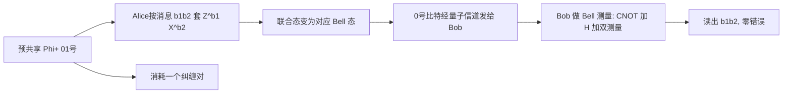

# $\rm Chapter \, 5$ 超密编码与容量

> **本章假设你已经会**
>
> 1. 四个 Bell 态的定义与最大纠缠：$\lvert\Phi^{+}\rangle=(\lvert00\rangle+\lvert11\rangle)/\sqrt2$ 这类记号的读法，见《量子力学》§8.3 与 §4.2。
> 2. 密度算子、偏迹与完全混态：约化态怎么从复合态里抽出，$\rho_{B}=I/2$ 为什么读作「掷硬币」，见《量子力学》§9.2、§9.3.6 与 §4.3。
> 3. 幺正门与 Born 规则：CNOT、$H$ 是矩阵，测量的概率分布怎么算，见《量子力学》§5.2、§6.3 与 §4.2 的 Bell 测量电路。
> 4. 本册攒下的账：不可克隆定理（§1.3）、实测方法与对账纪律（§2.5）、单边态不含信息的账（§4.3），以及第 3 章 E91 交付的能力：Alice 与 Bob 能预先共享验过纯的纠缠对。

第 4 章末尾留了一句话：超密编码（superdense coding）是传态的反面。本章把它兑现。任务先摆上台面：一条量子信道每次能送一个量子比特，Alice 想让它多带经典消息。直觉答案是一个比特，因为二能级系统里只有 $\lvert0\rangle$ 与 $\lvert1\rangle$ 两个可分辨信号。本章先论证这个直觉的边界在哪里（§5.1），然后用一个纠缠对把它打破：发一个量子比特，收两个经典比特，完整推导与零错误的来源（§5.2）。打破不是魔法，所以还要算清两笔账：给「信息量」配上熵语言之后，Holevo 界证明无纠缠时一个量子比特装不下超过一个经典比特（§5.3、§5.4），而超密编码恰好不违反它，对账的关键在「Bob 手里到底拿着哪个系统」（§5.5）。实测账把全部断言对到小数点后十位（§5.6），适用条件与噪声下的容量账收尾（§5.7）。

## $\rm \S \, 5.1$ 一个量子比特能装几个比特？

先把任务钉死。信道每次使用运送一个量子比特，Alice 从 $M$ 条消息里选一条，Bob 收到后要说出是哪条。「可靠」指零错误：每条消息对应的信号态必须被 Bob 的某次测量区分开。什么才算区分得开？两个纯态能被某次测量无错误地分辨，当且仅当它们正交：正交时存在一个测量方向，一个态肯定落在正结果、另一个肯定落在负结果；不正交时任何测量的两种结局都分不出全有或全无，因为非零内积意味着两个态在某个方向上有共同投影， Born 规则下必然出现重叠的分布。

于是上限来自一条线性代数：$d$ 维 Hilbert 空间里两两正交的单位向量至多 $d$ 个（$k$ 个两两正交的非零向量线性无关，无关组不超过维数）。二能级系统 $d=2$，所以零错误方案至多两个信号态，每次使用至多可靠传送 $\log_{2}2=1$ 比特。取 $\lvert0\rangle$ 与 $\lvert1\rangle$，Bob 沿 $z$ 轴测量，这就是能达到的顶。

账面上还留着一个口子：非正交态也允许用，代价是偶尔出错。会不会有人编一套聪明的非正交码，靠「多塞几个态」把平均信息量抬过 1 比特？单次直觉说不通，但直觉不是证明，这个口子要等 Holevo 界（§5.4）来封死。在那之前先记住结论的形状：无纠缠时一个量子比特的可靠容量是 1 比特，而且这不是工程近似，是维数加测量物理的共同判决。

纠缠从哪里插进来？第 4 章刚算过：四个 Bell 态两两正交，可它们长在**两比特**系统的 4 维空间里。Alice 的半边单独看永远是 $I/2$（§4.3），四个方向在她的 2 维空间里一个都找不到；但 Bob 手里若握着另外半边，四个正交方向就都在他够得着的联合空间里。假如 Alice 能在不发量子比特的情况下把共享态「拨」到四个 Bell 态之一，Bob 做一次 Bell 测量就能读出两条比特。她确实能：对自己那半边做 Pauli 操作就够了。发出去的只是她那半个纠缠，一个量子比特，后面两节把这笔账算全。

比喻先立好再用：共享纠缠像一对预先铺好的四格货架，两个格子之间隔着整个 4 维联合空间；Alice 发出的量子比特本身不装货，它只是把「货在那一格」的选择拨给了对方。货架是提前架好的，运费只按拨动那一下计。比喻的失效边界也先说明：货架不是凭空的，造它要花一个纠缠对，而纠缠对得靠量子信道提前分发验纯（第 3 章），§5.7 把这笔成本记回来。

> 本节小结：零错误分辨需要正交，$d$ 维空间至多 $d$ 个正交态，所以无纠缠的一个量子比特可靠容量是 1 比特；非正交编码想越过它要等 Holevo 界裁决；四个 Bell 态是联合空间里的正交货架，纠缠把货架搬进了账本。

## $\rm \S \, 5.2$ 超密编码：完整推导

约定记号：Alice 手里的纠缠半边记作第 0 号量子比特，Bob 的半边记作第 1 号，初态是 $\lvert\Phi^{+}\rangle_{01}=(\lvert00\rangle+\lvert11\rangle)/\sqrt2$。要传的消息是两比特串 $b_{1}b_{2}\in\{00,01,10,11\}$。

第一步：Alice 对自己的 0 号比特做 Pauli 操作 $Z^{b_{1}}X^{b_{2}}$（指数读作「按比特取幂」，$b=0$ 时是恒等 $I$，$b=1$ 时是对应的 Pauli）。四种组合作用在 $\lvert\Phi^{+}\rangle$ 上，逐振幅验证：

$$
\begin{aligned}
(I\otimes I)\lvert\Phi^{+}\rangle&=\tfrac{1}{\sqrt2}\big(\lvert00\rangle+\lvert11\rangle\big)=\lvert\Phi^{+}\rangle,\\
(I\otimes X)\lvert\Phi^{+}\rangle&=\tfrac{1}{\sqrt2}\big(\lvert01\rangle+\lvert10\rangle\big)=\lvert\Psi^{+}\rangle,\\
(I\otimes Z)\lvert\Phi^{+}\rangle&=\tfrac{1}{\sqrt2}\big(\lvert00\rangle-\lvert11\rangle\big)=\lvert\Phi^{-}\rangle,\\
(I\otimes XZ)\lvert\Phi^{+}\rangle&=\tfrac{1}{\sqrt2}\big(\lvert01\rangle-\lvert10\rangle\big)=\lvert\Psi^{-}\rangle.
\end{aligned}
$$

读法：Pauli 打在 0 号比特上，作用到两条振幅各自的 0 号分量；$X$ 对调 $\lvert0\rangle\leftrightarrow\lvert1\rangle$，$Z$ 给 $\lvert1\rangle$ 脚添负号，最后一行两者兼施（$XZ\lvert0\rangle=\lvert1\rangle$、$XZ\lvert1\rangle=-\lvert0\rangle$）。四个结果恰好是四个 Bell 态，两两正交、概率各一。编码表于是只有四行：

| 消息 $b_{1}b_{2}$ | Alice 的操作 $Z^{b_{1}}X^{b_{2}}$ | 联合态变为 | 
| --- | --- | --- |
| ${00}$ | $I$ | $\lvert\Phi^{+}\rangle$ |
| ${01}$ | $X$ | $\lvert\Psi^{+}\rangle$ |
| ${10}$ | $Z$ | $\lvert\Phi^{-}\rangle$ |
| ${11}$ | ${XZ}$ | $\lvert\Psi^{-}\rangle$ |

第二步：Alice 把 0 号比特交给 Bob。注意她没有发送 $b_{1}b_{2}$ 本身，也没有发任何经典消息；线上跑的只有那一个量子比特。

第三步：Bob 现在手握两个量子比特，联合态是四个 Bell 态之一。他用 Bell 测量读出是哪一个：就是 §4.2 那套电路，CNOT（0 号控制 1 号）加 $H$ 打在 0 号，再按计算基测量。那套电路把四个 Bell 态一一映到计算基（§4.2 已逐条验证），所以 Bob 的两个测量比特直接就是 $b_{1}b_{2}$，零错误、无歧义。账面总结：**发送 1 个量子比特，解出 2 个经典比特**。



「不可偷」的账在这里照抄 §4.3：Eve 截走线上那个量子比特，她的约化态是 $\mathrm{Tr}_{1}\big[(I\otimes P)\lvert\Phi^{+}\rangle\langle\Phi^{+}\rvert(I\otimes P)^{\dagger}\big]=I/2$，与 $P$ 无关。四个可能的联合态在她的单边视角下不可分辨，测量就是掷硬币；她对 $b_{1}b_{2}$ 的了解不超过瞎猜。消息不在线上那个量子比特里，而在它与 Bob 手中半边的关联里；关联不是实物，Eve 拿不走她没有的那一半。「不可仿」由不可克隆定理兜底（§1.3）：线上的态她复印不了。

白话：Alice 手里有一个二选一拨杆加一个正负号拨杆，两下组合四种拨法，把共享态拨到四个 Bell 态之一；她把拨杆这边寄过去，Bob 把两半拼起来一量，指针停在哪个 Bell 态一目了然。

> 本节小结：编码 $b_{1}b_{2}\mapsto Z^{b_{1}}X^{b_{2}}$ 作用在共享 $\lvert\Phi^{+}\rangle$ 上恰好铺出四个两两正交的 Bell 态；发送一个量子比特，Bob 用 Bell 测量零错误读出两比特；线上单边恒为 $I/2$，Eve 无从下手。

## $\rm \S \, 5.3$ 记账语言：von Neumann 熵与系综

要陈述「一个量子比特最多装多少信息」，先要给两样东西配单位：量子态的不确定性，和系综的平均。这些是本节的新工具，一共三个。

1. **von Neumann 熵（von Neumann entropy）**。密度算子 $\rho$ 的谱分解是 $\rho=\sum_{k}\lambda_{k}\lvert k\rangle\langle k\rvert$（《量子力学》§9.2），定义

$$
S(\rho)=-\mathrm{Tr}\,\rho\log_{2}\rho=-\sum_{k}\lambda_{k}\log_{2}\lambda_{k}
$$

读法：把经典 Shannon 熵 $H=-\sum_{i}p_{i}\log_{2}p_{i}$（《信息论》§1.1）里的概率换成密度算子的本征值。约定 $0\log_{2}0=0$。三个刻度记牢：纯态只有一个本征值 1，$S=0$，确定性最大也最「知道」；完全混态 $I/2$ 的两个本征值各 $1/2$，$S=1$ 比特；$d$ 维完全混态 $I/d$ 给 $S=\log_{2}d$。$S$ 越大，态里「搅匀的成分」越多。

2. **系综（ensemble）与平均态**。系综 $\{p_{i},\rho_{i}\}$ 指发信方以概率 $p_{i}$ 制备态 $\rho_{i}$，$\sum p_{i}=1$；平均态是 $\bar{\rho}=\sum_{i}p_{i}\rho_{i}$。Bob 长期拿到的是 $\bar{\rho}$，单个 $\rho_{i}$ 只有发信方知道。系综全为纯态时（本章系综都是），$\rho_{i}$ 的熵全为 0。

3. **经典互信息（mutual information）与可获取信息**。两个经典变量 ${X,Y}$ 的互信息 $I(X;Y)=H(X)+H(Y)-H(X,Y)$，读作「知道 $Y$ 之后 $X$ 的不确定性平均缩小了多少」（《信息论》§2.1）。把「可获取信息（accessible information）」定义成它的最大版：Bob 对收到的系统做任意测量得到经典结局 $Y$，可获取信息是 $\max I(X;Y)$，最大取遍所有测量。Holevo 界的全部内容就是给这个 max 一条统一的上限。

还需要两条熵不等式当工具。次可加性（subadditivity）：$S(AB)\le S(A)+S(B)$，联合的不确定性不超过两边各自之和，经典对应 $H(X,Y)\le H(X)+H(Y)$（《信息论》§1.2）。强次可加性（strong subadditivity）：$S(AB)+S(BC)\ge S(B)+S(ABC)$，等价的说法是条件互信息非负。这两条在量子里都不平凡，完整证明见 Wehrl 的综述（Rev. Mod. Phys. 50, 1978）或 Wilde《Quantum Information Theory》第 11 章；本节只当工具用，§5.4 会指认哪一步用了它。

> 本节小结：$S(\rho)$ 用本征值记不确定性，纯态 0、$I/2$ 为 1 比特、$I/d$ 为 $\log_{2}d$；系综配上平均态 $\bar{\rho}$；可获取信息是测量后互信息的最大值，它的上限要靠两条熵不等式。

## $\rm \S \, 5.4$ Holevo 界：完整推导

白话先行：系综 $\{p_{i},\rho_{i}\}$ 摆在 Bob 面前，他可以绞尽脑汁选测量。Holevo 界（Holevo bound，Holevo 1973）说，他能榨出的信息至多是

$$
\chi=S(\bar{\rho})-\sum_{i}p_{i}S(\rho_{i})
$$

读法：$\chi$（读作 chi）是平均态的熵减去各成员熵的加权平均。平均态越「匀」、成员态越「纯」，可榨的越多；成员态自己都混得厉害，彼此就不好认。系综全为纯态时第二项是零，$\chi=S(\bar{\rho})$。

证明分两步，第一步是纯代数，第二步借一次强次可加性。把消息 $X$（经典标签寄存器，对角态 $\sum_{i}p_{i}\lvert i\rangle\langle i\rvert$）和 Bob 的系统 $B$ 合成经典-量子态

$$
\rho^{XB}=\sum_{i}p_{i}\lvert i\rangle\langle i\rvert\otimes\rho_{i}
$$

第一步，证明量子互信息 $I(X;B)=S(X)+S(B)-S(XB)$ 恰好等于 $\chi$。三项逐个算：$S(X)=H(p)$；$S(B)=S(\bar{\rho})$，因为 $B$ 的边缘恰是平均态；$S(XB)$ 用分块性——$\rho^{XB}$ 按标签分成 $d$ 个互相正交的块，第 $i$ 块是 $p_{i}\rho_{i}$，整个系统的本征值集合是各块本征值乘 $p_{i}$ 后的并集，于是

$$
S(XB)=\sum_{i}p_{i}S(\rho_{i})+H(p)
$$

读法：每块贡献两份账，$p_{i}\rho_{i}$ 的本征值是 $p_{i}\lambda_{k}$，$-\sum p_{i}\lambda_{k}\log_{2}(p_{i}\lambda_{k})$ 拆成 $p_{i}H(p)$ 那份与 $p_{i}S(\rho_{i})$ 那份，对 $i$ 求和后前者归并成 $H(p)$。代回互信息定义，$H(p)$ 两头相消：

$$
I(X;B)=H(p)+S(\bar{\rho})-\Big(\sum_{i}p_{i}S(\rho_{i})+H(p)\Big)=\chi
$$

第二步，证明任何测量都读不出比 $I(X;B)$ 更多的信息。先限制在投影测量，一般 POVM 由 Naimark 扩充到更大的空间再归约，结论不变。Bob 的测量建成一个等距 $V:B\to BY$，把结局写进干净的量子寄存器 $Y$；测量后的态是

$$
\rho^{XBY}=\sum_{i}p_{i}\lvert i\rangle\langle i\rvert\otimes V\rho_{i}V^{\dagger}
$$

对量子互信息有链式法则 $I(X;BY)=I(X;B)+I(X;Y\vert B)$，这是定义的代数，展开 $I(X;B)+I(X;Y\vert B)=\big[S(X)+S(B)-S(XB)\big]+\big[S(XB)+S(BY)-S(B)-S(XBY)\big]=I(X;BY)$，一步没丢。条件互信息按定义算：$S(XBY)=H(p)+\sum_{i}p_{i}S(\rho_{i})$（等距保谱，分块论证同第一步），$S(XB)$ 是同一个数，$S(BY)=S(V\bar{\rho}V^{\dagger})=S(\bar{\rho})$，$S(B)=S(\bar{\rho})$。四项代入：

$$
I(X;Y\vert B)=\Big(H(p)+\sum_{i}p_{i}S(\rho_{i})\Big)+S(\bar{\rho})-S(\bar{\rho})-\Big(H(p)+\sum_{i}p_{i}S(\rho_{i})\Big)=0
$$

读法：给定 Bob 手里的量子系统 $B$，测量结局 $Y$ 完全由 $B$ 经固定操作产生，对 $X$ 不新增任何关联，所以 $I(X;BY)=I(X;B)$ 分毫不差。最后一步，扔掉寄存器不能更有利：$I(X;Y)\le I(X;BY)$，因为两者之差恰是 $I(X;B\vert Y)=S(XY)+S(BY)-S(Y)-S(XBY)\ge 0$，这正是强次可加性，全篇唯一外借的不等式。串起来：

$$
I(X;Y)\le I(X;BY)=I(X;B)=\chi
$$

可获取信息是 $I(X;Y)$ 对测量的最大值，故不超过 $\chi$。证毕。直觉版一句话：$\chi$ 是消息与 Bob 手中量子系统之间那条关联管道的总带宽，测量只是从管道里接水，接出来的不会比管道里的多。

推论立刻到手。$\bar{\rho}$ 是 $d$ 维系统上的密度算子，最大熵是 $\log_{2}d$（完全混态），而 $\sum_{i}p_{i}S(\rho_{i})\ge 0$，所以 $\chi\le\log_{2}d$。二能级系统 $\chi\le 1$：无论系综怎么编、测量怎么选，一个量子比特的可获取信息至多 1 比特。§5.1 那个「非正交编码能不能翻盘」的口子，至此被物理定律封死。正交二态方案（发 $\lvert0\rangle$ 或 $\lvert1\rangle$）达到 $\chi=1$ 且测量无错误，界是紧的，无纠缠量子信道的经典容量就是 1 比特每次使用。

> 本节小结：Holevo 界 $\max I(X;Y)\le\chi=S(\bar{\rho})-\sum p_{i}S(\rho_{i})$；证明第一步用分块熵把 $I(X;B)$ 算成 $\chi$，第二步用「测量是等距」与强次可加性封住测量端；二能级推论 $\chi\le1$，无纠缠容量 1 比特坐实。

## $\rm \S \, 5.5$ 对账：超密编码为什么不违反 Holevo 界

矛盾摆在脸上：无纠缠上限 1 比特，超密编码发了 2 比特。出路的入口在问题的主语里：Holevo 界封的是「Bob 在解码时手里持有的全部量子系统」的系综，不是「线上跑过了几个量子比特」。

无纠缠情形，Bob 解码时手里只有收到的那个量子比特，2 维，$\chi\le1$。超密情形，Bob 手里是**两个**量子比特：自己那半边纠缠加收到的半边，4 维联合空间。消息编在四个 Bell 态上，它们两两正交、各以 $1/4$ 出现，平均态是 $I/4$：

$$
\chi_{\text{超密}}=S(I/4)-\sum_{b}\tfrac{1}{4}S(\lvert\mathrm{Bell}_{b}\rangle)=\log_{2}4-0=2
$$

读法：联合平均态的熵是 2 比特（$d=4$ 的完全混态），四个成员是纯态不贡献，界恰好给到 2，一分不多一分不少。发送的那个量子比特单独看永远 $I/2$（§5.2 的 Eve 账），它对 $\chi$ 的贡献不是「自带 2 比特」，而是把 Bob 的可及空间从 2 维拼成 4 维。第二颗比特不是凭空多出来的，它是用纠缠买的：货架（4 维正交结构）是纠缠对提前架好的，量子比特只负责拨动与送达。

把两章的资源账并排放，对偶关系一目了然：传态是 1 个纠缠对加 2 个经典比特，换 1 个量子比特的搬运；超密是 1 个纠缠对加 1 个量子比特，换 2 个经典比特。纠缠在这两笔交易里都是不可省的原料，而纠缠本身要靠量子信道预先分发（第 3 章）。所以「超密」没有制造免费午餐，它把带宽从实时量子信道挪到了预共享资源上；这条资源链的总账，第 7 章讲量子中继时会再对一次。

> 本节小结：Holevo 界量的是解码者手里全部量子系统的系综；超密编码下这个系统是 2 比特联合、4 维空间、四个正交纯态，$\chi=2$ 恰好饱和；第二比特由纠缠买单，与传态在资源上对偶。

## $\rm \S \, 5.6$ 实测：四本账对账

上面每个公式都在仿真里真跑过。环境为 WSL 里的 python3 加 numpy（实验环境 numpy 2.5.4），脚本与全部输出存于 `26Fall/_uni5_work/expQI05/`，随机数种子固定为 ${20261109}$，重跑逐位一致，总耗时约 ${43}$ 秒。复现命令：

```bash
# 环境: WSL 的 Bash; 前置: python3 与 numpy; 脚本只读自身代码, 输出重定向进 result.txt
cd /mnt/c/Users/20811/Desktop/26Fall/_uni5_work/expQI05
python3 expQI05.py > result.txt 2>/dev/null    # 末行应为「断言全部通过」
```

与 §2.5、§4.4 的实验同一条纪律：明细账与汇总账独立统计，最后对成一笔；布尔断言逐个复查。E0 极限自检：四个消息对应的 Pauli 操作作用在 $\lvert\Phi^{+}\rangle$ 上，与 §5.2 编码表的 Bell 态逐一比保真度，偏差最大 ${4.4\times10^{-16}}$，与其余 Bell 态的重叠全为 0。E1 是主体：四条消息各 ${10000}$ 轮、共 ${40000}$ 次「拨动加发送加 Bell 测量」，测量结局按 Born 规则采样，解出消息的计数矩阵是 ${4\times10000}$ 的纯对角阵，成功率 ${1.000000}$；计数总和钉回 ${40000}$。发送量子比特 ${40000}$ 个，解出经典比特 ${80000}$ 个，一个不差，「2 经典比特每 1 量子比特」的对账落在整数上。有一处值得指出：Bell 测量结局的分布是确定的（理论转移矩阵是单位阵），采样只走过场，这与 §2.5 掷硬币式的账不同，原因正是四个信号态两两正交。

E2 是 Holevo 界的数值例。三个系综摆上台面：正交二态（$\lvert0\rangle,\lvert1\rangle$ 各 ${1/2}$）、四主轴态（$\lvert0\rangle,\lvert1\rangle,\lvert+\rangle,\lvert-\rangle$ 各 ${1/4}$）、四面体态（Bloch 球上四个对称方向各 ${1/4}$）。对每个系综独立算 $\chi$（谱分解求 $S$）与可获取信息的两条实测下界：全空间网格扫描 ${810900}$ 根测量轴的二输出投影测量，以及 pretty-good 测量（pretty-good measurement，按 $\Delta_{k}=\bar{\rho}^{-1/2}p_{k}\rho_{k}\bar{\rho}^{-1/2}$ 构造的「接近最优」固定方案）：

| 系综 | $\chi$（bit） | 投影扫描最大 $I(X;Y)$ | PG 测量 $I(X;Y)$ |
| --- | --- | --- | --- |
| 正交二态 | ${1.0000000000}$ | ${1.0000000000}$ | ${1.0000000000}$ |
| 四主轴态 | ${1.0000000000}$ | ${0.5000000000}$ | ${0.5000000000}$ |
| 四面体态 | ${1.0000000000}$ | ${0.3112682529}$ | ${0.2075187496}$ |

这张表三行三个教训。第一，$\chi$ 全部钉在 1：三个系综的平均态都是 $I/2$（四面体系综偏离 $I/2$ 的最大矩阵元 ${1.4\times10^{-17}}$），成员全为纯态，$S(\bar{\rho})=1$，界给到哪里实测就封到哪里，无任何测量越过它。第二，无纠缠的账永远摸不到 2：塞四个消息进去，连 1 比特都拿不满，四主轴态最好也只有一半，四面体态不到三分之一。第三，让错误率最小的测量不等于让信息最大的测量：四面体系综里，PG 测量与沿一个四面体方向的投影测量分辨正确率同为 ${1/2}$（这正是该系综错误率的物理最优），互信息却一为 ${0.2075}$、一为 ${0.3113}$，后者是扫描找到的最优轴 $\approx-(1,1,1)/\sqrt3$，与对称性吻合。正确率打平的两个测量，信息量可以差出一截；「最优」总是相对某个指标说的，这也是 §5.7 里容量账要留神的地方。

E3 是噪声下的对比小账。给发送的量子比特加去极化信道（depolarizing channel）：$\rho\to(1-\varepsilon)\rho+\varepsilon I/2$，$\varepsilon$ 是「彻底搅匀」的比例。超密一侧用密度算子模拟完整链路（编码、信道、Bell 测量），从转移矩阵算互信息；经典基线是同一条信道上的正交二态编码，理论互信息 $1-h_{2}(\varepsilon/2)$，$h_{2}$ 是二元熵函数。超密一侧有解析闭式 $2-h_{2}(3\varepsilon/4)-(3\varepsilon/4)\log_{2}3$（噪声把 Bell 对角态的概率打成 ${1-3\varepsilon/4}$ 与三个 ${\varepsilon/4}$），模拟与闭式在全部五个 $\varepsilon$ 上偏差小于 ${10^{-12}}$：

| $\varepsilon$ | 超密 $I(X;Y)$ | 经典正交 $I(X;Y)$ | 超密成功率 | 经典成功率 |
| --- | --- | --- | --- | --- |
| ${0.00}$ | ${2.000000}$ | ${1.000000}$ | ${1.0000}$ | ${1.0000}$ |
| ${0.05}$ | ${1.709854}$ | ${0.831339}$ | ${0.9625}$ | ${0.9750}$ |
| ${0.10}$ | ${1.496816}$ | ${0.713603}$ | ${0.9250}$ | ${0.9500}$ |
| ${0.20}$ | ${1.152415}$ | ${0.531004}$ | ${0.8500}$ | ${0.9000}$ |
| ${0.30}$ | ${0.874191}$ | ${0.390160}$ | ${0.7750}$ | ${0.8500}$ |

账读法：单看成功率，超密更脆，同样 $\varepsilon=0.05$ 它是 ${0.9625}$、经典是 ${0.9750}$，因为噪声打在一个承载 2 比特的态上，错法有三种；但按每量子比特的信息量，超密在 ${0\le\varepsilon\le0.3}$ 全程领先，$\varepsilon=0.1$ 时是经典的两倍出头。纠缠辅助的容量交叉验证（E3b）：把输入态在 Bloch 球网格上扫一遍，直接算纠缠辅助互信息 $I(R;B)=S(\rho_{A})+S(\rho_{B})-S(\rho_{RB})$，五个 $\varepsilon$ 的网格最大值与最大纠缠输入的解析值逐位一致（${2.0000000000}$、${1.7098539505}$、${1.4968162683}$、${1.1524153202}$、${0.8741906083}$），最大点全部落在 $\theta=\pi/2$ 的最大纠缠输入上。

> 竞赛生迁移提示：偏迹用 reshape 加 `einsum("iaib->ab", ...)` 三行搞定，注意求和指标必须成对（`iaib` 才是迹，`iajb` 是普通的块求和）；分块对角态的熵等于各块熵加标签分布的熵，这条「分块性」在 §5.4 的证明里被用了两次。

白话：这一节把四件事钉死。编码表逐态成立，四万轮零错误；三个系综的 $\chi$ 全是 1 且没有测量越过它，无纠缠塞四个消息连 1 都拿不满；噪声下超密更脆但每比特信息全程领先；解析闭式、模拟、容量交叉验证三本账互相对齐。

> 本节小结：E0 编码表保真度偏差 ${4.4\times10^{-16}}$；E1 四万轮计数纯对角、成功率 ${1.000000}$；E2 三个系综 $\chi$ 全为 ${1.0000000000}$、实测最优 ${1.0000000000}/{0.5000000000}/{0.3112682529}$、PG ${0.2075187496}$；E3 五个 $\varepsilon$ 模拟与闭式偏差 ${<10^{-12}}$ 且与纠缠辅助容量逐位一致；种子 ${20261109}$ 可复现。

## $\rm \S \, 5.7$ 适用条件与限制

1. 纠缠是消耗品。每传 2 比特烧 1 对纠缠，且纠缠不可克隆补充（§1.3）；分发与验纯的成本（第 3 章）全部记在这 2 比特的头上。纠缠供应断档时，超密编码退化回无纠缠的 1 比特信道。
2. Bob 需要量子存储（quantum memory）。他的半边纠缠必须等到 Alice 的量子比特抵达才能联合测量；存储期间退相干直接吃掉四个 Bell 态的正交性，错误率随等待时间上涨。存储质量是这条协议的工程命门。
3. 噪声下的容量有闭式账。去极化 $\varepsilon$ 下，本章模拟的互信息 $2-h_{2}(3\varepsilon/4)-(3\varepsilon/4)\log_{2}3$ 恰好是文献里的纠缠辅助容量：Bennett、Shor、Smolin、Thapliyal（2002）证明纠缠辅助容量等于信道互信息的最大值，而去极化信道的对称性让最大纠缠输入最优，E3b 的网格扫描是这条断言的数值复核。一般噪声信道的无纠缠经典容量则由 Holevo 容量（对系综取最大的 $\chi$）给出，无噪声时回到 1 比特。
4. 测量优化没有万能钥匙。E2 显示错误率最优与信息最优可以不是同一个测量；容量公式是渐近账（多次使用、联合测量），单次使用的最优策略是另一门学问，本书不再深入。
5. 光子实现有折扣。首次实验由 Mattle、Weinfurter、Kwiat、Zeilinger 在 1996 年完成（《物理评论快报》）；线性光学方案里光子间没有相互作用，四个 Bell 态最多区分两个（§4.5 第 5 条），实际每对纠缠传不到 2 比特，缺口与传态遇到的是同一个。
6. 回望 BB84：那里故意用两两不全正交的四个态（§2.2），牺牲「装得满」换「偷不着」。Holevo 界把这笔交易的底价写明了：非正交性是物理定律强制的不可区分性，BB84 的安全性正是从同一个定律里长出来的。全册心智模型在此合拢——不可偷、不可仿的代价与红利，都记在维数与正交性上。

> 本节小结：纠缠消耗且要分发、Bob 要存储、光子方案折半，是三条工程边界；噪声下容量有闭式账且与文献一致；无纠缠 1 比特是 Holevo 界的紧极限；BB84 用的是同一个不可区分性的另一面。

## $\rm \S \, 5.8$ 关键概念回顾

1. 为什么四个 Bell 态能被一次测量可靠区分，而 $\lvert0\rangle,\lvert1\rangle,\lvert+\rangle,\lvert-\rangle$ 四个单比特态不能？两条理由都要说到：Hilbert 空间的维数，与正交性和可分辨性的关系。
2. 写出 $\chi$ 的定义并说明两项各在量什么。系综全为纯态时它化简成什么？四个 Bell 态系综的 $\chi$ 等于几，为什么？
3. Holevo 界的证明里，强次可加性在哪一步出场？「扔掉系统不能更有利」对应哪个不等式方向？
4. 超密编码发送了 2 比特却不违反 Holevo 界，对账的关键主语是什么？Eve 截获发送的量子比特后她对消息的了解有多少，依据是哪条已算过的账？
5. E3 小账：$\varepsilon=0.1$ 时超密与经典正交编码的每量子比特互信息各是多少？「超密成功率更低」与「超密信息量更高」为什么不矛盾？

## $\rm \S \, 5.9$ 应用与辨析

1. 共享态换成 $\lvert\Psi^{+}\rangle=(\lvert01\rangle+\lvert10\rangle)/\sqrt2$，重推四行编码表。四种拨法得到的联合态还两两正交吗？Eve 截获发送的量子比特后，她的约化态是多少？
2. 同事宣称：「四面体系综有 4 个消息，每个消息平均要 $\log_{2}4=2$ 比特才能指认，所以一个量子比特传 4 选 1 至少接近 2 比特。」用 E2 的两个实测数字（$\chi$ 与扫描最优值）写一条完整的反驳，并指出他混淆了「消息的标签长度」与「可获取信息」中的哪一环。
3. 资源对偶题：传态与超密编码的资源不等式各是什么？有人提议「1 个纠缠对加 1 个量子比特传 3 比特」，用联合空间维数与 Holevo 界两条路各写一行，判它死刑或活刑。

## $\rm \S \, 5.10$ 本章自测答案

概念回顾答案：

1. 联合空间是 4 维，四个 Bell 态两两正交铺满一维各一，存在逐一识别的测量；四个单比特态挤在 2 维空间里，两两不正交（例如 $\lvert0\rangle$ 与 $\lvert+\rangle$ 内积 $1/\sqrt2$），任何测量的结局分布都有重叠，错误不可避免（§5.1、§5.2）。
2. $\chi=S(\bar{\rho})-\sum_{i}p_{i}S(\rho_{i})$：第一项是平均态的「总搅匀量」，第二项是各成员自身的混乱度，成员越混越难互相认。纯态系综化简为 $\chi=S(\bar{\rho})$；Bell 系综平均态 $I/4$、成员纯态，$\chi=\log_{2}4=2$（§5.4、§5.5）。
3. 在「扔掉 $B$ 不能更有利」一步：$I(X;Y)\le I(X;BY)$，差值 $I(X;B\vert Y)\ge0$ 正是强次可加性；链式法则那步只是定义代数，没借不等式（§5.4）。
4. 主语是 Bob 解码时持有的全部量子系统：超密下是 2 比特联合、4 维空间，$\chi=2$ 恰好饱和，线上那 1 个量子比特只是把空间拼完整的信使。Eve 的约化态恒为 $I/2$（§4.3 的账原样成立），她对消息的了解与瞎猜无异（§5.2、§5.5）。
5. 超密 ${1.496816}$ 比特，经典正交 ${0.713603}$ 比特。不矛盾：成功率衡量「单条消息有没有传对」，超密一个态承载 2 比特、错法三种所以更脆；互信息按比特计酬，2 比特的载荷乘上仍过半的成功率，每量子比特收入依旧翻倍（§5.6 E3）。

应用与辨析答案：

1. 逐振幅展开：$X$ 打在 Alice 边给出 $\lvert\Phi^{+}\rangle$，$Z$ 给出 $(\lvert01\rangle-\lvert10\rangle)/\sqrt2$，它与 $\lvert\Psi^{-}\rangle$ 只差全局相位，物理上是同一个态；${XZ}$ 同理给出 $\lvert\Phi^{-}\rangle$。四行表是 ${00\to\lvert\Psi^{+}\rangle}$、${01\to\lvert\Phi^{+}\rangle}$、${10\to\lvert\Psi^{-}\rangle}$、${11\to\lvert\Phi^{-}\rangle}$，仍两两正交，因为 Pauli 像与 $\lvert\Psi^{+}\rangle$ 同样铺满 4 维货架，只是标签重排；Bob 的解码表按新标签查即可。Eve 的约化态仍是 $I/2$：最大纠缠的任何单边都是 $I/2$，与具体是哪个 Bell 态无关（§5.2、《量子力学》§9.3.6）。
2. 反驳链条：第一，指认消息所需的标签长度是编码者的记账选择，与物理无关；物理封顶的是可获取信息。第二，四面体系综的 $\chi=1.0000000000$，无论怎么测量信息不超过 1 比特。第三，实测连 1 都摸不到：全空间扫描的最优投影测量只有 ${0.3112682529}$ 比特。他混淆的是「2 比特标签」与「2 比特可获取信息」，前者写在纸上，后者受 Holevo 界约束（§5.4、§5.6 E2）。
3. 传态：1 纠缠对加 2 经典比特 $\to$ 搬 1 量子比特；超密：1 纠缠对加 1 量子比特 $\to$ 传 2 经典比特。提议判死刑：1 对纠缠加 1 个发送量子比特后，Bob 手里是 2 量子比特、4 维空间，Holevo 上限 $\log_{2}4=2$ 比特，3 比特越界；维数论证同样封顶，4 维空间至多 4 个正交信号，每次使用至多指认 4 选 1 即 2 比特（§5.5、§5.1）。

**你现在能做什么**：闭卷写出四行编码表，对任何系综口算 $\chi$ 的两项各是什么，并一句话说清超密编码的 2 比特为什么不违反 Holevo 界。

超密编码的每一比特都假定纠缠对白送、存储免费、信道无噪。现实里第一条就不成立：纠缠（或起码的量子关联）要从真实信道里分发出来，光源有损耗、探测器有暗计数、链路上还有 Eve。下一章把理想账换成工程账：衰减光源怎么把安全率算实，QBER 怎么当仪表盘读，诱骗态方法怎么堵住光子数分裂的漏洞。

---

实验记录：本章 §5.6 全部实测数字来自脚本 `expQI05.py`（超密编码 Bell 测量模拟与四万轮对账、三系综 $\chi$ 与可获取信息扫描、去极化噪声下的互信息对比小账、纠缠辅助容量的输入态网格交叉验证；python3 加 numpy 2.5.4，种子 ${20261109}$，WSL 运行，总耗时约 ${43}$ 秒），原始输出存于写作工作目录 `26Fall/_uni5_work/expQI05/result.txt`，重跑可逐位复现表中数字。
