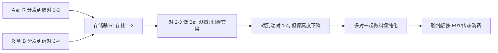

# $\rm Chapter \, 7$ 量子网络与中继

> **本章假设你已经会**
>
> 1. 四个 Bell 态，以及用 CNOT 造纠缠的两步电路（《量子力学》§8.4.2）；本册 §4.2 对三比特做过的 CNOT 加测量。
> 2. 隐形传态的资源账：一个纠缠对加两个经典比特加一次局域修正，搬一个未知态（§4.2、§4.3）。
> 3. 第 4 章留下的欠条：线性光学的 Bell 测量最多分辨四个 Bell 态中的两个，成功率上限 $50\%$，「工程账归第 7 章」（§4.5 第 5 条）。
> 4. 密钥率-距离账：率 $\propto\eta$ 的一次方定律、暗计数地板、诱骗态口径下 ${235}$ km 的截止距离（§6.4、§6.5）。
> 5. 安全率红线：每筛选比特 ${r=1-2h(q)}$ 在 QBER 约 ${11\%}$ 处归零（§2.6）。

第 6 章把直连 QKD 的墙量了出来：率随距离指数缩水，暗计数地板不动，几百公里处两者合围。本章处理墙外的事。核心动作只有一个：不再让光子跑全程，而是分段分发纠缠对，用纠缠交换把短的接成长的，用纠缠纯化把不纯的换成更纯的，用量子存储器把时间上对不齐的两段攒齐。三样部件合起来叫量子中继（quantum repeater）。本章先把交换的电路推完（§7.2），再算两本账：分段损耗账回答「指数的斜率为什么能砍半」（§7.3），纯化与退相干账回答「攒齐两段要等多久、等多久还划算」（§7.4、§7.5），全部数字在 §7.6 对账。

## $\rm \S \, 7.1$ 经典中继器的死路与任务的重新表述

经典网络修长距离的办法是中继器：信号走一段，读出来，再生放大，转发下一段。这套动作对量子态一步都做不得。读出来就是测量，测量就塌缩（§1.2），叠加里携带的信息当场蒸发；再生就是按读数重造，而重造一份与原来等价的未知态正是不可克隆定理禁止的事（§1.3）。所以量子网络里没有「读出-再生」式中继器，这不是器件做不够好，是物理把这条路封死了。

出路在于重新看任务。回看前几章消耗的东西：E91 的密钥原料是纠缠对（§3.2），隐形传态的原料是一个纠缠对加两比特（§4.2），超密编码的原料还是纠缠对（§5.2）。也就是说，量子通信真正要在两点之间建立的不是「一条能跑未知态的实时信道」，而是「一批事先验过纯的纠缠对」。纠缠对可以分段分发：A 到中继站发一段，中继站到 B 发一段，两段各自只需扛住一半距离的损耗。剩下两个问题：两段短纠缠怎么接成一段长的（§7.2），接出来不纯怎么办（§7.4）。段与段在时间上对不齐，还得有个地方先存着，这就是量子存储器（§7.5），第 5 章说过它是超密编码的工程命门（§5.9 第 2 条），在中继里它升格为主角。



图的读法自上而下：两条分发线各自反复尝试，直到存储器里同时攒住两对，交换才发生；纯化在消费之前把保真度抬到可用线以上，验纯（第 3 章那类统计抽测）是最后一道关。

> 本节小结：测量塌缩与不可克隆封死经典式中继；任务改写为分段建立纠缠对；四个部件是分段分发、存储、交换、纯化。

## $\rm \S \, 7.2$ 纠缠交换：把两段短的接成一段长的

设 Alice 与中继站 R 之间已经建好纠缠对 ${1,2}$（1 在 Alice 手里，2 在 R 手里），R 与 Bob 之间建好对 ${3,4}$（3 在 R 手里，4 在 Bob 手里）。纠缠交换（entanglement swapping）断言：R 对自己手里的 2、3 号粒子做一次贝尔态测量（Bell-state measurement，BSM），测量后 1 号和 4 号——从未谋面、相隔全程的两颗粒子——塌缩成一对纠缠。推导只需要把初态换一组基展开。记四个 Bell 态为 $\lvert\Phi^{\pm}\rangle$、$\lvert\Psi^{\pm}\rangle$，把两段纠缠都取 $\lvert\Phi^{+}\rangle$，按 ${2,3}$ 与 ${1,4}$ 的配对展开：

$$
\lvert\Phi^{+}\rangle_{12}\lvert\Phi^{+}\rangle_{34}
=\frac{1}{2}\sum_{i}\lvert B_{i}\rangle_{23}\lvert B_{i}\rangle_{14}
$$

读法：右边对四个 Bell 态求和，每个 Bell 态的「前半」标在 ${2,3}$ 上、「后半」标在 ${1,4}$ 上。验证办法是把两边都摊成计算基：左边摊开是 $\frac{1}{2}\bigl(\lvert0000\rangle+\lvert0101\rangle+\lvert1010\rangle+\lvert1111\rangle\bigr)$（比特序为 ${1,2,3,4}$），右边用 $\lvert\Phi^{+}\rangle\lvert\Phi^{+}\rangle$ 与 $\lvert\Phi^{-}\rangle\lvert\Phi^{-}\rangle$ 的交叉项相消、$\lvert\Psi^{+}\rangle\lvert\Psi^{+}\rangle$ 与 $\lvert\Psi^{-}\rangle\lvert\Psi^{-}\rangle$ 同理，恰好剩下同样四项。

于是 BSM 的每个结局 ${B_{i}}$ 对应一个确定的坍缩：测得 ${B_{i}}$，${1,4}$ 号就是 $\lvert B_{i}\rangle$。测得 $\lvert\Phi^{+}\rangle$ 时端到端对直接可用；其余三个结局套上第 4 章的修正帽即可——结局 $\lvert\Phi^{-}\rangle$ 对 4 号补 $Z$、$\lvert\Psi^{+}\rangle$ 补 $X$、$\lvert\Psi^{-}\rangle$ 补 ${ZX}$，修正表与 §4.2 的四顶帽子一一对应。R 手里测得的结局是两比特经典信息，广播给 Alice 与 Bob 好让他们知道该套哪顶帽；这两比特走经典信道，快慢只影响等待、不影响安全（§4.3 的账原样适用）。这套电路就是隐形传态原封不动地用在半边纠缠上：被「传」的是 1 号粒子的态，收货的是 4 号（§4.2 的承诺在此兑现）。两点值得按全册的心智模型核对。不可仿：BSM 是一次联合测量，2、3 号粒子在坍缩中销毁，全程没有任何环节产出第二份纠缠。不可偷：1、4 号从未踏上长信道，Eve 能碰的只有两段短程分发，她能做的是把各段的保真度拉低，这正是 §7.4 要治的病。

交换本身有代价。线性光学做不出完整的 BSM：四个 Bell 态最多分辨两个（§4.5 第 5 条），所以每次交换的成功概率至多一半，失败轮丢弃重试。还有一处容易误会：交换不会让 1、4 号粒子飞过全程——粒子始终待在原地，动起来的只有两比特经典消息。「接成一段长的」接的是纠缠关联，不是粒子。还有第 5 章欠的总账在此对一次：那里说纠缠是超密编码与传态共同的原料、原料要靠量子信道预先分发（§5.5 末）。本章把「分发」拆成了分段加交换：量子信道只跑每一段短的，段与段之间靠 BSM 加两比特经典消息接力，资源链闭合。

> 本节小结：展开恒等式给出 BSM 结局与端到端 Bell 态的一一对应，其余结局套修正帽；交换是传态用在半边纠缠上，销毁原件、不造副本；线性光学下单次交换成功至多 $1/2$。

## $\rm \S \, 7.3$ 分段损耗账：指数的斜率砍半

先立口径。全长 $L$ 公里分两段，每段长 $L/2$；每个时隙（时长 $\tau$）每段独立尝试分发一次纠缠对，单段单时隙成功概率 $p=\eta(L/2)=10^{-\alpha L/20}$（透过率公式照 §6.4）。直连口径是每时隙对全长尝试一次，成功概率 $\eta(L)=10^{-\alpha L/10}$。

最自然的疑问：分两段各试各的，合起来不还是一样难吗？没有存储器时确实一样：两段必须在同一时隙各成功一次，概率是

$$
p^{2}=\eta^{2}(L/2)=\eta(L)
$$

与直连逐点相等（§7.6 的脚本逐位验证过）。这说明分段本身一文不值，值钱的是报知（heralding）：每段分发成功与否，段内当场就知道——探测到了就是成功，没探测到就再来一轮。配上报知加存储器，两段就不必在同一时隙命中：哪段先成功就先存起来，等另一段。设两段的首成功时隙为 ${T_{A},T_{B}}$，各自服从几何分布 $P(T>t)=(1-p)^{t}$，端到端对在第 $\max(T_{A},T_{B})$ 个时隙成型。期望等待：

$$
\mathbb{E}[\max]=\sum_{t\ge0}P(\max>t)
=\sum_{t\ge0}\Bigl[2(1-p)^{t}-(1-p)^{2t}\Bigr]
=\frac{2}{p}-\frac{1}{p(2-p)}
$$

读法：$\max$ 超过 $t$ 等价于至少一段没在 $t$ 前成功，两段独立给出平方展开的两项；求和用 $\sum_{t\ge0}(1-p)^{t}=1/p$ 与 $\sum(1-p)^{2t}=1/\bigl(p(2-p)\bigr)$。小 $p$ 时 $\mathbb{E}[\max]\approx1.5/p$：两段并行，期望等待只比单段多一半。于是中继的端到端速率是每时隙 $1/\mathbb{E}[\max]\propto p\propto10^{-\alpha L/20}$：直连的指数斜率 $-\alpha/10$ 被砍成 $-\alpha/20$。损耗每多三个 dB，直连掉一个量级、中继掉半个。

| $L$（km） | 单段 $p$ | $\mathbb{E}[\max]$（模拟/解析） | 中继速率/时隙 | 直连速率/时隙 |
| --- | --- | --- | --- | --- |
| ${60}$ | ${0.251}$ | ${5.685\ /\ 5.686}$ | ${1.76\times10^{-1}}$ | ${6.31\times10^{-2}}$ |
| ${80}$ | ${0.158}$ | ${9.186\ /\ 9.193}$ | ${1.09\times10^{-1}}$ | ${2.51\times10^{-2}}$ |
| ${100}$ | ${0.100}$ | ${14.74\ /\ 14.74}$ | ${6.79\times10^{-2}}$ | ${1.00\times10^{-2}}$ |
| ${120}$ | ${0.063}$ | ${23.51\ /\ 23.52}$ | ${4.25\times10^{-2}}$ | ${3.98\times10^{-3}}$ |

模拟斜率 ${-0.01028}$ 对理论 ${-0.01000}$，直连 ${-0.02000}$ 分毫不差（§7.6）。表里还能看到中继的优势随距离拉开：${60}$ km 处速率只比直连快 ${2.8}$ 倍，${120}$ km 处已是 ${10.7}$ 倍——直连的 $\eta(L)$ 在掉，中继的 $\eta(L/2)$ 掉得慢。按模型外推到 ${800}$ km：直连每时隙 $10^{-16}$，中继的单段概率 $10^{-8}$、速率量级 $\frac{2}{3}\times10^{-8}$，相差八个十进制量级。这是模型推演的账，参数只有 $\alpha=0.2$ dB/km 一条；但它说清了中继的原理性收益不在「信号更强」，而在指数的指数上。

白话：直连是一辆车必须一次跑完全程，全程任何一公里出事都重来；中继是分段接力，每段各自反复发车，存住了就不撒手，两段都到库再拼车。拼车的代价是仓库要保鲜，下一节算保鲜费。

> 本节小结：无存储两段 $p^{2}=\eta(L)$ 与直连全等；报知加存储后速率 $\propto\eta(L/2)$，指数斜率砍半；${800}$ km 处模型推演差八个量级。

## $\rm \S \, 7.4$ 纠缠纯化：两对换一对更好的

交换把不纯也接了进去。每段分发都过噪声信道，保真度 $F<1$；交换是把两段的噪声卷在一起。所以要有一道工序：消耗两对保真度 $F$ 的纠缠对，换出一对保真度更高的。这就是纠缠纯化（entanglement purification），本节推最经典的一步（BBPSSW 方案，Bennett 等四人 1996 提出；DEJMPS 变体随后）。

噪声模型用 Werner 态（Werner state）：把退相干后的纠缠对写成

$$
\rho_{W}=F\lvert\Phi^{+}\rangle\langle\Phi^{+}\rvert+\frac{1-F}{3}\Bigl(\mathbb{1}-\lvert\Phi^{+}\rangle\langle\Phi^{+}\rvert\Bigr)
$$

读法：$F$ 是测出 $\lvert\Phi^{+}\rangle$ 的概率，剩下的 $1-F$ 平均摊给另外三个 Bell 态，每个占 $x=(1-F)/3$。$F=1$ 是纯纠缠，$F=1/4$ 时四项等权，退化为完全混态（§4.3 出现过的 $\mathbb{1}/2$ 的两比特版本）。Werner 假设说：噪声不偏爱哪个出错方向。这假设不总成立，§7.7 回头算账。

纯化电路：两对 Werner 态并排，编号 ${1,2}$ 与 ${3,4}$（1、3 为 Alice 持有，2、4 为 Bob 持有）。两人各对自己的粒子做一次 CNOT（1 控 2、3 控 4，称双边 CNOT），然后把 2、4 号一起测 $Z$ 基，**结局相等（00 或 11）才算成功**，幸存者是 ${1,2}$ 对。为什么这样能提纯？把 $\rho_{W}\otimes\rho_{W}$ 按「对 1 是哪个 Bell 态、对 2 是哪个 Bell 态」摊开，共 16 项，逐组看结局：

| 输入（对 1, 对 2） | 权重 | 结局相等？ | 幸存者与 $\lvert\Phi^{+}\rangle$ 的重合 |
| --- | --- | --- | --- |
| $(\Phi^{+},\Phi^{+})$ | $F^{2}$ | 必然 | $\Phi^{+}$，完美 |
| $(\Phi^{+},\Phi^{-})$ 与 $(\Phi^{-},\Phi^{+})$ | ${2Fx}$ | 必然 | $\Phi^{-}$，作废 |
| $(\Phi^{-},\Phi^{-})$ | $x^{2}$ | 必然 | $\Phi^{+}$，完美 |
| 四组 $(\Psi^{\pm},\Psi^{\pm})$ | $4x^{2}$ | 必然 | $\Psi$ 型，作废 |
| 跨块 8 组（一 $\Phi$ 一 $\Psi$） | $4Fx+4x^{2}$ | 从不相等 | 整轮失败 |

读法：Bell 态分两块，$\{\Phi^{+},\Phi^{-}\}$ 是 00/11 相关块，$\{\Psi^{+},\Psi^{-}\}$ 是 01/10 相关块；双边 CNOT 把「同块」输入送进相等结局、把「跨块」输入送进相异结局，而幸存者的 $\Phi/\Psi$ 身份由两对输入的乘积决定（$\Phi^{-}\otimes\Phi^{-}$ 的两个负号相乘回正，这半行值得自己摊开验一遍）。于是成功概率与幸存者保真度：

$$
P_{\mathrm{suc}}=F^{2}+2Fx+5x^{2},\qquad
F'=\frac{F^{2}+x^{2}}{F^{2}+2Fx+5x^{2}}
$$

读法：分子里 $F^{2}$ 与 $x^{2}$ 来自表中两行「完美」；分母把全部成功权重加齐。两个结局都保留是合法的：00 与 11 两支幸存者都是 $\Phi$ 型（11 支至多差一个已知相位），所以相对「只留 00」的口径，产额翻倍、保真度不变。代 $F=1/2$ 进 $F'=F$ 恰好成立：$F=1/2$ 是不动点，$F$ 高于它每步抬升、低于它每步下坠——纯化救不了已经坏过半的纠缠。$F_{0}=0.6$ 出发的阶梯在 §7.6：六步走到 ${0.779}$，累计成功概率只剩 ${0.078}$，保真度是拿产额换的。

DEJMPS 变体（Deutsch 等，1996）在 CNOT 前对其中一对加一次双边基旋转，把相位错误翻成可区分的结局，映射为 $\lambda_{0}'=(\lambda_{0}^{2}+\lambda_{3}^{2})/N$、$N=(\lambda_{0}+\lambda_{3})^{2}+(\lambda_{1}+\lambda_{2})^{2}$（$\lambda$ 为 Bell 基谱）。对上式的对称 Werner 输入，$N=F^{2}+2Fx+5x^{2}$、分子 $F^{2}+x^{2}$，与上表逐点重合——§7.6 有数值断言。它的真正收益在两对误差不均匀（相位错误为主的非对称输入）时，那是中继实际会遇到的情形，本书不展开。

顺带记一笔不纯化的账：两对 Werner 态直接交换，端到端保真度是 $F^{2}+3x^{2}$。读法：四对「同号」输入（$\Phi^{+}\Phi^{+}$、$\Phi^{-}\Phi^{-}$、$\Psi^{+}\Psi^{+}$、$\Psi^{-}\Psi^{-}$）经 BSM 的恒等结局都回到 $\Phi^{+}$（Bell 态对应的 Pauli 对自乘回单位元），其余输入掉进误差或失败；权重相加得 $F^{2}+3x^{2}$。§7.9 第 3 题要用它。

白话：纯化像两对里做一次联合抽检，赌出一对更好的，赌输了整对扔掉；赢了的那对更纯，但你手上的存货也更少了。

> 本节小结：Werner 态用 $F$ 与 $x=(1-F)/3$ 记账；双边 CNOT 加相等结局筛出 $(\Phi^{+},\Phi^{+})$ 与 $(\Phi^{-},\Phi^{-})$ 两组好货，${P_{\mathrm{suc}}=F^{2}+2Fx+5x^{2}}$、${F'=(F^{2}+x^{2})/P_{\mathrm{suc}}}$；$F=1/2$ 是分水岭；DEJMPS 在对称输入下与它重合。

## $\rm \S \, 7.5$ 存储退相干：等待的账

分段接力有一笔新账：先成功的对要在存储器里等另一段，等待期间它在退相干。设单个存储器的相位相干时间是 $T_{2}$（退相干时间，coherence time），两颗粒子各自的相位漂移相乘，Bell 态的相干因子按 $\gamma(t)=e^{-2t/T_{2}}$ 衰减。存了 $t$ 之后，对的状态退化为 $\Phi^{+}$ 与 $\Phi^{-}$ 的混合：

$$
F(t)=\frac{1+\gamma(t)}{2},\qquad
Q(t)=\frac{1-\gamma(t)}{4}
$$

读法：$F(t)$ 是测出 $\Phi^{+}$ 的份额；误码 $Q(t)$ 来自 $\Phi^{-}$ 份额——去相位模型下它在 $Z$ 基零错、在 $X$ 基全错（反关联），两基各占筛选比特一半，平均误码 $(1-F(t))/2=(1-\gamma)/4$。这是模型推演（§7.6 逐档对过账），真实存储器还有别的退化通道。

红线沿用 §2.6：$Q\le0.11$。解出 $\gamma\ge0.56$，即 $t\le0.29\,T_{2}$：存储器只允许你用到相干时间的三成。和 §7.3 的等待时间拼起来，约束是

$$
\frac{3-2p}{p(2-p)}\cdot\tau\;\le\;0.29\,T_{2}
$$

左边是 $\mathbb{E}[\max]$ 个时隙乘时隙时长。给定 $\tau$ 与 $T_{2}$，解出最小可行 $p$，再换算成最大中继距离（两段各 $L/2$）：

| $T_{2}$ | $1$ ms | $10$ ms | $100$ ms | $1$ s | $10$ s |
| --- | --- | --- | --- | --- | --- |
| $L_{\max}$（km） | ${33}$ | ${129}$ | ${229}$ | ${329}$ | ${429}$ |

参数 $\tau=100\ \mu\mathrm{s}$：这是分发尝试重复率的工程上限量级（探测器恢复时间与段内经典确认往返决定，经验规则）。规律干净：$T_{2}$ 每多一个量级，$L_{\max}$ 多 ${100}$ km。表格反过来读就是选型工具：给定目标距离，反推出所需的最低相干时间，存储器的指标从此有了账面依据。按同一本账倒推 ${800}$ km：单段 $p=10^{-8}$，期望等待 $1.5\times10^{8}$ 个时隙即 $1.5\times10^{4}$ 秒，要求 $T_{2}$ 不小于 $5.2\times10^{4}$ 秒，约十四个小时（模型推演）。

存储器现状给这串数字一个落点（文献量级的概述，非本章实测）：离子阱存储器相干时间可到秒级以上，原子系综与固态色心多在微秒到毫秒级，通信波段的光-原子接口典型毫秒级。对照上表：秒级存储器把双段中继推到三百多公里，离八百公里还差四个量级的 $T_{2}$。这就是「存储器现状」的账面位置——不是没有存储器，是等待时间比相干时间长太多。

白话：接力赛的仓库是块冰，第二棒迟迟不到，冰就在化；化到相干性剩不下六成，这对纠缠就过不了 §2.6 的红线，白存。

> 本节小结：Bell 相干按 $e^{-2t/T_{2}}$ 衰减，$F(t)=(1+\gamma)/2$、$Q(t)=(1-\gamma)/4$；红线给 $t\le0.29\,T_{2}$；$\tau=100\ \mu\mathrm{s}$ 时 $T_{2}$ 每加一个量级多 ${100}$ km，${800}$ km 需 $T_{2}\approx14$ 小时（模型推演）。

## $\rm \S \, 7.6$ 实测：三本账对账

上面的数字全部出自同一个脚本。环境为 WSL 里的 python3 加 numpy（实验环境 numpy 2.5.4），脚本与全部输出存于 `26Fall/_uni5_work/expQI07/`，随机数种子固定为 ${20261109}$，任何人重跑得到同一串数字。复现命令如下。

```bash
# 环境: WSL 的 Bash; 前置: python3 与 numpy; 脚本只读自身代码, 输出走标准输出
cd /mnt/c/Users/20811/Desktop/26Fall/_uni5_work/expQI07
python3 expQI07.py    # stdout 即随附 result.txt; 种子固定, 重跑逐位一致, 总耗时约 1 秒
```

成功验证：末行打印「断言全部通过」，三段实验 E1 至 E3 齐全；所有布尔断言（逐点相等、偏差阈值、映射重合）逐个复查。§7.3 的速率表与 §7.5 的两张表来自脚本输出，这里补充各自的断言细节。

E1 分段损耗账。四个距离各 ${2\times10^{5}}$ 次试次模拟 $\max(T_{A},T_{B})$，与解析式 $\frac{2}{p}-\frac{1}{p(2-p)}$ 对账，最大相对偏差 ${0.070\%}$（${L=80}$ km 档）；模拟速率拟合斜率 ${-0.01028}$ 每公里，落在理论值 $-\alpha/20={-0.01000}$ 的蒙特卡洛噪声内，直连拟合 ${-0.02000}$ 与 $-\alpha/10$ 精确一致；无存储两段的 $p^{2}$ 与直连 $\eta(L)$ 逐点相等在机器精度内成立。三条结论对应 §7.3 的三个断言：分段要配报知才值钱、斜率砍半、等待只多一半。

E2 纯化账。解析递推与四量子比特密度矩阵的精确演化（双边 CNOT、投影、偏迹全在脚本里）双来源对账，六个 $F$ 档最大偏差 ${5.6\times10^{-16}}$；DEJMPS 映射在对称 Werner 输入下与等结局口径逐档重合（偏差 $<10^{-12}$，有断言）。阶梯从 $F_{0}=0.6$ 出发：六步后 $F={0.779045}$，累计成功概率 ${0.077850}$，每一步的解析值与密度矩阵值都单独对过。

E3 退相干账。构造 $\Phi^{+}/\Phi^{-}$ 混合态，四个 $t/T_{2}$ 档的 $F(t)$ 与 $Q(t)$ 解析值对密度矩阵测量值偏差 $<10^{-12}$；红线方程 $\gamma\ge0.56$ 解出 $t_{\max}=0.2899\,T_{2}$，可达距离表由数值解二次方程得出，${800}$ km 需 $T_{2}\ge5.17\times10^{4}$ 秒。明细与汇总的口径也分开：E1 的斜率由模拟速率拟合而非解析式套现，E3 的距离用精确二次方程解而非 $1.5/p$ 近似，正文里的近似式只是帮助读数。

> 竞赛生迁移提示：本章 E1、E3 两段账里没有叠加与振幅，只剩概率与计数，numpy 向量化就是终点；只有 E2 的纯化需要态级模拟——一个 $16\times16$ 的密度矩阵加三次矩阵乘法。判断工具的标尺和第 6 章一致：账面上还剩不相干性吗。

白话：E1 验接力、E2 验换货、E3 验冰块；三段账各自的解析式与独立来源逐位对上，种子 ${20261109}$ 可复现。

> 本节小结：等待账模拟与解析最大偏差 ${0.070\%}$，斜率砍半被模拟证实；纯化解析与密度矩阵演化最大偏差 ${5.6\times10^{-16}}$；退相干对账偏差 $<10^{-12}$；全部断言通过。

## $\rm \S \, 7.7$ 适用条件与限制

1. 两段是最小教学规模。实用中继用四段、八段的嵌套结构，存储、纯化与交换交织调度，成功概率的连乘让率的账比本章低不少；本章没有把交换的 $1/2$ 上限与纯化的 $P_{\mathrm{suc}}$ 乘进速率表，那些是下一层罚单。
2. Werner 假设。真实信道的噪声偏爱特定出错方向（第 6 章的失准率就是一例）；DEJMPS 类协议的优势恰恰在非对称输入，本章只在对称 Werner 输入上验证了与 BBPSSW 等结局口径的重合。
3. 退相干模型是去相位简化。真实存储器还有激发态弛豫、模式失配、读出效率等通道，$Q(t)$ 的形状会变；红线沿用 §2.6 的渐近口径，有限码长还要再打折。
4. 分段账里没有暗计数。§6.4 的暗计数地板在每一段照旧发生，长段尤其吃亏；把两本账叠起来是实用的方向，机制结论（斜率砍半、等待约束）不受影响。
5. 验纯默认已做。进纯化与交换的对默认过了第 3 章那类统计抽测（E91 的 CHSH 检验，§3.5）；验纯只能剔除坏对，不能提升留下的对的保真度。
6. 所有距离-速率数字是模型推演：参数 $\alpha$、$\tau$、$T_{2}$ 取文献量级典型值，回答「机制把账压到哪」，不是某台仪器的实测。

## $\rm \S \, 7.8$ 关键概念回顾

1. 经典中继器的「读出」与「再生」各死于哪条定律？为什么把任务改写成「建立端到端纠缠」就能绕开它们？
2. 写出纠缠交换的展开恒等式。BSM 的四个结局各对应端到端哪个态、套哪顶修正帽？线性光学下单次交换的成功上限为什么是 $1/2$？
3. 没有存储器时两段的成功概率为什么恰好等于直连？引入报知与存储后，$\mathbb{E}[\max]$ 的精确式与 $p$ 很小时的近似式各是什么，速率的指数斜率怎么变？
4. 纯化电路的 16 项输入分成哪五组？成功概率 $P_{\mathrm{suc}}$ 与分子 $F^{2}+x^{2}$ 各由哪几组贡献？$F=1/2$ 的不动点是怎么验证的？
5. Bell 相干为什么按 $e^{-2t/T_{2}}$ 而不是 $e^{-t/T_{2}}$ 衰减？从 $Q(t)\le0.11$ 到 $t_{\max}=0.29\,T_{2}$ 中间有哪几步？

## $\rm \S \, 7.9$ 应用与辨析

1. 四段中继（三个中继站）时，单段长 $L/4$。用 $\mathbb{E}[\max]\approx1.5/p$ 的近似，写出端到端速率的指数斜率，并算 ${1600}$ km 处直连与四段中继的数量级差（模型推演）。
2. 同事说：「中继站和路由器一样，把量子态读出来检查一遍再转发下一段就行。」指出这句话错在哪两处，并按 §7.1 与 §7.2 的机制链重述中继站实际做的事。
3. 两对 $F=0.8$ 的 Werner 态：直接交换（端到端保真度是 $F^{2}+3x^{2}$，可按 §7.4 的乘积逻辑推出），或先各纯化一步再交换。两条路的端到端保真度各是多少？各付出什么代价？

## $\rm \S \, 7.10$ 本章自测答案

概念回顾答案：

1. 读出死于测量塌缩（§1.2），叠加里的信息当场蒸发；再生死于不可克隆定理（§1.3），按读数重造等价副本被线性性禁止。改写成建立纠缠后，量子信道只需在每段短程上分发「同一批对」的成员，分发质量用 §2.3 的指纹与 §7.4 的纯化管理，全程没有「复制未知态」的环节（§7.1）。
2. 恒等式 $\lvert\Phi^{+}\rangle_{12}\lvert\Phi^{+}\rangle_{34}=\frac{1}{2}\sum_{i}\lvert B_{i}\rangle_{23}\lvert B_{i}\rangle_{14}$（§7.2）。结局 $\Phi^{+}$ 免修正，$\Phi^{-}$ 补 $Z$、$\Psi^{+}$ 补 $X$、$\Psi^{-}$ 补 ${ZX}$，全打在 4 号上（§7.2）。线性光学分辨不出四个 Bell 态（§4.5），成功结局至多占一半，故上限 $1/2$（§7.2）。
3. 无存储时两段必须同隙成功，$p^{2}=\eta^{2}(L/2)=\eta(L)$，与直连在机器精度内相等（§7.3）。$\mathbb{E}[\max]=\frac{2}{p}-\frac{1}{p(2-p)}$，小 $p$ 时 $\approx1.5/p$（§7.3）。速率 $1/\mathbb{E}[\max]\propto p=\eta(L/2)$，斜率从 $-\alpha/10$ 变 $-\alpha/20$（§7.3）。
4. 五组：$(\Phi^{+},\Phi^{+})$、混合符号 $\Phi$ 对两组、$(\Phi^{-},\Phi^{-})$、四组 $\Psi$ 对、跨块八组（§7.4）。$P_{\mathrm{suc}}$ 由全部同块组贡献（$F^{2}+2Fx+5x^{2}$），分子 $F^{2}+x^{2}$ 只由首尾两个「完美」组贡献（§7.4）。把 $F=1/2$（$x=1/6$）代入 ${F'}$，得 $F'=10/20=1/2$，即不动点；$F>1/2$ 的六个档在 §7.6 全部抬升（§7.4）。
5. 两颗粒子各有相位漂移，Bell 态的相干因子是两者之积（§7.5）。$Q(t)=(1-\gamma)/4$ 来自 $\Phi^{-}$ 份额在 $X$ 基全错、两基各半（§7.5）；令 $(1-\gamma)/4\le0.11$ 得 $\gamma\ge0.56$，取对数得 $t\le\frac{T_{2}}{2}\ln\frac{1}{0.56}=0.29\,T_{2}$（§7.5）。

应用与辨析答案：

1. 单段 $p=\eta(L/4)=10^{-\alpha L/40}$，端到端速率 $\propto p$，斜率 $-\alpha/40$ 每公里（§7.3 的推论）。${1600}$ km 处直连 $\eta=10^{-32}$，单段 $10^{-8}$，数量级差 $\frac{\alpha L}{10}-\frac{\alpha L}{40}=24$ 个量级（§7.3）。代价是三台中继站、三份存储等待与更多次交换的 $1/2$ 罚单。
2. 两处错。其一，读出即测量即塌缩，叠加信息蒸发，重发出来的不是原态（§7.1）；其二，就算不塌缩，重造副本违反不可克隆（§7.1）。中继站实际做的：持有两段纠缠的半边，对自己手上两颗粒子做 BSM（§7.2），结局广播两比特经典消息，Bob 据此套修正帽；全程没有未知态经过中继站，站上只有坍缩与经典比特（§7.2）。
3. 直接交换：$x=0.0667$，端到端 $F^{2}+3x^{2}={0.653}$；先纯化：$F'=0.838$（§7.6 数值），$x'=0.0540$，交换后 $F^{2}+3x^{2}={0.711}$（§7.4、§7.9）。纯化路径保真度更高，代价是成功率：纯化一步 $P_{\mathrm{suc}}=0.769$，交换本身至多 $1/2$，两步的产额都打了折（§7.4）。

**你现在能做什么**：合上文件，从 $\lvert\Phi^{+}\rangle_{12}\lvert\Phi^{+}\rangle_{34}$ 的展开式出发，说出 BSM 测得 $\lvert\Psi^{+}\rangle$ 时 1、4 号粒子塌缩成什么、Bob 要补哪顶帽子。

中继把「传得不可偷不可仿」从百公里推到了原理上不封顶的距离，代价是存储器要扛住漫长的等待。但即便中继造出来，它改变的也只是密钥与纠缠的生产方式；另一条防线根本不走量子信道——把数学难题换一副更抗量子的骨架。下一章讲后量子密码，与量子通信同台收束。

---

实验记录：本章 §7.3 与 §7.6 全部数字来自脚本 `expQI07.py`（分段损耗蒙特卡洛与斜率拟合、四量子比特密度矩阵纯化对账与阶梯、退相干 $F(t)/Q(t)$ 对账与可达距离表；python3 加 numpy，种子 ${20261109}$，WSL 运行，总耗时约 1 秒）。其中速率-距离与存储-距离两本账为模型推演（参数取典型值），非仪器实测；等待时间、纯化保真度、退相干对账为蒙特卡洛或密度矩阵精确计算。原始输出存于写作工作目录 `26Fall/_uni5_work/expQI07/result.txt`，重跑可逐位复现表中数字。
